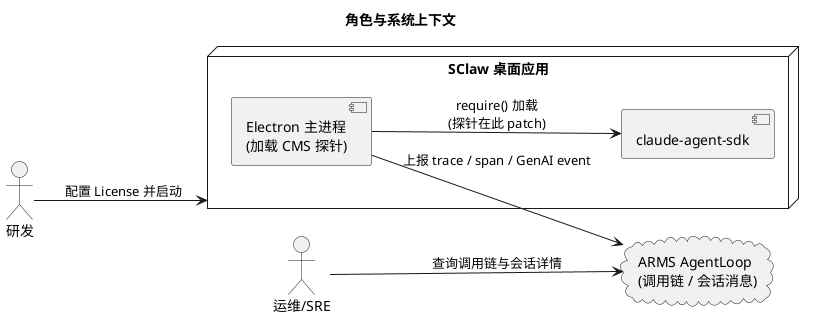
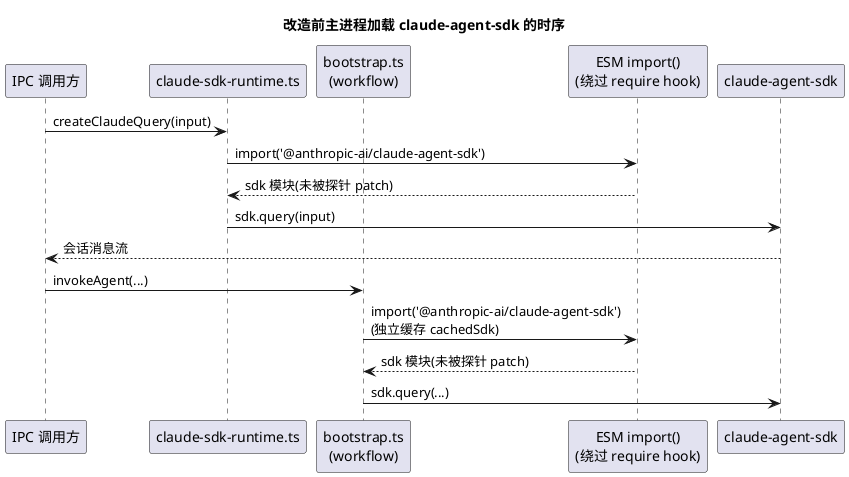
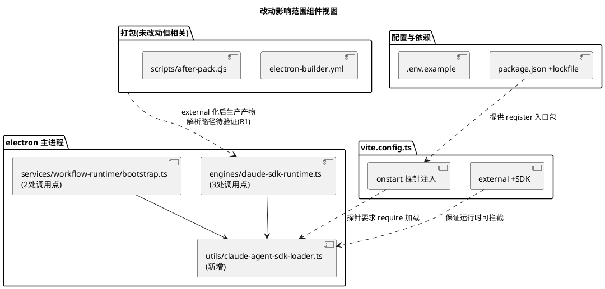

# ARMS AgentLoop 探针接入系统分析文档

> 分析对象：分支 `feat/arms-claude-agent-sdk`（相对 main 含 1 个提交 `9383d805`）
> 分析日期：2026-09-05
> 证据来源：`git show 9383d805`、`vite.config.ts`、`electron/utils/claude-agent-sdk-loader.ts`、`electron/engines/claude-sdk-runtime.ts`、`electron/services/workflow-runtime/bootstrap.ts`、`electron-builder.yml`、`scripts/after-pack.cjs`、`package.json`、`.env.example`

## 1. 需求背景

### 1.1 背景与问题

SClaw 是基于 Electron 的桌面 AI Agent 客户端，主进程通过 `@anthropic-ai/claude-agent-sdk`（版本 `^0.3.168`，见 `package.json:91`）驱动 Claude Agent 会话。团队需要将该运行时接入阿里云 ARMS AgentLoop 可观测平台，采集 Agent 会话的调用链（trace/span）、模型调用明细和会话消息，用于线上问题排查与效果分析。

接入采用龙蜥社区（LoongSuite）的 `@loongsuite/cms_node_sdk` 探针，工作模式为 Node.js 的 `--require`（`-r`）预加载注册：探针通过 `InstrumentationNodeModuleDefinition` 挂钩模块加载过程，在 `claude-agent-sdk` 被 `require` 时对其 `query()` 等入口打补丁，生成 `claude_agent` 相关 span。

首次接入尝试暴露出两个阻塞问题：

1. **采集不到 span**：主进程通过 Vite 打包，业务代码中对 SDK 使用动态 `import()` 加载（ESM 通道），完全绕过 Node 的 require hook，探针无法 patch，ARMS 后台没有任何 `claude_agent` span。
2. **打包后代码不可 patch**：即使改用 require，Vite/Rollup 会把 SDK 源码内联进 `dist-electron/main` 的单文件 bundle（`inlineDynamicImports: true`），打包产物中没有独立的 `node_modules/@anthropic-ai/claude-agent-sdk` 模块可被探针拦截。

此外还有一个工程约束：`NODE_OPTIONS` 若全局设置（如写入 shell 环境），探针会被加载进 `predev` 阶段的 vite、electron-rebuild、zx 等辅助 Node 进程，导致本地开发启动失败（见 `vite.config.ts:48-50` 注释）。

### 1.2 建设目标

- 在 Electron 主进程中上报 Claude Agent 会话调用链至 ARMS AgentLoop，包含 `claude_agent` 自动插桩 span。
- 接入开关完全由环境变量驱动：未配置 License 时探针不加载，对现有开发与打包流程零影响。
- 本地调试可观测：支持 console exporter 输出 span、支持上报会话消息内容（GenAI event）。
- 保持 renderer、preload、openclaw 子进程等其他进程不受影响。

可量化指标与验收口径：在配置 License 后 `pnpm dev` 启动，发起一次 Claude 会话，ARMS AgentLoop 控制台可见该应用的 trace 及 `claude_agent` span（本次分析未能实际联调验证，标记为待确认）。

### 1.3 范围与边界

**范围内：**

- dev 环境（`pnpm dev`，vite-plugin-electron）主进程探针注入与 SDK 加载链路改造。
- `claude-agent-sdk` 在主进程 bundle 中的 external 化。
- 环境变量样例与调试开关文档化（`.env.example`）。
- 新增生产依赖 `@loongsuite/cms_node_sdk ^1.0.8`。

**范围外：**

- 生产安装包（electron-builder 产物）的探针注入 —— 本次未实现，详见 3.10 风险。
- 渲染进程、openclaw 子进程、gateway preload 等其他运行单元的埋点。
- 除 `claude-agent-sdk` 外其他 SDK（`@google/genai`、`@langchain/core`、`mem0ai/oss` 等）的 GenAI 插桩核对。
- ARMS 控制台侧的应用/工作区配置（由接入中心完成，代码仓库不感知）。

### 1.4 角色与业务场景

| 角色 | 场景 |
| --- | --- |
| 研发（本机调试） | 在 `.env.development.local` 配置 License 后启动 `pnpm dev`，验证 span 上报与链路完整性 |
| 测试/QA | 在测试环境验证功能回归：未配置 License 时应用行为与改造前一致 |
| 运维/SRE | 在 ARMS AgentLoop 控制台按应用（`ARMS_APP_NAME`）查询调用链与会话消息 |
| 构建发布 | 确认打包产物在引入 external 化改动后 SDK 运行时解析正常 |



## 2. 目前系统现状

以下“现状”指改造前（main 分支）状态，作为对照基线。

### 2.1 现有业务流程

主进程使用 `claude-agent-sdk` 的链路（改造前）：

1. 渲染进程发起会话/工作流请求，经 IPC 到达主进程。
2. 主进程 `electron/engines/claude-sdk-runtime.ts` 的 `createClaudeQuery()` 准备运行环境（配置目录、账号与模型选择），然后**动态 `import('@anthropic-ai/claude-agent-sdk')`** 加载 SDK 并调用 `sdk.query(input)` 创建会话。
3. 同文件内 `getClaudeSessionMessages()`、`deleteClaudeSdkSession()` 走同一动态 import 路径。
4. `electron/services/workflow-runtime/bootstrap.ts` 维护了自己的另一份 SDK 缓存：`let cachedSdk: any; await import('@anthropic-ai/claude-agent-sdk')`（改造前第 31-35 行），供 `invokeAgent` 等两处调用（`bootstrap.ts:105`、`:151`）。
5. SDK 内部 spawn 平台相关的 CLI 可执行文件（`claude-agent-sdk-win32-x64` 等 optional 包，`asarUnpack` 已配置在 `electron-builder.yml:41-45`）。



### 2.2 现有系统与模块

涉及模块职责（改造前后均存在的部分）：

| 模块 | 职责 |
| --- | --- |
| `vite.config.ts` | vite + vite-plugin-electron 构建配置；dev 时通过 `onstart` 启动 Electron 主进程并注入环境变量 |
| `electron/engines/claude-sdk-runtime.ts` | Claude 运行时准备（`prepareClaudeRuntime`）、会话创建（`createClaudeQuery`）、会话消息读取与删除 |
| `electron/services/workflow-runtime/bootstrap.ts` | 工作流运行时，绑定真实 SDK 的 `query` 执行 `invokeAgent` |
| `electron-builder.yml` + `scripts/after-pack.cjs` | 安装包打包；SDK 平台 CLI 包通过 `asarUnpack` 解出到 `app.asar.unpacked`（`after-pack.cjs:137-177`） |

### 2.3 现有接口与数据

- SDK 加载接口（改造前为模块内私有）：
  - `claude-sdk-runtime.ts` 内 `loadClaudeAgentSdk()`：模块级 `claudeSdkPromise` 缓存的动态 import。
  - `bootstrap.ts` 内 `getSdk()`：模块级 `cachedSdk` 缓存的动态 import。
- 配置数据：`.env.development.local` 等 env 文件经 `loadEnv(mode, process.cwd(), '')` 读取（`vite.config.ts:18`），改造前未定义任何 ARMS 相关变量。
- 打包数据流：`files` 仅含 `dist`、`dist-electron`、`package.json`（`electron-builder.yml:14-17`）；运行时依赖的 `node_modules` 由 electron-builder 依据 `dependencies` 自动收集，平台 CLI 包由 after-pack 脚本按当前平台裁剪复制。

### 2.4 当前问题与约束

1. **P1：动态 import 绕过探针 hook**。`import()` 走 ESM loader，`InstrumentationNodeModuleDefinition` 只拦截 CommonJS `require`，导致 `query()` 从未被 patch。问题发生在 SDK 加载这一步，直接影响所有会话的上报——没有任何 `claude_agent` span 产生。
2. **P1：bundle 内联导致不可 patch**。`inlineDynamicImports: true`（`vite.config.ts:100`）下 SDK 源码被并入主进程单文件，运行时不存在独立模块可拦截。
3. **P2：探针注入面失控风险**。若简单用全局 `NODE_OPTIONS=-r ...` 注入，predev 的 vite/electron-rebuild/zx 进程都会加载探针，本地启动失败。
4. **P2：两处 SDK 加载逻辑重复**。runtime 与 workflow bootstrap 各自缓存 SDK，埋点改造需同时改两处，易遗漏。
5. 约束：renderer/preload 进程与 openclaw 独立子进程不应加载探针；未配置 License 的环境必须零影响。

## 3. 改动方案

### 3.1 方案概述

针对 2.4 的问题逐项改动：

| 现状问题 | 改动 | 预期结果 |
| --- | --- | --- |
| 动态 import 绕过 hook | 新增统一 loader，改用 `createRequire(__filename)` 同步 require 加载 SDK | 模块加载触发探针 patch，产生 `claude_agent` span |
| bundle 内联不可 patch | 主进程 rollup `external` 增加 SDK 精确名 + 子路径正则 | 运行时从 `node_modules` 加载真实模块，可被 hook |
| 探针注入面失控 | 仅在 vite-plugin-electron `onstart` 钩子里向 Electron 主进程 env 注入 `NODE_OPTIONS=-r @loongsuite/cms_node_sdk/register`，且以 License 非空且非 `auto` 为前提 | 探针只进入主进程；辅助脚本不受影响；未配置环境零影响 |
| 两处加载逻辑重复 | runtime 与 bootstrap 统一改为 `loadClaudeAgentSdkAsync()` | 单一加载点，单一缓存，后续维护只改一处 |

方案选择说明（为何 require 而非其他）：

- 探针的插桩机制决定了必须走 CJS require 通道；`register` 模式是 cms_node_sdk 官方接入方式。
- 已验证 `require('@anthropic-ai/claude-agent-sdk')` 在当前依赖版本下可解析（`sdk.mjs` 经 Node ESM-CJS 互操作导出 `query` 等函数），在 Electron 主进程运行时对该路径成立；打包产物中该解析是否仍成立见 3.10 风险 R1。
- 备选方案（`--import` ESM loader hook、OpenTelemetry 手工埋点）未采用：前者依赖 Node/Electron 版本对 ESM hook 的支持且探针侧未提供对应入口，后者改动面大且放弃自动插桩的后续升级红利。

### 3.2 改造后业务流程

```plantuml
@startuml
title 改造后 dev 启动与 SDK 加载时序
actor 研发 as dev
participant "pnpm dev\n(vite)" as vite
participant "onstart 钩子\n(vite.config.ts)" as onstart
participant "Electron 主进程" as main
participant "claude-agent-sdk-loader" as loader
participant "require hook\n(cms_node_sdk)" as hook
participant "claude-agent-sdk" as sdk
cloud "ARMS AgentLoop" as arms

dev -> vite : pnpm dev\n(.env.development.local 含 ARMS_LICENSE_KEY)
vite -> onstart : 构建完成，准备启动主进程
onstart -> onstart : 读取 ARMS_LICENSE_KEY\n非空且非 auto
onstart -> main : startup(env.NODE_OPTIONS=\n"-r @loongsuite/cms_node_sdk/register ...")
main -> hook : 进程启动时预加载 register
main -> loader : createClaudeQuery() /\ninvokeAgent() 触发加载
loader -> hook : require('@anthropic-ai/claude-agent-sdk')
hook -> sdk : 加载并 patch query() 等入口
hook --> loader : 已插桩模块
loader --> main : sdk(单一缓存)
main -> sdk : sdk.query(input)
sdk -> arms : claude_agent span /\nGenAI event(会话消息)
@enduml
```

### 3.3 系统与模块改动

**新增：**

- `electron/utils/claude-agent-sdk-loader.ts`（21 行）：
  - `loadClaudeAgentSdk()`：`createRequire(__filename)` 创建 CJS require，加载 SDK 并以模块级 `cachedSdk` 缓存（单例）。
  - `loadClaudeAgentSdkAsync()`：异步包装，保持调用方原有 `await` 形态不变。
  - 文件头注释明确记录约束：动态 import 会绕过 require hook 导致无 span。
- `package.json` dependencies：`@loongsuite/cms_node_sdk ^1.0.8`（pnpm-lock 已同步）。
- `.env.example` 新增 6 个变量样例：`ARMS_LICENSE_KEY`、`ARMS_APP_NAME`、`ARMS_REGION_ID`、`ARMS_WORKSPACE`、`ARMS_ENABLE_CONSOLE_EXPORTER`、`OTEL_INSTRUMENTATION_GENAI_EMIT_EVENT`（另含 `OTEL_LOG_LEVEL` 调试项与“License 不要用 auto”的注释警示）。

**修改：**

- `vite.config.ts`
  - `onstart`：合并 `process.env` 与 `loadedEnv` 为 `electronEnv`；读取 `ARMS_LICENSE_KEY || ARMS_LICENSE`，合法时把 `-r @loongsuite/cms_node_sdk/register` 前插进主进程 `NODE_OPTIONS`（已含该 flag 则不重复注入）；打印 `[ARMS] CMS probe enabled ...` 日志；license 为 `auto` 时 `console.warn` 提示去 AgentLoop 接入中心取真实 License。
  - 主进程 `rollupOptions.external`：新增 `'@anthropic-ai/claude-agent-sdk'` 与 `/^@anthropic-ai\/claude-agent-sdk/`（覆盖子路径，如平台二进制包引用）。
- `electron/engines/claude-sdk-runtime.ts`：删除私有 `loadClaudeAgentSdk`/`claudeSdkPromise`，三处调用点（`createClaudeQuery`、`getClaudeSessionMessages`、`deleteClaudeSdkSession`）改用 `loadClaudeAgentSdkAsync()`。
- `electron/services/workflow-runtime/bootstrap.ts`：删除私有 `cachedSdk`/`getSdk()` 实现，`getSdk()` 改为委托 `loadClaudeAgentSdkAsync()`，并将返回类型从 `any` 收敛为 `typeof import('@anthropic-ai/claude-agent-sdk')`。

**不变：**

- SDK 的全部业务调用签名（`query`/`getSessionMessages`/`deleteSession`）；renderer、preload 构建配置；openclaw 子进程打包流程；`asarUnpack` 既有规则。
- 其余直接 `import` SDK 的位置均为 `import type`（`claude-binary-gate.ts`、`claude-adapter.ts`、`claude-runtime-extensions.ts`），编译期擦除，不产生运行时加载，无需改动。

**废弃：**

- 两个模块内私有的 SDK 缓存变量与加载函数（见上）。

### 3.4 接口改动

模块内接口（非网络接口）：

| 接口 | 改动 | 说明 |
| --- | --- | --- |
| `loadClaudeAgentSdk()` | 新增 | 同步返回已插桩 SDK 单例 |
| `loadClaudeAgentSdkAsync()` | 新增 | 异步包装；被 4 个调用点使用 |
| `createClaudeQuery(input, diagnostics)` | 内部实现变更 | 签名、返回、时序日志（`sdk_loaded` 等 stage）均不变 |
| `getClaudeSessionMessages(sessionId, cwd)` | 内部实现变更 | 同上 |
| `deleteClaudeSdkSession(sessionId, cwd)` | 内部实现变更 | 同上 |
| `bootstrap.ts getSdk()` | 内部实现变更 | 返回类型由 `any` 收紧为 SDK 类型，调用点无需改 |

环境变量（新增，全部可选）：

| 变量 | 触发条件 | 行为 | 备注 |
| --- | --- | --- | --- |
| `ARMS_LICENSE_KEY`（兼容读取 `ARMS_LICENSE`） | 非空且 ≠ `auto` | 主进程注入探针 | 从 AgentLoop 接入中心获取 |
| `ARMS_APP_NAME` / `CMS_SERVICE_NAME` | 探针启用 | 服务名，缺省日志显示 `unknown` | 探针自身消费 |
| `ARMS_REGION_ID` / `ARMS_WORKSPACE` | 探针启用 | 上报目标地域与工作区 | 探针自身消费 |
| `ARMS_ENABLE_CONSOLE_EXPORTER` | 探针启用 | span 同步打印到主进程控制台 | 本地联调用 |
| `OTEL_INSTRUMENTATION_GENAI_EMIT_EVENT` | 探针启用 | 置 `true` 时上报会话消息内容（用户话术） | 涉内容合规，见 3.7 |
| `OTEL_LOG_LEVEL` | 探针启用 | 探针日志级别，如 `debug` | 调试用 |

错误处理：License = `auto` 仅告警不阻断；License 缺失时不注入，行为与改造前完全一致。探针包未安装但配置了 License 时，主进程将因 `--require` 模块缺失而启动失败——当前无兜底提示，见 3.10 风险 R4。

### 3.5 数据模型与数据处理

不涉及业务数据模型变更。涉及两类“配置数据”和一类“上报数据”：

- 配置数据：上述环境变量，来源为 `.env.development.local`（dev）或进程环境；不落库、不迁移。
- 上报数据：由探针自动采集的 trace/span 与 GenAI event（含会话消息，受 `OTEL_INSTRUMENTATION_GENAI_EMIT_EVENT` 开关控制），通过 OTLP 上报至 `ARMS_REGION_ID` 指定的 ARMS 工作区；应用侧不持久化、不二次加工。
- 历史数据：不涉及。

### 3.6 异常、幂等与一致性

- **幂等**：`NODE_OPTIONS` 注入前检查 flag 是否已存在，重复执行 `onstart`（vite 热重启）不会重复叠加；SDK 加载为模块级单例缓存，并发 `createClaudeQuery` 共享同一实例。
- **探针包缺失**：`pnpm dev` 前未执行 `pnpm install` 且配置了 License → Node 在预加载阶段抛 `Cannot find module '@loongsuite/cms_node_sdk/register'`，主进程无法启动。属于快速失败，但报错信息对非接入人不友好（R4）。
- **License 非法（`auto`）**：降级为警告日志，探针不启用，功能不受影响。
- **上报失败**：探针异步批量上报，网络/ARMS 不可用不影响业务链路（探针 SDK 的一般行为，未在本仓库代码中显式兜底，待联调确认）。
- **一致性**：改造不改变会话数据读写路径；`withClaudeConfigDirEnv` 环境队列逻辑未动。

### 3.7 权限、安全与审计

- `ARMS_LICENSE_KEY` 属于敏感凭证：`.env.example` 中仅放占位样例并注明“写入 `.env.development.local`”；该文件按仓库惯例不入库（`.env.*.local` 属 gitignore 常规项，待确认本仓库 `.gitignore` 已覆盖）。
- `OTEL_INSTRUMENTATION_GENAI_EMIT_EVENT=true` 会把**用户会话消息内容**上报至 ARMS。`.env.example` 已注释说明其用途；启用前需确认：上报内容是否符合公司数据合规要求、ARMS 工作区访问权限是否收敛。默认未开启。
- 探针注入面被刻意限制在 Electron 主进程：不污染 renderer（浏览器环境，无 NODE_OPTIONS）、preload、openclaw 子进程与构建辅助脚本，缩小了凭证与采集面的暴露范围。
- 审计：探针启用时主进程 stdout 打印 `[ARMS] CMS probe enabled (service=...)`，可在 dev 日志中确认注入是否发生。

### 3.8 兼容、迁移与回滚

- **兼容性**：
  - 未配置任何 ARMS 变量的环境与改造前完全一致（零影响面）。
  - `require` 加载对 SDK 调用方透明：导出形态一致（已在本机验证 `require('@anthropic-ai/claude-agent-sdk')` 返回含 `query` 的模块）。
  - external 化后 dev 构建产物中 SDK 变为运行时 `require`，要求 `node_modules` 存在该依赖——dev 场景天然满足。
- **迁移**：无数据迁移。接入步骤：① `pnpm install`（装入探针与锁定版本）；② 在 `.env.development.local` 配置 License 等变量；③ `pnpm dev` 验证控制台出现 `[ARMS] CMS probe enabled`。
- **回滚**：删除/置空 License 变量即关闭探针；代码级回滚为还原提交 `9383d805`，`import()` 路径与 bundle 内联恢复原状，无残留状态。

### 3.9 影响范围



| 维度 | 影响 | 说明 |
| --- | --- | --- |
| 业务流程 | 无 | 会话行为不变 |
| 应用模块 | 3 改 1 增 | 见 3.3 |
| 上下游系统 | 新增 ARMS AgentLoop 上报 | 仅探针启用时 |
| 接口 | 模块内接口 | 见 3.4 |
| 数据 | 无业务变更 | 见 3.5 |
| 权限/安全 | 新增凭证与内容上报开关 | 见 3.7 |
| 兼容性 | 未配置零影响 | 见 3.8 |
| 监控 | 本次即监控接入本身 | ARMS 控制台 |
| 回滚 | 关变量 / 还原提交 | 见 3.8 |

### 3.10 风险与待确认事项

**风险：**

- **R1（高，阻断生产化）**：探针注入仅存在于 vite-plugin-electron 的 dev `onstart`。electron-builder 产物不注入探针；且 external 化后生产 bundle 运行时 `require('@anthropic-ai/claude-agent-sdk')` 的解析依赖 electron-builder 对 `dependencies` 的 node_modules 收集与 pnpm 符号链接结构（`after-pack.cjs` 目前只对 `claude-agent-sdk-*` 平台包做了显式复制与裁剪，主包未见对应处理）。生产环境启用需单独方案（如打包入口首行 `require` register 模块并打包探针依赖），并实测安装包内 SDK 解析。
- **R2（中）**：external 正则 `/^@anthropic-ai\/claude-agent-sdk/` 同时匹配 `claude-agent-sdk-win32-x64` 等平台包。这些包此前已 external（被 `asarUnpack` 引用），本次只是显式化；但需构建一次确认无 “module not found” 回归。
- **R3（中）**：仓库本地 `node_modules` 当前**未安装** `@loongsuite/cms_node_sdk`（lockfile 已含 1.0.8）。配置 License 前必须先 `pnpm install`，否则主进程启动即失败。
- **R4（低）**：探针包缺失/License 配置错误时的报错是 Node 预加载阶段的原始错误，对非接入研发不友好；可在 `onstart` 增加包存在性检查并给出中文提示。
- **R5（低）**：用户话术上报（`OTEL_INSTRUMENTATION_GENAI_EMIT_EVENT`）默认关闭是安全的，但 `.env.example` 的注释语气是“ARMS 会话消息需要此开关”，可能被直接照抄开启，建议补充合规提示。

**待确认事项：**

> 待确认：ARMS License、工作区 ID 等真实配置值（需从 AgentLoop 接入中心获取，本文档不记录）。
> 待确认：配置后实际发起会话，ARMS 控制台可见 `claude_agent` span 与会话消息（本次为静态分析，未联调）。
> 待确认：本仓库 `.gitignore` 是否覆盖 `.env.development.local`。
> 待确认：探针对主进程内其他可插桩依赖（`@google/genai`、`@langchain/core`、`mem0ai/oss`、undici/fetch 等）的自动插桩范围与噪音水平，必要时配置 `OTEL_INSTRUMENTATION_*_ENABLED=false` 收敛。
> 待确认：生产环境是否需要接入；如需要，立项实现打包产物的探针注入与验证（对应 R1）。
