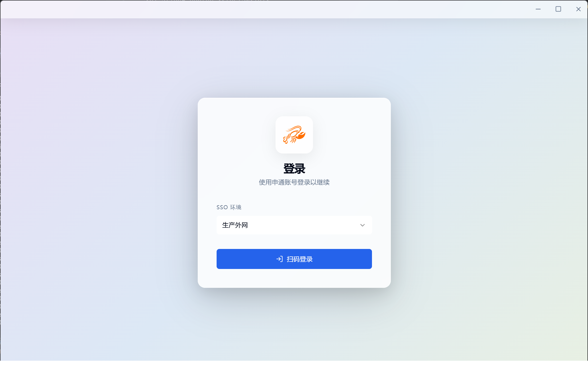
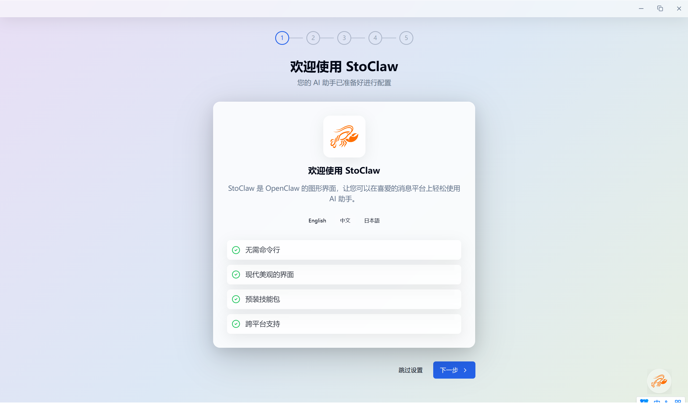
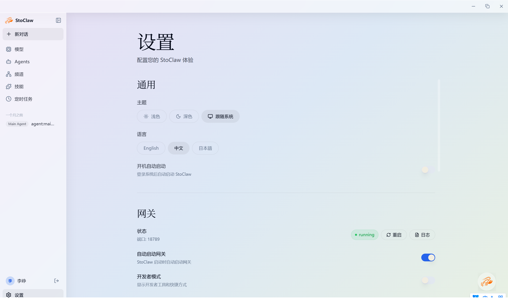
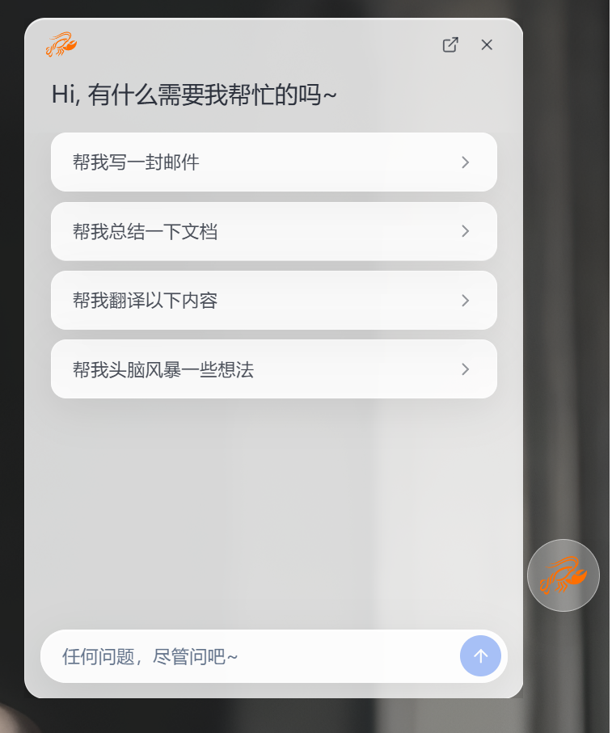

<p align="center">
  
</p>

<h1 align="center">StoClaw</h1>

<p align="center">
  <strong>The Desktop Interface for OpenClaw AI Agents</strong>
</p>

---
## Screenshot

<p align="center">
  
</p>

<p align="center">
  
</p>

<p align="center">
  
</p>

<p align="center">
  
</p>

<p align="center">
  
</p>

<p align="center">
  
</p>


---

## Getting Started

### System Requirements

- **Operating System**: macOS 11+, Windows 10+, or Linux (Ubuntu 20.04+)
- **Memory**: 4GB RAM minimum (8GB recommended)
- **Storage**: 1GB available disk space

### Installation

#### Build from Source

```bash
# Clone the repository
git clone http://gitlab.sto.cn/ai-memory/sto-claw.git
cd sto-claw

# Initialize the project
pnpm run init

# Start in development mode
pnpm dev
```
### First Launch

When you launch StoClaw for the first time, the **Setup Wizard** will guide you through:

1. **Language & Region** – Configure your preferred locale
2. **AI Provider** – Add providers with API keys or OAuth (for providers that support browser/device login)
3. **Skill Bundles** – Select pre-configured skills for common use cases
4. **Verification** – Test your configuration before entering the main interface

The wizard preselects your system language when it is supported, and falls back to English otherwise.

> Note for Moonshot (Kimi): StoClaw keeps Kimi web search enabled by default.  
> When Moonshot is configured, StoClaw also syncs Kimi web search to the China endpoint (`https://api.moonshot.cn/v1`) in OpenClaw config.

### Proxy Settings

StoClaw includes built-in proxy settings for environments where Electron, the OpenClaw Gateway, or channels such as Telegram need to reach the internet through a local proxy client.

Open **Settings → Gateway → Proxy** and configure:

- **Proxy Server**: the default proxy for all requests
- **Bypass Rules**: hosts that should connect directly, separated by semicolons, commas, or new lines
- In **Developer Mode**, you can optionally override:
  - **HTTP Proxy**
  - **HTTPS Proxy**
  - **ALL_PROXY / SOCKS**

Recommended local examples:

```text
Proxy Server: http://127.0.0.1:7890
```
Notes:

- A bare `host:port` value is treated as HTTP.
- If advanced proxy fields are left empty, StoClaw falls back to `Proxy Server`.
- Saving proxy settings reapplies Electron networking immediately and restarts the Gateway automatically.
- StoClaw also syncs the proxy to OpenClaw's Telegram channel config when Telegram is enabled.
- Gateway restarts preserve an existing Telegram channel proxy if StoClaw proxy is currently disabled.
- To explicitly clear Telegram channel proxy from OpenClaw config, save proxy settings with proxy disabled.
- In **Settings → Advanced → Developer**, you can run **OpenClaw Doctor** to execute `openclaw doctor --json` and inspect the diagnostic output without leaving the app.
- On packaged Windows builds, the bundled `openclaw` CLI/TUI runs via the shipped `node.exe` entrypoint to keep terminal input behavior stable.

---

## Architecture

StoClaw employs a **dual-process architecture** with a unified host API layer. The renderer talks to a single client abstraction, while Electron Main owns protocol selection and process lifecycle:

```┌─────────────────────────────────────────────────────────────────┐
│                        StoClaw Desktop App                         │
│                                                                  │
│  ┌────────────────────────────────────────────────────────────┐  │
│  │              Electron Main Process                          │  │
│  │  • Window & application lifecycle management               │  │
│  │  • Gateway process supervision                              │  │
│  │  • System integration (tray, notifications, keychain)       │  │
│  │  • Auto-update orchestration                                │  │
│  └────────────────────────────────────────────────────────────┘  │
│                              │                                    │
│                              │ IPC (authoritative control plane)  │
│                              ▼                                    │
│  ┌────────────────────────────────────────────────────────────┐  │
│  │              React Renderer Process                         │  │
│  │  • Modern component-based UI (React 19)                     │  │
│  │  • State management with Zustand                            │  │
│  │  • Unified host-api/api-client calls                        │  │
│  │  • Rich Markdown rendering                                  │  │
│  └────────────────────────────────────────────────────────────┘  │
└──────────────────────────────┬──────────────────────────────────┘
                               │
                               │ Main-owned transport strategy
                               │ (WS first, HTTP then IPC fallback)
                               ▼
┌─────────────────────────────────────────────────────────────────┐
│                Host API & Main Process Proxies                  │
│                                                                  │
│  • hostapi:fetch (Main proxy, avoids CORS in dev/prod)          │
│  • gateway:httpProxy (Renderer never calls Gateway HTTP direct)  │
│  • Unified error mapping & retry/backoff                         │
└──────────────────────────────┬──────────────────────────────────┘
                               │
                               │ WS / HTTP / IPC fallback
                               ▼
┌─────────────────────────────────────────────────────────────────┐
│                     OpenClaw Gateway                             │
│                                                                  │
│  • AI agent runtime and orchestration                           │
│  • Message channel management                                    │
│  • Skill/plugin execution environment                           │
│  • Provider abstraction layer                                    │
└─────────────────────────────────────────────────────────────────┘
```
### Design Principles

- **Process Isolation**: The AI runtime operates in a separate process, ensuring UI responsiveness even during heavy computation
- **Single Entry for Frontend Calls**: Renderer requests go through host-api/api-client; protocol details are hidden behind a stable interface
- **Main-Process Transport Ownership**: Electron Main controls WS/HTTP usage and fallback to IPC for reliability
- **Graceful Recovery**: Built-in reconnect, timeout, and backoff logic handles transient failures automatically
- **Secure Storage**: API keys and sensitive data leverage the operating system's native secure storage mechanisms
- **CORS-Safe by Design**: Local HTTP access is proxied by Main, preventing renderer-side CORS issues

### Process Model & Gateway Troubleshooting

- StoClaw is an Electron app, so **one app instance normally appears as multiple OS processes** (main/renderer/zygote/utility). This is expected.
- Single-instance protection uses Electron's lock plus a local process-file lock fallback, preventing duplicate app launch in environments where desktop IPC/session bus is unstable.
- During rolling upgrades, mixed old/new app versions can still have asymmetric protection behavior. For best reliability, upgrade all desktop clients to the same version.
- The OpenClaw Gateway listener should still be **single-owner**: only one process should listen on `127.0.0.1:18789`.
- To verify the active listener:
  - macOS/Linux: `lsof -nP -iTCP:18789 -sTCP:LISTEN`
  - Windows (PowerShell): `Get-NetTCPConnection -LocalPort 18789 -State Listen`
- Clicking the window close button (`X`) hides StoClaw to tray; it does **not** fully quit the app. Use tray menu **Quit StoClaw** for complete shutdown.

---

## Use Cases

### 🤖 Personal AI Assistant
Configure a general-purpose AI agent that can answer questions, draft emails, summarize documents, and help with everyday tasks—all from a clean desktop interface.

### 📊 Automated Monitoring
Set up scheduled agents to monitor news feeds, track prices, or watch for specific events. Results are delivered to your preferred notification channel.

### 💻 Developer Productivity
Integrate AI into your development workflow. Use agents to review code, generate documentation, or automate repetitive coding tasks.

### 🔄 Workflow Automation
Chain multiple skills together to create sophisticated automation pipelines. Process data, transform content, and trigger actions—all orchestrated visually.

---

## Development

### Prerequisites

- **Node.js**: 22+ (LTS recommended)
- **Package Manager**: pnpm 9+ (recommended) or npm

### Project Structure

```StoClaw/
├── electron/                 # Electron Main Process
│   ├── api/                 # Main-side API router and handlers
│   │   └── routes/          # RPC/HTTP proxy route modules
│   ├── services/            # Provider, secrets and runtime services
│   │   ├── providers/       # Provider/account model sync logic
│   │   └── secrets/         # OS keychain and secret storage
│   ├── shared/              # Shared provider schemas/constants
│   │   └── providers/
│   ├── main/                # App entry, windows, IPC registration
│   ├── gateway/             # OpenClaw Gateway process manager
│   ├── preload/             # Secure IPC bridge
│   └── utils/               # Utilities (storage, auth, paths)
├── src/                      # React Renderer Process
│   ├── lib/                 # Unified frontend API + error model
│   ├── stores/              # Zustand stores (settings/chat/gateway)
│   ├── components/          # Reusable UI components
│   ├── pages/               # Setup/Dashboard/Chat/Channels/Skills/Cron/Settings
│   ├── i18n/                # Localization resources
│   └── types/               # TypeScript type definitions
├── tests/
│   └── unit/                # Vitest unit/integration-like tests
├── resources/                # Static assets (icons/images)
└── scripts/                  # Build and utility scripts
```
### Available Commands

```bash
# Development
pnpm run init             # Install dependencies + download uv
pnpm dev                  # Start with hot reload (auto-prepares bundled skills if missing)

# Quality
pnpm lint                 # Run ESLint
pnpm typecheck            # TypeScript validation

# Testing
pnpm test                 # Run unit tests
pnpm run comms:replay     # Compute communication replay metrics
pnpm run comms:baseline   # Refresh communication baseline snapshot
pnpm run comms:compare    # Compare replay metrics against baseline thresholds
```

## Token Quota Guard

StoClaw checks the host route `GET /api/token-quota/check` before sending chat messages.
The host route proxies to upstream `GET /agent/v1/token-quota/check`.
When daily quota is exceeded, send is blocked client-side and the user sees a quota message.

```bash
# Build & Package
pnpm run build:vite       # Build frontend only
pnpm build                # Full production build (with packaging assets)
pnpm package              # Package for current platform (includes bundled preinstalled skills)
pnpm package:mac          # Package for macOS
pnpm package:win          # Package for Windows
pnpm package:linux        # Package for Linux
```

### Communication Regression Checks

When a PR changes communication paths (gateway events, chat runtime send/receive flow, channel delivery, or transport fallback), run:

```bash
pnpm run comms:replay
pnpm run comms:compare
```

`comms-regression` in CI enforces required scenarios and threshold checks.
### Tech Stack

| Layer | Technology |
|-------|------------|
| Runtime | Electron 40+ |
| UI Framework | React 19 + TypeScript |
| Styling | Tailwind CSS + shadcn/ui |
| State | Zustand |
| Build | Vite + electron-builder |
| Testing | Vitest + Playwright |
| Animation | Framer Motion |
| Icons | Lucide React |

---
