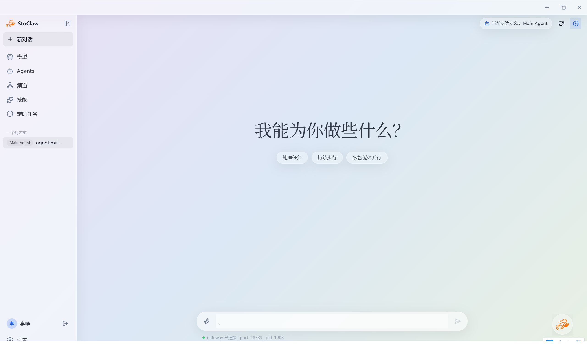
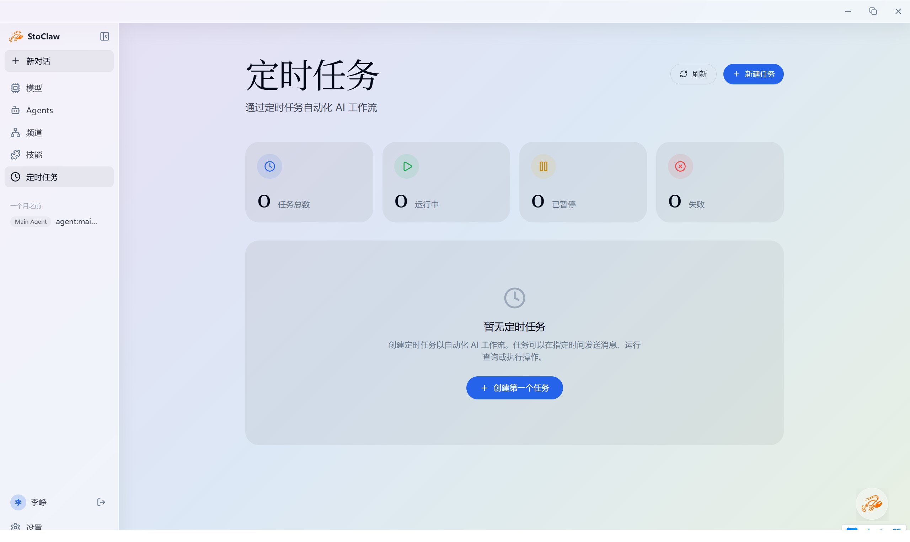

<p align="center">
  
</p>

<h1 align="center">StoClaw</h1>

<p align="center">
  <strong>The Desktop Interface for OpenClaw AI Agents</strong>
</p>

---
## Screenshot

<p align="center">
  
</p>

<p align="center">
  
</p>

<p align="center">
  
</p>

<p align="center">
  
</p>

<p align="center">
  
</p>

<p align="center">
  
</p>


---

## Getting Started

### System Requirements

- **Operating System**: macOS 11+, Windows 10+, or Linux (Ubuntu 20.04+)
- **Memory**: 4GB RAM minimum (8GB recommended)
- **Storage**: 1GB available disk space

**Windows only** — run `pnpm run preflight:win` (or `scripts/preflight-windows.ps1`) **before** downloading `Setup.exe` to check hardware and network. The NSIS installer repeats the same hard checks on fresh install (auto-updates are exempt):

| Check | Threshold | Blocks install |
|-------|-----------|----------------|
| Windows | 10 1809+ (64-bit) | Yes |
| Physical RAM | 16 GB | Yes |
| Disk total / free on install drive | 256 GB / 10 GB | Yes |
| Physical CPU cores | 4 | Yes |
| SSO (`baseinfo-usercenterserviceapi*.sto.cn`, see `sso-service.ts`) | TCP 443 reachable | Yes |
| GitHub (DWS CLI) | TCP 443 reachable | No — warning only |

macOS and Linux installers are unchanged.

### Installation

#### Build from Source

```bash
# Clone the repository
git clone http://gitlab.sto.cn/ai-memory/sto-claw.git
cd sto-claw

# Initialize the project
pnpm run init

# Start in development mode
pnpm dev
```
### First Launch

When you launch StoClaw for the first time, the **Setup Wizard** will guide you through:

1. **Language & Region** – Configure your preferred locale
2. **AI Provider** – Add providers with API keys or OAuth (for providers that support browser/device login)
3. **Skill Bundles** – Select pre-configured skills for common use cases
4. **Verification** – Test your configuration before entering the main interface

The wizard preselects your system language when it is supported, and falls back to English otherwise.

**HQ account-switch demo:** HQ users with branch-switch permission can impersonate a site account from the bottom-right FAB. The UI and session token reflect the site user, but AI resources (SK, model list, inference gateway, and Models-page quota) stay on the HQ account via `DemoSkStrategy`. Native site login and native HQ login are unchanged.

Main shell routes include the dashboard home (`/`), prototype STO task reports under `/tasks/:taskId` (overview) and per-day chat subitems at `/tasks/:taskId/YYYY-MM-DD` (navigable key: `hq-reconciliation`; subitems are listed under the sidebar “任务列表”, and the first home overview card ensures today’s subitem if needed then opens the **latest** persisted subitem by date so that row is selected by default), and main-agent chat on the home route (`/`; legacy `/chat` redirects to home). Main-agent chat now includes an inline in-session search bar that scans the currently rendered transcript and jumps between matching message records. Each task subitem uses its own persisted OpenClaw session key (`agent:main:session-sto-*`, stored locally per day) so its transcript stays isolated from the main agent chat; those sessions do not appear as separate rows in the chat session list. Deleting a dated subitem from the sidebar (trash on hover, same as history sessions) soft-deletes that transcript and removes the subitem from the persisted task list. The CRM home may still show three data-overview cards; only the first links into `/tasks/*` while the other two stay behind a “coming soon” overlay until their task entries are re-enabled in the sidebar list. **CRM week-report surface:** after SSO login, the app loads a policy whitelist from the STO policy service; the policy API host is chosen from **`VITE_APP_ENV`** only (`development`/`test` → `zc-test.sto.cn`, `staging` → `pre-zc.sto.cn`, `production` → `zc.sto.cn`). Only users whose SSO `userName` matches a whitelist `userCode` see the home task summary cards and can stay on `/tasks/*`; otherwise the home shows the legacy layout and `/tasks/*` redirects to `/`. Failed or timed-out policy requests are treated as **not** whitelisted (fail-closed).

**Learning Center:** the sidebar's 学习中心 entry is shown only when memory-center returns at least one learning domain visible to the current account. It opens `/learning-center`, which lists the permitted domains, categories, tutorials, and practice cases (visibility is decided entirely by memory-center; the Electron host proxies the seven `POST /api/learning-center/*` client routes, so the renderer never calls the backend or OSS directly). Tutorials open as a resizable right-side overlay without changing the learning-center layout; the overlay can cover the full content workspace and then restore its previous width, while tutorial text and media reflow with it (the existing deep link `/learning-center/tutorial/:tutorialId` still works). Cases offer a detail dialog plus a confirm-gated “立即使用” action that opens the matching skill, connector, app, workflow, external URL, or chat entry. Case prompts only seed the chat composer draft (`REPLACE` or `APPEND`) — nothing is ever auto-sent.

When an agent session uses the Claude Agent SDK engine, StoClaw still applies the desktop-side DingTalk recipient/send guard flow: selected DingTalk recipients are staged into Claude runtime instructions, and `dws chat message send` calls made through Claude's Bash tool keep the same anti-batch and post-success rate-limit protections as the OpenClaw plugin path. Image attachments on Claude sessions are sent as native Claude multimodal image blocks instead of path-only prompt text so visual understanding stays aligned with the uploaded pixels.

Claude Agent SDK sessions also expose a built-in `claude-scheduled-task-tool` MCP extension. From a Claude conversation, the agent can now create, inspect, update, delete, list, and trigger local Claude scheduled tasks directly through tool calls without leaving chat. Those task operations default to the current Claude session's agent/workspace context unless the user explicitly requests another target. Claude scheduled tasks created from the StoClaw task dialog can also carry selected DingTalk `@` recipients; StoClaw injects that recipient context into the saved Claude prompt so the same guarded DingTalk send flow remains available during scheduled runs.

Default shell uses the **provincial sidebar** (省区版本样式): home, scheduled tasks, skills, the STO task list block, and time-bucketed conversation history; chat and “my data” stay off the primary rail, the workspace group and conversation-list chrome are hidden, and the large user card is replaced by a compact settings entry (same menu: settings, language, theme, logout). To restore the **full** navigation rail for local builds, set `VITE_STOCLAW_SIDEBAR_LAYOUT=full` in `.env.development.local` or the build environment.

> Note for Moonshot (Kimi): StoClaw keeps Kimi web search enabled by default.  
> When Moonshot is configured, StoClaw also syncs Kimi web search to the China endpoint (`https://api.moonshot.cn/v1`) in OpenClaw config.

### Proxy Settings

StoClaw includes built-in proxy settings for environments where Electron, the OpenClaw Gateway, or channels such as Telegram need to reach the internet through a local proxy client.

Open **Settings → Gateway → Proxy** and configure:

- **Proxy Server**: the default proxy for all requests
- **Bypass Rules**: hosts that should connect directly, separated by semicolons, commas, or new lines
- In **Developer Mode**, you can optionally override:
  - **HTTP Proxy**
  - **HTTPS Proxy**
  - **ALL_PROXY / SOCKS**

Recommended local examples:

```text
Proxy Server: http://127.0.0.1:7890
```
Notes:

- A bare `host:port` value is treated as HTTP.
- If advanced proxy fields are left empty, StoClaw falls back to `Proxy Server`.
- Saving proxy settings reapplies Electron networking immediately and restarts the Gateway automatically.
- StoClaw also syncs the proxy to OpenClaw's Telegram channel config when Telegram is enabled.
- Gateway restarts preserve an existing Telegram channel proxy if StoClaw proxy is currently disabled.
- To explicitly clear Telegram channel proxy from OpenClaw config, save proxy settings with proxy disabled.
- In **Settings → Advanced → Developer**, you can run **OpenClaw Doctor** to execute `openclaw doctor --json` and inspect the diagnostic output without leaving the app.
- On packaged Windows builds, the bundled `openclaw` CLI/TUI runs via the shipped `node.exe` entrypoint to keep terminal input behavior stable.

---

## Architecture

StoClaw employs a **dual-process architecture** with a unified host API layer. The renderer talks to a single client abstraction, while Electron Main owns protocol selection and process lifecycle:

```┌─────────────────────────────────────────────────────────────────┐
│                        StoClaw Desktop App                         │
│                                                                  │
│  ┌────────────────────────────────────────────────────────────┐  │
│  │              Electron Main Process                          │  │
│  │  • Window & application lifecycle management               │  │
│  │  • Gateway process supervision                              │  │
│  │  • Authoritative chat-run lifecycle & recovery               │  │
│  │  • System integration (tray, notifications, keychain)       │  │
│  │  • Auto-update orchestration                                │  │
│  └────────────────────────────────────────────────────────────┘  │
│                              │                                    │
│                              │ IPC (authoritative control plane)  │
│                              ▼                                    │
│  ┌────────────────────────────────────────────────────────────┐  │
│  │              React Renderer Process                         │  │
│  │  • Modern component-based UI (React 19)                     │  │
│  │  • State management with Zustand                            │  │
│  │  • Unified host-api/api-client calls                        │  │
│  │  • Rich Markdown rendering                                  │  │
│  └────────────────────────────────────────────────────────────┘  │
└──────────────────────────────┬──────────────────────────────────┘
                               │
                               │ Main-owned transport strategy
                               │ (WS first, HTTP then IPC fallback)
                               ▼
┌─────────────────────────────────────────────────────────────────┐
│                Host API & Main Process Proxies                  │
│                                                                  │
│  • hostapi:fetch (Main proxy, avoids CORS in dev/prod)          │
│  • gateway:httpProxy (Renderer never calls Gateway HTTP direct)  │
│  • Unified error mapping & retry/backoff                         │
└──────────────────────────────┬──────────────────────────────────┘
                               │
                               │ WS / HTTP / IPC fallback
                               ▼
┌─────────────────────────────────────────────────────────────────┐
│                     OpenClaw Gateway                             │
│                                                                  │
│  • AI agent runtime and orchestration                           │
│  • Message channel management                                    │
│  • Skill/plugin execution environment                           │
│  • Provider abstraction layer                                    │
└─────────────────────────────────────────────────────────────────┘
```
### Design Principles

- **Process Isolation**: The AI runtime operates in a separate process, ensuring UI responsiveness even during heavy computation
- **Single Entry for Frontend Calls**: Renderer requests go through host-api/api-client; protocol details are hidden behind a stable interface
- **Main-Process Transport Ownership**: Electron Main controls WS/HTTP usage and fallback to IPC for reliability
- **Graceful Recovery**: Built-in reconnect, timeout, and backoff logic handles transient failures automatically
- **Authoritative Chat Runtime**: Main normalizes OpenClaw/Claude events into a versioned `chat-runtime:event` stream, persists minimal run metadata in SQLite, and exposes `chat-runtime:get` / `chat-runtime:listActive` snapshots for renderer and process-restart recovery. Transcripts remain engine-owned; optimistic and streaming content stay in a replaceable renderer overlay.
- **Secure Storage**: API keys and sensitive data leverage the operating system's native secure storage mechanisms
- **CORS-Safe by Design**: Local HTTP access is proxied by Main, preventing renderer-side CORS issues

### Process Model & Gateway Troubleshooting

- StoClaw is an Electron app, so **one app instance normally appears as multiple OS processes** (main/renderer/zygote/utility). This is expected.
- Single-instance protection uses Electron's lock plus a local process-file lock fallback, preventing duplicate app launch in environments where desktop IPC/session bus is unstable. On Windows, stale file locks are recovered by verifying that the recorded PID still belongs to SClaw; an unreadable or undeletable stale lock falls back to Electron's OS lock instead of permanently blocking startup.
- During rolling upgrades, mixed old/new app versions can still have asymmetric protection behavior. For best reliability, upgrade all desktop clients to the same version.
- The OpenClaw Gateway listener should still be **single-owner**: only one process should listen on `127.0.0.1:18789`.
- To verify the active listener:
  - macOS/Linux: `lsof -nP -iTCP:18789 -sTCP:LISTEN`
  - Windows (PowerShell): `Get-NetTCPConnection -LocalPort 18789 -State Listen`
- Clicking the window close button (`X`) hides StoClaw to tray; it does **not** fully quit the app. Use tray menu **Quit StoClaw** for complete shutdown.

---

## Use Cases

### 🤖 Personal AI Assistant
Configure a general-purpose AI agent that can answer questions, draft emails, summarize documents, and help with everyday tasks—all from a clean desktop interface.

### 📊 Automated Monitoring
Set up scheduled agents to monitor news feeds, track prices, or watch for specific events. Results are delivered to your preferred notification channel.

### 💻 Developer Productivity
Integrate AI into your development workflow. Use agents to review code, generate documentation, or automate repetitive coding tasks.

### 🔄 Workflow Automation
Chain multiple skills together to create sophisticated automation pipelines. Process data, transform content, and trigger actions—all orchestrated visually.

Workflow agents use an artifact-first delivery contract. A task may return small structured data directly or create one or more files in any task-appropriate format. Files are declared by node-relative resource paths; the desktop runtime validates the workspace boundary, records canonical artifact metadata, and passes only compact references downstream. Individual payload strings larger than 1 KiB must be delivered as files so generated content is not duplicated in workflow records or later model prompts.

Chat workflow progress cards are durable SQLite-backed timeline items. A card is registered only when a new run starts in its originating chat session; asking for an existing run's status remains an ordinary tool response. The renderer discovers card references by session and each mounted card polls a compact `wf_run` snapshot through the Main-process API, so switching sessions or reloading history does not depend on transient workflow status events or synthetic message content.

### Embedded Workflow Editor Integration

When a compatible `memory-center-web` editor is embedded, the Web editor owns the single 52px workflow business header while StoClaw retains native window chrome, confirmation/startup UI, local execution, and local-run history. During capability negotiation StoClaw masks the iframe and suppresses the legacy Host header, then reveals the complete Web-owned header in one step. A timeout or incompatible Web session restores the Host header as a safe fallback. The Web header can open StoClaw's existing local-run history dialog through an authenticated bridge intent; standalone Web sessions never read client-local run data.

For an unchanged published workflow, trial run skips draft persistence and starts with the exact published version ID supplied by the authenticated Web bridge. A changed published workflow or any draft workflow keeps the confirmation and save-before-run path: StoClaw asks the Web editor to persist the current canvas through the existing workflow PUT contract and starts only with the draft version ID returned by that successful save. Existing drafts are updated in place; saving from a changed published version creates a draft without replacing the active published version. Older Web builds that do not send a preparation mode continue to use save-before-run. Save failure, timeout, invalid response, iframe reset, or route change terminates the attempt and never falls back to a stale version.

Chat run lifecycle is authoritative in Electron Main. `ChatRuntimeSupervisor` applies an irreversible per-session state machine, serializes competing lifecycle inputs, and persists only monotonically newer `(epoch, sequence)` snapshots. Engine adapters expose runtime inspection and history-projection capabilities, so OpenClaw/Claude completion differences no longer leak into the supervisor or Renderer. Engine completion first enters `awaiting_transcript`; a bounded transcript-settle pass projects the final reasoning/tool chronology before the canonical completed event, and a late stable revision emits `transcript.updated` so the Renderer refreshes without user intervention. Renderer hydration retries with bounded backoff, buffers startup/gap events, and rejects stale or terminal-regressing snapshots.

Renderer chat content is session-scoped: immutable engine transcript, optimistic/streaming overlay, and display-only decorations are stored separately. UI messages are built from that model instead of a second top-level message array. A terminal runtime event immediately ends active-response UI state (including generating indicators and message-action locks), while the completed overlay remains mounted until refreshed transcript history actually contains the current turn; this avoids coupling interaction readiness to transcript-settle backoff without introducing a blank frame. If a follow-up starts before that takeover, the completed overlay is first materialized into the display-only projection so the previous turn remains visible while the new run gets its own overlay. History failures retain the last successful transcript, forced refreshes trail an in-flight request, and background sessions can hydrate without mutating foreground UI. A send idempotency key is single-use: retries inside ten minutes replay the original outcome, while expired keys are rejected instead of silently dispatching the engine again. If persisted idempotency state is unavailable, Main fails closed before memory preparation or engine dispatch.

Scheduled chat runs register their task-run owner and optional task deadline with `ChatRuntimeSupervisor`. Schedule status is finalized only from canonical chat terminal events; startup recovery reconciles persisted runtime/history without resending an uncertain message, while the scheduler's stale-run reaper remains an orphan-lease fallback. Workflow start acceptance is returned only after the minimal `wf_run` identity and chat-card metadata are durable; duplicate identities replay, while conflicts are rejected. Renderer no longer performs a second workflow-card registration after durable acceptance; it only repairs a missing message anchor after persisted history supplies one. Workflow parameter-form state is session-scoped, tool-result dedupe is revision-aware, and target-session agent/model selection never falls back to the visible conversation. `WorkflowCard` retains its compact three-second snapshot polling behavior.

---

## Development

### Prerequisites

- **Node.js**: 22+ (LTS recommended)
- **Package Manager**: pnpm 9+ (recommended) or npm

### Project Structure

```StoClaw/
├── electron/                 # Electron Main Process
│   ├── api/                 # Main-side API router and handlers
│   │   └── routes/          # RPC/HTTP proxy route modules
│   ├── services/            # Provider, secrets and runtime services
│   │   ├── providers/       # Provider/account model sync logic
│   │   └── secrets/         # OS keychain and secret storage
│   ├── shared/              # Shared provider schemas/constants
│   │   └── providers/
│   ├── main/                # App entry, windows, IPC registration
│   ├── gateway/             # OpenClaw Gateway process manager
│   ├── preload/             # Secure IPC bridge
│   └── utils/               # Utilities (storage, auth, paths)
├── src/                      # React Renderer Process
│   ├── lib/                 # Unified frontend API + error model
│   ├── stores/              # Zustand stores (settings/chat/gateway)
│   ├── components/          # Reusable UI components
│   ├── pages/               # Setup/Home/TaskDetail/Chat/Channels/Skills/Cron/Settings
│   ├── i18n/                # Localization resources
│   └── types/               # TypeScript type definitions
├── tests/
│   └── unit/                # Vitest unit/integration-like tests
├── resources/                # Static assets (icons/images)
└── scripts/                  # Build and utility scripts
```
### Available Commands

```bash
# Development
pnpm run init             # Install dependencies + download uv
pnpm dev                  # Start with hot reload (auto-prepares bundled skills if missing)

# Quality
pnpm lint                 # Run ESLint
pnpm typecheck            # TypeScript validation

# Testing
pnpm test                 # Run unit tests
pnpm run comms:replay     # Compute communication replay metrics
pnpm run comms:baseline   # Refresh communication baseline snapshot
pnpm run comms:compare    # Compare replay metrics against baseline thresholds
```

## Token Quota Guard

StoClaw checks the host route `GET /api/token-quota/check` before sending chat messages.
The host route proxies to upstream `GET /agent/v1/token-quota/check`.
When daily quota is exceeded, send is blocked client-side and the user sees a quota message.

```bash
# Build & Package
pnpm run build:vite       # Build frontend only
pnpm build                # Full production build (with packaging assets)
pnpm package              # Package for current platform (includes bundled preinstalled skills)
pnpm package:mac          # Package for macOS
pnpm package:win          # Package for Windows x64 (NSIS + ZIP)
pnpm package:linux        # Package for Linux
```

### Communication Regression Checks

When a PR changes communication paths (gateway events, chat runtime send/receive flow, channel delivery, or transport fallback), run:

```bash
pnpm run comms:replay
pnpm run comms:compare
```

`comms-regression` in CI enforces required scenarios and threshold checks.
### Tech Stack

| Layer | Technology |
|-------|------------|
| Runtime | Electron 40+ |
| UI Framework | React 19 + TypeScript |
| Styling | Tailwind CSS + shadcn/ui |
| State | Zustand |
| Build | Vite + electron-builder |
| Testing | Vitest + Playwright |
| Animation | Framer Motion |
| Icons | Lucide React |

---
