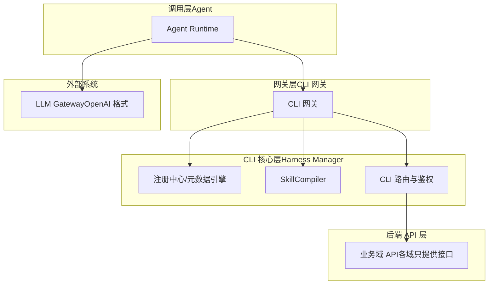
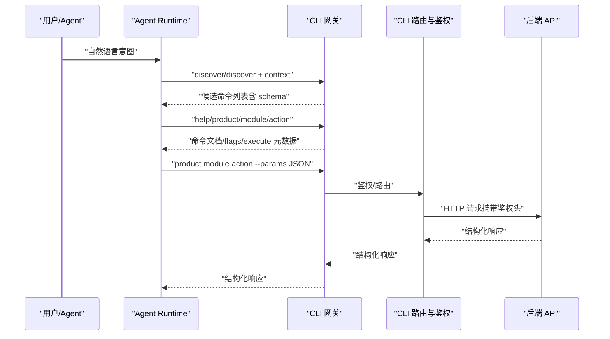
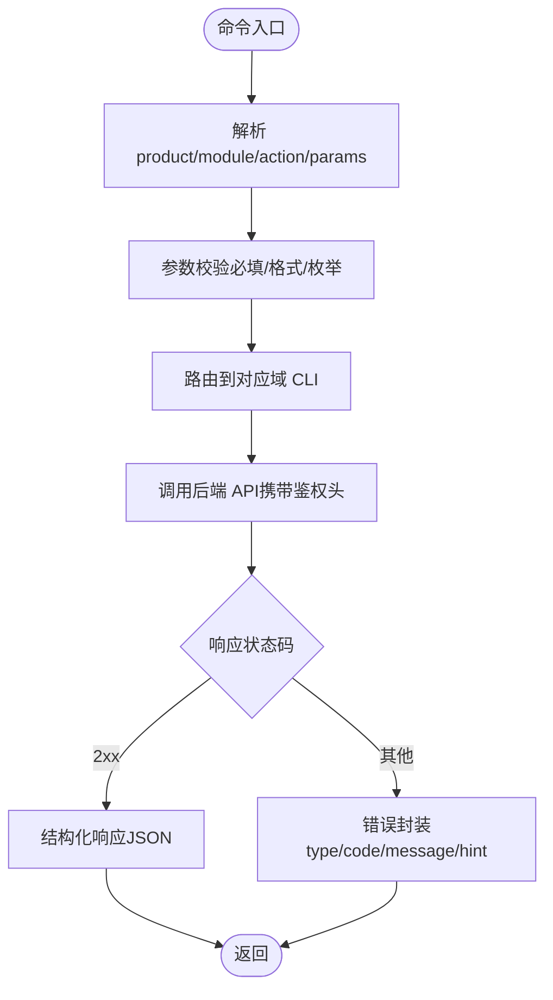
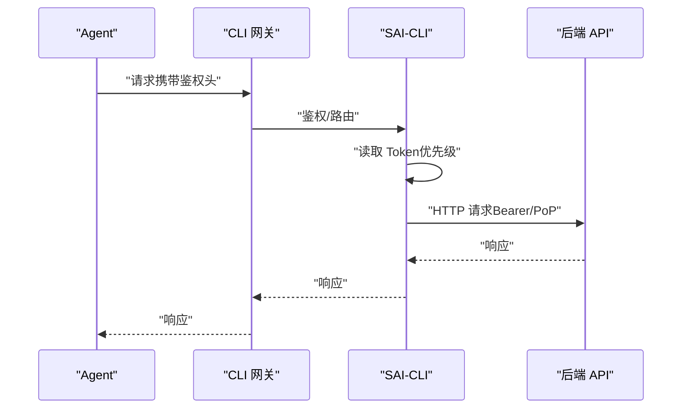
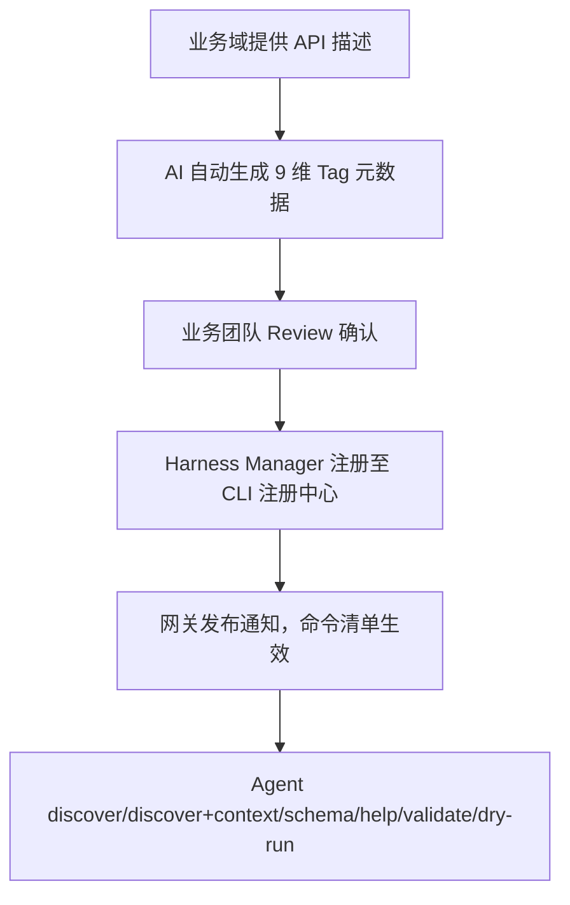
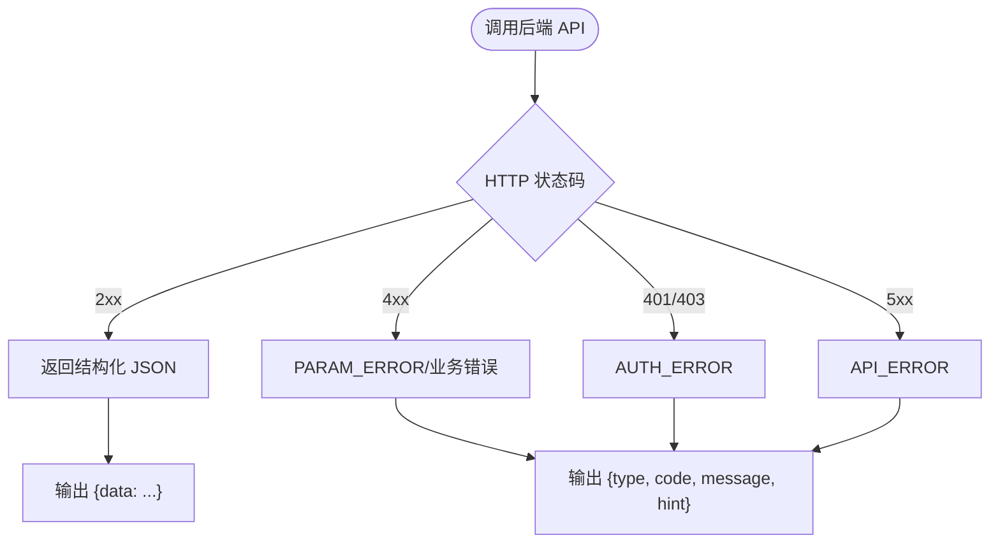
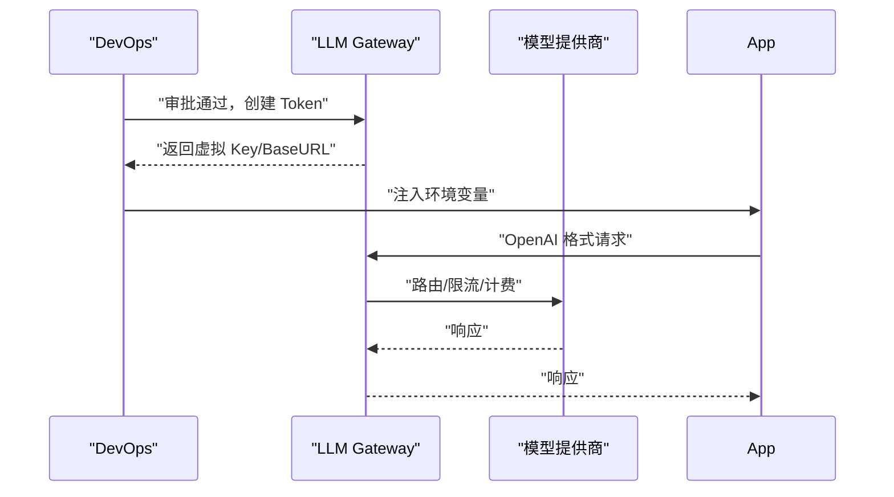
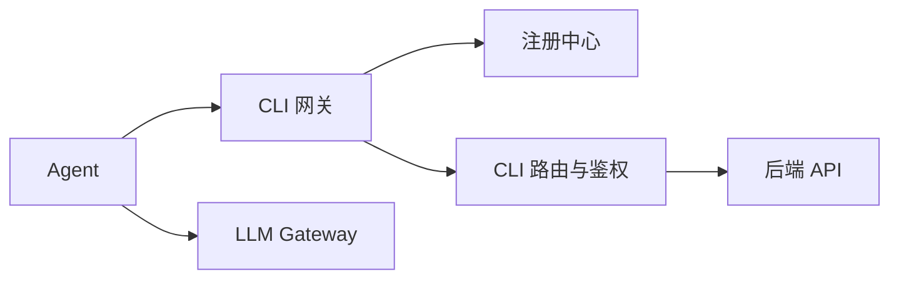

# API接口参考

<cite>
**本文引用的文件**
- [README.md](file://README.md)
- [config.yaml](file://openspec/config.yaml)
- [SAI_CLI_设计文档_v1.0.md](file://plan/SAI_CLI_设计文档_v1.0.md)
- [SAI_CLI_设计文档_v1.2.md](file://plan/SAI_CLI_设计文档_v1.2.md)
- [agent-api-discovery-architecture-review.zh-CN.md](file://notes/zhaobomin/agent-api-discovery-architecture-review.zh-CN.md)
- [cross-module-design-review-2026-04-24.md](file://notes/zhaobomin/cross-module-design-review-2026-04-24.md)
- [LLM-Gateway建设方案.md](file://plan/LLM-Gateway建设方案.md)
- [LLM-Gateway一期功能规划.md](file://plan/LLM-Gateway一期功能规划.md)
</cite>

## 目录
1. [简介](#简介)
2. [项目结构](#项目结构)
3. [核心组件](#核心组件)
4. [架构总览](#架构总览)
5. [详细组件分析](#详细组件分析)
6. [依赖分析](#依赖分析)
7. [性能考量](#性能考量)
8. [故障排查指南](#故障排查指南)
9. [结论](#结论)
10. [附录](#附录)

## 简介
本文件为 SAI 项目的 API 接口参考文档，面向开发者与集成方，系统性梳理以下内容：
- 公共接口定义、参数规范与返回值说明
- 认证与授权机制（含 PoP Token 与 AK/SK 签名）
- 错误码定义与异常处理
- 接口调用示例、最佳实践与性能优化建议
- SDK 使用指南与集成示例

SAI 采用四层分层架构：调用层（Agent）、网关层（CLI 路由与鉴权）、CLI 核心层（统一命令与元数据）、后端 API 层（各业务域接口）。本文重点覆盖网关层与 CLI 核心层的对外接口契约，以及与 LLM Gateway 的交互。

## 项目结构
仓库中与 API 接口相关的关键文档与配置如下：
- README.md：项目概览与模块分工图
- openspec/config.yaml：规范驱动配置
- plan/SAI_CLI_设计文档_v1.x：CLI 命令规范、鉴权、错误输出、注册与元数据生成等
- notes/zhaobomin/agent-api-discovery-architecture-review.zh-CN.md：Agent 发现链路与参数 schema 扩展建议
- notes/zhaobomin/cross-module-design-review-2026-04-24.md：模块接口对齐状态与缺失项
- plan/LLM-Gateway建设方案.md、plan/LLM-Gateway一期功能规划.md：LLM Gateway 的统一 OpenAI 格式 API、密钥管理与告警

**图表来源**
- [README.md:11-41](file://README.md#L11-L41)
- [SAI_CLI_设计文档_v1.2.md:29-64](file://plan/SAI_CLI_设计文档_v1.2.md#L29-L64)
- [LLM-Gateway建设方案.md:19-25](file://plan/LLM-Gateway建设方案.md#L19-L25)

**章节来源**
- [README.md:1-72](file://README.md#L1-L72)
- [openspec/config.yaml:1-21](file://openspec/config.yaml#L1-L21)

## 核心组件
- CLI 网关：负责命令注册、元数据搜索、元数据生成、发布通知、路由转发、权限校验（含 PoP 签名）
- 注册中心/元数据引擎：存储与管理 9 维 Tag 元数据，支持 AI 自动生成
- SkillCompiler：将注册元数据编译为 Agent 可读的 Tool 定义
- CLI 路由与鉴权：命令路由转发、Token 校验、AK/SK 签名
- 后端 API：各业务域提供接口，零侵入
- LLM Gateway：统一 OpenAI 格式 API，支持密钥分发、额度与告警、模型路由

**章节来源**
- [SAI_CLI_设计文档_v1.2.md:545-632](file://plan/SAI_CLI_设计文档_v1.2.md#L545-L632)
- [LLM-Gateway建设方案.md:29-65](file://plan/LLM-Gateway建设方案.md#L29-L65)

## 架构总览
SAI 的调用链路为：Agent → 网关 → SAI-CLI → API。网关负责路由与鉴权，CLI 核心层负责命令解析、参数校验与结构化输出。

**图表来源**
- [agent-api-discovery-architecture-review.zh-CN.md:194-203](file://notes/zhaobomin/agent-api-discovery-architecture-review.zh-CN.md#L194-L203)
- [agent-api-discovery-architecture-review.zh-CN.md:221-235](file://notes/zhaobomin/agent-api-discovery-architecture-review.zh-CN.md#L221-L235)
- [SAI_CLI_设计文档_v1.2.md:603-632](file://plan/SAI_CLI_设计文档_v1.2.md#L603-L632)

## 详细组件分析

### 1) 命令规范与调用
- 命令格式：{product} {module} {action} [params]
- 参数：JSON 格式字符串（如 --type 出港滞留）
- 无交互式输入：所有参数通过命令行传入，禁止运行时弹出交互式提示
- 结构化输出：统一 JSON，错误输出包含 type/code/message/hint 四字段

**图表来源**
- [SAI_CLI_设计文档_v1.0.md:83-113](file://plan/SAI_CLI_设计文档_v1.0.md#L83-L113)
- [SAI_CLI_设计文档_v1.0.md:143-184](file://plan/SAI_CLI_设计文档_v1.0.md#L143-L184)
- [SAI_CLI_设计文档_v1.2.md:295-336](file://plan/SAI_CLI_设计文档_v1.2.md#L295-L336)

**章节来源**
- [SAI_CLI_设计文档_v1.0.md:83-113](file://plan/SAI_CLI_设计文档_v1.0.md#L83-L113)
- [SAI_CLI_设计文档_v1.0.md:143-184](file://plan/SAI_CLI_设计文档_v1.0.md#L143-L184)
- [SAI_CLI_设计文档_v1.2.md:295-336](file://plan/SAI_CLI_设计文档_v1.2.md#L295-L336)

### 2) 鉴权与授权
- Token 获取优先级：命令行参数 > 环境变量 > 本地配置文件（~/.sai/sso-auth.json）
- 静默登录接口：POST /api/v1/sai/auth/silent-login（入参 code，响应包含 stoToken 等）
- 一期：Bearer Token（Agent → sai-cli → 业务 API）
- 二期：PoP（Proof-of-Possession）Token + ECDSA(P-256) 签名（Agent → sai-cli → sai-agent → 云端网关 → 业务 API）
- AK/SK 签名：Harness Manager API 统一使用 HMAC-SHA256（X-Access-Key、X-Signature、X-Timestamp）

**图表来源**
- [SAI_CLI_设计文档_v1.2.md:405-420](file://plan/SAI_CLI_设计文档_v1.2.md#L405-L420)
- [SAI_CLI_设计文档_v1.2.md:421-440](file://plan/SAI_CLI_设计文档_v1.2.md#L421-L440)
- [SAI_CLI_设计文档_v1.2.md:452-460](file://plan/SAI_CLI_设计文档_v1.2.md#L452-L460)

**章节来源**
- [SAI_CLI_设计文档_v1.2.md:394-471](file://plan/SAI_CLI_设计文档_v1.2.md#L394-L471)

### 3) 元数据注册与发现
- 注册中心：统一管理 9 维 Tag（D1-D9）、description、入参说明
- AI 自动生成：POST /api/v1/sai/cli/metadata/generate（入参包含系统/接口/参数/响应 schema）
- 注册接口：POST /api/v1/sai/cli/registry（支持 add/update/remove）
- 发布通知：Harness Manager 通过网关发布通知接口同步命令清单
- Agent 发现链路：list/index → discover（支持上下文）→ schema/help → validate/dry-run

**图表来源**
- [SAI_CLI_设计文档_v1.2.md:376-391](file://plan/SAI_CLI_设计文档_v1.2.md#L376-L391)
- [agent-api-discovery-architecture-review.zh-CN.md:221-235](file://notes/zhaobomin/agent-api-discovery-architecture-review.zh-CN.md#L221-L235)
- [agent-api-discovery-architecture-review.zh-CN.md:421-450](file://notes/zhaobomin/agent-api-discovery-architecture-review.zh-CN.md#L421-L450)

**章节来源**
- [SAI_CLI_设计文档_v1.2.md:151-223](file://plan/SAI_CLI_设计文档_v1.2.md#L151-L223)
- [SAI_CLI_设计文档_v1.2.md:376-391](file://plan/SAI_CLI_设计文档_v1.2.md#L376-L391)
- [agent-api-discovery-architecture-review.zh-CN.md:188-235](file://notes/zhaobomin/agent-api-discovery-architecture-review.zh-CN.md#L188-L235)

### 4) 错误码与异常处理
- 结构化错误输出包含：type、code、message、hint
- 常见类型：AUTH_ERROR（认证错误，如 401）、PARAM_ERROR（参数错误，如 400）、API_ERROR（服务错误，如 500）
- 网关层对非 2xx 状态码可靠映射为错误 envelope

**图表来源**
- [SAI_CLI_设计文档_v1.0.md:143-184](file://plan/SAI_CLI_设计文档_v1.0.md#L143-L184)
- [SAI_CLI_设计文档_v1.2.md:295-336](file://plan/SAI_CLI_设计文档_v1.2.md#L295-L336)

**章节来源**
- [SAI_CLI_设计文档_v1.0.md:143-184](file://plan/SAI_CLI_设计文档_v1.0.md#L143-L184)
- [SAI_CLI_设计文档_v1.2.md:295-336](file://plan/SAI_CLI_设计文档_v1.2.md#L295-L336)

### 5) Dry-Run 与可测试性
- 写操作命令（create/update/delete）支持 --dry-run，返回将要执行的操作描述
- 单元测试可测性：通过接口抽象实现，支持 Mock（HTTP 客户端、文件系统、Token 读取）

**章节来源**
- [SAI_CLI_设计文档_v1.0.md:254-281](file://plan/SAI_CLI_设计文档_v1.0.md#L254-L281)
- [SAI_CLI_设计文档_v1.2.md:474-501](file://plan/SAI_CLI_设计文档_v1.2.md#L474-L501)

### 6) LLM Gateway 集成
- 统一 OpenAI 格式 API：Agent → LLM Gateway → 各模型
- 密钥分发：DevOps 审批后自动创建 Token，动态注入环境变量
- 成本控制：额度预警（80%/90%/100%）与自动熔断
- 安全：密钥白名单、访问控制（VPN/内网）、可选隐私数据脱敏

**图表来源**
- [LLM-Gateway建设方案.md:36-65](file://plan/LLM-Gateway建设方案.md#L36-L65)
- [LLM-Gateway一期功能规划.md:3-11](file://plan/LLM-Gateway一期功能规划.md#L3-L11)

**章节来源**
- [LLM-Gateway建设方案.md:29-65](file://plan/LLM-Gateway建设方案.md#L29-L65)
- [LLM-Gateway一期功能规划.md:3-11](file://plan/LLM-Gateway一期功能规划.md#L3-L11)

### 7) 接口清单与对齐状态
- 已对齐：LLM 调用 POST /v1/chat/completions（OpenAI 格式）
- 未对齐/缺失：Agent 会话、Skill 拉取、CLI 拉取、知识检索、Channel 接口、全局错误码规范

**章节来源**
- [cross-module-design-review-2026-04-24.md:254-267](file://notes/zhaobomin/cross-module-design-review-2026-04-24.md#L254-L267)

## 依赖分析
- 调用层依赖网关层提供的统一命令与元数据
- 网关层依赖 CLI 核心层的注册中心与路由
- CLI 核心层依赖后端 API 的接口契约
- Agent 与 LLM Gateway 通过统一 OpenAI 格式对接

**图表来源**
- [README.md:11-41](file://README.md#L11-L41)
- [SAI_CLI_设计文档_v1.2.md:545-632](file://plan/SAI_CLI_设计文档_v1.2.md#L545-L632)

**章节来源**
- [README.md:11-41](file://README.md#L11-L41)
- [SAI_CLI_设计文档_v1.2.md:545-632](file://plan/SAI_CLI_设计文档_v1.2.md#L545-L632)

## 性能考量
- 冷启动 <1s，热启动 ~100ms（来自 Agent Runtime 方案评审）
- 网关层：路由转发、鉴权与负载均衡应尽量无状态、可水平扩展
- CLI：单一二进制文件，跨平台部署，减少运行时依赖
- LLM Gateway：按环境与等级路由，测试/本地环境自动降级，核心业务使用旗舰模型
- 建议：对高频命令与元数据建立本地缓存，减少网关查询开销

**章节来源**
- [Agent-Runtime方案review.md:11-12](file://notes/zhaobomin/Agent-Runtime方案review.md#L11-L12)
- [SAI_CLI_设计文档_v1.2.md:561-568](file://plan/SAI_CLI_设计文档_v1.2.md#L561-L568)
- [LLM-Gateway建设方案.md:43-54](file://plan/LLM-Gateway建设方案.md#L43-L54)

## 故障排查指南
- 认证失败（401/403）
  - 检查 Token 是否过期或无效
  - 确认获取 Token 的优先级顺序是否正确
  - 二期场景检查 PoP 签名与环境绑定
- 参数错误（400）
  - 按错误输出中的 hint 修正必填/格式/枚举参数
  - 使用 dry-run 预览写操作影响
- 服务错误（5xx）
  - 重试或联系运维
  - 关注 LLM Gateway 的告警与熔断状态
- 元数据/命令不可用
  - 确认网关已发布新版本命令清单
  - 检查注册中心中命令的 9 维 Tag 与参数 schema

**章节来源**
- [SAI_CLI_设计文档_v1.2.md:394-471](file://plan/SAI_CLI_设计文档_v1.2.md#L394-L471)
- [SAI_CLI_设计文档_v1.0.md:143-184](file://plan/SAI_CLI_设计文档_v1.0.md#L143-L184)
- [LLM-Gateway建设方案.md:53-65](file://plan/LLM-Gateway建设方案.md#L53-L65)

## 结论
本文基于现有文档梳理了 SAI 的 API 接口参考，明确了命令规范、鉴权与授权、错误处理、元数据注册与发现、Dry-Run 与可测试性，以及与 LLM Gateway 的集成方式。对于缺失或未对齐的接口（如 Agent 会话、Skill 拉取、知识检索、Channel 接口、全局错误码规范），建议尽快补齐接口定义与架构图，以支撑完整的 Agent 调用链路。

## 附录

### A. 接口调用示例（路径指引）
- 静默登录获取 Token
  - [POST /api/v1/sai/auth/silent-login:413-420](file://plan/SAI_CLI_设计文档_v1.2.md#L413-L420)
- 元数据生成
  - [POST /api/v1/sai/cli/metadata/generate:378-382](file://plan/SAI_CLI_设计文档_v1.2.md#L378-L382)
- 注册命令
  - [POST /api/v1/sai/cli/registry:386-390](file://plan/SAI_CLI_设计文档_v1.2.md#L386-L390)
- LLM 调用（OpenAI 格式）
  - [POST /v1/chat/completions:29-34](file://plan/LLM-Gateway建设方案.md#L29-L34)

**章节来源**
- [SAI_CLI_设计文档_v1.2.md:376-420](file://plan/SAI_CLI_设计文档_v1.2.md#L376-L420)
- [LLM-Gateway建设方案.md:29-34](file://plan/LLM-Gateway建设方案.md#L29-L34)

### B. SDK 使用指南与集成要点
- 命令行参数与环境变量优先级读取 Token
  - [Token 获取优先级:405-411](file://plan/SAI_CLI_设计文档_v1.2.md#L405-L411)
- Java SDK 注解（业务方接入）
  - [@CliSystem/@CliCommand/@NLU/@OutMap:350-362](file://plan/SAI_CLI_设计文档_v1.2.md#L350-L362)
- LLM Gateway 集成
  - 配置自定义 BaseURL 与 Key，遵循 OpenAI 格式
  - [密钥分发与额度告警:3-11](file://plan/LLM-Gateway一期功能规划.md#L3-L11)

**章节来源**
- [SAI_CLI_设计文档_v1.2.md:350-362](file://plan/SAI_CLI_设计文档_v1.2.md#L350-L362)
- [LLM-Gateway一期功能规划.md:3-11](file://plan/LLM-Gateway一期功能规划.md#L3-L11)