# Agent运行时接口

<cite>
**本文引用的文件**   
- [Agent-Runtime方案.md](file://plan/Agent-Runtime方案.md)
- [SAI_CLI_设计文档_v1.2.md](file://plan/SAI_CLI_设计文档_v1.2.md)
- [Sai整体架构设计.md](file://project/standup/Sai整体架构设计.md)
- [cross-module-design-review-2026-04-24.md](file://notes/zhaobomin/cross-module-design-review-2026-04-24.md)
- [Agent-Runtime方案review.md](file://notes/zhaobomin/Agent-Runtime方案review.md)
- [yihang.md（2026-04-20）](file://daily/2026-04-20/yihang.md)
- [yihang.md（2026-04-24）](file://daily/2026-04-24/yihang.md)
- [项目管理方案v1.0.md](file://project/项目管理方案v1.0.md)
- [config.yaml](file://openspec/config.yaml)
</cite>

## 目录
1. [简介](#简介)
2. [项目结构](#项目结构)
3. [核心组件](#核心组件)
4. [架构总览](#架构总览)
5. [详细组件分析](#详细组件分析)
6. [依赖分析](#依赖分析)
7. [性能考量](#性能考量)
8. [故障排除指南](#故障排除指南)
9. [结论](#结论)
10. [附录](#附录)

## 简介
本文件为Agent运行时模块的API接口文档，聚焦以下目标：
- 明确Agent会话接口的HTTP方法、URL模式、请求参数与响应格式
- 说明用户隔离机制、Serverless执行架构与会话生命周期
- 梳理技能管理接口、CLI集成接口与错误处理机制
- 提供调用示例、最佳实践与故障排除指南

本接口文档基于仓库现有设计文档与评审记录进行归纳总结，力求在不披露具体代码的前提下，提供可落地的接口说明与架构视图。

## 项目结构
围绕Agent运行时接口，相关文档主要分布在以下位置：
- Agent运行时方案与设计：plan/Agent-Runtime方案.md
- CLI架构与接口规范：plan/SAI_CLI_设计文档_v1.2.md
- 整体架构与模块接口矩阵：project/standup/Sai整体架构设计.md
- 跨模块设计评审与缺失项：notes/zhaobomin/cross-module-design-review-2026-04-24.md
- 早期接口约定与评审意见：notes/zhaobomin/Agent-Runtime方案review.md、daily/2026-04-20/yihang.md、daily/2026-04-24/yihang.md
- 项目管理与文档规范：project/项目管理方案v1.0.md
- 规范化配置：openspec/config.yaml

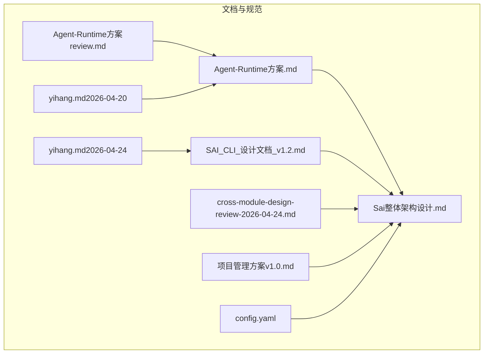

**图表来源**
- [Agent-Runtime方案.md:1-60](file://plan/Agent-Runtime方案.md#L1-L60)
- [SAI_CLI_设计文档_v1.2.md:1-635](file://plan/SAI_CLI_设计文档_v1.2.md#L1-L635)
- [Sai整体架构设计.md:1-277](file://project/standup/Sai整体架构设计.md#L1-L277)
- [cross-module-design-review-2026-04-24.md:1-306](file://notes/zhaobomin/cross-module-design-review-2026-04-24.md#L1-L306)
- [Agent-Runtime方案review.md:1-55](file://notes/zhaobomin/Agent-Runtime方案review.md#L1-L55)
- [yihang.md（2026-04-20）:1-23](file://daily/2026-04-20/yihang.md#L1-L23)
- [yihang.md（2026-04-24）:1-89](file://daily/2026-04-24/yihang.md#L1-L89)
- [项目管理方案v1.0.md:1-175](file://project/项目管理方案v1.0.md#L1-L175)
- [config.yaml:1-21](file://openspec/config.yaml#L1-L21)

**章节来源**
- [Agent-Runtime方案.md:1-60](file://plan/Agent-Runtime方案.md#L1-L60)
- [SAI_CLI_设计文档_v1.2.md:1-635](file://plan/SAI_CLI_设计文档_v1.2.md#L1-L635)
- [Sai整体架构设计.md:1-277](file://project/standup/Sai整体架构设计.md#L1-L277)
- [cross-module-design-review-2026-04-24.md:1-306](file://notes/zhaobomin/cross-module-design-review-2026-04-24.md#L1-L306)
- [Agent-Runtime方案review.md:1-55](file://notes/zhaobomin/Agent-Runtime方案review.md#L1-L55)
- [yihang.md（2026-04-20）:1-23](file://daily/2026-04-20/yihang.md#L1-L23)
- [yihang.md（2026-04-24）:1-89](file://daily/2026-04-24/yihang.md#L1-L89)
- [项目管理方案v1.0.md:1-175](file://project/项目管理方案v1.0.md#L1-L175)
- [config.yaml:1-21](file://openspec/config.yaml#L1-L21)

## 核心组件
- Agent运行时（Agent Runtime）
  - 职责：意图理解、会话管理、CLI调用、技能加载与执行
  - 隔离：基于Serverless按session分配实例，一实例一session
  - 启动性能：冷启动<1s，热启动约100ms
- LLM网关（LLM Gateway）
  - 职责：统一LLM代理、Token管理、成本控制
  - 协议：OpenAI风格接口
- Harness Manager（HM）
  - 职责：知识库、Skills、CLI注册与分发
  - CLI分发：统一构建单一SAI-CLI二进制，通过OSS挂载至Agent运行环境
- Channel（申懂懂App）
  - 职责：用户接入、前端交互、与Agent运行时的会话接口
  - 当前评审状态：接口定义尚缺文档

**章节来源**
- [Agent-Runtime方案.md:4-13](file://plan/Agent-Runtime方案.md#L4-L13)
- [Sai整体架构设计.md:142-151](file://project/standup/Sai整体架构设计.md#L142-L151)
- [cross-module-design-review-2026-04-24.md:49-66](file://notes/zhaobomin/cross-module-design-review-2026-04-24.md#L49-L66)
- [cross-module-design-review-2026-04-24.md:171-184](file://notes/zhaobomin/cross-module-design-review-2026-04-24.md#L171-L184)

## 架构总览
Agent运行时接口贯穿“意图理解链路”和“业务执行链路”，并通过网关与HM协同完成技能与CLI的拉取与分发。

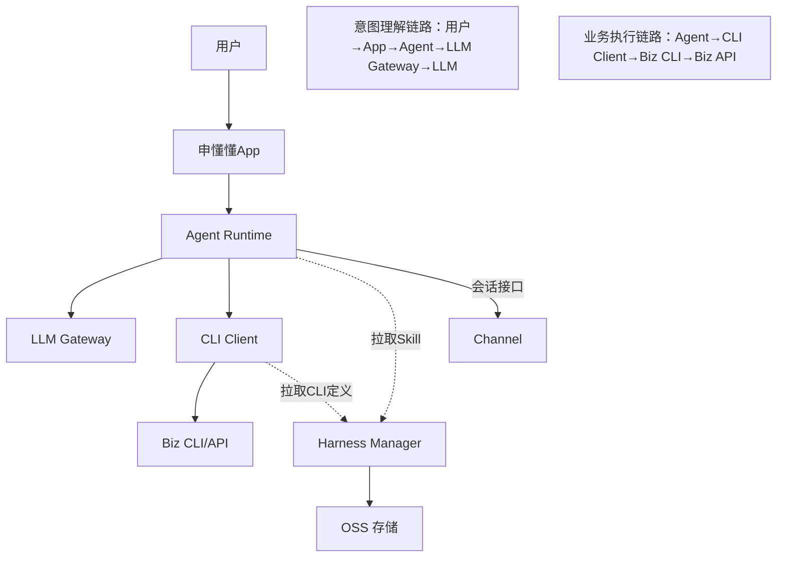

**图表来源**
- [Sai整体架构设计.md:19-65](file://project/standup/Sai整体架构设计.md#L19-L65)
- [Sai整体架构设计.md:108-138](file://project/standup/Sai整体架构设计.md#L108-L138)

**章节来源**
- [Sai整体架构设计.md:19-65](file://project/standup/Sai整体架构设计.md#L19-L65)
- [Sai整体架构设计.md:108-138](file://project/standup/Sai整体架构设计.md#L108-L138)

## 详细组件分析

### 会话接口（Agent Runtime ↔ Channel）
- 接口路径（草案）：POST /agent/session
- 调用方：Channel（申懂懂App）
- 提供方：Agent Runtime
- 认证方式：用户Token透传
- 接口矩阵状态：⚠ 未写入文档（评审指出）

会话接口用于：
- 基于用户级别workspace获取agent session
- 基于session进行Agent交互

会话生命周期要点：
- 用户隔离：基于Serverless按session分配实例，一实例一session
- 用户workspace组织：mount_list为本地文件路径与OSS bucket路径的映射
- Serverless层不感知user id，避免业务逻辑侵入

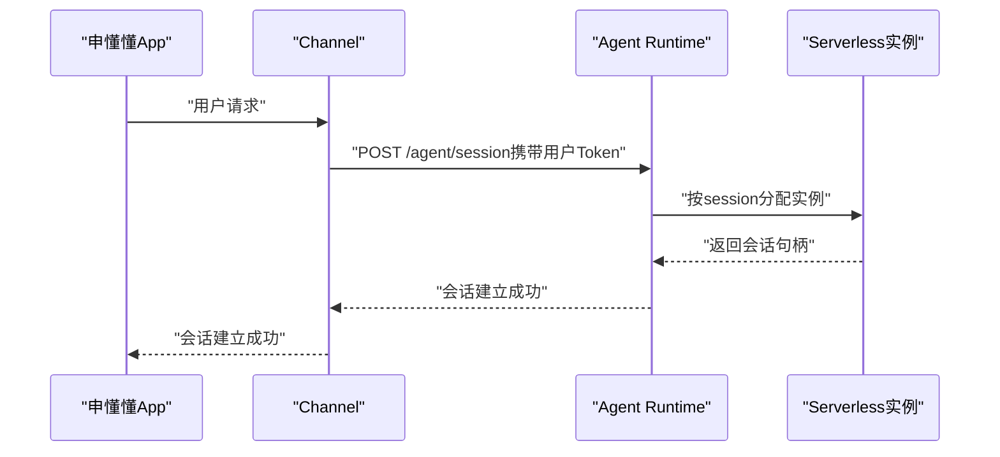

**图表来源**
- [yihang.md（2026-04-20）:7-11](file://daily/2026-04-20/yihang.md#L7-L11)
- [Agent-Runtime方案.md:4-13](file://plan/Agent-Runtime方案.md#L4-L13)
- [Sai整体架构设计.md:158](file://project/standup/Sai整体架构设计.md#L158)

**章节来源**
- [yihang.md（2026-04-20）:7-11](file://daily/2026-04-20/yihang.md#L7-L11)
- [Agent-Runtime方案.md:4-13](file://plan/Agent-Runtime方案.md#L4-L13)
- [Sai整体架构设计.md:158](file://project/standup/Sai整体架构设计.md#L158)
- [cross-module-design-review-2026-04-24.md:254-267](file://notes/zhaobomin/cross-module-design-review-2026-04-24.md#L254-L267)

### 意图理解接口（Agent Runtime → LLM Gateway）
- 接口路径：POST /v1/chat/completions
- 协议：OpenAI风格
- 认证：Bearer Token（Gateway分配的虚拟key）
- 评审状态：✅ 已对齐

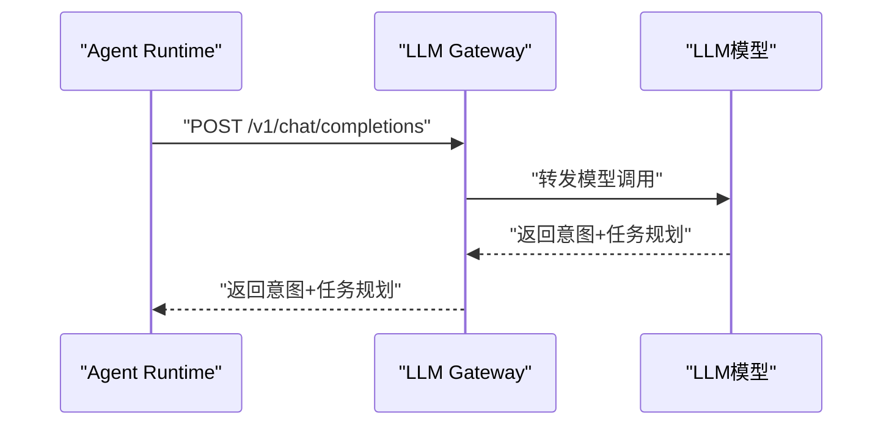

**图表来源**
- [Sai整体架构设计.md:158](file://project/standup/Sai整体架构设计.md#L158)

**章节来源**
- [Sai整体架构设计.md:158](file://project/standup/Sai整体架构设计.md#L158)

### CLI注册与元数据接口（Harness Manager）
- AI元数据生成接口：POST /api/v1/sai/cli/metadata/generate
- CLI注册接口：POST /api/v1/sai/cli/registry
- 支持操作：add（新增）、update（更新）、remove（注销，软删除30天可恢复）
- 评审状态：⚠ v1.2有路径，但缺少完整请求/响应schema

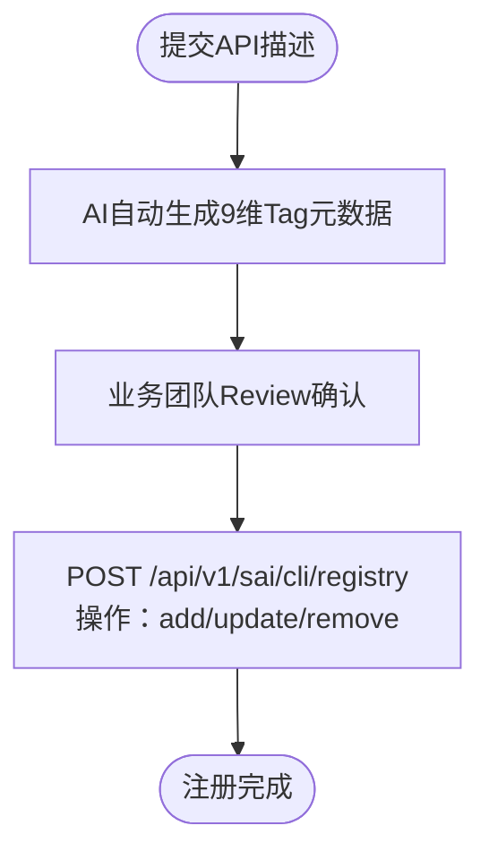

**图表来源**
- [SAI_CLI_设计文档_v1.2.md:376-391](file://plan/SAI_CLI_设计文档_v1.2.md#L376-L391)

**章节来源**
- [SAI_CLI_设计文档_v1.2.md:376-391](file://plan/SAI_CLI_设计文档_v1.2.md#L376-L391)

### CLI调用与鉴权（Agent Runtime → CLI Client → Biz CLI）
- 命令规范：{product} {module} {action} [params]
- 结构化输出：JSON（含结构化错误输出）
- 鉴权方案：PoP Token（分一期/二期实施）
- 评审状态：⚠ 与Agent Runtime的Skill拉取接口仍需补充

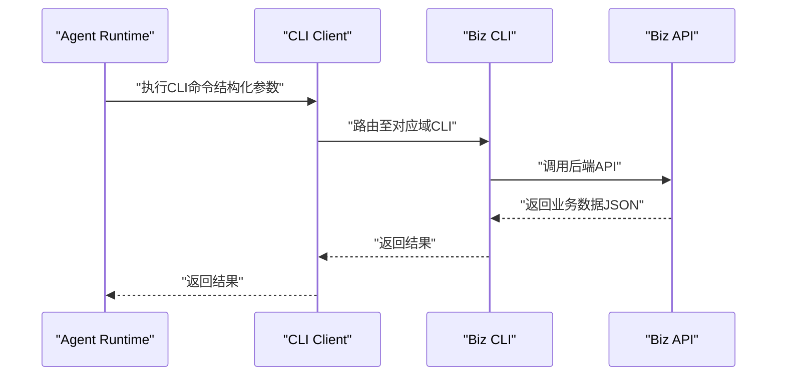

**图表来源**
- [Sai整体架构设计.md:206-213](file://project/standup/Sai整体架构设计.md#L206-L213)
- [SAI_CLI_设计文档_v1.2.md:115-146](file://plan/SAI_CLI_设计文档_v1.2.md#L115-L146)

**章节来源**
- [Sai整体架构设计.md:206-213](file://project/standup/Sai整体架构设计.md#L206-L213)
- [SAI_CLI_设计文档_v1.2.md:115-146](file://plan/SAI_CLI_设计文档_v1.2.md#L115-L146)

### 技能管理接口（Agent Runtime ← HM）
- 接口路径（草案）：GET /hm/skills/list
- 认证：HM内部Token
- 评审状态：⚠ 仅整体架构有路径，无schema

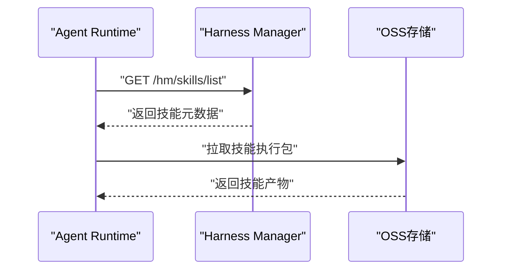

**图表来源**
- [Sai整体架构设计.md:160](file://project/standup/Sai整体架构设计.md#L160)

**章节来源**
- [Sai整体架构设计.md:160](file://project/standup/Sai整体架构设计.md#L160)

### CLI元数据与分发（CLI Client ← HM）
- 接口路径（草案）：GET /hm/cli/meta
- 认证：HM内部Token
- 评审状态：⚠ v1.2有路径规范，但缺少版本/缓存细节

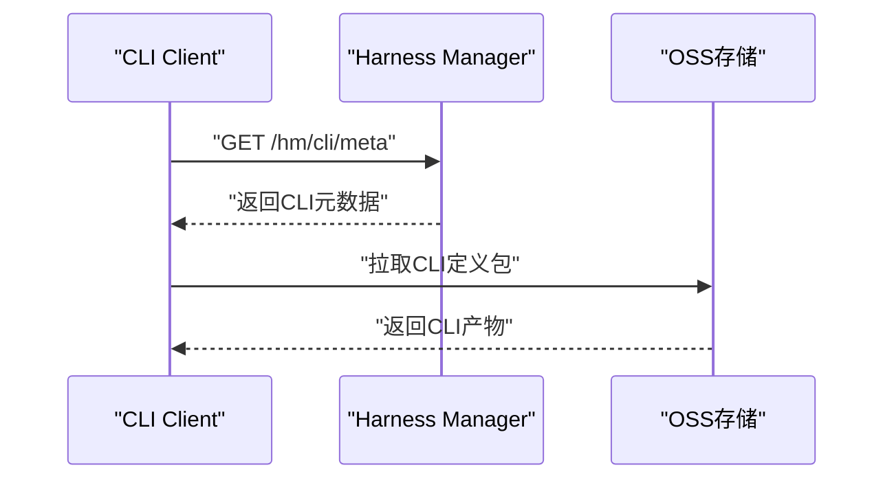

**图表来源**
- [Sai整体架构设计.md:161](file://project/standup/Sai整体架构设计.md#L161)

**章节来源**
- [Sai整体架构设计.md:161](file://project/standup/Sai整体架构设计.md#L161)

### 知识检索接口（Agent Runtime ← HM）
- 接口路径（草案）：POST /hm/kb/search
- 认证：HM内部Token
- 评审状态：⚠ 无KB设计文档

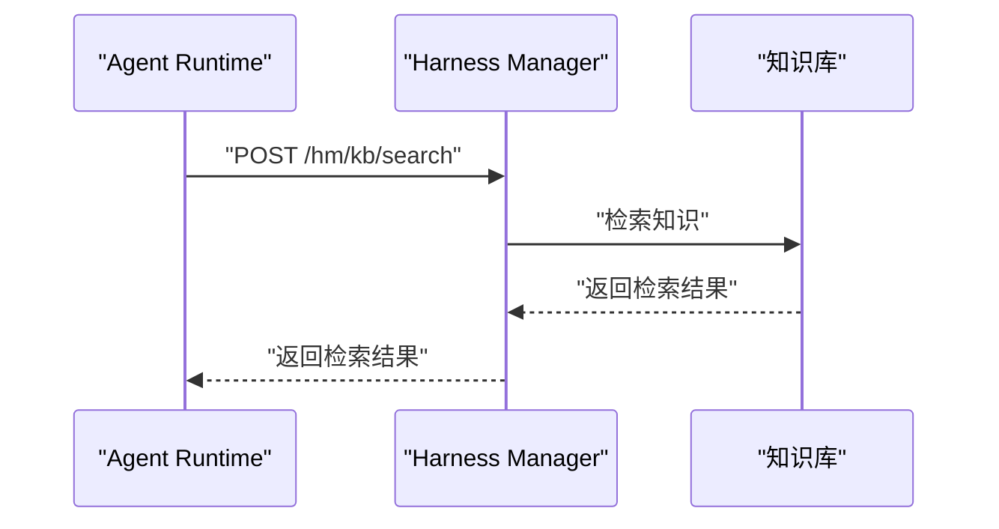

**图表来源**
- [Sai整体架构设计.md:163](file://project/standup/Sai整体架构设计.md#L163)

**章节来源**
- [Sai整体架构设计.md:163](file://project/standup/Sai整体架构设计.md#L163)

## 依赖分析
模块间接口依赖矩阵（摘要）：
- Agent会话：Channel → Agent Runtime（POST /agent/session，用户Token透传）
- LLM调用：Agent Runtime → LLM Gateway（POST /v1/chat/completions，OpenAI风格）
- 技能拉取：Agent Runtime → HM（GET /hm/skills/list，HM内部Token）
- CLI拉取：CLI Client → HM（GET /hm/cli/meta，HM内部Token）
- CLI注册：Biz CLI → HM（POST /hm/cli/register，业务方Token）
- 知识检索：Agent Runtime → HM（POST /hm/kb/search，HM内部Token）

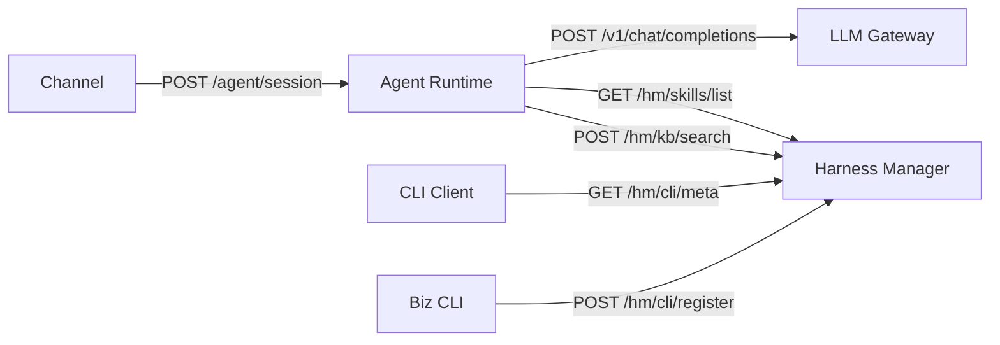

**图表来源**
- [Sai整体架构设计.md:154-164](file://project/standup/Sai整体架构设计.md#L154-L164)

**章节来源**
- [Sai整体架构设计.md:154-164](file://project/standup/Sai整体架构设计.md#L154-L164)

## 性能考量
- 启动性能：Agent实例冷启动<1s，热启动约100ms（来自Agent运行时方案）
- Serverless伸缩：与老徐团队沟通POD动态伸缩容方案，确认API接口与参数
- CLI分发：统一构建单一SAI-CLI二进制，通过OSS挂载，减少Agent拉取复杂度
- 错误降级：LLM Gateway熔断时，Agent返回固定提示；HM不可用时，Agent使用本地缓存

**章节来源**
- [Agent-Runtime方案.md:6](file://plan/Agent-Runtime方案.md#L6)
- [yihang.md（2026-04-24）:46-48](file://daily/2026-04-24/yihang.md#L46-L48)
- [Sai整体架构设计.md:236-245](file://project/standup/Sai整体架构设计.md#L236-L245)

## 故障排除指南
常见故障与降级策略：
- HM不可用：Agent使用本地缓存最近一次Skill/CLI定义，降级为无知识检索模式
- LLM Gateway熔断：Agent返回固定提示："当前 AI 服务暂时不可用，请稍后重试"；业务执行链路不受影响
- Biz API超时/失败：CLI Client单次重试（≤3s等待），失败后Agent向用户说明具体接口不可用
- OSS不可用：Agent使用本地缓存版本运行，日志告警通知HM团队
- Agent Runtime实例崩溃：Serverless平台自动重建实例，用户会话需重新发起

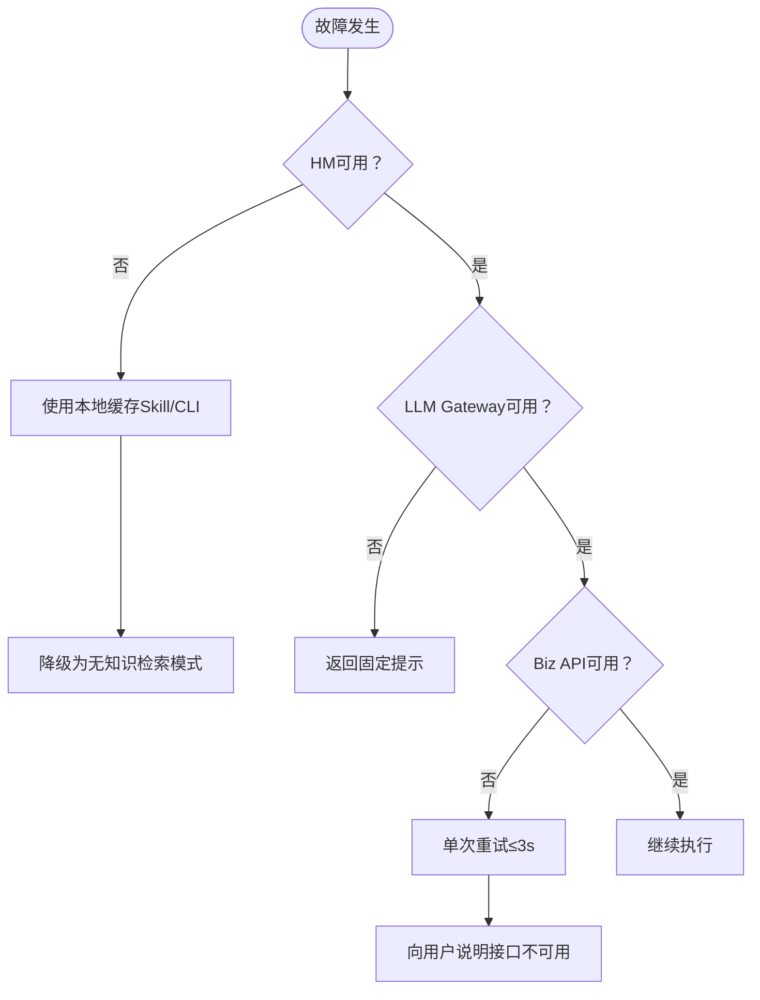

**图表来源**
- [Sai整体架构设计.md:236-245](file://project/standup/Sai整体架构设计.md#L236-L245)

**章节来源**
- [Sai整体架构设计.md:236-245](file://project/standup/Sai整体架构设计.md#L236-L245)

## 结论
- Agent运行时接口当前处于“接口矩阵已对齐但文档缺失”的阶段，会话接口（POST /agent/session）与LLM调用接口（POST /v1/chat/completions）已明确，其余接口（Skill/CLI/HM）仍需补充schema与版本管理细节
- 用户隔离与Serverless执行架构清晰，具备冷启动<1s、热启动约100ms的性能基础
- CLI分发采用统一构建与OSS挂载，降低Agent侧复杂度
- 建议优先补齐Channel与Agent Runtime的会话接口文档、HM与Agent Runtime的接口契约，以及全局错误码规范

## 附录

### 调用示例（步骤化说明）
- 会话建立
  - Channel调用Agent Runtime的会话接口，携带用户Token
  - Agent Runtime按session分配Serverless实例，返回会话句柄
- 意图理解
  - Agent Runtime调用LLM Gateway的聊天接口，获取意图与任务规划
- 业务执行
  - Agent Runtime通过CLI Client执行CLI命令，返回结构化结果
- 结果返回
  - Agent Runtime将结果返回Channel，由前端展示

**章节来源**
- [yihang.md（2026-04-20）:7-11](file://daily/2026-04-20/yihang.md#L7-L11)
- [Sai整体架构设计.md:108-138](file://project/standup/Sai整体架构设计.md#L108-L138)

### 最佳实践
- 严格遵循“无交互式输入”原则，确保Agent可自动化执行
- 使用结构化JSON输出与错误，便于Agent解析与用户理解
- 通过OSS挂载与统一构建的CLI二进制，减少Agent侧文件管理复杂度
- 在Agent Runtime与HM之间定义清晰的接口契约与版本管理策略

**章节来源**
- [SAI_CLI_设计文档_v1.2.md:120-146](file://plan/SAI_CLI_设计文档_v1.2.md#L120-L146)
- [SAI_CLI_设计文档_v1.2.md:394-471](file://plan/SAI_CLI_设计文档_v1.2.md#L394-L471)

### 风险与建议
- Channel设计文档缺失：建议尽快补齐前端架构、消息协议与与Agent Runtime的接口定义
- HM接口契约未定义：建议明确Skill/CLI/HM的接口schema、版本与缓存策略
- OSS挂载个性化需求：若阿里云评估无结论，需启动Agent层文件权限B方案

**章节来源**
- [cross-module-design-review-2026-04-24.md:171-184](file://notes/zhaobomin/cross-module-design-review-2026-04-24.md#L171-L184)
- [cross-module-design-review-2026-04-24.md:270-284](file://notes/zhaobomin/cross-module-design-review-2026-04-24.md#L270-L284)
- [Agent-Runtime方案review.md:18-31](file://notes/zhaobomin/Agent-Runtime方案review.md#L18-L31)