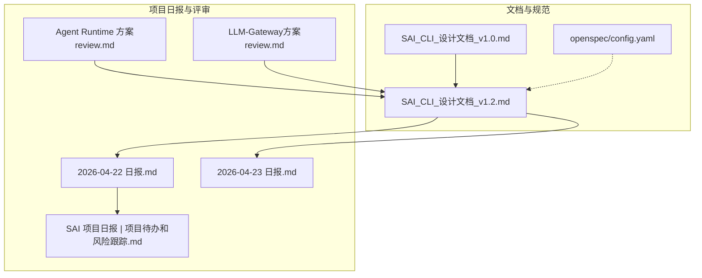
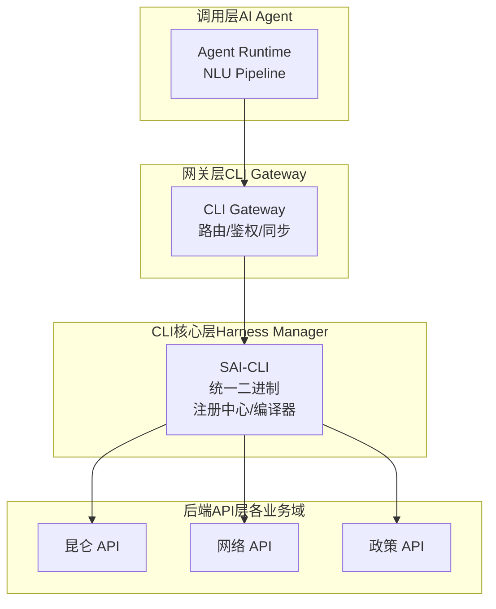
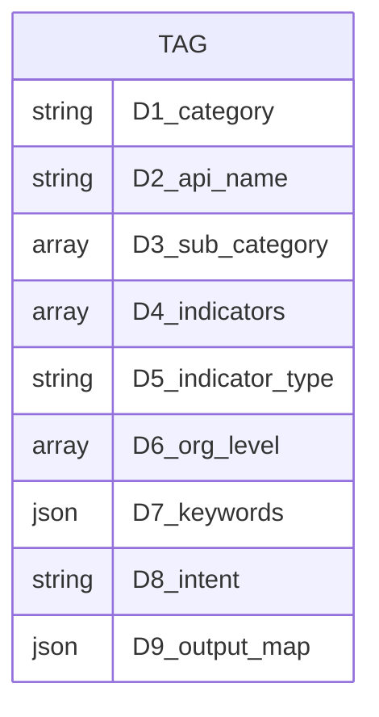
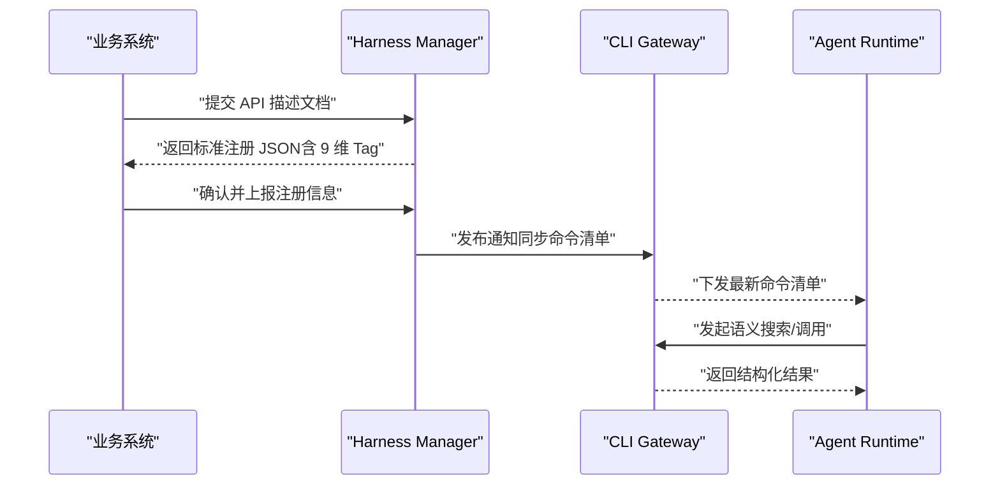
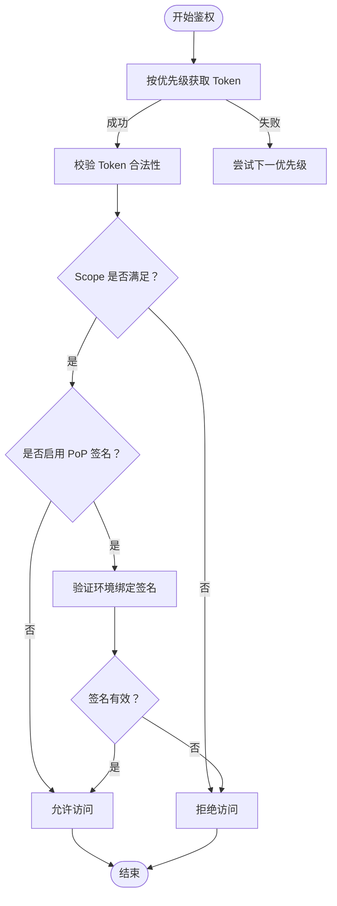
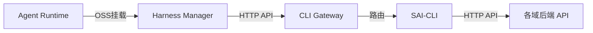

# CLI系统接口

<cite>
**本文档引用的文件**
- [SAI_CLI_设计文档_v1.0.md](file://plan/SAI_CLI_设计文档_v1.0.md)
- [SAI_CLI_设计文档_v1.2.md](file://plan/SAI_CLI_设计文档_v1.2.md)
- [2026-04-22 日报.md](file://daily/2026-04-22/suiyun.md)
- [2026-04-23 日报.md](file://daily/2026-04-23/suiyun.md)
- [SAI 项目日报 | 项目待办和风险跟踪.md](file://project/SAI-daily-report-2026-04-22-final.md)
- [Agent Runtime 方案review.md](file://notes/zhaobomin/Agent-Runtime方案review.md)
- [LLM-Gateway方案review.md](file://notes/zhaobomin/LLM-Gateway方案review.md)
- [config.yaml](file://openspec/config.yaml)
</cite>

## 目录
1. [简介](#简介)
2. [项目结构](#项目结构)
3. [核心组件](#核心组件)
4. [架构概览](#架构概览)
5. [详细组件分析](#详细组件分析)
6. [依赖分析](#依赖分析)
7. [性能考虑](#性能考虑)
8. [故障排查指南](#故障排查指南)
9. [结论](#结论)
10. [附录](#附录)

## 简介
本文件为 SAI（申通 AI 智能体平台）CLI 系统模块的全面 API 接口文档，覆盖四层分层架构、9 维 Tag 元数据体系、业务能力封装接口、鉴权控制与权限管理机制、CLI 注册流程、版本管理与更新机制，以及 CLI 命令示例、参数规范与使用指南。文档基于 v1.0 与 v1.2 设计文档，并结合项目日报与相关评审材料，形成可执行、可扩展、可治理的 CLI 接口规范。

## 项目结构
- 文档层面：以 SAI CLI 设计文档为核心，配套项目日报、评审记录与 openspec 配置，形成从架构到落地的完整知识谱系。
- 代码层面：当前仓库未包含 CLI 实现源码，API 规范与交互流程以文档为准，CLI 二进制由 Harness Manager 统一构建与发布。

**图表来源**
- [SAI_CLI_设计文档_v1.2.md](file://plan/SAI_CLI_设计文档_v1.2.md)
- [2026-04-22 日报.md](file://daily/2026-04-22/suiyun.md)
- [2026-04-23 日报.md](file://daily/2026-04-23/suiyun.md)
- [SAI 项目日报 | 项目待办和风险跟踪.md](file://project/SAI-daily-report-2026-04-22-final.md)
- [Agent Runtime 方案review.md](file://notes/zhaobomin/Agent Runtime 方案review.md)
- [LLM-Gateway方案review.md](file://notes/zhaobomin/LLM-Gateway方案review.md)
- [config.yaml](file://openspec/config.yaml)

**章节来源**
- [SAI_CLI_设计文档_v1.2.md](file://plan/SAI_CLI_设计文档_v1.2.md)
- [SAI_CLI_设计文档_v1.0.md](file://plan/SAI_CLI_设计文档_v1.0.md)
- [2026-04-22 日报.md](file://daily/2026-04-22/suiyun.md)
- [2026-04-23 日报.md](file://daily/2026-04-23/suiyun.md)
- [SAI 项目日报 | 项目待办和风险跟踪.md](file://project/SAI-daily-report-2026-04-22-final.md)
- [Agent Runtime 方案review.md](file://notes/zhaobomin/Agent Runtime 方案review.md)
- [LLM-Gateway方案review.md](file://notes/zhaobomin/LLM-Gateway方案review.md)
- [config.yaml](file://openspec/config.yaml)

## 核心组件
- 调用层（AI Agent）
  - 职责：根据用户提问在 SAI-CLI 中搜索相关 API，结合上下文选择最匹配的 API，拼接执行命令并返回结构化结果。
  - 关键约束：不直接调用后端 API；命令必须通过 SAI-CLI 注册发现。
- 网关层（CLI Gateway）
  - 职责：路由转发、鉴权校验（PoP 签名验证）、负载均衡、命令清单同步。
  - 关键能力：API 注册接口、元数据搜索接口、元数据生成、发布通知接口。
- CLI 核心层（Harness Manager 统一构建）
  - 职责：统一命令规范、入参/出参 JSON、公共能力（认证/日志）；内置 API 注册中心，统一管理各域命令的 9 维 Tag、description、入参说明；通过 SkillCompiler 将元数据编译为 Agent 可读的 Tool 定义。
  - 关键约束：各业务域不参与 CLI 开发；CLI 不感知 Agent 存在。
- 后端 API 层（各业务域）
  - 职责：提供业务功能的 HTTP 接口，零侵入。
  - 关键约束：无需改造前端 GUI，无需开发 CLI。

**章节来源**
- [SAI_CLI_设计文档_v1.2.md](file://plan/SAI_CLI_设计文档_v1.2.md)
- [SAI_CLI_设计文档_v1.0.md](file://plan/SAI_CLI_设计文档_v1.0.md)

## 架构概览
SAI CLI 采用四层分层架构，实现 AI Agent 与各业务域后端服务的标准化接入。调用层通过网关访问统一的 SAI-CLI，后者封装各域 API 并提供结构化输出。

**图表来源**
- [SAI_CLI_设计文档_v1.2.md](file://plan/SAI_CLI_设计文档_v1.2.md)

## 详细组件分析

### 命令规范与格式
- 统一命令格式：{product} {module} {action} [params]
- 字段说明：
  - product：产品域标识（如：kunlun、network、policy、finance）
  - module：功能模块（如：timeliness、route、rule、order、fee）
  - action：操作类型（get、list、create、update、delete）
  - params：命令参数（JSON 格式）

- 命令示例：
  - 昆仑域：kunlun timeliness query --type 出港滞留 --date 2026-04-21
  - 网络域：network order get --orgName 杭州网点 --timeType day
  - 政策域：policy rule query --product 标快 --region 华东

**章节来源**
- [SAI_CLI_设计文档_v1.2.md](file://plan/SAI_CLI_设计文档_v1.2.md)
- [SAI_CLI_设计文档_v1.0.md](file://plan/SAI_CLI_设计文档_v1.0.md)

### 9 维 Tag 元数据体系
- 维度总览：
  - 路由与分类组（D1-D4）：指标大类、API 名称、二级类目、指标清单
  - NLU 理解组（D5-D8）：指标类型、触发关键词（exact/synonym/negative）、场景意图
  - 执行与展示组（D6-D9）：适用层级、出参映射
- 关键机制：D7 的 negative 关键词用于防误判，防止将用户请求路由到错误的 API。
- 注册信息示例：包含 command、tags（D1-D9）、description、params、example。

**图表来源**
- [SAI_CLI_设计文档_v1.2.md](file://plan/SAI_CLI_设计文档_v1.2.md)

**章节来源**
- [SAI_CLI_设计文档_v1.2.md](file://plan/SAI_CLI_设计文档_v1.2.md)

### 业务能力封装接口
- API 注册接口（Harness Manager 对外）：
  - 元数据生成：POST /api/v1/sai/cli/metadata/generate
  - 命令注册：POST /api/v1/sai/cli/registry（支持 add/update/remove）
- 网关侧能力：
  - 元数据搜索接口：支持关键词/语义搜索
  - 元数据生成：AI 自动生成命令元数据及 9 维 Tag
  - 发布通知接口：触发命令清单同步更新

**图表来源**
- [SAI_CLI_设计文档_v1.2.md](file://plan/SAI_CLI_设计文档_v1.2.md)

**章节来源**
- [SAI_CLI_设计文档_v1.2.md](file://plan/SAI_CLI_设计文档_v1.2.md)

### 鉴权控制与权限管理
- 一期鉴权方案（PoP Token）：
  - Token 获取优先级：命令行参数 > 环境变量 > 本地配置文件
  - 配置文件格式：包含 token、identity_type、scopes、expires_at
  - 接口鉴权：Harness Manager API 使用 AK/SK 签名（HMAC-SHA256）
- 二期安全增强（PoP 签名 + ECDSA）：
  - 引入 sai-agent 作为安全代理，实现 Token 与设备/环境绑定
  - 云上 Token 只能在云上用，本地 Token 只能自己用
- 权限控制：Scope 权限控制，每个命令对应一组所需 Scope；高危操作需要更高权限或二次确认。

**图表来源**
- [SAI_CLI_设计文档_v1.2.md](file://plan/SAI_CLI_设计文档_v1.2.md)

**章节来源**
- [SAI_CLI_设计文档_v1.2.md](file://plan/SAI_CLI_设计文档_v1.2.md)

### CLI 注册流程
- 路径 A（AI 辅助）：提交 API 基础信息 → AI 自动生成 9 维 Tag 元数据 → 业务团队审核修改 → 注册
- 路径 B（自行准备）：按标准格式自行编写 9 维 Tag 元数据 → 直接注册
- 注册接口支持 add/update/remove 操作，支持软删除 30 天可恢复。

**章节来源**
- [SAI_CLI_设计文档_v1.2.md](file://plan/SAI_CLI_设计文档_v1.2.md)

### 版本管理与更新机制
- 发布流程：业务系统提供 API → Harness Manager 更新 CLI 代码 → 打包为统一 SAI-CLI 二进制 → 上传至 OSS 路径 → 调用网关发布通知 → 网关生效
- OSS 路径规范：CLI 网关、系统内置技能、公共技能、用户技能分别挂载到约定路径
- CLI 二进制构建：统一构建，业务系统无需编译、部署任何 CLI 代码

**章节来源**
- [SAI_CLI_设计文档_v1.2.md](file://plan/SAI_CLI_设计文档_v1.2.md)
- [2026-04-22 日报.md](file://daily/2026-04-22/suiyun.md)
- [2026-04-23 日报.md](file://daily/2026-04-23/suiyun.md)

### 使用指南与参数规范
- 无交互式输入：所有参数通过命令行传入，禁止运行时弹出交互式提示
- 结构化输出：统一 JSON 格式；错误输出包含 type、code、message、hint 四个字段
- Dry-Run 模式：写操作命令支持 --dry-run 参数，返回将要执行的操作描述
- 参数示例：参考各域命令示例，确保参数名称、类型、必填性、默认值、可选项与示例符合规范

**章节来源**
- [SAI_CLI_设计文档_v1.2.md](file://plan/SAI_CLI_设计文档_v1.2.md)
- [SAI_CLI_设计文档_v1.0.md](file://plan/SAI_CLI_设计文档_v1.0.md)

## 依赖分析
- 组件耦合与内聚：
  - 调用层与网关层：通过标准化接口契约耦合，不穿透调用
  - 网关层与 CLI 核心层：通过命令清单与鉴权接口耦合
  - CLI 核心层与后端 API 层：通过统一 HTTP 接口耦合，零侵入
- 外部依赖与集成点：
  - Agent Runtime：通过 OSS 挂载与 Harness Manager 协作
  - LLM Gateway：与 Agent Runtime 协同，提供路由与安全能力
  - Openspec：提供项目上下文与规范约束

**图表来源**
- [SAI_CLI_设计文档_v1.2.md](file://plan/SAI_CLI_设计文档_v1.2.md)
- [Agent Runtime 方案review.md](file://notes/zhaobomin/Agent Runtime 方案review.md)
- [LLM-Gateway方案review.md](file://notes/zhaobomin/LLM-Gateway方案review.md)

**章节来源**
- [SAI_CLI_设计文档_v1.2.md](file://plan/SAI_CLI_设计文档_v1.2.md)
- [Agent Runtime 方案review.md](file://notes/zhaobomin/Agent Runtime 方案review.md)
- [LLM-Gateway方案review.md](file://notes/zhaobomin/LLM-Gateway方案review.md)

## 性能考虑
- 单 CLI 二进制：统一构建，减少部署与分发复杂度，提升冷启动与热启动性能
- 命令清单动态加载：以本地缓存为基座，避免每次全量拉取，支持离线或弱网场景
- 负载均衡与路由：网关层提供负载均衡与命令清单同步，保障高可用与一致性
- 安全与性能平衡：PoP 签名验证在保证安全的同时，尽量降低链路延时（如可选的调用代理节点）

## 故障排查指南
- 鉴权相关错误：
  - 检查 Token 获取优先级是否正确配置（命令行参数、环境变量、本地配置文件）
  - 确认 sso-auth.json 文件格式与字段完整性
  - 如启用 PoP 签名，验证环境绑定签名是否有效
- 命令执行错误：
  - 检查命令格式与参数是否符合规范（JSON 格式、必填参数、默认值）
  - 使用 Dry-Run 模式预览将要执行的操作，确认影响范围
- 网关与注册问题：
  - 确认注册接口调用成功，命令清单已同步
  - 检查 OSS 挂载路径与 Agent 侧读取逻辑是否对齐
- 结构化错误输出：
  - 严格遵循 type、code、message、hint 四字段规范，便于定位与修复

**章节来源**
- [SAI_CLI_设计文档_v1.2.md](file://plan/SAI_CLI_设计文档_v1.2.md)
- [SAI_CLI_设计文档_v1.0.md](file://plan/SAI_CLI_设计文档_v1.0.md)

## 结论
SAI CLI 系统通过四层分层架构与 9 维 Tag 元数据体系，实现了 AI Agent 与各业务域后端服务的标准化接入。统一的命令规范、结构化的输出与严格的鉴权控制，确保了系统的可扩展性、安全性与可维护性。Harness Manager 统一构建与发布机制，降低了业务域的接入与维护成本。随着 PoP 签名与 SkillCompiler 等能力的逐步完善，SAI CLI 将为 Agent Runtime 提供更强大的工具能力与更稳定的运行环境。

## 附录
- 术语表：
  - SAI：申通 AI 智能体平台
  - Agent：AI 智能体运行时
  - Gateway：CLI 网关
  - Manager：Harness Manager
  - Tag：元数据标签
  - PoP：证明持有（Proof-of-Possession）
- 相关文档与链接：
  - SAI CLI 设计文档 v1.0/v1.2
  - 项目日报与风险跟踪
  - Agent Runtime 方案 review
  - LLM Gateway 方案 review
  - openspec 配置