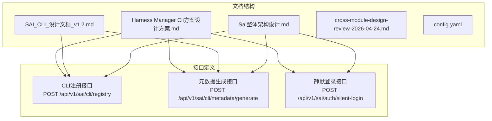
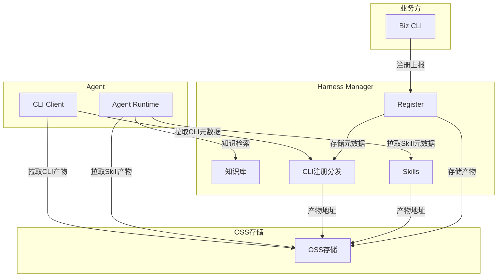
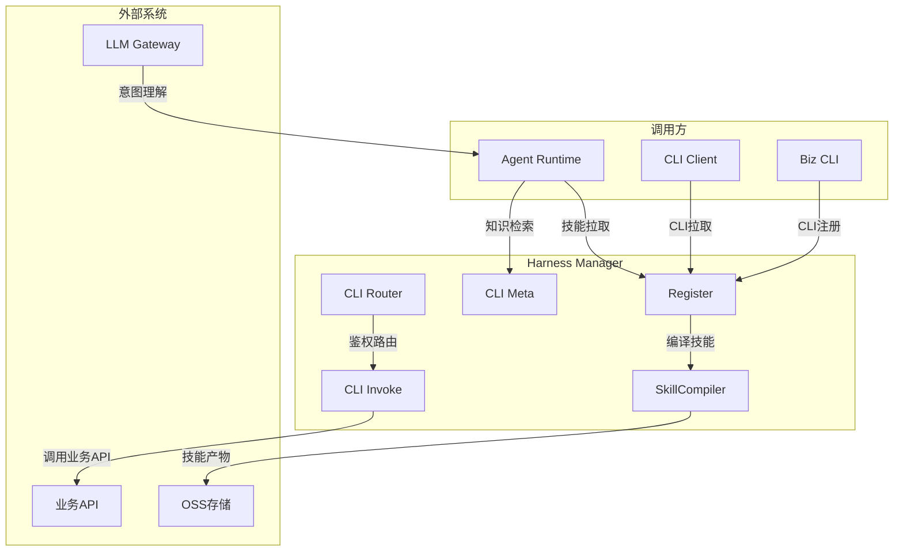

# Harness管理器接口

<cite>
**本文档引用的文件**
- [Harness Manager Cli方案设计方案.md](file://plan/Harness Manager Cli方案设计方案.md)
- [SAI_CLI_设计文档_v1.2.md](file://plan/SAI_CLI_设计文档_v1.2.md)
- [Sai整体架构设计.md](file://project/standup/Sai整体架构设计.md)
- [cross-module-design-review-2026-04-24.md](file://notes/zhaobomin/cross-module-design-review-2026-04-24.md)
- [config.yaml](file://openspec/config.yaml)
</cite>

## 目录
1. [简介](#简介)
2. [项目结构](#项目结构)
3. [核心组件](#核心组件)
4. [架构概览](#架构概览)
5. [详细组件分析](#详细组件分析)
6. [依赖分析](#依赖分析)
7. [性能考虑](#性能考虑)
8. [故障排查指南](#故障排查指南)
9. [结论](#结论)

## 简介
Harness管理器（Harness Manager，简称HM）是SAI CLI体系中的管理与接入层，负责统一承接业务API注册、CLI元数据管理、网关命令清单同步和Agent鉴权接入能力。本文档详细记录技能拉取接口、CLI拉取接口和CLI注册接口的完整定义，涵盖知识库管理、技能分发和CLI注册的API规范，包含认证授权机制、权限控制和访问限制，并提供接口调用示例、参数验证规则和错误码说明。

## 项目结构
本项目包含多个文档文件，其中与Harness管理器接口相关的关键文件如下：
- plan/Harness Manager Cli方案设计方案.md：包含完整的API接口设计、鉴权机制、响应格式等
- plan/SAI_CLI_设计文档_v1.2.md：包含CLI架构设计、9维Tag体系、鉴权方案等
- project/standup/Sai整体架构设计.md：包含HM子模块职责、接口矩阵等
- notes/zhaobomin/cross-module-design-review-2026-04-24.md：包含接口对齐状态、缺失项等
- openspec/config.yaml：包含项目配置信息



**图表来源**
- [Harness Manager Cli方案设计方案.md:150-157](file://plan/Harness Manager Cli方案设计方案.md#L150-L157)
- [SAI_CLI_设计文档_v1.2.md:376-391](file://plan/SAI_CLI_设计文档_v1.2.md#L376-L391)
- [Sai整体架构设计.md:154-166](file://project/standup/Sai整体架构设计.md#L154-L166)

**章节来源**
- [Harness Manager Cli方案设计方案.md:1-513](file://plan/Harness Manager Cli方案设计方案.md#L1-L513)
- [SAI_CLI_设计文档_v1.2.md:1-635](file://plan/SAI_CLI_设计文档_v1.2.md#L1-L635)
- [Sai整体架构设计.md:1-277](file://project/standup/Sai整体架构设计.md#L1-L277)
- [cross-module-design-review-2026-04-24.md:1-306](file://notes/zhaobomin/cross-module-design-review-2026-04-24.md#L1-L306)
- [config.yaml:1-21](file://openspec/config.yaml#L1-L21)

## 核心组件
Harness管理器包含以下核心组件：
- Register（API注册管理）：接收业务方上报，管理CLI命令的注册、更新和注销
- CLI Meta（元数据引擎）：存储和管理9维Tag元数据，支持AI自动生成
- SkillCompiler（技能编译）：将注册元数据编译为Agent可读的Tool定义
- CLI Router（路由与鉴权）：CLI命令路由转发，Token校验
- CLI Invoke（调用代理）：可选的调用代理节点，一期可跳过以降低链路延时

**章节来源**
- [SAI_CLI_设计文档_v1.2.md:547-559](file://plan/SAI_CLI_设计文档_v1.2.md#L547-L559)
- [Sai整体架构设计.md:173-194](file://project/standup/Sai整体架构设计.md#L173-L194)

## 架构概览
Harness管理器作为控制面服务，有三条核心数据流：
1. 注册流：业务方 → HM → OSS
2. 拉取流：Agent → HM（元数据）→ OSS（产物）
3. 检索流：Agent → HM → KB



**图表来源**
- [Sai整体架构设计.md:67-106](file://project/standup/Sai整体架构设计.md#L67-L106)

**章节来源**
- [Sai整体架构设计.md:67-106](file://project/standup/Sai整体架构设计.md#L67-L106)

## 详细组件分析

### CLI注册接口
CLI注册接口用于业务方上报CLI元数据，支持新增、更新、注销操作。

#### 接口定义
- 请求方法：POST
- 请求路径：`/api/v1/sai/cli/registry`
- Content-Type：application/json
- 鉴权方式：AK/SK签名鉴权

#### 请求参数
| 参数名 | 类型 | 必填 | 说明 |
|--------|------|------|------|
| systemCode | string | 是 | 业务系统编码 |
| systemName | string | 是 | 业务系统名称 |
| actionType | string | 是 | 操作类型：add/update/remove |
| apiId | string | 是 | API唯一标识 |
| apiHost | string | add时必填 | API服务域名 |
| apiPath | string | add时必填 | API路径 |
| method | string | add时必填 | HTTP方法 |
| apiName | string | add时必填 | API中文名称 |
| apiDesc | string | add时必填 | API功能描述 |
| apiVersion | string | add/update时必填 | 语义化版本号 |
| commandId | string | add时必填 | 命令唯一ID |
| command | string | add时必填 | 标准命令 |
| commandName | string | add时必填 | 命令中文名称 |
| description | string | 否 | 命令描述 |
| commandExample | string | 否 | 命令示例 |
| tags | object | add/update时必填 | D1-D9元数据 |
| parametersSchema | object | add/update时必填 | API入参JSON Schema |
| permissions | array[string] | 否 | 权限列表 |
| note | string | 否 | 变更备注 |

#### 响应字段
| 字段名 | 类型 | 说明 |
|--------|------|------|
| registrationId | string | 注册操作唯一ID |
| apiId | string | API唯一标识 |
| actionType | string | 操作类型 |
| commandId | string | 命令唯一ID |
| apiVersion | string | 生效版本号 |
| status | string | 状态：active/removed |
| effectiveTime | string | 网关生效时间 |
| previousVersion | string | 旧版本号 |
| gatewaySync | boolean | 是否已同步到网关 |

#### 业务规则与约束
- apiId唯一性：同一systemCode下不可重复
- 版本递增：update时apiVersion必须递增
- Tags完整性：必须包含D1-D9全维度
- parametersSchema校验：必须是合法JSON Schema
- API路径合法性：apiPath必须以/开头
- 注销保护：remove为软删除，保留30天可恢复
- 操作审计：所有操作记录registrationId与时间戳
- 并发控制：同一apiId串行处理

**章节来源**
- [Harness Manager Cli方案设计方案.md:302-376](file://plan/Harness Manager Cli方案设计方案.md#L302-L376)

### 元数据生成接口
元数据生成接口用于业务系统提交API基础信息，由AI生成D1-D9 Tag结构化元数据。

#### 接口定义
- 请求方法：POST
- 请求路径：`/api/v1/sai/cli/metadata/generate`
- Content-Type：application/json
- 鉴权方式：AK/SK签名鉴权

#### 请求参数
| 参数名 | 类型 | 必填 | 说明 |
|--------|------|------|------|
| systemCode | string | 是 | 业务系统编码 |
| systemName | string | 是 | 业务系统名称 |
| apiId | string | 否 | API唯一标识，不传则系统生成 |
| apiHost | string | 是 | API服务域名（含协议） |
| apiPath | string | 是 | API路径 |
| method | string | 是 | GET/POST/PUT/DELETE |
| apiName | string | 是 | API中文名称 |
| apiDesc | string | 是 | API功能描述 |
| parametersSchema | object | 否 | API入参JSON Schema |
| responseSchema | object | 否 | API出参JSON Schema |
| category | string | 否 | 指标大类提示 |

#### 响应核心字段
| 字段名 | 类型 | 说明 |
|--------|------|------|
| commandId | string | AI生成的命令唯一ID |
| command | string | AI生成的标准命令 |
| commandName | string | AI生成的命令中文名称 |
| description | string | 命令描述 |
| commandExample | string | 命令调用示例 |
| tags | object | D1-D9 Tag结构 |
| parametersSchema | object | AI增强后的参数结构 |
| permissions | array[string] | AI推荐权限列表 |

#### AI生成逻辑
AI基于apiDesc、parametersSchema、responseSchema和category自动推导D1-D9：
- D1：优先使用category，否则基于apiDesc推断
- D2：基于D1和apiName生成内部标识
- D3：从描述和参数中提取二级类目
- D4：从描述和参数中提取指标清单
- D5：根据指标后缀推断count/rate/target
- D6：从描述和参数中提取组织层级
- D7：生成精确词、同义词、排除词
- D8：根据查询场景和时间维度推断意图
- D9：基于responseSchema生成出参映射

**章节来源**
- [Harness Manager Cli方案设计方案.md:231-267](file://plan/Harness Manager Cli方案设计方案.md#L231-L267)
- [Harness Manager Cli方案设计方案.md:420-453](file://plan/Harness Manager Cli方案设计方案.md#L420-L453)

### 静默登录接口
静默登录接口用于Agent Runtime通过梧桐工号静默登录，获取用户身份信息与stoToken。

#### 接口定义
- 请求方法：POST
- 请求路径：`/api/v1/sai/auth/silent-login`
- Content-Type：application/json
- 鉴权方式：AK/SK签名鉴权

#### 请求参数
| 参数名 | 类型 | 必填 | 说明 |
|--------|------|------|------|
| code | string | 是 | 梧桐工号 |

#### 响应字段
| 字段名 | 类型 | 说明 |
|--------|------|------|
| id | string | 用户唯一ID |
| userName | string | 用户工号 |
| realName | string | 用户姓名 |
| companyName | string | 所属公司 |
| departmentName | string | 所属部门 |
| openId | string | 用户OpenID |
| signature | string | 用户签名标识 |
| authenticatedAt | string | 认证时间 |
| stoTokenExpiresAt | string | Token过期时间 |
| stoToken | string | 业务调用凭证 |

**章节来源**
- [Harness Manager Cli方案设计方案.md:391-419](file://plan/Harness Manager Cli方案设计方案.md#L391-L419)

### 技能拉取接口
技能拉取接口用于Agent Runtime从Harness Manager拉取Skill定义。

#### 接口定义
- 请求方法：GET
- 请求路径：`/hm/skills/list`
- 鉴权方式：HM内部Token
- 协议：HTTP/OSS

#### 请求参数
| 参数名 | 类型 | 必填 | 说明 |
|--------|------|------|------|
| version | string | 否 | 版本号，用于增量同步 |
| category | string | 否 | 技能分类过滤 |
| limit | integer | 否 | 返回数量限制，默认50 |

#### 响应格式
统一JSON响应信封：
```json
{
  "code": 200,
  "message": "操作成功",
  "timestamp": "2026-04-21T10:30:00Z",
  "data": {}
}
```

**章节来源**
- [Sai整体架构设计.md:159-160](file://project/standup/Sai整体架构设计.md#L159-L160)

### CLI拉取接口
CLI拉取接口用于CLI Client从Harness Manager拉取CLI定义。

#### 接口定义
- 请求方法：GET
- 请求路径：`/hm/cli/list`
- 鉴权方式：HM内部Token
- 协议：HTTP/OSS

#### 请求参数
| 参数名 | 类型 | 必填 | 说明 |
|--------|------|------|------|
| version | string | 否 | 版本号，用于增量同步 |
| product | string | 否 | 产品域过滤 |
| module | string | 否 | 功能模块过滤 |
| action | string | 否 | 操作类型过滤 |

#### 响应格式
统一JSON响应信封：
```json
{
  "code": 200,
  "message": "操作成功",
  "timestamp": "2026-04-21T10:30:00Z",
  "data": {}
}
```

**章节来源**
- [Sai整体架构设计.md:160-161](file://project/standup/Sai整体架构设计.md#L160-L161)

### 知识检索接口
知识检索接口用于Agent Runtime从Harness Manager进行知识检索。

#### 接口定义
- 请求方法：POST
- 请求路径：`/hm/kb/search`
- 鉴权方式：HM内部Token
- 协议：HTTP

#### 请求参数
| 参数名 | 类型 | 必填 | 说明 |
|--------|------|------|------|
| query | string | 是 | 检索关键词 |
| top_k | integer | 否 | 返回结果数量，默认10 |
| filters | object | 否 | 过滤条件 |
| threshold | number | 否 | 相似度阈值，默认0.7 |

#### 响应格式
统一JSON响应信封：
```json
{
  "code": 200,
  "message": "操作成功",
  "timestamp": "2026-04-21T10:30:00Z",
  "data": []
}
```

**章节来源**
- [Sai整体架构设计.md:162-162](file://project/standup/Sai整体架构设计.md#L162-L162)

## 依赖分析
Harness管理器接口之间的依赖关系如下：



**图表来源**
- [Sai整体架构设计.md:154-166](file://project/standup/Sai整体架构设计.md#L154-L166)
- [SAI_CLI_设计文档_v1.2.md:547-559](file://plan/SAI_CLI_设计文档_v1.2.md#L547-L559)

**章节来源**
- [Sai整体架构设计.md:154-166](file://project/standup/Sai整体架构设计.md#L154-L166)
- [SAI_CLI_设计文档_v1.2.md:547-559](file://plan/SAI_CLI_设计文档_v1.2.md#L547-L559)

## 性能考虑
- **冷启动优化**：Harness Manager采用OSS挂载形式，将统一打包的SAI-CLI二进制文件挂载至Agent运行环境，支持冷启动<1s
- **缓存策略**：Agent Runtime支持本地缓存最近一次Skill/CLI定义，当HM不可用时可降级为无知识检索模式
- **并发控制**：同一apiId串行处理，避免并发冲突
- **版本管理**：支持语义化版本控制，确保API变更的向后兼容性
- **增量同步**：支持版本号参数进行增量同步，减少网络传输

## 故障排查指南

### 常见错误码
- 200：操作成功
- 400：请求参数错误
- 401：鉴权失败
- 404：资源不存在
- 409：资源冲突
- 422：数据处理失败
- 500：服务内部错误

### 鉴权问题排查
1. **AK/SK签名错误**：检查X-Access-Key、X-Signature、X-Timestamp头部是否正确设置
2. **时间戳过期**：确保X-Timestamp在5分钟有效期内
3. **签名计算错误**：确认StringToSign格式和HMAC-SHA256算法实现

### 接口调用问题排查
1. **API注册失败**：检查apiId唯一性、Tags完整性、parametersSchema合法性
2. **元数据生成异常**：确认API描述文档质量，检查AI生成逻辑
3. **静默登录失败**：验证梧桐工号有效性，检查用户权限配置

### 性能问题排查
1. **响应缓慢**：检查网络连接，确认OSS挂载配置
2. **并发冲突**：避免同时对同一apiId进行多次操作
3. **内存占用过高**：检查Agent Runtime缓存配置

**章节来源**
- [Harness Manager Cli方案设计方案.md:180-210](file://plan/Harness Manager Cli方案设计方案.md#L180-L210)
- [cross-module-design-review-2026-04-24.md:236-245](file://notes/zhaobomin/cross-module-design-review-2026-04-24.md#L236-L245)

## 结论
Harness管理器接口提供了完整的CLI生命周期管理能力，包括元数据生成、API注册、静默登录等功能。通过AK/SK签名鉴权和PoP Token机制，确保了系统的安全性。接口设计遵循统一的响应格式和错误码规范，便于集成和维护。建议在实际部署中重点关注OSS挂载配置、版本管理和缓存策略，以确保系统的稳定性和性能。