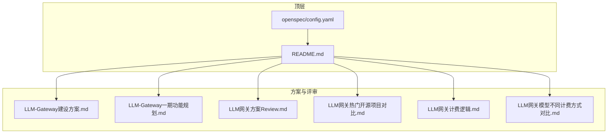
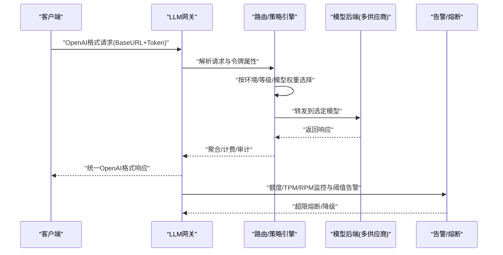
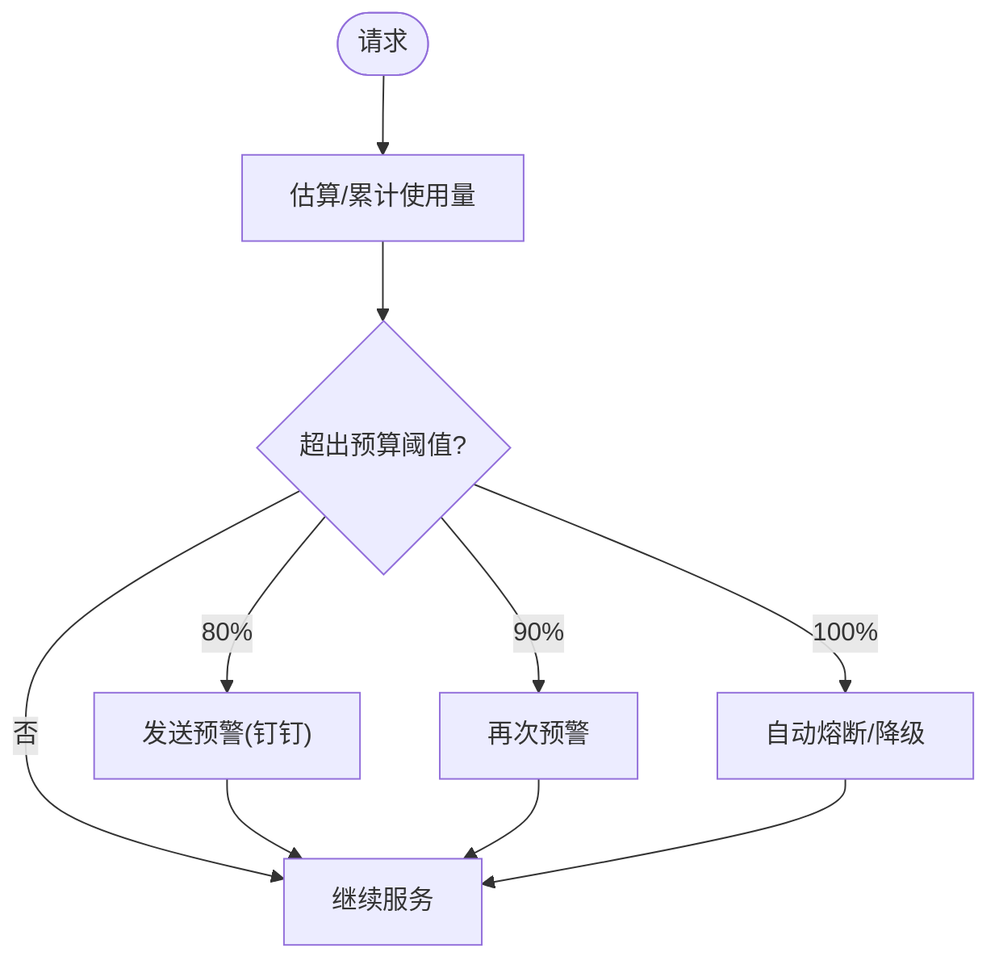
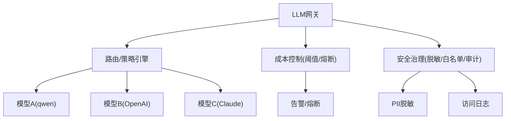

# LLM网关接口

<cite>
**本文引用的文件**
- [LLM网关建设方案.md](file://plan/LLM-Gateway建设方案.md)
- [LLM网关一期功能规划.md](file://plan/LLM-Gateway一期功能规划.md)
- [LLM网关方案Review.md](file://notes/zhaobomin/LLM-Gateway方案review.md)
- [LLM网关热门开源项目对比.md](file://plan/LLM Gateway 热门开源项目对比.md)
- [LLM网关计费逻辑.md](file://plan/LLM Gateway 计费逻辑.md)
- [LLM网关模型不同计费方式对比.md](file://plan/LLM Gateway 模型不同计费方式对比.md)
- [README.md](file://README.md)
- [openspec配置.md](file://openspec/config.yaml)
</cite>

## 目录
1. [简介](#简介)
2. [项目结构](#项目结构)
3. [核心组件](#核心组件)
4. [架构总览](#架构总览)
5. [详细组件分析](#详细组件分析)
6. [依赖分析](#依赖分析)
7. [性能考量](#性能考量)
8. [故障排查指南](#故障排查指南)
9. [结论](#结论)
10. [附录](#附录)

## 简介
本文件面向LLM网关模块，聚焦统一的LLM调用接口定义、多模型接入路由策略、成本控制与安全治理、调用示例、错误处理与性能优化建议，以及模型选择算法、负载均衡策略与监控指标说明。文档以仓库内现有方案与评审材料为基础，结合LiteLLM选型与DevOps融合思路，形成可操作的接口与运营规范。

## 项目结构
- 顶层README展示了Sai整体模块分工，其中LLMRouter位于基础设施层，承担LLM网关职责。
- 方案与评审材料集中于plan与notes目录，覆盖网关架构、路由策略、成本控制、安全治理与开源对比。
- openspec配置文件提供规范驱动的工程上下文，便于统一接口风格与约束。



**图表来源**
- [README.md:1-72](file://README.md#L1-L72)
- [openspec配置.md:1-21](file://openspec/config.yaml#L1-L21)

**章节来源**
- [README.md:1-72](file://README.md#L1-L72)
- [openspec配置.md:1-21](file://openspec/config.yaml#L1-L21)

## 核心组件
- 统一代理层：向下接入多家模型（qwen系列、OpenAI、Claude、Gemini等），向上统一暴露OpenAI格式API，实现零成本切换。
- DevOps密钥分发：通过审批流触发Webhook，自动创建渠道与唯一Token；CI/CD流水线按环境注入网关Token。
- 流量降级与成本控制：按环境与应用等级路由至不同模型；设置TPM/RPM上限；按令牌额度池配置80%/90%/100%三级预警与熔断。
- 日志与安全：请求日志拦截、隐私数据脱敏、Key白名单、访问方式（内网/虎盾）。
- 开源对比：LiteLLM具备精细化限流、预算重置、单令牌告警、PII脱敏、多负载均衡策略与可观测性集成等优势。

**章节来源**
- [LLM网关建设方案.md:29-65](file://plan/LLM-Gateway建设方案.md#L29-L65)
- [LLM网关建设方案.md:43-54](file://plan/LLM-Gateway建设方案.md#L43-L54)
- [LLM网关热门开源项目对比.md:1-22](file://plan/LLM Gateway 热门开源项目对比.md#L1-L22)

## 架构总览
下图展示从客户端到网关再到多模型后端的调用时序，体现统一代理、路由策略与成本控制的关键节点。



**图表来源**
- [LLM网关建设方案.md:29-54](file://plan/LLM-Gateway建设方案.md#L29-L54)

## 详细组件分析

### 统一LLM调用接口定义
- 协议与格式
  - 向上统一采用OpenAI格式API，便于业务线零成本切换。
  - 支持多模型接入（qwen系列、OpenAI、Claude、Gemini等）。
- 认证与鉴权
  - 使用虚拟Key（网关侧托管真实Key），业务侧仅持有虚拟Key。
  - Key白名单与访问控制：应用内网白名单、用户虎盾VPN访问。
- 请求/响应模式
  - 请求：BaseURL指向网关，Token为虚拟Key。
  - 响应：统一OpenAI格式，包含消息、使用量等字段。
- URL与方法
  - 采用OpenAI兼容路径与方法，便于SDK直连。

**章节来源**
- [LLM网关建设方案.md:29-34](file://plan/LLM-Gateway建设方案.md#L29-L34)
- [LLM网关建设方案.md:62-65](file://plan/LLM-Gateway建设方案.md#L62-L65)

### 多模型接入与路由策略
- 环境与等级路由
  - 本地/测试：低成本模型或本地开源模型，降低调试成本。
  - 生产（非核心）：性价比模型（qwen-plus），严格TPM/RPM上限。
  - 生产（核心）：旗舰模型（qwen-max），配置多渠道轮询与重试，保障高可用。
- 模型选择算法
  - 基于环境/等级的静态路由策略；结合权重轮询与故障降级。
  - 可扩展为动态策略：按延迟、成本、使用量等多维度评分与选择。
- 负载均衡策略
  - 轮询权重分配，支持故障转移与冷却期配置。
  - 与熔断/降级联动，避免热点模型过载。

```mermaid
flowchart TD
Start(["请求进入"]) --> Parse["解析令牌与请求"]
Parse --> Env{"环境/等级判定"}
Env --> |本地/测试| LowCost["路由至低成本模型"]
Env --> |生产(非核心)| MidTier["路由至性价比模型<br/>设置TPM/RPM上限"]
Env --> |生产(核心)| Premium["路由至旗舰模型<br/>多渠道轮询重试"]
LowCost --> LB["负载均衡/权重轮询"]
MidTier --> LB
Premium --> LB
LB --> Monitor["监控TPM/RPM/额度"]
Monitor --> Alert{"阈值触发?"}
Alert --> |是| Circuit["熔断/降级"]
Alert --> |否| Resp["返回响应"]
Circuit --> Resp
```

**图表来源**
- [LLM网关建设方案.md:45-53](file://plan/LLM-Gateway建设方案.md#L45-L53)
- [LLM网关热门开源项目对比.md:12-13](file://plan/LLM Gateway 热门开源项目对比.md#L12-L13)

**章节来源**
- [LLM网关建设方案.md:45-53](file://plan/LLM-Gateway建设方案.md#L45-L53)
- [LLM网关热门开源项目对比.md:12-13](file://plan/LLM Gateway 热门开源项目对比.md#L12-L13)

### 成本控制机制
- 额度池与预算重置
  - 为每个令牌设置独立额度池，支持按自然月重置。
- 预警与熔断
  - 80%/90%/100%三级预警；100%自动熔断降级。
- 计费对比与验证
  - 对比百炼Token、Coding Plan、Token Plan等模式，验证成本与稳定性，形成推荐策略。
- 计费逻辑
  - 基于响应usage或本地token计算，结合分词规则差异与阶梯计费限制，形成误差评估与纠偏策略。



**图表来源**
- [LLM网关建设方案.md:53](file://plan/LLM-Gateway建设方案.md#L53)
- [LLM网关计费逻辑.md:1-3](file://plan/LLM Gateway 计费逻辑.md#L1-L3)
- [LLM网关模型不同计费方式对比.md:1-9](file://plan/LLM Gateway 模型不同计费方式对比.md#L1-L9)

**章节来源**
- [LLM网关建设方案.md:53](file://plan/LLM-Gateway建设方案.md#L53)
- [LLM网关计费逻辑.md:1-3](file://plan/LLM Gateway 计费逻辑.md#L1-L3)
- [LLM网关模型不同计费方式对比.md:1-9](file://plan/LLM Gateway 模型不同计费方式对比.md#L1-L9)

### 安全治理接口
- 密钥管理
  - 真实Key由网关托管，业务侧仅持有虚拟Key；支持密钥轮转与白名单。
- 数据脱敏
  - 高敏业务可选配脱敏插件，请求前对隐私数据遮盖或替换。
- 访问控制
  - 应用内网白名单访问；用户通过虎盾VPN访问。
- 审计与日志
  - 网关层拦截并记录请求元数据（时间、来源IP、令牌归属域组、消耗Token数、响应延迟）。

**章节来源**
- [LLM网关建设方案.md:56-65](file://plan/LLM-Gateway建设方案.md#L56-L65)

### DevOps与令牌生命周期
- 令牌申请与审批
  - 个人令牌申请流程：字段、审批节点、调用网关接口创建用户Key、自动分配额度与告警规则。
- 令牌管理
  - 列表字段、启用/禁用、扩容、用量详情、配额记录、告警规则（二期考虑）。
- 监控告警
  - 默认80%/90%/100%三级告警；令牌管理页面一键屏蔽告警；钉钉推送模板。
- 网关配置
  - 全局告警（网关不可用）、模型健康检查失败告警推送至钉钉群。

**章节来源**
- [LLM网关一期功能规划.md:3-11](file://plan/LLM-Gateway一期功能规划.md#L3-L11)

### 调用示例与最佳实践
- 接入方式
  - IDE插件：安装RooCode插件，配置自定义BaseURL+Key。
  - CLI命令行：安装Qwen Code，配置自定义环境变量。
  - AI客户端：新增模型，配置自定义BaseURL+Key。
- 最佳实践
  - 优先使用统一BaseURL与虚拟Key，避免硬编码真实Key。
  - 按环境与等级选择模型，严格控制TPM/RPM与额度阈值。
  - 启用PII脱敏与白名单，强化数据安全。

**章节来源**
- [LLM网关一期功能规划.md:13-23](file://plan/LLM-Gateway一期功能规划.md#L13-L23)

### 错误处理策略
- 常见错误与处理
  - 400：请求参数错误（校验请求格式与必填项）。
  - 401：鉴权失败（检查虚拟Key有效性与白名单）。
  - 404：资源不存在（确认令牌与模型路由配置）。
  - 409：资源冲突（幂等性与并发控制）。
  - 422：数据处理失败（校验JSON Schema与参数合法性）。
  - 500：服务内部错误（重试与熔断）。
- 熔断与降级
  - 超阈值自动熔断；降级至备用模型或本地开源模型；冷却期后恢复。

**章节来源**
- [LLM网关建设方案.md:53](file://plan/LLM-Gateway建设方案.md#L53)

### 性能优化建议
- 路由与负载均衡
  - 使用权重轮询与延迟感知策略，减少热点与抖动。
  - 结合熔断与冷却期，避免级联故障。
- 成本与资源
  - 本地/测试环境优先低成本模型；生产按等级选择性价比与旗舰模型。
  - 合理设置TPM/RPM上限，避免突发流量冲击。
- 可观测性
  - 集成多维度成本追踪与告警，结合日志审计与PII脱敏，提升可观测性与合规性。

**章节来源**
- [LLM网关热门开源项目对比.md:15-16](file://plan/LLM Gateway 热门开源项目对比.md#L15-L16)
- [LLM网关建设方案.md:45-53](file://plan/LLM-Gateway建设方案.md#L45-L53)

## 依赖分析
- 组件耦合
  - 网关与模型后端松耦合，通过统一OpenAI格式API对接。
  - 路由策略与成本控制模块相互依赖，共同决定请求路径与资源消耗。
- 外部依赖
  - LiteLLM提供精细化限流、预算重置、单令牌告警、PII脱敏与可观测性集成。
- 风险与缓解
  - 逃生方案：业务侧支持fallback直连原生API；网关支持bypass模式一键关闭路由。
  - 前端适配：明确前端技术选型与BaseURL路由适配进度，避免4/30上线风险。



**图表来源**
- [LLM网关建设方案.md:29-65](file://plan/LLM-Gateway建设方案.md#L29-L65)
- [LLM网关热门开源项目对比.md:12-19](file://plan/LLM Gateway 热门开源项目对比.md#L12-L19)

**章节来源**
- [LLM网关建设方案.md:29-65](file://plan/LLM-Gateway建设方案.md#L29-L65)
- [LLM网关热门开源项目对比.md:12-19](file://plan/LLM Gateway 热门开源项目对比.md#L12-L19)
- [LLM网关方案Review.md:32-38](file://notes/zhaobomin/LLM-Gateway方案review.md#L32-L38)

## 性能考量
- 路由与负载均衡
  - 采用延迟/成本/使用量多策略，结合权重轮询与故障降级，提升稳定性与吞吐。
- 成本与资源
  - 通过环境与等级路由策略，将高成本模型限定在核心场景；严格TPM/RPM与额度阈值，避免资源浪费。
- 可观测性
  - 集成多维度成本追踪与告警，结合日志审计与PII脱敏，提升可观测性与合规性。

**章节来源**
- [LLM网关热门开源项目对比.md:12-16](file://plan/LLM Gateway 热门开源项目对比.md#L12-L16)
- [LLM网关建设方案.md:45-53](file://plan/LLM-Gateway建设方案.md#L45-L53)

## 故障排查指南
- 常见问题定位
  - 鉴权失败：检查虚拟Key是否在白名单、是否过期。
  - 超限熔断：查看额度阈值与使用量，调整策略或扩容。
  - 路由异常：核对环境/等级配置与模型权重。
- 处理流程
  - 启用bypass模式临时绕过路由；回溯日志与告警，修复配置后恢复。

**章节来源**
- [LLM网关建设方案.md:53](file://plan/LLM-Gateway建设方案.md#L53)
- [LLM网关方案Review.md:32-38](file://notes/zhaobomin/LLM-Gateway方案review.md#L32-L38)

## 结论
LLM网关通过统一代理、标准化API、精细化路由与成本控制、安全治理与可观测性，形成可扩展的企业级大模型接入平台。结合LiteLLM的高级能力与DevOps融合，可在4/30最小可用范围内快速落地，并逐步推进审批流与前端管理页面，实现全量推广与全局监控看板。

## 附录
- 术语
  - 虚拟Key：业务侧持有的网关Key，真实Key由网关托管。
  - TPM/RPM：每分钟Token数与每分钟请求数。
  - PII：个人身份信息，需脱敏处理。
- 参考
  - LiteLLM选型与对比：具备精细化限流、预算重置、单令牌告警、PII脱敏与可观测性集成。
  - 计费对比：基于相同提示词与模型的Token消耗、耗时与成本对比，形成推荐策略。

**章节来源**
- [LLM网关热门开源项目对比.md:1-22](file://plan/LLM Gateway 热门开源项目对比.md#L1-L22)
- [LLM网关模型不同计费方式对比.md:1-9](file://plan/LLM Gateway 模型不同计费方式对比.md#L1-L9)