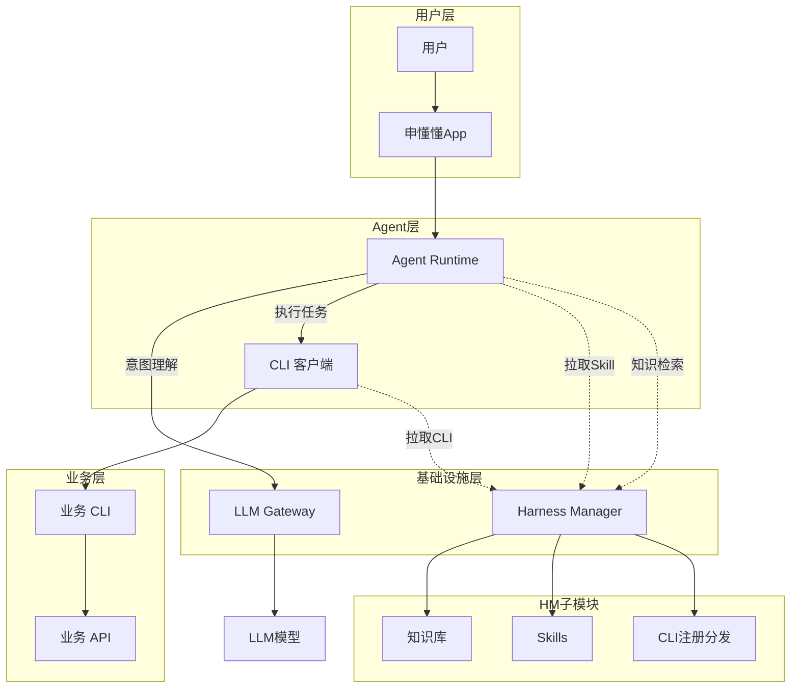
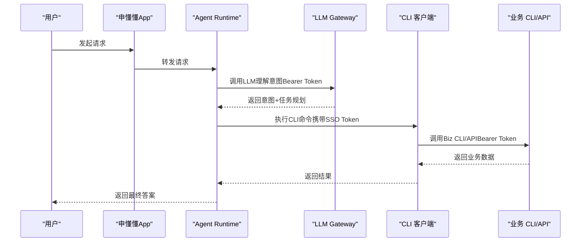
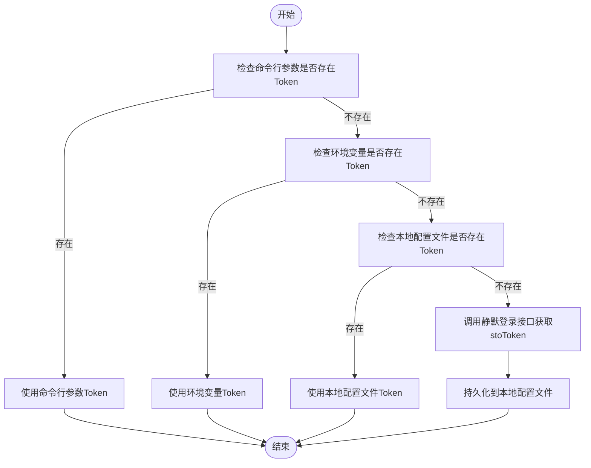
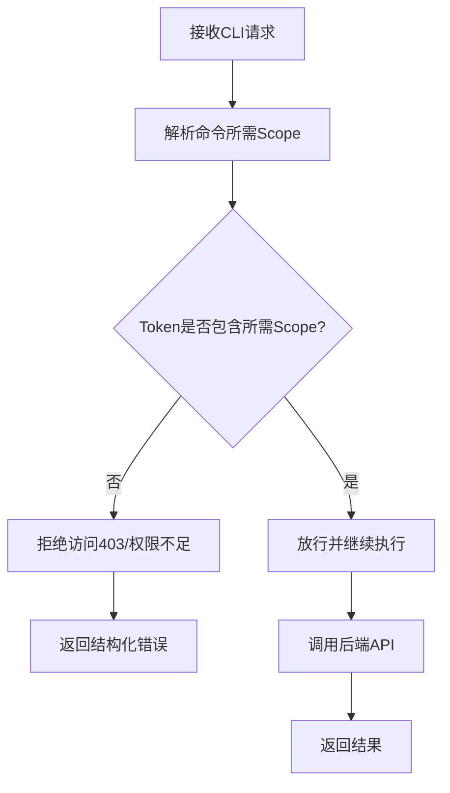
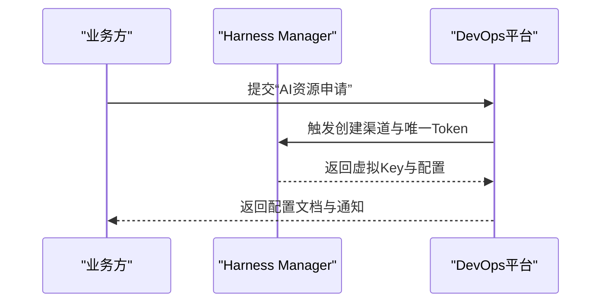
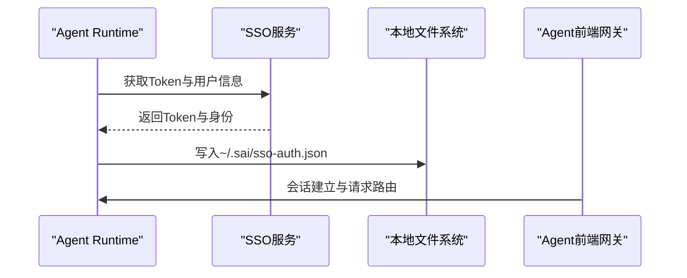
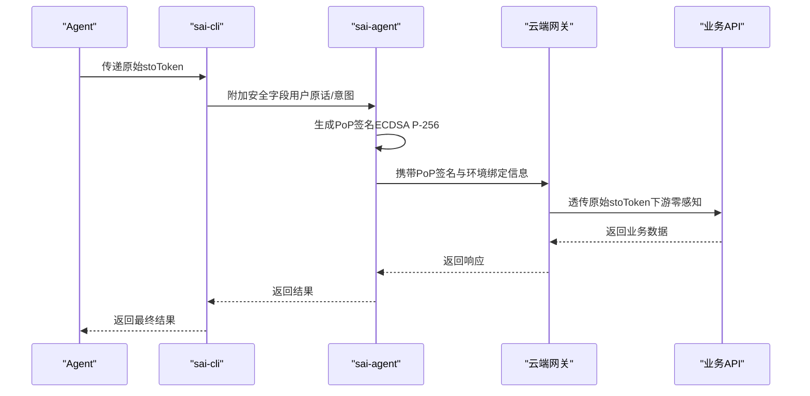
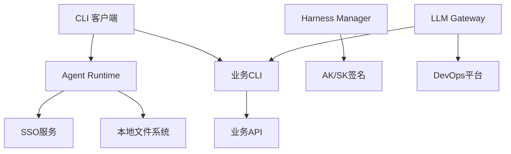

# 认证授权机制

<cite>
**本文引用的文件**   
- [SAI CLI 设计文档 v1.0](file://plan/SAI_CLI_设计文档_v1.0.md)
- [SAI CLI 设计文档 v1.2](file://plan/SAI_CLI_设计文档_v1.2.md)
- [Sai 整体架构设计](file://project/standup/Sai整体架构设计.md)
- [LLM Gateway 建设方案](file://plan/LLM-Gateway建设方案.md)
- [LLM Gateway 一期功能规划](file://plan/LLM-Gateway一期功能规划.md)
- [CLI 架构与规范对焦](file://plan/CLI 架构与规范对焦.md)
- [Agent Runtime 方案 review](file://notes/zhaobomin/Agent-Runtime方案review.md)
- [每日简报 2026-04-22](file://project/SAI-daily-report-2026-04-22-final.md)
</cite>

## 目录
1. [引言](#引言)
2. [项目结构](#项目结构)
3. [核心组件](#核心组件)
4. [架构总览](#架构总览)
5. [详细组件分析](#详细组件分析)
6. [依赖分析](#依赖分析)
7. [性能考量](#性能考量)
8. [故障排查指南](#故障排查指南)
9. [结论](#结论)
10. [附录](#附录)

## 引言
本文件系统化阐述 SAI 项目的认证授权机制，覆盖用户身份验证、权限控制与访问管理的完整流程，详细记录 API 密钥管理、OAuth 集成与会话令牌机制，以及安全策略、加密要求与审计日志。同时提供认证配置示例、权限分配指南与安全最佳实践，帮助开发者与运维人员快速落地与安全运营。

## 项目结构
SAI 项目围绕“意图理解链路”和“业务执行链路”两大主干，结合 Harness Manager 控制面与 LLM Gateway 网关层，形成“Agent → CLI 客户端 → 业务 CLI → 业务 API”的执行闭环；同时通过统一的鉴权与权限控制保障访问安全。

**图表来源**
- [Sai 整体架构设计:19-65](file://project/standup/Sai整体架构设计.md#L19-L65)

**章节来源**
- [Sai 整体架构设计:17-138](file://project/standup/Sai整体架构设计.md#L17-L138)

## 核心组件
- Agent Runtime：负责意图理解、会话管理与 CLI 调用，承担 SSO 认证与信息持久化职责。
- CLI 客户端：面向业务 CLI 的统一入口，负责路由、权限校验与命令下发。
- 业务 CLI：封装具体业务能力，执行后端 API 调用，自身负责鉴权与权限控制。
- Harness Manager：控制面服务，提供技能与 CLI 的注册、分发与检索能力。
- LLM Gateway：统一代理与密钥管理，提供模型路由、成本控制与安全审计。

**章节来源**
- [Sai 整体架构设计:142-151](file://project/standup/Sai整体架构设计.md#L142-L151)
- [SAI CLI 设计文档 v1.0:356-380](file://plan/SAI_CLI_设计文档_v1.0.md#L356-L380)

## 架构总览
SAI 的鉴权与权限控制贯穿“意图理解链路”和“业务执行链路”。Agent 通过 SSO 获取统一的 JWT Token，并将其透传至 CLI 客户端与业务 CLI；业务 CLI 再将 Token 传递给后端 API。同时，Harness Manager 的内部接口采用 AK/SK HMAC-SHA256 签名进行鉴权。

**图表来源**
- [Sai 整体架构设计:115-138](file://project/standup/Sai整体架构设计.md#L115-L138)

**章节来源**
- [Sai 整体架构设计:108-138](file://project/standup/Sai整体架构设计.md#L108-L138)

## 详细组件分析

### 1) 用户身份验证与会话令牌机制
- SSO 统一认证：全链路使用统一的 SSO Token（JWT）进行身份认证。
- Token 获取优先级（CLI）：命令行参数 > 环境变量 > 本地配置文件（Agent 登录后写入）。
- 静默登录接口：Agent 可通过静默登录接口获取临时 stoToken，用于 CLI 鉴权。
- 本地持久化：Agent 将认证信息保存至本地 `~/.sai/sso-auth.json`，包含 token、identity_type、scopes、expires_at 等字段。

**图表来源**
- [SAI CLI 设计文档 v1.2:405-419](file://plan/SAI_CLI_设计文档_v1.2.md#L405-L419)
- [SAI CLI 设计文档 v1.0:220-250](file://plan/SAI_CLI_设计文档_v1.0.md#L220-L250)

**章节来源**
- [SAI CLI 设计文档 v1.2:405-419](file://plan/SAI_CLI_设计文档_v1.2.md#L405-L419)
- [SAI CLI 设计文档 v1.0:220-250](file://plan/SAI_CLI_设计文档_v1.0.md#L220-L250)

### 2) 权限控制与作用域（Scope）管理
- Scope 权限控制：每个 CLI 命令对应一组所需 Scope，网关在执行前校验 Token 的 Scope 是否满足。
- 身份体系：Bot Token（应用级权限）与 User Token（人工用户级权限）并存，高危操作（批量修改/删除）需要更高权限 Token 或二次确认。
- 业务 CLI 自身鉴权：业务 CLI 在调用后端 API 时，应校验 Scope 与操作类型，拒绝越权请求。

**图表来源**
- [SAI CLI 设计文档 v1.0:230-239](file://plan/SAI_CLI_设计文档_v1.0.md#L230-L239)
- [SAI CLI 设计文档 v1.2:441-449](file://plan/SAI_CLI_设计文档_v1.2.md#L441-L449)

**章节来源**
- [SAI CLI 设计文档 v1.0:230-239](file://plan/SAI_CLI_设计文档_v1.0.md#L230-L239)
- [SAI CLI 设计文档 v1.2:441-449](file://plan/SAI_CLI_设计文档_v1.2.md#L441-L449)

### 3) API 密钥管理与 AK/SK 签名
- Harness Manager 内部接口统一采用 AK/SK HMAC-SHA256 签名鉴权，请求头包含 X-Access-Key、X-Signature、X-Timestamp。
- LLM Gateway 通过 DevOps 平台实现密钥分发与自动化审批，支持个人令牌申请、扩容与额度熔断告警，保障成本可控与安全审计。

**图表来源**
- [LLM Gateway 建设方案:36-41](file://plan/LLM-Gateway建设方案.md#L36-L41)
- [LLM Gateway 一期功能规划:3-11](file://plan/LLM-Gateway一期功能规划.md#L3-L11)

**章节来源**
- [LLM Gateway 建设方案:36-65](file://plan/LLM-Gateway建设方案.md#L36-L65)
- [LLM Gateway 一期功能规划:3-11](file://plan/LLM-Gateway一期功能规划.md#L3-L11)

### 4) OAuth 集成与会话生命周期
- Agent Runtime 通过 SSO 单点登录接口获取 Token 与用户身份信息，并将认证信息持久化至本地 `~/.sai/sso-auth.json`。
- Agent 前端网关负责会话路由与鉴权，基于 Serverless 平台启动与管理 Agent 实例，确保用户隔离与热启动性能。

**图表来源**
- [SAI CLI 设计文档 v1.2:620-631](file://plan/SAI_CLI_设计文档_v1.2.md#L620-L631)
- [CLI 架构与规范对焦:18-21](file://plan/CLI 架构与规范对焦.md#L18-L21)

**章节来源**
- [SAI CLI 设计文档 v1.2:620-631](file://plan/SAI_CLI_设计文档_v1.2.md#L620-L631)
- [CLI 架构与规范对焦:18-21](file://plan/CLI 架构与规范对焦.md#L18-L21)

### 5) 会话令牌与 PoP（Proof-of-Possession）增强
- 一期：标准 Bearer Token，Agent → sai-cli → 业务 API，暂不校验 Token 是否被复制。
- 二期：引入 PoP 签名 + ECDSA (P-256)，Agent → sai-cli → sai-agent → 云端网关 → 业务 API，实现 Token 与设备/环境绑定，防止复用。
- 环境绑定：本地客户端使用 OS Keychain + Machine ID；云端 Agent 使用 K8s Secret Volume（tmpfs，不落盘）+ Pod UID。

**图表来源**
- [SAI CLI 设计文档 v1.2:396-439](file://plan/SAI_CLI_设计文档_v1.2.md#L396-L439)

**章节来源**
- [SAI CLI 设计文档 v1.2:396-439](file://plan/SAI_CLI_设计文档_v1.2.md#L396-L439)

### 6) 安全策略与加密要求
- 统一使用 JWT Token（全链路 SSO Token），避免多套认证体系带来的复杂性。
- AK/SK 签名采用 HMAC-SHA256，请求头包含必要签名信息，确保接口调用不可抵赖。
- LLM Gateway 支持密钥扫描、数据脱敏与提示词注入防御，降低隐私泄露风险。
- 令牌生命周期管理：个人令牌支持自动额度分配、熔断告警与扩容流程，保障成本可控。

**章节来源**
- [LLM Gateway 建设方案:56-65](file://plan/LLM-Gateway建设方案.md#L56-L65)
- [LLM Gateway 一期功能规划:3-11](file://plan/LLM-Gateway一期功能规划.md#L3-L11)

### 7) 审计日志与可观测性
- LLM Gateway 记录请求元数据（时间、来源 IP、Token 归属域组、消耗 Token 数、响应延迟），支持隐私数据脱敏与白名单访问控制。
- 建议在业务 API 层保留必要的审计日志（如操作人、操作类型、资源标识、时间戳），并与上游 Token 的 identity_type、scopes 关联。

**章节来源**
- [LLM Gateway 建设方案:56-65](file://plan/LLM-Gateway建设方案.md#L56-L65)

### 8) 认证配置示例与权限分配指南
- 配置文件格式（本地）：包含 token、identity_type、scopes、expires_at 等字段，Agent 登录后自动写入。
- 权限分配：为每个 CLI 命令定义所需 Scope，网关在执行前校验；高危操作需更高权限或二次确认。
- Dry-Run 模式：写操作命令支持 --dry-run 参数，返回将要执行的操作描述，便于风险预估与审批。

**章节来源**
- [SAI CLI 设计文档 v1.0:241-250](file://plan/SAI_CLI_设计文档_v1.0.md#L241-L250)
- [SAI CLI 设计文档 v1.0:254-280](file://plan/SAI_CLI_设计文档_v1.0.md#L254-L280)

### 9) 安全最佳实践
- 最小权限原则：为 CLI 命令分配最小必要 Scope，避免过度授权。
- 令牌轮转与熔断：定期轮换个人令牌，设置额度熔断与告警，防止异常消耗。
- 网关与后端分离：LLM Gateway 统一托管真实密钥，业务侧使用虚拟 Key，降低泄露风险。
- 会话隔离：基于 Serverless 的按会话实例隔离，确保用户间互不影响。
- 审计与合规：保留完整的调用日志与操作轨迹，满足合规与审计要求。

**章节来源**
- [LLM Gateway 建设方案:56-65](file://plan/LLM-Gateway建设方案.md#L56-L65)
- [Agent Runtime 方案 review:9-14](file://notes/zhaobomin/Agent-Runtime方案review.md#L9-L14)

## 依赖分析
- Agent Runtime 依赖 SSO 提供统一 Token，并将认证信息持久化至本地。
- CLI 客户端依赖网关进行路由与权限校验，同时将 Token 透传至业务 CLI。
- 业务 CLI 依赖后端 API，自身负责 Scope 校验与高危操作二次确认。
- Harness Manager 内部接口采用 AK/SK 签名，避免直接暴露真实密钥。
- LLM Gateway 与 DevOps 平台联动，实现密钥自动化分发与额度熔断。

**图表来源**
- [Sai 整体架构设计:154-164](file://project/standup/Sai整体架构设计.md#L154-L164)
- [SAI CLI 设计文档 v1.0:356-380](file://plan/SAI_CLI_设计文档_v1.0.md#L356-L380)

**章节来源**
- [Sai 整体架构设计:154-164](file://project/standup/Sai整体架构设计.md#L154-L164)
- [SAI CLI 设计文档 v1.0:356-380](file://plan/SAI_CLI_设计文档_v1.0.md#L356-L380)

## 性能考量
- 热启动与隔离：Agent Runtime 基于 Serverless 的按会话实例隔离，冷启动 <1s，热启动 <200ms，保障用户体验。
- 网关路由与限流：LLM Gateway 支持按环境与等级的智能路由与精细化限流（RPM/TPM），避免资源滥用。
- 会话与实例管理：Agent 前端网关基于 Serverless 平台管理实例，实例崩溃可秒级重建，减少对用户的影响。

**章节来源**
- [Agent Runtime 方案 review:11-12](file://notes/zhaobomin/Agent-Runtime方案review.md#L11-L12)
- [LLM Gateway 建设方案:43-54](file://plan/LLM-Gateway建设方案.md#L43-L54)

## 故障排查指南
- 401/403 错误：检查 Token 是否过期或权限不足，确认 identity_type 与 scopes 是否匹配。
- 5xx 错误：检查后端 API 可用性与网关路由配置，必要时启用 Dry-Run 预览变更影响。
- 配置问题：确认本地配置文件路径与权限，确保 ~/.sai/sso-auth.json 内容正确。
- 审计与日志：利用 LLM Gateway 的请求日志与隐私脱敏能力定位问题，结合业务 API 审计日志进行交叉验证。

**章节来源**
- [SAI CLI 设计文档 v1.0:143-184](file://plan/SAI_CLI_设计文档_v1.0.md#L143-L184)
- [LLM Gateway 建设方案:56-65](file://plan/LLM-Gateway建设方案.md#L56-L65)

## 结论
SAI 项目通过统一的 SSO JWT Token、Scope 权限控制与 PoP 增强机制，构建了从意图理解到业务执行的全链路安全体系。结合 LLM Gateway 的密钥管理与 DevOps 自动化流程，实现了成本可控、安全可审计、易于运维的认证授权方案。建议在落地过程中严格遵循最小权限、令牌轮转与熔断告警等最佳实践，持续完善审计与可观测性能力。

## 附录
- 项目进展与风险跟踪：关注 LLM Gateway 4/30 上线与 CLI 职责边界方案落地情况，确保按时交付可用功能。
- 接口与职责：明确 Agent Runtime、CLI 客户端、Harness Manager 与业务 API 的接口契约与鉴权方式，避免返工。

**章节来源**
- [每日简报 2026-04-22:48-73](file://project/SAI-daily-report-2026-04-22-final.md#L48-L73)