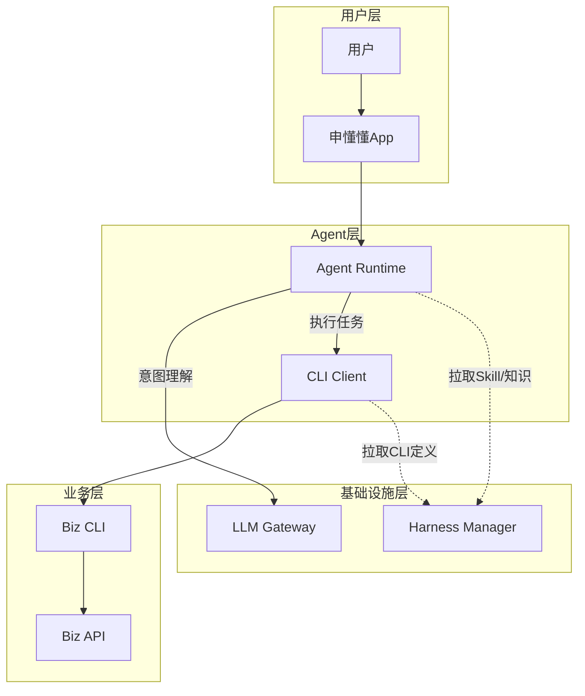
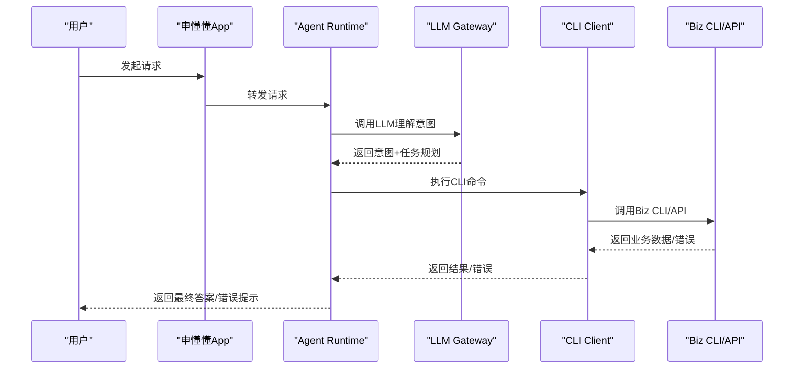
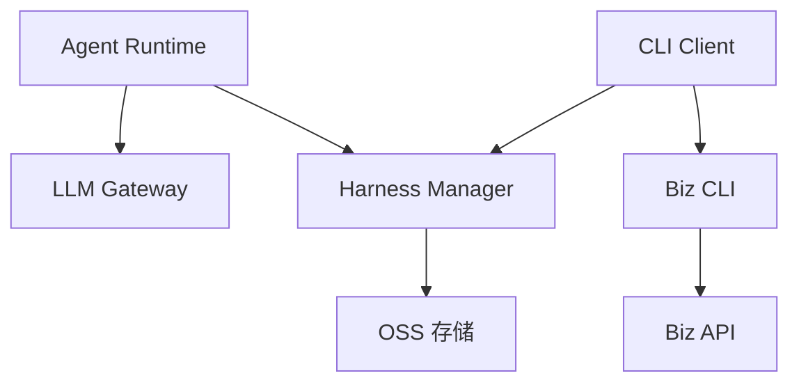
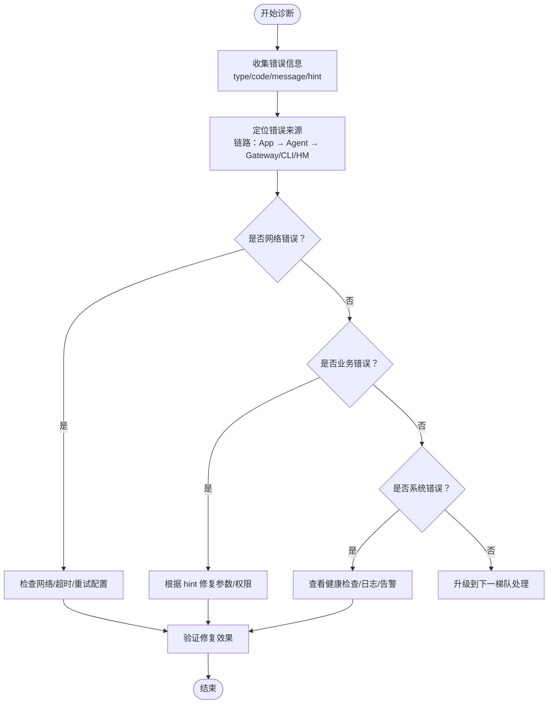

# 错误处理与异常

<cite>
**本文引用的文件**
- [Sai整体架构设计.md](file://project/standup/Sai整体架构设计.md)
- [SAI_CLI_设计文档_v1.0.md](file://plan/SAI_CLI_设计文档_v1.0.md)
- [SAI_CLI_设计文档_v1.2.md](file://plan/SAI_CLI_设计文档_v1.2.md)
- [LiteLLM Gateway 生产环境部署方案.md](file://plan/LiteLLM Gateway 生产环境部署方案.md)
- [Agent-Runtime方案review.md](file://notes/zhaobomin/Agent-Runtime方案review.md)
- [LLM-Gateway方案review.md](file://notes/zhaobomin/LLM-Gateway方案review.md)
- [agent-api-discovery-architecture-review.zh-CN.md](file://notes/zhaobomin/agent-api-discovery-architecture-review.zh-CN.md)
- [cross-module-design-review-2026-04-24.md](file://notes/zhaobomin/cross-module-design-review-2026-04-24.md)
</cite>

## 目录
1. [简介](#简介)
2. [项目结构](#项目结构)
3. [核心组件](#核心组件)
4. [架构总览](#架构总览)
5. [详细组件分析](#详细组件分析)
6. [依赖关系分析](#依赖关系分析)
7. [性能考量](#性能考量)
8. [故障排除指南](#故障排除指南)
9. [结论](#结论)
10. [附录](#附录)

## 简介
本文件面向 SAI（申通 AI 智能体平台）项目，系统化梳理错误处理与异常管理体系，覆盖网络错误、业务错误与系统错误的分类与处置策略，明确各模块的错误码定义、异常类型与处理机制，给出重试策略、降级方案与监控告警建议，并提供诊断与排障流程，帮助研发与运维团队在不同模块间建立一致的错误处理实践。

## 项目结构
SAI 采用“用户层 → Agent 层 → 基础设施层 → 业务层”的分层架构，关键模块包括：
- 用户层：申懂懂 App
- Agent 层：Agent Runtime、CLI Client
- 基础设施层：LLM Gateway、Harness Manager
- 业务层：Biz CLI、Biz API

图表来源
- [Sai整体架构设计.md:19-65](file://project/standup/Sai整体架构设计.md#L19-L65)

章节来源
- [Sai整体架构设计.md:19-65](file://project/standup/Sai整体架构设计.md#L19-L65)

## 核心组件
- Agent Runtime：负责意图理解、会话管理、CLI 调用与错误反馈
- LLM Gateway：统一 LLM 代理、路由与成本控制，提供熔断与告警
- Harness Manager：控制面服务，提供 Skill/CLI 注册、分发与检索
- CLI Client/Biz CLI：执行业务命令，输出结构化错误
- Channel（申懂懂 App）：前端接入与交互协议

章节来源
- [Sai整体架构设计.md:142-151](file://project/standup/Sai整体架构设计.md#L142-L151)
- [Sai整体架构设计.md:197-221](file://project/standup/Sai整体架构设计.md#L197-L221)

## 架构总览
SAI 的两条核心链路分别承载“意图理解”和“业务执行”。错误处理贯穿链路的每个环节，需确保：
- 明确的错误分类与统一的错误载体（结构化 JSON）
- 可观测的错误日志与告警
- 面向 Agent 的可解释错误与可恢复策略
- 面向用户的友好提示与修复建议

图表来源
- [Sai整体架构设计.md:115-138](file://project/standup/Sai整体架构设计.md#L115-L138)

章节来源
- [Sai整体架构设计.md:108-138](file://project/standup/Sai整体架构设计.md#L108-L138)

## 详细组件分析

### 错误分类与统一载体
- 错误类型
  - 认证错误：AUTH_ERROR（如 401/403）
  - 参数错误：PARAM_ERROR（如 400/422）
  - 业务错误：API_ERROR（后端返回的业务错误码）
  - 系统错误：系统不可用、超时、限流等（如 503/429）
- 统一错误载体
  - 结构化 JSON，包含 type、code、message、hint 四个字段
  - hint 提供下一步修复建议，便于 Agent 与用户自助处理

章节来源
- [SAI_CLI_设计文档_v1.0.md:143-183](file://plan/SAI_CLI_设计文档_v1.0.md#L143-L183)
- [SAI_CLI_设计文档_v1.2.md:295-335](file://plan/SAI_CLI_设计文档_v1.2.md#L295-L335)

### Agent Runtime 错误处理
- 会话与生命周期：基于 Serverless 的按会话实例隔离，实例崩溃时自动重建
- 错误传播：将下游（LLM Gateway、CLI Client、HM）的错误以统一 JSON 传递给前端
- 重试与降级：对可恢复错误进行有限重试；对不可恢复错误返回用户可理解的提示

章节来源
- [Agent-Runtime方案review.md:9-15](file://notes/zhaobomin/Agent-Runtime方案review.md#L9-L15)
- [Agent-Runtime方案review.md:18-31](file://notes/zhaobomin/Agent-Runtime方案review.md#L18-L31)

### LLM Gateway 错误处理与熔断
- 额度预警与熔断：80%/90%/100% 三级告警，支持自动熔断
- 逃生方案：业务侧 fallback 直连原生 API；或 Gateway bypass 模式一键关闭路由
- 路由与重试：启用 Redis 缓存、负载均衡与有限重试（num_retries=2），超时 300s
- 健康检查：定期探测健康端点，连续失败触发告警

章节来源
- [LLM-Gateway方案review.md:9-16](file://notes/zhaobomin/LLM-Gateway方案review.md#L9-L16)
- [LLM-Gateway方案review.md:32-39](file://notes/zhaobomin/LLM-Gateway方案review.md#L32-L39)
- [LiteLLM Gateway 生产环境部署方案.md:71-79](file://plan/LiteLLM Gateway 生产环境部署方案.md#L71-L79)
- [LiteLLM Gateway 生产环境部署方案.md:137-150](file://plan/LiteLLM Gateway 生产环境部署方案.md#L137-L150)

### Harness Manager 错误处理与降级
- 控制面不可用：Agent 使用本地缓存的 Skill/CLI 定义继续运行，知识检索降级为无知识模式
- OSS 不可用：Agent 使用本地缓存版本运行，日志告警通知 HM 团队
- 接口契约：Skill/CLI 拉取、知识检索、CLI 注册等接口需定义明确的参数、响应与缓存策略

章节来源
- [Sai整体架构设计.md:236-245](file://project/standup/Sai整体架构设计.md#L236-L245)
- [cross-module-design-review-2026-04-24.md:187-196](file://notes/zhaobomin/cross-module-design-review-2026-04-24.md#L187-L196)

### CLI Client/Biz CLI 错误处理
- 结构化错误输出：严格遵循统一 JSON 错误载体
- 单次重试：对 Biz API 超时/失败执行有限重试（≤3s 等待）
- 本地缓存：Agent 侧缓存 CLI 定义，避免频繁拉取失败导致的链路中断

章节来源
- [Sai整体架构设计.md:240-243](file://project/standup/Sai整体架构设计.md#L240-L243)
- [SAI_CLI_设计文档_v1.2.md:295-335](file://plan/SAI_CLI_设计文档_v1.2.md#L295-L335)

### Channel（申懂懂 App）错误处理
- 交互协议：需明确消息协议（流式/非流式、SSE/WebSocket）、会话管理与生成式 UI
- 与 Agent 的接口：明确会话创建与请求发送接口，避免协议不一致导致的错误

章节来源
- [cross-module-design-review-2026-04-24.md:171-184](file://notes/zhaobomin/cross-module-design-review-2026-04-24.md#L171-L184)
- [Sai整体架构设计.md:158-164](file://project/standup/Sai整体架构设计.md#L158-L164)

## 依赖关系分析
SAI 的错误处理依赖于模块间的接口契约与可观测性能力。关键依赖关系如下：

图表来源
- [Sai整体架构设计.md:67-106](file://project/standup/Sai整体架构设计.md#L67-L106)

章节来源
- [Sai整体架构设计.md:67-106](file://project/standup/Sai整体架构设计.md#L67-L106)

## 性能考量
- LLM Gateway：启用 Redis 缓存与负载均衡，num_retries=2，timeout=300s，避免抖动放大
- Agent Runtime：Serverless 实例按会话隔离，实例崩溃可秒级重建，降低长尾影响
- CLI Client：本地缓存 CLI 定义，减少网络依赖与拉取失败概率
- 日志与监控：生产环境仅保留 WARNING 及以上日志，降低 SLS 写入压力；健康检查与钉钉告警联动

章节来源
- [LiteLLM Gateway 生产环境部署方案.md:58-89](file://plan/LiteLLM Gateway 生产环境部署方案.md#L58-L89)
- [LiteLLM Gateway 生产环境部署方案.md:100-150](file://plan/LiteLLM Gateway 生产环境部署方案.md#L100-L150)
- [Agent-Runtime方案review.md:9-15](file://notes/zhaobomin/Agent-Runtime方案review.md#L9-L15)

## 故障排除指南

### 通用诊断流程

### 模块化排障要点
- LLM Gateway
  - 检查健康端点与不健康模型标记，确认是否触发熔断
  - 查看日志与告警，核对 Redis 与 RDS 连接状态
  - 如需逃生，启用 bypass 模式或业务侧直连原生 API
- Harness Manager
  - 检查 OSS 可用性与缓存策略，确认本地缓存是否生效
  - 核对 Skill/CLI 拉取接口契约与缓存配置
- CLI Client/Biz CLI
  - 校验结构化错误输出是否符合统一载体
  - 对 Biz API 超时执行单次重试（≤3s），失败后提示用户
- Agent Runtime
  - 核对会话接口契约（get_session/send_request）
  - 检查 Serverless 实例重建日志与会话状态
- Channel（申懂懂 App）
  - 明确消息协议与会话管理，避免协议不一致导致的错误

章节来源
- [LLM-Gateway方案review.md:32-39](file://notes/zhaobomin/LLM-Gateway方案review.md#L32-L39)
- [LiteLLM Gateway 生产环境部署方案.md:137-150](file://plan/LiteLLM Gateway 生产环境部署方案.md#L137-L150)
- [Sai整体架构设计.md:236-245](file://project/standup/Sai整体架构设计.md#L236-L245)
- [agent-api-discovery-architecture-review.zh-CN.md:68-95](file://notes/zhaobomin/agent-api-discovery-architecture-review.zh-CN.md#L68-L95)

## 结论
SAI 的错误处理体系以“统一错误载体 + 分层降级 + 可观测告警”为核心，结合 LLM Gateway 的熔断与逃生、Harness Manager 的缓存与控制面降级、Agent Runtime 的实例隔离与错误传播，以及 CLI Client 的结构化错误输出，形成从链路到模块的闭环保障。建议尽快补齐全局错误码规范与接口契约文档，以进一步提升一致性与可维护性。

## 附录

### 错误码与异常类型对照（建议）
- 认证错误：401/403 → AUTH_ERROR
- 参数错误：400/422 → PARAM_ERROR
- 业务错误：后端返回的业务 code → API_ERROR
- 系统错误：503/429/超时 → SYSTEM_ERROR
- 建议：制定跨模块统一错误码字典，避免各模块自定义冲突

章节来源
- [cross-module-design-review-2026-04-24.md:210-221](file://notes/zhaobomin/cross-module-design-review-2026-04-24.md#L210-L221)