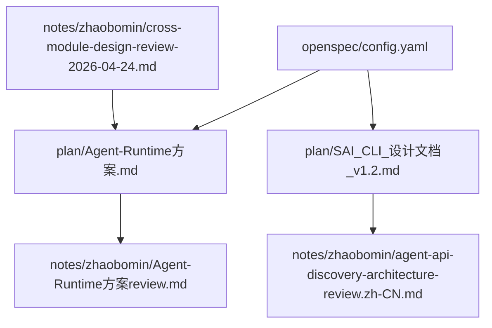
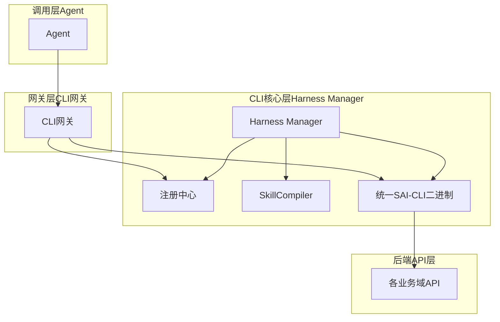
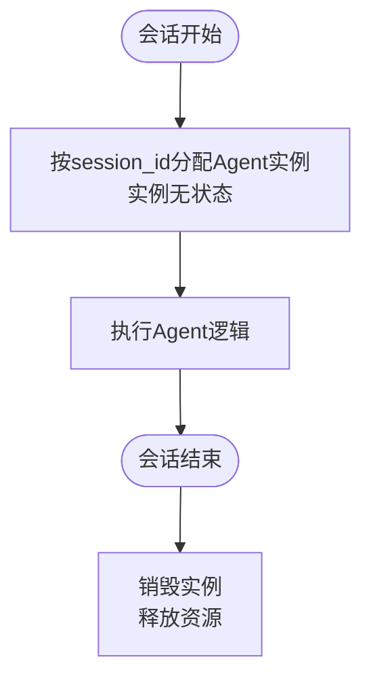
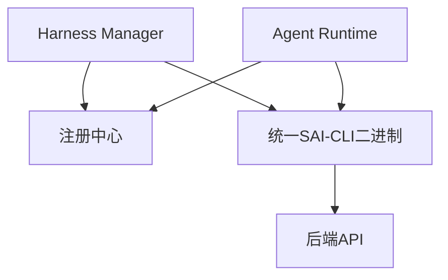
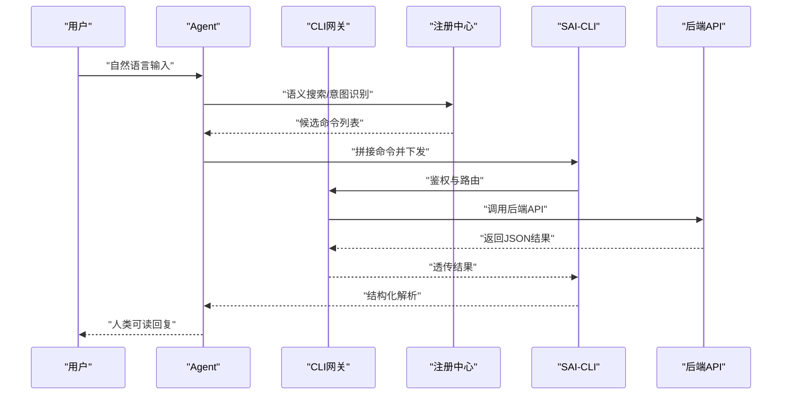
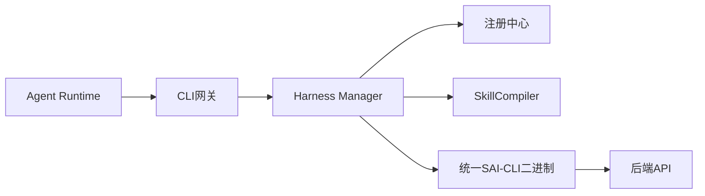

# Agent Runtime（奕杭）

<cite>
**本文引用的文件**
- [Agent-Runtime方案.md](file://plan/Agent-Runtime方案.md)
- [Agent-Runtime方案review.md](file://notes/zhaobomin/Agent-Runtime方案review.md)
- [SAI_CLI_设计文档_v1.2.md](file://plan/SAI_CLI_设计文档_v1.2.md)
- [agent-api-discovery-architecture-review.zh-CN.md](file://notes/zhaobomin/agent-api-discovery-architecture-review.zh-CN.md)
- [cross-module-design-review-2026-04-24.md](file://notes/zhaobomin/cross-module-design-review-2026-04-24.md)
- [config.yaml](file://openspec/config.yaml)
</cite>

## 目录
1. [引言](#引言)
2. [项目结构](#项目结构)
3. [核心组件](#核心组件)
4. [架构总览](#架构总览)
5. [详细组件分析](#详细组件分析)
6. [依赖分析](#依赖分析)
7. [性能考量](#性能考量)
8. [故障排查指南](#故障排查指南)
9. [结论](#结论)
10. [附录](#附录)

## 引言
本文件面向“Agent Runtime（奕杭）”模块，围绕Serverless执行架构、用户隔离、会话管理与状态持久化、技能（Skill）管理与加载、CLI集成与命令调用、错误处理、性能优化与冷启动、资源管理、配置示例与API接口、以及集成指南等方面，提供系统化、可落地的技术文档。文档以仓库内现有方案与评审材料为基础，结合跨模块一致性要求，形成面向开发者的实现参考与最佳实践。

## 项目结构
该仓库以文档为主，Agent Runtime相关设计与评审集中在“plan”和“notes/zhaobomin”目录中，同时openspec提供规范与上下文配置。整体结构如下：

图表来源
- [Agent-Runtime方案.md:1-60](file://plan/Agent-Runtime方案.md#L1-L60)
- [Agent-Runtime方案review.md:1-55](file://notes/zhaobomin/Agent-Runtime方案review.md#L1-L55)
- [SAI_CLI_设计文档_v1.2.md:1-635](file://plan/SAI_CLI_设计文档_v1.2.md#L1-L635)
- [agent-api-discovery-architecture-review.zh-CN.md:24-533](file://notes/zhaobomin/agent-api-discovery-architecture-review.zh-CN.md#L24-L533)
- [cross-module-design-review-2026-04-24.md:138-170](file://notes/zhaobomin/cross-module-design-review-2026-04-24.md#L138-L170)
- [config.yaml:1-21](file://openspec/config.yaml#L1-L21)

章节来源
- [Agent-Runtime方案.md:1-60](file://plan/Agent-Runtime方案.md#L1-L60)
- [Agent-Runtime方案review.md:1-55](file://notes/zhaobomin/Agent-Runtime方案review.md#L1-L55)
- [SAI_CLI_设计文档_v1.2.md:1-635](file://plan/SAI_CLI_设计文档_v1.2.md#L1-L635)
- [agent-api-discovery-architecture-review.zh-CN.md:24-533](file://notes/zhaobomin/agent-api-discovery-architecture-review.zh-CN.md#L24-L533)
- [cross-module-design-review-2026-04-24.md:138-170](file://notes/zhaobomin/cross-module-design-review-2026-04-24.md#L138-L170)
- [config.yaml:1-21](file://openspec/config.yaml#L1-L21)

## 核心组件
- Serverless执行与用户隔离
  - 基于AgentRun（serverless）实现，按会话分配实例，一实例一会话，实例无状态，会话结束即销毁。
  - 冷启动<1秒、热启动约100毫秒，满足通用Agent调用的性能要求。
- 技能（Skill）隔离与分发
  - 通过OSS挂载实现Workspace/Systemspace分离，Systemspace按用户/领域/公共组织；若OSS挂载不可用，回退到Agent层实现基于用户路径的文件权限控制。
- CLI集成与命令调用
  - Agent通过注册中心与CLI网关交互，采用“三步调用流程”或“6步NLU Pipeline”，统一命令规范与结构化输出。
- 会话管理与状态持久化
  - 会话生命周期与实例绑定，实例销毁即清理；状态持久化通过外部系统或Agent层的会话上下文管理实现。
- 错误处理与结构化输出
  - CLI统一采用结构化错误输出，包含type/code/message/hint字段，便于Agent与用户定位问题。
- 安全与鉴权
  - 一期：Bearer Token；二期：PoP Token + ECDSA签名，实现环境绑定与防复用。
- 性能与资源管理
  - 冷启动优化：函数计算/容器热启动；资源管理：按会话隔离、最小化实例占用。

章节来源
- [Agent-Runtime方案.md:4-13](file://plan/Agent-Runtime方案.md#L4-L13)
- [Agent-Runtime方案.md:15-32](file://plan/Agent-Runtime方案.md#L15-L32)
- [SAI_CLI_设计文档_v1.2.md:115-146](file://plan/SAI_CLI_设计文档_v1.2.md#L115-L146)
- [SAI_CLI_设计文档_v1.2.md:250-288](file://plan/SAI_CLI_设计文档_v1.2.md#L250-L288)
- [SAI_CLI_设计文档_v1.2.md:295-336](file://plan/SAI_CLI_设计文档_v1.2.md#L295-L336)
- [SAI_CLI_设计文档_v1.2.md:394-471](file://plan/SAI_CLI_设计文档_v1.2.md#L394-L471)

## 架构总览
Agent Runtime在Serverless层之上，结合CLI注册中心与网关，形成“Agent → 网关 → SAI-CLI → API”的解耦链路。Skill与CLI通过Harness Manager统一编排与发布，Agent侧仅负责会话管理、意图理解与命令拼接。

图表来源
- [SAI_CLI_设计文档_v1.2.md:29-64](file://plan/SAI_CLI_设计文档_v1.2.md#L29-L64)
- [SAI_CLI_设计文档_v1.2.md:545-591](file://plan/SAI_CLI_设计文档_v1.2.md#L545-L591)
- [agent-api-discovery-architecture-review.zh-CN.md:24-38](file://notes/zhaobomin/agent-api-discovery-architecture-review.zh-CN.md#L24-L38)

## 详细组件分析

### Serverless执行与用户隔离
- 实例模型
  - 一实例一会话，实例无状态，会话结束即销毁，确保用户间完全隔离。
  - 冷启动<1秒、热启动约100毫秒，满足实时交互需求。
- 与函数计算/容器的关系
  - 方案中明确采用函数计算部署；跨模块评审指出冷启动方案在不同文档中描述不一致，需明确底层基础设施（函数计算 vs K8s CloneSet vs ACS）。

图表来源
- [Agent-Runtime方案.md:4-13](file://plan/Agent-Runtime方案.md#L4-L13)
- [cross-module-design-review-2026-04-24.md:149-157](file://notes/zhaobomin/cross-module-design-review-2026-04-24.md#L149-L157)

章节来源
- [Agent-Runtime方案.md:4-13](file://plan/Agent-Runtime方案.md#L4-L13)
- [cross-module-design-review-2026-04-24.md:149-157](file://notes/zhaobomin/cross-module-design-review-2026-04-24.md#L149-L157)

### 技能（Skill）管理与加载
- 分发与挂载
  - Workspace/Systemspace分离，Systemspace按用户/领域/公共组织；优先通过OSS挂载；若不可用，回退到Agent层实现基于用户路径的文件权限控制。
- 与Harness Manager的协作
  - Agent Runtime需从Harness Manager拉取Skill/CLI；跨模块评审强调Agent Runtime方案中未提及Harness Manager，建议补充“与Harness Manager的接口契约”。

图表来源
- [Agent-Runtime方案.md:15-32](file://plan/Agent-Runtime方案.md#L15-L32)
- [cross-module-design-review-2026-04-24.md:160-167](file://notes/zhaobomin/cross-module-design-review-2026-04-24.md#L160-L167)
- [SAI_CLI_设计文档_v1.2.md:545-591](file://plan/SAI_CLI_设计文档_v1.2.md#L545-L591)

章节来源
- [Agent-Runtime方案.md:15-32](file://plan/Agent-Runtime方案.md#L15-L32)
- [cross-module-design-review-2026-04-24.md:160-167](file://notes/zhaobomin/cross-module-design-review-2026-04-24.md#L160-L167)
- [SAI_CLI_设计文档_v1.2.md:545-591](file://plan/SAI_CLI_设计文档_v1.2.md#L545-L591)

### CLI集成与命令调用
- 统一命令规范
  - 命令格式：{product} {module} {action} [params]，JSON结构化入参/出参。
- 注册中心与9维Tag
  - 9维Tag（D1-D9）覆盖路由、NLU理解、执行与展示维度；支持AI自动生成元数据，业务团队Review确认。
- 6步NLU Pipeline
  - 意图分类 → 实体抽取 → Tag匹配与评分 → 参数组装 → API调用 → 结果解读。
- 结构化错误输出
  - 统一type/code/message/hint字段，便于Agent与用户定位问题。
- 鉴权与安全
  - 一期：Bearer Token；二期：PoP Token + ECDSA签名，实现环境绑定与防复用。

图表来源
- [SAI_CLI_设计文档_v1.2.md:115-146](file://plan/SAI_CLI_设计文档_v1.2.md#L115-L146)
- [SAI_CLI_设计文档_v1.2.md:151-223](file://plan/SAI_CLI_设计文档_v1.2.md#L151-L223)
- [SAI_CLI_设计文档_v1.2.md:250-288](file://plan/SAI_CLI_设计文档_v1.2.md#L250-L288)
- [SAI_CLI_设计文档_v1.2.md:295-336](file://plan/SAI_CLI_设计文档_v1.2.md#L295-L336)
- [SAI_CLI_设计文档_v1.2.md:394-471](file://plan/SAI_CLI_设计文档_v1.2.md#L394-L471)

章节来源
- [SAI_CLI_设计文档_v1.2.md:115-146](file://plan/SAI_CLI_设计文档_v1.2.md#L115-L146)
- [SAI_CLI_设计文档_v1.2.md:151-223](file://plan/SAI_CLI_设计文档_v1.2.md#L151-L223)
- [SAI_CLI_设计文档_v1.2.md:250-288](file://plan/SAI_CLI_设计文档_v1.2.md#L250-L288)
- [SAI_CLI_设计文档_v1.2.md:295-336](file://plan/SAI_CLI_设计文档_v1.2.md#L295-L336)
- [SAI_CLI_设计文档_v1.2.md:394-471](file://plan/SAI_CLI_设计文档_v1.2.md#L394-L471)

### 会话管理与状态持久化
- 会话与实例绑定
  - 一实例一会话，实例销毁即清理，确保隔离与资源回收。
- 上下文与持久化
  - 会话上下文由Agent层管理；状态持久化通过外部系统或Agent层的会话上下文实现，避免实例内状态泄漏。

章节来源
- [Agent-Runtime方案.md:8-10](file://plan/Agent-Runtime方案.md#L8-L10)

### 错误处理与结构化输出
- CLI统一采用结构化错误输出，包含type/code/message/hint字段，便于Agent与用户定位问题。
- Agent侧可据此进行重试、降级或提示用户/Agent下一步操作。

章节来源
- [SAI_CLI_设计文档_v1.2.md:295-336](file://plan/SAI_CLI_设计文档_v1.2.md#L295-L336)

### 安全与鉴权
- 一期：Token优先级（命令行参数 > 环境变量 > 本地配置文件），统一SSO Token。
- 二期：PoP Token + ECDSA签名，实现环境绑定与防复用，支持云端Pod与本地机器的Token隔离。

章节来源
- [SAI_CLI_设计文档_v1.2.md:405-471](file://plan/SAI_CLI_设计文档_v1.2.md#L405-L471)

## 依赖分析
- 模块边界与职责
  - Agent：会话管理、意图理解、命令拼接与执行反馈。
  - CLI网关：路由转发、鉴权校验、命令清单同步。
  - Harness Manager：注册中心、SkillCompiler、统一CLI二进制打包与发布。
  - 后端API：业务域提供接口，零侵入。
- 跨模块一致性
  - 跨模块评审指出：Agent Runtime方案与Harness Manager的接口契约缺失，需明确依赖关系与接口定义。

图表来源
- [SAI_CLI_设计文档_v1.2.md:545-591](file://plan/SAI_CLI_设计文档_v1.2.md#L545-L591)
- [agent-api-discovery-architecture-review.zh-CN.md:24-38](file://notes/zhaobomin/agent-api-discovery-architecture-review.zh-CN.md#L24-L38)
- [cross-module-design-review-2026-04-24.md:160-167](file://notes/zhaobomin/cross-module-design-review-2026-04-24.md#L160-L167)

章节来源
- [SAI_CLI_设计文档_v1.2.md:545-591](file://plan/SAI_CLI_设计文档_v1.2.md#L545-L591)
- [agent-api-discovery-architecture-review.zh-CN.md:24-38](file://notes/zhaobomin/agent-api-discovery-architecture-review.zh-CN.md#L24-L38)
- [cross-module-design-review-2026-04-24.md:160-167](file://notes/zhaobomin/cross-module-design-review-2026-04-24.md#L160-L167)

## 性能考量
- 冷启动优化
  - 函数计算/容器热启动<1秒，热启动约100毫秒；跨模块评审提出需明确底层基础设施（函数计算 vs K8s CloneSet vs ACS）。
- 资源管理
  - 一实例一会话，实例销毁即释放；避免长连接与全局状态，降低内存与CPU占用。
- CLI执行效率
  - 6步NLU Pipeline减少误判与重试；9维Tag与AI自动生成提升召回质量与参数组装准确性。

章节来源
- [Agent-Runtime方案.md:6-13](file://plan/Agent-Runtime方案.md#L6-L13)
- [cross-module-design-review-2026-04-24.md:149-157](file://notes/zhaobomin/cross-module-design-review-2026-04-24.md#L149-L157)
- [SAI_CLI_设计文档_v1.2.md:250-288](file://plan/SAI_CLI_设计文档_v1.2.md#L250-L288)

## 故障排查指南
- 结构化错误输出
  - CLI统一输出type/code/message/hint，便于Agent与用户定位问题；建议在Agent侧记录并上报。
- 动态命令兜底分发
  - agent-api-discovery评审指出动态命令兜底分发未接入主流程，可能导致合法动态命令在特定环境下不可用；建议在root层统一解析未知三段路径。
- 鉴权问题
  - 优先检查命令行参数、环境变量、本地配置文件中的Token；确认Scope与权限范围；如启用PoP签名，检查设备/环境绑定信息。

章节来源
- [SAI_CLI_设计文档_v1.2.md:295-336](file://plan/SAI_CLI_设计文档_v1.2.md#L295-L336)
- [agent-api-discovery-architecture-review.zh-CN.md:42-66](file://notes/zhaobomin/agent-api-discovery-architecture-review.zh-CN.md#L42-L66)
- [SAI_CLI_设计文档_v1.2.md:405-471](file://plan/SAI_CLI_设计文档_v1.2.md#L405-L471)

## 结论
Agent Runtime以Serverless为核心，结合CLI注册中心与网关，形成“Agent → 网关 → SAI-CLI → API”的解耦架构。通过一实例一会话的用户隔离、OSS挂载与回退权限控制实现Skill隔离、统一命令规范与结构化输出保障错误处理，配合6步NLU Pipeline与9维Tag提升意图理解与参数组装准确率。跨模块评审强调需明确底层基础设施与Harness Manager接口契约，建议尽快补齐正式设计文档与接口定义，确保可评审、可执行。

## 附录

### 配置示例与上下文
- openspec配置用于为AI生成artifact提供项目上下文与规则，可在此基础上扩展Agent Runtime相关规范。

章节来源
- [config.yaml:1-21](file://openspec/config.yaml#L1-L21)

### API与接口要点（基于现有文档）
- 注册中心与元数据
  - 9维Tag（D1-D9）注册与检索；AI自动生成元数据；业务团队Review确认。
- CLI网关接口
  - API注册接口、元数据搜索接口、元数据生成接口、发布通知接口、路由转发、权限校验。
- Agent职责
  - SSO认证、信息持久化、API搜索、API选择、命令拼接、命令执行、鉴权标准。

章节来源
- [SAI_CLI_设计文档_v1.2.md:151-223](file://plan/SAI_CLI_设计文档_v1.2.md#L151-L223)
- [SAI_CLI_设计文档_v1.2.md:603-632](file://plan/SAI_CLI_设计文档_v1.2.md#L603-L632)