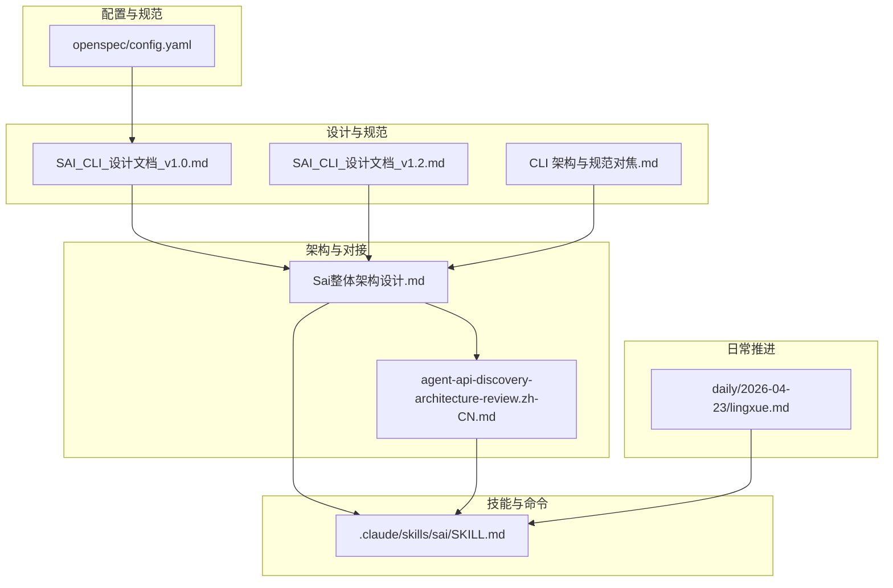
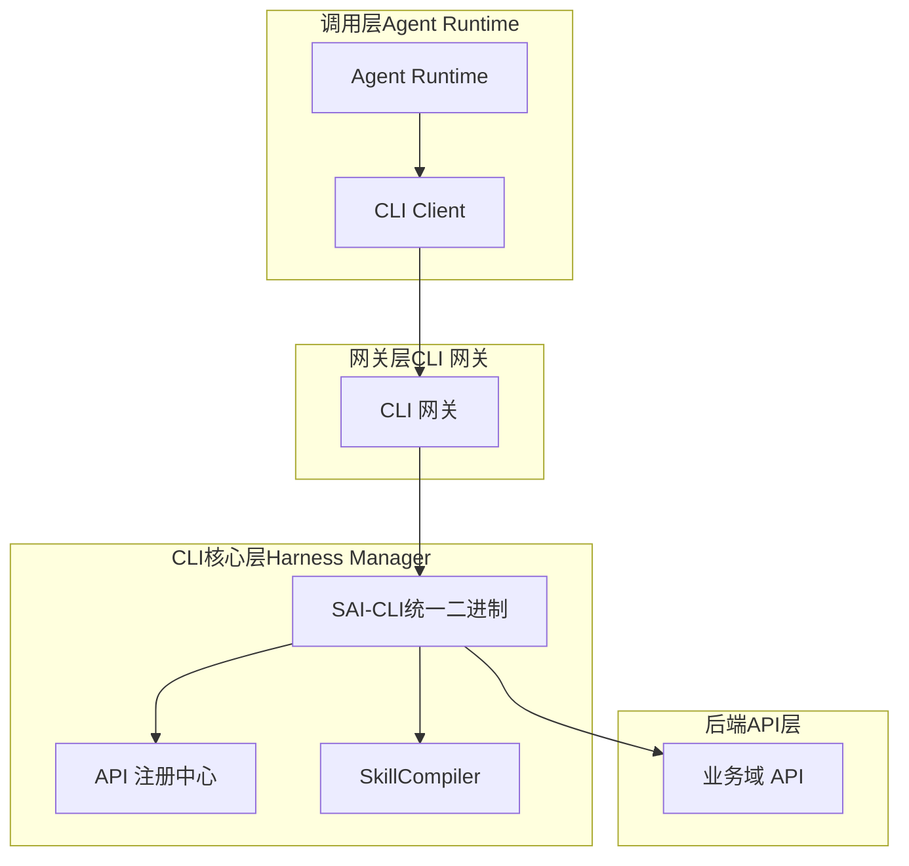
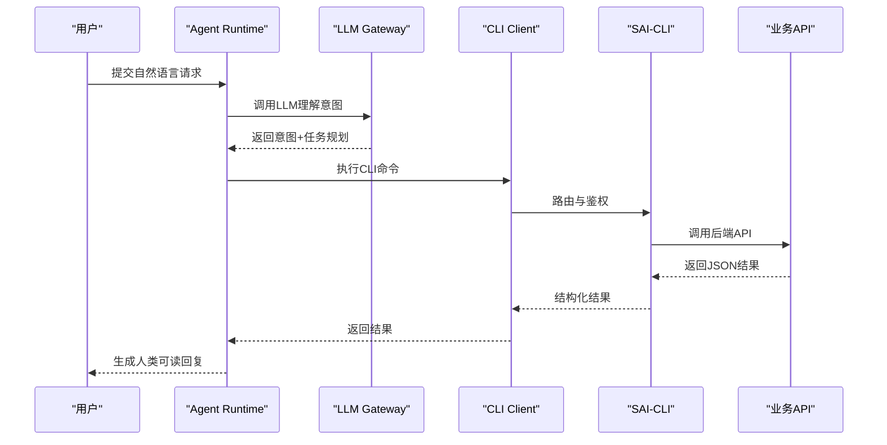
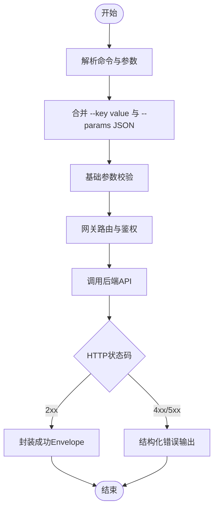
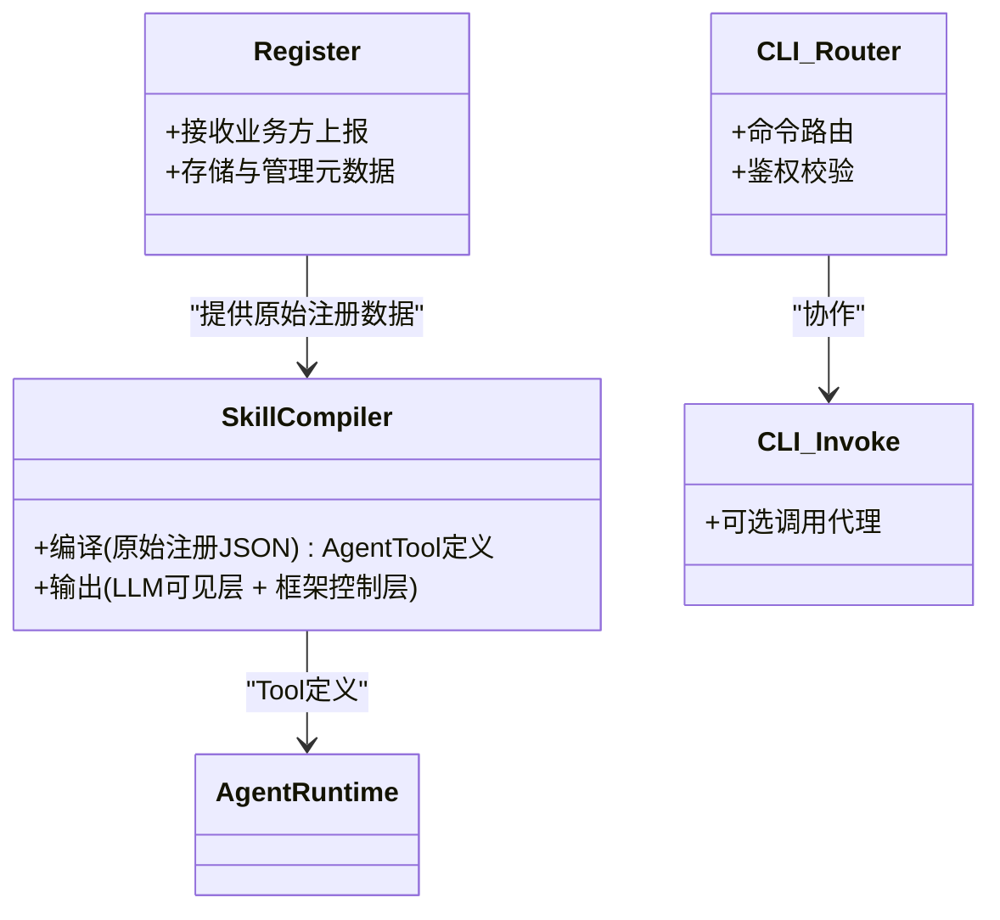
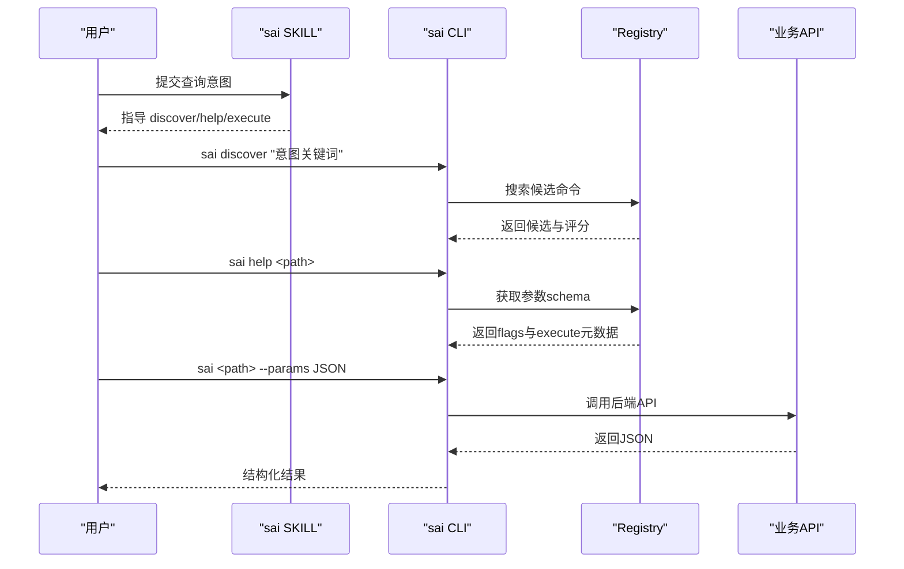
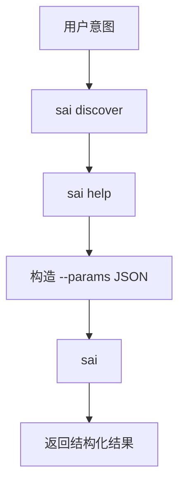
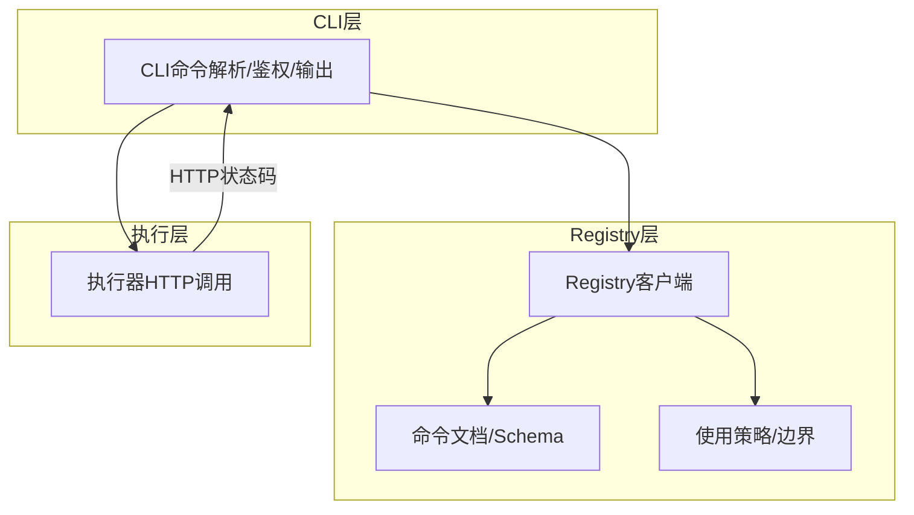

# CLI集成机制

<cite>
**本文档引用的文件**
- [SAI_CLI_设计文档_v1.0.md](file://plan/SAI_CLI_设计文档_v1.0.md)
- [SAI_CLI_设计文档_v1.2.md](file://plan/SAI_CLI_设计文档_v1.2.md)
- [CLI 架构与规范对焦.md](file://plan/CLI 架构与规范对焦.md)
- [agent-api-discovery-architecture-review.zh-CN.md](file://notes/zhaobomin/agent-api-discovery-architecture-review.zh-CN.md)
- [Sai整体架构设计.md](file://project/standup/Sai整体架构设计.md)
- [2026-04-23_lingxue.md](file://daily/2026-04-23/lingxue.md)
- [SKILL.md](file://.claude/skills/sai/SKILL.md)
- [config.yaml](file://openspec/config.yaml)
</cite>

## 目录
1. [简介](#简介)
2. [项目结构](#项目结构)
3. [核心组件](#核心组件)
4. [架构总览](#架构总览)
5. [详细组件分析](#详细组件分析)
6. [依赖关系分析](#依赖关系分析)
7. [性能考量](#性能考量)
8. [故障排除指南](#故障排除指南)
9. [结论](#结论)
10. [附录](#附录)

## 简介
本文件面向开发者与运维工程师，系统化阐述基于 SAI 的 CLI 集成机制，涵盖 Agent 与 CLI 系统的分层架构、命令调用流程、参数传递与结果处理、CLI 包装器实现原理、Python 脚本调用机制以及 API 数据获取流程。文档还总结了当前 AI 销售助理的 CLI 使用方式、技能执行中的脚本引用与业务 API 调用、CLI 客户端适配策略、未来随云客户端迁移计划与兼容性处理，并提供 CLI 集成示例、配置参数与调试技巧，以及最佳实践与故障排除指南。

## 项目结构
仓库围绕 SAI CLI 的设计文档、Agent 与 Harness Manager 的对接方案、CLI 技能与命令示例、以及日常推进记录展开，形成“设计—实现—验证—运维”的闭环。

**图表来源**
- [SAI_CLI_设计文档_v1.0.md:1-384](file://plan/SAI_CLI_设计文档_v1.0.md#L1-L384)
- [SAI_CLI_设计文档_v1.2.md:1-635](file://plan/SAI_CLI_设计文档_v1.2.md#L1-L635)
- [CLI 架构与规范对焦.md:1-25](file://plan/CLI 架构与规范对焦.md#L1-L25)
- [Sai整体架构设计.md:1-277](file://project/standup/Sai整体架构设计.md#L1-L277)
- [.claude/skills/sai/SKILL.md:1-155](file://.claude/skills/sai/SKILL.md#L1-L155)
- [agent-api-discovery-architecture-review.zh-CN.md:1-558](file://notes/zhaobomin/agent-api-discovery-architecture-review.zh-CN.md#L1-L558)
- [2026-04-23_lingxue.md:1-56](file://daily/2026-04-23/lingxue.md#L1-L56)
- [config.yaml:1-21](file://openspec/config.yaml#L1-L21)

**章节来源**
- [SAI_CLI_设计文档_v1.0.md:1-384](file://plan/SAI_CLI_设计文档_v1.0.md#L1-L384)
- [SAI_CLI_设计文档_v1.2.md:1-635](file://plan/SAI_CLI_设计文档_v1.2.md#L1-L635)
- [CLI 架构与规范对焦.md:1-25](file://plan/CLI 架构与规范对焦.md#L1-L25)
- [Sai整体架构设计.md:1-277](file://project/standup/Sai整体架构设计.md#L1-L277)
- [.claude/skills/sai/SKILL.md:1-155](file://.claude/skills/sai/SKILL.md#L1-L155)
- [agent-api-discovery-architecture-review.zh-CN.md:1-558](file://notes/zhaobomin/agent-api-discovery-architecture-review.zh-CN.md#L1-L558)
- [2026-04-23_lingxue.md:1-56](file://daily/2026-04-23/lingxue.md#L1-L56)
- [config.yaml:1-21](file://openspec/config.yaml#L1-L21)

## 核心组件
- 调用层（Agent Runtime）：负责意图理解、技能选择、命令拼接与执行，返回结构化结果。
- 网关层（CLI 网关）：负责命令路由、鉴权校验、负载均衡、命令清单同步。
- CLI 核心层（Harness Manager 统一构建）：统一命令规范、入参/出参 JSON、公共能力（认证/日志），内置 API 注册中心与 SkillCompiler。
- 后端 API 层：各业务域提供只读 HTTP 接口，零侵入接入。

关键特性
- 协议统一：所有 HTTP 调用与 CLI 入参/出参统一使用 JSON。
- 命令规范：{product} {module} {action} [params]，参数以 --key value 或 --params JSON 传递。
- 结构化错误输出：统一的 type/code/message/hint 字段。
- 安全与鉴权：支持 Bearer Token 与 PoP Token（分阶段实施），Token 获取优先级明确。
- 可测试性：核心逻辑通过接口抽象，支持 vfs、HTTP 客户端注入与 Token 读取抽象。

**章节来源**
- [SAI_CLI_设计文档_v1.2.md:69-113](file://plan/SAI_CLI_设计文档_v1.2.md#L69-L113)
- [SAI_CLI_设计文档_v1.2.md:115-147](file://plan/SAI_CLI_设计文档_v1.2.md#L115-L147)
- [SAI_CLI_设计文档_v1.2.md:295-337](file://plan/SAI_CLI_设计文档_v1.2.md#L295-L337)
- [SAI_CLI_设计文档_v1.2.md:394-471](file://plan/SAI_CLI_设计文档_v1.2.md#L394-L471)
- [SAI_CLI_设计文档_v1.2.md:474-513](file://plan/SAI_CLI_设计文档_v1.2.md#L474-L513)

## 架构总览
SAI 采用四层分层架构，实现 AI Agent 与各业务域后端服务的标准化接入。Agent 通过 CLI 网关调用统一的 SAI-CLI，后者封装各域 API 并提供结构化输出。

**图表来源**
- [Sai整体架构设计.md:19-65](file://project/standup/Sai整体架构设计.md#L19-L65)
- [SAI_CLI_设计文档_v1.2.md:29-64](file://plan/SAI_CLI_设计文档_v1.2.md#L29-L64)

**章节来源**
- [Sai整体架构设计.md:19-65](file://project/standup/Sai整体架构设计.md#L19-L65)
- [SAI_CLI_设计文档_v1.2.md:29-64](file://plan/SAI_CLI_设计文档_v1.2.md#L29-L64)

## 详细组件分析

### Agent 与 CLI 的调用流程（6步 NLU Pipeline）
Agent 与 SAI-CLI 的交互升级为 6 步 NLU Pipeline：意图分类、实体抽取、Tag 匹配与评分、参数组装、API 调用、结果解读。

**图表来源**
- [Sai整体架构设计.md:115-138](file://project/standup/Sai整体架构设计.md#L115-L138)
- [SAI_CLI_设计文档_v1.2.md:250-268](file://plan/SAI_CLI_设计文档_v1.2.md#L250-L268)

**章节来源**
- [Sai整体架构设计.md:115-138](file://project/standup/Sai整体架构设计.md#L115-L138)
- [SAI_CLI_设计文档_v1.2.md:250-268](file://plan/SAI_CLI_设计文档_v1.2.md#L250-L268)

### CLI 命令调用流程与参数传递
- 命令格式：{product} {module} {action} [params]
- 参数传递：支持 --key value 与 --params JSON；两者合并规则明确，兼顾机器调用与人工调试。
- 结果处理：统一 JSON envelope 输出，成功与失败均结构化，便于 Agent 稳定解析。

**图表来源**
- [SAI_CLI_设计文档_v1.2.md:115-147](file://plan/SAI_CLI_设计文档_v1.2.md#L115-L147)
- [SAI_CLI_设计文档_v1.2.md:295-337](file://plan/SAI_CLI_设计文档_v1.2.md#L295-L337)

**章节来源**
- [SAI_CLI_设计文档_v1.2.md:115-147](file://plan/SAI_CLI_设计文档_v1.2.md#L115-L147)
- [SAI_CLI_设计文档_v1.2.md:295-337](file://plan/SAI_CLI_设计文档_v1.2.md#L295-L337)

### CLI 包装器与 SkillCompiler 实现原理
- 包装器职责：统一命令规范、入参/出参 JSON、公共能力（认证/日志）、路由与鉴权。
- SkillCompiler：将业务方上报的原始注册 JSON 编译为 Agent 可读的“增强型 Tool 定义”，包含 LLM 可见层与框架控制层。
- 注册中心：集中管理 9 维 Tag、description、入参说明，支持 AI 自动生成与业务团队审核。

**图表来源**
- [SAI_CLI_设计文档_v1.2.md:547-559](file://plan/SAI_CLI_设计文档_v1.2.md#L547-L559)
- [SAI_CLI_设计文档_v1.2.md:225-249](file://plan/SAI_CLI_设计文档_v1.2.md#L225-L249)

**章节来源**
- [SAI_CLI_设计文档_v1.2.md:547-559](file://plan/SAI_CLI_设计文档_v1.2.md#L547-L559)
- [SAI_CLI_设计文档_v1.2.md:225-249](file://plan/SAI_CLI_设计文档_v1.2.md#L225-L249)

### Python 脚本调用机制与 API 数据获取
- 脚本调用：CLI 通过统一命令规范调用后端 API，Agent 通过技能（Skill）指导用户使用 sai discover/help/execute 三步流程。
- API 数据获取：CLI 核心层负责鉴权头、动态命令路径解析、参数合并与基础校验、本地缓存与执行代理，最终返回结构化 JSON。

**图表来源**
- [.claude/skills/sai/SKILL.md:19-64](file://.claude/skills/sai/SKILL.md#L19-L64)
- [agent-api-discovery-architecture-review.zh-CN.md:190-203](file://notes/zhaobomin/agent-api-discovery-architecture-review.zh-CN.md#L190-L203)

**章节来源**
- [.claude/skills/sai/SKILL.md:19-64](file://.claude/skills/sai/SKILL.md#L19-L64)
- [agent-api-discovery-architecture-review.zh-CN.md:190-203](file://notes/zhaobomin/agent-api-discovery-architecture-review.zh-CN.md#L190-L203)

### 当前 AI 销售助理的 CLI 使用方式
- 使用三步流程：发现（discover）→ 理解（help/schema）→ 执行（execute）。
- 已知命令参考：网点组织查询、业务量指标、网络贡献指标、派件履约、派费损益、面单损益等。
- 参数构造：依据 help 返回的 schema，构造 --params JSON，key 对应 flag name。

**图表来源**
- [.claude/skills/sai/SKILL.md:19-64](file://.claude/skills/sai/SKILL.md#L19-L64)

**章节来源**
- [.claude/skills/sai/SKILL.md:19-64](file://.claude/skills/sai/SKILL.md#L19-L64)

### CLI 客户端适配策略与未来迁移
- 适配策略：统一 OSS 挂载形式，将 SAI-CLI 二进制挂载至 Agent 运行环境；鉴权机制支持配置文件读取与参数传入。
- 迁移计划：v1.2 引入 PoP Token + ECDSA 签名（分阶段实施），增强云端与本地 Token 的环境绑定与防复用。
- 兼容性处理：保持 CLI 与业务域 API 的零侵入；通过注册中心与 SkillCompiler 保证 Agent Tool 定义的稳定演进。

**章节来源**
- [SAI_CLI_设计文档_v1.2.md:561-600](file://plan/SAI_CLI_设计文档_v1.2.md#L561-L600)
- [SAI_CLI_设计文档_v1.2.md:421-440](file://plan/SAI_CLI_设计文档_v1.2.md#L421-L440)

## 依赖关系分析
- 模块边界清晰：CLI 层薄而可靠，API 知识集中在注册中心与 SkillCompiler；Agent 通过 Skill 与 CLI 定义交互。
- 关键耦合点：Registry 客户端、执行器（execute.RunQuery）、鉴权与输出层。
- 优化建议：拆分 Registry.Client 与 execute.RunQuery，减少单文件复杂度；增强非 2xx 状态码映射与调试日志可控性。

**图表来源**
- [agent-api-discovery-architecture-review.zh-CN.md:28-36](file://notes/zhaobomin/agent-api-discovery-architecture-review.zh-CN.md#L28-L36)
- [agent-api-discovery-architecture-review.zh-CN.md:135-165](file://notes/zhaobomin/agent-api-discovery-architecture-review.zh-CN.md#L135-L165)

**章节来源**
- [agent-api-discovery-architecture-review.zh-CN.md:28-36](file://notes/zhaobomin/agent-api-discovery-architecture-review.zh-CN.md#L28-L36)
- [agent-api-discovery-architecture-review.zh-CN.md:135-165](file://notes/zhaobomin/agent-api-discovery-architecture-review.zh-CN.md#L135-L165)

## 性能考量
- 缓存与TTL：Registry Schema 本地缓存与 TTL，降低高频调用 discover/help/list 的延迟。
- 输出协议：统一 JSON envelope，减少解析开销。
- 参数合并：--params JSON 与 --key value 合并规则，兼顾机器调用与人工调试。
- 调试日志：建议仅在 SAI_DEBUG=true 时输出，对敏感字段脱敏，避免污染 Agent 解析与泄露业务参数。

**章节来源**
- [agent-api-discovery-architecture-review.zh-CN.md:18-21](file://notes/zhaobomin/agent-api-discovery-architecture-review.zh-CN.md#L18-L21)
- [agent-api-discovery-architecture-review.zh-CN.md:115-134](file://notes/zhaobomin/agent-api-discovery-architecture-review.zh-CN.md#L115-L134)

## 故障排除指南
常见问题与建议
- 动态命令兜底分发未接入真实入口：建议在 main.go 或 root command 层接入 TryDynamicDispatch，或改为 root RunE/Args 统一解析未知三段路径。
- 下游 4xx/5xx 被包装成成功：建议在执行器中对非 2xx 返回 typed error，并按状态码映射错误类型。
- 默认 prod profile 占位 URL：建议构建脚本在校验 prod profile，不允许占位进入产物。
- 下游请求日志默认输出业务参数：建议仅在 SAI_DEBUG=true 时输出，并对敏感字段做 masking。
- Registry.Client 责任过重：建议拆分为 transport、cache_store、commands_client、parser、refresh 等模块。
- execute.RunQuery 边界偏厚：建议引入 Executor 结构体，注入 http.Client、token provider、logger，拆分请求构造与响应解析。

**章节来源**
- [agent-api-discovery-architecture-review.zh-CN.md:42-66](file://notes/zhaobomin/agent-api-discovery-architecture-review.zh-CN.md#L42-L66)
- [agent-api-discovery-architecture-review.zh-CN.md:68-95](file://notes/zhaobomin/agent-api-discovery-architecture-review.zh-CN.md#L68-L95)
- [agent-api-discovery-architecture-review.zh-CN.md:96-114](file://notes/zhaobomin/agent-api-discovery-architecture-review.zh-CN.md#L96-L114)
- [agent-api-discovery-architecture-review.zh-CN.md:115-134](file://notes/zhaobomin/agent-api-discovery-architecture-review.zh-CN.md#L115-L134)
- [agent-api-discovery-architecture-review.zh-CN.md:135-165](file://notes/zhaobomin/agent-api-discovery-architecture-review.zh-CN.md#L135-L165)
- [agent-api-discovery-architecture-review.zh-CN.md:166-187](file://notes/zhaobomin/agent-api-discovery-architecture-review.zh-CN.md#L166-L187)

## 结论
SAI CLI 集成机制通过四层分层架构与统一协议，实现了 Agent 与各业务域 API 的标准化接入。设计强调“薄 CLI + 注册中心驱动”，CLI 保持通用能力，API 知识集中管理并通过 SkillCompiler 为 Agent 提供增强型 Tool 定义。当前实现已具备可扩展性与可测试性，建议优先修复非 2xx 状态码处理与动态命令兜底分发问题，进一步完善 discover 返回结构与执行前校验能力，以支撑 Agent 在数百个历史 API 中高效发现与正确调用。

## 附录

### CLI 集成示例与配置参数
- 命令示例：kunlun timeliness query --type 出港滞留 --date 2026-04-21
- 参数传递：--key value 与 --params JSON 合并；help 返回 flags 与 execute 元数据
- 结构化输出：统一 JSON envelope，错误输出包含 type/code/message/hint
- 鉴权优先级：命令行参数 > 环境变量 > 本地配置文件

**章节来源**
- [SAI_CLI_设计文档_v1.2.md:134-147](file://plan/SAI_CLI_设计文档_v1.2.md#L134-L147)
- [SAI_CLI_设计文档_v1.2.md:295-337](file://plan/SAI_CLI_设计文档_v1.2.md#L295-L337)
- [SAI_CLI_设计文档_v1.2.md:405-412](file://plan/SAI_CLI_设计文档_v1.2.md#L405-L412)

### 调试技巧
- 使用 sai discover 与 sai help 确认候选与参数 schema，避免构造错误的 JSON。
- 在 SAI_DEBUG=true 时启用调试日志，注意对敏感字段脱敏。
- 通过 --dry-run 或 validate 预检参数完整性与风险等级。
- 检查本地 ~/.sai/sso-auth.json 是否正确，或通过参数传入 --token。

**章节来源**
- [.claude/skills/sai/SKILL.md:19-64](file://.claude/skills/sai/SKILL.md#L19-L64)
- [agent-api-discovery-architecture-review.zh-CN.md:115-134](file://notes/zhaobomin/agent-api-discovery-architecture-review.zh-CN.md#L115-L134)
- [agent-api-discovery-architecture-review.zh-CN.md:379-420](file://notes/zhaobomin/agent-api-discovery-architecture-review.zh-CN.md#L379-L420)

### 最佳实践
- 严格遵守统一命令规范与 JSON 协议，避免非结构化输出。
- 通过注册中心与 SkillCompiler 提升 Agent 的可发现性与可执行性。
- 在 CI/CD 中校验 prod profile，避免占位 URL 进入产物。
- 保持 CLI 与业务域 API 的零侵入，通过注册与分发机制实现解耦。

**章节来源**
- [SAI_CLI_设计文档_v1.2.md:69-113](file://plan/SAI_CLI_设计文档_v1.2.md#L69-L113)
- [Sai整体架构设计.md:173-195](file://project/standup/Sai整体架构设计.md#L173-L195)