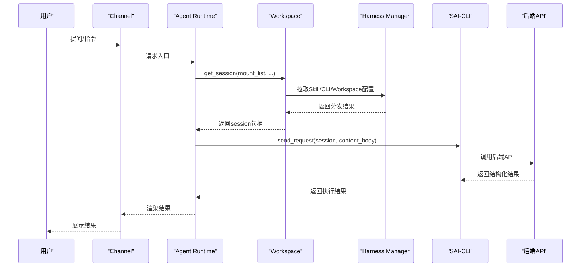
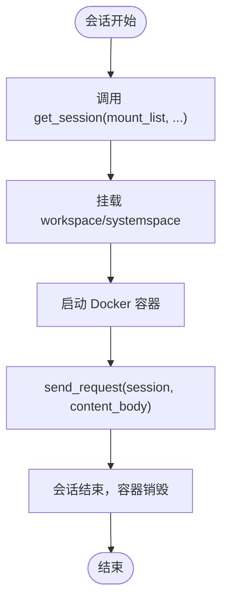
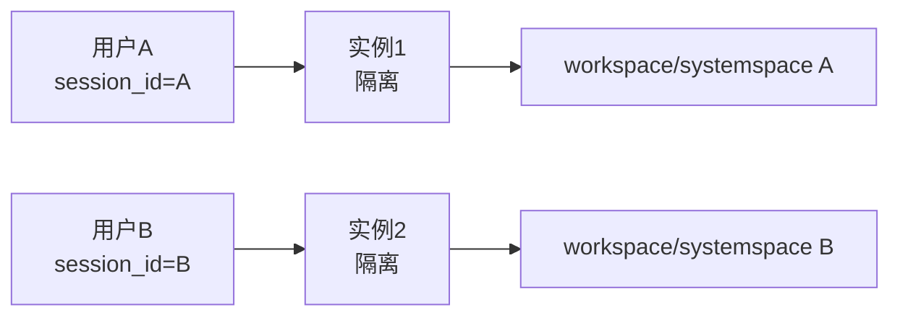
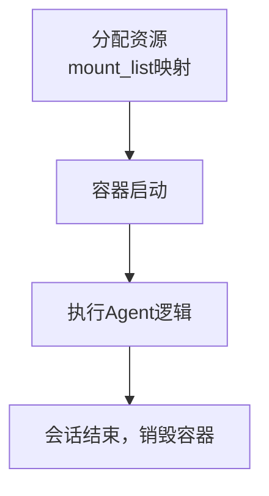
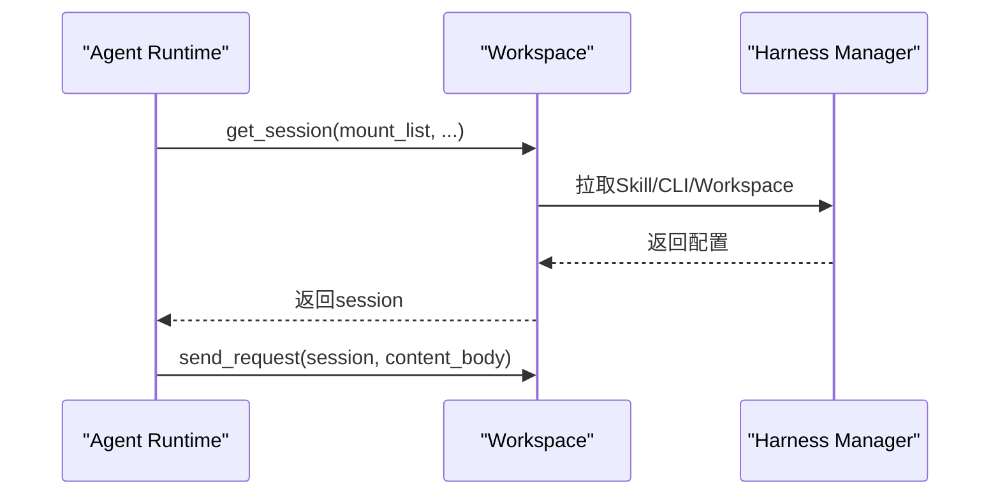
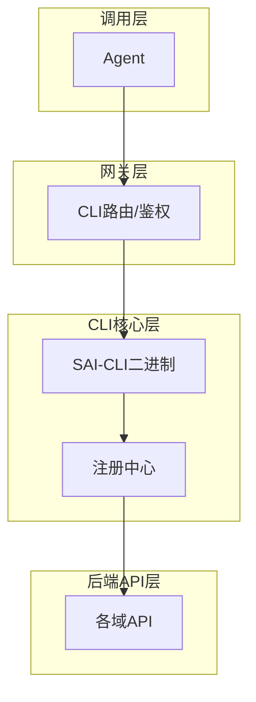
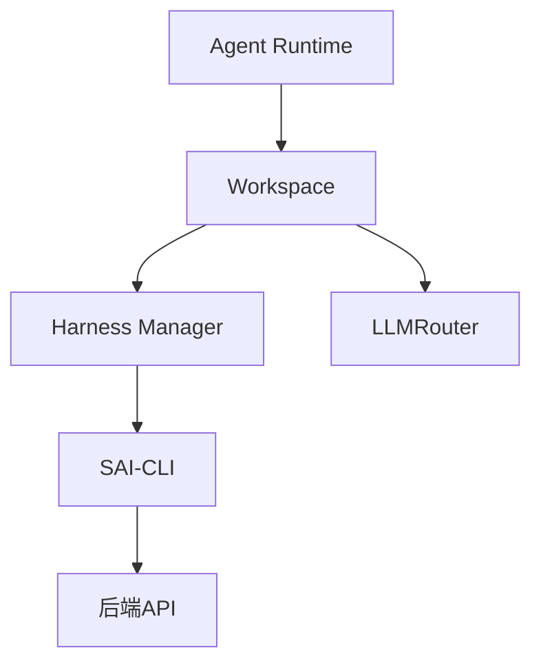

# Serverless执行架构

<cite>
**本文引用的文件**
- [Agent-Runtime方案.md](file://plan/Agent-Runtime方案.md)
- [Agent-Runtime方案review.md](file://notes/zhaobomin/Agent-Runtime方案review.md)
- [2026-04-20早会记录.md](file://project/standup/2026-04-20-zhaobomin.md)
- [yihang 4.20日报.md](file://daily/2026-04-20/yihang.md)
- [SAI_CLI_设计文档_v1.2.md](file://plan/SAI_CLI_设计文档_v1.2.md)
- [Agent 设计方案（MSE流量分流）.md](file://plan/Agent 设计方案（MSE流量分流）.md)
- [config.yaml](file://openspec/config.yaml)
</cite>

## 目录
1. [引言](#引言)
2. [项目结构](#项目结构)
3. [核心组件](#核心组件)
4. [架构总览](#架构总览)
5. [详细组件分析](#详细组件分析)
6. [依赖分析](#依赖分析)
7. [性能考量](#性能考量)
8. [故障排除指南](#故障排除指南)
9. [结论](#结论)
10. [附录](#附录)

## 引言
本文件面向Serverless执行架构，聚焦“基于AgentRun的Serverless实现”。围绕会话生命周期、容器资源分配与销毁、基于session_id的用户执行环境隔离、热启动与冷启动策略、以及与Harness Manager、CLI API、LLMRouter等模块的协作关系，提供系统化技术文档。内容来源于仓库内现有文档与会议记录，旨在帮助开发者快速理解并落地容器化Serverless执行方案。

## 项目结构
仓库中与Serverless执行架构相关的关键文档分布如下：
- 方案与评审：Agent Runtime方案、方案Review、早会模块架构图
- 会话与接口：与老徐关于get_session/send_request的接口澄清
- CLI与网关：SAI CLI设计文档（四层架构、9维Tag、注册与发布流程）
- 基础设施：Agent（MSE流量分流）方案（Kubernetes Pod池、OSS挂载、路由控制）
- 规范与上下文：openspec配置（用于AI生成与规范）

```mermaid
graph TB
subgraph "Channel层"
CH["Channel<br/>申懂懂App"]
end
subgraph "核心层"
AR["Agent Runtime<br/>奕杭"]
WS["Workspace"]
HM["Harness Manager<br/>隋云"]
end
subgraph "基础设施层"
LR["LLMRouter<br/>老徐"]
CA["CLI API<br/>淩雪"]
end
subgraph "Harness Manager子模块"
KB["知识库"]
SK["Skills"]
CLI["CLI 管理和分发"]
end
CH --> WS
AR --> WS
WS < --> HM
HM --> KB
HM --> SK
HM --> CLI
CLI --> CA
WS --> LR
```

图表来源
- [2026-04-20早会记录.md:5-40](file://project/standup/2026-04-20-zhaobomin.md#L5-L40)

章节来源
- [2026-04-20早会记录.md:1-84](file://project/standup/2026-04-20-zhaobomin.md#L1-L84)

## 核心组件
- Agent Runtime（Serverless执行层）
  - 基于session_id隔离用户执行环境，单实例单会话
  - 通过Docker容器承载Agent实例，实现“会话进入run docker，Agent无状态，会话结束销毁”
  - 热启动性能指标明确：冷启动<1秒，热启动约100ms
  - 与老徐的接口契约：get_session、send_request
- Harness Manager（技能与CLI分发）
  - 提供Skills、CLI管理与分发，支持SAI-CLI统一二进制打包与发布
  - 与Agent Runtime的交互通过Workspace进行
- Workspace（会话工作区）
  - 作为Agent Runtime与HM之间的桥梁，承载session持久化与mount_list组织
- CLI API（后端API层）
  - 各业务域仅提供API接口，不参与CLI层开发
- LLMRouter（路由与网关）
  - 与Workspace交互，承担路由转发与负载均衡职责

章节来源
- [Agent-Runtime方案.md:4-13](file://plan/Agent-Runtime方案.md#L4-L13)
- [yihang 4.20日报.md:5-12](file://daily/2026-04-20/yihang.md#L5-L12)
- [2026-04-20早会记录.md:12-38](file://project/standup/2026-04-20-zhaobomin.md#L12-L38)

## 架构总览
Serverless执行架构以Agent Runtime为核心，围绕会话生命周期与容器化执行展开，结合Harness Manager的技能与CLI分发、LLMRouter的路由能力，形成“Agent → Workspace → Harness Manager/CLI API”的标准链路。



图表来源
- [yihang 4.20日报.md:5-12](file://daily/2026-04-20/yihang.md#L5-L12)
- [2026-04-20早会记录.md:29-37](file://project/standup/2026-04-20-zhaobomin.md#L29-L37)
- [SAI_CLI_设计文档_v1.2.md:29-105](file://plan/SAI_CLI_设计文档_v1.2.md#L29-L105)

## 详细组件分析

### 会话生命周期与容器启动机制
- 生命周期要点
  - 会话进入：通过get_session(mount_list, ...)获取session句柄，mount_list用于组织用户workspace（除skill、cli外，还考虑session持久化）
  - 交互执行：send_request(session, content_body)在容器内执行Agent逻辑
  - 会话结束：容器销毁，Agent无状态，资源回收
- 容器启动与隔离
  - 基于Docker容器承载Agent实例，确保单实例单会话的隔离
  - mount_list将本地路径与OSS路径映射，实现workspace/systemspace分离
- 热启动与冷启动
  - 冷启动<1秒，热启动约100ms，满足通用Agent调用的性能要求



图表来源
- [Agent-Runtime方案.md:6-8](file://plan/Agent-Runtime方案.md#L6-L8)
- [yihang 4.20日报.md:7-11](file://daily/2026-04-20/yihang.md#L7-L11)

章节来源
- [Agent-Runtime方案.md:4-13](file://plan/Agent-Runtime方案.md#L4-L13)
- [yihang 4.20日报.md:5-12](file://daily/2026-04-20/yihang.md#L5-L12)

### 基于session_id的用户执行环境隔离
- 单实例单会话
  - 每个Agent实例仅承载一个session，避免多会话共享带来的状态污染
- session_id驱动的隔离
  - 通过session_id动态分配Agent实例，确保用户执行环境相互隔离
- mount_list组织
  - 本地路径与OSS路径映射，区分workspace与systemspace，便于按用户/领域/公共组织



图表来源
- [Agent-Runtime方案.md:8](file://plan/Agent-Runtime方案.md#L8)
- [Agent-Runtime方案.md:29](file://plan/Agent-Runtime方案.md#L29)

章节来源
- [Agent-Runtime方案.md:8-9](file://plan/Agent-Runtime方案.md#L8-L9)

### 容器资源分配与销毁流程
- 资源分配
  - 通过mount_list将用户workspace/systemspace挂载到容器内，支持Linux管道命令
  - 若OSS挂载不可用，提供Agent层实现基于用户文件路径权限的替代方案
- 销毁流程
  - 会话结束后销毁容器，释放资源，保证无状态与可重复利用



图表来源
- [Agent-Runtime方案.md:18-26](file://plan/Agent-Runtime方案.md#L18-L26)

章节来源
- [Agent-Runtime方案.md:18-32](file://plan/Agent-Runtime方案.md#L18-L32)

### 与Harness Manager的接口契约与协作
- 接口契约
  - get_session：基于用户级别workspace获取agent session，mount_list组织workspace
  - send_request：基于session进行Agent交互
- 与HM协作
  - Workspace作为桥梁，从HM拉取Skill/CLI/Workspace配置
  - HM负责Skills、CLI管理与分发，Agent Runtime不感知user id，降低耦合



图表来源
- [yihang 4.20日报.md:7-11](file://daily/2026-04-20/yihang.md#L7-L11)
- [2026-04-20早会记录.md:32-35](file://project/standup/2026-04-20-zhaobomin.md#L32-L35)

章节来源
- [yihang 4.20日报.md:5-12](file://daily/2026-04-20/yihang.md#L5-L12)
- [2026-04-20早会记录.md:12-38](file://project/standup/2026-04-20-zhaobomin.md#L12-L38)

### CLI与后端API的解耦与调用链
- 分层解耦
  - Agent → 网关 → SAI-CLI → API，每层仅依赖下一层接口契约
- 统一命令规范与Tag体系
  - 9维Tag（路由/分类/意图/执行/展示等）用于自动识别与路由
  - 命令格式统一，参数结构化，禁止交互式输入
- 发布与注册
  - Harness Manager统一构建与打包SAI-CLI二进制，提供注册接口（add/update/remove）



图表来源
- [SAI_CLI_设计文档_v1.2.md:29-105](file://plan/SAI_CLI_设计文档_v1.2.md#L29-L105)
- [SAI_CLI_设计文档_v1.2.md:365-391](file://plan/SAI_CLI_设计文档_v1.2.md#L365-L391)
- [SAI_CLI_设计文档_v1.2.md:574-591](file://plan/SAI_CLI_设计文档_v1.2.md#L574-L591)

章节来源
- [SAI_CLI_设计文档_v1.2.md:29-105](file://plan/SAI_CLI_设计文档_v1.2.md#L29-L105)
- [SAI_CLI_设计文档_v1.2.md:365-391](file://plan/SAI_CLI_设计文档_v1.2.md#L365-L391)
- [SAI_CLI_设计文档_v1.2.md:574-591](file://plan/SAI_CLI_设计文档_v1.2.md#L574-L591)

### 基础设施与冷启动策略（Kubernetes/ACS对比）
- 文档中存在不同描述：
  - LLM-Gateway建设方案：Kubernetes集群部署
  - Agent Runtime方案：阿里云函数计算，冷启动<1s
  - 徐春辉4/24日报：ACS（20-30s）vs 宿主机（~5s），AgentRun模块
- 建议
  - 明确Agent Runtime底层基础设施（函数计算/K8s CloneSet/ACS），统一目标与指标

章节来源
- [Agent-Runtime方案.md:12](file://plan/Agent-Runtime方案.md#L12)
- [Agent 设计方案（MSE流量分流）.md:1-28](file://plan/Agent 设计方案（MSE流量分流）.md#L1-L28)
- [Agent-Runtime方案review.md:149-157](file://notes/zhaobomin/Agent-Runtime方案review.md#L149-L157)

## 依赖分析
- 模块耦合
  - Agent Runtime与Workspace：通过get_session/send_request接口耦合
  - Workspace与Harness Manager：通过Skill/CLI/Workspace配置耦合
  - LLMRouter与Workspace：通过路由与负载均衡耦合
- 外部依赖
  - 阿里云函数计算（当前部署方式）
  - OSS挂载（优先方案；不可用时回退Agent层权限控制）
  - SAI-CLI注册中心与发布流程



图表来源
- [2026-04-20早会记录.md:29-37](file://project/standup/2026-04-20-zhaobomin.md#L29-L37)

章节来源
- [2026-04-20早会记录.md:12-38](file://project/standup/2026-04-20-zhaobomin.md#L12-L38)

## 性能考量
- 启动性能
  - 冷启动<1秒，热启动约100ms，满足通用Agent调用体验
- 资源利用率
  - 单实例单会话，容器按需启动与销毁，避免长驻进程资源占用
  - mount_list将workspace/systemspace分离，减少不必要的IO开销
- 成本控制
  - Serverless容器按次付费，适合低频/突发场景
  - 与函数计算/ACS/K8s的选择需结合SLA与成本模型评估

章节来源
- [Agent-Runtime方案.md:6](file://plan/Agent-Runtime方案.md#L6)
- [Agent-Runtime方案.md:12](file://plan/Agent-Runtime方案.md#L12)

## 故障排除指南
- 接口契约未对齐
  - 现状：get_session/send_request在早期对齐中，但方案文档未体现
  - 建议：在正式设计文档中明确接口签名与调用约束
- OSS挂载阻塞
  - 现状：OSS挂载逻辑在Agent层配置，无法个性化挂载
  - 建议：优先推进阿里云个性化挂载接口；若不可用，Agent层实现基于用户路径的权限控制
- 文档完整性不足
  - 现状：方案粒度偏粗，缺少架构图、接口定义、数据流
  - 建议：补齐正式设计文档，包含系统架构图、核心接口定义、session生命周期、错误处理机制
- 与Harness Manager对接模糊
  - 现状：HM的Skill分发策略尚未定稿
  - 建议：与隋云对齐Skill分发策略，明确systemspace组织方式

章节来源
- [Agent-Runtime方案review.md:18-31](file://notes/zhaobomin/Agent-Runtime方案review.md#L18-L31)
- [Agent-Runtime方案.md:18-32](file://plan/Agent-Runtime方案.md#L18-L32)
- [Agent-Runtime方案review.md:32-36](file://notes/zhaobomin/Agent-Runtime方案review.md#L32-L36)

## 结论
本架构以Agent Runtime为核心，通过Serverless容器化与基于session_id的隔离策略，实现高性能、低成本的会话执行。配合Harness Manager的技能与CLI分发、LLMRouter的路由能力，形成清晰的分层解耦链路。建议尽快补齐正式设计文档与接口契约，统一底层基础设施选择，明确与HM的对接策略，以保障可执行性与可维护性。

## 附录

### 配置参数与部署示例（基于现有文档）
- 接口参数要点
  - get_session(mount_list, ...): mount_list为本地路径与OSS路径映射列表
  - send_request(session, content_body): 基于session执行Agent交互
- 部署与发布
  - 当前使用阿里云函数计算控制台部署，待DevOps平台对接完成后切换
  - SAI-CLI统一二进制打包与发布，Harness Manager负责注册与网关同步

章节来源
- [yihang 4.20日报.md:7-12](file://daily/2026-04-20/yihang.md#L7-L12)
- [Agent-Runtime方案.md:12](file://plan/Agent-Runtime方案.md#L12)
- [SAI_CLI_设计文档_v1.2.md:574-591](file://plan/SAI_CLI_设计文档_v1.2.md#L574-L591)

### 监控指标建议
- 启动时延：冷启动/热启动耗时
- 资源使用：CPU/内存/IO（容器粒度）
- 会话吞吐：QPS、P95/P99时延
- 失败率与重试：接口失败率、超时与重试次数
- 资源回收：容器销毁成功率与时延

章节来源
- [Agent-Runtime方案.md:6](file://plan/Agent-Runtime方案.md#L6)

### 最佳实践
- 严格遵循单实例单会话原则，避免跨会话共享状态
- 使用mount_list组织workspace/systemspace，确保隔离与可审计
- 优先采用OSS挂载；若不可用，实现Agent层权限控制作为B计划
- 与Harness Manager对齐Skill分发策略，明确systemspace组织方式
- 明确底层基础设施（函数计算/K8s/ACS）与目标SLA，统一成本模型

章节来源
- [Agent-Runtime方案.md:8-32](file://plan/Agent-Runtime方案.md#L8-L32)
- [Agent-Runtime方案review.md:18-31](file://notes/zhaobomin/Agent-Runtime方案review.md#L18-L31)