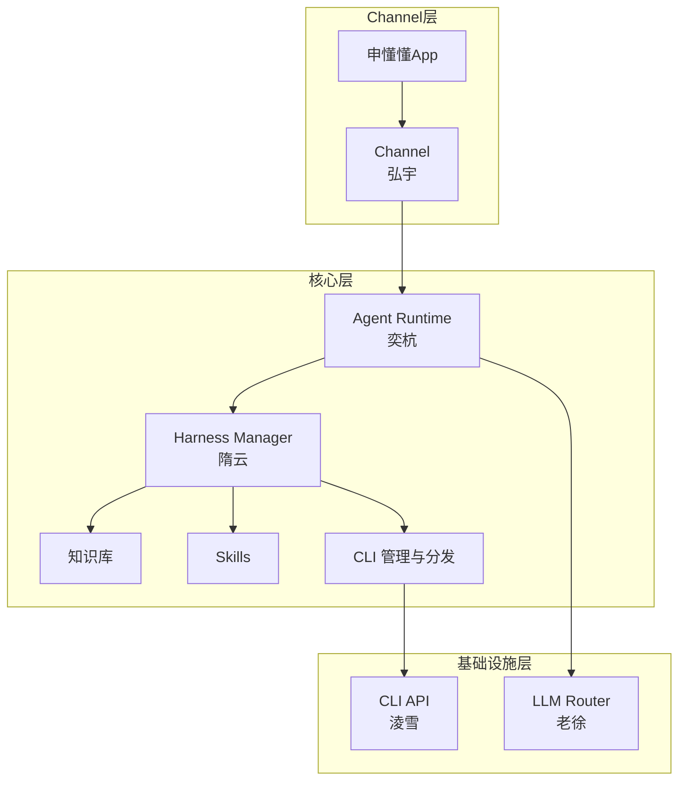
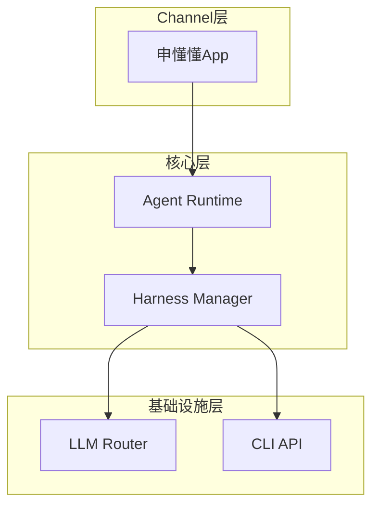
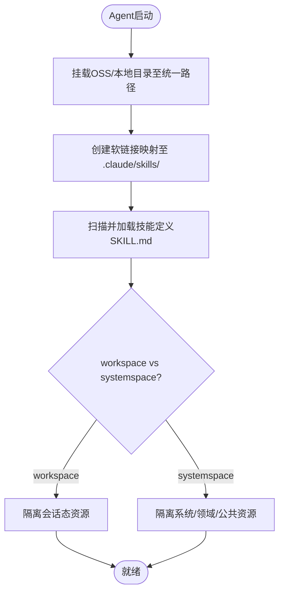
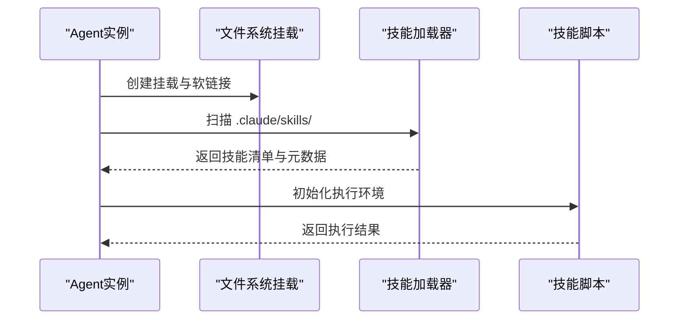
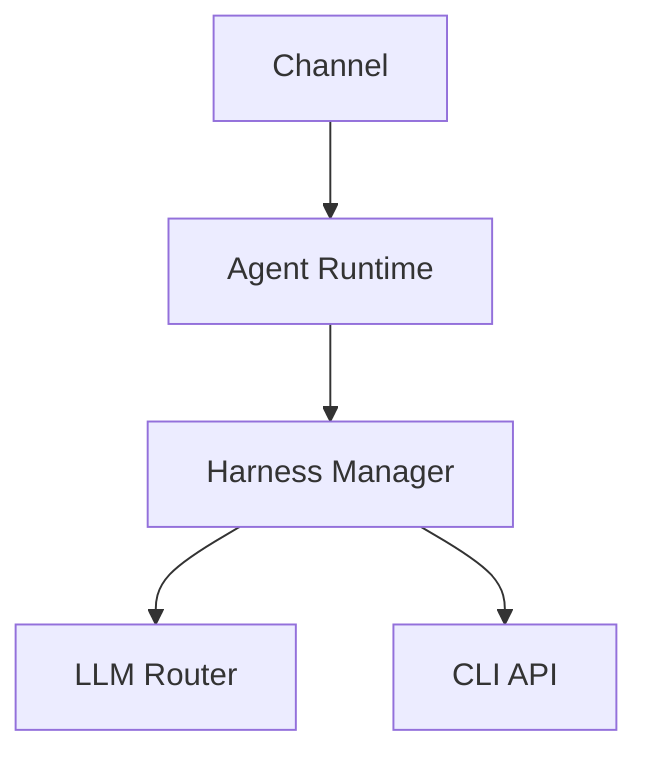

# 技能管理系统

<cite>
**本文引用的文件**
- [README.md](file://README.md)
- [Agent-Runtime方案.md](file://plan/Agent-Runtime方案.md)
- [Agent-Runtime方案review.md](file://notes/zhaobomin/Agent-Runtime方案review.md)
- [LLM-Gateway建设方案.md](file://plan/LLM-Gateway建设方案.md)
- [项目管理方案v1.0.md](file://project/项目管理方案v1.0.md)
- [Sai整体架构设计.md](file://project/standup/Sai整体架构设计.md)
- [yihang.md](file://daily/2026-04-24/yihang.md)
- [.claude/skills/openspec-explore/SKILL.md](file://.claude/skills/openspec-explore/SKILL.md)
</cite>

## 目录
1. [简介](#简介)
2. [项目结构](#项目结构)
3. [核心组件](#核心组件)
4. [架构总览](#架构总览)
5. [详细组件分析](#详细组件分析)
6. [依赖分析](#依赖分析)
7. [性能考虑](#性能考虑)
8. [故障排查指南](#故障排查指南)
9. [结论](#结论)
10. [附录](#附录)

## 简介
本文件面向技能管理系统（Skill Management System）的技术文档，聚焦以下主题：
- 基于Docker文件系统挂载的技能隔离机制：workspace与systemspace的区分、OSS挂载逻辑与权限控制
- 技能加载流程、执行环境准备与资源管理
- 技能版本管理、依赖解析与冲突处理
- 技能热更新机制、回滚策略与性能监控
- 技能开发规范、部署流程与调试方法
- 技能编排与最佳实践

该系统以“极简、可追踪、可灰度”为核心设计原则，采用分层架构与模块化仓库划分，结合Serverless Agent实例、LLM网关与CLI API，形成从Channel到Agent Runtime再到Harness Manager与基础设施的完整链路。

## 项目结构
公共文档库采用“团队维度 + 日报集中”的组织方式，便于跨团队协作与进度可视化。核心模块与职责如下：
- Channel层：负责与前端/业务渠道对接（如申懂懂App）
- 核心层：Agent Runtime（Serverless实例与会话隔离）、Harness Manager（知识库、Skills、CLI管理与分发）
- 基础设施层：LLM Router（路由与调度）、CLI API（提供API原始描述）

图表来源
- [README.md:11-41](file://README.md#L11-L41)

章节来源
- [README.md:9-41](file://README.md#L9-L41)
- [项目管理方案v1.0.md:21-49](file://project/项目管理方案v1.0.md#L21-L49)

## 核心组件
- Agent Runtime（Serverless）：按会话分配实例，实例无状态，会话结束后销毁；冷启动<1秒，热启动约100毫秒级，具备良好的热启动性能
- Harness Manager：负责知识库、Skills与CLI的管理与分发，承担控制面职责，故障时Agent可使用本地缓存继续运行
- LLM Gateway：统一接入与路由多模型，提供API标准化、额度与成本控制、安全与审计、自动化流程
- CLI API：提供API原始描述，支撑上层工具链与Agent调用

章节来源
- [Agent-Runtime方案.md:4-12](file://plan/Agent-Runtime方案.md#L4-L12)
- [Sai整体架构设计.md:261-268](file://project/standup/Sai整体架构设计.md#L261-L268)
- [LLM-Gateway建设方案.md:15-26](file://plan/LLM-Gateway建设方案.md#L15-L26)

## 架构总览
系统围绕“Channel → Agent Runtime → Harness Manager → 基础设施”的主链路展开，同时通过CLI API与LLM Router形成双向支撑。技能与CLI的资源路径映射通过挂载与软链接实现，确保隔离与可扩展性。

图表来源
- [README.md:11-41](file://README.md#L11-L41)
- [Agent-Runtime方案.md:33-38](file://plan/Agent-Runtime方案.md#L33-L38)

## 详细组件分析

### 技能隔离与挂载机制（workspace 与 systemspace）
- 目标：通过Docker文件系统挂载实现技能隔离，区分workspace与systemspace，前者面向用户会话态数据，后者面向系统/领域/公共资源
- OSS挂载逻辑：将外部技能目录挂载至统一的“.claude/skills/”路径，支持软链接与目录映射，减少Agent启动时的IO与初始化开销
- 权限控制：通过挂载策略与软链接创建脚本，限定技能可见范围与访问边界，避免越权访问

图表来源
- [Agent-Runtime方案.md:15-31](file://plan/Agent-Runtime方案.md#L15-L31)
- [yihang.md:10-31](file://daily/2026-04-24/yihang.md#L10-L31)

章节来源
- [Agent-Runtime方案.md:15-31](file://plan/Agent-Runtime方案.md#L15-L31)
- [yihang.md:10-31](file://daily/2026-04-24/yihang.md#L10-L31)

### 技能加载流程与执行环境准备
- 加载流程：Agent启动后执行挂载与软链接创建脚本，随后扫描“.claude/skills/”目录，依据SKILL.md元数据与兼容性声明加载技能
- 执行环境：技能脚本在隔离容器中运行，依赖通过挂载目录与本地缓存组合提供；CLI工具通过统一路径挂载，供技能调用
- 资源管理：按会话分配Agent实例，实例销毁释放资源；systemspace资源按领域/公共策略组织，减少重复下载与IO

图表来源
- [yihang.md:32-42](file://daily/2026-04-24/yihang.md#L32-L42)
- [.claude/skills/openspec-explore/SKILL.md:1-10](file://.claude/skills/openspec-explore/SKILL.md#L1-L10)

章节来源
- [yihang.md:32-42](file://daily/2026-04-24/yihang.md#L32-L42)
- [.claude/skills/openspec-explore/SKILL.md:1-10](file://.claude/skills/openspec-explore/SKILL.md#L1-L10)

### 技能版本管理、依赖解析与冲突处理
- 版本管理：技能元数据包含版本字段，便于灰度与回滚；建议遵循语义化版本，配合标签与分支策略
- 依赖解析：技能声明兼容性（如openspec CLI），加载器据此决定是否满足运行条件；未满足时阻断加载或提示升级
- 冲突处理：systemspace与workspace命名冲突通过挂载层级与软链接策略规避；同一领域多版本通过版本号与命名空间隔离

章节来源
- [.claude/skills/openspec-explore/SKILL.md:6-9](file://.claude/skills/openspec-explore/SKILL.md#L6-L9)
- [Agent-Runtime方案.md:27-31](file://plan/Agent-Runtime方案.md#L27-L31)

### 技能热更新机制与回滚策略
- 热更新：通过挂载更新与软链接重建实现，无需重启Agent实例；更新后重新扫描加载，确保新版本生效
- 回滚：Agent实例可秒级销毁重建，旧镜像保留；回滚时恢复至旧版本镜像或挂载旧版本目录
- 监控：结合LLM Gateway的用量与告警，观察热更新期间的性能波动与错误率

章节来源
- [Sai整体架构设计.md:261-268](file://project/standup/Sai整体架构设计.md#L261-L268)
- [LLM-Gateway建设方案.md:56-65](file://plan/LLM-Gateway建设方案.md#L56-L65)

### 性能监控与可观测性
- LLM Gateway提供统一API、额度与成本控制、安全与审计能力，可用于监控模型调用与费用
- Agent Runtime强调热启动性能（冷启动<1秒，热启动~100ms），适合高频短会话场景
- 建议在技能执行链路中埋点关键指标（加载耗时、执行时延、错误率、资源占用），结合网关日志与告警联动

章节来源
- [Agent-Runtime方案.md:6-12](file://plan/Agent-Runtime方案.md#L6-L12)
- [LLM-Gateway建设方案.md:56-65](file://plan/LLM-Gateway建设方案.md#L56-L65)

### 开发规范、部署流程与调试方法
- 开发规范：技能以SKILL.md定义，包含元数据、兼容性与描述；遵循“Git即进度”，变更需同步文档
- 部署流程：通过挂载与软链接将外部资源映射至Agent可访问路径；灰度发布遵循上线策略，失败可快速回滚
- 调试方法：利用Agent日志与LLM Gateway日志定位问题；对技能加载与执行过程进行分步验证

章节来源
- [项目管理方案v1.0.md:59-86](file://project/项目管理方案v1.0.md#L59-L86)
- [Sai整体架构设计.md:261-268](file://project/standup/Sai整体架构设计.md#L261-L268)

### 技能编排与最佳实践
- 编排原则：将技能与CLI按领域/公共策略组织在systemspace，按用户/会话组织在workspace；通过挂载与软链接实现统一入口
- 最佳实践：优先使用systemspace共享能力，减少重复实现；为关键技能提供版本化与兼容性声明；在灰度环境中验证热更新与回滚

章节来源
- [Agent-Runtime方案.md:27-31](file://plan/Agent-Runtime方案.md#L27-L31)
- [yihang.md:14-30](file://daily/2026-04-24/yihang.md#L14-L30)

## 依赖分析
- 模块耦合：Channel层依赖Agent Runtime；Agent Runtime依赖Harness Manager与LLM Router；Harness Manager依赖CLI API
- 外部依赖：阿里云函数计算（当前部署）、OSS挂载能力（待评估与B方案实现）
- 接口契约：与LLM Router的接口依赖需明确（如get_session、send_request），确保Serverless层不感知user_id

图表来源
- [README.md:11-41](file://README.md#L11-L41)
- [Agent-Runtime方案review.md:26-30](file://notes/zhaobomin/Agent-Runtime方案review.md#L26-L30)

章节来源
- [Agent-Runtime方案review.md:18-36](file://notes/zhaobomin/Agent-Runtime方案review.md#L18-L36)

## 性能考虑
- 启动性能：Agent实例冷启动<1秒，热启动约100ms，适合高频短会话
- IO优化：通过OSS挂载与软链接减少重复下载与扫描开销
- 资源隔离：按会话隔离与按领域/公共隔离相结合，避免资源争用
- 成本控制：LLM Gateway提供额度与熔断机制，避免异常流量导致成本飙升

章节来源
- [Agent-Runtime方案.md:6-12](file://plan/Agent-Runtime方案.md#L6-L12)
- [LLM-Gateway建设方案.md:43-65](file://plan/LLM-Gateway建设方案.md#L43-L65)

## 故障排查指南
- 挂载与软链接问题：检查挂载目标与权限，确认软链接创建脚本执行成功
- 技能加载失败：核对SKILL.md元数据与兼容性声明，确认依赖满足
- Agent实例异常：利用秒级销毁重建能力快速回滚；检查日志定位问题
- 网关异常：启用bypass模式临时透传，保障业务链路可用

章节来源
- [yihang.md:32-42](file://daily/2026-04-24/yihang.md#L32-L42)
- [Sai整体架构设计.md:261-268](file://project/standup/Sai整体架构设计.md#L261-L268)

## 结论
本技能管理系统以Serverless Agent、统一挂载与软链接策略、以及LLM Gateway为核心，实现了高性能、可灰度、可回滚的技能运行与分发体系。通过清晰的模块划分与严格的开发/部署规范，系统在复杂业务场景下具备良好的可维护性与扩展性。

## 附录
- 参考文档与评审意见：Agent Runtime方案与评审、LLM Gateway建设方案、整体架构设计与上线策略
- 技能定义模板：SKILL.md包含元数据、兼容性与描述，作为技能开发与加载的依据

章节来源
- [Agent-Runtime方案.md:1-60](file://plan/Agent-Runtime方案.md#L1-L60)
- [Agent-Runtime方案review.md:1-36](file://notes/zhaobomin/Agent-Runtime方案review.md#L1-L36)
- [LLM-Gateway建设方案.md:1-109](file://plan/LLM-Gateway建设方案.md#L1-L109)
- [Sai整体架构设计.md:261-277](file://project/standup/Sai整体架构设计.md#L261-L277)
- [.claude/skills/openspec-explore/SKILL.md:1-289](file://.claude/skills/openspec-explore/SKILL.md#L1-L289)