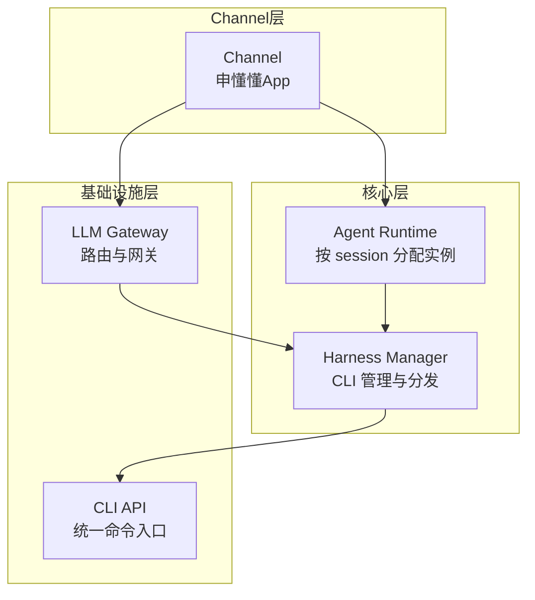
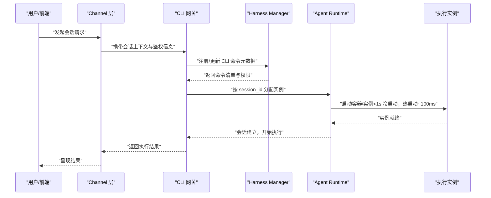
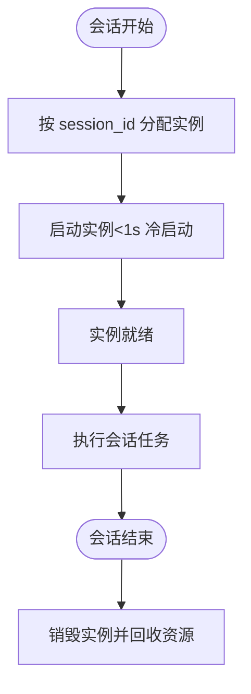
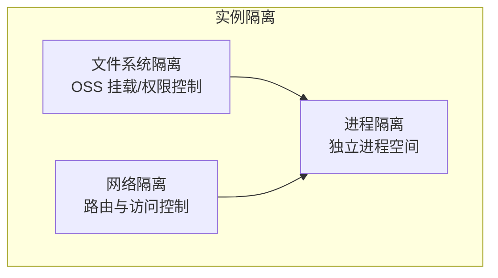
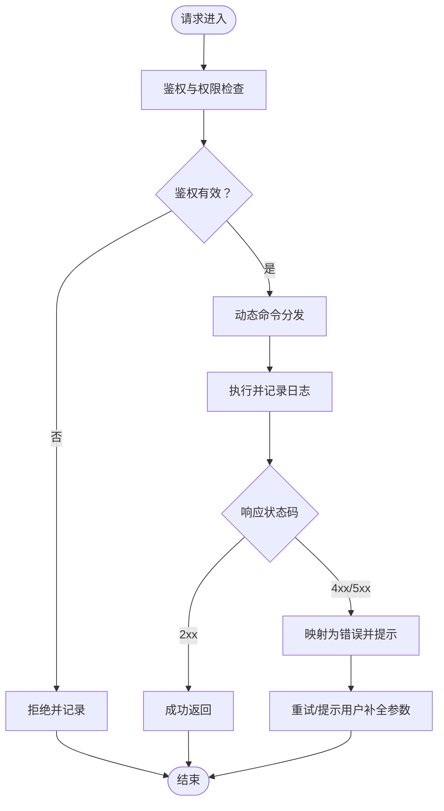
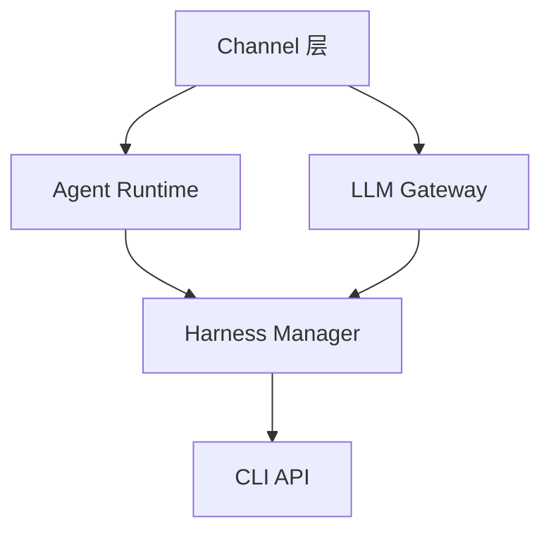

# 用户隔离与会话管理

<cite>
**本文引用的文件**
- [README.md](file://README.md)
- [Agent-Runtime方案.md](file://plan/Agent-Runtime方案.md)
- [Agent-Runtime方案review.md](file://notes/zhaobomin/Agent-Runtime方案review.md)
- [agent-api-discovery-architecture-review.zh-CN.md](file://notes/zhaobomin/agent-api-discovery-architecture-review.zh-CN.md)
- [SAI_CLI_设计文档_v1.2.md](file://plan/SAI_CLI_设计文档_v1.2.md)
- [CLI 架构与规范对焦.md](file://plan/CLI 架构与规范对焦.md)
- [cross-module-design-review-2026-04-24.md](file://notes/zhaobomin/cross-module-design-review-2026-04-24.md)
- [yihang.md](file://daily/2026-04-21/yihang.md)
</cite>

## 目录
1. [简介](#简介)
2. [项目结构](#项目结构)
3. [核心组件](#核心组件)
4. [架构总览](#架构总览)
5. [详细组件分析](#详细组件分析)
6. [依赖分析](#依赖分析)
7. [性能考量](#性能考量)
8. [故障排查指南](#故障排查指南)
9. [结论](#结论)
10. [附录](#附录)

## 简介
本技术文档围绕“用户隔离与会话管理”主题，系统阐述基于 session_id 的动态实例分配机制，涵盖会话状态管理、实例生命周期控制、资源回收策略；用户执行环境隔离的实现原理（文件系统隔离、网络隔离、进程隔离）；会话持久化与状态同步、并发控制；会话超时处理、异常恢复与安全防护；以及会话管理 API、配置选项与监控指标。文档同时提供会话设计模式与最佳实践，帮助开发者在复杂业务场景中构建稳定、可扩展、可审计的会话管理体系。

## 项目结构
本仓库聚焦于 SAI（STO AI）的整体架构与模块协同，其中与“用户隔离与会话管理”直接相关的关键模块包括：
- Agent Runtime：负责按 session_id 动态分配 serverless 实例，确保一实例一 session，实现用户执行环境隔离。
- Harness Manager（CLI 管理与分发）：提供 CLI 命令注册、元数据生成、发布通知与分发能力，支撑会话上下文与权限传递。
- CLI 网关：负责路由、鉴权与会话上下文注入，承载会话生命周期的关键入口。
- LLM Gateway：提供路由与网关能力，配合会话上下文进行请求转发与异常处理。
- Channel 层（如申懂懂 App）：面向前端的用户交互入口，负责会话管理与消息协议。

图表来源
- [README.md:11-41](file://README.md#L11-L41)

章节来源
- [README.md:9-41](file://README.md#L9-L41)

## 核心组件
- Agent Runtime（按 session_id 动态实例分配）
  - 会话进入 run docker，Agent 无状态，会话结束销毁。
  - 启动时延：<1 秒（冷启动），热启动约 100ms。
  - 基于 Claude Agent SDK 构建通用 Agent，提供用户日志便于接入后排查。
- CLI 网关与 Harness Manager
  - 提供 CLI 命令注册、元数据生成、发布通知与分发。
  - 统一鉴权与权限控制，支持 Token 获取优先级与 AK/SK 签名。
- CLI 命令与会话上下文
  - 通过统一命令规范与 JSON 入参与输出，支持结构化会话上下文传递。
- LLM Gateway
  - 提供路由与网关能力，配合会话上下文进行请求转发与异常处理。
- Channel 层（前端）
  - 负责会话管理、消息协议（流式/非流式、SSE/WebSocket）与多会话历史。

章节来源
- [Agent-Runtime方案.md:4-12](file://plan/Agent-Runtime方案.md#L4-L12)
- [Agent-Runtime方案review.md:9-14](file://notes/zhaobomin/Agent-Runtime方案review.md#L9-L14)
- [SAI_CLI_设计文档_v1.2.md:29-63](file://plan/SAI_CLI_设计文档_v1.2.md#L29-L63)
- [CLI 架构与规范对焦.md:7-22](file://plan/CLI 架构与规范对焦.md#L7-L22)
- [README.md:11-41](file://README.md#L11-L41)

## 架构总览
下图展示会话从 Channel 层进入，经 CLI 网关与 Harness Manager，最终由 Agent Runtime 按 session_id 动态分配实例执行的总体流程。该流程强调“一实例一 session”的隔离原则与 serverless 启动的低延迟特性。

图表来源
- [Agent-Runtime方案.md:4-12](file://plan/Agent-Runtime方案.md#L4-L12)
- [README.md:11-41](file://README.md#L11-L41)

## 详细组件分析

### 会话生命周期与动态实例分配
- 动态实例分配
  - 基于 session_id 进行实例分配，确保同一时刻一个实例仅承载一个会话。
  - serverless 平台按需启动实例，满足低延迟与弹性伸缩。
- 实例生命周期
  - 启动：会话进入 run docker，Agent 无状态，实例在会话期间常驻。
  - 销毁：会话结束即销毁实例，释放资源。
- 启动性能
  - 冷启动 <1 秒，热启动约 100ms，满足通用 Agent 调用场景。

图表来源
- [Agent-Runtime方案.md:6-12](file://plan/Agent-Runtime方案.md#L6-L12)

章节来源
- [Agent-Runtime方案.md:4-12](file://plan/Agent-Runtime方案.md#L4-L12)
- [Agent-Runtime方案review.md:9-14](file://notes/zhaobomin/Agent-Runtime方案review.md#L9-L14)

### 用户执行环境隔离
- 文件系统隔离
  - 通过 Docker 挂载 OSS，区分 workspace 与 systemspace，按用户/领域/公共组织。
  - 若 OSS 挂载不可行，提供 Agent 层文件权限实现作为备选方案。
- 网络隔离
  - 通过网关与路由策略限制实例访问范围，结合鉴权与权限控制。
- 进程隔离
  - 每个实例独立运行，进程空间隔离，避免相互干扰。

图表来源
- [Agent-Runtime方案.md:15-31](file://plan/Agent-Runtime方案.md#L15-L31)

章节来源
- [Agent-Runtime方案.md:15-31](file://plan/Agent-Runtime方案.md#L15-L31)

### 会话持久化、状态同步与并发控制
- 会话持久化
  - 会话上下文与元数据通过 CLI 注册中心与本地缓存管理，支持 TTL 控制。
- 状态同步
  - 通过 CLI 网关与 Harness Manager 的统一协议，确保命令树与元数据一致性。
- 并发控制
  - 基于 session_id 的实例分配天然避免并发冲突；CLI 层统一参数解析与合并，减少竞态。

章节来源
- [agent-api-discovery-architecture-review.zh-CN.md:14-36](file://notes/zhaobomin/agent-api-discovery-architecture-review.zh-CN.md#L14-L36)
- [agent-api-discovery-architecture-review.zh-CN.md:135-165](file://notes/zhaobomin/agent-api-discovery-architecture-review.zh-CN.md#L135-L165)

### 会话超时处理、异常恢复与安全防护
- 超时处理
  - 通过 CLI 层统一 TTL 与缓存策略，避免频繁回源；结合实例销毁机制，防止僵尸会话。
- 异常恢复
  - 非 2xx 状态码需可靠映射为错误 envelope，便于上层重试与提示。
  - 动态命令兜底分发需在启动期之外接入，避免依赖静态挂载导致可用性不稳定。
- 安全防护
  - 鉴权：统一使用 SSO Token；支持 PoP（Proof-of-Possession）签名增强（二期）。
  - 机密信息脱敏：调试日志默认关闭，敏感字段掩码。
  - 构建期校验：生产 profile 不允许占位符进入产物。

图表来源
- [agent-api-discovery-architecture-review.zh-CN.md:68-95](file://notes/zhaobomin/agent-api-discovery-architecture-review.zh-CN.md#L68-L95)
- [agent-api-discovery-architecture-review.zh-CN.md:115-134](file://notes/zhaobomin/agent-api-discovery-architecture-review.zh-CN.md#L115-L134)
- [agent-api-discovery-architecture-review.zh-CN.md:96-114](file://notes/zhaobomin/agent-api-discovery-architecture-review.zh-CN.md#L96-L114)

章节来源
- [agent-api-discovery-architecture-review.zh-CN.md:68-134](file://notes/zhaobomin/agent-api-discovery-architecture-review.zh-CN.md#L68-L134)
- [SAI_CLI_设计文档_v1.2.md:394-470](file://plan/SAI_CLI_设计文档_v1.2.md#L394-L470)

### 会话管理 API、配置选项与监控指标
- 会话管理 API
  - Channel 层与 Agent Runtime 的接口契约需明确（如 POST /agent/session 等），当前评审指出缺少设计文档与接口定义。
- 配置选项
  - 环境 profile、URL、TTL、超时等配置解析；生产环境构建校验，禁止占位符进入产物。
- 监控指标
  - 建议纳入：实例启动耗时、会话活跃数、请求成功率、错误分布、资源使用率、缓存命中率等。

章节来源
- [cross-module-design-review-2026-04-24.md:171-222](file://notes/zhaobomin/cross-module-design-review-2026-04-24.md#L171-L222)
- [agent-api-discovery-architecture-review.zh-CN.md:96-114](file://notes/zhaobomin/agent-api-discovery-architecture-review.zh-CN.md#L96-L114)

### 会话设计模式与最佳实践
- 设计模式
  - 会话即实例：一实例一 session，天然隔离。
  - 动态分发：按 session_id 分配，避免静态挂载依赖。
  - 结构化上下文：统一 JSON 入参与输出，便于 Agent 解析与缓存。
- 最佳实践
  - 统一鉴权与权限控制，避免跨域越权。
  - 调试日志显式开启并脱敏敏感字段。
  - 构建期校验生产配置，避免占位符上线。
  - 为写操作提供 Dry-Run 模式，降低误操作风险。

章节来源
- [Agent-Runtime方案.md:4-12](file://plan/Agent-Runtime方案.md#L4-L12)
- [SAI_CLI_设计文档_v1.2.md:474-485](file://plan/SAI_CLI_设计文档_v1.2.md#L474-L485)
- [agent-api-discovery-architecture-review.zh-CN.md:115-134](file://notes/zhaobomin/agent-api-discovery-architecture-review.zh-CN.md#L115-L134)

## 依赖分析
- 模块耦合
  - Channel 层依赖 Agent Runtime 与 LLM Gateway；Agent Runtime 依赖 Harness Manager 与 CLI 注册中心。
- 关键接口依赖
  - 评审指出与老徐对齐的两个核心接口（get_session / send_request）未在文档中体现，需补充。
- 外部依赖
  - Claude Agent SDK（强依赖），建议抽象 SDK 以降低迁移风险。

图表来源
- [README.md:11-41](file://README.md#L11-L41)
- [Agent-Runtime方案review.md:26-30](file://notes/zhaobomin/Agent-Runtime方案review.md#L26-L30)

章节来源
- [README.md:11-41](file://README.md#L11-L41)
- [Agent-Runtime方案review.md:26-30](file://notes/zhaobomin/Agent-Runtime方案review.md#L26-L30)

## 性能考量
- 启动性能
  - 冷启动 <1 秒，热启动约 100ms，满足通用 Agent 调用场景。
- 缓存与回源
  - 本地缓存与 TTL 降低高频调用延迟，避免频繁回源。
- 资源回收
  - 会话结束后销毁实例，释放 CPU、内存与存储资源。

章节来源
- [Agent-Runtime方案.md:6-12](file://plan/Agent-Runtime方案.md#L6-L12)
- [agent-api-discovery-architecture-review.zh-CN.md:14-19](file://notes/zhaobomin/agent-api-discovery-architecture-review.zh-CN.md#L14-L19)

## 故障排查指南
- 非 2xx 状态码处理
  - 当前实现将 4xx/5xx 包装为成功，需在执行器中对非 2xx 返回类型化错误，并映射为统一错误码。
- 动态命令兜底分发
  - 当前未接入 TryDynamicDispatch，建议在 main.go 或 root command 层统一接入，避免合法动态命令受启动期预挂载影响。
- 调试日志与敏感信息
  - 默认关闭调试日志，仅在显式开启时输出；对敏感字段进行掩码处理。
- 生产配置校验
  - 构建阶段校验生产 profile，禁止占位符进入产物；在版本输出中保留构建环境摘要以便排查。

章节来源
- [agent-api-discovery-architecture-review.zh-CN.md:68-95](file://notes/zhaobomin/agent-api-discovery-architecture-review.zh-CN.md#L68-L95)
- [agent-api-discovery-architecture-review.zh-CN.md:115-134](file://notes/zhaobomin/agent-api-discovery-architecture-review.zh-CN.md#L115-L134)
- [agent-api-discovery-architecture-review.zh-CN.md:96-114](file://notes/zhaobomin/agent-api-discovery-architecture-review.zh-CN.md#L96-L114)

## 结论
本方案以“一实例一 session”的 serverless 动态实例分配为核心，结合 CLI 网关与 Harness Manager 的统一协议，实现了用户执行环境的文件系统、网络与进程隔离。通过会话上下文与权限控制、TTL 缓存与实例销毁机制，系统在性能与安全性之间取得平衡。建议尽快补齐接口定义与架构图，完善会话管理 API、配置选项与监控指标，以支撑大规模场景下的稳定运行。

## 附录
- 会话登录态与鉴权
  - CLI 平台提供根据梧桐账号获取临时 token 的接口，Agent Runtime 在启动时注入 token 文件或环境变量，用于向后端请求鉴权。
- CLI 命令规范与元数据
  - 采用统一命令规范与 JSON 入参与输出；9 维 Tag 由 AI 自动生成，业务团队审核确认后注册至 SAI-CLI。

章节来源
- [yihang.md:1-5](file://daily/2026-04-21/yihang.md#L1-L5)
- [CLI 架构与规范对焦.md:7-22](file://plan/CLI 架构与规范对焦.md#L7-L22)
- [SAI_CLI_设计文档_v1.2.md:361-393](file://plan/SAI_CLI_设计文档_v1.2.md#L361-L393)