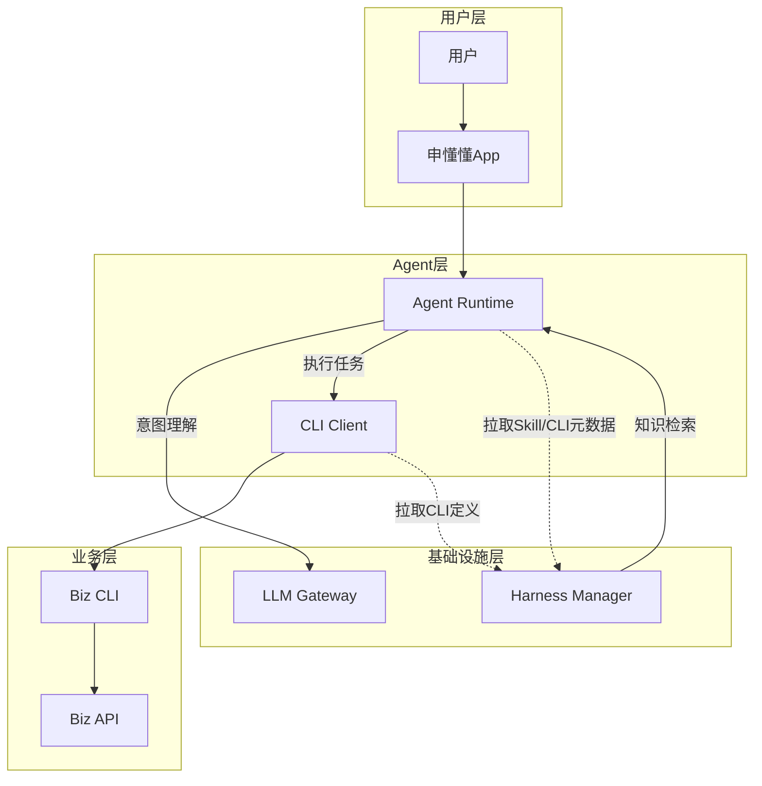
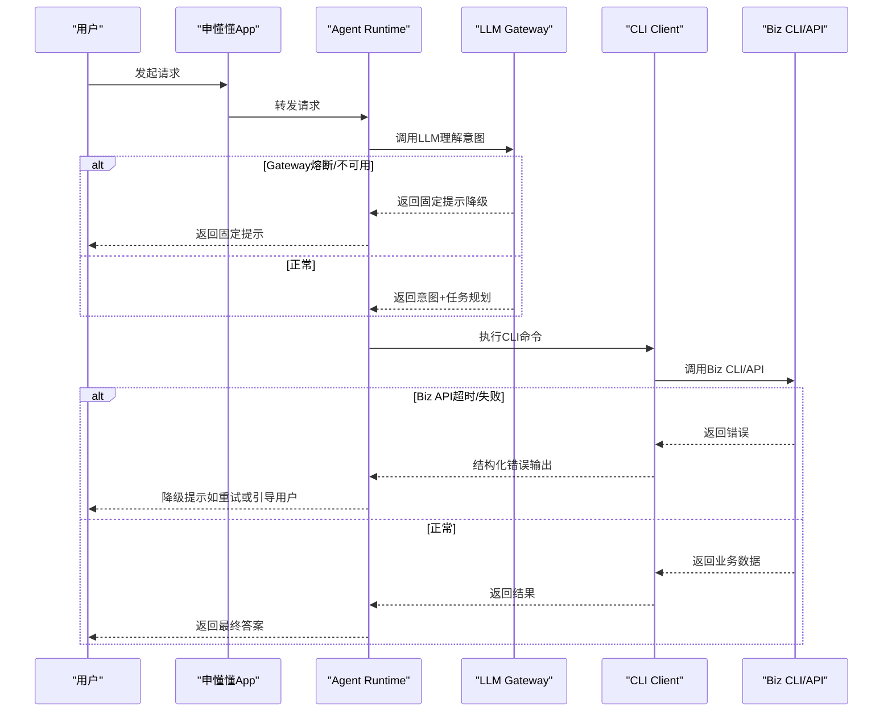
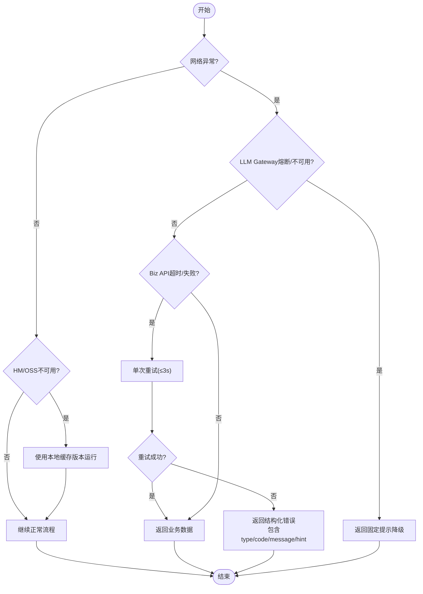
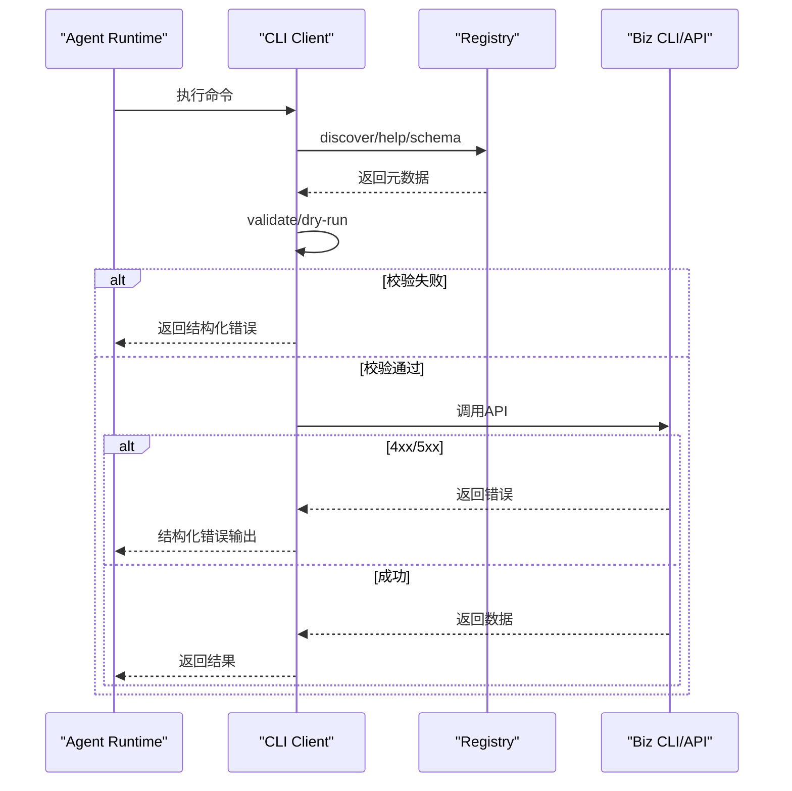
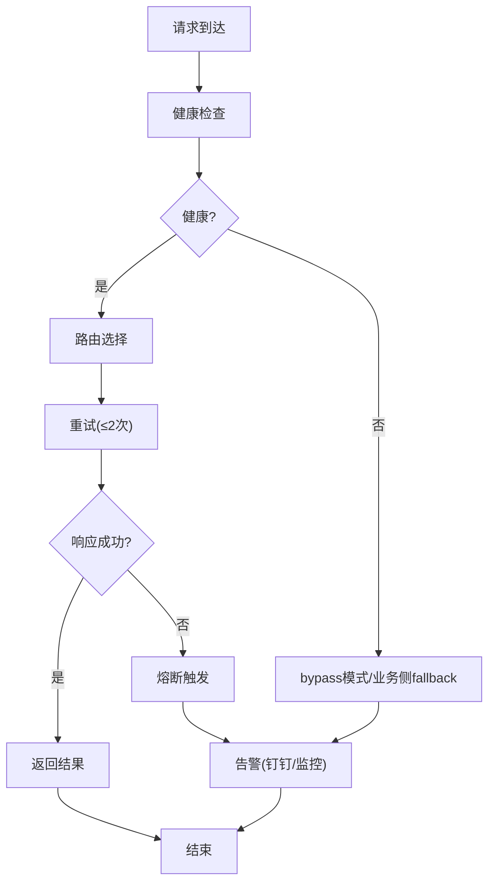
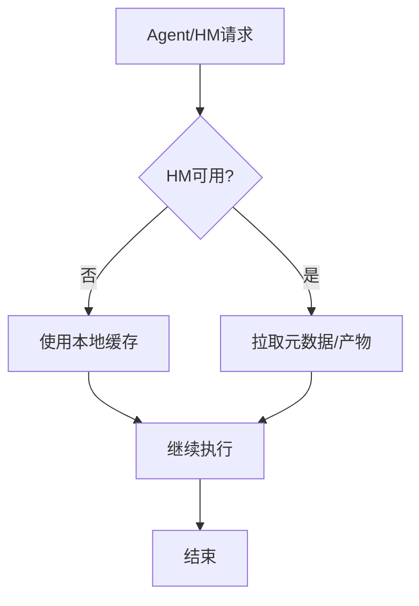
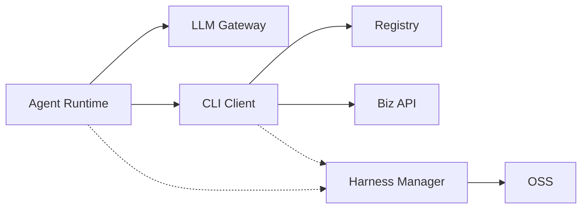

# 错误处理与降级策略

<cite>
**本文引用的文件**
- [Sai整体架构设计.md](file://project/standup/Sai整体架构设计.md)
- [agent-api-discovery-architecture-review.zh-CN.md](file://notes/zhaobomin/agent-api-discovery-architecture-review.zh-CN.md)
- [LLM-Gateway方案review.md](file://notes/zhaobomin/LLM-Gateway方案review.md)
- [LiteLLM Gateway 生产环境部署方案.md](file://plan/LiteLLM Gateway 生产环境部署方案.md)
- [cross-module-design-review-2026-04-24.md](file://notes/zhaobomin/cross-module-design-review-2026-04-24.md)
- [Agent-Runtime方案.md](file://plan/Agent-Runtime方案.md)
- [SAI_CLI_设计文档_v1.2.md](file://plan/SAI_CLI_设计文档_v1.2.md)
</cite>

## 目录
1. [简介](#简介)
2. [项目结构](#项目结构)
3. [核心组件](#核心组件)
4. [架构总览](#架构总览)
5. [详细组件分析](#详细组件分析)
6. [依赖分析](#依赖分析)
7. [性能考量](#性能考量)
8. [故障排查指南](#故障排查指南)
9. [结论](#结论)
10. [附录](#附录)

## 简介
本文件聚焦于Agent运行时的错误处理与降级策略，系统性梳理以下方面：
- 错误分类与捕获机制：网络异常、资源不足、技能执行失败、CLI调用错误
- 处理流程与策略：服务降级、功能降级、性能降级
- 日志记录、告警机制与故障恢复
- 错误码定义、重试策略与熔断机制
- 设计模式与最佳实践

## 项目结构
围绕Sai整体架构，错误处理与降级策略贯穿“意图理解链路”和“业务执行链路”，并由Harness Manager（HM）提供控制面支撑（知识库、Skills、CLI注册分发）。关键模块与职责如下：
- Agent Runtime：会话管理、意图理解、CLI调用、错误降级与恢复
- LLM Gateway：统一代理、路由、限流、熔断、可观测与逃生方案
- CLI Client：本地执行CLI命令，结构化错误输出
- Biz CLI/Biz API：业务能力封装与API调用
- HM：控制面服务，提供元数据与产物分发，支持降级缓存

图表来源
- [Sai整体架构设计.md:19-65](file://project/standup/Sai整体架构设计.md#L19-L65)
- [Sai整体架构设计.md:108-138](file://project/standup/Sai整体架构设计.md#L108-L138)

章节来源
- [Sai整体架构设计.md:15-65](file://project/standup/Sai整体架构设计.md#L15-L65)
- [Sai整体架构设计.md:108-138](file://project/standup/Sai整体架构设计.md#L108-L138)

## 核心组件
- Agent Runtime：负责会话生命周期、意图理解与CLI调用，具备本地缓存与降级能力，确保在HM或OSS不可用时仍可运行。
- LLM Gateway：统一OpenAI兼容接口，提供路由、限流、熔断、可观测与逃生方案（bypass/fallback）。
- CLI Client：本地执行CLI命令，统一结构化错误输出，支持参数校验与执行前验证。
- Biz CLI/Biz API：业务API调用，配合重试与错误映射。
- HM：控制面服务，提供Skills与CLI元数据与产物分发，支持降级缓存。

章节来源
- [Sai整体架构设计.md:142-164](file://project/standup/Sai整体架构设计.md#L142-L164)
- [Sai整体架构设计.md:173-194](file://project/standup/Sai整体架构设计.md#L173-L194)

## 架构总览
下图展示错误处理与降级的关键交互路径与策略：

图表来源
- [Sai整体架构设计.md:115-138](file://project/standup/Sai整体架构设计.md#L115-L138)
- [Sai整体架构设计.md:236-245](file://project/standup/Sai整体架构设计.md#L236-L245)

## 详细组件分析

### Agent运行时错误分类与处理流程
- 网络异常
  - LLM Gateway熔断/不可用：Agent返回固定提示，业务执行链路不受影响。
  - Biz API超时/失败：CLI Client单次重试（≤3s等待），失败后Agent向用户说明具体接口不可用。
  - HM/OSS不可用：Agent使用本地缓存版本运行，日志告警通知HM团队。
- 资源不足
  - Agent实例崩溃：Serverless平台自动重建实例，用户会话需重新发起。
- 技能执行失败
  - HM不可用：Agent本地缓存最近一次Skill定义，降级为无知识检索模式。
- CLI调用错误
  - 结构化错误输出：统一包含type、code、message、hint字段，便于Agent与用户定位问题。
  - 执行前校验：validate/dry-run能力，提前发现参数缺失、枚举/日期/权限问题与副作用风险。

图表来源
- [Sai整体架构设计.md:236-245](file://project/standup/Sai整体架构设计.md#L236-L245)
- [SAI_CLI_设计文档_v1.2.md:295-336](file://plan/SAI_CLI_设计文档_v1.2.md#L295-L336)

章节来源
- [Sai整体架构设计.md:236-245](file://project/standup/Sai整体架构设计.md#L236-L245)
- [SAI_CLI_设计文档_v1.2.md:295-336](file://plan/SAI_CLI_设计文档_v1.2.md#L295-L336)

### CLI调用错误处理与结构化输出
- 结构化错误输出：type（认证/参数/API等）、code（HTTP状态码或业务错误码）、message（人类可读描述）、hint（修复建议）。
- 执行前校验：validate或--dry-run，返回normalizedInput、missing、warnings、resolvedEndpoint、sideEffect、confirmationRequired等，降低误调用风险。
- 参数schema增强：format、enum、aliases、inferFrom、askWhenMissing、sensitive等，支持Agent补全与追问。

图表来源
- [agent-api-discovery-architecture-review.zh-CN.md:68-95](file://notes/zhaobomin/agent-api-discovery-architecture-review.zh-CN.md#L68-L95)
- [agent-api-discovery-architecture-review.zh-CN.md:380-420](file://notes/zhaobomin/agent-api-discovery-architecture-review.zh-CN.md#L380-L420)
- [SAI_CLI_设计文档_v1.2.md:295-336](file://plan/SAI_CLI_设计文档_v1.2.md#L295-L336)

章节来源
- [agent-api-discovery-architecture-review.zh-CN.md:68-95](file://notes/zhaobomin/agent-api-discovery-architecture-review.zh-CN.md#L68-L95)
- [agent-api-discovery-architecture-review.zh-CN.md:380-420](file://notes/zhaobomin/agent-api-discovery-architecture-review.zh-CN.md#L380-L420)
- [SAI_CLI_设计文档_v1.2.md:295-336](file://plan/SAI_CLI_设计文档_v1.2.md#L295-L336)

### LLM网关的熔断、逃生与可观测
- 熔断与逃生：至少准备两个方案：业务侧fallback直连百炼/OpenAI原生API；Gateway bypass模式一键关闭路由规则。
- 路由与重试：num_retries=2，timeout=300s，启用负载均衡；健康检查与模型健康检查（unhealthy端点标记、二次确认、连续失败阈值告警）。
- 日志与告警：生产环境日志级别限制，SLS采集ERROR级别日志；监控平台对Pod健康、资源使用、RDS/Redis依赖进行监控。
- 成本与额度：80%/90%/100%三级告警+自动熔断，成本可控。

图表来源
- [LLM-Gateway方案review.md:32-39](file://notes/zhaobomin/LLM-Gateway方案review.md#L32-L39)
- [LiteLLM Gateway 生产环境部署方案.md:71-79](file://plan/LiteLLM Gateway 生产环境部署方案.md#L71-L79)
- [LiteLLM Gateway 生产环境部署方案.md:137-150](file://plan/LiteLLM Gateway 生产环境部署方案.md#L137-L150)
- [Sai整体架构设计.md:256-257](file://project/standup/Sai整体架构设计.md#L256-L257)

章节来源
- [LLM-Gateway方案review.md:32-39](file://notes/zhaobomin/LLM-Gateway方案review.md#L32-L39)
- [LiteLLM Gateway 生产环境部署方案.md:71-79](file://plan/LiteLLM Gateway 生产环境部署方案.md#L71-L79)
- [LiteLLM Gateway 生产环境部署方案.md:137-150](file://plan/LiteLLM Gateway 生产环境部署方案.md#L137-L150)
- [Sai整体架构设计.md:256-257](file://project/standup/Sai整体架构设计.md#L256-L257)

### 控制面（HM）的降级与缓存
- HM不可用：Agent本地缓存最近一次Skill/CLI定义，降级为无知识检索模式。
- OSS不可用：Agent使用本地缓存版本运行，日志告警通知HM团队。
- HM职责：Skills与CLI注册分发、知识库检索，不参与调用链路，只做资源分发。

图表来源
- [Sai整体架构设计.md:240-244](file://project/standup/Sai整体架构设计.md#L240-L244)
- [Sai整体架构设计.md:173-194](file://project/standup/Sai整体架构设计.md#L173-L194)

章节来源
- [Sai整体架构设计.md:240-244](file://project/standup/Sai整体架构设计.md#L240-L244)
- [Sai整体架构设计.md:173-194](file://project/standup/Sai整体架构设计.md#L173-L194)

## 依赖分析
- Agent Runtime依赖LLM Gateway进行意图理解，依赖CLI Client执行业务命令，依赖HM提供Skills与CLI元数据。
- CLI Client依赖Registry元数据与Biz API，Biz API依赖业务系统。
- HM依赖OSS存储产物与元数据，为Agent与CLI提供分发能力。

图表来源
- [Sai整体架构设计.md:154-164](file://project/standup/Sai整体架构设计.md#L154-L164)
- [Sai整体架构设计.md:173-194](file://project/standup/Sai整体架构设计.md#L173-L194)

章节来源
- [Sai整体架构设计.md:154-164](file://project/standup/Sai整体架构设计.md#L154-L164)
- [Sai整体架构设计.md:173-194](file://project/standup/Sai整体架构设计.md#L173-L194)

## 性能考量
- Agent冷启动与热启动：冷启动<1s，热启动<200ms，满足通用Agent调用接受度。
- LLM Gateway：副本数2，单Pod 4C8G，num_workers=4，num_retries=2，timeout=300s，启用负载均衡与Redis缓存，降低重复请求延迟与成本。
- CLI执行：本地执行，避免远程调用开销；执行前校验减少无效调用。

章节来源
- [Agent-Runtime方案.md:6](file://plan/Agent-Runtime方案.md#L6)
- [LiteLLM Gateway 生产环境部署方案.md:38-47](file://plan/LiteLLM Gateway 生产环境部署方案.md#L38-L47)
- [LiteLLM Gateway 生产环境部署方案.md:71-79](file://plan/LiteLLM Gateway 生产环境部署方案.md#L71-L79)

## 故障排查指南
- CLI错误输出字段：type、code、message、hint，便于快速定位认证、参数、API错误。
- 执行前校验：validate或--dry-run，提前发现缺失参数、枚举/日期/权限问题与副作用风险。
- 网关熔断与逃生：bypass模式一键关闭路由规则；业务侧fallback直连百炼/OpenAI原生API。
- 日志与告警：SLS采集ERROR级别日志；监控平台对Pod健康、资源使用、RDS/Redis依赖进行监控。
- 本地缓存降级：HM/OSS不可用时，Agent使用本地缓存版本运行，日志告警通知HM团队。

章节来源
- [SAI_CLI_设计文档_v1.2.md:295-336](file://plan/SAI_CLI_设计文档_v1.2.md#L295-L336)
- [agent-api-discovery-architecture-review.zh-CN.md:68-95](file://notes/zhaobomin/agent-api-discovery-architecture-review.zh-CN.md#L68-L95)
- [LLM-Gateway方案review.md:32-39](file://notes/zhaobomin/LLM-Gateway方案review.md#L32-L39)
- [LiteLLM Gateway 生产环境部署方案.md:100-122](file://plan/LiteLLM Gateway 生产环境部署方案.md#L100-L122)
- [Sai整体架构设计.md:240-245](file://project/standup/Sai整体架构设计.md#L240-L245)

## 结论
本方案通过“控制面降级缓存 + 网关熔断与逃生 + 执行前校验 + 结构化错误输出”的组合拳，实现了Agent运行时在多种故障场景下的稳健性与可恢复性。建议在后续迭代中进一步完善全局错误码体系、接口契约与可观测告警细节，确保跨模块一致性与可运维性。

## 附录

### 错误码与状态码规范（建议）
- 认证错误：401（AUTH_REQUIRED/AUTH_TOKEN_EXPIRED）
- 权限错误：403（FORBIDDEN）
- 参数错误：400/422（ARGUMENT_INVALID/DOWNSTREAM_ARGUMENT_INVALID）
- 服务不可用：5xx（DOWNSTREAM_UNAVAILABLE）
- 限流：429（RATE_LIMITED）
- 业务错误：带业务code与message

章节来源
- [agent-api-discovery-architecture-review.zh-CN.md:88-94](file://notes/zhaobomin/agent-api-discovery-architecture-review.zh-CN.md#L88-L94)
- [cross-module-design-review-2026-04-24.md:210-221](file://notes/zhaobomin/cross-module-design-review-2026-04-24.md#L210-L221)

### 重试策略与熔断机制
- CLI调用：Biz API失败时单次重试（≤3s等待），失败后返回结构化错误。
- LLM Gateway：num_retries=2，timeout=300s，启用负载均衡；健康检查与模型健康检查（unhealthy端点标记、二次确认、连续失败阈值告警）。
- 熔断：达到阈值触发熔断，发送钉钉/监控告警；bypass模式一键关闭路由规则。

章节来源
- [Sai整体架构设计.md:242-243](file://project/standup/Sai整体架构设计.md#L242-L243)
- [LiteLLM Gateway 生产环境部署方案.md:71-79](file://plan/LiteLLM Gateway 生产环境部署方案.md#L71-L79)
- [LiteLLM Gateway 生产环境部署方案.md:137-150](file://plan/LiteLLM Gateway 生产环境部署方案.md#L137-L150)

### 设计模式与最佳实践
- 分层与职责分离：薄CLI + 元数据驱动；控制面（HM）只做资源分发；网关负责路由与熔断。
- 结构化错误输出：统一type/code/message/hint，便于Agent与用户定位问题。
- 执行前校验：validate/dry-run，提前发现参数与风险，降低误调用。
- 降级缓存：HM/OSS不可用时使用本地缓存，保障业务执行链路可用。
- 观测与告警：限制日志级别、SLS采集ERROR、监控Pod健康与资源使用。

章节来源
- [agent-api-discovery-architecture-review.zh-CN.md:452-473](file://notes/zhaobomin/agent-api-discovery-architecture-review.zh-CN.md#L452-L473)
- [Sai整体架构设计.md:236-245](file://project/standup/Sai整体架构设计.md#L236-L245)
- [LiteLLM Gateway 生产环境部署方案.md:100-122](file://plan/LiteLLM Gateway 生产环境部署方案.md#L100-L122)