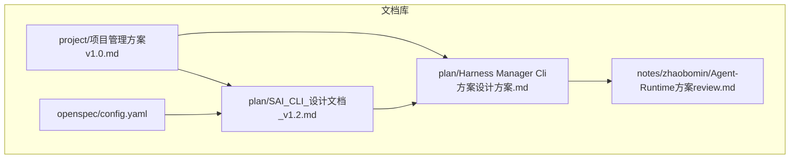
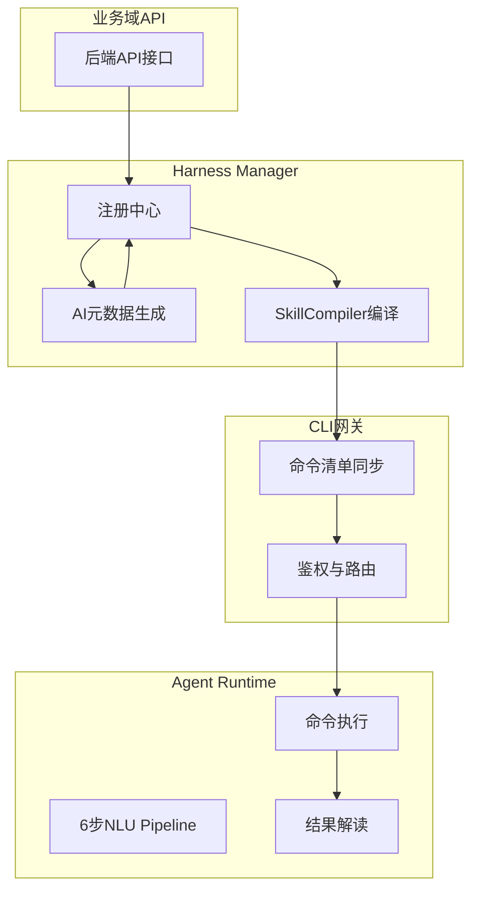
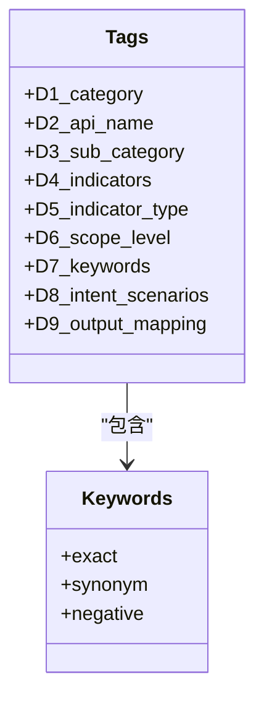
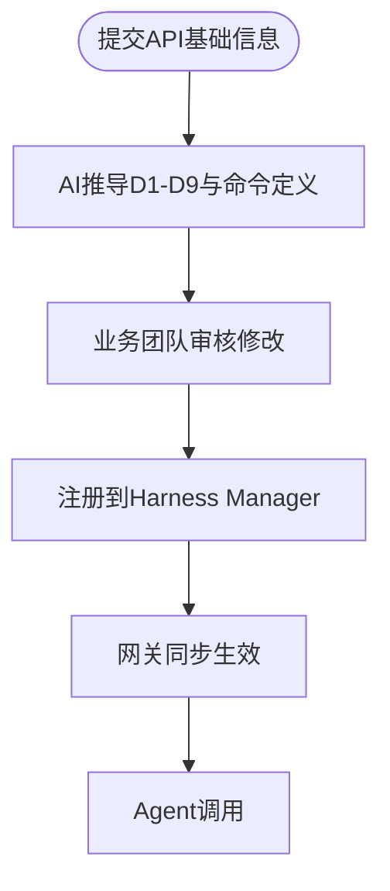
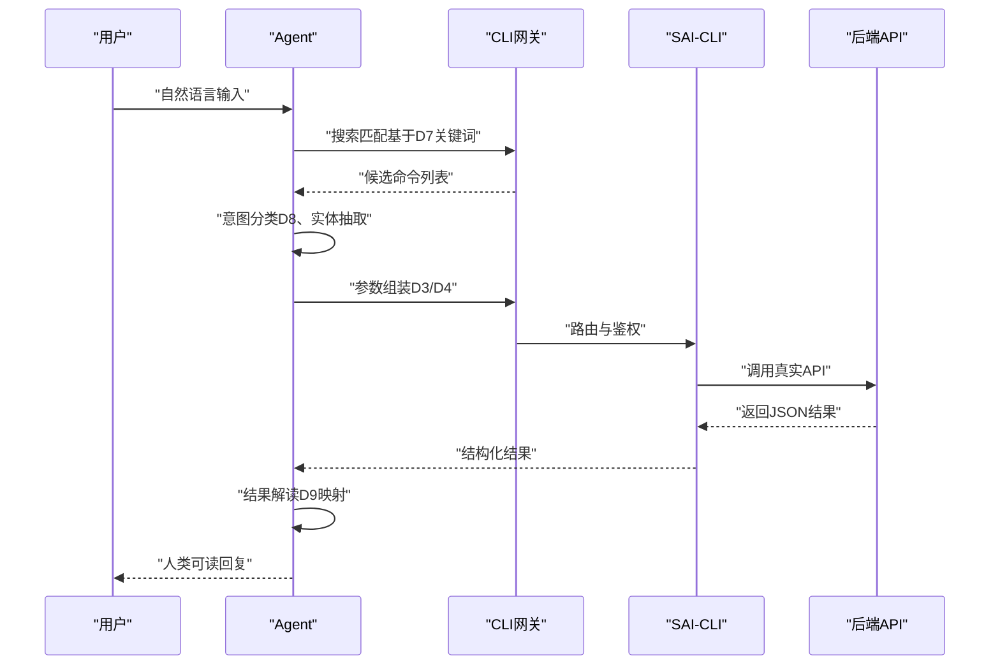
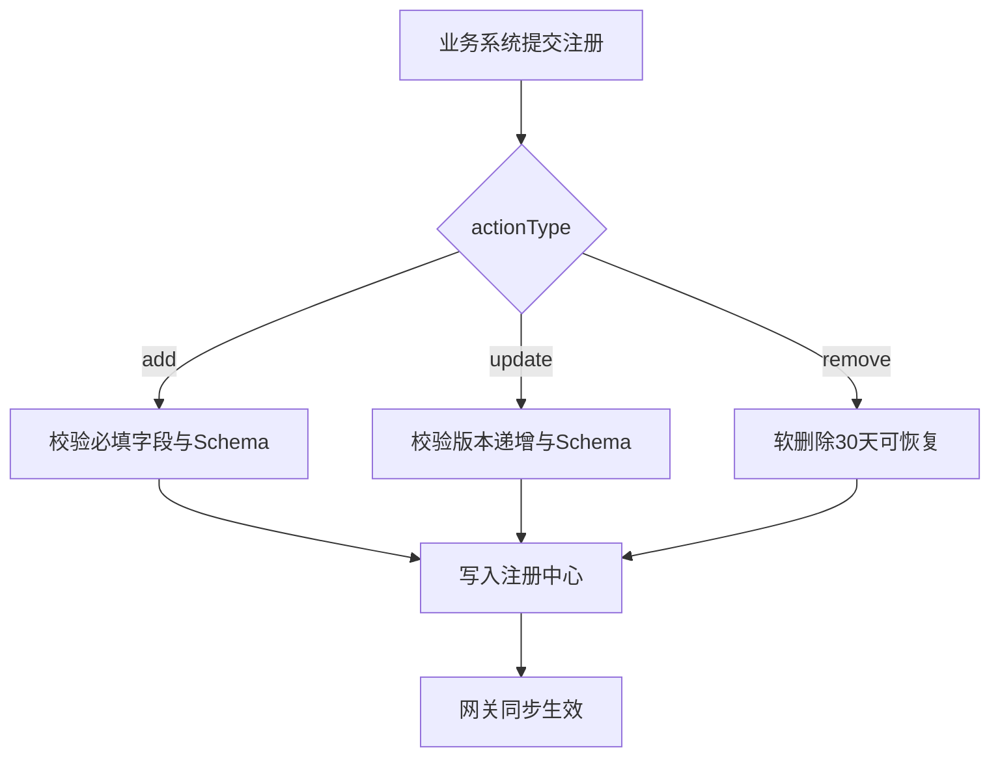
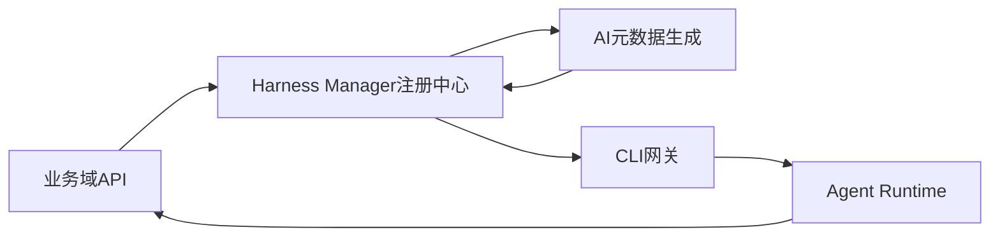

# 9维Tag元数据体系

<cite>
**本文引用的文件**
- [SAI_CLI_设计文档_v1.2.md](file://plan/SAI_CLI_设计文档_v1.2.md)
- [Harness Manager Cli方案设计方案.md](file://plan/Harness Manager Cli方案设计方案.md)
- [SAI_CLI_设计文档_v1.0.md](file://plan/SAI_CLI_设计文档_v1.0.md)
- [Agent-Runtime方案review.md](file://notes/zhaobomin/Agent-Runtime方案review.md)
- [LLM-Gateway方案review.md](file://notes/zhaobomin/LLM-Gateway方案review.md)
- [项目管理方案v1.0.md](file://project/项目管理方案v1.0.md)
- [config.yaml](file://openspec/config.yaml)
</cite>

## 目录
1. [引言](#引言)
2. [项目结构](#项目结构)
3. [核心组件](#核心组件)
4. [架构总览](#架构总览)
5. [详细组件分析](#详细组件分析)
6. [依赖分析](#依赖分析)
7. [性能考量](#性能考量)
8. [故障排查指南](#故障排查指南)
9. [结论](#结论)
10. [附录](#附录)

## 引言
本文件围绕CLI系统“9维Tag元数据体系”展开，系统性阐述9个Tag维度的设计原理、语义与用途，以及与Agent调用链路的协同机制。文档还覆盖Tag的自动生成机制、AI辅助工具、人工Review流程、注册与版本管理策略、质量控制与维护最佳实践，帮助读者从概念到落地形成完整认知。

## 项目结构
本仓库文档库包含多个团队的设计文档、接口文档与公共文档，其中与9维Tag元数据体系直接相关的关键文档如下：
- SAI CLI架构设计（v1.2）：定义了9维Tag的分组、维度与用途，以及Agent调用的6步NLU流程、SkillCompiler编译模块、PoP Token鉴权方案等。
- Harness Manager CLI方案设计：定义了Tag结构（D1-D9）、AI生成规则、注册接口、参数Schema、版本管理与并发控制等。
- Agent Runtime方案Review：指出Agent层与Harness Manager的接口依赖与对接要点，强调Skill分发策略与接口定义的重要性。
- 项目管理方案v1.0：明确了Git即进度、文档同步、日报制度等协作规范，保障Tag元数据的版本演进与跨团队协同。
- openspec/config.yaml：提供项目上下文与AI生成Artifact的规则配置入口。

**图表来源**
- [SAI_CLI_设计文档_v1.2.md](file://plan/SAI_CLI_设计文档_v1.2.md)
- [Harness Manager Cli方案设计方案.md](file://plan/Harness Manager Cli方案设计方案.md)
- [Agent-Runtime方案review.md](file://notes/zhaobomin/Agent-Runtime方案review.md)
- [项目管理方案v1.0.md](file://project/项目管理方案v1.0.md)
- [config.yaml](file://openspec/config.yaml)

**章节来源**
- [SAI_CLI_设计文档_v1.2.md](file://plan/SAI_CLI_设计文档_v1.2.md)
- [Harness Manager Cli方案设计方案.md](file://plan/Harness Manager Cli方案设计方案.md)
- [Agent-Runtime方案review.md](file://notes/zhaobomin/Agent-Runtime方案review.md)
- [项目管理方案v1.0.md](file://project/项目管理方案v1.0.md)
- [config.yaml](file://openspec/config.yaml)

## 核心组件
- 9维Tag元数据：由路由与分类组（D1-D4）、NLU理解组（D5-D8）、执行与展示组（D6-D9）构成，支撑Agent语义理解、参数组装与结果解读。
- AI辅助生成：基于API描述与Schema，自动推导D1-D9标签，输出结构化命令定义与参数建议。
- 人工Review流程：业务团队对AI生成结果进行审核与修正，确保关键词、排除词、意图与出参映射准确。
- 注册与版本管理：通过注册接口完成新增/更新/注销，支持语义化版本号、软删除与网关同步。
- SkillCompiler编译：将注册元数据编译为Agent可读的Tool定义，包含LLM可见层与框架控制层。
- Agent调用链路：6步NLU Pipeline，从意图分类、实体抽取、Tag匹配评分、参数组装、API调用到结果解读。

**章节来源**
- [SAI_CLI_设计文档_v1.2.md](file://plan/SAI_CLI_设计文档_v1.2.md)
- [Harness Manager Cli方案设计方案.md](file://plan/Harness Manager Cli方案设计方案.md)

## 架构总览
9维Tag元数据体系贯穿“业务API → Harness Manager → CLI网关 → Agent Runtime”的全链路，确保Agent能够准确理解命令能力、自动拼接参数并正确解读结果。

**图表来源**
- [SAI_CLI_设计文档_v1.2.md](file://plan/SAI_CLI_设计文档_v1.2.md)
- [Harness Manager Cli方案设计方案.md](file://plan/Harness Manager Cli方案设计方案.md)

## 详细组件分析

### 9维Tag维度定义与语义
- 路由与分类组（D1-D4）
  - D1 指标大类：一级路由，快速归类到业务域（如时效、单量、签收率）。
  - D2 API名称：二级路由，CLI的唯一内部标识。
  - D4 指标清单：细粒度路由，映射indicatorList入参。
- NLU理解组（D5-D8）
  - D5 指标类型：count/rate/target，影响结果解读方式。
  - D7 触发关键词：exact（精确）+ synonym（同义）+ negative（排除）三层匹配，防误判。
  - D8 场景意图：单点查询/趋势分析/异常监控。
- 执行与展示组（D6-D9）
  - D3 二级类目：对应subCategoryList入参。
  - D6 适用层级：网点/分拨/大区等，用于权限校验。
  - D9 出参映射：JSON字段到中文含义翻译，供Agent解读结果。

**图表来源**
- [Harness Manager Cli方案设计方案.md](file://plan/Harness Manager Cli方案设计方案.md)
- [SAI_CLI_设计文档_v1.2.md](file://plan/SAI_CLI_设计文档_v1.2.md)

**章节来源**
- [Harness Manager Cli方案设计方案.md](file://plan/Harness Manager Cli方案设计方案.md)
- [SAI_CLI_设计文档_v1.2.md](file://plan/SAI_CLI_设计文档_v1.2.md)

### Tag自动生成机制与AI辅助工具
- 输入：systemCode、systemName、apiId、apiHost、apiPath、method、apiName、apiDesc、parametersSchema、responseSchema、category等。
- 生成规则：
  - D1：优先使用category，否则基于apiDesc推断。
  - D2：基于D1与apiName生成内部标识。
  - D3/D4：从描述与参数中提取二级类目与指标清单。
  - D5：根据指标后缀推断count/rate/target。
  - D6：从描述与参数中提取组织层级。
  - D7：生成精确词、同义词、排除词。
  - D8：根据查询场景与时间维度推断意图。
  - D9：基于responseSchema生成出参映射。
- 输出：commandId、command、commandName、description、commandExample、tags、parametersSchema、permissions等。
- 约束：生成结果仅作建议，必须业务审核修改后注册；D7.keywords.negative必须包含易混淆排除词。

**图表来源**
- [Harness Manager Cli方案设计方案.md](file://plan/Harness Manager Cli方案设计方案.md)

**章节来源**
- [Harness Manager Cli方案设计方案.md](file://plan/Harness Manager Cli方案设计方案.md)

### 人工Review流程
- 路径A（推荐）：业务系统提交API信息 → AI生成元数据 → 审核修改 → 注册到Manager → CLI网关生效。
- 路径B（特殊定制）：业务系统按标准格式自行编写元数据 → 直接注册。
- 关键审查点：关键词覆盖度、排除词有效性、指标类型与出参映射准确性、权限与层级设置。

**章节来源**
- [Harness Manager Cli方案设计方案.md](file://plan/Harness Manager Cli方案设计方案.md)
- [SAI_CLI_设计文档_v1.2.md](file://plan/SAI_CLI_设计文档_v1.2.md)

### Tag在Agent调用中的作用与参数描述
- 作用：
  - D7触发关键词：用于NLU匹配与评分，提升路由准确性。
  - D8场景意图：决定参数组装策略与结果解读方式。
  - D9出参映射：将JSON字段翻译为中文，生成人类可读回复。
- 参数描述：遵循JSON Schema，补充description与枚举，便于Agent自动组装请求参数。
- 示例生成：AI生成commandExample，业务团队可在此基础上优化为更贴近用户习惯的示例。

**图表来源**
- [SAI_CLI_设计文档_v1.2.md](file://plan/SAI_CLI_设计文档_v1.2.md)

**章节来源**
- [SAI_CLI_设计文档_v1.2.md](file://plan/SAI_CLI_设计文档_v1.2.md)

### 注册接口与版本管理策略
- 注册接口：POST /api/v1/sai/cli/registry，支持add/update/remove。
- 版本管理：语义化版本号，update必须递增；remove为软删除，保留30天可恢复。
- 并发控制：同一apiId串行处理；apiId唯一性约束。
- 参数Schema：遵循JSON Schema规范，建议补充description。
- 网关同步：注册完成后触发网关命令清单同步，生效时间可追踪。

**图表来源**
- [Harness Manager Cli方案设计方案.md](file://plan/Harness Manager Cli方案设计方案.md)

**章节来源**
- [Harness Manager Cli方案设计方案.md](file://plan/Harness Manager Cli方案设计方案.md)

### SkillCompiler编译模块
- 职责：将业务方上报的原始注册JSON编译为Agent可读的“增强型Tool定义”，分为LLM可见层与框架控制层。
- 框架控制层包含domain、intent_scenarios、negative_keywords、result_fields等，用于路由控制、消歧与结果解读。

**章节来源**
- [SAI_CLI_设计文档_v1.2.md](file://plan/SAI_CLI_设计文档_v1.2.md)

### 鉴权与安全
- 一期：Bearer Token + Scope权限控制，支持命令行参数、环境变量、本地配置文件三种Token获取方式。
- 二期：PoP Token + ECDSA签名，实现Token与设备/环境绑定，防止复用；Agent层引入sai-agent作为安全代理。
- 接口鉴权：Harness Manager API统一采用AK/SK签名（HMAC-SHA256）。

**章节来源**
- [SAI_CLI_设计文档_v1.2.md](file://plan/SAI_CLI_设计文档_v1.2.md)

### 与Agent Runtime的对接要点
- Agent层职责：静默登录获取stoToken、API搜索、命令选择、参数拼接、命令执行与结果返回。
- 接口依赖：需明确Agent Runtime与Harness Manager之间的接口定义与依赖关系，确保Skill分发策略清晰。
- 风险关注：方案粒度、接口定义缺失、Skill分发依赖关系模糊等问题需在正式设计文档中补齐。

**章节来源**
- [Agent-Runtime方案review.md](file://notes/zhaobomin/Agent-Runtime方案review.md)
- [SAI_CLI_设计文档_v1.2.md](file://plan/SAI_CLI_设计文档_v1.2.md)

## 依赖分析
- 组件耦合：
  - 业务域API与Harness Manager：通过注册接口与AI生成接口耦合。
  - Harness Manager与CLI网关：通过注册中心与网关同步机制耦合。
  - CLI网关与Agent Runtime：通过命令清单与鉴权接口耦合。
- 外部依赖：
  - LLM Gateway：提供模型路由与计费监控，间接影响Agent调用成本与稳定性。
  - 项目管理方案：Git即进度、文档同步与日报制度，保障Tag元数据的版本演进与跨团队协同。

**图表来源**
- [SAI_CLI_设计文档_v1.2.md](file://plan/SAI_CLI_设计文档_v1.2.md)
- [Harness Manager Cli方案设计方案.md](file://plan/Harness Manager Cli方案设计方案.md)

**章节来源**
- [SAI_CLI_设计文档_v1.2.md](file://plan/SAI_CLI_设计文档_v1.2.md)
- [Harness Manager Cli方案设计方案.md](file://plan/Harness Manager Cli方案设计方案.md)
- [LLM-Gateway方案review.md](file://notes/zhaobomin/LLM-Gateway方案review.md)
- [项目管理方案v1.0.md](file://project/项目管理方案v1.0.md)

## 性能考量
- 生成性能：AI生成流程需保证响应时间与吞吐，避免成为瓶颈。
- 匹配性能：D7关键词匹配与评分需高效，减少NLU阶段延迟。
- 同步性能：注册中心到网关的同步应具备幂等与快速生效能力。
- 执行性能：CLI命令执行与结果解读应尽量减少往返与解析开销。

## 故障排查指南
- 生成失败：检查API描述与Schema完整性，确保AI生成接口入参符合规范。
- 匹配误判：核查D7关键词覆盖度与negative排除词，避免易混淆场景。
- 权限错误：确认Scope权限与Token来源，优先级顺序为命令行参数 > 环境变量 > 本地配置文件。
- 注册异常：核对actionType、apiId唯一性、版本号递增与Schema合法性。
- 网关未生效：确认注册中心写入成功与网关同步状态，检查生效时间与previousVersion。

**章节来源**
- [Harness Manager Cli方案设计方案.md](file://plan/Harness Manager Cli方案设计方案.md)
- [SAI_CLI_设计文档_v1.2.md](file://plan/SAI_CLI_设计文档_v1.2.md)

## 结论
9维Tag元数据体系通过“路由与分类组 + NLU理解组 + 执行与展示组”的分层设计，为Agent提供了强大的语义理解、参数构造与结果解读能力。配合AI辅助生成与人工Review流程，以及严格的注册与版本管理策略，能够稳定支撑Agent调用链路的自动化与智能化。未来随着PoP Token与SkillCompiler的完善，体系将更加安全与高效。

## 附录

### Tag结构定义与模板
- 路由与分类组
  - D1_category：string，一级路由，快速归类到业务域
  - D2_api_name：string，二级路由，CLI的唯一内部标识
  - D4_indicators：array<string>，细粒度路由，对应指标列表
- NLU理解组
  - D5_indicator_type：string，count/rate/target
  - D7_keywords：object，关键词匹配规则
    - exact：array<string>，精确匹配词
    - synonym：array<string>，同义词/口语化表达
    - negative：array<string>，排除词，防止误路由
  - D8_intent_scenarios：array<string>，支持的查询场景（单点查询/趋势分析/异常监控）
- 执行与展示组
  - D3_sub_category：array<string>，对应子类目入参
  - D6_scope_level：string，如网点/分拨/大区/省区
  - D9_output_mapping：object，返回字段与中文含义映射

**章节来源**
- [Harness Manager Cli方案设计方案.md](file://plan/Harness Manager Cli方案设计方案.md)
- [SAI_CLI_设计文档_v1.2.md](file://plan/SAI_CLI_设计文档_v1.2.md)

### 版本管理与变更记录
- v1.0：初版发布，提出9维Tag升级需求。
- v1.1：架构调整，Agent与SAI-CLI交互改为注册中心+三步调用流程。
- v1.2：对齐上游设计，Tag升级为9维体系，鉴权方案升级为PoP Token + ECDSA签名，新增CLI-API注册接口规范与SkillCompiler编译模块说明。

**章节来源**
- [SAI_CLI_设计文档_v1.2.md](file://plan/SAI_CLI_设计文档_v1.2.md)

### Tag开发指南与最佳实践
- 开发指南
  - 使用统一命令格式：{product} {module} {action} [params]。
  - 遵循JSON Schema规范编写parametersSchema，补充description与枚举。
  - 通过AI生成接口提交API基础信息，审核修改后注册。
- 质量控制
  - 关键词覆盖率与排除词有效性是防误判的核心。
  - 指标类型与出参映射需与业务口径一致。
- 维护最佳实践
  - 严格遵循语义化版本号与更新流程。
  - 注册后及时验证网关同步与Agent匹配效果。
  - 建立回滚与软删除机制，保障变更可控。

**章节来源**
- [SAI_CLI_设计文档_v1.2.md](file://plan/SAI_CLI_设计文档_v1.2.md)
- [Harness Manager Cli方案设计方案.md](file://plan/Harness Manager Cli方案设计方案.md)
- [项目管理方案v1.0.md](file://project/项目管理方案v1.0.md)