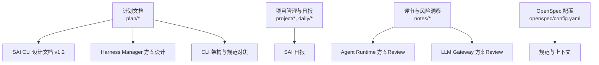
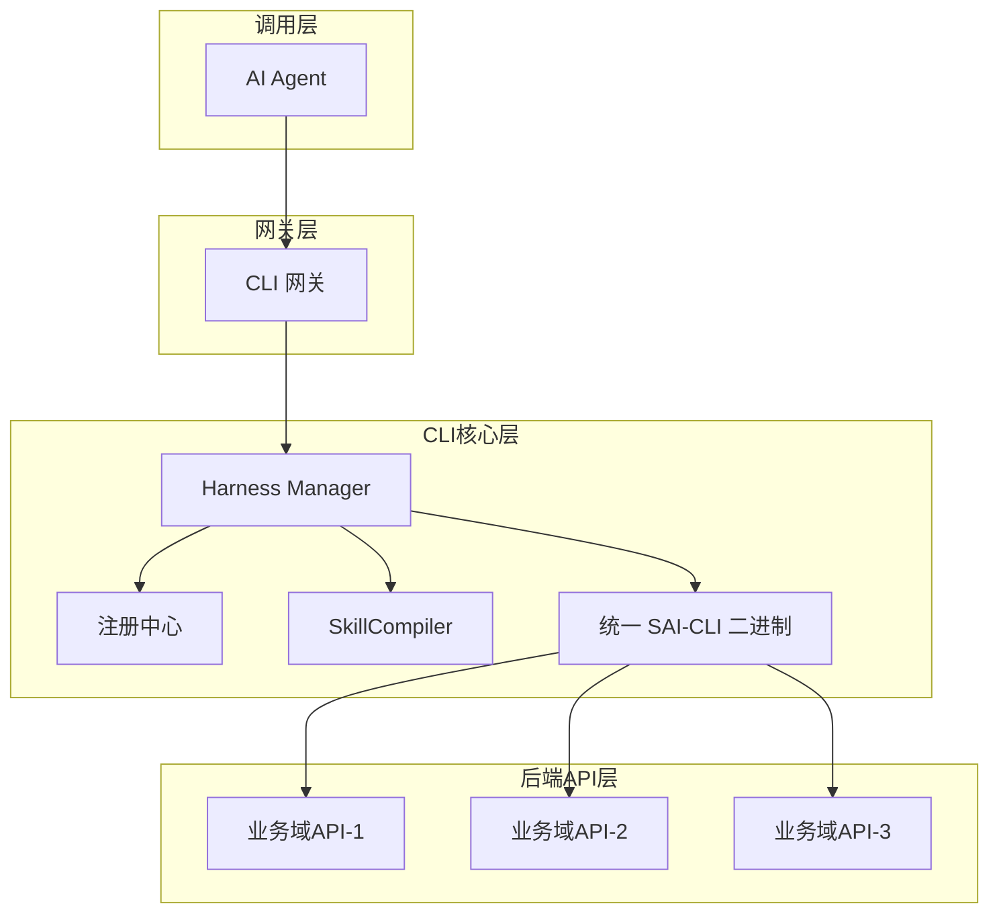
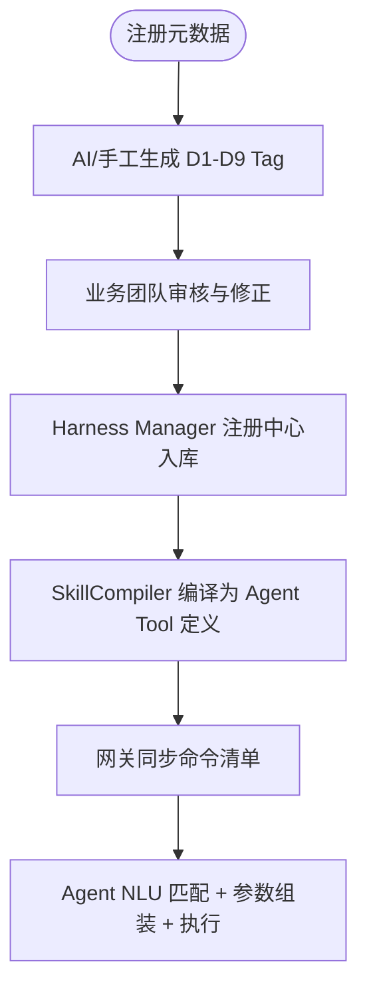
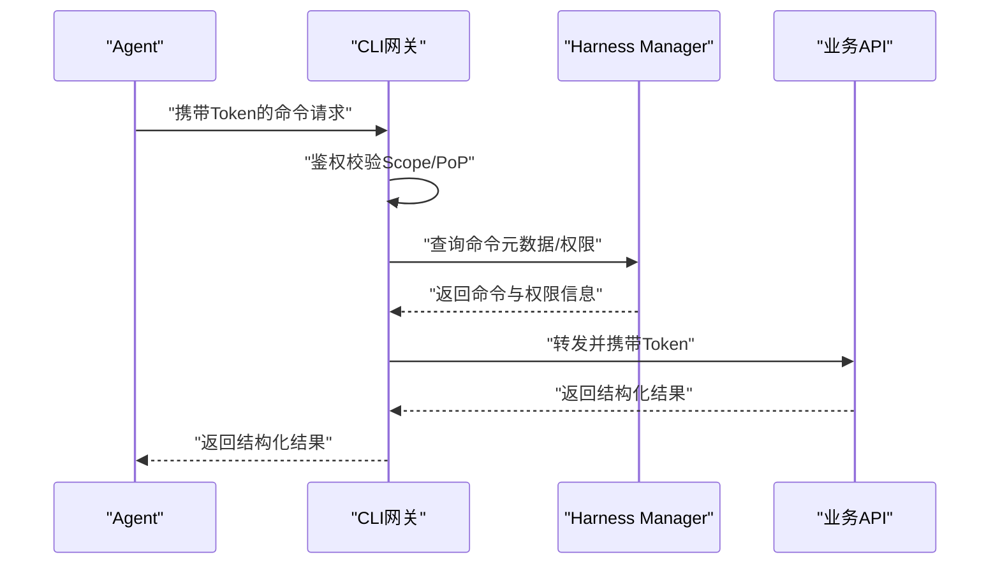
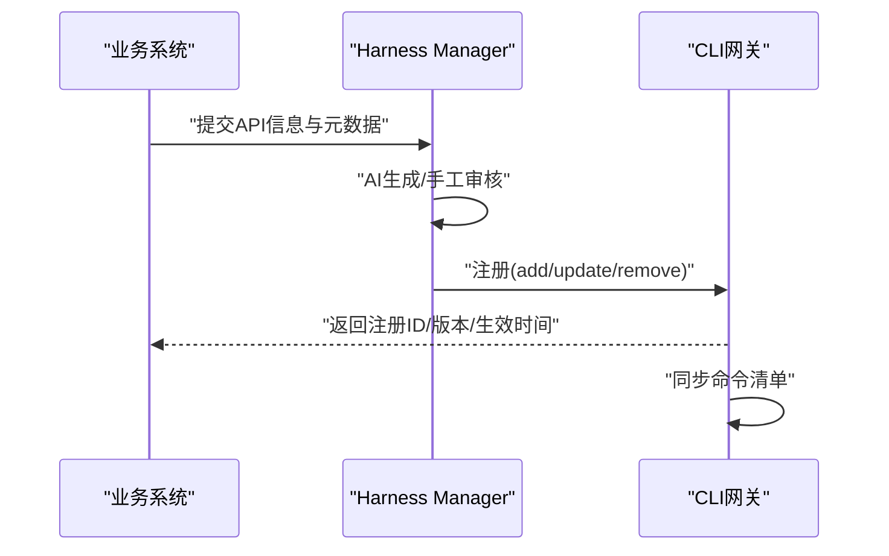
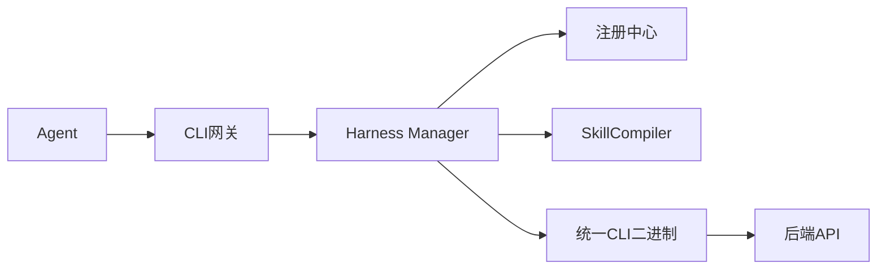

# CLI系统（淩雪）

<cite>
**本文引用的文件**
- [SAI CLI 设计文档 v1.2.md](file://plan/SAI_CLI_设计文档_v1.2.md)
- [SAI CLI 设计文档 v1.0.md](file://plan/SAI_CLI_设计文档_v1.0.md)
- [Harness Manager Cli方案设计方案.md](file://plan/Harness Manager Cli方案设计方案.md)
- [CLI 架构与规范对焦.md](file://plan/CLI 架构与规范对焦.md)
- [SAI-daily-report-2026-04-22-final.md](file://project/SAI-daily-report-2026-04-22-final.md)
- [Agent-Runtime方案review.md](file://notes/zhaobomin/Agent-Runtime方案review.md)
- [LLM-Gateway方案review.md](file://notes/zhaobomin/LLM-Gateway方案review.md)
- [config.yaml](file://openspec/config.yaml)
- [lingxue.md](file://daily/2026-04-23/lingxue.md)
</cite>

## 目录
1. [引言](#引言)
2. [项目结构](#项目结构)
3. [核心组件](#核心组件)
4. [架构总览](#架构总览)
5. [详细组件分析](#详细组件分析)
6. [依赖分析](#依赖分析)
7. [性能考量](#性能考量)
8. [故障排查指南](#故障排查指南)
9. [结论](#结论)
10. [附录](#附录)

## 引言
本文件为“CLI系统（淩雪）”的技术文档，面向业务开发者与平台工程团队，系统阐述四层分层架构的设计理念与实现要点，覆盖标准化命令规范、9维Tag元数据体系、业务能力封装方法、鉴权与权限控制、API调用流程、错误处理与性能优化、CLI注册流程、版本管理与兼容性策略，并提供命令示例、配置模板与开发指南，帮助快速落地可被Agent稳定调用的CLI能力。

## 项目结构
该仓库以“计划、项目管理、评审与日常记录”为主，CLI系统的关键设计与接口规范集中在“plan”目录下的设计文档中，同时“project”“notes”“daily”等目录提供了跨模块协同与落地进展的背景信息。

图表来源
- [SAI CLI 设计文档 v1.2.md](file://plan/SAI_CLI_设计文档_v1.2.md)
- [Harness Manager Cli方案设计方案.md](file://plan/Harness Manager Cli方案设计方案.md)
- [CLI 架构与规范对焦.md](file://plan/CLI 架构与规范对焦.md)
- [SAI-daily-report-2026-04-22-final.md](file://project/SAI-daily-report-2026-04-22-final.md)
- [Agent-Runtime方案review.md](file://notes/zhaobomin/Agent-Runtime方案review.md)
- [LLM-Gateway方案review.md](file://notes/zhaobomin/LLM-Gateway方案review.md)
- [config.yaml](file://openspec/config.yaml)

章节来源
- [SAI CLI 设计文档 v1.2.md](file://plan/SAI_CLI_设计文档_v1.2.md)
- [Harness Manager Cli方案设计方案.md](file://plan/Harness Manager Cli方案设计方案.md)
- [CLI 架构与规范对焦.md](file://plan/CLI 架构与规范对焦.md)
- [SAI-daily-report-2026-04-22-final.md](file://project/SAI-daily-report-2026-04-22-final.md)
- [Agent-Runtime方案review.md](file://notes/zhaobomin/Agent-Runtime方案review.md)
- [LLM-Gateway方案review.md](file://notes/zhaobomin/LLM-Gateway方案review.md)
- [config.yaml](file://openspec/config.yaml)

## 核心组件
- 调用层（AI Agent）：负责自然语言理解、命令选择与执行，不直接调用后端API。
- 网关层（CLI网关）：负责路由转发、鉴权校验、命令清单同步与权限过滤。
- CLI核心层（Harness Manager统一构建）：统一命令规范、入参/出参JSON、公共能力（认证/日志），内置API注册中心与SkillCompiler。
- 后端API层：各业务域提供API接口，零侵入，不感知CLI存在。

章节来源
- [SAI CLI 设计文档 v1.2.md](file://plan/SAI_CLI_设计文档_v1.2.md)
- [Harness Manager Cli方案设计方案.md](file://plan/Harness Manager Cli方案设计方案.md)

## 架构总览
四层架构实现“Agent → 网关 → SAI-CLI → API”的标准化接入，每层仅依赖下一层接口契约，实现解耦与独立演进。

图表来源
- [SAI CLI 设计文档 v1.2.md](file://plan/SAI_CLI_设计文档_v1.2.md)
- [Harness Manager Cli方案设计方案.md](file://plan/Harness Manager Cli方案设计方案.md)

## 详细组件分析

### 标准化命令规范
- 命令格式：{product} {module} {action} [params]
- 参数统一JSON格式，禁止交互式输入，确保Agent可自动化执行。
- 示例：kunlun timeliness query --type 出港滞留 --date 2026-04-21

章节来源
- [SAI CLI 设计文档 v1.2.md](file://plan/SAI_CLI_设计文档_v1.2.md)
- [SAI CLI 设计文档 v1.0.md](file://plan/SAI_CLI_设计文档_v1.0.md)

### 9维Tag元数据体系
- 路由与分类组（D1-D4）：指标大类、API名称、二级类目、指标清单
- NLU理解组（D5-D8）：指标类型、触发关键词（exact/synonym/negative）、场景意图
- 执行与展示组（D6-D9）：适用层级、出参映射
- 关键机制：D7的negative关键词用于防误判；D9用于结果解读的人类可读映射

图表来源
- [SAI CLI 设计文档 v1.2.md](file://plan/SAI_CLI_设计文档_v1.2.md)
- [Harness Manager Cli方案设计方案.md](file://plan/Harness Manager Cli方案设计方案.md)

章节来源
- [SAI CLI 设计文档 v1.2.md](file://plan/SAI_CLI_设计文档_v1.2.md)
- [Harness Manager Cli方案设计方案.md](file://plan/Harness Manager Cli方案设计方案.md)

### 业务能力封装方法
- 由Harness Manager统一将各域API封装为单一CLI二进制，CLI不感知Agent存在。
- 通过SkillCompiler将注册元数据编译为Agent可读的Tool定义，包含LLM可见层与框架控制层。
- 6步NLU Pipeline：意图分类→实体抽取→Tag匹配评分→参数组装→API调用→结果解读。

章节来源
- [SAI CLI 设计文档 v1.2.md](file://plan/SAI_CLI_设计文档_v1.2.md)
- [Harness Manager Cli方案设计方案.md](file://plan/Harness Manager Cli方案设计方案.md)

### 鉴权机制、权限控制与安全策略
- 一期：Bearer Token（优先级：命令行参数 > 环境变量 > 本地配置文件），Scope权限控制。
- 二期：PoP Token + ECDSA签名，引入环境绑定（本地OS Keychain、云端K8s Secret），防止Token复用。
- 接口鉴权：Harness Manager API统一AK/SK签名（HMAC-SHA256）。
- 配置文件：~/.sai/sso-auth.json，包含token、identity_type、scopes、expires_at。

图表来源
- [SAI CLI 设计文档 v1.2.md](file://plan/SAI_CLI_设计文档_v1.2.md)
- [Harness Manager Cli方案设计方案.md](file://plan/Harness Manager Cli方案设计方案.md)

章节来源
- [SAI CLI 设计文档 v1.2.md](file://plan/SAI_CLI_设计文档_v1.2.md)
- [Harness Manager Cli方案设计方案.md](file://plan/Harness Manager Cli方案设计方案.md)

### API调用流程、错误处理与性能优化
- 调用流程：Agent发起→网关鉴权→命令元数据检索→参数组装→调用后端API→结构化返回。
- 错误输出：统一JSON结构（type/code/message/hint），便于Agent与用户理解与修复。
- 性能优化：统一二进制部署、单一可执行文件减少依赖、跨平台支持、Dry-Run模式降低风险。

章节来源
- [SAI CLI 设计文档 v1.2.md](file://plan/SAI_CLI_设计文档_v1.2.md)
- [SAI CLI 设计文档 v1.0.md](file://plan/SAI_CLI_设计文档_v1.0.md)

### CLI注册流程、版本管理与兼容性
- 注册接口：POST /api/v1/sai/cli/registry，支持add/update/remove（软删除30天可恢复）。
- 版本管理：语义化版本号递增，注册后网关同步生效，记录previousVersion与effectiveTime。
- 兼容性：注册中心保证命令唯一性与Schema校验，ActionType与字段必填对照严格约束。

图表来源
- [Harness Manager Cli方案设计方案.md](file://plan/Harness Manager Cli方案设计方案.md)

章节来源
- [Harness Manager Cli方案设计方案.md](file://plan/Harness Manager Cli方案设计方案.md)

### 开发指南与最佳实践
- 开发语言：统一Golang，编译为单一二进制，跨平台部署。
- 可测试性：通过接口抽象（HTTP客户端、文件系统、Token读取）支持Mock与单元测试。
- Dry-Run：写操作命令必须支持--dry-run，返回将要执行的操作描述。
- Tag自动化：AI辅助生成D1-D9标签，业务团队审核确认后注册。

章节来源
- [SAI CLI 设计文档 v1.2.md](file://plan/SAI_CLI_设计文档_v1.2.md)
- [Harness Manager Cli方案设计方案.md](file://plan/Harness Manager Cli方案设计方案.md)

## 依赖分析
- 调用层依赖网关层提供的命令清单与权限信息。
- 网关层依赖Harness Manager的注册中心与鉴权能力。
- CLI核心层依赖各业务域API接口，统一封装为命令。
- Harness Manager依赖AI生成与注册中心，支撑SkillCompiler与网关同步。

图表来源
- [SAI CLI 设计文档 v1.2.md](file://plan/SAI_CLI_设计文档_v1.2.md)
- [Harness Manager Cli方案设计方案.md](file://plan/Harness Manager Cli方案设计方案.md)

章节来源
- [SAI CLI 设计文档 v1.2.md](file://plan/SAI_CLI_设计文档_v1.2.md)
- [Harness Manager Cli方案设计方案.md](file://plan/Harness Manager Cli方案设计方案.md)

## 性能考量
- 统一二进制部署，减少运行时依赖与启动开销。
- 网关层承担鉴权与路由，避免业务域承担额外逻辑。
- 通过Dry-Run与参数Schema减少无效调用与重试成本。
- 6步NLU Pipeline提升意图理解与参数组装准确性，降低误路由与失败率。

[本节为通用性能建议，不直接分析具体文件]

## 故障排查指南
- 鉴权失败：检查Token来源（命令行参数/环境变量/本地配置文件），确认Scope是否满足命令需求。
- 注册异常：核对actionType、apiVersion、tags完整性与parametersSchema合法性。
- 结果解读：确认D9出参映射是否正确，必要时在SkillCompiler侧补充或修正。
- 日常进展：参考每日报告与评审意见，关注Agent Runtime与LLM Gateway的协同节奏。

章节来源
- [SAI CLI 设计文档 v1.2.md](file://plan/SAI_CLI_设计文档_v1.2.md)
- [Harness Manager Cli方案设计方案.md](file://plan/Harness Manager Cli方案设计方案.md)
- [lingxue.md](file://daily/2026-04-23/lingxue.md)
- [Agent-Runtime方案review.md](file://notes/zhaobomin/Agent-Runtime方案review.md)
- [LLM-Gateway方案review.md](file://notes/zhaobomin/LLM-Gateway方案review.md)

## 结论
淩雪CLI系统通过四层分层架构与9维Tag元数据体系，实现了Agent可读、可调用、可鉴权、可治理的统一CLI能力。Harness Manager作为唯一构建与维护方，将各域API封装为单一CLI二进制，配合SkillCompiler与网关，形成从意图理解到结果解读的闭环。鉴权机制分阶段演进，既满足当前基础链路，又为PoP签名与环境绑定预留空间。建议在落地过程中严格遵循统一命令规范、结构化输出与Dry-Run策略，确保系统稳定性与可扩展性。

[本节为总结性内容，不直接分析具体文件]

## 附录

### 命令示例
- 昆仑域：kunlun timeliness query --type 出港滞留 --date 2026-04-21
- 网络域：network order get --orgName 杭州网点 --timeType day
- 政策域：policy rule query --product 标快 --region 华东

章节来源
- [SAI CLI 设计文档 v1.2.md](file://plan/SAI_CLI_设计文档_v1.2.md)

### 配置模板
- 本地认证配置：~/.sai/sso-auth.json（包含token、identity_type、scopes、expires_at）
- 静默登录接口：POST /api/v1/sai/auth/silent-login（入参：code；响应：用户身份与stoToken）

章节来源
- [SAI CLI 设计文档 v1.2.md](file://plan/SAI_CLI_设计文档_v1.2.md)
- [Harness Manager Cli方案设计方案.md](file://plan/Harness Manager Cli方案设计方案.md)

### 接口清单（摘要）
- 元数据生成：POST /api/v1/sai/cli/metadata/generate
- API注册：POST /api/v1/sai/cli/registry（支持add/update/remove）
- 静默登录：POST /api/v1/sai/auth/silent-login
- 统一响应与错误码：统一JSON信封与错误码定义

章节来源
- [Harness Manager Cli方案设计方案.md](file://plan/Harness Manager Cli方案设计方案.md)