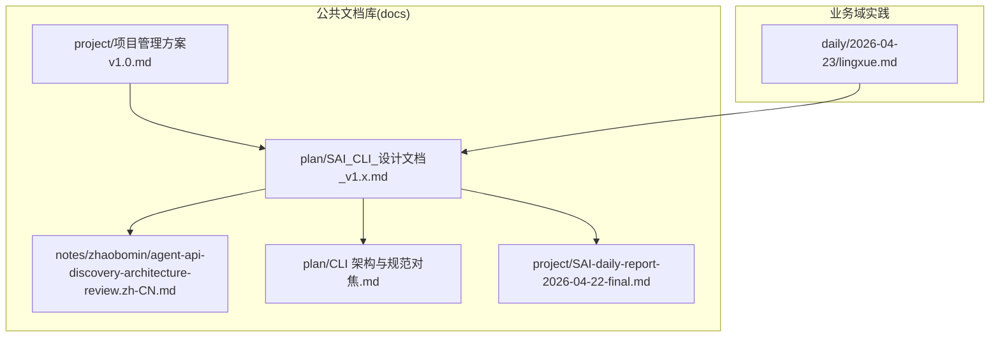
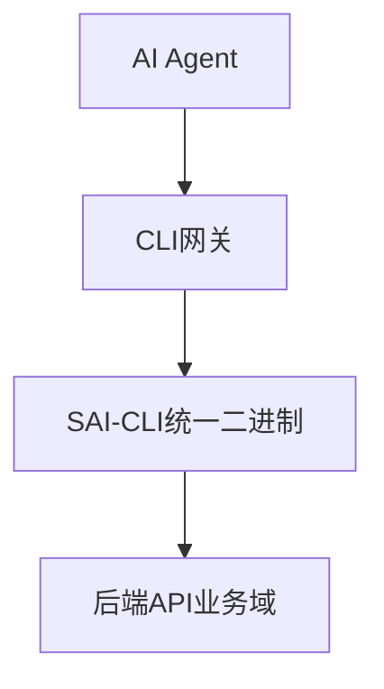
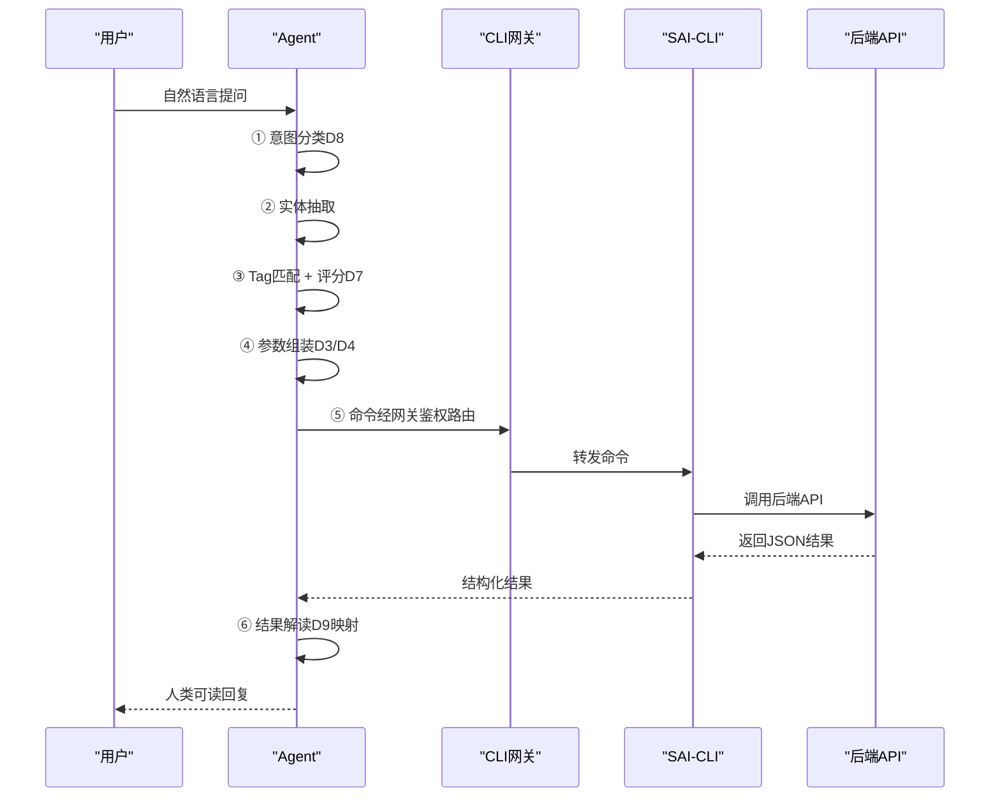
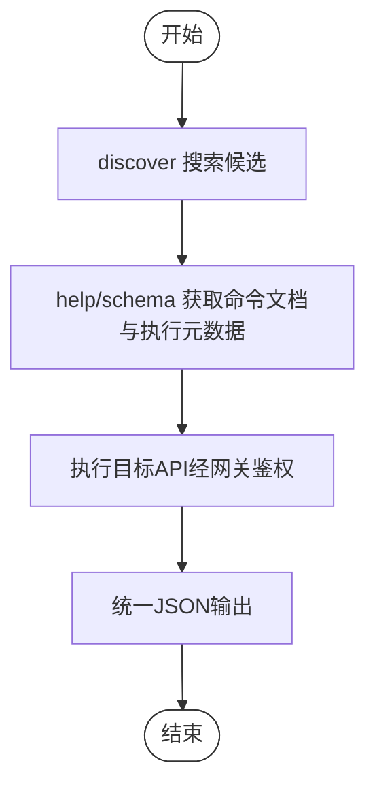
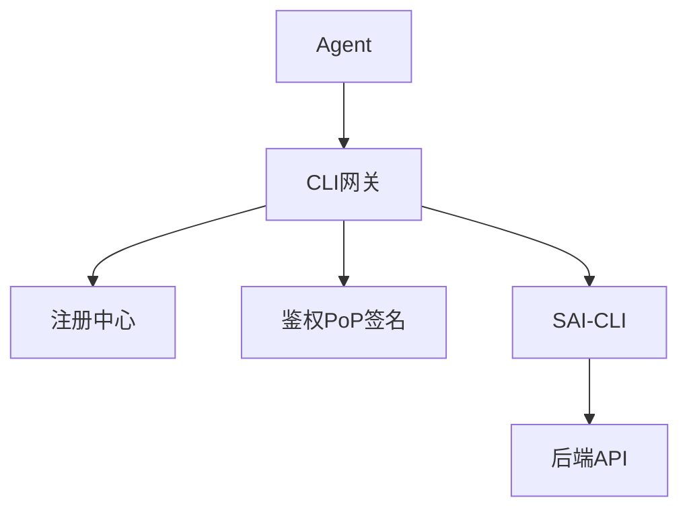

# 业务能力封装方法

<cite>
**本文引用的文件**
- [SAI_CLI_设计文档_v1.0.md](file://plan/SAI_CLI_设计文档_v1.0.md)
- [SAI_CLI_设计文档_v1.2.md](file://plan/SAI_CLI_设计文档_v1.2.md)
- [CLI 架构与规范对焦.md](file://plan/CLI 架构与规范对焦.md)
- [agent-api-discovery-architecture-review.zh-CN.md](file://notes/zhaobomin/agent-api-discovery-architecture-review.zh-CN.md)
- [项目管理方案v1.0.md](file://project/项目管理方案v1.0.md)
- [SAI-daily-report-2026-04-22-final.md](file://project/SAI-daily-report-2026-04-22-final.md)
- [lingxue.md](file://daily/2026-04-23/lingxue.md)
</cite>

## 目录
1. [简介](#简介)
2. [项目结构](#项目结构)
3. [核心组件](#核心组件)
4. [架构总览](#架构总览)
5. [详细组件分析](#详细组件分析)
6. [依赖分析](#依赖分析)
7. [性能考量](#性能考量)
8. [故障排查指南](#故障排查指南)
9. [结论](#结论)
10. [附录](#附录)

## 简介
本文件围绕“CLI系统业务能力封装方法”展开，系统阐述GUI零改造原则的实现机制、业务API抽取策略、后端API复用方式、HTTP接口封装与业务逻辑剥离、以及各业务域（运营、网络、政策、财务）的能力封装模式与适配方法。文档还提供封装流程、接口转换、数据映射与兼容性处理的实践指南，并给出业务域适配建议、封装示例与迁移最佳实践，帮助团队在不改动前端GUI的前提下，将后端API能力以统一CLI形态交付给Agent与用户。

## 项目结构
本仓库采用“多团队代码库 + 公共文档库”的组织方式，其中与CLI业务能力封装直接相关的关键文档集中在公共文档库的plan与notes目录，以及项目管理方案中。

图表来源
- [SAI_CLI_设计文档_v1.2.md](file://plan/SAI_CLI_设计文档_v1.2.md)
- [agent-api-discovery-architecture-review.zh-CN.md](file://notes/zhaobomin/agent-api-discovery-architecture-review.zh-CN.md)
- [CLI 架构与规范对焦.md](file://plan/CLI 架构与规范对焦.md)
- [项目管理方案v1.0.md](file://project/项目管理方案v1.0.md)
- [SAI-daily-report-2026-04-22-final.md](file://project/SAI-daily-report-2026-04-22-final.md)
- [lingxue.md](file://daily/2026-04-23/lingxue.md)

章节来源
- [项目管理方案v1.0.md](file://project/项目管理方案v1.0.md)
- [SAI_CLI_设计文档_v1.2.md](file://plan/SAI_CLI_设计文档_v1.2.md)

## 核心组件
- 调用层（AI Agent）：负责将自然语言映射为CLI命令，通过注册中心搜索与选择API，拼接执行命令并返回结构化结果。
- 网关层：负责路由转发、鉴权校验（PoP签名验证）、负载均衡、命令清单同步。
- CLI核心层（由Harness Manager统一构建与维护）：统一命令规范、入参/出参JSON、公共能力（认证/日志）；内置API注册中心（9维Tag、description、入参说明）；通过SkillCompiler将元数据编译为Agent可读的Tool定义。
- 后端API层：各业务域仅提供API接口，无需改造前端GUI，无需开发CLI。

章节来源
- [SAI_CLI_设计文档_v1.2.md](file://plan/SAI_CLI_设计文档_v1.2.md)
- [CLI 架构与规范对焦.md](file://plan/CLI 架构与规范对焦.md)

## 架构总览
整体采用四层分层架构，实现AI Agent与各业务域后端服务的标准化接入。调用链路为：Agent → 网关 → SAI-CLI → API。每一层只依赖下一层的接口契约，不穿透调用，确保独立演进、独立部署与独立测试。

图表来源
- [SAI_CLI_设计文档_v1.2.md](file://plan/SAI_CLI_设计文档_v1.2.md)

章节来源
- [SAI_CLI_设计文档_v1.2.md](file://plan/SAI_CLI_设计文档_v1.2.md)

## 详细组件分析

### GUI零改造原则与业务API抽取策略
- 原则：GUI零改造，各域只提供API。业务域仅维护后端API接口，不开发CLI，不改造GUI。
- 抽取策略：从GUI背后抽取HTTP API，CLI直接调用API，保持业务功能原样运行。
- 价值：避免前端改动带来的回归风险，降低业务域开发成本，统一后端能力出口。

章节来源
- [SAI_CLI_设计文档_v1.0.md](file://plan/SAI_CLI_设计文档_v1.0.md)
- [SAI_CLI_设计文档_v1.2.md](file://plan/SAI_CLI_设计文档_v1.2.md)

### 后端API复用方式与HTTP接口封装
- 复用方式：各域API以只读方式被CLI复用，无需改造前端GUI。
- 封装要点：
  - 统一命令规范：{product} {module} {action} [params]，参数统一JSON格式。
  - 结构化输出：CLI输出统一JSON，错误输出同样结构化。
  - 鉴权与安全：支持PoP Token（分阶段实施），支持AK/SK签名鉴权（Harness Manager内部接口）。
  - 可测试性：核心逻辑通过接口抽象，支持Mock与单元测试。

章节来源
- [SAI_CLI_设计文档_v1.2.md](file://plan/SAI_CLI_设计文档_v1.2.md)
- [CLI 架构与规范对焦.md](file://plan/CLI 架构与规范对焦.md)

### 业务逻辑剥离与Agent可调用性
- 业务逻辑剥离：CLI不感知Agent存在，不包含业务逻辑，仅负责命令解析、参数校验、调用后端API与结构化输出。
- Agent可调用性：
  - 无交互式输入：所有参数通过命令行传入，禁止运行时弹出交互式提示。
  - 结构化Tag元数据：每个命令附带Tag信息，描述功能、参数说明与调用示例，供Agent在调用前理解命令能力。
  - 9维Tag体系：通用路由骨架 + 9维深度Tag，覆盖路由与分类、NLU理解、执行与展示三大维度，支撑语义理解、参数构造、消歧防误判与结果解读。

章节来源
- [SAI_CLI_设计文档_v1.2.md](file://plan/SAI_CLI_设计文档_v1.2.md)

### 业务域（运营、网络、政策、财务）能力封装模式与适配方法
- 统一模式：各域仅提供API接口与描述文档，Harness Manager统一开发并打包为单一SAI-CLI二进制文件，域内无需独立开发CLI。
- 适配方法：
  - API注册：通过注册接口上报API，支持add/update/remove操作。
  - Tag生成：AI根据API描述自动生成9维Tag元数据，业务团队Review确认后注册。
  - 命令示例：域内提供高频使用场景与命令示例，确保Agent可正确拼接与执行。
  - 数据映射：通过D9出参映射，将JSON字段翻译为中文含义，供Agent解读结果。

章节来源
- [SAI_CLI_设计文档_v1.2.md](file://plan/SAI_CLI_设计文档_v1.2.md)
- [lingxue.md](file://daily/2026-04-23/lingxue.md)

### 封装流程、接口转换、数据映射与兼容性处理
- 封装流程：
  - API盘点与需求梳理 → Tag自动生成与Review → 注册至SAI-CLI → SkillCompiler编译为Agent Tool定义 → 网关同步命令清单 → Agent调用。
- 接口转换：
  - 自然语言 → 语义理解（D8意图分类）→ Tag匹配（D7关键词）→ 参数组装（D3/D4）→ API调用（经网关鉴权）→ 结果解读（D9映射）。
- 数据映射：
  - D9出参映射将后端返回的JSON字段翻译为中文含义，生成人类可读的回复。
- 兼容性处理：
  - 注册中心支持软删除（30天可恢复），便于灰度与回滚。
  - 9维Tag体系支持语义消歧与参数归一化，降低误用风险。

章节来源
- [SAI_CLI_设计文档_v1.2.md](file://plan/SAI_CLI_设计文档_v1.2.md)

### Agent调用流程（6步NLU Pipeline）

图表来源
- [SAI_CLI_设计文档_v1.2.md](file://plan/SAI_CLI_设计文档_v1.2.md)

章节来源
- [SAI_CLI_设计文档_v1.2.md](file://plan/SAI_CLI_设计文档_v1.2.md)

### 代码级封装流程（以Agent API发现机制Review为参考）

图表来源
- [agent-api-discovery-architecture-review.zh-CN.md](file://notes/zhaobomin/agent-api-discovery-architecture-review.zh-CN.md)

章节来源
- [agent-api-discovery-architecture-review.zh-CN.md](file://notes/zhaobomin/agent-api-discovery-architecture-review.zh-CN.md)

## 依赖分析
- 调用层依赖网关提供的元数据搜索与发布通知接口。
- 网关依赖CLI注册中心与鉴权机制（PoP签名验证）。
- CLI核心层依赖Harness Manager统一构建与维护，依赖注册中心与SkillCompiler。
- 后端API层仅依赖自身接口契约，不依赖CLI层。

图表来源
- [SAI_CLI_设计文档_v1.2.md](file://plan/SAI_CLI_设计文档_v1.2.md)

章节来源
- [SAI_CLI_设计文档_v1.2.md](file://plan/SAI_CLI_设计文档_v1.2.md)

## 性能考量
- 单一二进制部署：由Harness Manager统一打包，减少部署复杂度与运行时依赖。
- 本地缓存与TTL：注册中心支持本地缓存与TTL，降低高频调用延迟。
- 调试日志可控：默认关闭调试日志，仅在显式开启时输出，避免污染stderr与泄露敏感信息。
- 代码可维护性：建议拆分registry.Client与execute.RunQuery，提升可测试性与可演进性。

章节来源
- [agent-api-discovery-architecture-review.zh-CN.md](file://notes/zhaobomin/agent-api-discovery-architecture-review.zh-CN.md)
- [CLI 架构与规范对焦.md](file://plan/CLI 架构与规范对焦.md)

## 故障排查指南
- 非2xx状态码处理：当前实现将4xx/5xx包装为成功，建议在执行器中按状态码映射为typed error，确保Agent可靠判断失败原因。
- 动态命令兜底分发：建议在root层接入TryDynamicDispatch，避免合法动态命令受启动期预挂载影响。
- 生产profile校验：构建脚本在prod环境下禁止占位URL进入产物，确保运行时可达。
- 日志与敏感信息：仅在SAI_DEBUG=true时输出调试日志，对敏感字段做masking。

章节来源
- [agent-api-discovery-architecture-review.zh-CN.md](file://notes/zhaobomin/agent-api-discovery-architecture-review.zh-CN.md)

## 结论
通过GUI零改造原则与统一的9维Tag体系，SAI CLI实现了业务域后端API的标准化封装与Agent可调用性。Harness Manager统一构建与维护CLI，业务域仅提供API接口，既降低了开发成本，又确保了系统的解耦与可演进性。配合PoP Token与SkillCompiler，系统在安全与智能化方面也具备了良好的扩展基础。

## 附录
- 业务域适配指南
  - 仅提供API接口与描述文档，不参与CLI开发。
  - 提供高频使用场景与命令示例，确保Agent可正确拼接与执行。
  - 通过注册接口上报API，支持add/update/remove操作。
  - AI自动生成9维Tag元数据，业务团队Review确认后注册。
- 封装示例
  - 昆仑域：查询出港滞留时效，命令格式为kunlun timeliness query，参数统一JSON格式。
  - 网络域：查询网点单量，命令格式为network order get，参数统一JSON格式。
  - 政策域：查询运费政策规则，命令格式为policy rule query，参数统一JSON格式。
  - 财务域：查询损益分析总表，命令格式为finance fee get，参数统一JSON格式。
- 迁移最佳实践
  - 以只读方式抽取后端API，不改动前端GUI。
  - 统一命令规范与JSON入参/出参，确保Agent可稳定解析。
  - 通过注册中心与SkillCompiler实现元数据驱动，避免硬编码。
  - 采用Dry-Run模式对写操作进行预检，降低误操作风险。
  - 分阶段实施PoP Token，确保链路安全与兼容性。

章节来源
- [SAI_CLI_设计文档_v1.2.md](file://plan/SAI_CLI_设计文档_v1.2.md)
- [lingxue.md](file://daily/2026-04-23/lingxue.md)