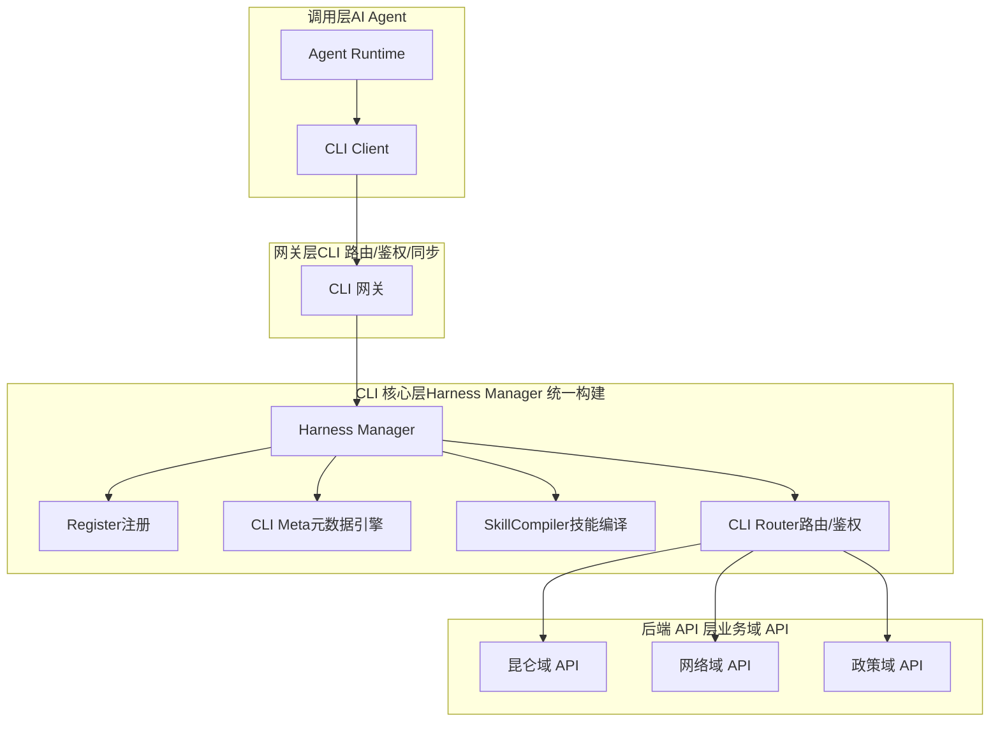
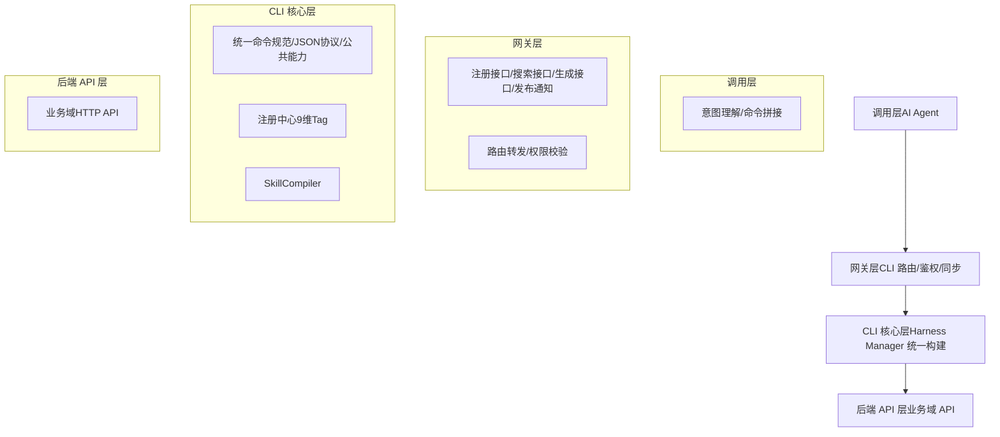
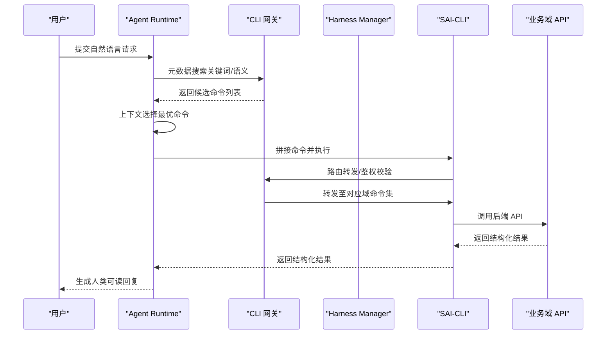
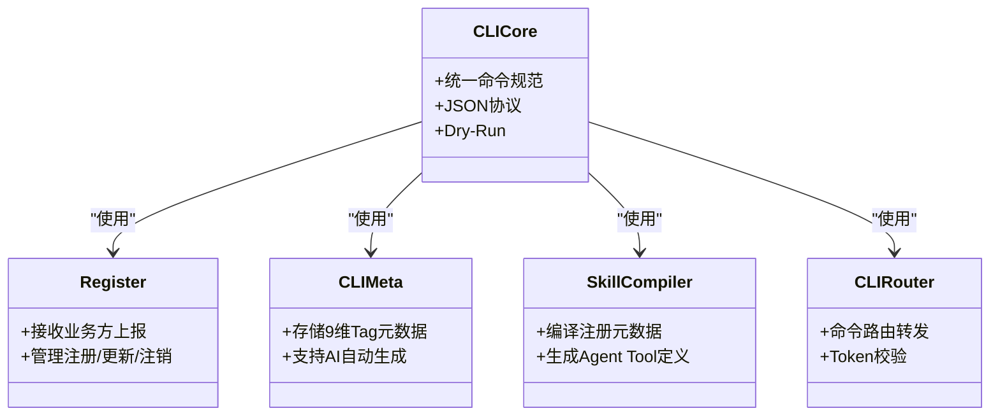
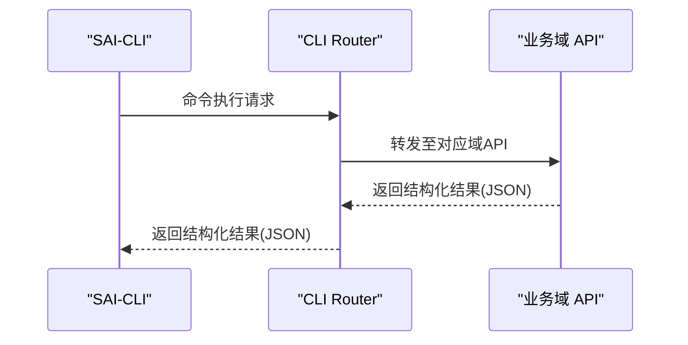
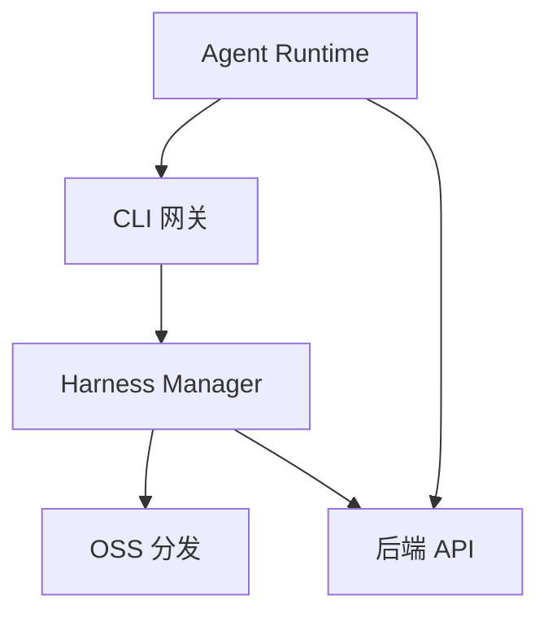

# 四层分层架构设计

<cite>
**本文引用的文件**
- [SAI CLI 设计文档 v1.2.md](file://plan/SAI_CLI_设计文档_v1.2.md)
- [SAI CLI 设计文档 v1.0.md](file://plan/SAI_CLI_设计文档_v1.0.md)
- [Sai整体架构设计.md](file://project/standup/Sai整体架构设计.md)
- [2026-04-20 早会记录.md](file://project/standup/2026-04-20-zhaobomin.md)
- [SAI 项目日报 | 项目待办和风险跟踪.md](file://project/SAI-daily-report-2026-04-22-final.md)
- [Agent Runtime 方案 Review.md](file://notes/zhaobomin/Agent-Runtime方案review.md)
- [LLM Gateway 方案 Review.md](file://notes/zhaobomin/LLM-Gateway方案review.md)
- [LLM-Gateway建设方案.md](file://plan/LLM-Gateway建设方案.md)
- [Agent-Runtime方案.md](file://plan/Agent-Runtime方案.md)
</cite>

## 目录
1. [引言](#引言)
2. [项目结构](#项目结构)
3. [核心组件](#核心组件)
4. [架构总览](#架构总览)
5. [详细组件分析](#详细组件分析)
6. [依赖分析](#依赖分析)
7. [性能考量](#性能考量)
8. [故障排查指南](#故障排查指南)
9. [结论](#结论)
10. [附录](#附录)

## 引言
本文件围绕 SAI（申通 AI 智能体平台）的 CLI 系统四层分层架构展开，系统性阐述调用层、网关层、CLI 核心层与后端 API 层的设计原理、职责边界、关键约束与依赖关系。文档强调“架构解耦”原则，确保各层可独立演进、独立部署、独立测试；并通过统一命令规范、统一协议（JSON）、统一鉴权（PoP Token/Bearer Token）与统一元数据（9 维 Tag）实现跨域协同与 Agent 可读可执行的自动化调用链路。

## 项目结构
- 文档以“SAI CLI 设计文档 v1.2”为核心蓝本，补充 v1.0 的基础规范与 Sai 整体架构设计中的 HM/Hook 关系，形成完整的四层视角。
- 项目日报与早会记录提供了模块职责、接口依赖矩阵与上线策略，有助于理解各层在整体系统中的位置与交互。



图表来源
- [Sai整体架构设计.md:19-65](file://project/standup/Sai整体架构设计.md#L19-L65)
- [SAI CLI 设计文档 v1.2.md:33-64](file://plan/SAI_CLI_设计文档_v1.2.md#L33-L64)

章节来源
- [Sai整体架构设计.md:19-65](file://project/standup/Sai整体架构设计.md#L19-L65)
- [SAI CLI 设计文档 v1.2.md:33-64](file://plan/SAI_CLI_设计文档_v1.2.md#L33-L64)

## 核心组件
- 调用层（AI Agent）
  - 职责：意图理解、API 搜索、命令拼接、结构化结果返回。
  - 约束：不直接调用后端 API；命令必须通过 SAI-CLI 注册发现与路由。
- 网关层（CLI 路由/鉴权/同步）
  - 职责：命令注册接口、元数据搜索、元数据生成、发布通知、路由转发、权限校验（PoP Token/Bearer Token）。
  - 约束：不包含业务逻辑，仅做协议与路由。
- CLI 核心层（Harness Manager 统一构建）
  - 职责：统一命令规范、入参/出参 JSON、公共能力（认证/日志）、API 注册中心、SkillCompiler 编译。
  - 约束：各业务域不参与 CLI 开发；CLI 不感知 Agent 存在。
- 后端 API 层（业务域 API）
  - 职责：提供业务功能的 HTTP 接口，零侵入。
  - 约束：仅暴露 API，无需改造前端 GUI，无需开发 CLI。

章节来源
- [SAI CLI 设计文档 v1.2.md:66-75](file://plan/SAI_CLI_设计文档_v1.2.md#L66-L75)
- [SAI CLI 设计文档 v1.0.md:44-53](file://plan/SAI_CLI_设计文档_v1.0.md#L44-L53)

## 架构总览
四层架构通过“Agent → 网关 → SAI-CLI → API”的链路实现解耦，每层仅依赖下一层接口契约，避免穿透调用。该设计使各层可独立演进、部署与测试，同时 CLI 的迭代与业务域 API 的迭代完全解耦。



图表来源
- [SAI CLI 设计文档 v1.2.md:29-75](file://plan/SAI_CLI_设计文档_v1.2.md#L29-L75)

章节来源
- [SAI CLI 设计文档 v1.2.md:29-75](file://plan/SAI_CLI_设计文档_v1.2.md#L29-L75)

## 详细组件分析

### 调用层（AI Agent）
- 职责与流程
  - 通过注册中心进行语义搜索，结合上下文选择最匹配 API。
  - 依据入参说明拼接执行命令，调用 CLI，返回结构化结果。
- 关键约束
  - 不直接调用后端 API；命令必须经 SAI-CLI 注册发现。
  - 输出必须为结构化 JSON，错误输出包含 type/code/message/hint。
- 与网关交互
  - 通过网关的元数据搜索接口获取候选命令列表。
  - 通过网关的发布通知接口同步命令清单更新。



图表来源
- [SAI CLI 设计文档 v1.2.md:603-632](file://plan/SAI_CLI_设计文档_v1.2.md#L603-L632)
- [Sai整体架构设计.md:115-138](file://project/standup/Sai整体架构设计.md#L115-L138)

章节来源
- [SAI CLI 设计文档 v1.2.md:603-632](file://plan/SAI_CLI_设计文档_v1.2.md#L603-L632)
- [Sai整体架构设计.md:115-138](file://project/standup/Sai整体架构设计.md#L115-L138)

### 网关层（CLI 路由/鉴权/同步）
- 能力清单
  - API 注册接口：接收 Harness Manager 的 API 注册请求，写入注册中心。
  - 元数据搜索接口：支持 Agent 语义搜索，返回候选命令。
  - 元数据生成接口：AI 自动生成命令元数据（9 维 Tag）。
  - 发布通知接口：触发命令清单同步更新。
  - 路由转发：根据 product 字段路由至对应域命令集。
  - 权限校验：Token 合法性与 Scope 校验；二期支持 PoP 签名验证。
- 部署与分发
  - 采用 OSS 挂载形式，将统一打包的 SAI-CLI 二进制文件挂载至 Agent 运行环境。

```mermaid
flowchart TD
subgraph "网关层"
REG["注册接口"]
SEARCH["搜索接口"]
GEN["元数据生成接口"]
PUB["发布通知接口"]
ROUTE["路由转发"]
AUTH["权限校验"]
end
subgraph "Harness Manager"
HM["统一构建与维护"]
end
subgraph "Agent"
AG["Agent Runtime"]
end
subgraph "OSS"
OSS["统一二进制/技能分发"]
end
AG --> SEARCH
AG --> PUB
HM --> REG
HM --> GEN
REG --> OSS
SEARCH --> OSS
PUB --> OSS
ROUTE --> OSS
AUTH --> OSS
```

图表来源
- [SAI CLI 设计文档 v1.2.md:605-618](file://plan/SAI_CLI_设计文档_v1.2.md#L605-L618)
- [SAI CLI 设计文档 v1.2.md:561-591](file://plan/SAI_CLI_设计文档_v1.2.md#L561-L591)

章节来源
- [SAI CLI 设计文档 v1.2.md:605-618](file://plan/SAI_CLI_设计文档_v1.2.md#L605-L618)
- [SAI CLI 设计文档 v1.2.md:561-591](file://plan/SAI_CLI_设计文档_v1.2.md#L561-L591)

### CLI 核心层（Harness Manager 统一构建）
- 组件与职责
  - Register：API 注册管理（新增/更新/注销）。
  - CLI Meta：9 维 Tag 元数据存储与管理，支持 AI 自动生成。
  - SkillCompiler：将注册元数据编译为 Agent 可读的 Tool 定义。
  - CLI Router：命令路由与鉴权。
  - CLI Invoke（可选）：调用代理节点，降低链路延时。
- 统一规范
  - 命令格式：{product} {module} {action} [params]。
  - JSON 协议：入参/出参统一 JSON；错误输出统一结构化 JSON。
  - 无交互式输入：禁止运行时弹出交互式提示。
  - Dry-Run：写操作命令支持 --dry-run。
- 开发语言与部署
  - Golang 开发，编译为单一二进制文件，跨平台部署。



图表来源
- [SAI CLI 设计文档 v1.2.md:547-559](file://plan/SAI_CLI_设计文档_v1.2.md#L547-L559)
- [SAI CLI 设计文档 v1.2.md:115-146](file://plan/SAI_CLI_设计文档_v1.2.md#L115-L146)

章节来源
- [SAI CLI 设计文档 v1.2.md:547-559](file://plan/SAI_CLI_设计文档_v1.2.md#L547-L559)
- [SAI CLI 设计文档 v1.2.md:115-146](file://plan/SAI_CLI_设计文档_v1.2.md#L115-L146)

### 后端 API 层（业务域 API）
- 职责与约束
  - 各域仅提供 API 接口，无需改造前端 GUI，无需开发 CLI。
  - 零侵入，各域只维护自身 API。
- 与 CLI 的交互
  - 通过 CLI Router 路由至对应域命令集，再调用后端 API。
  - 返回结构化 JSON，遵循统一协议。



图表来源
- [SAI CLI 设计文档 v1.2.md:57-63](file://plan/SAI_CLI_设计文档_v1.2.md#L57-L63)
- [SAI CLI 设计文档 v1.2.md:547-559](file://plan/SAI_CLI_设计文档_v1.2.md#L547-L559)

章节来源
- [SAI CLI 设计文档 v1.2.md:57-63](file://plan/SAI_CLI_设计文档_v1.2.md#L57-L63)
- [SAI CLI 设计文档 v1.2.md:547-559](file://plan/SAI_CLI_设计文档_v1.2.md#L547-L559)

## 依赖分析
- 层间依赖
  - 调用层依赖网关的元数据搜索与发布通知接口。
  - 网关依赖 Harness Manager 的注册中心与 OSS 分发。
  - CLI 核心层依赖后端 API 的 HTTP 接口。
- 接口契约
  - 统一命令规范与 JSON 协议。
  - 统一鉴权（PoP Token/Bearer Token）与 Scope 控制。
  - 统一错误输出结构（type/code/message/hint）。



图表来源
- [Sai整体架构设计.md:19-65](file://project/standup/Sai整体架构设计.md#L19-L65)
- [SAI CLI 设计文档 v1.2.md:561-591](file://plan/SAI_CLI_设计文档_v1.2.md#L561-L591)

章节来源
- [Sai整体架构设计.md:19-65](file://project/standup/Sai整体架构设计.md#L19-L65)
- [SAI CLI 设计文档 v1.2.md:561-591](file://plan/SAI_CLI_设计文档_v1.2.md#L561-L591)

## 性能考量
- 热启动与冷启动
  - Agent Runtime 采用 serverless（AgentRun）按 session 分配实例，冷启动 <1s，热启动 <200ms，满足实时性要求。
- 路由与鉴权
  - 网关层承担路由与鉴权，减少 CLI 核心层的业务负担，提升整体响应速度。
- 部署与分发
  - SAI-CLI 二进制文件统一构建并挂载至 Agent 运行环境，降低部署与分发成本。

章节来源
- [Sai整体架构设计.md:238-245](file://project/standup/Sai整体架构设计.md#L238-L245)
- [Agent-Runtime方案.md:4-13](file://plan/Agent-Runtime方案.md#L4-L13)

## 故障排查指南
- 网关层故障
  - 网关熔断导致意图理解链路中断：Agent 返回固定提示，业务执行链路不受影响。
- HM 不可用
  - Agent 使用本地缓存的 Skill/CLI 定义，降级为无知识检索模式。
- OSS 不可用
  - Agent 使用本地缓存版本运行，日志告警通知 HM 团队。
- Biz API 超时/失败
  - CLI Client 单次重试（≤3s 等待），失败后 Agent 向用户说明具体接口不可用。
- Agent Runtime 实例崩溃
  - Serverless 平台自动重建实例，用户会话需重新发起。

章节来源
- [Sai整体架构设计.md:236-245](file://project/standup/Sai整体架构设计.md#L236-L245)

## 结论
四层分层架构通过“调用层 → 网关层 → CLI 核心层 → 后端 API 层”的解耦设计，实现了跨域协作与自动化执行。统一命令规范、统一协议与统一鉴权确保了各层的独立演进与稳定交互；Harness Manager 的集中构建与分发进一步降低了业务域的开发与运维成本。结合热启动与降级策略，系统在性能与可靠性方面具备良好保障。

## 附录
- 术语与缩写
  - Agent：智能体运行时，负责意图理解与任务执行。
  - 网关：CLI 路由/鉴权/同步的统一入口。
  - HM：Harness Manager，统一构建与维护 SAI-CLI。
  - PoP：证明持有（Proof-of-Possession），用于 Token 环境绑定签名。
  - AK/SK：访问密钥/签名密钥，用于 Harness Manager API 的 HMAC-SHA256 签名。
- 最佳实践
  - 业务域仅提供 API 接口与描述文档，不参与 CLI 开发。
  - CLI 命令必须支持纯参数化调用，禁止交互式输入。
  - 错误输出必须为结构化 JSON，包含 type/code/message/hint。
  - 写操作命令必须支持 --dry-run，便于风险预估与审计。
  - 统一使用 Golang 开发 CLI，编译为单一二进制文件，便于部署与分发。