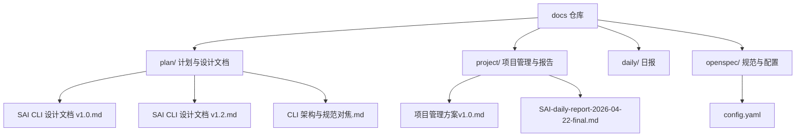
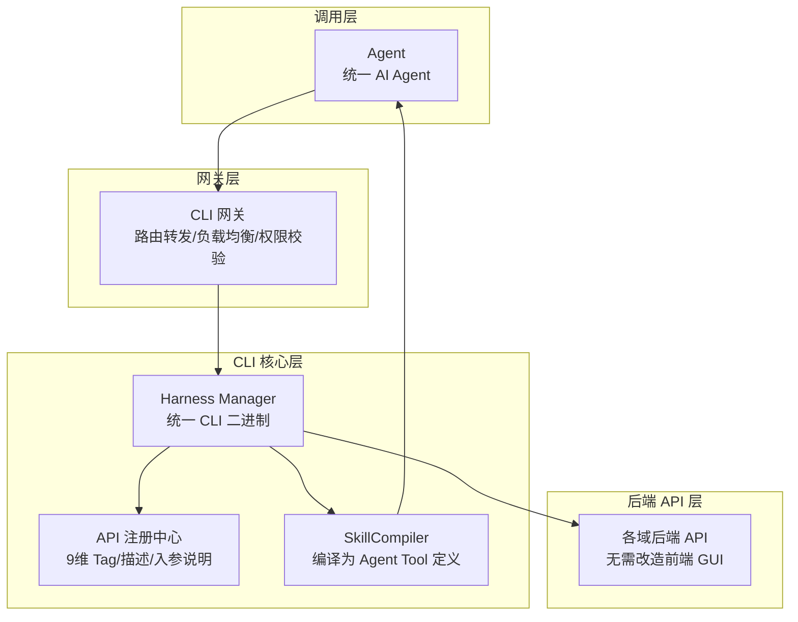
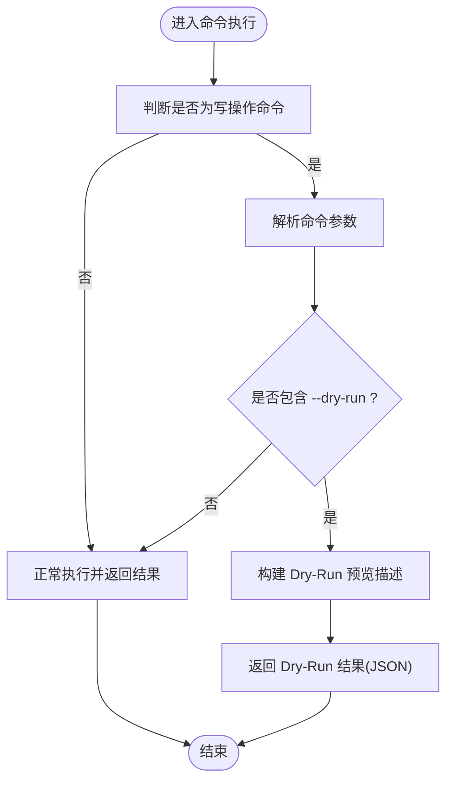
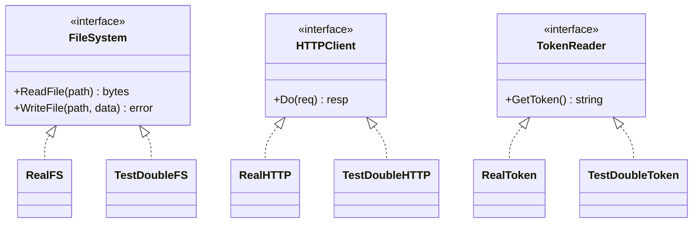
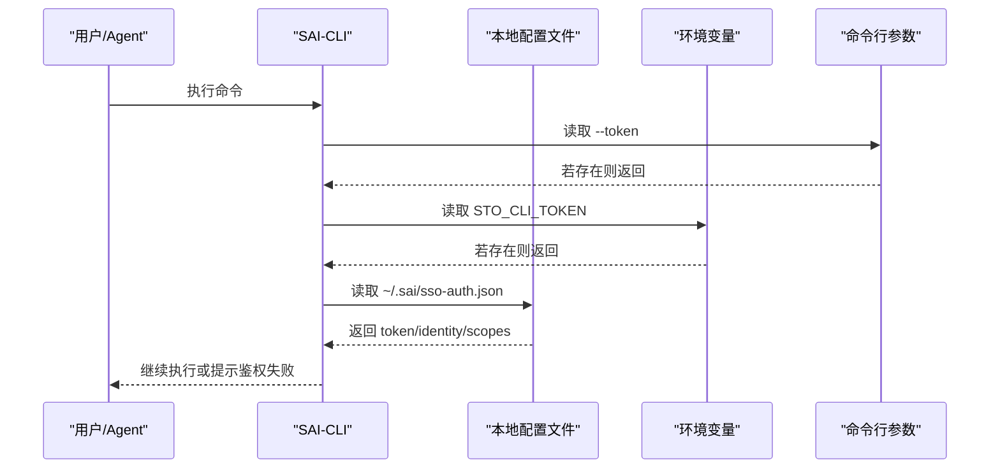
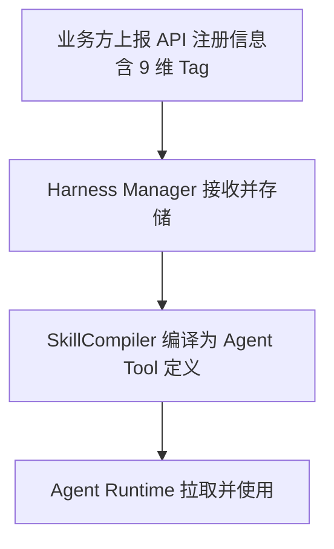
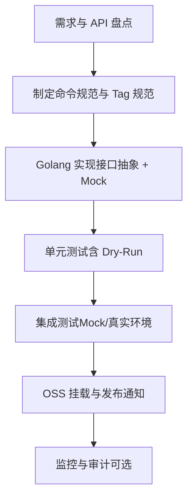
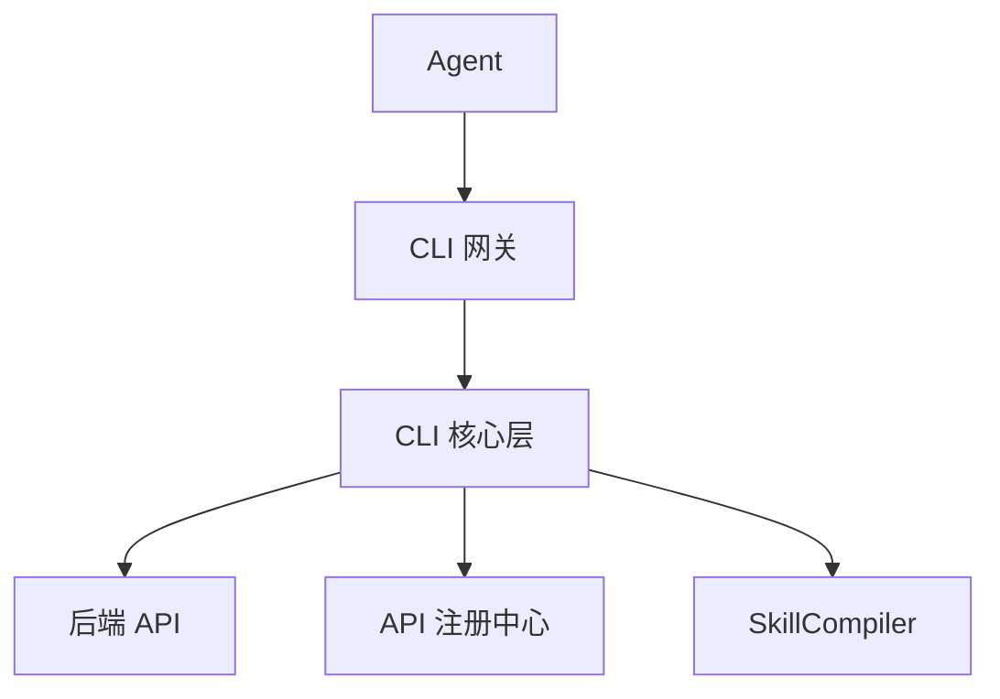

# 开发与测试规范

<cite>
**本文引用的文件**
- [SAI CLI 设计文档 v1.0.md](file://plan/SAI_CLI_设计文档_v1.0.md)
- [SAI CLI 设计文档 v1.2.md](file://plan/SAI_CLI_设计文档_v1.2.md)
- [CLI 架构与规范对焦.md](file://plan/CLI 架构与规范对焦.md)
- [项目管理方案v1.0.md](file://project/项目管理方案v1.0.md)
- [README.md](file://README.md)
- [SAI-daily-report-2026-04-22-final.md](file://project/SAI-daily-report-2026-04-22-final.md)
- [config.yaml](file://openspec/config.yaml)
</cite>

## 目录
1. [简介](#简介)
2. [项目结构](#项目结构)
3. [核心组件](#核心组件)
4. [架构总览](#架构总览)
5. [详细组件分析](#详细组件分析)
6. [依赖分析](#依赖分析)
7. [性能考量](#性能考量)
8. [故障排查指南](#故障排查指南)
9. [结论](#结论)
10. [附录](#附录)

## 简介
本文件面向 CLI 系统的开发与测试规范，聚焦以下目标：
- 深入解释 Golang 开发语言选择与开发环境搭建要点
- 详细描述 Dry-Run 模式的实现原理与使用场景
- 阐述单元测试可测性要求、接口抽象与 Mock 机制
- 提供开发流程、测试策略与质量保证措施
- 给出开发环境配置、测试工具使用与代码质量标准

本规范以 SAI CLI 设计文档为核心依据，并结合项目管理方案与日常汇报，形成可执行、可追溯、可度量的质量基线。

## 项目结构
本仓库的文档库采用“公共文档 + 团队目录”的组织方式，便于跨团队协同与版本化追踪。CLI 相关规范主要沉淀在计划与设计文档中，同时项目管理方案明确了 Git 提交流程、文档同步与日报制度。

图表来源
- [README.md:11-41](file://README.md#L11-L41)
- [项目管理方案v1.0.md:90-134](file://project/项目管理方案v1.0.md#L90-L134)

章节来源
- [README.md:11-41](file://README.md#L11-L41)
- [项目管理方案v1.0.md:90-134](file://project/项目管理方案v1.0.md#L90-L134)

## 核心组件
围绕 CLI 系统的开发与测试，核心组件包括：
- 开发语言与工具链：统一使用 Golang，强调跨平台与单二进制部署优势
- 命令规范与协议：统一命令格式、入参/出参 JSON、结构化错误输出
- 安全与鉴权：Token 获取优先级、配置文件格式、鉴权机制
- 可测试性与 Dry-Run：写操作命令支持 Dry-Run，核心逻辑通过接口抽象与 Mock 支撑单元测试
- 发布与运维：OSS 挂载、版本发布通知、命令清单同步

章节来源
- [SAI CLI 设计文档 v1.0.md:187-196](file://plan/SAI_CLI_设计文档_v1.0.md#L187-L196)
- [SAI CLI 设计文档 v1.0.md:254-292](file://plan/SAI_CLI_设计文档_v1.0.md#L254-L292)
- [SAI CLI 设计文档 v1.2.md:394-471](file://plan/SAI_CLI_设计文档_v1.2.md#L394-L471)
- [CLI 架构与规范对焦.md:8-13](file://plan/CLI 架构与规范对焦.md#L8-L13)

## 架构总览
SAI CLI 采用四层分层架构，实现 Agent、网关、CLI 核心层与后端 API 的标准化接入与解耦。CLI 核心层由 Harness Manager 统一构建与维护，封装各域命令集，提供统一的命令规范、认证与日志能力。

图表来源
- [SAI CLI 设计文档 v1.2.md:33-64](file://plan/SAI_CLI_设计文档_v1.2.md#L33-L64)
- [SAI CLI 设计文档 v1.2.md:545-591](file://plan/SAI_CLI_设计文档_v1.2.md#L545-L591)

章节来源
- [SAI CLI 设计文档 v1.2.md:33-64](file://plan/SAI_CLI_设计文档_v1.2.md#L33-L64)
- [SAI CLI 设计文档 v1.2.md:545-591](file://plan/SAI_CLI_设计文档_v1.2.md#L545-L591)

## 详细组件分析

### 组件A：Dry-Run 模式
Dry-Run 是针对写操作命令（create/update/delete）提供的“预执行”能力，返回将要执行的操作描述，帮助 Agent 与操作人员在执行前确认影响范围，避免误操作。

图表来源
- [SAI CLI 设计文档 v1.0.md:256-281](file://plan/SAI_CLI_设计文档_v1.0.md#L256-L281)
- [SAI CLI 设计文档 v1.2.md:476-501](file://plan/SAI_CLI_设计文档_v1.2.md#L476-L501)

章节来源
- [SAI CLI 设计文档 v1.0.md:256-281](file://plan/SAI_CLI_设计文档_v1.0.md#L256-L281)
- [SAI CLI 设计文档 v1.2.md:476-501](file://plan/SAI_CLI_设计文档_v1.2.md#L476-L501)

### 组件B：单元测试可测性与接口抽象
为确保 CLI 核心逻辑可在无真实 API 环境下进行单元测试，规范要求通过接口抽象与 Mock 机制实现可测试性。典型抽象包括：
- 文件系统：使用虚拟文件系统封装
- HTTP 客户端：通过 interface 注入，支持 Mock
- Token 读取：通过接口抽象，支持注入测试 Token

图表来源
- [SAI CLI 设计文档 v1.0.md:282-292](file://plan/SAI_CLI_设计文档_v1.0.md#L282-L292)
- [SAI CLI 设计文档 v1.2.md:502-513](file://plan/SAI_CLI_设计文档_v1.2.md#L502-L513)

章节来源
- [SAI CLI 设计文档 v1.0.md:282-292](file://plan/SAI_CLI_设计文档_v1.0.md#L282-L292)
- [SAI CLI 设计文档 v1.2.md:502-513](file://plan/SAI_CLI_设计文档_v1.2.md#L502-L513)

### 组件C：鉴权与配置
鉴权机制支持多通道 Token 获取，优先级从高到低为：命令行参数、环境变量、本地配置文件。配置文件格式包含 token、identity_type、scopes、expires_at 等字段。同时，规范明确了 AK/SK 签名鉴权用于 Harness Manager 的 API 接口。

图表来源
- [SAI CLI 设计文档 v1.0.md:222-250](file://plan/SAI_CLI_设计文档_v1.0.md#L222-L250)
- [SAI CLI 设计文档 v1.2.md:405-470](file://plan/SAI_CLI_设计文档_v1.2.md#L405-L470)

章节来源
- [SAI CLI 设计文档 v1.0.md:222-250](file://plan/SAI_CLI_设计文档_v1.0.md#L222-L250)
- [SAI CLI 设计文档 v1.2.md:405-470](file://plan/SAI_CLI_设计文档_v1.2.md#L405-L470)

### 组件D：Tag 与 SkillCompiler（9 维 Tag 体系）
Harness Manager 内置 SkillCompiler，将业务方上报的原始注册 JSON 编译为 Agent 可读的“增强型 Tool 定义”。9 维 Tag 体系覆盖路由与分类、NLU 理解、执行与展示三大组，支撑 Agent 的意图分类、实体抽取、命令匹配与结果解读。

图表来源
- [SAI CLI 设计文档 v1.2.md:225-249](file://plan/SAI_CLI_设计文档_v1.2.md#L225-L249)
- [SAI CLI 设计文档 v1.2.md:545-560](file://plan/SAI_CLI_设计文档_v1.2.md#L545-L560)

章节来源
- [SAI CLI 设计文档 v1.2.md:225-249](file://plan/SAI_CLI_设计文档_v1.2.md#L225-L249)
- [SAI CLI 设计文档 v1.2.md:545-560](file://plan/SAI_CLI_设计文档_v1.2.md#L545-L560)

### 组件E：开发流程与测试策略
- 开发语言统一：Harness Manager 侧统一使用 Golang，确保跨平台与单二进制部署
- 命令规范：统一命令格式与 JSON 协议，结构化错误输出
- 可测试性：接口抽象 + Mock，Dry-Run 预检写操作
- 质量保证：Git 提交流程、文档同步、每日提交、规范评审

图表来源
- [SAI CLI 设计文档 v1.2.md:574-588](file://plan/SAI_CLI_设计文档_v1.2.md#L574-L588)
- [项目管理方案v1.0.md:59-87](file://project/项目管理方案v1.0.md#L59-L87)

章节来源
- [SAI CLI 设计文档 v1.2.md:574-588](file://plan/SAI_CLI_设计文档_v1.2.md#L574-L588)
- [项目管理方案v1.0.md:59-87](file://project/项目管理方案v1.0.md#L59-L87)

## 依赖分析
- 组件耦合与内聚：CLI 核心层通过接口抽象实现与外部依赖（文件系统、HTTP 客户端、Token 读取）的解耦，提升内聚、降低耦合
- 直接与间接依赖：Agent 依赖网关进行路由与鉴权；网关依赖 CLI 核心层的命令清单与鉴权；CLI 核心层依赖后端 API
- 外部依赖与集成点：后端 API 以只读方式被 CLI 复用，零侵入；鉴权采用统一 Token 与 AK/SK 签名
- 接口契约与实现细节：9 维 Tag 与 SkillCompiler 的编译契约，确保 Agent 与 CLI 的语义一致性

图表来源
- [SAI CLI 设计文档 v1.2.md:33-64](file://plan/SAI_CLI_设计文档_v1.2.md#L33-L64)
- [SAI CLI 设计文档 v1.2.md:545-591](file://plan/SAI_CLI_设计文档_v1.2.md#L545-L591)

章节来源
- [SAI CLI 设计文档 v1.2.md:33-64](file://plan/SAI_CLI_设计文档_v1.2.md#L33-L64)
- [SAI CLI 设计文档 v1.2.md:545-591](file://plan/SAI_CLI_设计文档_v1.2.md#L545-L591)

## 性能考量
- 单二进制部署：Golang 编译产物跨平台、无运行时依赖，利于在 Agent 容器环境中快速部署与运行
- 路由与负载均衡：网关层负责路由转发与负载均衡，减少 CLI 核心层的业务负担
- 鉴权与签名：PoP Token（二期）增强安全性，同时保持下游 API 的零感知
- 监控与审计：建议在生产环境启用全链路监控与审计，保障性能与安全

## 故障排查指南
- 鉴权失败
  - 检查 Token 获取优先级：命令行参数 > 环境变量 > 本地配置文件
  - 校验配置文件格式与字段完整性
- 命令执行异常
  - 使用 Dry-Run 预检写操作，确认将要执行的操作描述
  - 核对命令格式与参数 JSON 结构
- 发布与同步问题
  - 确认 OSS 挂载路径与权限
  - 调用网关“发布通知”接口，确保命令清单同步成功

章节来源
- [SAI CLI 设计文档 v1.0.md:222-250](file://plan/SAI_CLI_设计文档_v1.0.md#L222-L250)
- [SAI CLI 设计文档 v1.2.md:405-470](file://plan/SAI_CLI_设计文档_v1.2.md#L405-L470)
- [SAI CLI 设计文档 v1.2.md:574-588](file://plan/SAI_CLI_设计文档_v1.2.md#L574-L588)

## 结论
本规范以 SAI CLI 设计文档为基础，明确了 Golang 开发语言、命令规范、协议统一、鉴权机制、可测试性与 Dry-Run 等关键要求，并配套开发流程、测试策略与质量保证措施。通过接口抽象与 Mock、9 维 Tag 与 SkillCompiler 编译、以及严格的 Git 与文档同步机制，确保 CLI 系统在复杂业务域中的可演进、可测试与可运维。

## 附录
- 开发环境配置
  - 使用 Golang 进行开发，遵循统一命令规范与 JSON 协议
  - 配置本地鉴权文件 ~/.sai/sso-auth.json，确保 Token 读取优先级
- 测试工具与实践
  - 单元测试：通过接口抽象与 Mock 验证核心逻辑
  - 集成测试：结合 Dry-Run 预检写操作，验证命令执行路径
- 代码质量标准
  - 严格遵守 Git 提交流程与文档同步要求
  - 每日提交，保持项目进展透明可追溯

章节来源
- [项目管理方案v1.0.md:59-87](file://project/项目管理方案v1.0.md#L59-L87)
- [CLI 架构与规范对焦.md:8-13](file://plan/CLI 架构与规范对焦.md#L8-L13)
- [config.yaml:1-21](file://openspec/config.yaml#L1-L21)