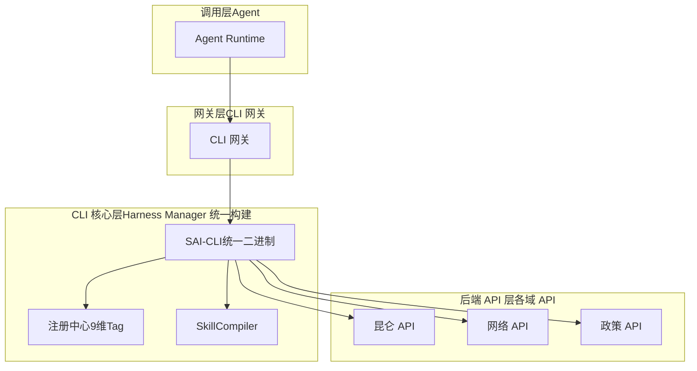
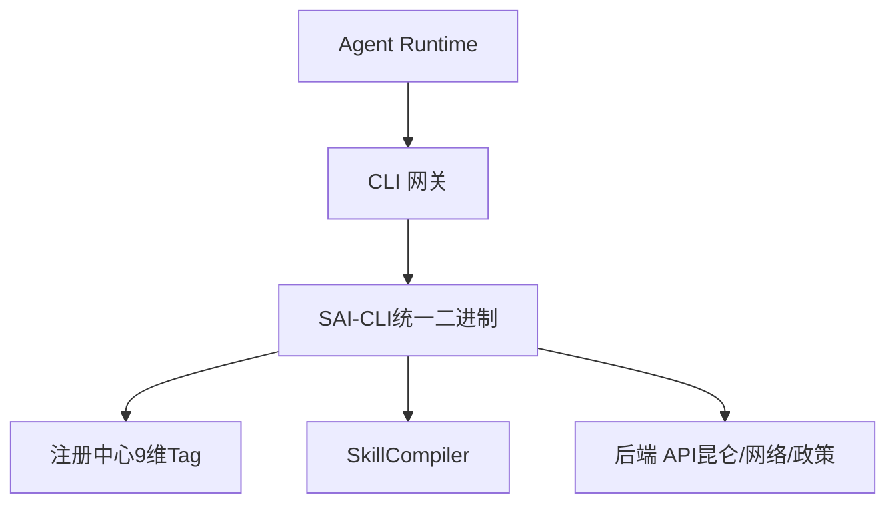
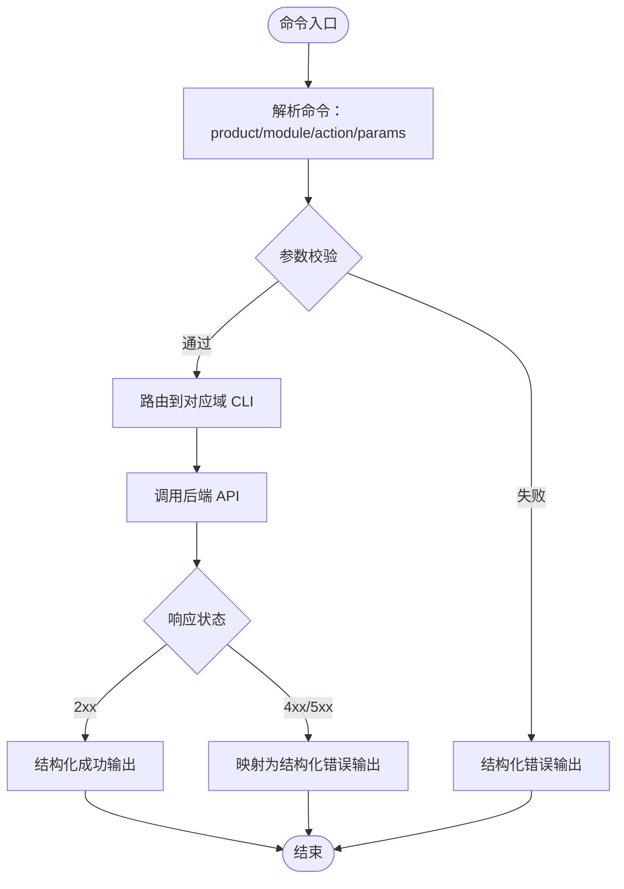
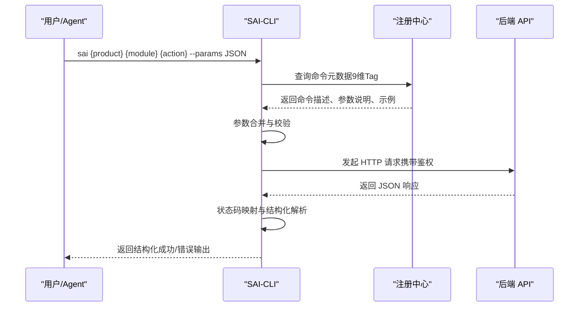
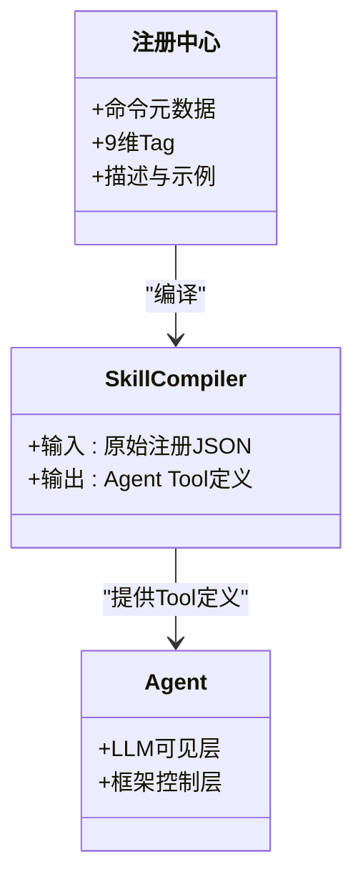
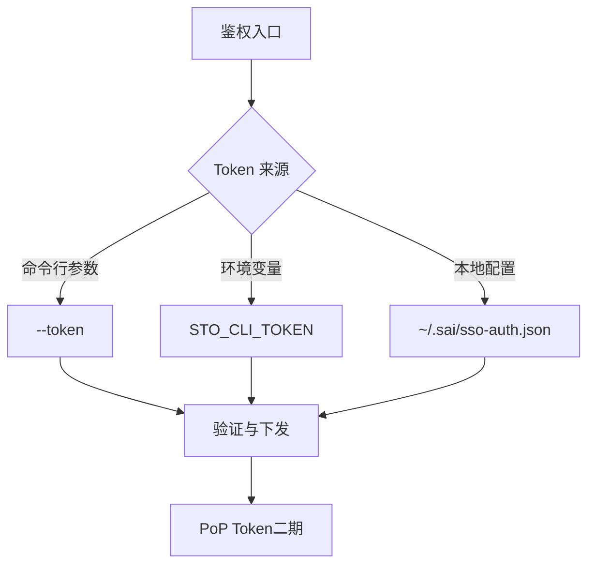
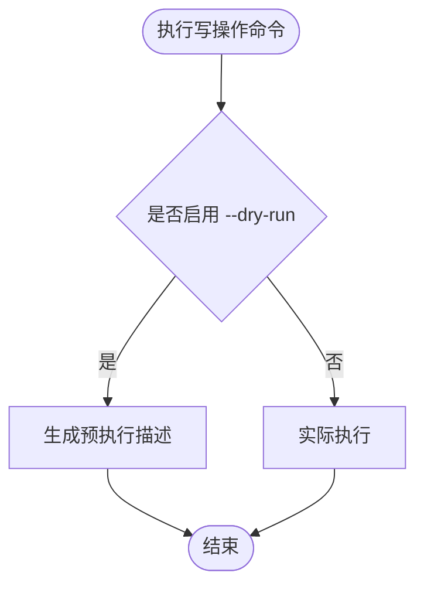
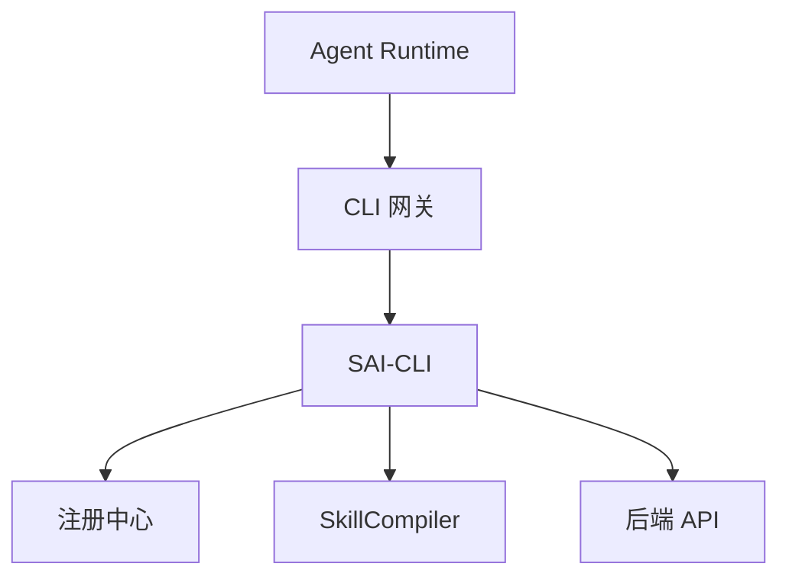
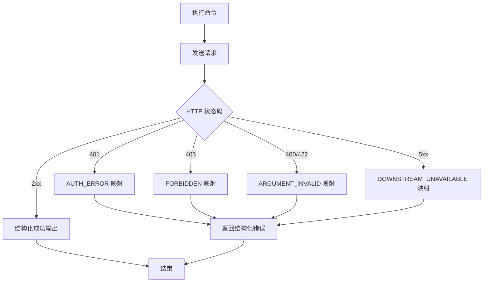

# 标准化命令规范

<cite>
**本文引用的文件**
- [SAI_CLI_设计文档_v1.0.md](file://plan/SAI_CLI_设计文档_v1.0.md)
- [SAI_CLI_设计文档_v1.2.md](file://plan/SAI_CLI_设计文档_v1.2.md)
- [CLI 架构与规范对焦.md](file://plan/CLI 架构与规范对焦.md)
- [agent-api-discovery-architecture-review.zh-CN.md](file://notes/zhaobomin/agent-api-discovery-architecture-review.zh-CN.md)
- [README.md](file://README.md)
- [cross-module-design-review-2026-04-24.md](file://notes/zhaobomin/cross-module-design-review-2026-04-24.md)
</cite>

## 目录
1. [简介](#简介)
2. [项目结构](#项目结构)
3. [核心组件](#核心组件)
4. [架构总览](#架构总览)
5. [详细组件分析](#详细组件分析)
6. [依赖分析](#依赖分析)
7. [性能考虑](#性能考虑)
8. [故障排查指南](#故障排查指南)
9. [结论](#结论)
10. [附录](#附录)

## 简介
本文件围绕 SAI（Smart Agent Interface）的 CLI 标准化命令规范展开，系统阐述统一命令格式的设计理念、实现要点与工程落地。重点覆盖 product（产品域）、module（功能模块）、action（操作类型）三要素的命名规范与使用方法，参数传递机制、JSON 格式要求与命令解析流程，并给出各业务域的命令示例、参数说明与使用场景。最后提供命令开发规范、最佳实践与常见问题解决方案，帮助各域在统一规范下快速、安全、可测试地交付 CLI 能力。

## 项目结构
本仓库与 CLI 规范相关的关键文档集中在 plan 与 notes 目录，分别承载总体设计与架构评审结论；README 提供模块与职责概览。围绕 CLI 的统一命令规范，v1.0 与 v1.2 文档给出了从“多 CLI 各自开发”到“Harness Manager 统一构建单一 CLI”的演进路径，明确了四层架构、9 维 Tag 体系、PoP Token 鉴权、6 步 NLU Pipeline 等关键设计。

**图表来源**
- [SAI_CLI_设计文档_v1.2.md: 31-64:31-64](file://plan/SAI_CLI_设计文档_v1.2.md#L31-L64)
- [README.md: 9-41:9-41](file://README.md#L9-L41)

**章节来源**
- [README.md: 9-41:9-41](file://README.md#L9-L41)
- [SAI_CLI_设计文档_v1.2.md: 29-64:29-64](file://plan/SAI_CLI_设计文档_v1.2.md#L29-L64)

## 核心组件
- 统一命令格式：{product} {module} {action} [params]
- 三要素规范：
  - product：产品域标识，如 kunlun、network、policy、finance
  - module：功能模块，如 timeliness、route、rule、order、fee
  - action：操作类型，如 get、list、create、update、delete
- 参数传递：支持 --key value 与 --params JSON 合并规则，兼顾机器调用与人工调试
- 结构化输出：成功与失败均以 JSON envelope 输出，错误输出包含 type、code、message、hint 四字段
- 鉴权：支持 Bearer Token 与 PoP Token（分两期实施），Token 获取优先级为命令行参数 > 环境变量 > 本地配置文件
- 可测试性：Dry-Run 模式用于写操作命令的预执行校验；核心逻辑通过接口抽象，支持单元测试

**章节来源**
- [SAI_CLI_设计文档_v1.0.md: 83-116:83-116](file://plan/SAI_CLI_设计文档_v1.0.md#L83-L116)
- [SAI_CLI_设计文档_v1.2.md: 115-147:115-147](file://plan/SAI_CLI_设计文档_v1.2.md#L115-L147)
- [SAI_CLI_设计文档_v1.2.md: 295-336:295-336](file://plan/SAI_CLI_设计文档_v1.2.md#L295-L336)
- [SAI_CLI_设计文档_v1.2.md: 394-471:394-471](file://plan/SAI_CLI_设计文档_v1.2.md#L394-L471)
- [SAI_CLI_设计文档_v1.2.md: 474-513:474-513](file://plan/SAI_CLI_设计文档_v1.2.md#L474-L513)

## 架构总览
SAI CLI 采用四层分层架构，实现 Agent 与各业务域后端服务的标准化接入。调用层（Agent）通过网关层（CLI 网关）路由到 CLI 核心层（Harness Manager 统一构建的 SAI-CLI），再调用后端 API 层（各域 API）。鉴权与权限控制贯穿网关与 CLI 核心层，注册中心与 SkillCompiler 提供元数据与工具定义支撑。

**图表来源**
- [SAI_CLI_设计文档_v1.2.md: 31-64:31-64](file://plan/SAI_CLI_设计文档_v1.2.md#L31-L64)
- [SAI_CLI_设计文档_v1.2.md: 545-588:545-588](file://plan/SAI_CLI_设计文档_v1.2.md#L545-L588)

**章节来源**
- [SAI_CLI_设计文档_v1.2.md: 29-64:29-64](file://plan/SAI_CLI_设计文档_v1.2.md#L29-L64)
- [SAI_CLI_设计文档_v1.2.md: 545-588:545-588](file://plan/SAI_CLI_设计文档_v1.2.md#L545-L588)

## 详细组件分析

### 统一命令格式与三要素规范
- 命令格式：{product} {module} {action} [params]
- 字段说明：
  - product：产品域标识，如 kunlun、network、policy、finance
  - module：功能模块，如 timeliness、route、rule、order、fee
  - action：操作类型，如 get、list、create、update、delete
  - params：命令参数，支持 --key value 与 --params JSON 合并规则
- 各域命令示例：
  - 昆仑域：kunlun timeliness query --type 出港滞留 --date 2026-04-21
  - 网络域：network order get --orgName 杭州网点 --timeType day
  - 政策域：policy rule query --product 标快 --region 华东

**图表来源**
- [SAI_CLI_设计文档_v1.0.md: 83-116:83-116](file://plan/SAI_CLI_设计文档_v1.0.md#L83-L116)
- [SAI_CLI_设计文档_v1.2.md: 115-147:115-147](file://plan/SAI_CLI_设计文档_v1.2.md#L115-L147)

**章节来源**
- [SAI_CLI_设计文档_v1.0.md: 83-116:83-116](file://plan/SAI_CLI_设计文档_v1.0.md#L83-L116)
- [SAI_CLI_设计文档_v1.2.md: 115-147:115-147](file://plan/SAI_CLI_设计文档_v1.2.md#L115-L147)

### 参数传递机制与 JSON 格式要求
- 参数合并规则：支持 --key value 与 --params JSON 合并，兼顾机器调用与人工调试
- JSON 格式：所有入参/出参统一使用 JSON 格式，错误输出同样遵循此约定
- 结构化输出：成功 envelope 与失败 envelope 均为 JSON，错误输出包含 type、code、message、hint 四字段

**图表来源**
- [SAI_CLI_设计文档_v1.2.md: 365-391:365-391](file://plan/SAI_CLI_设计文档_v1.2.md#L365-L391)
- [agent-api-discovery-architecture-review.zh-CN.md: 190-203:190-203](file://notes/zhaobomin/agent-api-discovery-architecture-review.zh-CN.md#L190-L203)

**章节来源**
- [SAI_CLI_设计文档_v1.2.md: 365-391:365-391](file://plan/SAI_CLI_设计文档_v1.2.md#L365-L391)
- [agent-api-discovery-architecture-review.zh-CN.md: 190-203:190-203](file://notes/zhaobomin/agent-api-discovery-architecture-review.zh-CN.md#L190-L203)

### 9 维 Tag 体系与 SkillCompiler
- 9 维 Tag 维度：路由与分类组（D1-D2、D4）、NLU 理解组（D5、D7-D8）、执行与展示组（D3、D6、D9）
- D7 negative 关键词用于防误判，D9 出参映射用于结果解读
- SkillCompiler 将注册元数据编译为 Agent 可读的 Tool 定义，包含 LLM 可见层与框架控制层

**图表来源**
- [SAI_CLI_设计文档_v1.2.md: 151-223:151-223](file://plan/SAI_CLI_设计文档_v1.2.md#L151-L223)
- [SAI_CLI_设计文档_v1.2.md: 225-249:225-249](file://plan/SAI_CLI_设计文档_v1.2.md#L225-L249)

**章节来源**
- [SAI_CLI_设计文档_v1.2.md: 151-223:151-223](file://plan/SAI_CLI_设计文档_v1.2.md#L151-L223)
- [SAI_CLI_设计文档_v1.2.md: 225-249:225-249](file://plan/SAI_CLI_设计文档_v1.2.md#L225-L249)

### 鉴权与安全（PoP Token）
- 一期：标准 Bearer Token，支持命令行参数、环境变量、本地配置文件三种获取方式
- 二期：PoP Token + ECDSA 签名，实现 Token 与设备/环境绑定，引入 sai-agent 作为安全代理
- 接口鉴权：Harness Manager API 使用 AK/SK 签名（HMAC-SHA256）

**图表来源**
- [SAI_CLI_设计文档_v1.2.md: 405-449:405-449](file://plan/SAI_CLI_设计文档_v1.2.md#L405-L449)
- [SAI_CLI_设计文档_v1.2.md: 452-459:452-459](file://plan/SAI_CLI_设计文档_v1.2.md#L452-L459)

**章节来源**
- [SAI_CLI_设计文档_v1.2.md: 405-449:405-449](file://plan/SAI_CLI_设计文档_v1.2.md#L405-L449)
- [SAI_CLI_设计文档_v1.2.md: 452-459:452-459](file://plan/SAI_CLI_设计文档_v1.2.md#L452-L459)

### 可测试性与 Dry-Run
- 写操作命令必须支持 --dry-run，Dry-Run 返回将要执行的操作描述，而非实际执行
- 单元测试可测性：通过接口抽象（文件系统、HTTP 客户端、Token 读取）实现 Mock

**图表来源**
- [SAI_CLI_设计文档_v1.2.md: 474-513:474-513](file://plan/SAI_CLI_设计文档_v1.2.md#L474-L513)

**章节来源**
- [SAI_CLI_设计文档_v1.2.md: 474-513:474-513](file://plan/SAI_CLI_设计文档_v1.2.md#L474-L513)

### 命令开发规范与最佳实践
- 开发语言统一：Harness Manager 侧统一使用 Golang
- 命令注册：通过 AI 自动生成 9 维 Tag 元数据，业务团队 Review 确认后注册
- 发布流程：Harness Manager 统一打包为单一 SAI-CLI 二进制，上传至 OSS 并通知网关同步
- 参数设计：遵循 --key value 与 --params JSON 合并规则，提供结构化错误输出
- 安全与鉴权：优先使用 Token 获取优先级；高危操作需更高权限或二次确认
- 可测试性：核心逻辑接口抽象，支持 Mock 与 Dry-Run

**章节来源**
- [SAI_CLI_设计文档_v1.2.md: 339-362:339-362](file://plan/SAI_CLI_设计文档_v1.2.md#L339-L362)
- [SAI_CLI_设计文档_v1.2.md: 365-391:365-391](file://plan/SAI_CLI_设计文档_v1.2.md#L365-L391)
- [SAI_CLI_设计文档_v1.2.md: 545-588:545-588](file://plan/SAI_CLI_设计文档_v1.2.md#L545-L588)

## 依赖分析
- 调用层（Agent）依赖网关层提供的元数据搜索与命令清单同步能力
- 网关层依赖 CLI 核心层的统一路由与鉴权
- CLI 核心层依赖注册中心的 9 维 Tag 与 SkillCompiler 的工具定义
- 后端 API 层为各域提供只读接口，零侵入

**图表来源**
- [SAI_CLI_设计文档_v1.2.md: 31-64:31-64](file://plan/SAI_CLI_设计文档_v1.2.md#L31-L64)
- [agent-api-discovery-architecture-review.zh-CN.md: 452-499:452-499](file://notes/zhaobomin/agent-api-discovery-architecture-review.zh-CN.md#L452-L499)

**章节来源**
- [SAI_CLI_设计文档_v1.2.md: 31-64:31-64](file://plan/SAI_CLI_设计文档_v1.2.md#L31-L64)
- [agent-api-discovery-architecture-review.zh-CN.md: 452-499:452-499](file://notes/zhaobomin/agent-api-discovery-architecture-review.zh-CN.md#L452-L499)

## 性能考虑
- 统一二进制部署：单一可执行文件，跨平台支持良好，适合在 Agent 容器环境中运行
- 本地缓存与 TTL：注册中心支持本地缓存与 TTL，降低高频调用延迟
- 结构化输出：JSON envelope 输出，便于 Agent 稳定解析成功与失败结果
- 代码分层：CLI 保持通用能力，API 知识放在注册中心，后续新增历史系统 API 时不需要发版 CLI

**章节来源**
- [SAI_CLI_设计文档_v1.2.md: 340-349:340-349](file://plan/SAI_CLI_设计文档_v1.2.md#L340-L349)
- [agent-api-discovery-architecture-review.zh-CN.md: 18-20:18-20](file://notes/zhaobomin/agent-api-discovery-architecture-review.zh-CN.md#L18-L20)

## 故障排查指南
- 非 2xx 状态码处理：下游 4xx/5xx 应被包装为结构化错误输出，避免被误判为成功
- 动态命令兜底分发：确保 TryDynamicDispatch 接入，不依赖启动期预挂载
- 调试日志：默认关闭，仅在 SAISAI_DEBUG=true 时输出，对敏感字段做脱敏
- 构建校验：生产包构建时校验 profile，不允许占位 URL 进入产物
- 错误码映射：按状态码映射为 AUTH_REQUIRED、FORBIDDEN、ARGUMENT_INVALID、DOWNSTREAM_UNAVAILABLE 等

**图表来源**
- [agent-api-discovery-architecture-review.zh-CN.md: 68-95:68-95](file://notes/zhaobomin/agent-api-discovery-architecture-review.zh-CN.md#L68-L95)

**章节来源**
- [agent-api-discovery-architecture-review.zh-CN.md: 68-95:68-95](file://notes/zhaobomin/agent-api-discovery-architecture-review.zh-CN.md#L68-L95)

## 结论
SAI CLI 标准化命令规范以统一命令格式为核心，配合 9 维 Tag 体系、PoP Token 鉴权与 SkillCompiler 编译机制，实现了 Agent 与后端 API 的解耦与可发现性。通过结构化输出、Dry-Run 与接口抽象，保障了可测试性与可运维性。v1.2 将 CLI 开发职责收敛至 Harness Manager，采用统一二进制部署，进一步降低了各域接入成本与维护复杂度。建议在后续演进中持续完善注册中心元数据协议、Agent 发现链路与版本管理细节，以支撑更大规模的历史系统与 API 空间。

## 附录
- 术语
  - product：产品域标识
  - module：功能模块
  - action：操作类型
  - Tag：命令元数据标签
  - PoP Token：证明持有者拥有 Token 的签名机制
- 参考文档
  - [SAI_CLI_设计文档_v1.0.md](file://plan/SAI_CLI_设计文档_v1.0.md)
  - [SAI_CLI_设计文档_v1.2.md](file://plan/SAI_CLI_设计文档_v1.2.md)
  - [CLI 架构与规范对焦.md](file://plan/CLI 架构与规范对焦.md)
  - [agent-api-discovery-architecture-review.zh-CN.md](file://notes/zhaobomin/agent-api-discovery-architecture-review.zh-CN.md)
  - [cross-module-design-review-2026-04-24.md](file://notes/zhaobomin/cross-module-design-review-2026-04-24.md)