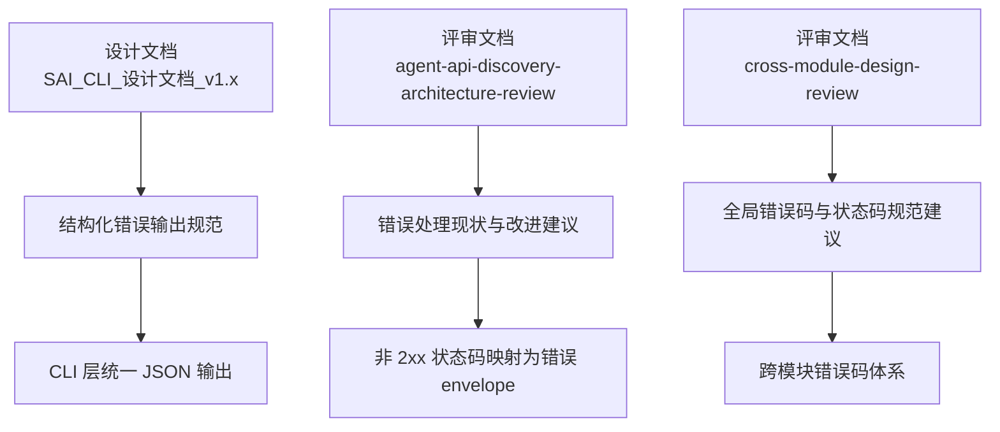
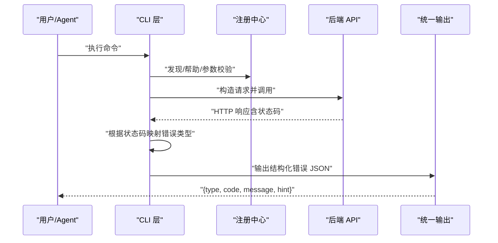
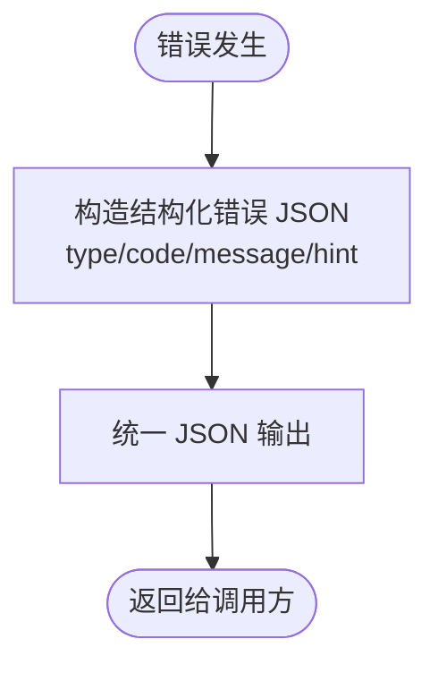
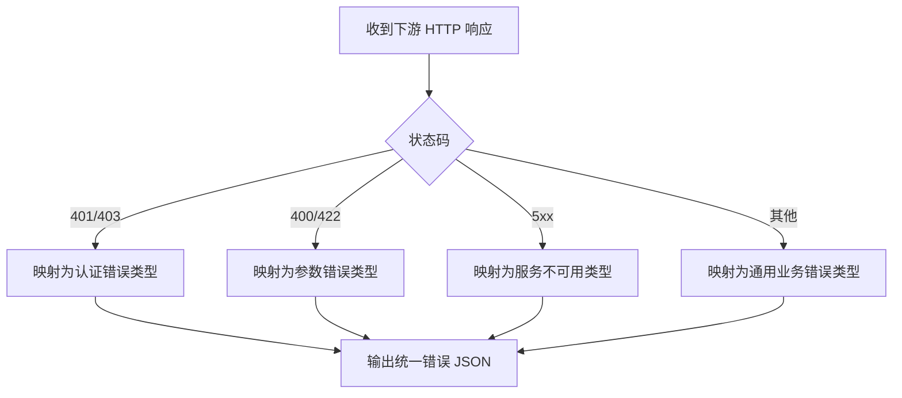
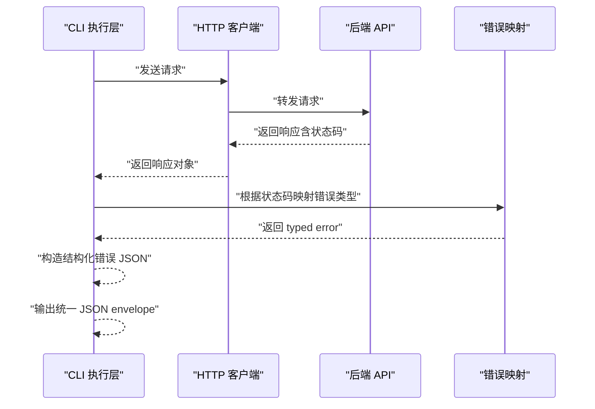
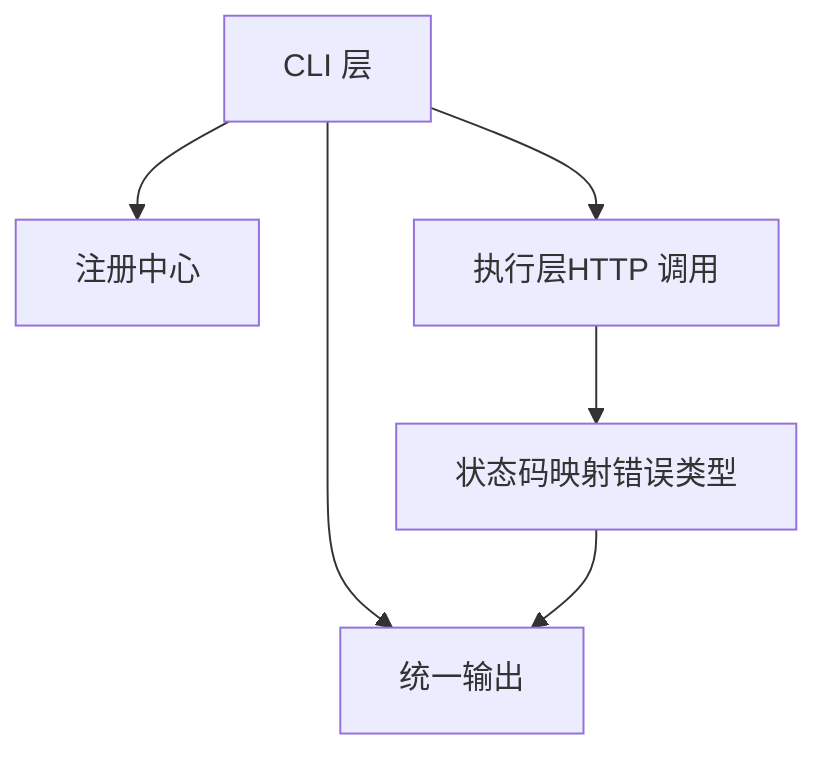

# 结构化错误处理

<cite>
**本文引用的文件**
- [SAI_CLI_设计文档_v1.0.md](file://plan/SAI_CLI_设计文档_v1.0.md)
- [SAI_CLI_设计文档_v1.2.md](file://plan/SAI_CLI_设计文档_v1.2.md)
- [CLI 架构与规范对焦.md](file://plan/CLI 架构与规范对焦.md)
- [agent-api-discovery-architecture-review.zh-CN.md](file://notes/zhaobomin/agent-api-discovery-architecture-review.zh-CN.md)
- [cross-module-design-review-2026-04-24.md](file://notes/zhaobomin/cross-module-design-review-2026-04-24.md)
</cite>

## 目录
1. [简介](#简介)
2. [项目结构](#项目结构)
3. [核心组件](#核心组件)
4. [架构总览](#架构总览)
5. [详细组件分析](#详细组件分析)
6. [依赖分析](#依赖分析)
7. [性能考量](#性能考量)
8. [故障排除指南](#故障排除指南)
9. [结论](#结论)
10. [附录](#附录)

## 简介
本文件围绕 CLI 系统的结构化错误处理展开，系统性阐述统一错误输出格式的设计理念、实现机制与最佳实践。文档聚焦于 type、code、message、hint 四个固定字段的语义与使用规范，给出错误类型分类与错误码对齐策略，并结合仓库内既有设计文档与评审意见，梳理错误处理流程、异常捕获与用户提示机制，提供调试与故障排除方法，帮助开发者在 CLI 与 Agent 的协同链路中实现一致、可诊断、可自动化的错误体验。

## 项目结构
本仓库与 CLI 结构化错误处理相关的关键文档集中在“计划”与“评审”两类材料中：
- 设计文档：明确 CLI 架构、命令规范、结构化输出与鉴权等原则
- 评审文档：指出当前实现与设计之间的差距，提出错误处理可靠性改进建议

**图表来源**
- [SAI_CLI_设计文档_v1.2.md](file://plan/SAI_CLI_设计文档_v1.2.md)
- [agent-api-discovery-architecture-review.zh-CN.md](file://notes/zhaobomin/agent-api-discovery-architecture-review.zh-CN.md)
- [cross-module-design-review-2026-04-24.md](file://notes/zhaobomin/cross-module-design-review-2026-04-24.md)

**章节来源**
- [SAI_CLI_设计文档_v1.0.md](file://plan/SAI_CLI_设计文档_v1.0.md)
- [SAI_CLI_设计文档_v1.2.md](file://plan/SAI_CLI_设计文档_v1.2.md)
- [CLI 架构与规范对焦.md](file://plan/CLI 架构与规范对焦.md)
- [agent-api-discovery-architecture-review.zh-CN.md](file://notes/zhaobomin/agent-api-discovery-architecture-review.zh-CN.md)
- [cross-module-design-review-2026-04-24.md](file://notes/zhaobomin/cross-module-design-review-2026-04-24.md)

## 核心组件
- 结构化错误输出规范：统一 type、code、message、hint 四字段，确保人类可读与机器可解析一致
- CLI 层输出：统一 JSON envelope，承载成功与失败结果
- 评审建议：将非 2xx 状态码可靠映射为错误 envelope，避免“成功包装失败”
- 全局错误码：建议建立跨模块统一的错误码体系，覆盖认证、参数、服务不可用、限流、业务错误等

**章节来源**
- [SAI_CLI_设计文档_v1.2.md](file://plan/SAI_CLI_设计文档_v1.2.md)
- [agent-api-discovery-architecture-review.zh-CN.md](file://notes/zhaobomin/agent-api-discovery-architecture-review.zh-CN.md)
- [cross-module-design-review-2026-04-24.md](file://notes/zhaobomin/cross-module-design-review-2026-04-24.md)

## 架构总览
CLI 作为统一命令入口，通过注册中心元数据驱动命令发现、参数说明与执行。结构化错误输出贯穿 CLI 层与下游 API 调用，确保 Agent 与自动化脚本能可靠识别失败并采取下一步行动。

**图表来源**
- [SAI_CLI_设计文档_v1.2.md](file://plan/SAI_CLI_设计文档_v1.2.md)
- [agent-api-discovery-architecture-review.zh-CN.md](file://notes/zhaobomin/agent-api-discovery-architecture-review.zh-CN.md)

## 详细组件分析

### 结构化错误输出规范
- 设计原则：所有错误输出必须为结构化 JSON，包含 type、code、message、hint 四个固定字段
- 字段语义
  - type：错误类型（如 AUTH_ERROR、PARAM_ERROR、API_ERROR）
  - code：错误码（与后端 API 错误码对齐）
  - message：人类可读的错误描述
  - hint：修复建议，指导用户或 Agent 下一步操作
- 示例：文档提供了认证、参数、API 三类典型错误的 JSON 输出示例

**图表来源**
- [SAI_CLI_设计文档_v1.2.md](file://plan/SAI_CLI_设计文档_v1.2.md)

**章节来源**
- [SAI_CLI_设计文档_v1.2.md](file://plan/SAI_CLI_设计文档_v1.2.md)

### 错误类型分类与错误码对齐策略
- 错误类型建议
  - 认证错误：401/403（如 AUTH_REQUIRED、AUTH_TOKEN_EXPIRED、FORBIDDEN）
  - 参数错误：400/422（如 ARGUMENT_INVALID、DOWNSTREAM_ARGUMENT_INVALID）
  - 服务不可用：5xx（如 DOWNSTREAM_UNAVAILABLE）
  - 限流与业务错误：429、业务自定义 code + message
- 对齐策略
  - 与后端 API 错误码对齐，便于端到端一致性
  - 建议建立跨模块统一的错误码体系，避免各模块自定义不一致

**图表来源**
- [agent-api-discovery-architecture-review.zh-CN.md](file://notes/zhaobomin/agent-api-discovery-architecture-review.zh-CN.md)
- [cross-module-design-review-2026-04-24.md](file://notes/zhaobomin/cross-module-design-review-2026-04-24.md)

**章节来源**
- [agent-api-discovery-architecture-review.zh-CN.md](file://notes/zhaobomin/agent-api-discovery-architecture-review.zh-CN.md)
- [cross-module-design-review-2026-04-24.md](file://notes/zhaobomin/cross-module-design-review-2026-04-24.md)

### 错误处理流程、异常捕获与用户提示机制
- 流程要点
  - CLI 层统一 JSON 输出，成功与失败均以 envelope 形式呈现
  - 对非 2xx 响应进行 typed error 映射，避免“成功包装失败”
  - 输出结构化错误 JSON，包含 type、code、message、hint
- 异常捕获
  - 在执行层对下游响应状态码进行判定与错误类型映射
  - 对调试日志进行显式开关与敏感字段脱敏，避免污染 stderr 与泄露业务参数
- 用户提示
  - hint 字段提供可操作的修复建议，便于 Agent 自动化或人工用户快速定位问题

**图表来源**
- [agent-api-discovery-architecture-review.zh-CN.md](file://notes/zhaobomin/agent-api-discovery-architecture-review.zh-CN.md)

**章节来源**
- [agent-api-discovery-architecture-review.zh-CN.md](file://notes/zhaobomin/agent-api-discovery-architecture-review.zh-CN.md)

### 最佳实践
- 统一输出：所有错误与成功均以统一 JSON envelope 输出，便于 Agent 解析
- 明确映射：将 HTTP 状态码与错误类型一一对应，避免“成功包装失败”
- 语义清晰：message 与 hint 保持简洁明确，优先提供可执行的修复建议
- 安全日志：调试日志默认关闭，敏感字段脱敏，避免泄露业务参数
- 可观测性：在版本输出中保留构建环境与关键端点摘要，便于排障

**章节来源**
- [agent-api-discovery-architecture-review.zh-CN.md](file://notes/zhaobomin/agent-api-discovery-architecture-review.zh-CN.md)
- [SAI_CLI_设计文档_v1.2.md](file://plan/SAI_CLI_设计文档_v1.2.md)

## 依赖分析
- CLI 层依赖注册中心元数据，用于命令发现与参数 schema
- CLI 层依赖统一输出模块，确保成功与失败均以结构化 JSON 呈现
- 评审文档指出当前实现中“下游 4xx/5xx 被包装成成功”的问题，建议在执行层进行状态码判定与错误映射

**图表来源**
- [agent-api-discovery-architecture-review.zh-CN.md](file://notes/zhaobomin/agent-api-discovery-architecture-review.zh-CN.md)
- [SAI_CLI_设计文档_v1.2.md](file://plan/SAI_CLI_设计文档_v1.2.md)

**章节来源**
- [agent-api-discovery-architecture-review.zh-CN.md](file://notes/zhaobomin/agent-api-discovery-architecture-review.zh-CN.md)
- [SAI_CLI_设计文档_v1.2.md](file://plan/SAI_CLI_设计文档_v1.2.md)

## 性能考量
- 结构化错误输出本身开销极小，关键在于避免“成功包装失败”导致的重复重试与无效调用
- 通过统一错误码与 hint，可减少 Agent 与用户反复试错的成本
- 调试日志默认关闭与敏感字段脱敏，有助于降低 stderr 输出噪声与潜在泄露风险

[本节为通用性能讨论，不直接分析具体文件]

## 故障排除指南
- 现状问题
  - 下游 4xx/5xx 被包装成成功，导致 Agent 无法可靠判断失败
  - 默认生产 profile 仍包含占位 URL，可能导致构建成功但运行失败
  - 下游请求日志默认输出业务参数，污染 stderr 并可能泄露敏感信息
- 排查步骤
  - 检查执行层对非 2xx 响应的错误映射是否生效
  - 校验构建脚本对生产 profile 的校验逻辑，确保占位符不进入产物
  - 通过显式开关启用调试日志，并对敏感字段进行脱敏
- 建议
  - 在执行层引入 typed error，按状态码映射错误类型
  - 在版本输出中保留构建环境与关键端点摘要
  - 仅在调试模式输出完整请求日志，避免默认输出业务参数

**章节来源**
- [agent-api-discovery-architecture-review.zh-CN.md](file://notes/zhaobomin/agent-api-discovery-architecture-review.zh-CN.md)

## 结论
结构化错误处理是 CLI 与 Agent 协同链路中的关键环节。通过统一的 type、code、message、hint 字段与可靠的错误映射机制，可显著提升错误可诊断性与自动化处理效率。结合评审建议，当前实现应在“非 2xx 状态码映射为错误 envelope”“调试日志显式开关与脱敏”“生产 profile 校验”等方面进行改进，以达到设计文档所提出的“统一命令规范、统一错误输出、统一鉴权与日志”的目标。

[本节为总结性内容，不直接分析具体文件]

## 附录
- 相关设计与评审文档路径
  - [SAI_CLI_设计文档_v1.0.md](file://plan/SAI_CLI_设计文档_v1.0.md)
  - [SAI_CLI_设计文档_v1.2.md](file://plan/SAI_CLI_设计文档_v1.2.md)
  - [CLI 架构与规范对焦.md](file://plan/CLI 架构与规范对焦.md)
  - [agent-api-discovery-architecture-review.zh-CN.md](file://notes/zhaobomin/agent-api-discovery-architecture-review.zh-CN.md)
  - [cross-module-design-review-2026-04-24.md](file://notes/zhaobomin/cross-module-design-review-2026-04-24.md)

[本节为附录性内容，不直接分析具体文件]