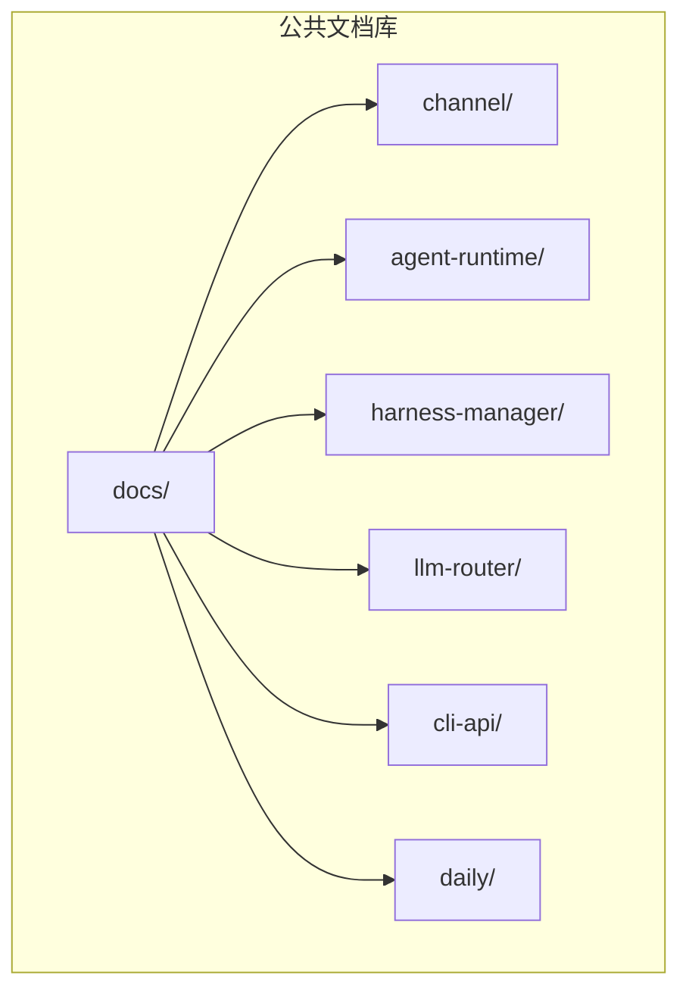
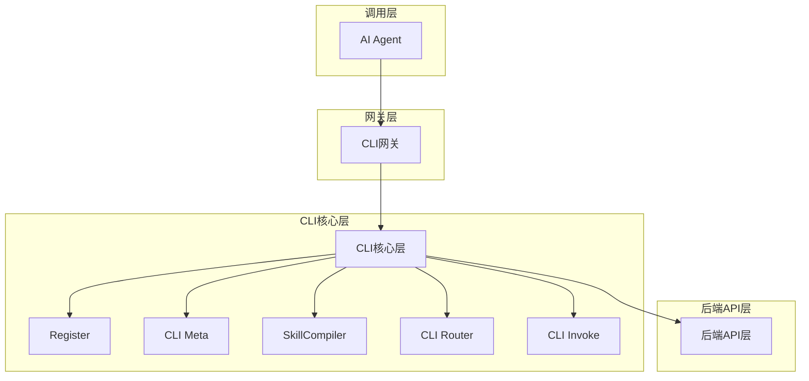
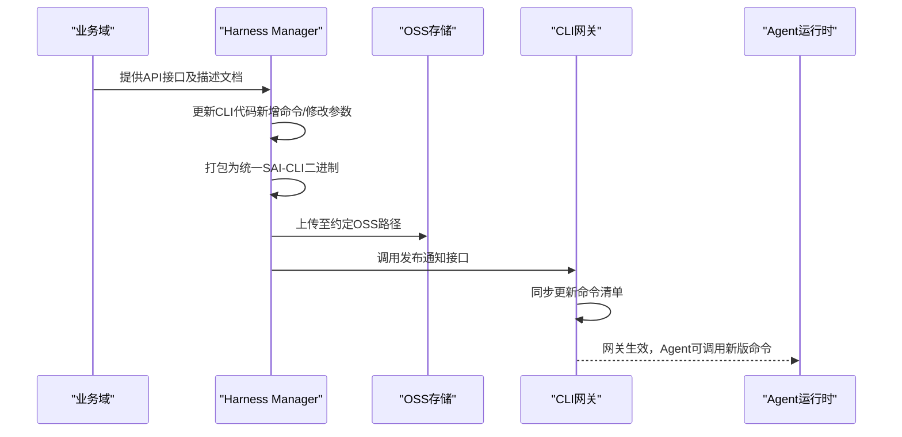
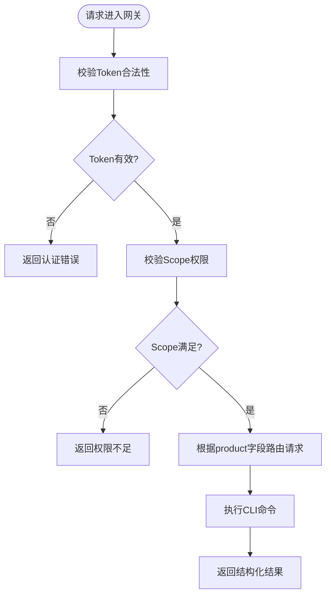
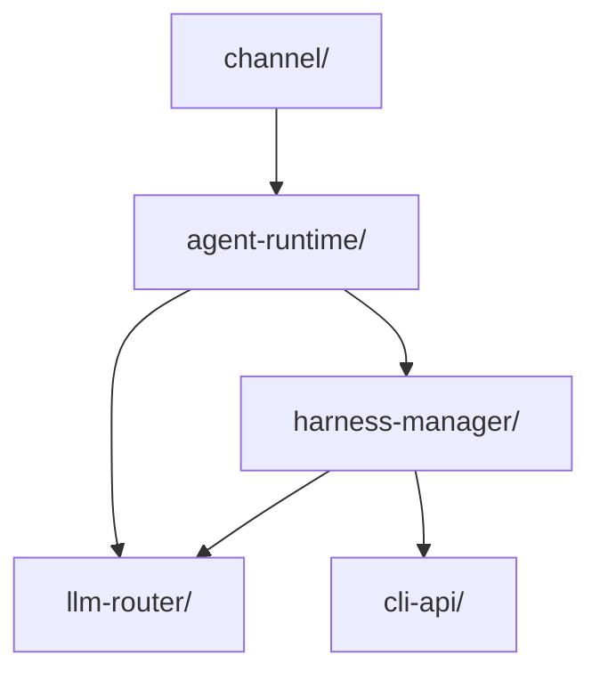

# 部署与运维管理

<cite>
**本文档引用的文件**
- [SAI_CLI_设计文档_v1.0.md](file://plan/SAI_CLI_设计文档_v1.0.md)
- [SAI_CLI_设计文档_v1.2.md](file://plan/SAI_CLI_设计文档_v1.2.md)
- [Agent-Runtime方案review.md](file://notes/zhaobomin/Agent-Runtime方案review.md)
- [agent-api-discovery-architecture-review.zh-CN.md](file://notes/zhaobomin/agent-api-discovery-architecture-review.zh-CN.md)
- [LLM-Gateway建设方案.md](file://plan/LLM-Gateway建设方案.md)
- [LLM-Gateway一期功能规划.md](file://plan/LLM-Gateway一期功能规划.md)
- [项目管理方案v1.0.md](file://project/项目管理方案v1.0.md)
- [Sai整体架构设计.md](file://project/standup/Sai整体架构设计.md)
- [Agent 设计方案（MSE流量分流）.md](file://plan/Agent 设计方案（MSE流量分流）.md)
</cite>

## 目录
1. [简介](#简介)
2. [项目结构](#项目结构)
3. [核心组件](#核心组件)
4. [架构概览](#架构概览)
5. [详细组件分析](#详细组件分析)
6. [依赖关系分析](#依赖关系分析)
7. [性能考量](#性能考量)
8. [故障排查指南](#故障排查指南)
9. [结论](#结论)
10. [附录](#附录)

## 简介
本文件为CLI系统部署与运维管理的技术文档，围绕SAI CLI架构设计，深入解释OSS挂载部署方式与二进制包管理，详细描述发布通知流程、命令清单同步与版本控制策略，阐述CLI网关路由转发与权限校验机制，并涵盖部署架构、运维流程与监控告警，提供部署配置指南、运维操作手册与故障恢复方案。

## 项目结构
文档库采用按团队维度组织的公共文档库结构，包含各团队的设计文档、接口文档与日常日报，便于跨团队协作与信息透明。

图表来源
- [项目管理方案v1.0.md:90-134](file://project/项目管理方案v1.0.md#L90-L134)

章节来源
- [项目管理方案v1.0.md:13-175](file://project/项目管理方案v1.0.md#L13-L175)

## 核心组件
- CLI网关层：负责路由转发、负载均衡、同步机制、权限校验，不包含业务逻辑。
- CLI核心层：统一命令规范、入参/出参JSON、公共能力（认证/日志），由Harness Manager统一开发和维护。
- 后端API层：各域现有后端API，无需改造前端GUI。
- Agent运行时：负责SSO认证、信息持久化、API搜索与命令执行。
- Harness Manager：负责API注册管理、元数据引擎、技能编译、CLI路由与鉴权、CLI调用代理等。

章节来源
- [SAI_CLI_设计文档_v1.2.md:29-75](file://plan/SAI_CLI_设计文档_v1.2.md#L29-L75)
- [SAI_CLI_设计文档_v1.2.md:545-560](file://plan/SAI_CLI_设计文档_v1.2.md#L545-L560)

## 架构概览
SAI采用四层分层架构，实现AI Agent与各业务域后端服务的标准化接入。调用层通过Agent理解自然语言指令，映射为CLI命令；网关层负责路由转发与鉴权；CLI核心层封装统一命令规范与公共能力；后端API层提供业务功能的HTTP接口。

图表来源
- [SAI_CLI_设计文档_v1.2.md:29-75](file://plan/SAI_CLI_设计文档_v1.2.md#L29-L75)
- [SAI_CLI_设计文档_v1.2.md:545-560](file://plan/SAI_CLI_设计文档_v1.2.md#L545-L560)

## 详细组件分析

### OSS挂载部署方式与二进制包管理
- 部署方式：采用OSS挂载形式，将统一打包的SAI-CLI二进制文件挂载至Agent运行环境，由公共sai-cli负责统一路由。
- OSS路径规范：
  - CLI网关：sai/cli/sai-cli
  - 系统内置技能：sai/skill/system/
  - 公共技能：sai/skill/public/
  - 用户技能：sai/skill/wtcodexx/
- 发布流程：业务域提供API接口及描述文档 → Harness Manager更新CLI代码 → 打包为统一SAI-CLI二进制（包含所有域命令集） → 上传至约定的OSS路径 → 调用网关"发布通知"接口，同步更新命令清单 → 网关生效，Agent可调用新版命令。

图表来源
- [SAI_CLI_设计文档_v1.2.md:574-588](file://plan/SAI_CLI_设计文档_v1.2.md#L574-L588)

章节来源
- [SAI_CLI_设计文档_v1.2.md:561-572](file://plan/SAI_CLI_设计文档_v1.2.md#L561-L572)
- [SAI_CLI_设计文档_v1.2.md:574-588](file://plan/SAI_CLI_设计文档_v1.2.md#L574-L588)

### 发布通知流程、命令清单同步与版本控制策略
- 发布通知接口：接收Harness Manager的CLI版本上报，触发命令清单同步更新。
- 命令清单同步：网关在收到发布通知后，更新内部命令清单，确保Agent可调用最新命令。
- 版本控制策略：通过统一的二进制包版本管理，确保Agent运行时与网关命令清单的一致性；支持灰度发布与回滚策略。

章节来源
- [SAI_CLI_设计文档_v1.2.md:615](file://plan/SAI_CLI_设计文档_v1.2.md#L615)

### CLI网关路由转发与权限校验机制
- 路由转发：根据product字段将请求路由至对应域的CLI命令集。
- 权限校验：验证Token合法性及Scope是否满足命令所需权限；二期支持PoP签名验证。
- 鉴权方案：采用PoP（Proof-of-Possession）Token方案，实现Token与环境绑定签名，分一期/二期实施。

图表来源
- [SAI_CLI_设计文档_v1.2.md:616-617](file://plan/SAI_CLI_设计文档_v1.2.md#L616-L617)
- [SAI_CLI_设计文档_v1.2.md:421-440](file://plan/SAI_CLI_设计文档_v1.2.md#L421-L440)

章节来源
- [SAI_CLI_设计文档_v1.2.md:605-617](file://plan/SAI_CLI_设计文档_v1.2.md#L605-L617)
- [SAI_CLI_设计文档_v1.2.md:421-440](file://plan/SAI_CLI_设计文档_v1.2.md#L421-L440)

### Agent运行时与Harness Manager对接
- Agent职责：SSO认证、信息持久化、API搜索、命令拼接与执行、鉴权标准统一使用SSO Token。
- Harness Manager职责：API注册管理、元数据引擎、技能编译、CLI路由与鉴权、CLI调用代理。
- 对接方式：通过OSS路径挂载方式进行交互，Agent不直接调用Manager API。

章节来源
- [SAI_CLI_设计文档_v1.2.md:620-631](file://plan/SAI_CLI_设计文档_v1.2.md#L620-L631)
- [SAI_CLI_设计文档_v1.2.md:545-560](file://plan/SAI_CLI_设计文档_v1.2.md#L545-L560)

### LLM网关与监控告警
- LLM网关：使用LiteLLM搭建统一AI调用入口，支持多模型接入与统一API标准。
- 监控告警：支持个人令牌80%/90%/100%三级告警，超限后自动熔断；网关不可用告警推送到钉钉群。
- 成本控制：按环境与等级路由，测试环境强制路由至低成本模型，生产环境核心应用使用旗舰模型。

章节来源
- [LLM-Gateway建设方案.md:43-64](file://plan/LLM-Gateway建设方案.md#L43-L64)
- [LLM-Gateway建设方案.md:95-101](file://plan/LLM-Gateway建设方案.md#L95-L101)
- [LLM-Gateway一期功能规划.md:3-11](file://plan/LLM-Gateway一期功能规划.md#L3-L11)

## 依赖关系分析
SAI整体架构中，各模块之间的依赖关系如下：

图表来源
- [项目管理方案v1.0.md:34-49](file://project/项目管理方案v1.0.md#L34-L49)

章节来源
- [项目管理方案v1.0.md:21-49](file://project/项目管理方案v1.0.md#L21-L49)

## 性能考量
- CLI二进制包统一构建与分发：由Harness Manager统一构建单一可执行文件，减少部署复杂度与运行时依赖。
- 网关层路由与鉴权：通过路由转发与权限校验，确保请求高效准确地到达目标CLI命令集。
- Agent运行时：基于Serverless按会话分配实例，冷启动<1s，热启动<200ms，提升用户体验。
- LLM网关：支持多模型轮询重试机制，确保高可用；按环境与等级路由，降低测试与开发成本。

章节来源
- [SAI_CLI_设计文档_v1.2.md:339-350](file://plan/SAI_CLI_设计文档_v1.2.md#L339-L350)
- [Sai整体架构设计.md:224-232](file://project/standup/Sai整体架构设计.md#L224-L232)

## 故障排查指南
- 网关不可用：Agent使用本地缓存最近一次Skill/CLI定义，降级为无知识检索模式。
- LLM网关熔断：Agent返回固定提示"当前AI服务暂时不可用，请稍后重试"；业务执行链路不受影响。
- 业务API超时/失败：CLI Client单次重试（≤3s等待），失败后Agent向用户说明具体接口不可用。
- OSS不可用：Agent使用本地缓存版本运行，日志告警通知HM团队。
- Agent运行时实例崩溃：Serverless平台自动重建实例，用户会话需重新发起。

章节来源
- [Sai整体架构设计.md:236-247](file://project/standup/Sai整体架构设计.md#L236-L247)

## 结论
SAI CLI系统通过四层分层架构实现了AI Agent与各业务域后端服务的标准化接入，采用OSS挂载与统一二进制包管理，确保部署简单与版本可控。网关层负责路由转发与权限校验，保障请求安全高效；Harness Manager统一构建与维护CLI核心层，降低业务域开发负担；Agent运行时负责SSO认证与命令执行；LLM网关提供统一的AI调用入口与监控告警。整体方案具备良好的扩展性与可维护性，适用于企业级智能化场景。

## 附录

### 部署配置指南
- OSS挂载路径配置：根据OSS路径规范，确保CLI网关、系统内置技能、公共技能与用户技能的正确挂载。
- CLI网关配置：确保路由转发与权限校验功能正常，Token与Scope校验符合预期。
- Agent运行时配置：确保SSO认证与信息持久化功能正常，API搜索与命令执行流程顺畅。

章节来源
- [SAI_CLI_设计文档_v1.2.md:565-572](file://plan/SAI_CLI_设计文档_v1.2.md#L565-L572)
- [SAI_CLI_设计文档_v1.2.md:605-617](file://plan/SAI_CLI_设计文档_v1.2.md#L605-L617)

### 运维操作手册
- 发布流程：业务域提供API接口及描述文档 → Harness Manager更新CLI代码 → 打包为统一SAI-CLI二进制 → 上传至OSS路径 → 调用网关发布通知接口 → 网关生效。
- 监控告警：配置个人令牌80%/90%/100%三级告警，超限后自动熔断；网关不可用告警推送到钉钉群。
- 版本回滚：通过统一二进制包版本管理，支持灰度发布与回滚策略。

章节来源
- [SAI_CLI_设计文档_v1.2.md:574-588](file://plan/SAI_CLI_设计文档_v1.2.md#L574-L588)
- [LLM-Gateway建设方案.md:95-101](file://plan/LLM-Gateway建设方案.md#L95-L101)

### 故障恢复方案
- 网关不可用：Agent使用本地缓存最近一次Skill/CLI定义，降级为无知识检索模式。
- LLM网关熔断：Agent返回固定提示"当前AI服务暂时不可用，请稍后重试"；业务执行链路不受影响。
- 业务API超时/失败：CLI Client单次重试（≤3s等待），失败后Agent向用户说明具体接口不可用。
- OSS不可用：Agent使用本地缓存版本运行，日志告警通知HM团队。
- Agent运行时实例崩溃：Serverless平台自动重建实例，用户会话需重新发起。

章节来源
- [Sai整体架构设计.md:236-247](file://project/standup/Sai整体架构设计.md#L236-L247)