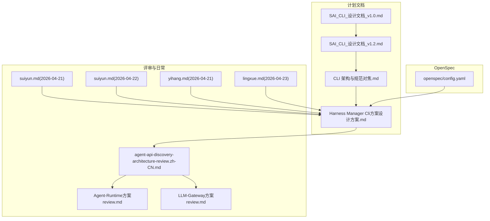
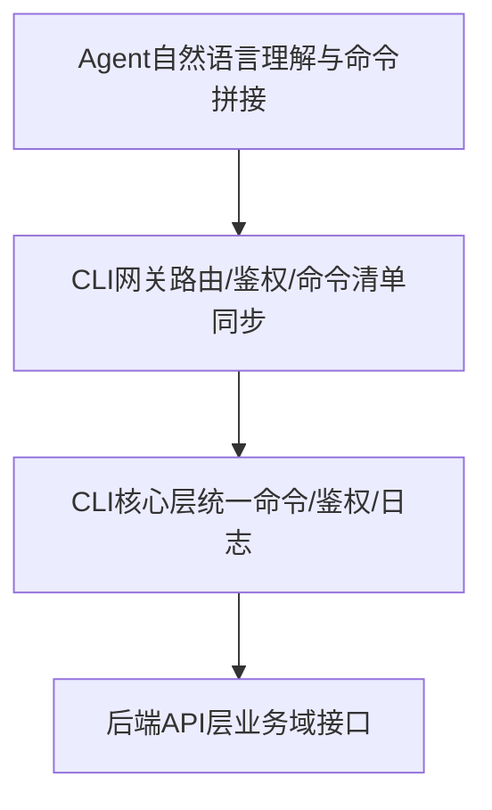
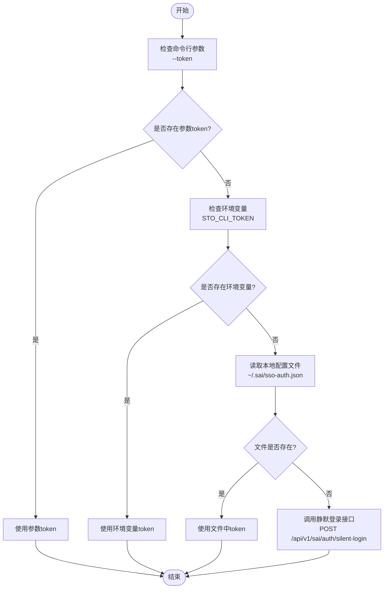
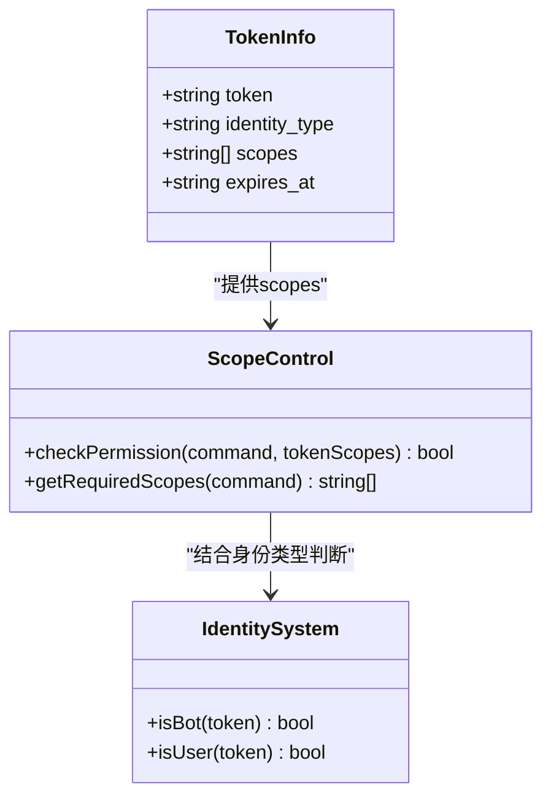
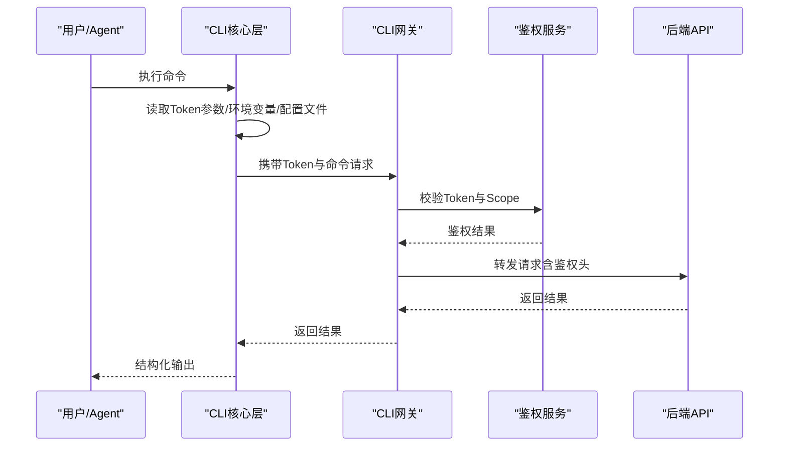
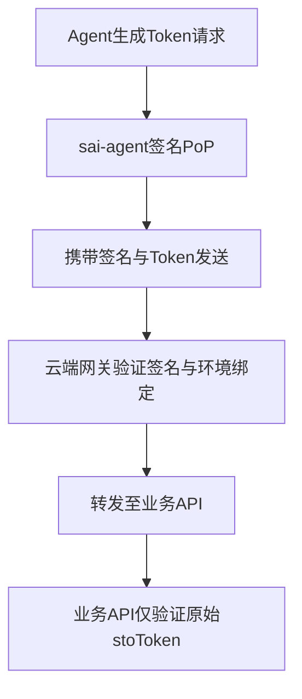
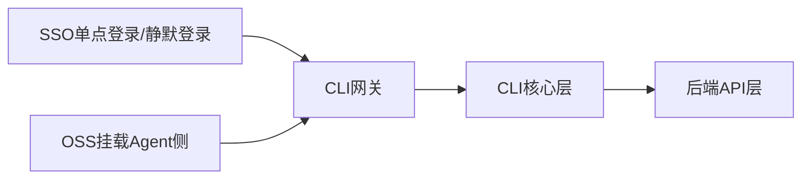

# 鉴权与权限控制

<cite>
**本文引用的文件**
- [SAI_CLI_设计文档_v1.0.md](file://plan/SAI_CLI_设计文档_v1.0.md)
- [SAI_CLI_设计文档_v1.2.md](file://plan/SAI_CLI_设计文档_v1.2.md)
- [CLI 架构与规范对焦.md](file://plan/CLI 架构与规范对焦.md)
- [Harness Manager Cli方案设计方案.md](file://plan/Harness Manager Cli方案设计方案.md)
- [agent-api-discovery-architecture-review.zh-CN.md](file://notes/zhaobomin/agent-api-discovery-architecture-review.zh-CN.md)
- [Agent-Runtime方案review.md](file://notes/zhaobomin/Agent-Runtime方案review.md)
- [LLM-Gateway方案review.md](file://notes/zhaobomin/LLM-Gateway方案review.md)
- [suiyun.md](file://daily/2026-04-21/suiyun.md)
- [suiyun.md](file://daily/2026-04-22/suiyun.md)
- [yihang.md](file://daily/2026-04-21/yihang.md)
- [lingxue.md](file://daily/2026-04-23/lingxue.md)
- [config.yaml](file://openspec/config.yaml)
</cite>

## 目录
1. [简介](#简介)
2. [项目结构](#项目结构)
3. [核心组件](#核心组件)
4. [架构总览](#架构总览)
5. [详细组件分析](#详细组件分析)
6. [依赖分析](#依赖分析)
7. [性能考量](#性能考量)
8. [故障排查指南](#故障排查指南)
9. [结论](#结论)
10. [附录](#附录)

## 简介
本文件聚焦于CLI系统的鉴权与权限控制，围绕以下目标展开：
- Token获取优先级机制与多种获取方式
- JWT Token标准、Scope权限控制与身份体系设计
- Bot Token与User Token的区别与使用场景
- 配置文件格式、权限验证流程与安全策略
- 鉴权配置指南、权限管理最佳实践与安全加固措施

## 项目结构
本仓库中与鉴权与权限控制直接相关的关键文档集中在“计划”“笔记”“每日站会”等目录，涵盖CLI架构、鉴权方案、接口设计与实现评审等内容。

**图表来源**
- [SAI_CLI_设计文档_v1.0.md:1-384](file://plan/SAI_CLI_设计文档_v1.0.md#L1-L384)
- [SAI_CLI_设计文档_v1.2.md:1-635](file://plan/SAI_CLI_设计文档_v1.2.md#L1-L635)
- [CLI 架构与规范对焦.md:1-25](file://plan/CLI 架构与规范对焦.md#L1-L25)
- [Harness Manager Cli方案设计方案.md:1-513](file://plan/Harness Manager Cli方案设计方案.md#L1-L513)
- [agent-api-discovery-architecture-review.zh-CN.md:1-558](file://notes/zhaobomin/agent-api-discovery-architecture-review.zh-CN.md#L1-L558)
- [Agent-Runtime方案review.md:1-55](file://notes/zhaobomin/Agent-Runtime方案review.md#L1-L55)
- [LLM-Gateway方案review.md:1-70](file://notes/zhaobomin/LLM-Gateway方案review.md#L1-L70)
- [suiyun.md(2026-04-21):1-43](file://daily/2026-04-21/suiyun.md#L1-L43)
- [suiyun.md(2026-04-22):1-64](file://daily/2026-04-22/suiyun.md#L1-L64)
- [yihang.md(2026-04-21):1-10](file://daily/2026-04-21/yihang.md#L1-L10)
- [lingxue.md(2026-04-23):1-40](file://daily/2026-04-23/lingxue.md#L1-L40)
- [config.yaml:1-21](file://openspec/config.yaml#L1-L21)

**章节来源**
- [SAI_CLI_设计文档_v1.0.md:1-384](file://plan/SAI_CLI_设计文档_v1.0.md#L1-L384)
- [SAI_CLI_设计文档_v1.2.md:1-635](file://plan/SAI_CLI_设计文档_v1.2.md#L1-L635)
- [CLI 架构与规范对焦.md:1-25](file://plan/CLI 架构与规范对焦.md#L1-L25)
- [Harness Manager Cli方案设计方案.md:1-513](file://plan/Harness Manager Cli方案设计方案.md#L1-L513)
- [agent-api-discovery-architecture-review.zh-CN.md:1-558](file://notes/zhaobomin/agent-api-discovery-architecture-review.zh-CN.md#L1-L558)
- [Agent-Runtime方案review.md:1-55](file://notes/zhaobomin/Agent-Runtime方案review.md#L1-L55)
- [LLM-Gateway方案review.md:1-70](file://notes/zhaobomin/LLM-Gateway方案review.md#L1-L70)
- [suiyun.md(2026-04-21):1-43](file://daily/2026-04-21/suiyun.md#L1-L43)
- [suiyun.md(2026-04-22):1-64](file://daily/2026-04-22/suiyun.md#L1-L64)
- [yihang.md(2026-04-21):1-10](file://daily/2026-04-21/yihang.md#L1-L10)
- [lingxue.md(2026-04-23):1-40](file://daily/2026-04-23/lingxue.md#L1-L40)
- [config.yaml:1-21](file://openspec/config.yaml#L1-L21)

## 核心组件
- Token获取与发现
  - 优先级：命令行参数 > 环境变量 > 本地配置文件
  - 配置文件：~/.sai/sso-auth.json，包含token、identity_type、scopes、expires_at
- 鉴权方案
  - 一期：标准Bearer Token（统一SSO Token）
  - 二期：PoP（Proof-of-Possession）+ ECDSA签名，实现Token与环境绑定
- 权限控制
  - Scope权限控制，命令与所需Scope集合关联
  - 身份体系：Bot Token（应用级）+ User Token（人工用户级）
- 接口鉴权
  - Harness Manager API统一采用AK/SK签名（HMAC-SHA256）

**章节来源**
- [SAI_CLI_设计文档_v1.0.md:220-250](file://plan/SAI_CLI_设计文档_v1.0.md#L220-L250)
- [SAI_CLI_设计文档_v1.2.md:394-470](file://plan/SAI_CLI_设计文档_v1.2.md#L394-L470)
- [Harness Manager Cli方案设计方案.md:192-210](file://plan/Harness Manager Cli方案设计方案.md#L192-L210)
- [CLI 架构与规范对焦.md:10-21](file://plan/CLI 架构与规范对焦.md#L10-L21)

## 架构总览
鉴权与权限控制贯穿“调用层（Agent）→网关层（CLI路由/鉴权）→CLI核心层（统一命令/鉴权）→后端API层”的四层架构。其中网关层负责路由与鉴权，CLI核心层负责命令解析与调用后端API，后端API层提供业务接口。

**图表来源**
- [SAI_CLI_设计文档_v1.0.md:19-52](file://plan/SAI_CLI_设计文档_v1.0.md#L19-L52)
- [SAI_CLI_设计文档_v1.2.md:29-75](file://plan/SAI_CLI_设计文档_v1.2.md#L29-L75)

**章节来源**
- [SAI_CLI_设计文档_v1.0.md:19-52](file://plan/SAI_CLI_设计文档_v1.0.md#L19-L52)
- [SAI_CLI_设计文档_v1.2.md:29-75](file://plan/SAI_CLI_设计文档_v1.2.md#L29-L75)

## 详细组件分析

### 组件A：Token获取优先级与多种获取方式
- 优先级机制
  1) 命令行参数：--token <JWT_TOKEN>
  2) 环境变量：STO_CLI_TOKEN=<JWT_TOKEN>
  3) 本地配置文件：~/.sai/sso-auth.json（由Agent登录后自动写入）
- 静默登录接口（获取stoToken）
  - POST /api/v1/sai/auth/silent-login
  - 入参：{ "code": "梧桐工号" }
  - 响应：包含userName、realName、stoToken、stoTokenExpiresAt等
- 本地版本支持扫码登录注入sto token，便于本地调试与开发

**图表来源**
- [SAI_CLI_设计文档_v1.2.md:405-420](file://plan/SAI_CLI_设计文档_v1.2.md#L405-L420)
- [CLI 架构与规范对焦.md:10-12](file://plan/CLI 架构与规范对焦.md#L10-L12)
- [suiyun.md(2026-04-22):33-38](file://daily/2026-04-22/suiyun.md#L33-L38)

**章节来源**
- [SAI_CLI_设计文档_v1.2.md:405-420](file://plan/SAI_CLI_设计文档_v1.2.md#L405-L420)
- [CLI 架构与规范对焦.md:10-12](file://plan/CLI 架构与规范对焦.md#L10-L12)
- [suiyun.md(2026-04-22):33-38](file://daily/2026-04-22/suiyun.md#L33-L38)

### 组件B：JWT Token标准、Scope权限控制与身份体系
- Token标准
  - JWT Token，全链路统一使用SSO Token
- 权限控制
  - Scope权限控制，每个命令对应一组所需Scope
  - D6适用层级（如网点/分拨/大区）用于权限校验
- 身份体系
  - Bot Token（Agent应用级权限）
  - User Token（人工用户级权限）
- 高危操作
  - 批量修改、删除类操作需要更高权限Token或额外二次确认

**图表来源**
- [SAI_CLI_设计文档_v1.0.md:230-250](file://plan/SAI_CLI_设计文档_v1.0.md#L230-L250)
- [SAI_CLI_设计文档_v1.2.md:441-450](file://plan/SAI_CLI_设计文档_v1.2.md#L441-L450)
- [Harness Manager Cli方案设计方案.md:298-334](file://plan/Harness Manager Cli方案设计方案.md#L298-L334)

**章节来源**
- [SAI_CLI_设计文档_v1.0.md:230-250](file://plan/SAI_CLI_设计文档_v1.0.md#L230-L250)
- [SAI_CLI_设计文档_v1.2.md:441-450](file://plan/SAI_CLI_设计文档_v1.2.md#L441-L450)
- [Harness Manager Cli方案设计方案.md:298-334](file://plan/Harness Manager Cli方案设计方案.md#L298-L334)

### 组件C：Bot Token与User Token的区别与使用场景
- Bot Token（应用级）
  - 适用于Agent自动调用，权限集中、可审计
  - 适合批量、自动化、非交互式场景
- User Token（人工用户级）
  - 适用于人工用户直连CLI或调试
  - 适合交互式、细粒度授权场景
- 使用场景
  - Bot Token：自动化脚本、定时任务、批量治理
  - User Token：本地开发调试、临时查询、特权操作

**章节来源**
- [SAI_CLI_设计文档_v1.0.md:235-238](file://plan/SAI_CLI_设计文档_v1.0.md#L235-L238)
- [SAI_CLI_设计文档_v1.2.md:446-449](file://plan/SAI_CLI_设计文档_v1.2.md#L446-L449)

### 组件D：配置文件格式与权限验证流程
- 配置文件格式（~/.sai/sso-auth.json）
  - token：JWT字符串
  - identity_type：bot或user
  - scopes：所需权限集合
  - expires_at：过期时间
- 权限验证流程
  - CLI在执行命令前按优先级获取Token
  - 网关层校验Token合法性与Scope是否满足命令所需
  - 二期引入PoP签名与环境绑定，增强防复用能力

**图表来源**
- [SAI_CLI_设计文档_v1.2.md:394-470](file://plan/SAI_CLI_设计文档_v1.2.md#L394-L470)
- [CLI 架构与规范对焦.md:10-12](file://plan/CLI 架构与规范对焦.md#L10-L12)
- [Harness Manager Cli方案设计方案.md:97-104](file://plan/Harness Manager Cli方案设计方案.md#L97-L104)

**章节来源**
- [SAI_CLI_设计文档_v1.2.md:394-470](file://plan/SAI_CLI_设计文档_v1.2.md#L394-L470)
- [CLI 架构与规范对焦.md:10-12](file://plan/CLI 架构与规范对焦.md#L10-L12)
- [Harness Manager Cli方案设计方案.md:97-104](file://plan/Harness Manager Cli方案设计方案.md#L97-L104)

### 组件E：安全策略与PoP方案（二期）
- 一期：标准Bearer Token，Agent→sai-cli→业务API
- 二期：PoP（Proof-of-Possession）+ ECDSA签名
  - 引入sai-agent作为安全代理，实现Token与设备/环境绑定
  - 本地客户端：OS Keychain + Machine ID
  - 云端Agent：K8s Secret Volume（tmpfs，不落盘）+ Pod UID
- 安全目标
  - 云上Token只能在云上使用（即使泄露也无法在其他地方使用）
  - 本地Token只能在本设备使用（换设备无法使用）
  - 下游业务零感知（下游API只需原始stoToken）

**图表来源**
- [SAI_CLI_设计文档_v1.2.md:421-440](file://plan/SAI_CLI_设计文档_v1.2.md#L421-L440)

**章节来源**
- [SAI_CLI_设计文档_v1.2.md:421-440](file://plan/SAI_CLI_设计文档_v1.2.md#L421-L440)

### 组件F：接口鉴权（AK/SK签名）
- Harness Manager API统一采用AK/SK签名鉴权（HMAC-SHA256）
- 请求头：
  - X-Access-Key
  - X-Signature
  - X-Timestamp（毫秒，有效期5分钟）
- 签名规则：
  - StringToSign = AccessKey + “\n” + Timestamp
  - Signature = HMAC-SHA256(SecretKey, StringToSign)

**章节来源**
- [Harness Manager Cli方案设计方案.md:192-210](file://plan/Harness Manager Cli方案设计方案.md#L192-L210)

## 依赖分析
- 组件耦合与内聚
  - CLI核心层与网关层通过统一鉴权契约耦合，保持较低内聚
  - 网关层负责路由与鉴权，CLI核心层负责命令解析与调用
- 外部依赖与集成点
  - SSO单点登录接口与静默登录接口
  - OSS挂载（Agent侧读取sai-cli与技能资源）
  - 后端API层（业务域接口）
- 潜在循环依赖
  - 文档层面未见循环依赖迹象，鉴权与权限控制通过集中式网关层实现

**图表来源**
- [Harness Manager Cli方案设计方案.md:105-141](file://plan/Harness Manager Cli方案设计方案.md#L105-L141)
- [SAI_CLI_设计文档_v1.2.md:543-632](file://plan/SAI_CLI_设计文档_v1.2.md#L543-L632)

**章节来源**
- [Harness Manager Cli方案设计方案.md:105-141](file://plan/Harness Manager Cli方案设计方案.md#L105-L141)
- [SAI_CLI_设计文档_v1.2.md:543-632](file://plan/SAI_CLI_设计文档_v1.2.md#L543-L632)

## 性能考量
- Token获取优先级顺序避免重复IO与网络请求，提高启动与鉴权效率
- 本地配置文件与环境变量读取开销极低，建议在Agent侧预注入以减少磁盘IO
- 网关层鉴权与路由应尽量使用缓存与短生命周期TTL，降低鉴权延迟
- 二期PoP签名验证应避免成为链路瓶颈，建议异步或并行处理

## 故障排查指南
- 常见错误类型与输出
  - AUTH_ERROR：Token已过期或无效
  - PARAM_ERROR：缺少必填参数
  - API_ERROR：后端服务暂时不可用
- 建议排查步骤
  - 检查Token是否在有效期内
  - 确认命令所需Scope是否齐全
  - 验证配置文件路径与权限
  - 检查静默登录接口返回与过期时间
  - 通过Dry-Run模式预检高危操作

**章节来源**
- [SAI_CLI_设计文档_v1.0.md:143-184](file://plan/SAI_CLI_设计文档_v1.0.md#L143-L184)
- [SAI_CLI_设计文档_v1.2.md:295-336](file://plan/SAI_CLI_设计文档_v1.2.md#L295-L336)
- [lingxue.md(2026-04-23):29-31](file://daily/2026-04-23/lingxue.md#L29-L31)

## 结论
本方案通过“Token获取优先级机制 + Scope权限控制 + 身份体系设计 + PoP安全增强”的组合，实现了CLI系统的安全与可用性平衡。一期以标准Bearer Token保障基础链路，二期以PoP签名与环境绑定进一步强化安全。建议在落地过程中优先完善鉴权与权限控制的自动化与可观测性，确保高危操作的二次确认与审计留痕。

## 附录
- 鉴权配置指南
  - 命令行参数：--token <JWT_TOKEN>
  - 环境变量：STO_CLI_TOKEN=<JWT_TOKEN>
  - 本地配置文件：~/.sai/sso-auth.json（由Agent登录后自动写入）
- 权限管理最佳实践
  - 最小权限原则：按命令分配所需Scope
  - 分层授权：D6适用层级与组织边界结合
  - 高危操作：批量修改/删除需更高权限或二次确认
- 安全加固措施
  - 优先启用PoP方案（二期）
  - 严格AK/SK密钥管理与轮换
  - 本地与云端Token隔离与设备绑定
  - 审计日志与异常告警联动