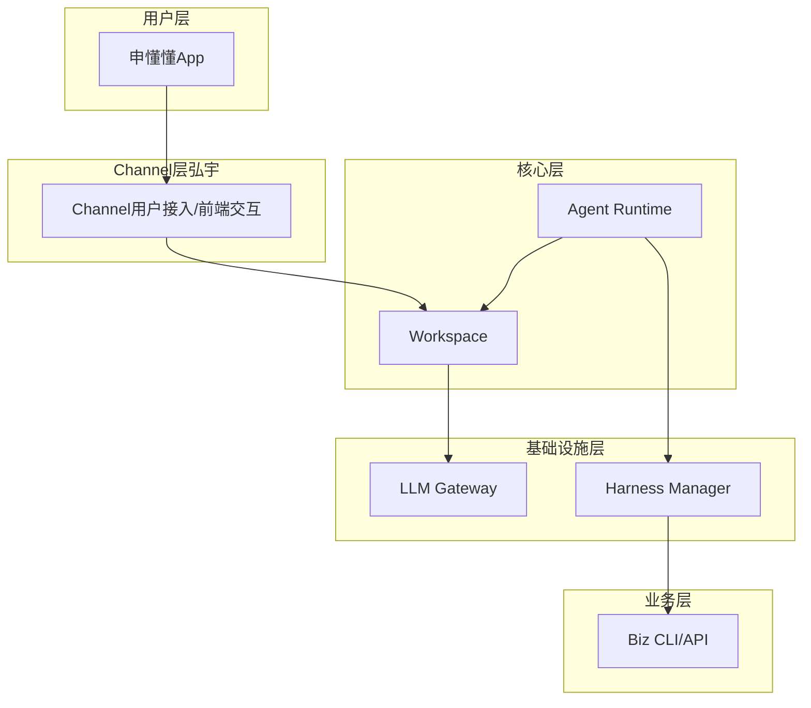
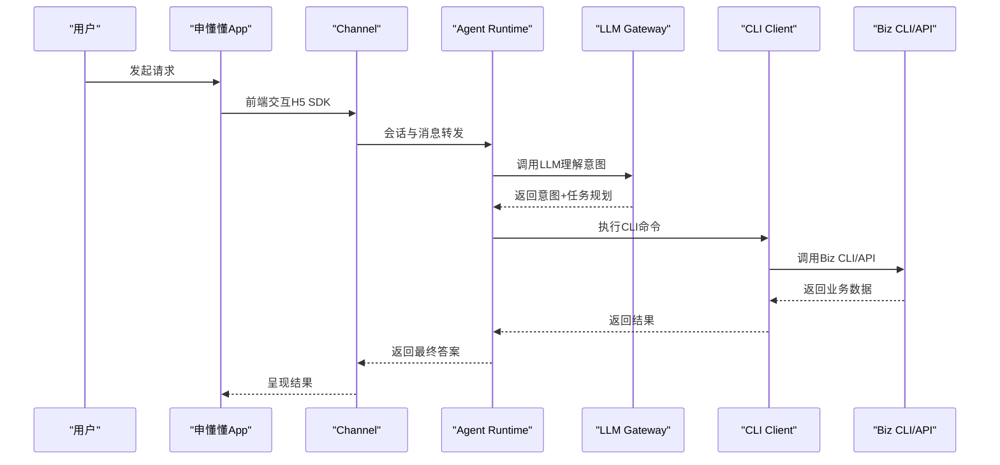
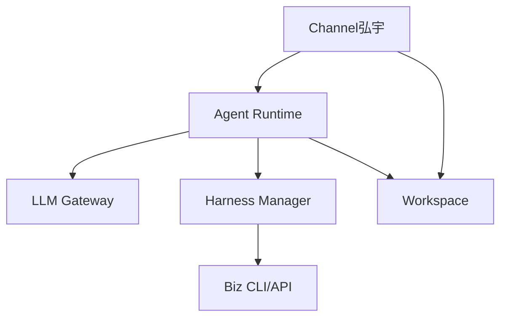

# Channel（弘宇）

<cite>
**本文引用的文件**
- [Sai整体架构设计.md](file://project/standup/Sai整体架构设计.md)
- [2026-04-20早会记录.md](file://project/standup/2026-04-20-zhaobomin.md)
- [Cross-module设计评审-2026-04-24.md](file://notes/zhaobomin/cross-module-design-review-2026-04-24.md)
- [Agent-Runtime方案.md](file://plan/Agent-Runtime方案.md)
- [SAI-daily-report-2026-04-22-final.md](file://project/SAI-daily-report-2026-04-22-final.md)
- [yihang-2024-04-20.md](file://daily/2026-04-20/yihang.md)
- [yihang-2024-04-23.md](file://daily/2026-04-23/yihang.md)
- [hongyu-2026-04-24.md](file://daily/2026-04-24/hongyu.md)
</cite>

## 目录
1. [简介](#简介)
2. [项目结构](#项目结构)
3. [核心组件](#核心组件)
4. [架构总览](#架构总览)
5. [组件详解](#组件详解)
6. [依赖关系分析](#依赖关系分析)
7. [性能与可靠性](#性能与可靠性)
8. [故障排查指南](#故障排查指南)
9. [结论](#结论)
10. [附录](#附录)

## 简介
本文件面向前端开发者与产品团队，系统化梳理 Channel（弘宇）模块在 SAI 项目中的定位、设计理念与实现架构，重点覆盖以下方面：
- 用户接入与前端交互：申懂懂 App 的前端接入路径、H5 SDK 集成策略与交互体验设计
- Agent SDK 集成：通用 Agent 前端 SDK 的引入方式、会话生命周期与消息传递机制
- 会话管理与状态同步：多会话、历史记录、状态恢复与持久化
- 用户认证与数据安全：PoP Token 机制、用户隔离与权限控制
- 前端开发指南：集成步骤、API 接口约定、协议与错误处理
- 风险与对齐：当前缺失项与跨模块接口契约缺口

## 项目结构
Channel（弘宇）作为用户接入与前端交互层，主要职责包括：
- 申懂懂 App 的前端接入与交互体验设计
- 通用 Agent 前端 SDK 的集成与演示
- 与 Agent Runtime 的会话与消息交互协议对齐
- 与 Harness Manager 的技能/CLI/知识检索等支撑能力的对接

图表来源
- [Sai整体架构设计.md:19-65](file://project/standup/Sai整体架构设计.md#L19-L65)
- [2026-04-20早会记录.md:5-40](file://project/standup/2026-04-20-zhaobomin.md#L5-L40)

章节来源
- [Sai整体架构设计.md:19-65](file://project/standup/Sai整体架构设计.md#L19-L65)
- [2026-04-20早会记录.md:5-40](file://project/standup/2026-04-20-zhaobomin.md#L5-L40)

## 核心组件
- Channel（弘宇）
  - 职责：申懂懂 App 的前端接入、H5 SDK 集成、交互体验设计
  - 关键进展：430 版本小窗模式接入 SDK，完成基础对话原型；512 版本功能边界与优先级对齐
- Agent Runtime（奕杭）
  - 职责：通用 Agent 执行、意图理解、CLI 调用
  - 关键能力：基于 Serverless 的用户隔离与热启动；与 HM 的技能/CLI/知识检索对接
- Harness Manager（隋云）
  - 职责：知识库、Skills、CLI 注册与分发
  - 关键能力：元数据注册、OSS 分发、Agent 拉取
- LLM Gateway（老徐）
  - 职责：统一 LLM 调用代理、Token 管理与成本控制
  - 关键能力：OpenAI 格式统一接口、熔断与降级

章节来源
- [Sai整体架构设计.md:142-151](file://project/standup/Sai整体架构设计.md#L142-L151)
- [Sai整体架构设计.md:224-232](file://project/standup/Sai整体架构设计.md#L224-L232)
- [Cross-module设计评审-2026-04-24.md:91-99](file://notes/zhaobomin/cross-module-design-review-2026-04-24.md#L91-L99)

## 架构总览
Channel 与 Agent Runtime 的交互链路如下：
- 用户在申懂懂 App 中发起请求
- Channel 将请求转发至 Agent Runtime
- Agent Runtime 通过 LLM Gateway 进行意图理解与任务规划
- Agent Runtime 通过 CLI Client 调用 Biz CLI/API 执行业务操作
- Agent Runtime 与 HM 进行技能/CLI/知识检索的支撑交互

图表来源
- [Sai整体架构设计.md:115-138](file://project/standup/Sai整体架构设计.md#L115-L138)

章节来源
- [Sai整体架构设计.md:108-138](file://project/standup/Sai整体架构设计.md#L108-L138)

## 组件详解

### 1. 前端接入与交互设计（H5 SDK 集成）
- 集成策略
  - 430 版本：在既有产品内通过“小窗口”模式接入通用 Agent 前端 SDK，完成基础对话原型
  - 512 版本：明确功能边界与优先级，对齐前后端交互体验
- 交互体验
  - 首页框架：顶部导航 + 中间品牌 IP 透出 + 底部输入区
  - 登入登出：权限控制，优先复用申懂懂现有流程
  - 侧边栏导航：左滑呼出，包含新建对话、历史会话时间轴、用户信息
  - 历史会话：列表展示（分组），支持重命名、删除；启动时自动恢复上次会话
  - 新建会话：侧边栏新建对话，点击进入空白页并自动唤起键盘
  - 文本输入框：默认态/聚焦态切换；多行自适应
  - 生成式 UI：计划支持 Markdown 渲染与生成式 UI 混合模式，当前因 React 版本不兼容暂缓
- 开发要点
  - 从本地接口切换至后端环境接口，进行全链路联调
  - 解决迁移后的样式显示问题，优化界面细节
  - 与 Agent Runtime 的会话与消息协议对齐

章节来源
- [hongyu-2026-04-24.md:1-39](file://daily/2026-04-24/hongyu.md#L1-L39)
- [SAI-daily-report-2026-04-22-final.md:34-36](file://project/SAI-daily-report-2026-04-22-final.md#L34-L36)

### 2. Agent SDK 集成方案
- 通用页面 SDK
  - PC、移动端项目引入 SDK 即可与 Agent 交互
  - PC 端 demo 已跑通（AI 销售助理），需按弘宇逻辑进行对焦与演进
- ACP 协议考虑
  - 当前 Agent 已考虑 ACP 协议的向前兼容（通过 Adapter）
  - 因 Agent 为云端且 ACP 不支持 HTTP 协议，以及 Claude Agent ACP SDK 为 TypeScript，暂缓实施
- 430 里程碑
  - 在申懂懂内嵌通用 Agent 前端 SDK，通过 agent-gateway 路由，按用户 session 在 Serverless 上分配 Agent，实现“你好”对话能力

章节来源
- [Agent-Runtime方案.md:40-60](file://plan/Agent-Runtime方案.md#L40-L60)
- [yihang-2024-04-23.md:17-20](file://daily/2026-04-23/yihang.md#L17-L20)
- [yihang-2024-04-23.md:29-33](file://daily/2026-04-23/yihang.md#L29-L33)

### 3. 会话管理与状态同步
- 会话生命周期
  - 基于用户级别的 workspace 获取 Agent 会话：get_session(mount_list, ...)
  - mount_list 为本地文件路径与 OSS bucket 下文件路径的映射，用于组织用户 workspace
  - 基于 session 进行 Agent 交互：send_request(session, content_body)
- 用户隔离与持久化
  - 基于 Serverless（AgentRun）按 session 分配实例，一实例一 session，确保用户执行环境隔离
  - serverless 层不感知 user id，避免业务逻辑侵入
- 历史与恢复
  - 历史会话列表支持分组、重命名、删除
  - 启动时自动恢复上次会话，保证连续性

章节来源
- [yihang-2024-04-20.md:5-12](file://daily/2026-04-20/yihang.md#L5-L12)
- [yihang-2024-04-23.md:12-16](file://daily/2026-04-23/yihang.md#L12-L16)
- [hongyu-2026-04-24.md:14-26](file://daily/2026-04-24/hongyu.md#L14-L26)

### 4. 前端交互协议与消息传递机制
- 协议类型
  - 意图理解链路：Agent → LLM Gateway 采用 HTTP/OpenAI API 格式
  - 业务执行链路：Agent → CLI Client 本地调用；CLI Client → Biz CLI 采用 HTTP；Biz CLI → Biz API 采用 HTTP/RPC
  - HM 支撑交互：Agent/HM 之间采用 HTTP/OSS 拉取元数据与产物
- 消息传递
  - Channel 作为前端接入层，负责将用户请求转发至 Agent Runtime，并呈现最终结果
  - 会话与消息在 Channel 与 Agent Runtime 之间通过统一的会话接口进行管理

章节来源
- [Sai整体架构设计.md:197-221](file://project/standup/Sai整体架构设计.md#L197-L221)

### 5. 用户认证与数据安全
- PoP Token 机制
  - 采用 Proof-of-Possession Token 方案，实现 Token 与环境绑定签名
  - 分两期实施：一期/二期路径清晰
- 用户隔离与权限
  - 基于 Serverless 的用户隔离，确保一个 Agent 实例仅承载一个 session
  - serverless 层不感知 user id，避免业务逻辑耦合
- 安全建议
  - 前端接入时严格校验用户身份，透传用户 Token 至 Agent Runtime
  - 对会话与消息传输进行必要的加密与完整性校验

章节来源
- [Agent-Runtime方案.md:397](file://plan/SAI_CLI_设计文档_v1.2.md#L397)
- [yihang-2024-04-20.md:7-12](file://daily/2026-04-20/yihang.md#L7-L12)

### 6. 与 Agent Runtime 的接口定义（当前对齐状态）
- 已对齐
  - LLM 调用：Agent Runtime → LLM Gateway 采用 OpenAI 格式
- 未对齐（需补齐）
  - Agent 会话：Channel → Agent Runtime 的会话接口（如 POST /agent/session → get_session / send_request）
  - 前端交互：申懂懂 App → Channel 的交互协议与接口定义
- 风险提示
  - 当前为口头确认，尚未形成书面契约，存在对接返工风险

章节来源
- [Sai整体架构设计.md:154-164](file://project/standup/Sai整体架构设计.md#L154-L164)
- [Cross-module设计评审-2026-04-24.md:254-267](file://notes/zhaobomin/cross-module-design-review-2026-04-24.md#L254-L267)

### 7. 与 Harness Manager 的支撑交互
- 技能/CLI/知识检索
  - Agent Runtime → HM：拉取 Skill 元数据与产物、CLI 元数据与产物、知识检索
  - HM → OSS：提供产物下载地址
- 接口缺口
  - 技能拉取：GET /hm/skills/list + OSS 拉取执行包
  - CLI 拉取：GET /hm/cli/list + OSS 拉取定义包
  - CLI 注册：POST /hm/cli/register
  - 知识检索：POST /hm/kb/search
- 风险提示
  - 当前仅整体架构有路径，缺少具体请求/响应 schema、分页与缓存策略等

章节来源
- [Sai整体架构设计.md:158-163](file://project/standup/Sai整体架构设计.md#L158-L163)
- [Cross-module设计评审-2026-04-24.md:187-197](file://notes/zhaobomin/cross-module-design-review-2026-04-24.md#L187-L197)

## 依赖关系分析
- 模块耦合
  - Channel 与 Agent Runtime：通过会话接口与消息协议耦合
  - Agent Runtime 与 LLM Gateway：通过统一 OpenAI 格式接口耦合
  - Agent Runtime 与 HM：通过 HTTP/OSS 拉取元数据与产物耦合
  - HM 与业务系统：通过 CLI 注册与 Biz API 调用耦合
- 潜在风险
  - Channel 设计文档缺失，导致前端接入方案、消息协议与接口定义不明确
  - Agent Runtime ↔ HM 接口契约未定义，存在对接返工风险
  - LLM Gateway 逃生方案未定，存在服务不可用时的回退风险

图表来源
- [Sai整体架构设计.md:19-65](file://project/standup/Sai整体架构设计.md#L19-L65)

章节来源
- [Sai整体架构设计.md:154-164](file://project/standup/Sai整体架构设计.md#L154-L164)
- [Cross-module设计评审-2026-04-24.md:254-267](file://notes/zhaobomin/cross-module-design-review-2026-04-24.md#L254-L267)

## 性能与可靠性
- 性能指标
  - Agent 实例冷启动 <1s，热启动 <100ms（实测数据）
- 可靠性策略
  - LLM Gateway 熔断：意图理解链路完全中断时返回固定提示
  - HM 不可用：Agent 使用本地缓存最近一次 Skill/CLI 定义，降级为无知识检索模式
  - OSS 不可用：Agent 使用本地缓存版本运行，日志告警通知 HM 团队
  - Agent Runtime 实例崩溃：Serverless 平台自动重建实例，用户会话需重新发起
- 建议
  - 明确全局错误码与状态码规范，覆盖认证、参数、服务不可用、限流、业务错误等

章节来源
- [Sai整体架构设计.md:224-245](file://project/standup/Sai整体架构设计.md#L224-L245)
- [Cross-module设计评审-2026-04-24.md:210-221](file://notes/zhaobomin/cross-module-design-review-2026-04-24.md#L210-L221)

## 故障排查指南
- 前端接入阻塞
  - 现状：Channel 设计文档缺失，前端交互协议与接口定义未对齐
  - 建议：尽快补齐最小版设计文档（前端架构 + 消息协议 + 与 Agent Runtime 接口）
- 会话与消息异常
  - 检查会话接口（如 POST /agent/session → get_session / send_request）是否正确透传用户 Token
  - 核对 mount_list 与 OSS 挂载路径是否匹配用户 workspace
- 业务执行失败
  - CLI Client 单次重试（≤3s 等待），失败后向用户说明具体接口不可用
- 知识检索中断
  - HM 不可用时，Agent 使用本地缓存，等待 HM 恢复后自动切换

章节来源
- [Cross-module设计评审-2026-04-24.md:91-99](file://notes/zhaobomin/cross-module-design-review-2026-04-24.md#L91-L99)
- [Sai整体架构设计.md:236-244](file://project/standup/Sai整体架构设计.md#L236-L244)

## 结论
- Channel（弘宇）在 SAI 项目中承担用户接入与前端交互的关键职责，当前已具备 H5 SDK 集成与交互体验设计的基础进展
- 与 Agent Runtime 的会话与消息协议、与 Harness Manager 的技能/CLI/知识检索接口尚需补齐书面契约
- 建议优先完成 Channel 设计文档与接口定义，确保前端接入与后端能力对齐，保障 4/30 交付目标

## 附录

### A. 前端开发指南（基于现有信息）
- 集成步骤
  - 引入通用 Agent 前端 SDK（PC/移动端）
  - 在申懂懂 App 中嵌入“小窗口”模式，完成基础对话原型
  - 与 agent-gateway 路由对接，按用户 session 在 Serverless 上分配 Agent
- 接口与协议
  - 会话接口：POST /agent/session → get_session / send_request（需补齐接口定义）
  - 意图理解：Agent → LLM Gateway 采用 OpenAI 格式
  - 业务执行：Agent → CLI Client（本地）→ Biz CLI（HTTP）→ Biz API（HTTP/RPC）
- 错误处理
  - 统一错误码与状态码规范（建议覆盖认证、参数、服务不可用、限流、业务错误）
  - 熔断与降级：LLM Gateway 熔断时返回固定提示；HM 不可用时使用本地缓存

章节来源
- [Agent-Runtime方案.md:40-60](file://plan/Agent-Runtime方案.md#L40-L60)
- [Sai整体架构设计.md:154-164](file://project/standup/Sai整体架构设计.md#L154-L164)
- [Sai整体架构设计.md:197-221](file://project/standup/Sai整体架构设计.md#L197-L221)
- [Cross-module设计评审-2026-04-24.md:210-221](file://notes/zhaobomin/cross-module-design-review-2026-04-24.md#L210-L221)