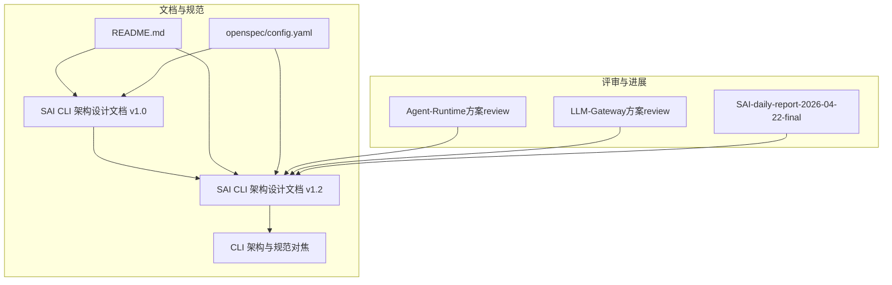
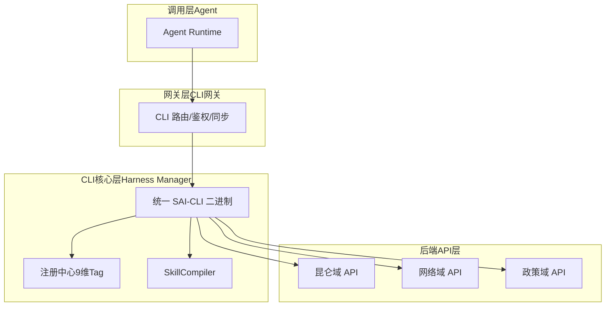
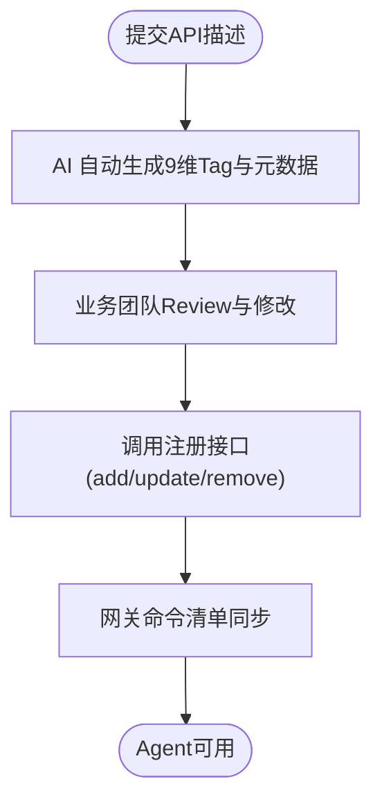
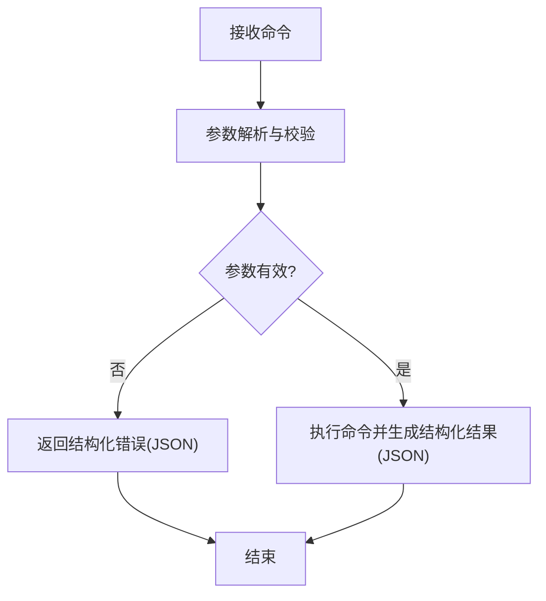
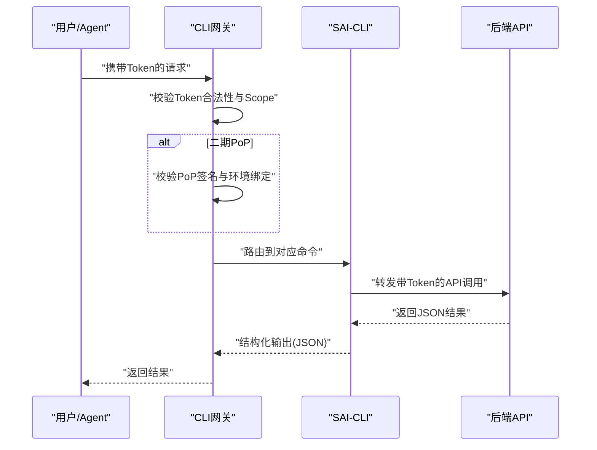
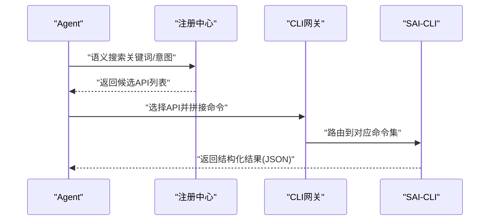
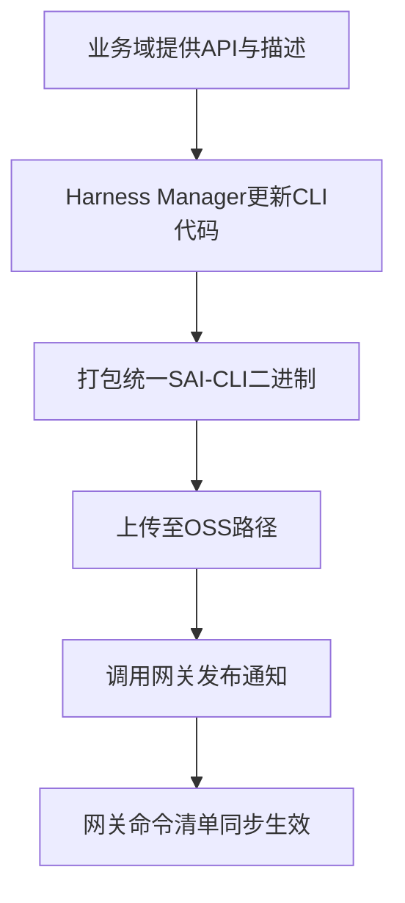
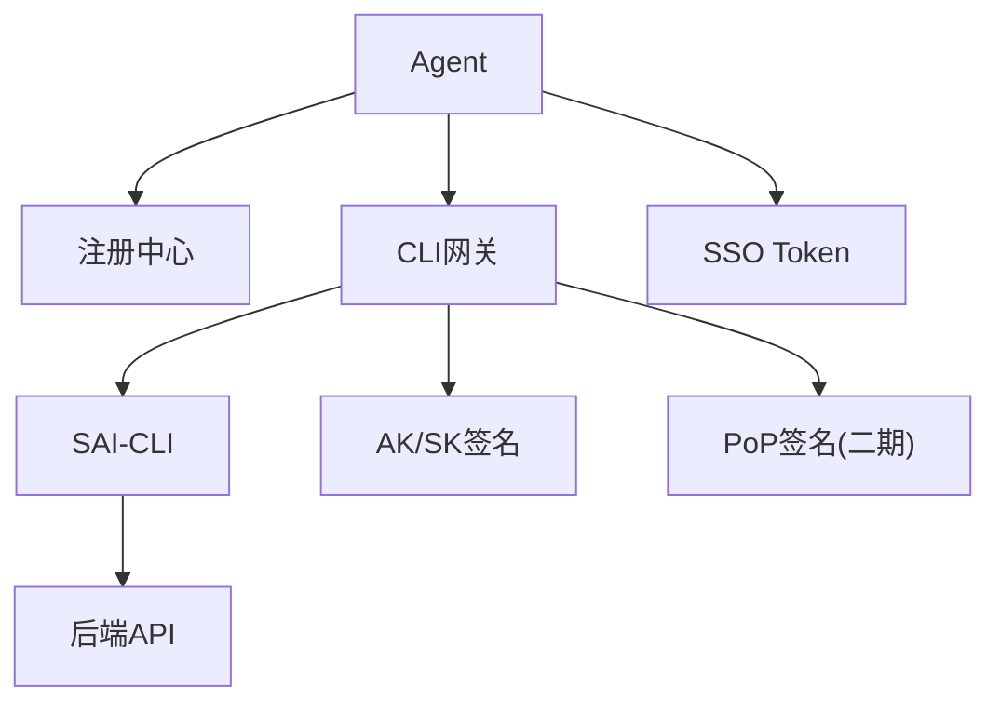

# CLI注册分发

<cite>
**本文引用的文件**
- [SAI CLI 架构设计文档 v1.0](file://plan/SAI_CLI_设计文档_v1.0.md)
- [SAI CLI 架构设计文档 v1.2](file://plan/SAI_CLI_设计文档_v1.2.md)
- [CLI 架构与规范对焦.md](file://plan/CLI 架构与规范对焦.md)
- [README.md](file://README.md)
- [openspec/config.yaml](file://openspec/config.yaml)
- [Agent-Runtime方案review.md](file://notes/zhaobomin/Agent-Runtime方案review.md)
- [LLM-Gateway方案review.md](file://notes/zhaobomin/LLM-Gateway方案review.md)
- [SAI-daily-report-2026-04-22-final.md](file://project/SAI-daily-report-2026-04-22-final.md)
</cite>

## 目录
1. [简介](#简介)
2. [项目结构](#项目结构)
3. [核心组件](#核心组件)
4. [架构总览](#架构总览)
5. [详细组件分析](#详细组件分析)
6. [依赖分析](#依赖分析)
7. [性能考量](#性能考量)
8. [故障排查指南](#故障排查指南)
9. [结论](#结论)
10. [附录](#附录)

## 简介
本文件面向CLI注册分发模块，系统化阐述SAI-CLI的注册流程、验证机制、分发策略与版本管理；说明鉴权与安全校验、权限控制与访问限制；覆盖自动发现、负载均衡与故障转移；并提供开发规范、发布流程与运维监控指南，帮助开发者完成CLI实现与集成。

## 项目结构
该仓库以文档为主，围绕SAI项目（STO AI）的CLI与Agent生态展开，重点文档包括：
- CLI设计文档（v1.0、v1.2）：定义分层架构、命令规范、鉴权与发布流程
- CLI架构与规范对焦：明确部署方式、鉴权机制与网关能力
- README与模块分工：展示CLI在整体架构中的定位
- openspec配置：项目上下文与制品规则
- 评审与日报：对Agent Runtime、LLM Gateway等周边模块的评审意见与项目进展

**图表来源**
- [README.md:11-41](file://README.md#L11-L41)
- [openspec/config.yaml:1-21](file://openspec/config.yaml#L1-L21)

**章节来源**
- [README.md:9-41](file://README.md#L9-L41)
- [openspec/config.yaml:1-21](file://openspec/config.yaml#L1-L21)

## 核心组件
- 调用层（Agent）：负责意图理解、API搜索与命令拼接，不直接调用后端API
- 网关层（CLI网关）：路由转发、鉴权校验、命令清单同步、元数据生成与发布通知
- CLI核心层（Harness Manager统一构建）：统一命令规范、入参/出参JSON、公共能力（认证/日志）、API注册中心与SkillCompiler
- 后端API层：各业务域提供API接口，零侵入

关键职责边界：
- Agent不直接调用后端API，通过SAI-CLI注册中心搜索与发现API
- CLI由Harness Manager统一构建，封装所有业务域命令，不感知Agent存在
- 网关负责路由与鉴权，不包含业务逻辑

**章节来源**
- [SAI CLI 架构设计文档 v1.2:29-75](file://plan/SAI_CLI_设计文档_v1.2.md#L29-L75)
- [SAI CLI 架构设计文档 v1.0:44-53](file://plan/SAI_CLI_设计文档_v1.0.md#L44-L53)

## 架构总览
SAI采用四层分层架构，实现AI Agent与各业务域后端服务的标准化接入。Agent通过网关与SAI-CLI交互，SAI-CLI再调用后端API。

**图表来源**
- [SAI CLI 架构设计文档 v1.2:33-64](file://plan/SAI_CLI_设计文档_v1.2.md#L33-L64)

**章节来源**
- [SAI CLI 架构设计文档 v1.2:29-75](file://plan/SAI_CLI_设计文档_v1.2.md#L29-L75)

## 详细组件分析

### 注册与元数据管理
- 注册中心：集中管理各域命令的9维Tag（D1-D9）、description、入参说明
- 元数据生成：支持AI根据API描述自动生成9维Tag与命令元数据，业务团队Review确认后注册
- 注册接口：支持add/update/remove（软删除30天可恢复）

**图表来源**
- [SAI CLI 架构设计文档 v1.2:365-392](file://plan/SAI_CLI_设计文档_v1.2.md#L365-L392)

**章节来源**
- [SAI CLI 架构设计文档 v1.2:151-224](file://plan/SAI_CLI_设计文档_v1.2.md#L151-L224)
- [SAI CLI 架构设计文档 v1.2:365-392](file://plan/SAI_CLI_设计文档_v1.2.md#L365-L392)

### 命令规范与参数校验
- 命令格式：{product} {module} {action} [params]
- 无交互式输入：所有参数通过命令行传入，禁止运行时弹出交互式提示
- 结构化输出：统一JSON格式，错误输出包含type/code/message/hint字段
- Dry-Run：写操作支持--dry-run，返回将要执行的操作描述

**图表来源**
- [SAI CLI 架构设计文档 v1.2:115-147](file://plan/SAI_CLI_设计文档_v1.2.md#L115-L147)
- [SAI CLI 架构设计文档 v1.2:295-336](file://plan/SAI_CLI_设计文档_v1.2.md#L295-L336)
- [SAI CLI 架构设计文档 v1.2:474-501](file://plan/SAI_CLI_设计文档_v1.2.md#L474-L501)

**章节来源**
- [SAI CLI 架构设计文档 v1.2:115-147](file://plan/SAI_CLI_设计文档_v1.2.md#L115-L147)
- [SAI CLI 架构设计文档 v1.2:295-336](file://plan/SAI_CLI_设计文档_v1.2.md#L295-L336)
- [SAI CLI 架构设计文档 v1.2:474-501](file://plan/SAI_CLI_设计文档_v1.2.md#L474-L501)

### 鉴权与安全校验
- 一期：标准Bearer Token，Agent→sai-cli→业务API，Token获取优先级：命令行参数 > 环境变量 > 本地配置文件
- 二期：PoP Token + ECDSA签名，引入sai-agent作为安全代理，实现Token与设备/环境绑定
- 接口鉴权：Harness Manager API统一使用AK/SK签名（HMAC-SHA256）

**图表来源**
- [SAI CLI 架构设计文档 v1.2:394-471](file://plan/SAI_CLI_设计文档_v1.2.md#L394-L471)

**章节来源**
- [SAI CLI 架构设计文档 v1.2:394-471](file://plan/SAI_CLI_设计文档_v1.2.md#L394-L471)

### 自动发现与路由
- Agent通过SAI-CLI注册中心发起语义搜索，返回匹配的命令候选列表
- 网关根据product字段将请求路由至对应域的CLI命令集
- 9维Tag体系（D1-D9）支撑语义理解、参数构造、消歧防误判与结果解读

**图表来源**
- [SAI CLI 架构设计文档 v1.2:603-632](file://plan/SAI_CLI_设计文档_v1.2.md#L603-L632)

**章节来源**
- [SAI CLI 架构设计文档 v1.2:603-632](file://plan/SAI_CLI_设计文档_v1.2.md#L603-L632)

### 版本管理与发布流程
- Harness Manager统一构建与维护，将各域API封装为单一CLI二进制文件
- 发布流程：业务域提供API→Harness Manager更新CLI代码→打包统一二进制→上传OSS→调用网关发布通知→网关生效
- OSS路径规范：CLI网关、系统内置技能、公共技能、用户技能

**图表来源**
- [SAI CLI 架构设计文档 v1.2:561-591](file://plan/SAI_CLI_设计文档_v1.2.md#L561-L591)

**章节来源**
- [SAI CLI 架构设计文档 v1.2:561-591](file://plan/SAI_CLI_设计文档_v1.2.md#L561-L591)

### 负载均衡与故障转移
- 网关层承担路由与负载均衡职责，保证命令转发稳定
- 注册中心与SkillCompiler提升元数据可用性与一致性，减少因命令不可用导致的失败
- 二期PoP方案进一步提升安全性与可用性，降低Token滥用风险

**章节来源**
- [SAI CLI 架构设计文档 v1.2:605-618](file://plan/SAI_CLI_设计文档_v1.2.md#L605-L618)

### 开发规范与测试
- 开发语言统一：Harness Manager侧使用Golang
- 可测试性：核心逻辑通过接口抽象，支持Mock与注入测试Token
- Dry-Run：写操作支持--dry-run，便于风险控制与影响评估

**章节来源**
- [SAI CLI 架构设计文档 v1.2:339-350](file://plan/SAI_CLI_设计文档_v1.2.md#L339-L350)
- [SAI CLI 架构设计文档 v1.2:474-513](file://plan/SAI_CLI_设计文档_v1.2.md#L474-L513)

## 依赖分析
- 组件耦合与内聚：CLI保持通用能力，API知识集中在注册中心，新增历史系统API无需发版CLI
- 外部依赖：Harness Manager API使用AK/SK签名；Agent通过SSO获取Token；PoP方案依赖sai-agent
- 集成点：Agent与注册中心交互、Agent与网关交互、网关与CLI、CLI与后端API

**图表来源**
- [SAI CLI 架构设计文档 v1.2:605-632](file://plan/SAI_CLI_设计文档_v1.2.md#L605-L632)
- [SAI CLI 架构设计文档 v1.2:452-459](file://plan/SAI_CLI_设计文档_v1.2.md#L452-L459)

**章节来源**
- [SAI CLI 架构设计文档 v1.2:605-632](file://plan/SAI_CLI_设计文档_v1.2.md#L605-L632)
- [SAI CLI 架构设计文档 v1.2:452-459](file://plan/SAI_CLI_设计文档_v1.2.md#L452-L459)

## 性能考量
- 单一二进制部署：减少运行时依赖，跨平台支持良好，适合Agent容器环境
- 动态命令分发：通过注册中心与预挂载结合，提升可用性与稳定性
- 负载均衡：网关层承担路由与负载均衡，保障高并发下的稳定性

**章节来源**
- [SAI CLI 架构设计文档 v1.2:561-564](file://plan/SAI_CLI_设计文档_v1.2.md#L561-L564)
- [Agent-Runtime方案review.md:11-14](file://notes/zhaobomin/Agent-Runtime方案review.md#L11-L14)

## 故障排查指南
- 鉴权失败：检查Token来源优先级（命令行参数 > 环境变量 > 本地配置文件），确认Token有效性与Scope
- 命令不可用：确认注册中心命令清单是否已同步，检查网关路由配置
- 结构化错误输出：根据type/code/message/hint定位问题并按建议修复
- 发布未生效：确认Harness Manager已上传统一二进制并调用网关发布通知接口

**章节来源**
- [SAI CLI 架构设计文档 v1.2:405-419](file://plan/SAI_CLI_设计文档_v1.2.md#L405-L419)
- [SAI CLI 架构设计文档 v1.2:574-588](file://plan/SAI_CLI_设计文档_v1.2.md#L574-L588)

## 结论
SAI-CLI注册分发模块通过四层架构实现Agent、网关、CLI与后端API的解耦与协同。注册中心与9维Tag体系支撑自动发现与语义理解；统一的鉴权与安全机制保障链路安全；Harness Manager统一构建与发布流程简化运维；动态命令分发与负载均衡提升可用性。该设计为CLI实现与集成提供了清晰的参考与最佳实践。

## 附录
- 术语说明：PoP（证明持有）、AK/SK（访问密钥/签名密钥）、Dry-Run（预演模式）
- 相关文档：CLI设计文档、Agent Runtime评审、LLM Gateway评审、项目日报

**章节来源**
- [SAI CLI 架构设计文档 v1.2:1-16](file://plan/SAI_CLI_设计文档_v1.2.md#L1-L16)
- [Agent-Runtime方案review.md:1-55](file://notes/zhaobomin/Agent-Runtime方案review.md#L1-L55)
- [LLM-Gateway方案review.md:1-70](file://notes/zhaobomin/LLM-Gateway方案review.md#L1-L70)
- [SAI-daily-report-2026-04-22-final.md:1-77](file://project/SAI-daily-report-2026-04-22-final.md#L1-L77)