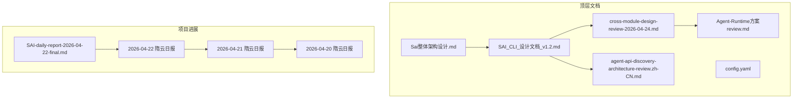
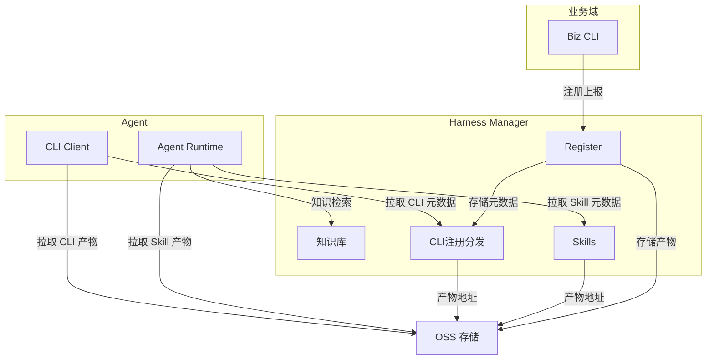
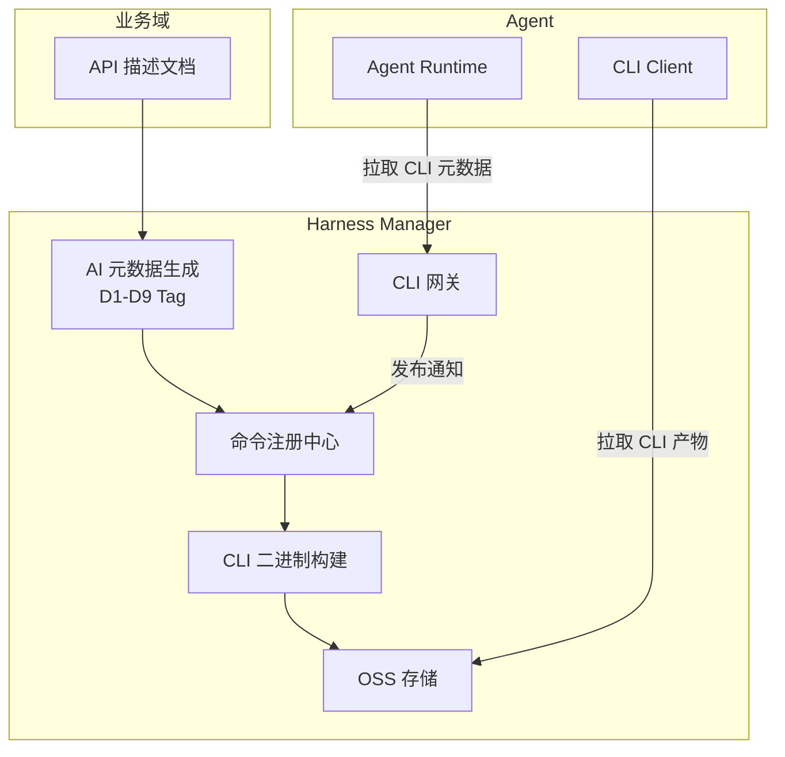
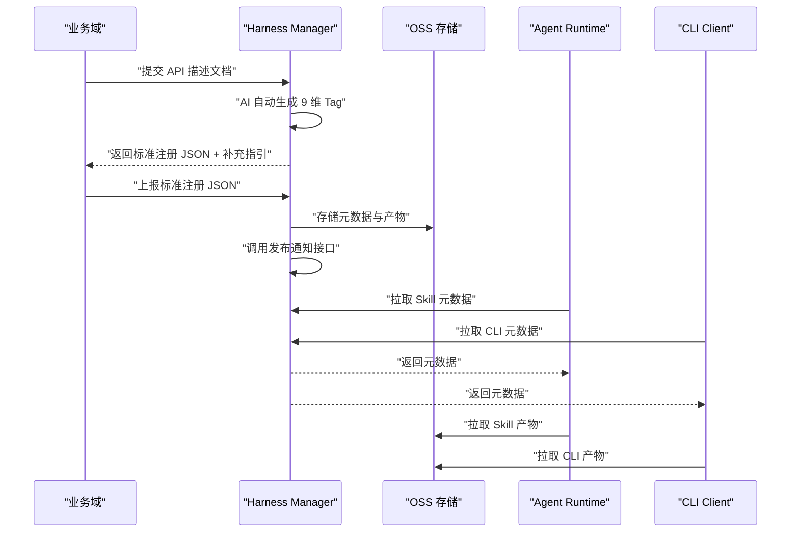
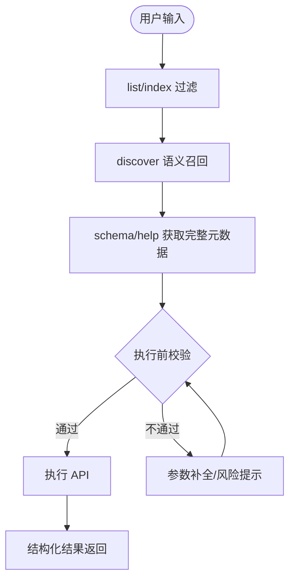
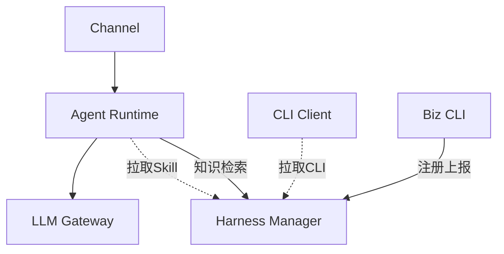

# Harness Manager（隋云）

<cite>
**本文引用的文件**
- [Sai整体架构设计.md](file://project/standup/Sai整体架构设计.md)
- [SAI_CLI_设计文档_v1.2.md](file://plan/SAI_CLI_设计文档_v1.2.md)
- [SAI_CLI_设计文档_v1.0.md](file://plan/SAI_CLI_设计文档_v1.0.md)
- [cross-module-design-review-2026-04-24.md](file://notes/zhaobomin/cross-module-design-review-2026-04-24.md)
- [agent-api-discovery-architecture-review.zh-CN.md](file://notes/zhaobomin/agent-api-discovery-architecture-review.zh-CN.md)
- [SAI-daily-report-2026-04-22-final.md](file://project/SAI-daily-report-2026-04-22-final.md)
- [2026-04-22 隋云日报](file://daily/2026-04-22/suiyun.md)
- [2026-04-21 隋云日报](file://daily/2026-04-21/suiyun.md)
- [2026-04-20 隋云日报](file://daily/2026-04-20/suiyun.md)
- [Agent-Runtime方案review.md](file://notes/zhaobomin/Agent-Runtime方案review.md)
- [config.yaml](file://openspec/config.yaml)
</cite>

## 目录
1. [简介](#简介)
2. [项目结构](#项目结构)
3. [核心组件](#核心组件)
4. [架构总览](#架构总览)
5. [详细组件分析](#详细组件分析)
6. [依赖关系分析](#依赖关系分析)
7. [性能考量](#性能考量)
8. [故障排查指南](#故障排查指南)
9. [结论](#结论)
10. [附录](#附录)

## 简介
本文件围绕 Harness Manager（隋云）模块，系统化阐述其在 SAI（申通 AI）平台中的定位与职责，重点覆盖以下方面：
- 知识库管理：企业知识存储与检索，支撑 Agent 决策。
- Skills 管理：Skill 注册与管理，Agent 从 HM 拉取 Skill 定义。
- CLI 注册分发：业务方上报元数据，统一构建并分发至 Agent 运行环境，实现“单 CLI 统一封装”。

同时，文档深入分析 OSS 存储集成、资源分发机制与版本管理、控制面服务设计理念、数据流处理与接口设计，并提供自动化构建流程、元数据管理与服务发现机制的实践建议，以及面向开发者的配置示例、API 接口规范与集成指南。

## 项目结构
- 顶层文档与设计：整体架构、CLI 设计、跨模块评审、Agent 发现机制评审等。
- 项目进展与风险：每日/周报、风险跟踪与上线策略。
- 开放规范：openspec 配置模板，用于约束生成制品与上下文。

**图表来源**
- [Sai整体架构设计.md:1-277](file://project/standup/Sai整体架构设计.md#L1-L277)
- [SAI_CLI_设计文档_v1.2.md:1-635](file://plan/SAI_CLI_设计文档_v1.2.md#L1-L635)
- [cross-module-design-review-2026-04-24.md:1-306](file://notes/zhaobomin/cross-module-design-review-2026-04-24.md#L1-L306)
- [agent-api-discovery-architecture-review.zh-CN.md:1-558](file://notes/zhaobomin/agent-api-discovery-architecture-review.zh-CN.md#L1-L558)
- [Agent-Runtime方案review.md:1-55](file://notes/zhaobomin/Agent-Runtime方案review.md#L1-L55)
- [config.yaml:1-21](file://openspec/config.yaml#L1-L21)

**章节来源**
- [Sai整体架构设计.md:1-277](file://project/standup/Sai整体架构设计.md#L1-L277)
- [SAI_CLI_设计文档_v1.2.md:1-635](file://plan/SAI_CLI_设计文档_v1.2.md#L1-L635)
- [cross-module-design-review-2026-04-24.md:1-306](file://notes/zhaobomin/cross-module-design-review-2026-04-24.md#L1-L306)
- [agent-api-discovery-architecture-review.zh-CN.md:1-558](file://notes/zhaobomin/agent-api-discovery-architecture-review.zh-CN.md#L1-L558)
- [Agent-Runtime方案review.md:1-55](file://notes/zhaobomin/Agent-Runtime方案review.md#L1-L55)
- [config.yaml:1-21](file://openspec/config.yaml#L1-L21)

## 核心组件
- 知识库（KB）
  - 企业知识存储与检索，辅助 Agent 决策。
- Skills
  - Skill 注册与管理，Agent 从 HM 拉取 Skill 定义。
- CLI 注册分发
  - 业务方上报元数据，统一构建并分发至 Agent 运行环境，实现“单 CLI 统一封装”。

职责边界与交付：
- 业务系统专注于核心 API 建设与描述输出。
- Harness Manager 负责聚合 API 描述、元数据提取、标准化封装与二进制构建。
- Agent 通过 OSS 路径挂载方式拉取产物，不直接调用 HM API。

**章节来源**
- [Sai整体架构设计.md:173-195](file://project/standup/Sai整体架构设计.md#L173-L195)
- [SAI_CLI_设计文档_v1.2.md:543-602](file://plan/SAI_CLI_设计文档_v1.2.md#L543-L602)

## 架构总览
Harness Manager 作为控制面服务，承担三条核心数据流：
- 注册流：业务方 → HM → OSS
- 拉取流：Agent → HM（元数据）→ OSS（产物）
- 检索流：Agent → HM → KB

**图表来源**
- [Sai整体架构设计.md:67-106](file://project/standup/Sai整体架构设计.md#L67-L106)

**章节来源**
- [Sai整体架构设计.md:67-106](file://project/standup/Sai整体架构设计.md#L67-L106)

## 详细组件分析

### 知识库（KB）
- 职责：企业知识存储与检索，支撑 Agent 决策。
- 设计要点：与 Agent 的检索接口契约需明确，包括查询语法、返回格式、相似度阈值等。
- 风险与缺失：整体架构文档列出 KB 子模块，但缺乏具体设计（数据源、向量存储、检索算法、更新机制）。

最佳实践建议：
- 明确知识入库流程（文档导入、API 同步）与增量更新策略。
- 定义检索接口的输入输出规范，支持分页与过滤。
- 设计缓存与降级策略，保障检索可用性。

**章节来源**
- [Sai整体架构设计.md:175-179](file://project/standup/Sai整体架构设计.md#L175-L179)
- [cross-module-design-review-2026-04-24.md:223-231](file://notes/zhaobomin/cross-module-design-review-2026-04-24.md#L223-L231)

### Skills 管理
- 职责：Skill 注册与管理，Agent 从 HM 拉取 Skill 定义。
- 设计要点：Skill 的格式、版本管理、加载与执行机制、与 CLI 的关系。
- 风险与缺失：整体架构文档列出 Skills 子模块，但缺少具体设计与接口契约。

最佳实践建议：
- 定义 Skill 的输入/输出 schema，支持版本与增量更新。
- 明确 Agent Runtime 与 HM 的接口契约（拉取、缓存、失效策略）。
- 设计 SkillCompiler 将注册元数据编译为 Agent 可读的 Tool 定义。

**章节来源**
- [Sai整体架构设计.md:180-184](file://project/standup/Sai整体架构设计.md#L180-L184)
- [cross-module-design-review-2026-04-24.md:233-241](file://notes/zhaobomin/cross-module-design-review-2026-04-24.md#L233-L241)

### CLI 注册分发
- 职责：业务方上报元数据，统一构建并分发至 Agent 运行环境。
- 架构演进：从“多 CLI 分域部署”演进为“单 CLI 统一封装”，业务域仅提供 API，Harness Manager 负责全生命周期管理。
- 关键机制：
  - 注册上报机制：AI 自动生成 9 维 Tag（D1-D9），重复度检测，返回补充指引。
  - CLI 二进制构建：统一构建为 sai-cli 二进制文件，提供给 Agent 端使用。
  - 鉴权兼容：云上版本 Token 不进入模型上下文；本地版本支持扫码登录注入 sto token。
  - 与 Agent 交互：通过 OSS 路径挂载方式进行交互，Agent 启动阶段自动挂载指定 OSS 路径。

**图表来源**
- [SAI_CLI_设计文档_v1.2.md:19-64](file://plan/SAI_CLI_设计文档_v1.2.md#L19-L64)
- [SAI_CLI_设计文档_v1.2.md:543-602](file://plan/SAI_CLI_设计文档_v1.2.md#L543-L602)
- [2026-04-22 隋云日报:19-44](file://daily/2026-04-22/suiyun.md#L19-L44)

**章节来源**
- [SAI_CLI_设计文档_v1.2.md:19-64](file://plan/SAI_CLI_设计文档_v1.2.md#L19-L64)
- [SAI_CLI_设计文档_v1.2.md:543-602](file://plan/SAI_CLI_设计文档_v1.2.md#L543-L602)
- [2026-04-22 隋云日报:19-44](file://daily/2026-04-22/suiyun.md#L19-L44)

### 控制面服务设计理念
- 分层解耦：Agent → 网关 → SAI-CLI → API，层层解耦，每一层只依赖下一层的接口契约。
- 零侵入：各业务域只需提供 API 接口，无需改造前端 GUI，无需开发 CLI。
- 统一协议：所有 HTTP 调用及 CLI 的入参/出参统一使用 JSON 格式。
- 结构化错误输出：统一的错误输出结构，包含 type、code、message、hint 字段。

**章节来源**
- [SAI_CLI_设计文档_v1.2.md:79-184](file://plan/SAI_CLI_设计文档_v1.2.md#L79-L184)

### 数据流处理与接口设计
- 注册接口（AI 元数据生成）：POST /api/v1/sai/cli/metadata/generate，输入包含 systemCode、systemName、apiPath、method、apiDesc、parametersSchema、responseSchema 等，输出为标准注册 JSON。
- 注册接口（命令注册）：POST /api/v1/sai/cli/registry，支持 add、update、remove 操作。
- 发布通知接口：由 Harness Manager 调用，同步更新命令清单。
- Agent 拉取接口：Agent Runtime 与 CLI Client 通过 HM 拉取元数据与产物，采用 OSS 路径挂载。

**图表来源**
- [SAI_CLI_设计文档_v1.2.md:376-391](file://plan/SAI_CLI_设计文档_v1.2.md#L376-L391)
- [SAI_CLI_设计文档_v1.2.md:543-602](file://plan/SAI_CLI_设计文档_v1.2.md#L543-L602)

**章节来源**
- [SAI_CLI_设计文档_v1.2.md:376-391](file://plan/SAI_CLI_设计文档_v1.2.md#L376-L391)
- [SAI_CLI_设计文档_v1.2.md:543-602](file://plan/SAI_CLI_设计文档_v1.2.md#L543-L602)

### OSS 存储集成与资源分发机制
- 挂载方式：采用 OSS 挂载形式，将统一打包的 SAI-CLI 二进制文件挂载至 Agent 运行环境。
- 路径规范：
  - CLI 网关：sai/cli/sai-cli
  - 系统内置技能：sai/skill/system/
  - 公共技能：sai/skill/public/
  - 用户技能：sai/skill/wtcodexx/
- 发布流程：业务域提供 API → Harness Manager 更新 CLI 代码 → 打包为统一 SAI-CLI 二进制 → 上传至约定 OSS 路径 → 调用网关“发布通知”接口 → 网关生效。

**章节来源**
- [SAI_CLI_设计文档_v1.2.md:561-591](file://plan/SAI_CLI_设计文档_v1.2.md#L561-L591)

### 版本管理
- 版本策略：建议采用语义化版本（SemVer），结合 OSS 对象版本或路径后缀区分版本。
- 增量同步：Agent 侧支持缓存与 TTL，Registry 客户端支持增量刷新与 304 协作。
- 回滚机制：OSS 支持对象版本回滚，控制面服务故障时 Agent 使用本地缓存继续运行。

**章节来源**
- [agent-api-discovery-architecture-review.zh-CN.md:135-165](file://notes/zhaobomin/agent-api-discovery-architecture-review.zh-CN.md#L135-L165)

### 自动化构建流程
- 构建步骤：业务域提供 API 描述 → Harness Manager 生成元数据 → 注册命令 → 统一构建 sai-cli 二进制 → 上传 OSS → 发布通知。
- 构建校验：生产环境构建需校验配置，禁止占位符进入产物；版本输出保留构建环境与关键 endpoint 摘要。

**章节来源**
- [2026-04-22 隋云日报:19-44](file://daily/2026-04-22/suiyun.md#L19-L44)
- [agent-api-discovery-architecture-review.zh-CN.md:96-114](file://notes/zhaobomin/agent-api-discovery-architecture-review.zh-CN.md#L96-L114)

### 元数据管理与服务发现机制
- 9 维 Tag 体系：D1-D9 标签覆盖路由与分类、NLU 理解、执行与展示维度，支持语义召回与消歧。
- 发现机制：discover → help/schema → execute 的三段式链路，支持上下文、参数推断、风险等级与执行前校验。
- Agent 发现链路：list/index → discover → schema/help → validate/dry-run。

**图表来源**
- [agent-api-discovery-architecture-review.zh-CN.md:219-238](file://notes/zhaobomin/agent-api-discovery-architecture-review.zh-CN.md#L219-L238)

**章节来源**
- [SAI_CLI_设计文档_v1.2.md:149-293](file://plan/SAI_CLI_设计文档_v1.2.md#L149-L293)
- [agent-api-discovery-architecture-review.zh-CN.md:188-238](file://notes/zhaobomin/agent-api-discovery-architecture-review.zh-CN.md#L188-L238)

### 鉴权与安全
- 一期：Bearer Token，Agent → sai-cli → 业务 API。
- 二期：PoP Token + ECDSA（P-256），引入环境绑定签名防复用，Token 与设备/环境绑定。
- 配置文件：~/.sai/sso-auth.json，包含 token、identity_type、scopes、expires_at。

**章节来源**
- [SAI_CLI_设计文档_v1.2.md:394-471](file://plan/SAI_CLI_设计文档_v1.2.md#L394-L471)

## 依赖关系分析
- 模块间依赖矩阵（摘自整体架构文档）：
  - LLM 调用：Agent → LLM Gateway（OpenAI 格式）
  - Agent 会话：Channel → Agent Runtime（待定义）
  - Skill 拉取：Agent → HM（待定义）
  - CLI 拉取：CLI Client → HM（待定义）
  - CLI 注册：Biz CLI → HM（已对齐）
  - 知识检索：Agent → HM（待定义）
  - 前端交互：申懂懂 App → Channel（待定义）

**图表来源**
- [Sai整体架构设计.md:154-165](file://project/standup/Sai整体架构设计.md#L154-L165)

**章节来源**
- [Sai整体架构设计.md:154-165](file://project/standup/Sai整体架构设计.md#L154-L165)

## 性能考量
- 冷启动与热启动：Agent Runtime 目标冷启动 <1s，热启动 <200ms。
- 并发与容量：需进行 QPS/并发用户数、Token 消耗、存储容量（OSS、RDS、Redis）与 Agent 实例数量的预估。
- 传输与缓存：Registry 客户端支持本地缓存与 TTL，降低高频调用延迟；OSS 挂载支持增量同步与版本管理。

**章节来源**
- [Sai整体架构设计.md:224-233](file://project/standup/Sai整体架构设计.md#L224-L233)
- [agent-api-discovery-architecture-review.zh-CN.md:135-165](file://notes/zhaobomin/agent-api-discovery-architecture-review.zh-CN.md#L135-L165)

## 故障排查指南
- HM 不可用：Agent 使用本地缓存的 Skill/CLI 定义，降级为无知识检索模式。
- OSS 不可用：Agent 使用本地缓存版本运行，日志告警通知 HM 团队。
- Biz API 超时/失败：CLI Client 单次重试（≤3s 等待），失败后 Agent 向用户说明具体接口不可用。
- LLM Gateway 熔断：Agent 返回固定提示“当前 AI 服务暂时不可用，请稍后重试”，业务执行链路不受影响。

**章节来源**
- [Sai整体架构设计.md:236-245](file://project/standup/Sai整体架构设计.md#L236-L245)

## 结论
Harness Manager（隋云）模块通过“单 CLI 统一封装”的架构演进，实现了业务域与 CLI 层的彻底解耦，降低了接入与维护成本。结合 OSS 存储与路径挂载的分发机制、9 维 Tag 的元数据体系与 Agent 发现链路，形成了从注册、构建、分发到执行的完整闭环。当前文档在接口契约、OSS 分发细节与跨模块一致性方面仍有待完善，建议尽快补齐 Agent Runtime ↔ HM 的接口定义、Channel 设计文档与全局错误码体系，以确保 4/30 交付目标的顺利达成。

## 附录

### API 接口规范（摘要）
- 元数据生成接口
  - 方法：POST
  - 路径：/api/v1/sai/cli/metadata/generate
  - 输入：systemCode、systemName、apiPath、method、apiDesc、parametersSchema、responseSchema 等
  - 输出：标准注册 JSON（含 D1-D9 Tag）
- 命令注册接口
  - 方法：POST
  - 路径：/api/v1/sai/cli/registry
  - 操作：add、update、remove
- 发布通知接口
  - 方法：由 Harness Manager 调用，同步更新命令清单
- Agent 拉取接口
  - 方法：GET/POST
  - 路径：/hm/skills/list、/hm/cli/meta、/hm/kb/search（待定义）

**章节来源**
- [SAI_CLI_设计文档_v1.2.md:376-391](file://plan/SAI_CLI_设计文档_v1.2.md#L376-L391)
- [Sai整体架构设计.md:154-165](file://project/standup/Sai整体架构设计.md#L154-L165)

### 配置示例（摘要）
- OSS 路径规范
  - CLI 网关：sai/cli/sai-cli
  - 系统内置技能：sai/skill/system/
  - 公共技能：sai/skill/public/
  - 用户技能：sai/skill/wtcodexx/
- sso-auth.json 配置文件
  - 字段：token、identity_type、scopes、expires_at

**章节来源**
- [SAI_CLI_设计文档_v1.2.md:565-573](file://plan/SAI_CLI_设计文档_v1.2.md#L565-L573)
- [SAI_CLI_设计文档_v1.2.md:461-470](file://plan/SAI_CLI_设计文档_v1.2.md#L461-L470)

### 集成指南（摘要）
- 业务域集成
  - 提供 API 描述文档 → 调用元数据生成接口 → 审核修改 → 注册命令 → 等待发布通知生效
- Agent 集成
  - 启动阶段自动挂载指定 OSS 路径 → 拉取 CLI 元数据与产物 → 执行命令
- HM 与 Agent Runtime 对接
  - 明确 Skill 拉取、CLI 拉取、知识检索接口的请求/响应格式与缓存策略

**章节来源**
- [SAI_CLI_设计文档_v1.2.md:543-602](file://plan/SAI_CLI_设计文档_v1.2.md#L543-L602)
- [cross-module-design-review-2026-04-24.md:187-197](file://notes/zhaobomin/cross-module-design-review-2026-04-24.md#L187-L197)