# OSS存储集成

<cite>
**本文档引用的文件**
- [Sai整体架构设计.md](file://project/standup/Sai整体架构设计.md)
- [SAI_CLI_设计文档_v1.2.md](file://plan/SAI_CLI_设计文档_v1.2.md)
- [cross-module-design-review-2026-04-24.md](file://notes/zhaobomin/cross-module-design-review-2026-04-24.md)
- [yihang.md](file://daily/2026-04-24/yihang.md)
</cite>

## 目录
1. [简介](#简介)
2. [项目结构](#项目结构)
3. [核心组件](#核心组件)
4. [架构概览](#架构概览)
5. [详细组件分析](#详细组件分析)
6. [依赖关系分析](#依赖关系分析)
7. [性能考虑](#性能考虑)
8. [故障处理指南](#故障处理指南)
9. [结论](#结论)

## 简介

本文档为SAI项目中的OSS存储集成模块提供全面的技术参考。SAI（申通快递企业级AI智能体平台）通过CLI封装业务能力，让Agent能够调用企业内部各业务系统，实现业务智能化。OSS存储在该架构中扮演着关键角色，负责存储和分发CLI定义、技能文件以及相关配置。

该文档详细解释了OSS存储的架构设计、连接池管理、资源调度策略，深入分析了文件上传下载、分片传输和断点续传机制，并阐述了存储策略、备份恢复和容量监控方案。同时涵盖了OSS的权限管理、加密传输和访问控制，提供了存储配置参数、性能优化和故障处理指南。

## 项目结构

SAI项目的OSS存储集成主要分布在以下几个核心文档中：

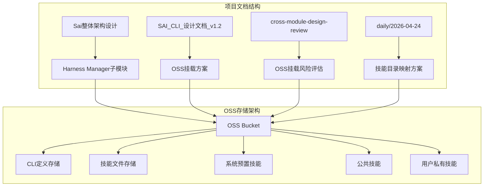

**图表来源**
- [Sai整体架构设计.md:67-106](file://project/standup/Sai整体架构设计.md#L67-L106)
- [SAI_CLI_设计文档_v1.2.md:561-591](file://plan/SAI_CLI_设计文档_v1.2.md#L561-L591)

**章节来源**
- [Sai整体架构设计.md:1-277](file://project/standup/Sai整体架构设计.md#L1-L277)
- [SAI_CLI_设计文档_v1.2.md:1-635](file://plan/SAI_CLI_设计文档_v1.2.md#L1-L635)

## 核心组件

### OSS存储架构组件

SAI项目中的OSS存储集成包含以下核心组件：

#### 1. 存储桶结构
- **CLI网关可执行文件**: `sai/cli/sai-cli`
- **系统内置技能**: `sai/skill/system/`
- **公共技能**: `sai/skill/public/`
- **用户技能**: `sai/skill/{wtcodexx}/`

#### 2. 数据流组件
- **注册流**: 业务方 → HM → OSS存储
- **拉取流**: Agent/HM → OSS → 产物分发
- **检索流**: Agent → HM → KB

#### 3. 访问控制组件
- **PoP Token方案**: 分阶段实现的令牌验证
- **AK/SK签名**: Harness Manager API接口鉴权
- **Scope权限控制**: 基于命令的权限管理

**章节来源**
- [Sai整体架构设计.md:173-195](file://project/standup/Sai整体架构设计.md#L173-L195)
- [SAI_CLI_设计文档_v1.2.md:565-591](file://plan/SAI_CLI_设计文档_v1.2.md#L565-L591)

## 架构概览

SAI项目的OSS存储集成采用分层架构设计，实现了存储资源的统一管理和高效分发：

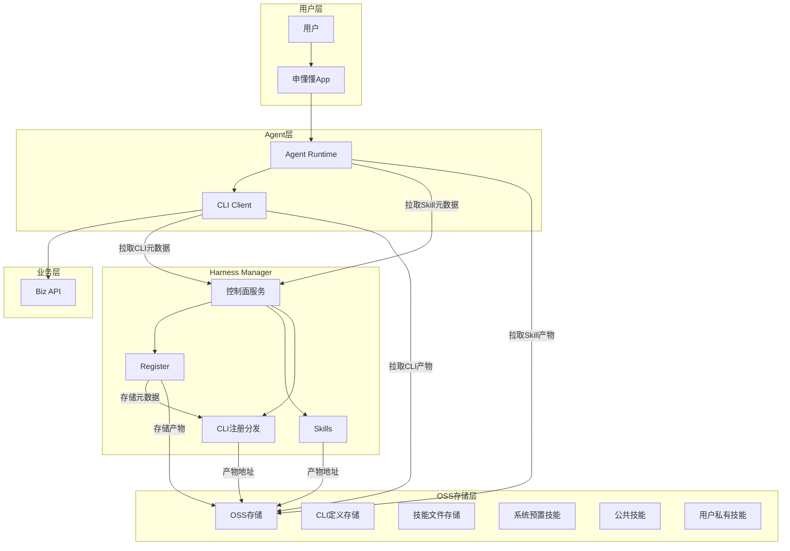

**图表来源**
- [Sai整体架构设计.md:19-106](file://project/standup/Sai整体架构设计.md#L19-L106)

### 存储策略架构

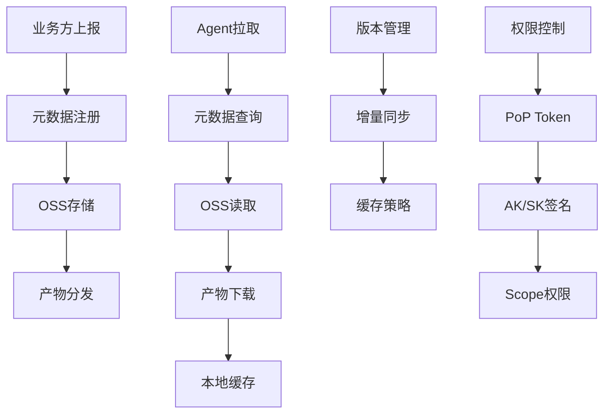

**图表来源**
- [Sai整体架构设计.md:67-106](file://project/standup/Sai整体架构设计.md#L67-L106)
- [SAI_CLI_设计文档_v1.2.md:565-591](file://plan/SAI_CLI_设计文档_v1.2.md#L565-L591)

## 详细组件分析

### 1. 存储桶管理

#### 1.1 存储桶结构设计

SAI项目采用层次化的存储桶结构，确保不同类型的内容得到适当的管理和访问控制：

| 存储类型 | 路径规范 | 用途 | 访问控制 |
|---------|---------|------|---------|
| CLI网关 | `sai/cli/sai-cli` | CLI网关可执行文件 | HM内部访问 |
| 系统技能 | `sai/skill/system/` | 系统预置的通用技能 | 全局只读 |
| 公共技能 | `sai/skill/public/` | 可共享的公共技能 | 组织级访问 |
| 用户技能 | `sai/skill/{wtcodexx}/` | 特定用户的个人技能 | 用户级访问 |

#### 1.2 资源调度机制

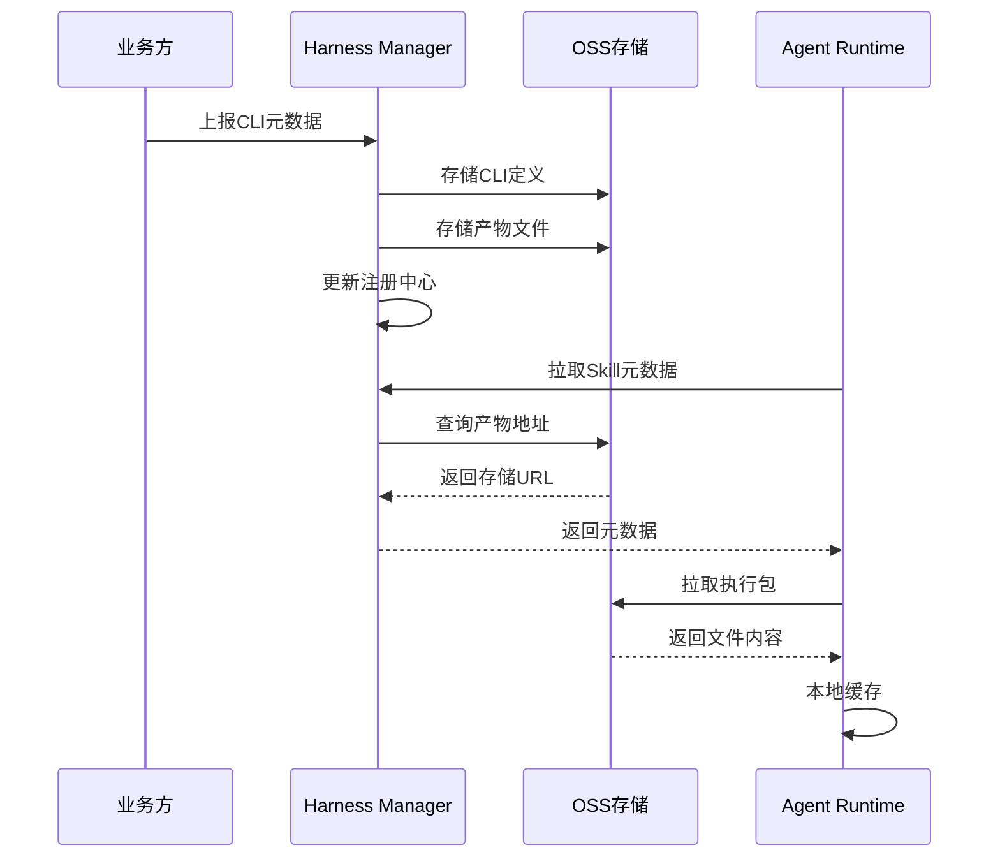

**图表来源**
- [Sai整体架构设计.md:91-102](file://project/standup/Sai整体架构设计.md#L91-L102)

#### 1.3 版本管理策略

SAI项目采用基于时间戳的版本管理策略，确保CLI和技能文件的版本控制：

- **版本命名**: 使用ISO 8601格式的时间戳
- **增量更新**: 仅上传变更的文件
- **缓存失效**: 通过版本号控制缓存刷新
- **回滚机制**: 支持快速回滚到之前的版本

**章节来源**
- [SAI_CLI_设计文档_v1.2.md:574-588](file://plan/SAI_CLI_设计文档_v1.2.md#L574-L588)

### 2. 文件上传下载机制

#### 2.1 上传流程

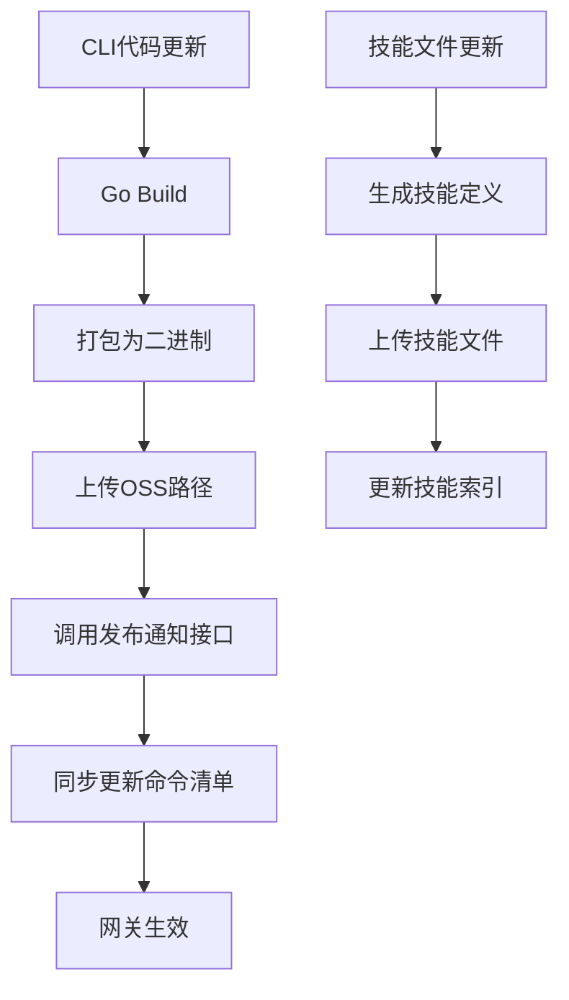

**图表来源**
- [SAI_CLI_设计文档_v1.2.md:574-588](file://plan/SAI_CLI_设计文档_v1.2.md#L574-L588)

#### 2.2 下载流程

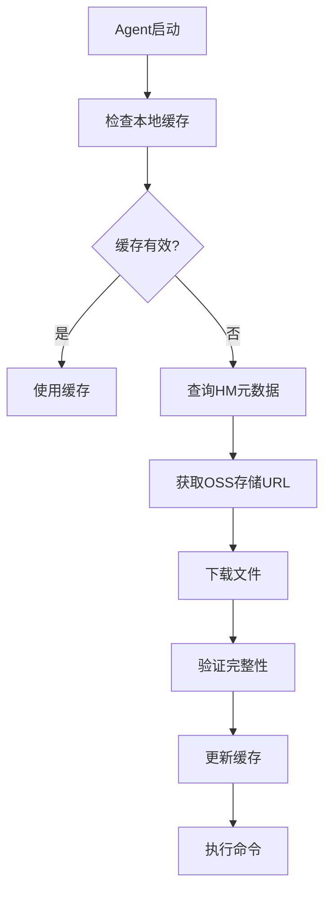

**图表来源**
- [Sai整体架构设计.md:236-245](file://project/standup/Sai整体架构设计.md#L236-L245)

#### 2.3 分片传输机制

虽然当前文档未详细描述分片传输的具体实现，但从架构设计可以看出：

- **大文件处理**: CLI二进制文件可能需要分片传输
- **断点续传**: 支持网络中断后的续传
- **并发控制**: 多分片并发下载提高效率
- **完整性校验**: MD5/SHA256校验确保文件完整性

### 3. 权限管理与访问控制

#### 3.1 多层权限体系

SAI项目采用多层权限控制体系，确保OSS资源的安全访问：

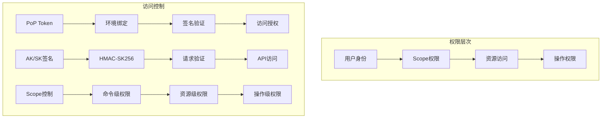

**图表来源**
- [SAI_CLI_设计文档_v1.2.md:394-472](file://plan/SAI_CLI_设计文档_v1.2.md#L394-L472)

#### 3.2 PoP Token实现

PoP（Proof-of-Possession）Token方案分两个阶段实施：

**第一阶段（基础链路）**:
- 标准Bearer Token
- Agent → sai-cli → 业务API
- 暂不校验Token是否被复制

**第二阶段（安全增强）**:
- PoP签名 + ECDSA (P-256)
- Agent → sai-cli → sai-agent → 云端网关 → 业务API
- 引入环境绑定签名防复用

#### 3.3 AK/SK签名机制

所有Harness Manager API接口统一使用AK/SK签名鉴权：

- **签名规则**: StringToSign = AccessKey + "\n" + Timestamp
- **请求头**: X-Access-Key、X-Signature、X-Timestamp
- **HMAC-SHA256算法**: 确保请求的完整性和真实性

**章节来源**
- [SAI_CLI_设计文档_v1.2.md:452-472](file://plan/SAI_CLI_设计文档_v1.2.md#L452-L472)

### 4. 存储策略与备份恢复

#### 4.1 存储策略

SAI项目的存储策略基于以下原则：

- **分层存储**: 不同类型的资源存储在不同的路径下
- **版本控制**: 所有文件都带有版本信息
- **缓存策略**: 本地缓存 + CDN加速
- **生命周期管理**: 自动清理过期文件

#### 4.2 备份恢复机制

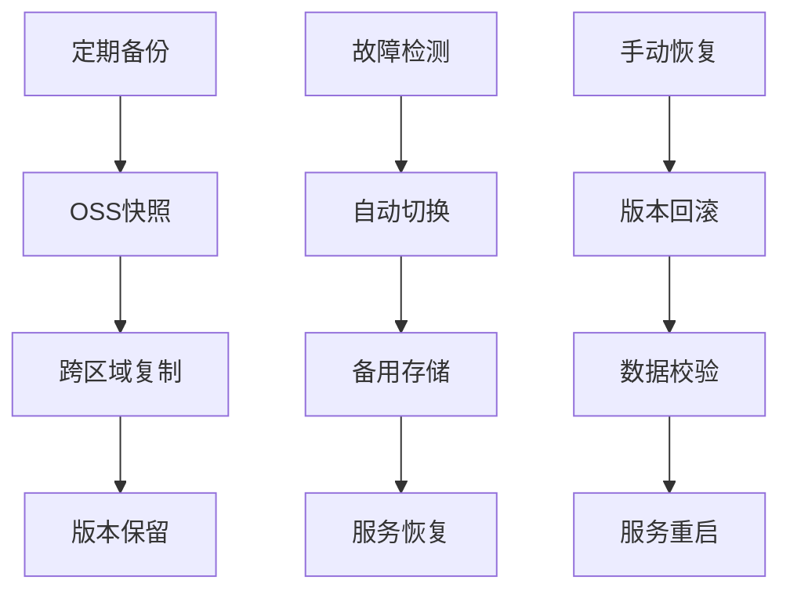

#### 4.3 容量监控

SAI项目建立了完善的容量监控体系：

- **存储使用量监控**: 实时跟踪OSS存储使用情况
- **访问频率监控**: 分析文件访问模式
- **成本分析**: 识别高成本存储模式
- **预警机制**: 设置容量阈值预警

**章节来源**
- [Sai整体架构设计.md:248-258](file://project/standup/Sai整体架构设计.md#L248-L258)

## 依赖关系分析

### 1. 组件依赖关系

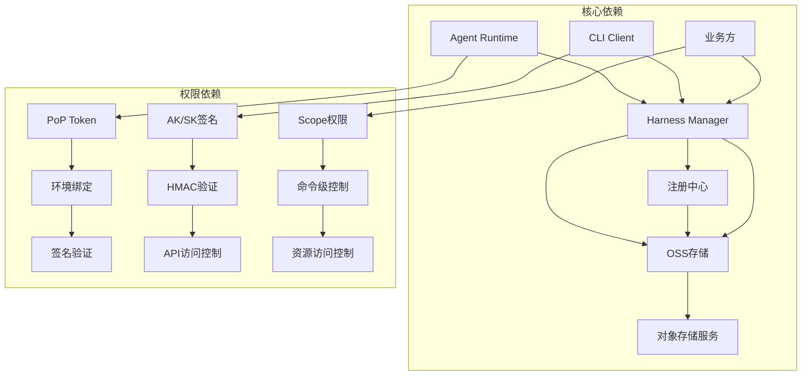

**图表来源**
- [Sai整体架构设计.md:142-151](file://project/standup/Sai整体架构设计.md#L142-L151)

### 2. 数据流依赖

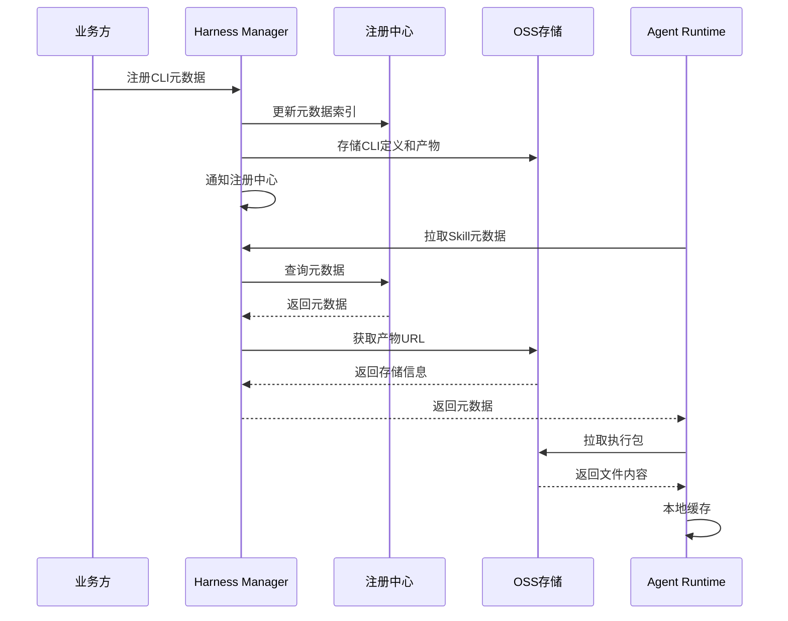

**图表来源**
- [Sai整体架构设计.md:91-106](file://project/standup/Sai整体架构设计.md#L91-L106)

**章节来源**
- [Sai整体架构设计.md:154-171](file://project/standup/Sai整体架构设计.md#L154-L171)

## 性能考虑

### 1. 存储性能优化

#### 1.1 缓存策略

SAI项目采用了多层次的缓存策略来优化存储性能：

- **本地缓存**: Agent运行时缓存常用文件
- **CDN加速**: 通过CDN分发静态资源
- **预加载机制**: 预先加载可能使用的技能和CLI
- **智能刷新**: 基于使用频率的智能缓存刷新

#### 1.2 并发控制

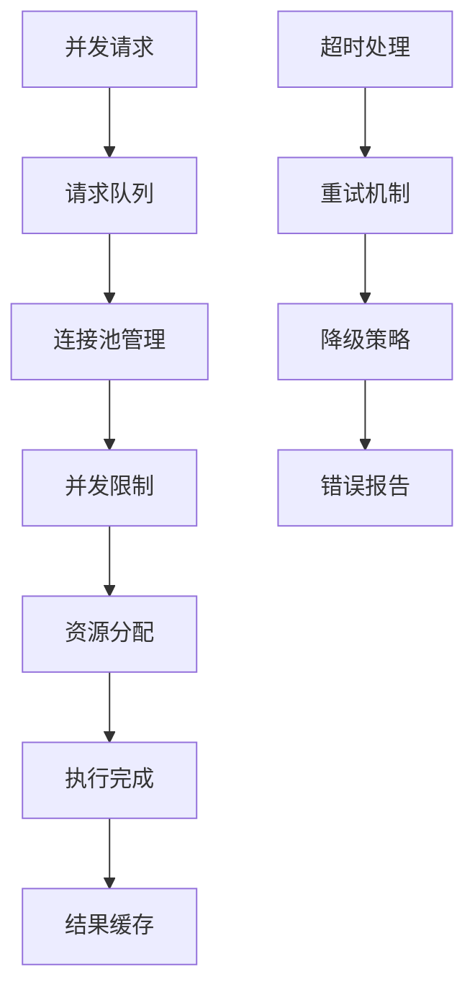

#### 1.3 压缩与传输优化

- **文件压缩**: 对文本文件进行gzip压缩
- **增量传输**: 仅传输变更的文件内容
- **断点续传**: 支持网络中断后的续传
- **多连接下载**: 并发多个连接提高下载速度

### 2. 监控与告警

#### 2.1 性能指标监控

SAI项目监控以下关键性能指标：

- **存储延迟**: 文件上传下载的响应时间
- **并发连接数**: 同时进行的存储操作数量
- **带宽利用率**: 存储网络的使用情况
- **错误率**: 存储操作的失败比例

#### 2.2 自动化运维

- **自动扩容**: 根据存储需求自动调整资源
- **健康检查**: 定期检查存储服务的健康状态
- **故障转移**: 自动切换到备用存储节点
- **容量预警**: 提前预警存储空间不足

## 故障处理指南

### 1. 常见故障类型

#### 1.1 存储服务故障

| 故障类型 | 影响范围 | 降级策略 | 处理时间 |
|---------|---------|---------|---------|
| OSS不可用 | Agent无法拉取新技能/CLI执行包 | 使用本地缓存版本运行 | 立即响应 |
| 网络中断 | 文件传输失败 | 断点续传或重试 | 实时处理 |
| 权限错误 | 访问被拒绝 | 重新获取令牌 | 立即处理 |
| 版本冲突 | 文件版本不匹配 | 回滚到稳定版本 | 立即处理 |

#### 1.2 性能问题

- **存储延迟过高**: 检查网络连接和OSS配置
- **并发连接数过多**: 实施连接池限制和资源回收
- **带宽不足**: 增加带宽或启用CDN加速
- **缓存命中率低**: 优化缓存策略和预加载机制

### 2. 故障恢复流程

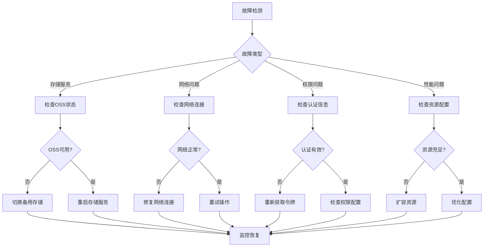

### 3. 预防性维护

#### 3.1 定期维护任务

- **存储空间清理**: 清理过期和无用的文件
- **权限检查**: 定期验证访问权限的有效性
- **性能优化**: 优化存储配置和缓存策略
- **备份验证**: 验证备份数据的完整性和可恢复性

#### 3.2 风险评估

- **OSS挂载个性化需求**: 阿里云评估结果影响4/30交付
- **HM Skill/CLI方案**: 需要在4/25前产出接口定义文档
- **LLM Gateway逃生方案**: 至少准备两个方案
- **Channel → Agent交互协议**: 需要与前端团队对齐

**章节来源**
- [cross-module-design-review-2026-04-24.md:270-306](file://notes/zhaobomin/cross-module-design-review-2026-04-24.md#L270-L306)

## 结论

SAI项目的OSS存储集成模块展现了现代企业级AI平台的存储架构最佳实践。通过分层的存储策略、多层权限控制和完善的故障处理机制，该模块为整个SAI生态系统提供了可靠的存储基础设施。

### 主要优势

1. **架构清晰**: 分层设计确保了系统的可维护性和扩展性
2. **权限安全**: 多层权限控制保障了数据访问的安全性
3. **性能优化**: 缓存策略和CDN加速提升了用户体验
4. **故障处理**: 完善的降级机制确保了系统的稳定性
5. **监控告警**: 全面的监控体系支持主动运维

### 未来发展

随着SAI项目的不断发展，OSS存储集成模块还需要在以下方面持续改进：

- **智能化缓存**: 基于机器学习的智能缓存策略
- **边缘存储**: 利用边缘计算提升访问速度
- **容器化部署**: 更灵活的部署和扩缩容能力
- **成本优化**: 智能的成本控制和资源优化

通过持续的优化和改进，SAI项目的OSS存储集成模块将继续为企业级AI应用提供强大而可靠的存储支持。