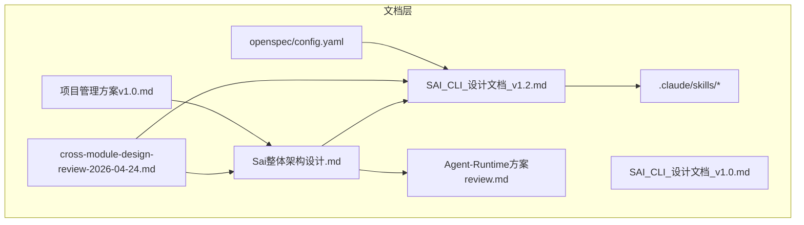
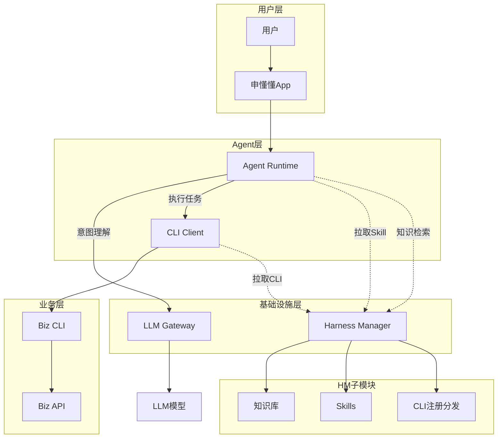
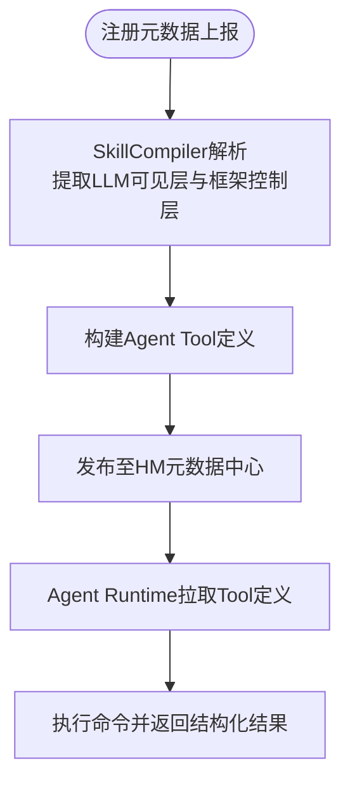
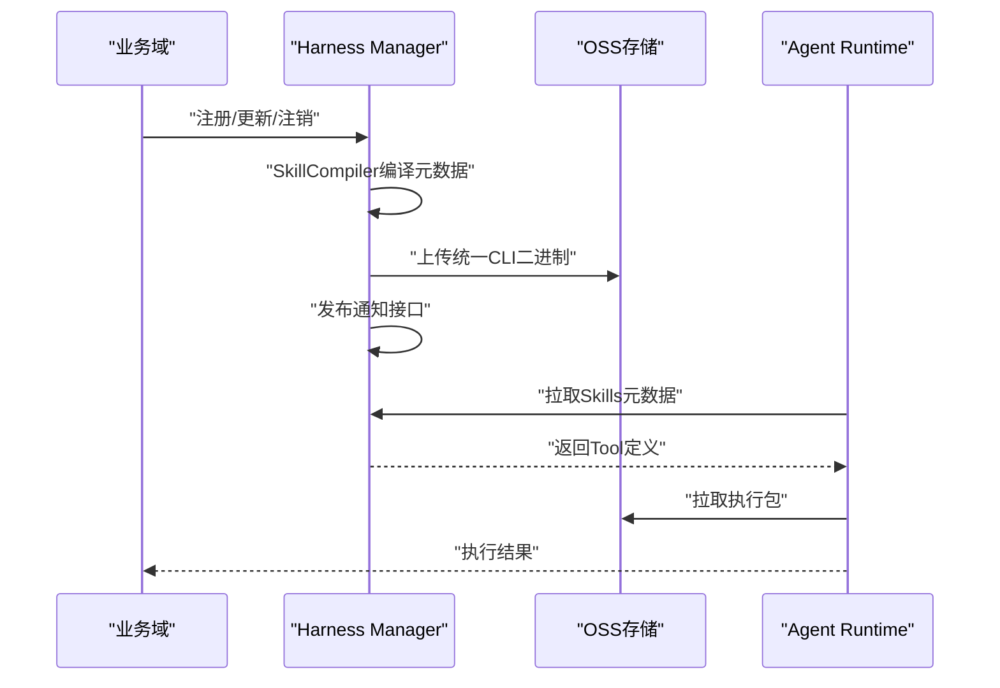
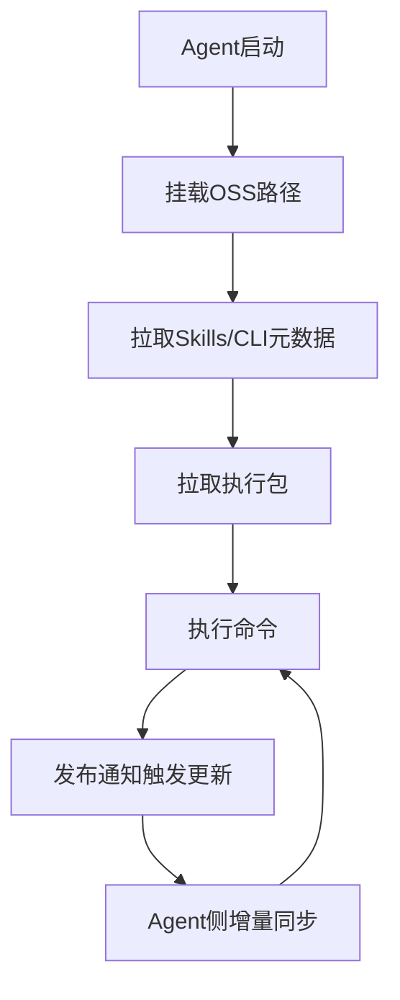
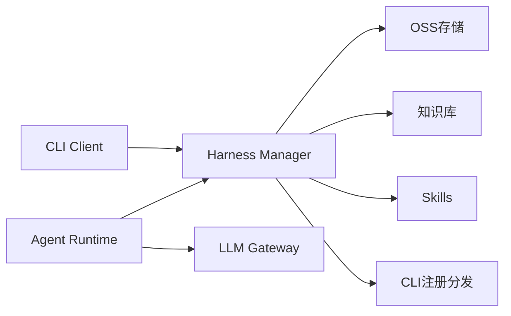

# Skills管理

<cite>
**本文引用的文件**   
- [Sai整体架构设计.md](file://project/standup/Sai整体架构设计.md)
- [cross-module-design-review-2026-04-24.md](file://notes/zhaobomin/cross-module-design-review-2026-04-24.md)
- [SAI_CLI_设计文档_v1.2.md](file://plan/SAI_CLI_设计文档_v1.2.md)
- [SAI_CLI_设计文档_v1.0.md](file://plan/SAI_CLI_设计文档_v1.0.md)
- [Agent-Runtime方案review.md](file://notes/zhaobomin/Agent-Runtime方案review.md)
- [SKILL.md（.claude/skills/sai）](file://.claude/skills/sai/SKILL.md)
- [SKILL.md（.claude/skills/openspec-apply-change）](file://.claude/skills/openspec-apply-change/SKILL.md)
- [SKILL.md（.claude/skills/openspec-explore）](file://.claude/skills/openspec-explore/SKILL.md)
- [config.yaml（openspec）](file://openspec/config.yaml)
- [项目管理方案v1.0.md](file://project/项目管理方案v1.0.md)
</cite>

## 目录
1. [简介](#简介)
2. [项目结构](#项目结构)
3. [核心组件](#核心组件)
4. [架构总览](#架构总览)
5. [详细组件分析](#详细组件分析)
6. [依赖分析](#依赖分析)
7. [性能考量](#性能考量)
8. [故障排查指南](#故障排查指南)
9. [结论](#结论)
10. [附录](#附录)

## 简介
本文件围绕Skills管理模块，系统化阐述Skill的定义规范、注册流程、生命周期管理、分类体系、依赖关系与版本控制机制，以及动态加载、热更新与隔离执行策略。同时覆盖权限控制、访问审计与性能监控要点，并提供开发规范、接口定义与调试工具使用指南，帮助开发者高效实现与最佳实践落地。

## 项目结构
本仓库为公共文档库，Skills管理相关内容主要分布在以下位置：
- 顶层架构与模块职责：Sai整体架构设计
- 跨模块一致性与缺失项评审：cross-module-design-review
- CLI与Skills相关设计：SAI_CLI_设计文档_v1.x
- Agent Runtime与Skills交互：Agent-Runtime方案review
- Skills示例与行为说明：.claude/skills
- 开放规范配置：openspec/config.yaml
- 项目管理与版本划分：项目管理方案v1.0

**图表来源**
- [Sai整体架构设计.md:19-65](file://project/standup/Sai整体架构设计.md#L19-L65)
- [cross-module-design-review-2026-04-24.md:103-169](file://notes/zhaobomin/cross-module-design-review-2026-04-24.md#L103-L169)
- [SAI_CLI_设计文档_v1.2.md:29-64](file://plan/SAI_CLI_设计文档_v1.2.md#L29-L64)
- [Agent-Runtime方案review.md:1-36](file://notes/zhaobomin/Agent-Runtime方案review.md#L1-L36)
- [.claude/skills/sai/SKILL.md:70-107](file://.claude/skills/sai/SKILL.md#L70-L107)
- [openspec/config.yaml:1-21](file://openspec/config.yaml#L1-L21)
- [项目管理方案v1.0.md:34-49](file://project/项目管理方案v1.0.md#L34-L49)

**章节来源**
- [Sai整体架构设计.md:19-65](file://project/standup/Sai整体架构设计.md#L19-L65)
- [cross-module-design-review-2026-04-24.md:103-169](file://notes/zhaobomin/cross-module-design-review-2026-04-24.md#L103-L169)
- [SAI_CLI_设计文档_v1.2.md:29-64](file://plan/SAI_CLI_设计文档_v1.2.md#L29-L64)
- [Agent-Runtime方案review.md:1-36](file://notes/zhaobomin/Agent-Runtime方案review.md#L1-L36)
- [.claude/skills/sai/SKILL.md:70-107](file://.claude/skills/sai/SKILL.md#L70-L107)
- [openspec/config.yaml:1-21](file://openspec/config.yaml#L1-L21)
- [项目管理方案v1.0.md:34-49](file://project/项目管理方案v1.0.md#L34-L49)

## 核心组件
- Skills（技能）：由Harness Manager（HM）统一编译与分发，Agent Runtime按需拉取并执行。Skills定义来源于业务域API注册元数据，经SkillCompiler编译为Agent可读Tool定义。
- SkillCompiler（技能编译模块）：将业务方上报的原始注册JSON编译为Agent Tool定义，包含LLM可见层与框架控制层元信息。
- HM（Harness Manager）：Skills与CLI注册、编译、分发的控制面，提供元数据与产物的OSS分发路径。
- Agent Runtime：按需拉取Skills与CLI定义，执行命令并返回结构化结果。
- CLI Client：与HM交互拉取CLI定义，执行业务域命令。
- OSS（对象存储）：作为Skills与CLI产物的分发介质，Agent启动时挂载指定路径。

**章节来源**
- [Sai整体架构设计.md:180-194](file://project/standup/Sai整体架构设计.md#L180-L194)
- [SAI_CLI_设计文档_v1.2.md:225-249](file://plan/SAI_CLI_设计文档_v1.2.md#L225-L249)
- [SAI_CLI_设计文档_v1.2.md:545-591](file://plan/SAI_CLI_设计文档_v1.2.md#L545-L591)
- [cross-module-design-review-2026-04-24.md:233-241](file://notes/zhaobomin/cross-module-design-review-2026-04-24.md#L233-L241)

## 架构总览
下图展示Skills在整体架构中的位置与交互路径，强调Agent Runtime与HM之间的Skills拉取与执行链路。

**图表来源**
- [Sai整体架构设计.md:19-65](file://project/standup/Sai整体架构设计.md#L19-L65)

**章节来源**
- [Sai整体架构设计.md:19-65](file://project/standup/Sai整体架构设计.md#L19-L65)

## 详细组件分析

### Skill定义规范与分类体系
- 9维Tag体系：用于语义理解、参数构造、消歧防误判与结果解读。包含路由与分类组（D1-D2、D4）、NLU理解组（D5、D7-D8）、执行与展示组（D3、D6、D9）。
- LLM可见层：name、description、parameters，便于LLM理解命令功能与参数。
- 框架控制层：__agent_meta__，包含domain、intent_scenarios、negative_keywords、result_fields等，用于路由控制、消歧与结果解读。
- 命令规范：{product} {module} {action} [params]，统一参数格式与结构化输出，禁止运行时交互式输入。

**图表来源**
- [SAI_CLI_设计文档_v1.2.md:225-249](file://plan/SAI_CLI_设计文档_v1.2.md#L225-L249)
- [SAI_CLI_设计文档_v1.2.md:250-288](file://plan/SAI_CLI_设计文档_v1.2.md#L250-L288)

**章节来源**
- [SAI_CLI_设计文档_v1.2.md:151-249](file://plan/SAI_CLI_设计文档_v1.2.md#L151-L249)
- [SAI_CLI_设计文档_v1.2.md:250-288](file://plan/SAI_CLI_设计文档_v1.2.md#L250-L288)

### 注册流程与生命周期管理
- 注册路径A（AI辅助）：提交API基础信息 → AI自动生成9维Tag元数据 → 业务团队审核修改 → 注册。
- 注册路径B（自行准备）：按标准格式自行编写9维Tag元数据 → 直接注册。
- 生命周期：add（新增）、update（更新）、remove（注销，软删除30天可恢复）。
- 发布通知：Harness Manager打包统一CLI二进制并上传OSS，调用“发布通知”接口同步命令清单，Agent生效。

**图表来源**
- [SAI_CLI_设计文档_v1.2.md:376-391](file://plan/SAI_CLI_设计文档_v1.2.md#L376-L391)
- [SAI_CLI_设计文档_v1.2.md:574-588](file://plan/SAI_CLI_设计文档_v1.2.md#L574-L588)

**章节来源**
- [SAI_CLI_设计文档_v1.2.md:376-391](file://plan/SAI_CLI_设计文档_v1.2.md#L376-L391)
- [SAI_CLI_设计文档_v1.2.md:574-588](file://plan/SAI_CLI_设计文档_v1.2.md#L574-L588)

### 依赖关系与版本控制机制
- 依赖关系：Agent Runtime依赖HM提供的Skills元数据与产物；CLI Client依赖HM提供的CLI元数据；HM内部依赖SkillCompiler与OSS。
- 版本控制：通过OSS路径规范与发布通知实现版本化分发；Agent启动阶段挂载指定OSS路径，读取统一CLI二进制与Skills清单。
- 增量同步：CLI元数据支持版本查询与增量同步，减少Agent侧负担。

**章节来源**
- [Sai整体架构设计.md:67-106](file://project/standup/Sai整体架构设计.md#L67-L106)
- [SAI_CLI_设计文档_v1.2.md:565-588](file://plan/SAI_CLI_设计文档_v1.2.md#L565-L588)

### 动态加载、热更新与隔离执行策略
- 动态加载：Agent启动阶段挂载OSS路径，按需拉取Skills与CLI定义；支持动态命令兜底分发，避免依赖启动时预挂载。
- 热更新：通过发布通知接口触发命令清单同步更新，Agent侧无需重启即可生效。
- 隔离执行：基于Serverless按session分配实例，一实例一session，确保用户隔离；CLI命令无交互式输入，保证Agent自动化执行。

**图表来源**
- [Sai整体架构设计.md:67-106](file://project/standup/Sai整体架构设计.md#L67-L106)
- [Agent-Runtime方案review.md:11-14](file://notes/zhaobomin/Agent-Runtime方案review.md#L11-L14)

**章节来源**
- [Sai整体架构设计.md:67-106](file://project/standup/Sai整体架构设计.md#L67-L106)
- [Agent-Runtime方案review.md:11-14](file://notes/zhaobomin/Agent-Runtime方案review.md#L11-L14)

### 权限控制、访问审计与性能监控
- 权限控制：统一SSO Token，Scope权限控制，Bot Token与User Token区分；高危操作需更高权限或二次确认。
- 访问审计：结构化错误输出包含type、code、message、hint，便于审计与排障。
- 性能监控：整体架构文档列出冷启动<1s、热启动<200ms的目标；需补充全局错误码与状态码规范、性能与容量规划。

**章节来源**
- [SAI_CLI_设计文档_v1.2.md:394-471](file://plan/SAI_CLI_设计文档_v1.2.md#L394-L471)
- [Sai整体架构设计.md:224-246](file://project/standup/Sai整体架构设计.md#L224-L246)

### 开发规范、接口定义与调试工具
- 开发语言：Harness Manager侧统一使用Golang。
- 接口定义：SkillCompiler输出Agent可读Tool定义；Agent Runtime与HM之间需定义Skills拉取、CLI拉取、知识检索等接口契约。
- 调试工具：Dry-Run模式支持写操作命令预览将要执行的操作；单元测试通过接口抽象实现Mock。

**章节来源**
- [SAI_CLI_设计文档_v1.2.md:339-350](file://plan/SAI_CLI_设计文档_v1.2.md#L339-L350)
- [SAI_CLI_设计文档_v1.2.md:474-513](file://plan/SAI_CLI_设计文档_v1.2.md#L474-L513)
- [cross-module-design-review-2026-04-24.md:187-197](file://notes/zhaobomin/cross-module-design-review-2026-04-24.md#L187-L197)

## 依赖分析
- 模块耦合：Skills与CLI注册、编译、分发由HM统一负责；Agent Runtime与HM之间存在明确的拉取接口依赖；CLI Client与HM之间存在元数据与产物拉取依赖。
- 外部依赖：OSS作为分发介质，Agent启动阶段挂载指定路径；LLM Gateway提供意图理解链路。
- 潜在风险：接口契约未完全定义（Skills拉取、CLI拉取、知识检索），需尽快补齐。

**图表来源**
- [Sai整体架构设计.md:67-106](file://project/standup/Sai整体架构设计.md#L67-L106)
- [cross-module-design-review-2026-04-24.md:187-197](file://notes/zhaobomin/cross-module-design-review-2026-04-24.md#L187-L197)

**章节来源**
- [Sai整体架构设计.md:67-106](file://project/standup/Sai整体架构设计.md#L67-L106)
- [cross-module-design-review-2026-04-24.md:187-197](file://notes/zhaobomin/cross-module-design-review-2026-04-24.md#L187-L197)

## 性能考量
- 冷启动与热启动目标：冷启动<1s，热启动<200ms。
- 元数据规模影响：1500个API Tag元数据量级对Agent启动速度的影响需评估。
- 存储与网络：OSS挂载与缓存策略需明确，以降低拉取延迟与带宽消耗。

**章节来源**
- [Sai整体架构设计.md:224-251](file://project/standup/Sai整体架构设计.md#L224-L251)

## 故障排查指南
- HM不可用：Agent使用本地缓存最近一次Skills/CLI定义，降级为无知识检索模式。
- OSS不可用：Agent使用本地缓存版本运行，日志告警通知HM团队。
- LLM Gateway熔断：Agent返回固定提示，业务执行链路不受影响。
- Biz API超时/失败：CLI Client单次重试（≤3s等待），失败后Agent向用户说明具体接口不可用。

**章节来源**
- [Sai整体架构设计.md:236-246](file://project/standup/Sai整体架构设计.md#L236-L246)

## 结论
Skills管理模块以HM为核心，通过SkillCompiler将业务域API元数据编译为Agent可读Tool定义，并借助OSS实现Skills与CLI的统一分发与版本化管理。整体架构明确了Agent Runtime与HM之间的依赖关系，但在接口契约、知识库设计、性能与容量规划等方面仍存在缺失，需尽快补齐以保障4/30交付目标。

## 附录
- 术语说明：Skills为Agent可调用的工具集合；Tool定义为Agent侧可识别的命令与参数描述；OSS为对象存储，用于分发二进制与元数据。
- 参考实现：.claude/skills目录下的示例展示了Skill的行为与调用方式，可作为实现参考。

**章节来源**
- [.claude/skills/sai/SKILL.md:70-107](file://.claude/skills/sai/SKILL.md#L70-L107)
- [.claude/skills/openspec-apply-change/SKILL.md:153-157](file://.claude/skills/openspec-apply-change/SKILL.md#L153-L157)
- [.claude/skills/openspec-explore/SKILL.md:171-200](file://.claude/skills/openspec-explore/SKILL.md#L171-L200)