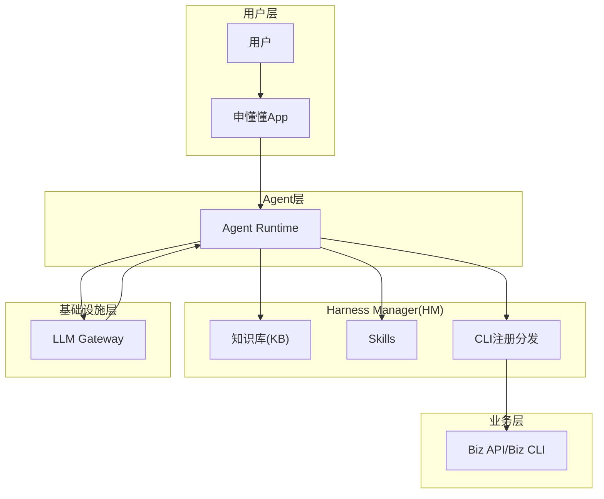
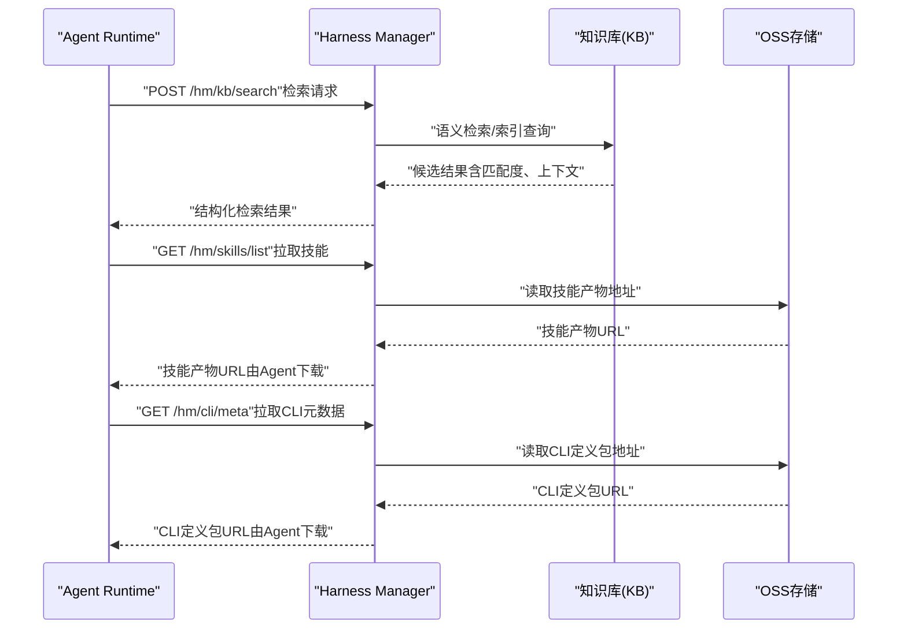
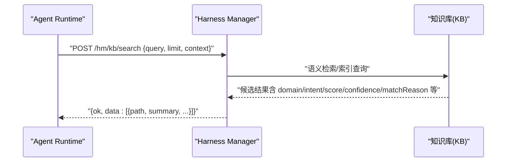
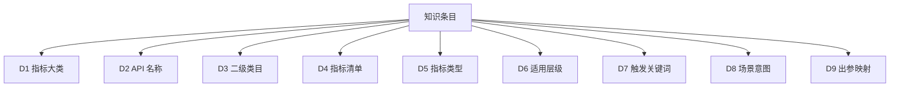
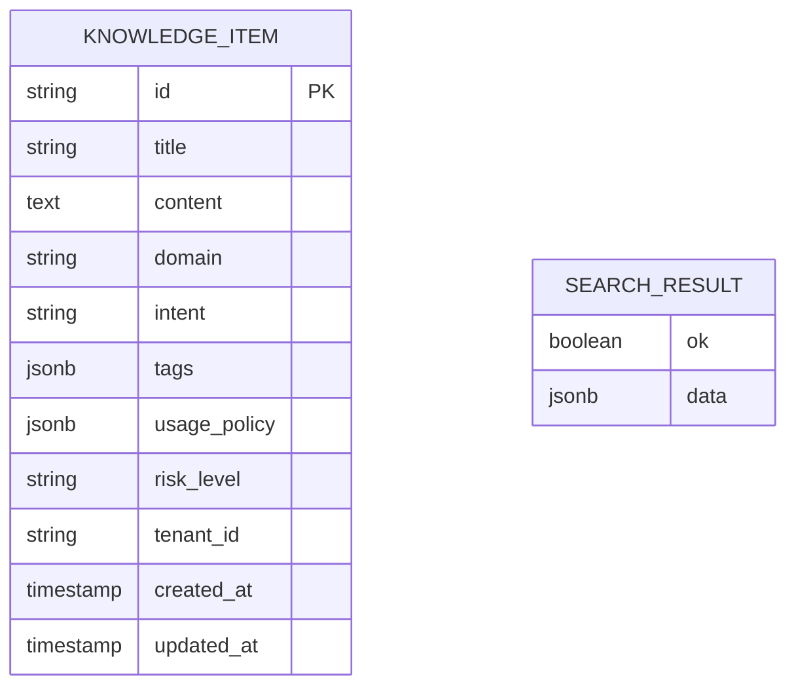
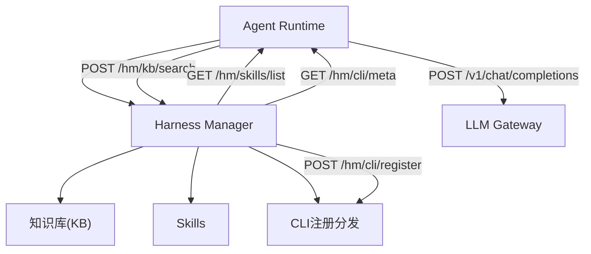

# 知识库管理

<cite>
**本文引用的文件**
- [README.md](file://README.md)
- [Sai整体架构设计.md](file://project/standup/Sai整体架构设计.md)
- [agent-api-discovery-architecture-review.zh-CN.md](file://notes/zhaobomin/agent-api-discovery-architecture-review.zh-CN.md)
- [cross-module-design-review-2026-04-24.md](file://notes/zhaobomin/cross-module-design-review-2026-04-24.md)
- [SAI_CLI_设计文档_v1.2.md](file://plan/SAI_CLI_设计文档_v1.2.md)
- [CLI 架构与规范对焦.md](file://plan/CLI 架构与规范对焦.md)
- [lingxue.md](file://daily/2026-04-24/lingxue.md)
</cite>

## 目录
1. [简介](#简介)
2. [项目结构](#项目结构)
3. [核心组件](#核心组件)
4. [架构总览](#架构总览)
5. [详细组件分析](#详细组件分析)
6. [依赖分析](#依赖分析)
7. [性能考虑](#性能考虑)
8. [故障排查指南](#故障排查指南)
9. [结论](#结论)
10. [附录](#附录)

## 简介
本文件围绕“知识库管理（KB）”模块，结合现有文档中的接口矩阵、模块职责与设计要点，给出可操作的技术文档与实现参考。当前仓库中明确指出“知识库（KB）”为 Harness Manager 的子模块之一，但缺乏 KB 的数据源、向量存储、检索算法与更新机制等具体设计。本文在不虚构信息的前提下，基于已有接口契约与设计原则，提供面向开发者的实现蓝图、API 规范、数据模型与优化建议。

## 项目结构
- 顶层 README 展示了模块分工与数据流概览，其中明确包含“Harness Manager 子模块：知识库（KB）”。
- “Sai整体架构设计”进一步细化了 HM 的子模块职责与调用协议，强调 HM 作为控制面，不参与业务调用链路，仅做资源分发与检索支撑。
- “agent-api-discovery-architecture-review”与“cross-module-design-review-2026-04-24”两篇评审文档对“知识检索”接口的必要性与现状进行了评估，指出“知识检索”接口尚无 KB 设计文档，属于高风险缺失项。

**图表来源**
- [README.md:11-41](file://README.md#L11-L41)
- [Sai整体架构设计.md:19-65](file://project/standup/Sai整体架构设计.md#L19-L65)

**章节来源**
- [README.md:9-41](file://README.md#L9-L41)
- [Sai整体架构设计.md:17-65](file://project/standup/Sai整体架构设计.md#L17-L65)

## 核心组件
- 知识库（KB）：企业知识存储与检索，支撑 Agent 决策。
- Skills：技能注册与管理，Agent 从 HM 拉取 Skill 定义。
- CLI 注册分发：业务方上报 CLI 元数据，存储至 OSS，Agent 从 OSS 拉取 CLI 定义。

上述职责来自“Sai整体架构设计”对 HM 子模块的说明，其中 KB 与 Skills、CLI 注册分发共同构成 HM 的控制面能力。

**章节来源**
- [Sai整体架构设计.md:173-194](file://project/standup/Sai整体架构设计.md#L173-L194)

## 架构总览
- Agent 通过“知识检索”接口向 HM 发起检索请求，HM 返回候选与上下文信息，辅助 Agent 做出决策。
- HM 与业务层之间通过 OSS 进行产物分发，Agent 通过 HM 拉取技能与 CLI 定义，不直接参与业务调用链路。

**图表来源**
- [Sai整体架构设计.md:104-106](file://project/standup/Sai整体架构设计.md#L104-L106)
- [Sai整体架构设计.md:158-163](file://project/standup/Sai整体架构设计.md#L158-L163)

**章节来源**
- [Sai整体架构设计.md:104-106](file://project/standup/Sai整体架构设计.md#L104-L106)
- [Sai整体架构设计.md:158-163](file://project/standup/Sai整体架构设计.md#L158-L163)

## 详细组件分析

### 知识库检索接口规范
- 接口路径：POST /hm/kb/search
- 认证方式：HM 内部 Token
- 风险评估：未定义（高风险）

检索请求与响应建议遵循如下结构（基于评审文档对 discover 的增强建议，用于 KB 检索的参考）：

- 请求体（示例）
  - query：自然语言查询
  - limit：返回候选数量上限
  - context：上下文信息（如 locale、preferredProduct、conversationHints 等）
- 响应体（示例）
  - ok：布尔值
  - data：候选数组
    - path：命令/知识条目标识
    - summary：摘要
    - domain/intent：领域与意图
    - score/confidence：匹配分数与置信度
    - matchReason：匹配原因
    - requiredFlags/optionalFlags/missingFlags：参数需求
    - inferredParams：从上下文推断的参数
    - riskLevel：风险等级（只读/有副作用）
    - nextHelp：帮助指引

**图表来源**
- [agent-api-discovery-architecture-review.zh-CN.md:239-308](file://notes/zhaobomin/agent-api-discovery-architecture-review.zh-CN.md#L239-L308)
- [Sai整体架构设计.md:158-163](file://project/standup/Sai整体架构设计.md#L158-L163)

**章节来源**
- [agent-api-discovery-architecture-review.zh-CN.md:239-308](file://notes/zhaobomin/agent-api-discovery-architecture-review.zh-CN.md#L239-L308)
- [Sai整体架构设计.md:158-163](file://project/standup/Sai整体架构设计.md#L158-L163)

### 知识分类体系与元数据管理
- 9 维 Tag 体系（来自 CLI 设计文档）可作为 KB 元数据的参考来源，用于知识条目的分类与检索：
  - D1 指标大类、D2 API 名称、D3 二级类目、D4 指标清单、D5 指标类型、D6 适用层级、D7 触发关键词、D8 场景意图、D9 出参映射
- 建议将 KB 的“知识条目”视为“命令/API 的语义化描述”，其元数据可复用 CLI 的 Tag 体系，便于 Agent 在检索后进行消歧与参数推断。

**图表来源**
- [SAI_CLI_设计文档_v1.2.md:155-169](file://plan/SAI_CLI_设计文档_v1.2.md#L155-L169)

**章节来源**
- [SAI_CLI_设计文档_v1.2.md:155-169](file://plan/SAI_CLI_设计文档_v1.2.md#L155-L169)

### 服务发现与检索链路
- 评审文档建议将发现机制升级为“list/index → discover → schema/help → validate/dry-run”的四层链路，KB 检索可借鉴该思路：
  - list/index：快速了解当前用户可见的知识空间（可基于权限与标签过滤）
  - discover：语义召回候选（结合上下文与权限）
  - schema/help：获取候选的输入/输出、适用边界与示例
  - validate/dry-run：执行前校验参数、风险与规范化结果
- discover 的返回结构建议包含：domain、intent、confidence、matchReason、requiredFlags、optionalFlags、missingFlags、inferredParams、riskLevel、nextHelp 等字段，以提升 Agent 的可解释性与可控性。

**章节来源**
- [agent-api-discovery-architecture-review.zh-CN.md:219-308](file://notes/zhaobomin/agent-api-discovery-architecture-review.zh-CN.md#L219-L308)

### 知识更新策略与版本控制
- 由于 KB 设计文档缺失，当前建议沿用 CLI 的注册与发布流程思路：
  - 业务方提供 API 描述文档 → AI 自动生成元数据（可复用 Tag 体系） → 业务团队审核 → 注册至 HM → 通过 HM 同步至 KB 索引
  - 版本控制：采用“软删除（30 天可恢复）+ 增量同步”的策略，避免全量重建带来的索引抖动
- 与 CLI 的差异：KB 更关注“语义检索”与“上下文理解”，需在注册阶段补充“领域/意图/适用边界/风险等级”等元数据字段。

**章节来源**
- [SAI_CLI_设计文档_v1.2.md:365-392](file://plan/SAI_CLI_设计文档_v1.2.md#L365-L392)

### 缓存优化与性能
- 评审文档指出 CLI 的 registry 客户端存在“责任过重、单文件复杂度高”的问题，建议拆分为 transport、cache_store、commands_client、parser、refresh 等模块。KB 可借鉴该思路：
  - 缓存层：本地缓存 + ETag/304 处理 + stale fallback
  - 索引层：倒排索引/向量索引（结合检索算法） + 权限过滤
  - 传输层：HTTP 重试与超时控制
- 评审还建议将“下游 4xx/5xx 包装为成功”的问题修复为“typed error + 状态码映射”，KB 的检索结果也应遵循结构化错误输出，便于 Agent 做降级与重试。

**章节来源**
- [agent-api-discovery-architecture-review.zh-CN.md:135-186](file://notes/zhaobomin/agent-api-discovery-architecture-review.zh-CN.md#L135-L186)

### 权限控制与访问统计
- 权限控制：评审文档建议在 discover 返回中加入 riskLevel（只读/有副作用），KB 检索亦可沿用该思路，结合“适用层级（D6）”与“权限 Scope”进行过滤。
- 访问统计：建议在检索接口中增加埋点字段（如 request_id、path、method、status、duration、user_id、tenant_id 等），便于后续统计与审计。

**章节来源**
- [agent-api-discovery-architecture-review.zh-CN.md:274-281](file://notes/zhaobomin/agent-api-discovery-architecture-review.zh-CN.md#L274-L281)
- [SAI_CLI_设计文档_v1.2.md:441-450](file://plan/SAI_CLI_设计文档_v1.2.md#L441-L450)

### 配置管理
- 评审文档指出“默认 prod profile 仍是占位 URL”的问题，建议在构建阶段校验生产配置，不允许占位符进入产物；同时在 version 输出中保留 buildEnv 与关键 endpoint 摘要，便于排查。
- KB 的配置建议包括：索引存储路径、缓存 TTL、检索超时、日志开关（SAI_DEBUG）、鉴权密钥等。

**章节来源**
- [agent-api-discovery-architecture-review.zh-CN.md:96-114](file://notes/zhaobomin/agent-api-discovery-architecture-review.zh-CN.md#L96-L114)

### 数据模型定义（概念性）
- 知识条目（概念模型）
  - id：唯一标识
  - title：标题
  - content：正文内容
  - domain/intent：领域与意图
  - tags：9 维 Tag（D1-D9）
  - usage_policy：适用边界（useWhen/doNotUseWhen/dataFreshness/sideEffect/confirmationRequired）
  - risk_level：风险等级
  - created_at/updated_at：时间戳
  - tenant_id：租户标识
- 检索结果（概念模型）
  - ok：布尔值
  - data：候选数组（path、summary、domain、intent、score、confidence、matchReason、requiredFlags、optionalFlags、missingFlags、inferredParams、riskLevel、nextHelp）

**图表来源**
- [agent-api-discovery-architecture-review.zh-CN.md:239-308](file://notes/zhaobomin/agent-api-discovery-architecture-review.zh-CN.md#L239-L308)
- [SAI_CLI_设计文档_v1.2.md:155-169](file://plan/SAI_CLI_设计文档_v1.2.md#L155-L169)

## 依赖分析
- Agent 与 HM 的接口契约
  - POST /v1/chat/completions（LLM 调用）：已对齐
  - GET /hm/skills/list：未定义（仅整体架构有路径，无 schema）
  - GET /hm/cli/meta：未定义（v1.2 有路径规范，无版本/缓存）
  - POST /hm/cli/register：已定义（v1.2）
  - POST /hm/kb/search：未定义（知识检索）
- 评审文档指出“Agent Runtime ↔ HM 接口契约”缺失，需对齐 Skill 拉取、CLI 拉取的具体 schema 与缓存策略。

**图表来源**
- [Sai整体架构设计.md:158-163](file://project/standup/Sai整体架构设计.md#L158-L163)
- [cross-module-design-review-2026-04-24.md:258-267](file://notes/zhaobomin/cross-module-design-review-2026-04-24.md#L258-L267)

**章节来源**
- [Sai整体架构设计.md:158-163](file://project/standup/Sai整体架构设计.md#L158-L163)
- [cross-module-design-review-2026-04-24.md:258-267](file://notes/zhaobomin/cross-module-design-review-2026-04-24.md#L258-L267)

## 性能考虑
- 检索延迟：建议引入本地缓存与 TTL，结合 ETag/304 与 stale fallback，降低频繁检索对后端的压力。
- 索引规模：针对“1500 个 API Tag 元数据量级对 Agent 启动速度的影响”进行容量评估，避免启动时一次性加载全部索引。
- 并发与 QPS：结合“预期 QPS/并发用户数”与“Token 消耗预估”，规划存储容量（OSS/RDS/Redis）与实例数量。
- 日志与调试：默认关闭业务参数日志，仅在 SAI_DEBUG=true 时输出，避免污染 stderr 与泄露敏感信息。

**章节来源**
- [cross-module-design-review-2026-04-24.md:243-251](file://notes/zhaobomin/cross-module-design-review-2026-04-24.md#L243-L251)
- [agent-api-discovery-architecture-review.zh-CN.md:115-134](file://notes/zhaobomin/agent-api-discovery-architecture-review.zh-CN.md#L115-L134)

## 故障排查指南
- 知识检索不可用：检查 HM 不可用时的降级策略（Agent 使用本地缓存），并确认 KB 服务健康状态。
- 检索结果异常：确认检索接口返回结构是否包含 confidence、matchReason、riskLevel 等关键字段，以便 Agent 判断是否需要用户确认或提示补全参数。
- 非 2xx 状态码：修复“下游 4xx/5xx 被包装为成功”的问题，确保 typed error 与状态码映射正确，便于 Agent 做重试与降级。
- 生产配置问题：构建阶段校验 prod profile，不允许占位符进入产物；在 version 输出中保留 buildEnv 与关键 endpoint 摘要。

**章节来源**
- [Sai整体架构设计.md:236-245](file://project/standup/Sai整体架构设计.md#L236-L245)
- [agent-api-discovery-architecture-review.zh-CN.md:68-95](file://notes/zhaobomin/agent-api-discovery-architecture-review.zh-CN.md#L68-L95)
- [agent-api-discovery-architecture-review.zh-CN.md:96-114](file://notes/zhaobomin/agent-api-discovery-architecture-review.zh-CN.md#L96-L114)

## 结论
- 知识库（KB）作为 HM 的子模块，承担“企业知识存储与检索”的职责，当前仓库中明确其存在，但缺乏 KB 的数据源、向量存储、检索算法与更新机制等具体设计。
- 基于现有接口矩阵与设计原则，建议以“list/index → discover → schema/help → validate/dry-run”的四层发现链路为基础，完善 KB 的检索接口与返回结构。
- 在实现层面，可借鉴 CLI 的 9 维 Tag 体系与注册发布流程，结合权限过滤、风险等级与适用边界，提升检索的可解释性与安全性。
- 需尽快补齐“Agent Runtime ↔ HM 接口契约”与“知识检索接口”的具体 schema，以降低对接返工风险。

## 附录
- 接口对齐状态（摘自评审文档）
  - LLM 调用：已对齐
  - Skill 拉取：未定义（仅整体架构有路径，无 schema）
  - CLI 拉取：v1.2 有路径规范，无版本/缓存
  - CLI 注册：已定义（v1.2）
  - 知识检索：未定义（知识检索）
  - 前端交互：未定义（Channel 文档缺失）

**章节来源**
- [cross-module-design-review-2026-04-24.md:258-267](file://notes/zhaobomin/cross-module-design-review-2026-04-24.md#L258-L267)