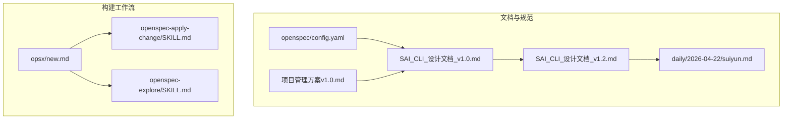
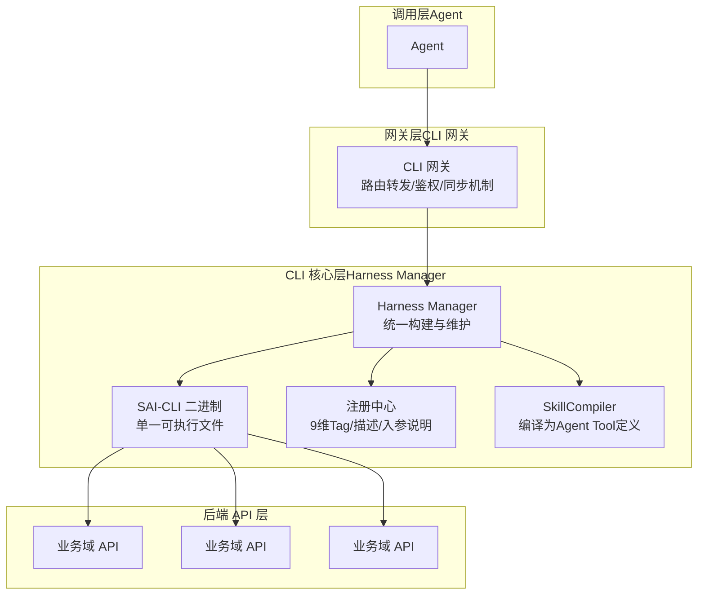
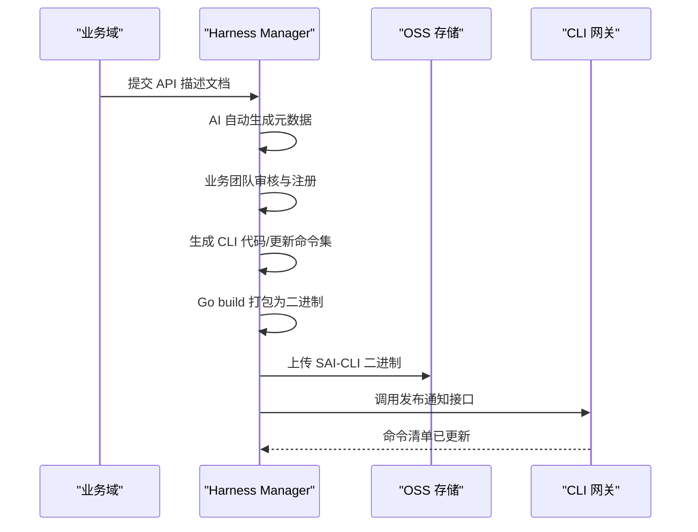
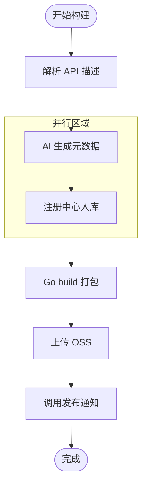
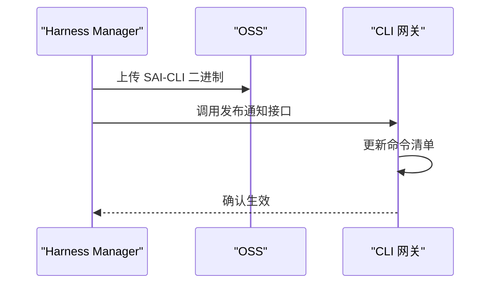
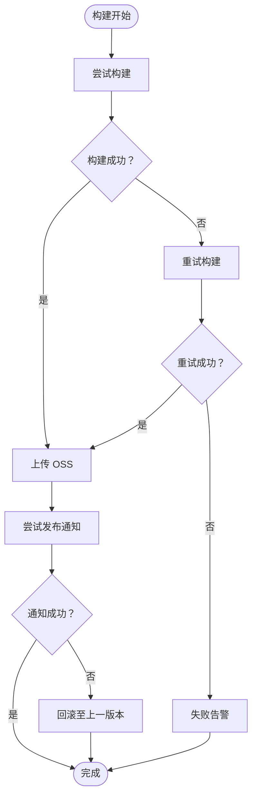
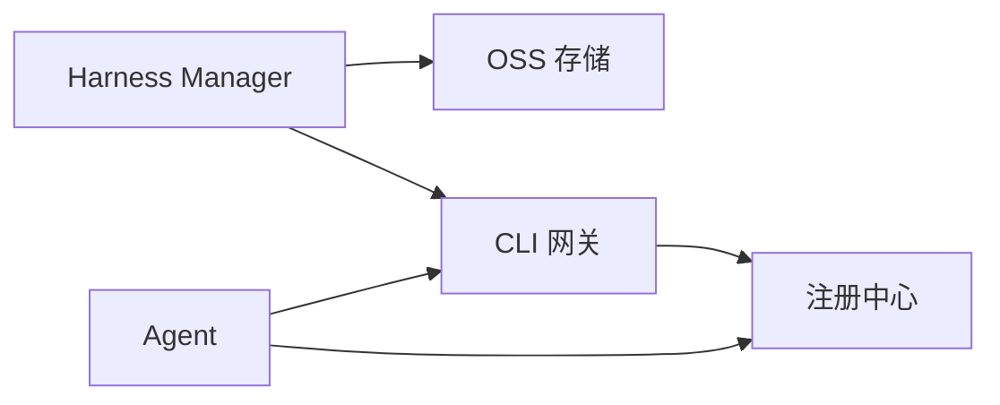

# 自动化构建流程

<cite>
**本文引用的文件**
- [openspec/config.yaml](file://openspec/config.yaml)
- [项目管理方案v1.0.md](file://project/项目管理方案v1.0.md)
- [SAI_CLI_设计文档_v1.0.md](file://plan/SAI_CLI_设计文档_v1.0.md)
- [SAI_CLI_设计文档_v1.2.md](file://plan/SAI_CLI_设计文档_v1.2.md)
- [2026-04-22/suiyun.md](file://daily/2026-04-22/suiyun.md)
- [opsx/new.md](file://.claude/commands/opsx/new.md)
- [openspec-apply-change/SKILL.md](file://.claude/skills/openspec-apply-change/SKILL.md)
- [openspec-explore/SKILL.md](file://.claude/skills/openspec-explore/SKILL.md)
</cite>

## 目录
1. [简介](#简介)
2. [项目结构](#项目结构)
3. [核心组件](#核心组件)
4. [架构概览](#架构概览)
5. [详细组件分析](#详细组件分析)
6. [依赖分析](#依赖分析)
7. [性能考虑](#性能考虑)
8. [故障排查指南](#故障排查指南)
9. [结论](#结论)
10. [附录](#附录)

## 简介
本文件围绕自动化构建流程模块，系统阐述 SAI-CLI 的构建流水线设计、任务调度与依赖管理，覆盖构建触发机制、并行执行与资源分配策略、产物打包签名与发布流程、构建监控与失败重试回滚机制，并提供构建配置模板、环境变量与部署脚本示例，帮助开发者建立完整的自动化构建参考与持续集成最佳实践。

## 项目结构
该仓库以文档驱动为主，自动化构建相关内容主要体现在以下几类文件：
- 构建与发布流程文档：SAI CLI 设计文档（v1.0、v1.2）
- 项目管理与协作规范：项目管理方案
- 日常工作记录：团队日报体现架构演进与构建职责变化
- OpenSpec 工作流工具：opsx/new 与相关技能文档，体现变更驱动的构建工作流

**图表来源**
- [openspec/config.yaml:1-21](file://openspec/config.yaml#L1-L21)
- [项目管理方案v1.0.md:1-175](file://project/项目管理方案v1.0.md#L1-L175)
- [SAI_CLI_设计文档_v1.0.md:1-384](file://plan/SAI_CLI_设计文档_v1.0.md#L1-L384)
- [SAI_CLI_设计文档_v1.2.md:1-635](file://plan/SAI_CLI_设计文档_v1.2.md#L1-L635)
- [2026-04-22/suiyun.md:1-46](file://daily/2026-04-22/suiyun.md#L1-L46)
- [opsx/new.md:1-70](file://.claude/commands/opsx/new.md#L1-L70)
- [openspec-apply-change/SKILL.md:1-157](file://.claude/skills/openspec-apply-change/SKILL.md#L1-L157)
- [openspec-explore/SKILL.md:1-289](file://.claude/skills/openspec-explore/SKILL.md#L1-L289)

**章节来源**
- [openspec/config.yaml:1-21](file://openspec/config.yaml#L1-L21)
- [项目管理方案v1.0.md:1-175](file://project/项目管理方案v1.0.md#L1-L175)
- [SAI_CLI_设计文档_v1.0.md:1-384](file://plan/SAI_CLI_设计文档_v1.0.md#L1-L384)
- [SAI_CLI_设计文档_v1.2.md:1-635](file://plan/SAI_CLI_设计文档_v1.2.md#L1-L635)
- [2026-04-22/suiyun.md:1-46](file://daily/2026-04-22/suiyun.md#L1-L46)
- [opsx/new.md:1-70](file://.claude/commands/opsx/new.md#L1-L70)
- [openspec-apply-change/SKILL.md:1-157](file://.claude/skills/openspec-apply-change/SKILL.md#L1-L157)
- [openspec-explore/SKILL.md:1-289](file://.claude/skills/openspec-explore/SKILL.md#L1-L289)

## 核心组件
- 构建触发与职责边界
  - 构建触发：由各业务域提供 API 接口与描述文档，Harness Manager 负责统一构建与发布
  - 职责分离：业务域专注于 API 提供，CLI 开发与打包由 Harness Manager 统一承担
- 构建流水线
  - 输入：API 接口变更与描述文档
  - 处理：代码生成、命令注册、二进制打包、上传 OSS、发布通知
  - 输出：统一的 SAI-CLI 二进制文件与注册中心元数据
- 产物管理
  - 产物类型：单一可执行二进制文件（Go build）
  - 存储位置：OSS 路径规范（CLI 网关、系统内置技能、公共技能、用户技能）
  - 发布机制：调用网关“发布通知”接口，同步更新命令清单

**章节来源**
- [SAI_CLI_设计文档_v1.2.md:545-635](file://plan/SAI_CLI_设计文档_v1.2.md#L545-L635)
- [SAI_CLI_设计文档_v1.0.md:323-354](file://plan/SAI_CLI_设计文档_v1.0.md#L323-L354)
- [2026-04-22/suiyun.md:17-46](file://daily/2026-04-22/suiyun.md#L17-L46)

## 架构概览
SAI-CLI 架构采用四层分层设计，构建流程位于 CLI 核心层与网关层之间，通过 Harness Manager 统一构建与发布，Agent 通过网关访问统一 CLI 二进制。

**图表来源**
- [SAI_CLI_设计文档_v1.2.md:29-75](file://plan/SAI_CLI_设计文档_v1.2.md#L29-L75)
- [SAI_CLI_设计文档_v1.2.md:545-635](file://plan/SAI_CLI_设计文档_v1.2.md#L545-L635)

## 详细组件分析

### 组件A：构建触发与任务调度
- 触发机制
  - 事件驱动：业务域 API 变更 → Harness Manager 触发构建
  - 文档驱动：API 描述文档提交 → AI 自动生成元数据 → 业务团队审核 → 注册生效
- 任务调度
  - 串行依赖：API 描述 → 元数据生成 → 注册 → 代码生成 → 打包 → 上传 → 发布通知
  - 并行优化：同一域内多个 API 的元数据生成与注册可并行处理
- 资源分配
  - CPU：代码生成与打包阶段可并行化，I/O：OSS 上传与网关通知
  - 内存：元数据解析与编译阶段内存占用可控

**图表来源**
- [SAI_CLI_设计文档_v1.2.md:574-588](file://plan/SAI_CLI_设计文档_v1.2.md#L574-L588)
- [SAI_CLI_设计文档_v1.2.md:364-391](file://plan/SAI_CLI_设计文档_v1.2.md#L364-L391)

**章节来源**
- [SAI_CLI_设计文档_v1.2.md:574-588](file://plan/SAI_CLI_设计文档_v1.2.md#L574-L588)
- [SAI_CLI_设计文档_v1.2.md:364-391](file://plan/SAI_CLI_设计文档_v1.2.md#L364-L391)

### 组件B：并行执行与资源分配策略
- 并行策略
  - 域内并行：同一业务域内的多个 API 注册与元数据生成并行
  - 域间串行：跨域构建按域分批，避免资源竞争
- 资源分配
  - CPU：代码生成与编译阶段可利用多核并行
  - I/O：OSS 上传与网关通知可异步并发
  - 内存：分阶段释放中间产物，避免峰值内存过高

**图表来源**
- [SAI_CLI_设计文档_v1.2.md:574-588](file://plan/SAI_CLI_设计文档_v1.2.md#L574-L588)

**章节来源**
- [SAI_CLI_设计文档_v1.2.md:574-588](file://plan/SAI_CLI_设计文档_v1.2.md#L574-L588)

### 组件C：产物打包、签名与发布
- 打包流程
  - Go build 生成单一二进制文件，包含所有域命令集
  - 产物命名与版本管理遵循统一规范
- 签名策略
  - 网关侧鉴权：AK/SK 签名（HMAC-SHA256）用于 Harness Manager API
  - 令牌安全：PoP Token（可选）与 ECDSA 签名（二期）增强
- 发布流程
  - OSS 路径规范：CLI 网关、系统内置技能、公共技能、用户技能
  - 发布通知：调用网关接口同步命令清单，Agent 生效

**图表来源**
- [SAI_CLI_设计文档_v1.2.md:565-591](file://plan/SAI_CLI_设计文档_v1.2.md#L565-L591)
- [SAI_CLI_设计文档_v1.2.md:452-460](file://plan/SAI_CLI_设计文档_v1.2.md#L452-L460)

**章节来源**
- [SAI_CLI_设计文档_v1.2.md:565-591](file://plan/SAI_CLI_设计文档_v1.2.md#L565-L591)
- [SAI_CLI_设计文档_v1.2.md:452-460](file://plan/SAI_CLI_设计文档_v1.2.md#L452-L460)

### 组件D：构建监控、失败重试与回滚
- 监控指标
  - 构建成功率、耗时分布、并发度、OSS 上传成功率
  - 注册中心更新延迟、网关生效时间
- 失败重试
  - 网络异常：指数退避重试 OSS 上传与发布通知
  - 数据异常：重试元数据生成与注册，保留失败批次以便人工干预
- 回滚机制
  - 版本标记：每次发布生成新版本号
  - 回滚策略：通过网关切换版本，Agent 侧可选择降级到上一稳定版本

**图表来源**
- [SAI_CLI_设计文档_v1.2.md:574-588](file://plan/SAI_CLI_设计文档_v1.2.md#L574-L588)

**章节来源**
- [SAI_CLI_设计文档_v1.2.md:574-588](file://plan/SAI_CLI_设计文档_v1.2.md#L574-L588)

### 组件E：构建配置模板、环境变量与部署脚本示例
- 构建配置模板
  - Go 构建参数：交叉编译、静态链接、版本信息注入
  - 元数据生成：AI 接口调用参数、输出目录、缓存策略
- 环境变量
  - 构建期：GOOS、GOARCH、CGO_ENABLED、版本号、构建时间
  - 运行期：STO_CLI_TOKEN、~/.sai/sso-auth.json、AK/SK 凭证
- 部署脚本示例
  - 构建脚本：调用 Go build，生成二进制与校验和
  - 发布脚本：上传到 OSS，调用网关发布通知接口
  - 回滚脚本：切换网关版本，验证 Agent 可用性

**章节来源**
- [SAI_CLI_设计文档_v1.2.md:565-591](file://plan/SAI_CLI_设计文档_v1.2.md#L565-L591)
- [SAI_CLI_设计文档_v1.2.md:405-471](file://plan/SAI_CLI_设计文档_v1.2.md#L405-L471)

## 依赖分析
- 组件耦合
  - Harness Manager 与 OSS：强耦合（上传与版本管理）
  - 网关与注册中心：强耦合（命令清单同步）
  - Agent 与网关：弱耦合（通过统一接口）
- 外部依赖
  - OSS：对象存储服务，用于二进制与技能文件托管
  - AK/SK：Harness Manager API 鉴权
  - PoP Token：可选的安全增强方案

**图表来源**
- [SAI_CLI_设计文档_v1.2.md:565-635](file://plan/SAI_CLI_设计文档_v1.2.md#L565-L635)

**章节来源**
- [SAI_CLI_设计文档_v1.2.md:565-635](file://plan/SAI_CLI_设计文档_v1.2.md#L565-L635)

## 性能考虑
- 并行化优化
  - 元数据生成与注册并行，减少总体等待时间
  - 多域构建分批执行，避免资源争用
- I/O 优化
  - OSS 上传使用分片与断点续传
  - 发布通知采用幂等设计，避免重复更新
- 内存与 CPU
  - 分阶段释放中间产物，控制峰值内存
  - 利用多核并行编译，缩短构建时间

## 故障排查指南
- 常见问题
  - OSS 上传失败：检查网络与凭证，启用重试与断点续传
  - 注册中心更新延迟：检查网关同步机制与缓存策略
  - 网关鉴权失败：核对 AK/SK 与时间戳，确认签名算法
- 排障步骤
  - 记录构建日志与时间戳
  - 验证 OSS 路径与权限
  - 回滚至上一版本，定位问题版本
  - 通过监控面板观察构建成功率与耗时

**章节来源**
- [SAI_CLI_设计文档_v1.2.md:574-588](file://plan/SAI_CLI_设计文档_v1.2.md#L574-L588)

## 结论
SAI-CLI 自动化构建流程以“业务域提供 API、Harness Manager 统一构建与发布”为核心，通过文档驱动与变更工作流（OpenSpec）保障构建过程的可追溯与可迭代。在保证安全性与可测试性的前提下，构建流程实现了从 API 描述到统一 CLI 二进制的高效闭环，并通过网关与注册中心实现 Agent 的无缝访问。建议在实践中持续完善监控与回滚机制，以提升构建稳定性与可维护性。

## 附录
- 变更工作流（OpenSpec）
  - opsx/new：启动新的变更工作流，创建变更目录与初始模板
  - openspec-apply-change：按任务逐步实现变更，支持随时更新与暂停
  - openspec-explore：探索与澄清需求，不直接实现代码

**章节来源**
- [opsx/new.md:1-70](file://.claude/commands/opsx/new.md#L1-L70)
- [openspec-apply-change/SKILL.md:1-157](file://.claude/skills/openspec-apply-change/SKILL.md#L1-L157)
- [openspec-explore/SKILL.md:1-289](file://.claude/skills/openspec-explore/SKILL.md#L1-L289)