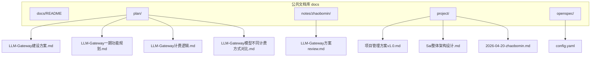
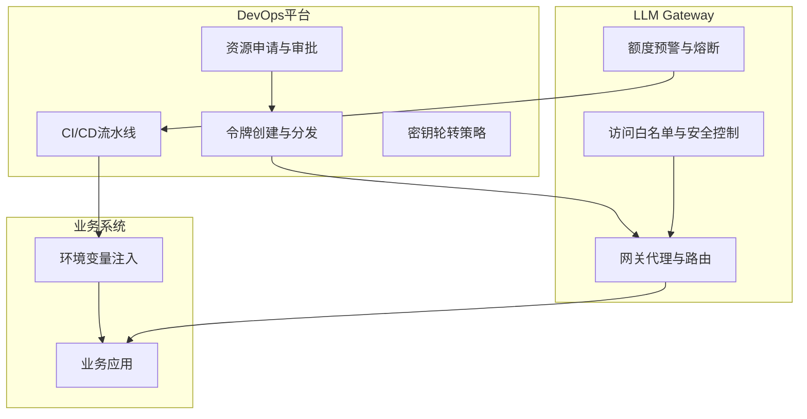
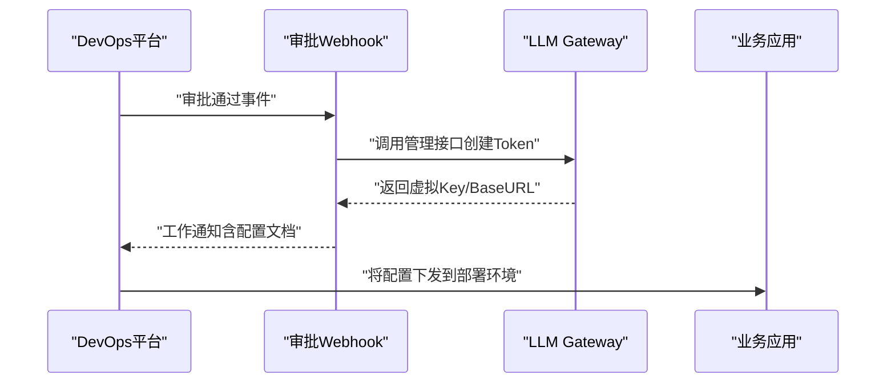
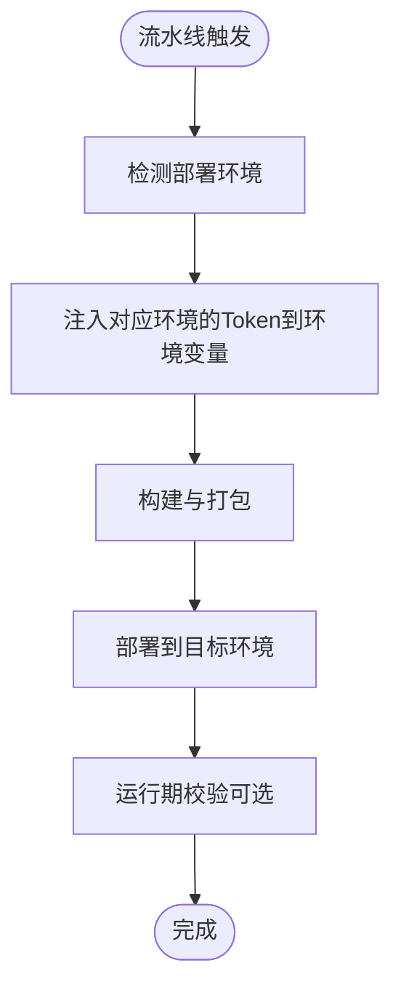
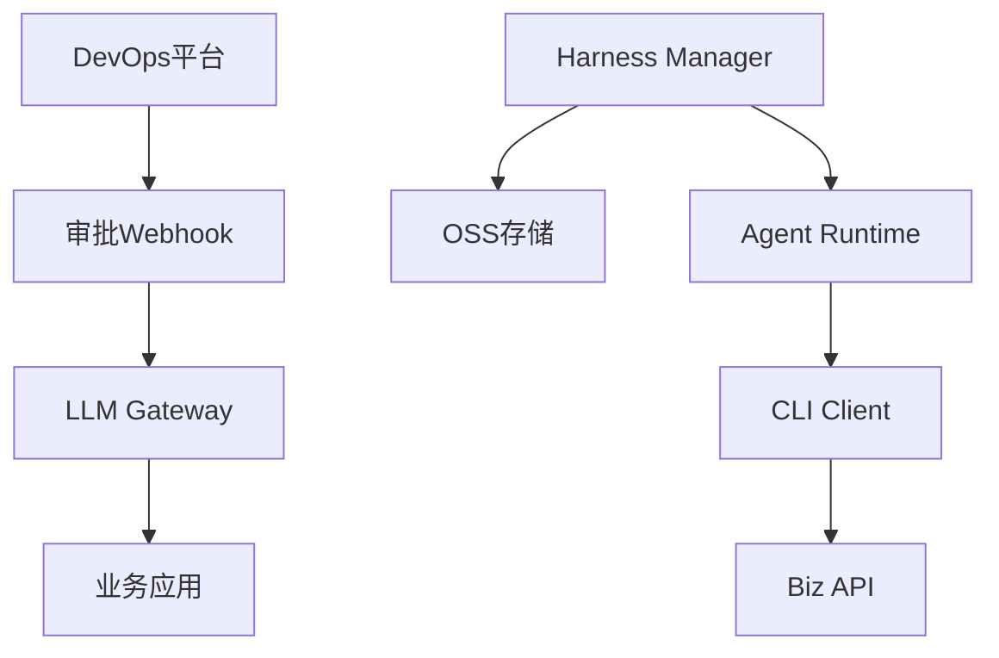

# DevOps自动化集成

<cite>
**本文引用的文件**
- [LLM-Gateway建设方案.md](file://plan/LLM-Gateway建设方案.md)
- [LLM-Gateway一期功能规划.md](file://plan/LLM-Gateway一期功能规划.md)
- [LLM-Gateway方案review.md](file://notes/zhaobomin/LLM-Gateway方案review.md)
- [LLM-Gateway计费逻辑.md](file://plan/LLM-Gateway计费逻辑.md)
- [LLM-Gateway模型不同计费方式对比.md](file://plan/LLM-Gateway模型不同计费方式对比.md)
- [SAI_CLI_设计文档_v1.0.md](file://plan/SAI_CLI_设计文档_v1.0.md)
- [SAI_CLI_设计文档_v1.2.md](file://plan/SAI_CLI_设计文档_v1.2.md)
- [项目管理方案v1.0.md](file://project/项目管理方案v1.0.md)
- [Sai整体架构设计.md](file://project/standup/Sai整体架构设计.md)
- [2026-04-20-zhaobomin.md](file://project/standup/2026-04-20-zhaobomin.md)
- [config.yaml](file://openspec/config.yaml)
</cite>

## 目录
1. [引言](#引言)
2. [项目结构](#项目结构)
3. [核心组件](#核心组件)
4. [架构总览](#架构总览)
5. [详细组件分析](#详细组件分析)
6. [依赖分析](#依赖分析)
7. [性能考量](#性能考量)
8. [故障排除指南](#故障排除指南)
9. [结论](#结论)
10. [附录](#附录)

## 引言
本技术文档聚焦于LLM Gateway与DevOps平台的自动化集成，围绕资源申请自动化、流水线动态注入与审批流程打通展开，系统阐述AI资源申请流程、Token自动创建与环境变量注入机制，并给出CI/CD流水线集成配置、密钥轮转策略与配置管理最佳实践。文档同时提供自动化流程监控与运维管理建议，帮助读者在统一的DevOps框架下实现LLM资源的自动化、安全化与可观测化。

## 项目结构
本仓库以“文档驱动”的方式组织，公共文档库docs下按团队维度划分设计与接口文档，配套日报制度与Git提交规范，确保代码与文档同步、进度透明可见。LLM Gateway与DevOps集成的关键文档主要分布在“plan”与“notes/zhaobomin”目录，涵盖建设方案、评审意见、计费与模型对比、以及CLI与Harness Manager对接方案。

**图表来源**
- [项目管理方案v1.0.md:90-131](file://project/项目管理方案v1.0.md#L90-L131)
- [LLM-Gateway建设方案.md:19-25](file://plan/LLM-Gateway建设方案.md#L19-L25)
- [LLM-Gateway一期功能规划.md:1-23](file://plan/LLM-Gateway一期功能规划.md#L1-L23)
- [config.yaml:1-21](file://openspec/config.yaml#L1-L21)

**章节来源**
- [项目管理方案v1.0.md:90-131](file://project/项目管理方案v1.0.md#L90-L131)
- [LLM-Gateway建设方案.md:19-25](file://plan/LLM-Gateway建设方案.md#L19-L25)
- [config.yaml:1-21](file://openspec/config.yaml#L1-L21)

## 核心组件
- LLM Gateway：统一代理层，向下接入多模型，向上提供OpenAI格式API，支持精细化限流、额度预警与熔断、路由策略与安全控制。
- DevOps平台：负责资源申请审批、令牌创建与分发、流水线动态注入与密钥轮转。
- CLI与Harness Manager：提供统一命令规范、注册中心、元数据编译与分发，支撑Agent与业务系统的自动化调用。
- 计费与模型对比：为成本控制与模型选择提供量化依据。

**章节来源**
- [LLM-Gateway建设方案.md:27-65](file://plan/LLM-Gateway建设方案.md#L27-L65)
- [LLM-Gateway一期功能规划.md:3-23](file://plan/LLM-Gateway一期功能规划.md#L3-L23)
- [SAI_CLI_设计文档_v1.2.md:29-75](file://plan/SAI_CLI_设计文档_v1.2.md#L29-L75)

## 架构总览
下图展示了LLM Gateway与DevOps平台的集成视图，强调资源申请、令牌创建、流水线注入与审批流程的协同。

**图表来源**
- [LLM-Gateway建设方案.md:36-65](file://plan/LLM-Gateway建设方案.md#L36-L65)
- [LLM-Gateway一期功能规划.md:7-11](file://plan/LLM-Gateway一期功能规划.md#L7-L11)

## 详细组件分析

### 资源申请自动化与审批流程
- 申请与审批：研发在DevOps发起“AI资源申请”，填写应用等级、并发、所需环境等字段，审批通过后触发Webhook调用网关管理接口，自动创建渠道与唯一Token。
- 审批节点：申请人→部门TL→运维审批（抄送PMO）→PMO确认，确保资源发放的合规性与可追溯性。
- 返回与通知：返回虚拟Key、BaseURL与配置文档，通过工作通知告知申请人。

**图表来源**
- [LLM-Gateway建设方案.md:38-41](file://plan/LLM-Gateway建设方案.md#L38-L41)
- [LLM-Gateway一期功能规划.md:7](file://plan/LLM-Gateway一期功能规划.md#L7)

**章节来源**
- [LLM-Gateway建设方案.md:36-41](file://plan/LLM-Gateway建设方案.md#L36-L41)
- [LLM-Gateway一期功能规划.md:7](file://plan/LLM-Gateway一期功能规划.md#L7)

### Token自动创建与环境变量注入
- Token创建：调用网关管理接口，自动分配额度与告警规则，生成虚拟Key供业务侧使用。
- 环境变量注入：在CI/CD流水线打包部署时，系统根据当前部署环境（测试/预发/生产）将对应网关Token动态注入为环境变量，避免硬编码。
- 配置管理：可选使用配置中心（如Apollo）将Token写入配置文件，统一管理与版本化。

**图表来源**
- [LLM-Gateway建设方案.md:40](file://plan/LLM-Gateway建设方案.md#L40)

**章节来源**
- [LLM-Gateway建设方案.md:40](file://plan/LLM-Gateway建设方案.md#L40)

### CI/CD流水线中的集成配置
- 基础配置：在流水线中添加“令牌注入”步骤，读取DevOps侧下发的虚拟Key与BaseURL，写入环境变量或配置文件。
- 多环境策略：测试/预发使用低成本模型与较低额度，生产核心应用使用旗舰模型并配置严格限流与熔断。
- 安全基线：禁止在代码中硬编码真实Key，统一通过环境变量或配置中心注入；对敏感配置进行加密存储与最小权限访问。

**章节来源**
- [LLM-Gateway建设方案.md:43-54](file://plan/LLM-Gateway建设方案.md#L43-L54)

### 密钥轮转策略与配置管理最佳实践
- 轮转策略：基于网关原生额度重置能力（如按自然月重置），或通过定时任务触发重置；对高风险场景采用短期Token与频繁轮转。
- 最佳实践：
  - 使用虚拟Key对外，真实Key仅在网关侧托管；
  - 通过白名单与访问控制限制Token使用范围；
  - 对高敏数据启用脱敏与审计日志；
  - 将配置与密钥分离，使用配置中心与密钥管理服务统一治理。

**章节来源**
- [LLM-Gateway建设方案.md:56-65](file://plan/LLM-Gateway建设方案.md#L56-L65)
- [LLM-Gateway建设方案.md:87-88](file://plan/LLM-Gateway建设方案.md#L87-L88)

### 计费逻辑与模型对比
- 计费逻辑：基于模型响应中的usage计算价格，若无usage则需本地先计算token再计价；分词规则差异与不支持阶梯计费带来误差。
- 模型对比：不同场景（AI客户端、CLI命令行、IDE插件、直接请求）在耗时与token消耗上存在差异，建议结合业务场景选择合适模型与计费方式。

**章节来源**
- [LLM-Gateway计费逻辑.md:1-3](file://plan/LLM-Gateway计费逻辑.md#L1-L3)
- [LLM-Gateway模型不同计费方式对比.md:1-9](file://plan/LLM-Gateway模型不同计费方式对比.md#L1-L9)

### CLI与Harness Manager对接（与DevOps集成的补充）
- CLI统一规范：命令格式为{product} {module} {action} [params]，统一入参/出参JSON，支持结构化错误输出。
- 注册与分发：业务方通过SDK注解上报API，Harness Manager统一构建SAI-CLI二进制并分发至OSS，Agent按需拉取。
- 安全与鉴权：支持PoP Token与ECDSA签名（二期），Token获取优先级为命令行参数→环境变量→本地配置文件。

**章节来源**
- [SAI_CLI_设计文档_v1.2.md:115-146](file://plan/SAI_CLI_设计文档_v1.2.md#L115-L146)
- [SAI_CLI_设计文档_v1.2.md:394-471](file://plan/SAI_CLI_设计文档_v1.2.md#L394-L471)
- [SAI_CLI_设计文档_v1.2.md:545-591](file://plan/SAI_CLI_设计文档_v1.2.md#L545-L591)

## 依赖分析
- LLM Gateway与DevOps平台：通过审批Webhook与管理接口实现资源申请与令牌创建的自动化。
- LLM Gateway与业务应用：通过统一OpenAI格式API与环境变量注入实现零改造接入。
- Harness Manager与Agent：通过注册中心与OSS分发实现CLI与Skill的统一管理与调用。

**图表来源**
- [Sai整体架构设计.md:19-65](file://project/standup/Sai整体架构设计.md#L19-L65)
- [Sai整体架构设计.md:108-138](file://project/standup/Sai整体架构设计.md#L108-L138)

**章节来源**
- [Sai整体架构设计.md:19-65](file://project/standup/Sai整体架构设计.md#L19-L65)
- [Sai整体架构设计.md:108-138](file://project/standup/Sai整体架构设计.md#L108-L138)

## 性能考量
- 路由与降级：按环境与应用等级动态路由，测试/本地环境自动降级至低成本模型，核心生产使用旗舰模型并配置重试与熔断。
- 限流与告警：支持基于Key、User、Team的双维度限流（RPM/TPM），按80%/90%/100%阈值触发告警与熔断，保障成本可控与系统稳定。
- 模型高可用：支持故障降级（如旗舰模型故障切至均衡模型），减少单点失效影响。

**章节来源**
- [LLM-Gateway建设方案.md:43-54](file://plan/LLM-Gateway建设方案.md#L43-L54)
- [LLM-Gateway建设方案.md:89-92](file://plan/LLM-Gateway建设方案.md#L89-L92)

## 故障排除指南
- 网关不可用：配置全局告警推送至钉钉群；在逃生方案下可切换bypass模式或业务侧直连原生API。
- 额度超限：检查告警阈值与熔断策略，必要时扩容或优化模型选择。
- 审批Webhook失败：核对审批节点与回调地址，确保网关管理接口可用与鉴权正确。
- 环境变量注入失败：检查流水线注入步骤与变量命名，确保与业务侧读取一致。
- CLI调用异常：确认Token来源优先级与有效期，检查Harness Manager注册与OSS分发状态。

**章节来源**
- [LLM-Gateway建设方案.md:105-109](file://plan/LLM-Gateway建设方案.md#L105-L109)
- [LLM-Gateway建设方案.md:56-65](file://plan/LLM-Gateway建设方案.md#L56-L65)
- [LLM-Gateway一期功能规划.md:9-11](file://plan/LLM-Gateway一期功能规划.md#L9-L11)
- [SAI_CLI_设计文档_v1.2.md:545-591](file://plan/SAI_CLI_设计文档_v1.2.md#L545-L591)

## 结论
通过将LLM Gateway与DevOps平台深度融合，可实现从资源申请、令牌创建到流水线注入与审批流程的全链路自动化。结合精细化路由、额度预警与熔断、白名单与脱敏等安全措施，以及统一的CLI与Harness Manager分发机制，能够显著提升AI资源的管理效率与安全性。建议在4/30先达成“网关+手动发key”的最小可用目标，后续逐步推进审批流与前端管理页面，确保项目节奏可控与风险受控。

## 附录
- 评审要点与风险提示：Review文档指出4/30时间紧张、前后文矛盾、逃生方案不明确、计费误差与安全缺口等问题，建议统一技术栈、明确逃生方案并开展误差评估与安全加固。
- 文档与提交规范：公共文档库按团队维度组织，要求代码与文档同步提交，每日至少一次提交，确保项目进展透明可见。

**章节来源**
- [LLM-Gateway方案review.md:19-70](file://notes/zhaobomin/LLM-Gateway方案review.md#L19-L70)
- [项目管理方案v1.0.md:74-87](file://project/项目管理方案v1.0.md#L74-L87)
- [项目管理方案v1.0.md:137-147](file://project/项目管理方案v1.0.md#L137-L147)