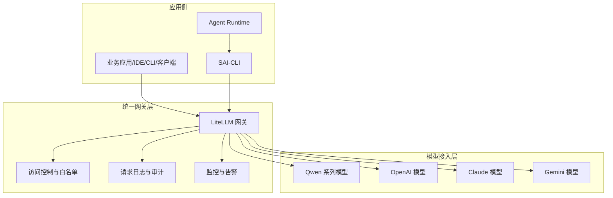
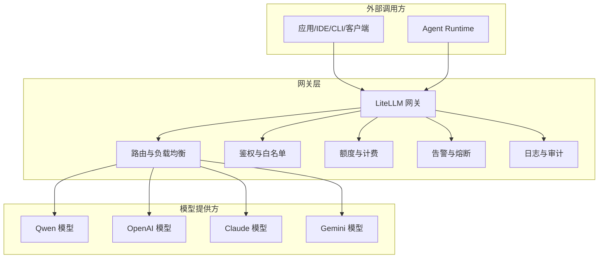
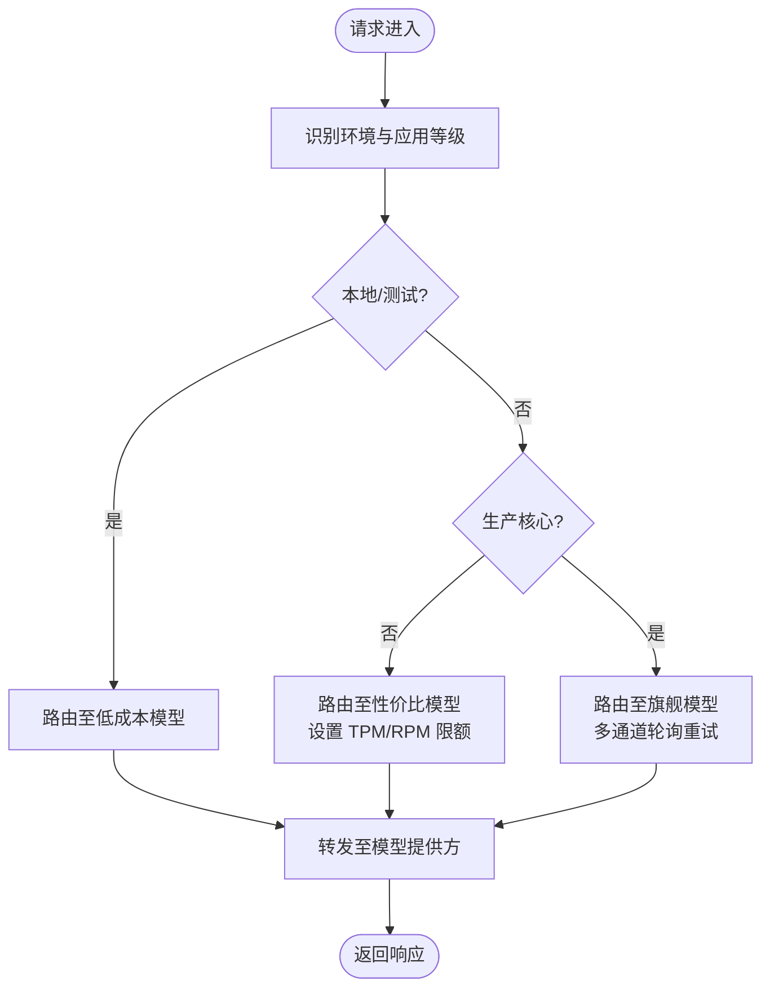
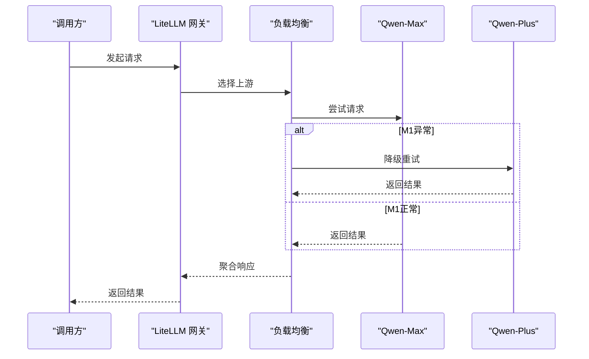
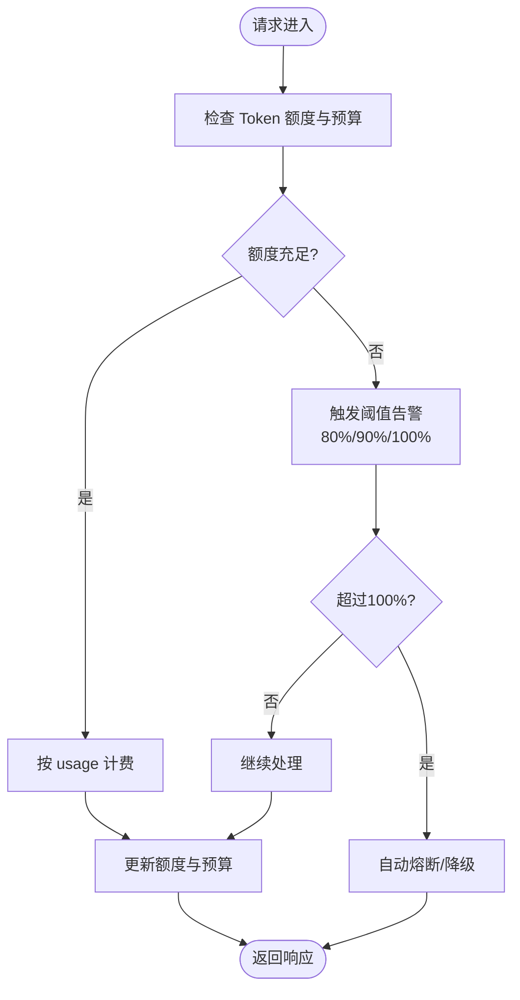
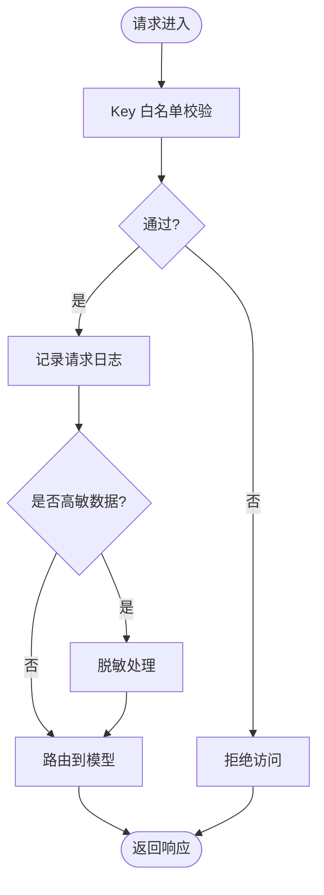
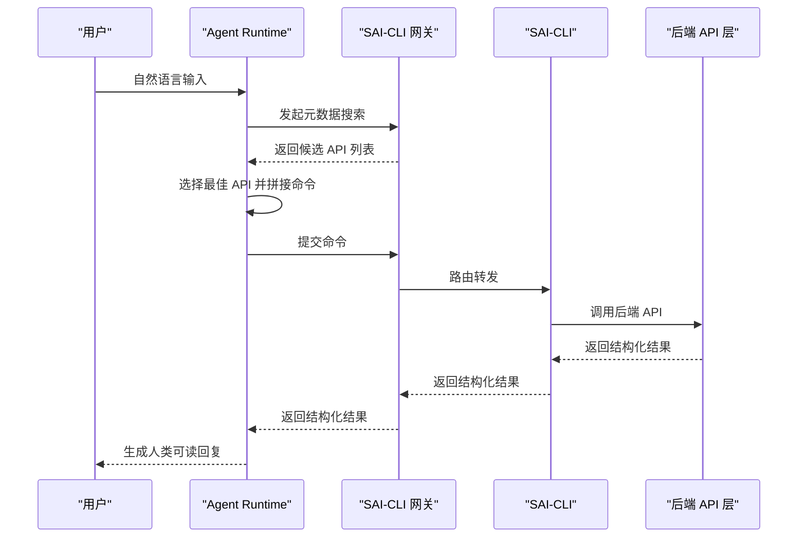
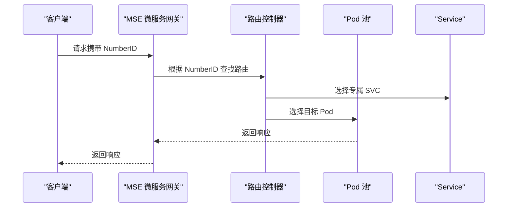
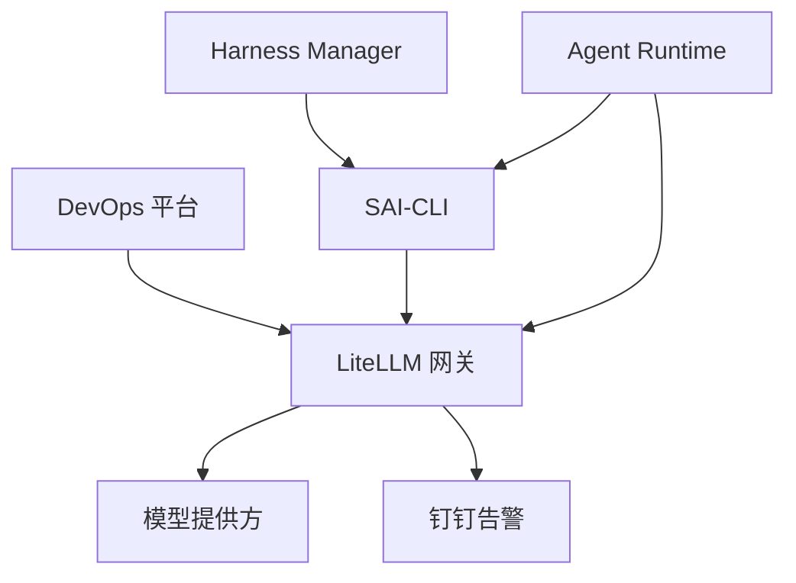

# LLM Gateway（老徐）

<cite>
**本文引用的文件**
- [LLM Gateway 建设方案.md](file://plan/LLM-Gateway建设方案.md)
- [LLM Gateway 一期功能规划.md](file://plan/LLM-Gateway一期功能规划.md)
- [LLM Gateway 计费逻辑.md](file://plan/LLM Gateway 计费逻辑.md)
- [LLM Gateway 模型不同计费方式对比.md](file://plan/LLM Gateway 模型不同计费方式对比.md)
- [LLM-Gateway方案review.md](file://notes/zhaobomin/LLM-Gateway方案review.md)
- [SAI CLI 设计文档_v1.0.md](file://plan/SAI_CLI_设计文档_v1.0.md)
- [SAI CLI 设计文档_v1.2.md](file://plan/SAI_CLI_设计文档_v1.2.md)
- [Agent-Runtime方案.md](file://plan/Agent-Runtime方案.md)
- [Agent 设计方案（MSE流量分流）.md](file://plan/Agent 设计方案（MSE流量分流）.md)
- [Agent-Runtime方案review.md](file://notes/zhaobomin/Agent-Runtime方案review.md)
- [SAI 项目日报 | 项目待办和风险跟踪.md](file://project/SAI-daily-report-2026-04-22-final.md)
</cite>

## 目录
1. [引言](#引言)
2. [项目结构](#项目结构)
3. [核心组件](#核心组件)
4. [架构总览](#架构总览)
5. [详细组件分析](#详细组件分析)
6. [依赖分析](#依赖分析)
7. [性能考虑](#性能考虑)
8. [故障排查指南](#故障排查指南)
9. [结论](#结论)
10. [附录](#附录)

## 引言
本技术文档围绕 LLM Gateway（统一 AI 服务入口）展开，系统性阐述其设计理念、架构实现、多模型接入机制、路由与负载均衡策略、成本控制与额度管理、安全治理与权限控制、配置与部署、运维监控以及 API 接口规范与集成指南。文档同时结合 SAI CLI 与 Agent Runtime 的协同设计，给出面向开发者与运维人员的实用参考。

## 项目结构
- LLM Gateway 采用开源 LiteLLM 作为核心网关，配合 DevOps 平台实现令牌生命周期管理、额度与告警、模型路由与降级、日志与安全治理。
- SAI CLI 与 Agent Runtime 通过网关层实现命令发现、路由转发、鉴权与负载均衡，形成“Agent → 网关 → CLI → API”的标准化调用链。
- 项目采用阶段性交付策略：4/30 先上线最小可用网关与手动发 key 能力，5/15 DevOps 融合审批与自动发 key，5/30 全量推广与全局监控看板。

图表来源
- [LLM Gateway 建设方案.md:15-26](file://plan/LLM-Gateway建设方案.md#L15-L26)
- [SAI CLI 设计文档_v1.2.md:29-64](file://plan/SAI_CLI_设计文档_v1.2.md#L29-L64)

章节来源
- [LLM Gateway 建设方案.md:1-109](file://plan/LLM-Gateway建设方案.md#L1-L109)
- [SAI CLI 设计文档_v1.2.md:29-64](file://plan/SAI_CLI_设计文档_v1.2.md#L29-L64)

## 核心组件
- 统一代理与 API 标准化：向上统一暴露 OpenAI 格式 API，向下接入多家模型，实现“零成本切换”。
- DevOps 密钥分发：审批流触发自动创建渠道与唯一 Token，CI/CD 动态注入环境变量，杜绝真实 Key 硬编码。
- 流量降级与成本控制：按环境与应用等级进行路由策略（本地/测试用低成本模型，生产核心用旗舰模型），结合 TPM/RPM 限额与额度预警熔断。
- 日志与安全：请求日志拦截、隐私数据脱敏、Key 白名单、访问方式（内网/虎盾）。
- 监控与告警：令牌级阈值告警（80%/90%/100%）、网关不可用与模型健康检查告警推送到钉钉群。

章节来源
- [LLM Gateway 建设方案.md:27-65](file://plan/LLM-Gateway建设方案.md#L27-L65)
- [LLM-Gateway方案review.md:9-16](file://notes/zhaobomin/LLM-Gateway方案review.md#L9-L16)

## 架构总览
下图展示 LLM Gateway 的系统架构与关键交互：

图表来源
- [LLM Gateway 建设方案.md:15-26](file://plan/LLM-Gateway建设方案.md#L15-L26)
- [LLM Gateway 建设方案.md:43-65](file://plan/LLM-Gateway建设方案.md#L43-L65)

## 详细组件分析

### 多模型接入与路由策略
- 模型接入：统一代理层向下支持 Qwen 全版本与 OpenAI、Claude、Gemini 等主流模型，向上暴露统一 OpenAI 格式 API。
- 路由策略：
  - 本地/测试：低成本模型或开源本地模型，降低调试成本。
  - 生产（非核心）：性价比模型（如 qwen-plus），严格 TPM/RPM 限额。
  - 生产（核心）：旗舰模型（如 qwen-max），多渠道轮询与重试，保障高可用。
- 环境维度与应用等级：按环境与等级动态选择模型与限额，实现资源与成本的精细化调度。

图表来源
- [LLM Gateway 建设方案.md:43-54](file://plan/LLM-Gateway建设方案.md#L43-L54)

章节来源
- [LLM Gateway 建设方案.md:27-54](file://plan/LLM-Gateway建设方案.md#L27-L54)

### 负载均衡与降级机制
- 负载均衡：基于多渠道权重与健康状态进行轮询与重试，优先选择可用性更高的上游。
- 降级策略：当旗舰模型不可用时自动切至性价比模型；突发流量或阈值触发时临时降级或熔断，保障系统稳定性。

图表来源
- [LLM Gateway 建设方案.md:49-54](file://plan/LLM-Gateway建设方案.md#L49-L54)

章节来源
- [LLM Gateway 建设方案.md:43-54](file://plan/LLM-Gateway建设方案.md#L43-L54)

### 成本控制、额度管理与告警
- 额度池：为每个 Token 设置独立资金或 Token 额度池，支持按自然月重置。
- 预警与熔断：80%/90%/100% 三级阈值，达到阈值自动告警与熔断，支持自定义阈值。
- 计费逻辑：基于模型 response 的 usage 计算价格，若无 usage 则本地先计算 token 再计价；分词规则差异与不支持阶梯计费导致误差，需通过实测评估误差范围。

图表来源
- [LLM Gateway 建设方案.md:53-54](file://plan/LLM-Gateway建设方案.md#L53-L54)
- [LLM Gateway 计费逻辑.md:1-3](file://plan/LLM Gateway 计费逻辑.md#L1-L3)

章节来源
- [LLM Gateway 建设方案.md:53-54](file://plan/LLM-Gateway建设方案.md#L53-L54)
- [LLM Gateway 模型不同计费方式对比.md:1-9](file://plan/LLM Gateway 模型不同计费方式对比.md#L1-L9)

### 安全治理、权限控制与访问管理
- Key 白名单：对每个 Key 加白名单，仅白名单 Key 可使用。
- 访问方式：应用通过白名单方式内网访问，用户通过虎盾（VPN）访问。
- 日志与审计：拦截并记录请求元数据（时间、来源 IP、Token 归属域组、消耗 Token 数、响应延迟）。
- 隐私数据脱敏：高敏业务可选配脱敏插件，在请求发往公有云模型前遮盖或替换敏感数据。
- 逃生方案：建议至少具备两类逃生方案：业务侧直连百炼/OpenAI 原生 API、网关支持 bypass 模式一键关闭路由规则。

图表来源
- [LLM Gateway 建设方案.md:56-65](file://plan/LLM-Gateway建设方案.md#L56-L65)

章节来源
- [LLM Gateway 建设方案.md:56-65](file://plan/LLM-Gateway建设方案.md#L56-L65)
- [LLM-Gateway方案review.md:46-51](file://notes/zhaobomin/LLM-Gateway方案review.md#L46-L51)

### 配置管理、部署方案与运维监控
- 配置：LiteLLM WebUI 动态配置，ConfigMap 切换为 WebUI 动态配置，支持模型与路由规则在线调整。
- 部署：支持 Docker/ECS/K8s 集群部署，结合 DevOps 平台实现审批流与自动发 key。
- 监控：令牌级阈值告警、网关不可用与模型健康检查告警推送到钉钉群；建议后续完善全局监控看板。

章节来源
- [LLM Gateway 建设方案.md:17-26](file://plan/LLM-Gateway建设方案.md#L17-L26)
- [LLM-Gateway方案review.md:21-25](file://notes/zhaobomin/LLM-Gateway方案review.md#L21-L25)

### SAI CLI 与 Agent Runtime 协同
- SAI-CLI 采用四层分层架构：调用层（Agent）、网关层（路由转发、鉴权、负载均衡）、CLI 核心层（统一命令规范、入参/出参 JSON、公共能力）、后端 API 层（各域只提供 API）。
- 网关层能力：API 注册接口、元数据搜索接口、元数据生成、发布通知接口、路由转发、权限校验。
- Agent 职责：SSO 认证、信息持久化、API 搜索、API 选择、命令拼接、命令执行、鉴权标准统一使用 SSO Token。
- CLI 与 Harness Manager 对接：采用 OSS 挂载形式，统一打包的 SAI-CLI 二进制文件挂载至 Agent 运行环境；发布流程由 Harness Manager 执行。

图表来源
- [SAI CLI 设计文档_v1.2.md:29-64](file://plan/SAI_CLI_设计文档_v1.2.md#L29-L64)
- [SAI CLI 设计文档_v1.2.md:603-632](file://plan/SAI_CLI_设计文档_v1.2.md#L603-L632)

章节来源
- [SAI CLI 设计文档_v1.2.md:29-64](file://plan/SAI_CLI_设计文档_v1.2.md#L29-L64)
- [SAI CLI 设计文档_v1.2.md:603-632](file://plan/SAI_CLI_设计文档_v1.2.md#L603-L632)

### Agent Runtime 与 MSE 流量分流
- 用户隔离：基于 serverless（AgentRun）按 session 分配实例，一实例一 session，确保隔离与热启动性能。
- Skill 隔离：基于 OSS 挂载实现 workspace 与 systemspace 区分，支持按用户/领域/公共组织；若 OSS 挂载不可行，则在 Agent 层实现文件路径权限。
- MSE 流量分流：通过 Header NumberID 实现专属链路与弹性扩缩容，路由控制器负责注册路由、创建专属 SVC、挂载 OSS。

图表来源
- [Agent 设计方案（MSE流量分流）.md:1-28](file://plan/Agent 设计方案（MSE流量分流）.md#L1-L28)

章节来源
- [Agent-Runtime方案.md:1-60](file://plan/Agent-Runtime方案.md#L1-L60)
- [Agent 设计方案（MSE流量分流）.md:1-28](file://plan/Agent 设计方案（MSE流量分流）.md#L1-L28)

## 依赖分析
- 组件耦合与协作：
  - LLM Gateway 依赖 DevOps 平台完成审批与自动发 key；依赖 LiteLLM 提供路由、限流、告警与降级能力。
  - SAI-CLI 网关依赖 Harness Manager 的注册中心与 SkillCompiler，实现命令元数据的自动生成与编译。
  - Agent Runtime 依赖网关层的元数据搜索与路由转发，实现命令发现与执行。
- 外部依赖与集成点：
  - 模型提供方：Qwen、OpenAI、Claude、Gemini。
  - 通知与告警：钉钉群推送。
  - 部署与运维：Docker/ECS/K8s、OSS 挂载、ConfigMap 动态配置。

图表来源
- [LLM Gateway 建设方案.md:17-26](file://plan/LLM-Gateway建设方案.md#L17-L26)
- [SAI CLI 设计文档_v1.2.md:545-591](file://plan/SAI_CLI_设计文档_v1.2.md#L545-L591)

章节来源
- [LLM Gateway 建设方案.md:17-26](file://plan/LLM-Gateway建设方案.md#L17-L26)
- [SAI CLI 设计文档_v1.2.md:545-591](file://plan/SAI_CLI_设计文档_v1.2.md#L545-L591)

## 性能考虑
- 热启动与隔离：Agent Runtime 采用 serverless，冷启动 <1s，热启动 100ms，满足通用 Agent 调用性能要求。
- 路由与负载：基于权重与健康状态的轮询与重试，优先选择可用性更高的上游，减少失败重试带来的延迟。
- 配置与部署：支持 Docker/ECS/K8s 部署，结合 ConfigMap 动态配置，降低变更成本与停机时间。
- 日志与审计：拦截并记录请求元数据，便于性能分析与问题定位。

章节来源
- [Agent-Runtime方案.md:4-13](file://plan/Agent-Runtime方案.md#L4-L13)
- [LLM Gateway 建设方案.md:17-26](file://plan/LLM-Gateway建设方案.md#L17-L26)

## 故障排查指南
- 网关不可用告警：检查网关进程状态、模型提供方可用性、路由配置与白名单。
- 令牌超限熔断：检查阈值配置、额度池状态、告警推送链路；必要时临时提高阈值或扩容额度。
- 模型健康检查失败：检查模型提供方 API Key、网络连通性、模型版本与参数配置。
- 请求日志异常：核对日志采集与存储配置，确认脱敏规则与审计策略。
- 逃生方案：业务侧直连百炼/OpenAI 原生 API；网关支持 bypass 模式一键关闭路由规则。

章节来源
- [LLM Gateway 建设方案.md:53-65](file://plan/LLM-Gateway建设方案.md#L53-L65)
- [LLM-Gateway方案review.md:32-38](file://notes/zhaobomin/LLM-Gateway方案review.md#L32-L38)

## 结论
LLM Gateway 以 LiteLLM 为核心，结合 DevOps 平台实现统一入口、自动化密钥分发、精细化路由与成本控制、安全治理与告警熔断，满足多模型接入与统一管理的需求。SAI CLI 与 Agent Runtime 通过网关层实现命令发现、路由转发与鉴权，形成标准化调用链。建议在 4/30 先上线最小可用网关与手动发 key 能力，随后逐步推进 DevOps 融合与全量推广，并完善逃生方案与监控看板。

## 附录
- 项目规划与里程碑：
  - 阶段一：网关上线（4/30）
  - 阶段二：DevOps 融合（5/15）
  - 阶段三：全量推广（5/30）
- 4/30 目标：个人令牌申请与管理、监控告警、LiteLLM 网关配置、测试验证。
- 风险与建议：上线时间紧张、前后文矛盾、逃生方案不明确、计费误差未量化、安全方案缺口、前端技术选型缺失、百炼账号迁移建议需评估。

章节来源
- [LLM-Gateway建设方案.md:95-109](file://plan/LLM-Gateway建设方案.md#L95-L109)
- [LLM-Gateway一期功能规划.md:1-23](file://plan/LLM-Gateway一期功能规划.md#L1-L23)
- [LLM-Gateway方案review.md:21-64](file://notes/zhaobomin/LLM-Gateway方案review.md#L21-L64)
- [SAI 项目日报 | 项目待办和风险跟踪.md:48-77](file://project/SAI-daily-report-2026-04-22-final.md#L48-L77)