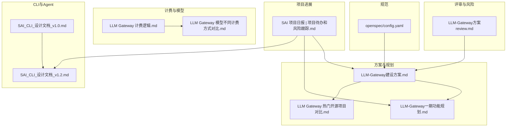
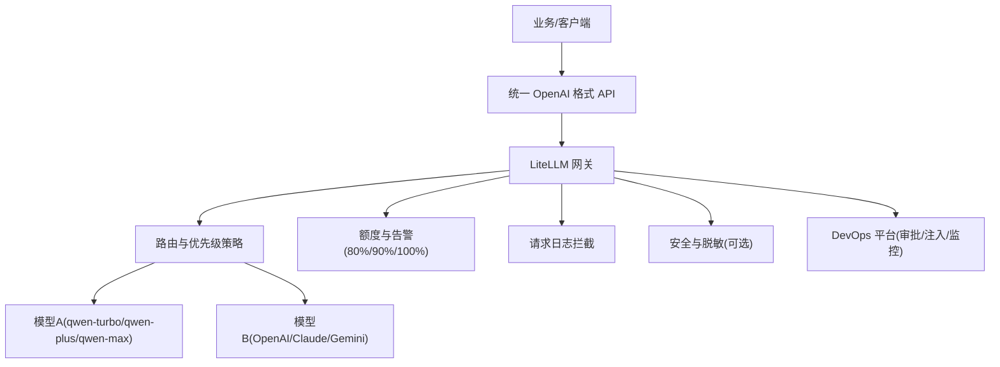
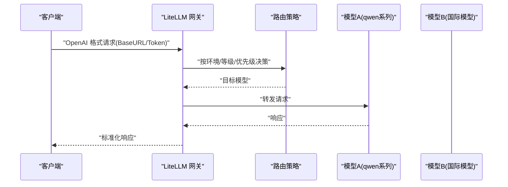
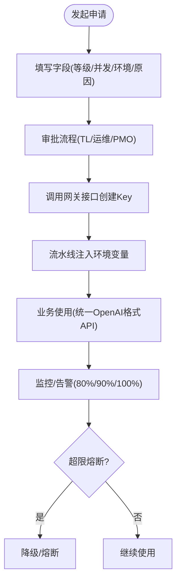
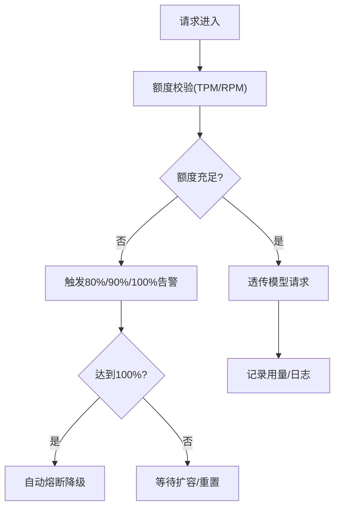
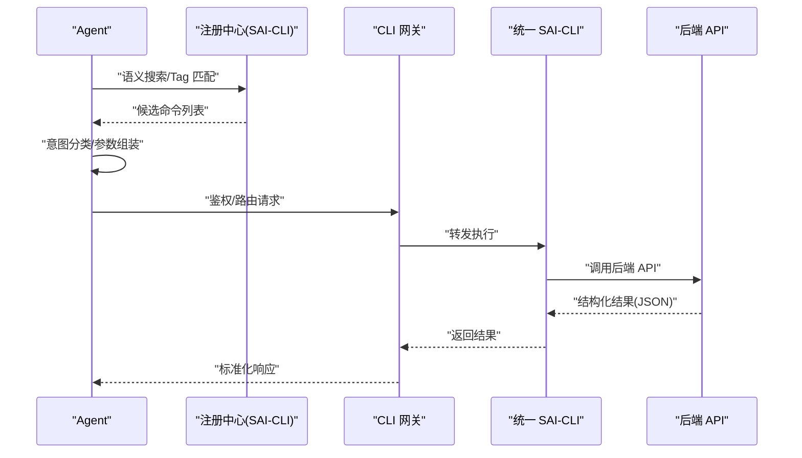
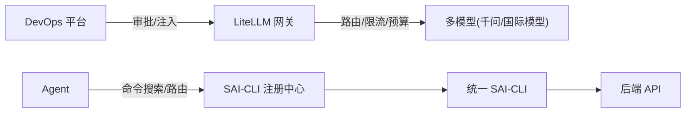

# 多模型接入与管理

<cite>
**本文引用的文件**
- [LLM-Gateway建设方案.md](file://plan/LLM-Gateway建设方案.md)
- [LLM-Gateway方案review.md](file://notes/zhaobomin/LLM-Gateway方案review.md)
- [LLM-Gateway一期功能规划.md](file://plan/LLM-Gateway一期功能规划.md)
- [LLM Gateway 热门开源项目对比.md](file://plan/LLM Gateway 热门开源项目对比.md)
- [LLM Gateway 模型不同计费方式对比.md](file://plan/LLM Gateway 模型不同计费方式对比.md)
- [LLM Gateway 计费逻辑.md](file://plan/LLM Gateway 计费逻辑.md)
- [SAI_CLI_设计文档_v1.0.md](file://plan/SAI_CLI_设计文档_v1.0.md)
- [SAI_CLI_设计文档_v1.2.md](file://plan/SAI_CLI_设计文档_v1.2.md)
- [SAI 项目日报 | 项目待办和风险跟踪.md](file://project/SAI-daily-report-2026-04-22-final.md)
- [config.yaml](file://openspec/config.yaml)
</cite>

## 目录
1. [引言](#引言)
2. [项目结构](#项目结构)
3. [核心组件](#核心组件)
4. [架构总览](#架构总览)
5. [详细组件分析](#详细组件分析)
6. [依赖分析](#依赖分析)
7. [性能考量](#性能考量)
8. [故障排查指南](#故障排查指南)
9. [结论](#结论)
10. [附录](#附录)

## 引言
本文件围绕“多模型接入与管理”主题，系统化梳理基于 LiteLLM 的 LLM Gateway 能力与实践，覆盖统一接入、接口标准化、模型切换、成本与预算控制、安全与审计、以及 DevOps 自动化流程。文档同时结合 SAI CLI 的命令体系与 Agent 调用链路，给出模型接入示例、配置要点、最佳实践与故障排查方法，帮助读者在统一网关下高效、安全、可控地管理国内外主流大模型。

## 项目结构
该仓库以“方案文档 + 项目进展 + 开源对比 + CLI 设计”为主，形成“规划—落地—验证”的闭环：
- 方案与规划：LLM-Gateway建设方案、LLM-Gateway一期功能规划、LLM Gateway 热门开源项目对比
- 风险与评审：LLM-Gateway方案review
- 计费与模型对比：LLM Gateway 计费逻辑、LLM Gateway 模型不同计费方式对比
- CLI 与 Agent：SAI_CLI_设计文档_v1.0、SAI_CLI_设计文档_v1.2
- 项目进展：SAI 项目日报 | 项目待办和风险跟踪
- 规范与配置：openspec/config.yaml

图表来源
- [LLM-Gateway建设方案.md](file://plan/LLM-Gateway建设方案.md)
- [LLM-Gateway一期功能规划.md](file://plan/LLM-Gateway一期功能规划.md)
- [LLM Gateway 热门开源项目对比.md](file://plan/LLM Gateway 热门开源项目对比.md)
- [LLM-Gateway方案review.md](file://notes/zhaobomin/LLM-Gateway方案review.md)
- [LLM Gateway 计费逻辑.md](file://plan/LLM Gateway 计费逻辑.md)
- [LLM Gateway 模型不同计费方式对比.md](file://plan/LLM Gateway 模型不同计费方式对比.md)
- [SAI_CLI_设计文档_v1.0.md](file://plan/SAI_CLI_设计文档_v1.0.md)
- [SAI_CLI_设计文档_v1.2.md](file://plan/SAI_CLI_设计文档_v1.2.md)
- [SAI 项目日报 | 项目待办和风险跟踪.md](file://project/SAI-daily-report-2026-04-22-final.md)
- [config.yaml](file://openspec/config.yaml)

章节来源
- [LLM-Gateway建设方案.md](file://plan/LLM-Gateway建设方案.md)
- [LLM-Gateway一期功能规划.md](file://plan/LLM-Gateway一期功能规划.md)
- [LLM Gateway 热门开源项目对比.md](file://plan/LLM Gateway 热门开源项目对比.md)
- [LLM-Gateway方案review.md](file://notes/zhaobomin/LLM-Gateway方案review.md)
- [SAI 项目日报 | 项目待办和风险跟踪.md](file://project/SAI-daily-report-2026-04-22-final.md)
- [openspec/config.yaml](file://openspec/config.yaml)

## 核心组件
- LiteLLM 网关：作为统一代理层，向下接入千问全系与 OpenAI/Claude/Gemini 等国际主流模型，向上暴露统一 OpenAI 格式 API，实现业务零成本切换与多模型热切换。
- DevOps 平台：自动化资源申请、审批与 Token 分发，流水线动态注入，实现“真实 Key”清零与虚拟 Key 管理。
- 路由与降级：按环境与应用等级路由至不同模型（本地/测试用低成本模型，生产核心用旗舰模型），并支持多渠道轮询与熔断降级。
- 额度与告警：为每个 Token 设置资金/Token 额度池，80%/90%/100% 三级告警与自动熔断，结合钉钉推送。
- 日志与安全：请求日志拦截、隐私数据脱敏（可选）、Key 白名单、访问方式（内网/虎盾 VPN）。
- CLI 与 Agent：通过 SAI-CLI 的统一命令规范与注册中心，Agent 基于 NLU Pipeline 选择并拼接命令，经网关路由执行。

章节来源
- [LLM-Gateway建设方案.md](file://plan/LLM-Gateway建设方案.md)
- [LLM-Gateway一期功能规划.md](file://plan/LLM-Gateway一期功能规划.md)
- [LLM Gateway 热门开源项目对比.md](file://plan/LLM Gateway 热门开源项目对比.md)
- [SAI_CLI_设计文档_v1.2.md](file://plan/SAI_CLI_设计文档_v1.2.md)

## 架构总览
下图展示 LLM Gateway 的核心交互：业务/客户端通过统一 OpenAI 格式 API 调用，网关进行路由、限流、预算控制与日志审计，必要时触发告警与熔断；同时与 DevOps 平台联动完成令牌生命周期管理。

图表来源
- [LLM-Gateway建设方案.md](file://plan/LLM-Gateway建设方案.md)
- [LLM-Gateway一期功能规划.md](file://plan/LLM-Gateway一期功能规划.md)

## 详细组件分析

### 组件A：统一 API 与模型接入
- 接入范围：千问全系版本 + OpenAI/Claude/Gemini 等国际主流模型。
- 切换机制：统一 OpenAI 格式 API，业务仅需更换 Base URL 与 Token 即可无缝切换底层模型。
- 模型选择策略：按环境与等级路由（本地/测试用低成本模型；生产核心用旗舰模型；多渠道轮询重试）。

图表来源
- [LLM-Gateway建设方案.md](file://plan/LLM-Gateway建设方案.md)

章节来源
- [LLM-Gateway建设方案.md](file://plan/LLM-Gateway建设方案.md)

### 组件B：令牌生命周期与 DevOps 自动化
- 令牌申请：个人/团队在 DevOps 发起“AI 资源申请”，填写应用等级、并发、环境等，审批通过后自动创建渠道与唯一 Token。
- 注入与隔离：CI/CD 流水线按环境注入对应 Token，业务代码禁止硬编码 Key。
- 令牌管理：个人/管理员视角列表，支持启用/禁用、扩容、用量详情、配额记录、告警规则管理。

图表来源
- [LLM-Gateway一期功能规划.md](file://plan/LLM-Gateway一期功能规划.md)

章节来源
- [LLM-Gateway一期功能规划.md](file://plan/LLM-Gateway一期功能规划.md)

### 组件C：成本控制与计费策略
- 额度池：为每个 Token 设定资金/Token 额度池，支持预算重置（如按自然月）。
- 告警与熔断：80%/90%/100% 三级阈值，超限自动熔断并推送钉钉告警。
- 模型计费对比：通过不同场景（AI 客户端、CLI、IDE 插件、直连）对比 token 消耗与时延，辅助选择性价比模型。

图表来源
- [LLM-Gateway建设方案.md](file://plan/LLM-Gateway建设方案.md)
- [LLM Gateway 模型不同计费方式对比.md](file://plan/LLM Gateway 模型不同计费方式对比.md)

章节来源
- [LLM-Gateway建设方案.md](file://plan/LLM-Gateway建设方案.md)
- [LLM Gateway 模型不同计费方式对比.md](file://plan/LLM Gateway 模型不同计费方式对比.md)

### 组件D：安全与审计
- Key 管理：网关统一托管真实 Key，业务侧使用虚拟 Key；支持白名单与访问控制。
- 隐私保护：高敏业务可选配脱敏插件；建议在方案中默认开启。
- 审计日志：拦截请求元数据（时间/IP/Token/消耗/TPM/RPM/延迟），支持留存与权限管理。

章节来源
- [LLM-Gateway建设方案.md](file://plan/LLM-Gateway建设方案.md)
- [LLM-Gateway方案review.md](file://notes/zhaobomin/LLM-Gateway方案review.md)

### 组件E：CLI 与 Agent 的命令体系
- 统一命令规范：{product} {module} {action} [params]，JSON 结构化入参与出参。
- 注册中心与 Tag：9 维 Tag（D1-D9）+ 描述 + 入参说明，AI 自动生成，业务 Review 后注册。
- Agent 调用链：NLU Pipeline（意图分类、实体抽取、Tag 匹配评分、参数组装、API 调用、结果解读）。
- 安全与鉴权：PoP Token（分两期实施）+ AK/SK 签名；Dry-Run 与单元测试可测性。

图表来源
- [SAI_CLI_设计文档_v1.2.md](file://plan/SAI_CLI_设计文档_v1.2.md)

章节来源
- [SAI_CLI_设计文档_v1.0.md](file://plan/SAI_CLI_设计文档_v1.0.md)
- [SAI_CLI_设计文档_v1.2.md](file://plan/SAI_CLI_设计文档_v1.2.md)

## 依赖分析
- LiteLLM 作为核心网关，承担路由、限流、预算、告警与熔断等职责，是 LLM Gateway 的关键依赖。
- DevOps 平台提供令牌生命周期管理与流水线注入，与网关通过管理接口协同。
- CLI/Agent 通过统一注册中心与网关交互，依赖稳定的鉴权与路由能力。
- 项目进展与风险跟踪显示“4/30 最小可用”目标，强调 LiteLLM 网关跑通与基础告警优先。

图表来源
- [LLM-Gateway建设方案.md](file://plan/LLM-Gateway建设方案.md)
- [LLM-Gateway一期功能规划.md](file://plan/LLM-Gateway一期功能规划.md)
- [SAI_CLI_设计文档_v1.2.md](file://plan/SAI_CLI_设计文档_v1.2.md)
- [SAI 项目日报 | 项目待办和风险跟踪.md](file://project/SAI-daily-report-2026-04-22-final.md)

章节来源
- [LLM-Gateway建设方案.md](file://plan/LLM-Gateway建设方案.md)
- [LLM-Gateway一期功能规划.md](file://plan/LLM-Gateway一期功能规划.md)
- [SAI_CLI_设计文档_v1.2.md](file://plan/SAI_CLI_设计文档_v1.2.md)
- [SAI 项目日报 | 项目待办和风险跟踪.md](file://project/SAI-daily-report-2026-04-22-final.md)

## 性能考量
- 模型选择与路由：本地/测试用 qwen-turbo 或免费开源模型，生产核心用 qwen-max，兼顾成本与效果。
- 成本与稳定性：通过 TPM/RPM 限制与额度池控制，避免突发流量导致的超支与服务抖动。
- CLI/Agent 链路：统一命令规范与注册中心减少误判与重试；Dry-Run 与单元测试可测性降低线上风险。
- 计费对比：通过不同场景（AI 客户端、CLI、IDE 插件、直连）对比 token 消耗与时延，辅助模型与接入方式选择。

章节来源
- [LLM-Gateway建设方案.md](file://plan/LLM-Gateway建设方案.md)
- [LLM Gateway 模型不同计费方式对比.md](file://plan/LLM Gateway 模型不同计费方式对比.md)
- [SAI_CLI_设计文档_v1.2.md](file://plan/SAI_CLI_设计文档_v1.2.md)

## 故障排查指南
- 网关不可用/路由异常
  - 检查网关健康检查与全局告警推送至钉钉群。
  - 确认模型健康检查失败告警是否触发。
  - 逃生方案：业务侧支持 fallback 直连原生 API（绕过网关）；网关支持 bypass 模式一键关闭路由规则。
- 超额熔断
  - 检查 80%/90%/100% 阈值配置与钉钉告警是否正常。
  - 核对 Token 额度池与预算重置策略（如按自然月）。
- 安全与审计
  - 确认 Key 白名单与访问方式（内网/虎盾 VPN）。
  - 高敏场景默认开启脱敏插件；必要时增加 prompt 长度/内容限制。
- CLI/Agent 调用失败
  - 检查注册中心 Tag 与命令元数据是否正确；确认 NLU Pipeline 匹配评分与参数组装。
  - 使用 Dry-Run 预演写操作，核对受影响范围与警告信息。

章节来源
- [LLM-Gateway建设方案.md](file://plan/LLM-Gateway建设方案.md)
- [LLM-Gateway方案review.md](file://notes/zhaobomin/LLM-Gateway方案review.md)
- [SAI_CLI_设计文档_v1.2.md](file://plan/SAI_CLI_设计文档_v1.2.md)

## 结论
通过 LiteLLM 网关实现多模型统一接入与管理，结合 DevOps 自动化、精细化预算与告警、安全与审计能力，可在保障成本可控与安全合规的前提下，实现模型的灵活切换与稳定运行。配合 SAI CLI 的统一命令规范与注册中心，Agent 可以高效、准确地完成跨域 API 调用，形成从“令牌管理—网关路由—命令执行—结果解读”的完整闭环。

## 附录
- 开源网关对比：LiteLLM 在精细化限流、预算重置、额度告警、数据安全、模型高可用等方面具备更强的企业级能力，适合当前与未来需求。
- 规范与配置：openspec/config.yaml 提供项目上下文与制品规则，便于在统一规范下开展多模型接入与管理。

章节来源
- [LLM Gateway 热门开源项目对比.md](file://plan/LLM Gateway 热门开源项目对比.md)
- [openspec/config.yaml](file://openspec/config.yaml)