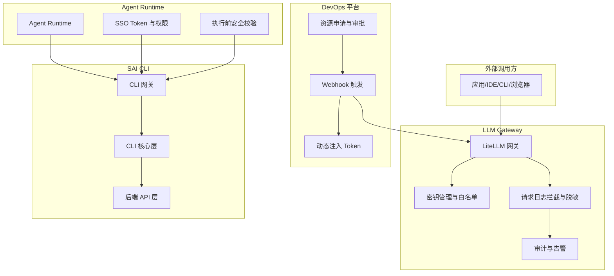
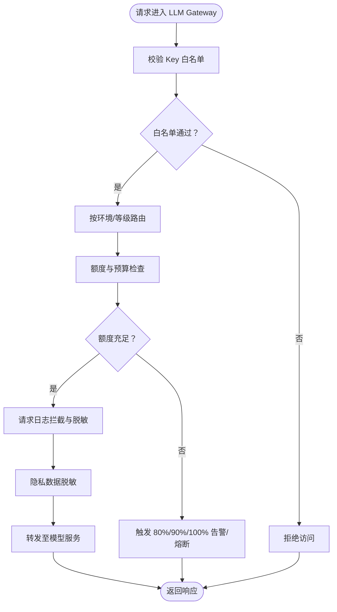
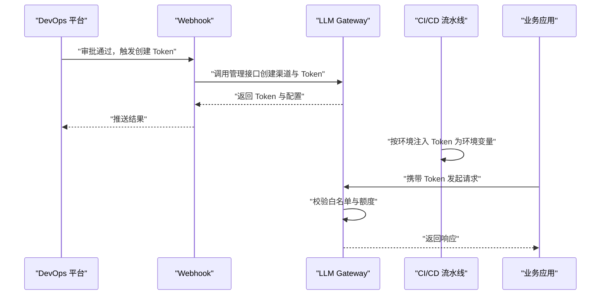
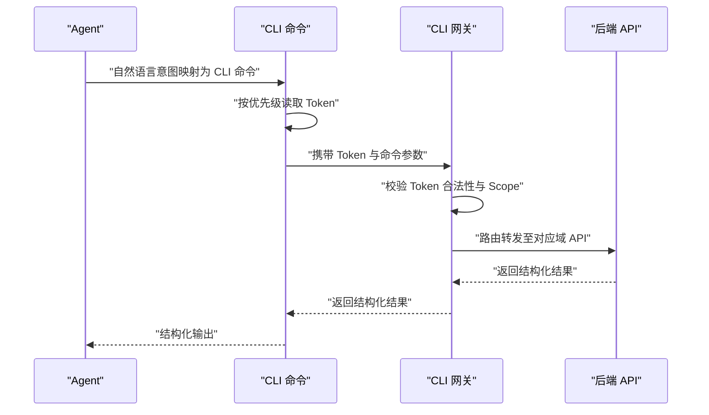
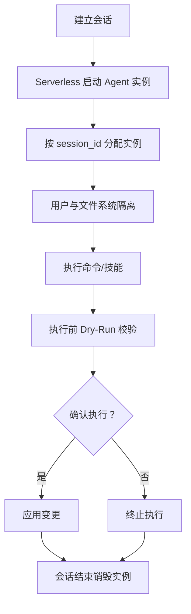
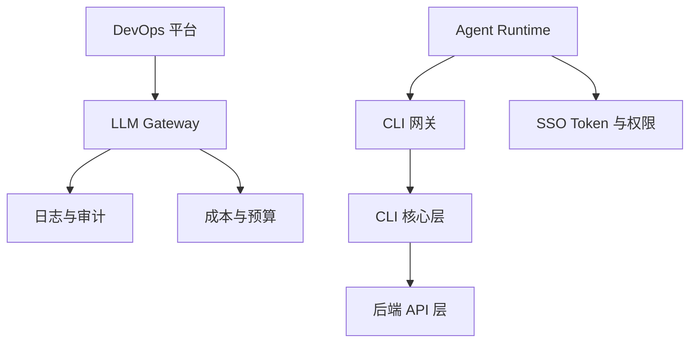

# 安全治理与权限控制

<cite>
**本文引用的文件**
- [LLM-Gateway建设方案.md](file://plan/LLM-Gateway建设方案.md)
- [LLM-Gateway一期功能规划.md](file://plan/LLM-Gateway一期功能规划.md)
- [LLM-Gateway方案review.md](file://notes/zhaobomin/LLM-Gateway方案review.md)
- [LLM Gateway 模型不同计费方式对比.md](file://plan/LLM Gateway 模型不同计费方式对比.md)
- [SAI_CLI_设计文档_v1.0.md](file://plan/SAI_CLI_设计文档_v1.0.md)
- [Agent-Runtime方案.md](file://plan/Agent-Runtime方案.md)
- [README.md](file://README.md)
- [agent-api-discovery-architecture-review.zh-CN.md](file://notes/zhaobomin/agent-api-discovery-architecture-review.zh-CN.md)
</cite>

## 目录
1. [简介](#简介)
2. [项目结构](#项目结构)
3. [核心组件](#核心组件)
4. [架构总览](#架构总览)
5. [详细组件分析](#详细组件分析)
6. [依赖关系分析](#依赖关系分析)
7. [性能考量](#性能考量)
8. [故障排查指南](#故障排查指南)
9. [结论](#结论)
10. [附录](#附录)

## 简介
本文件面向安全治理与权限控制，围绕 LLM Gateway 的安全架构与治理机制展开，涵盖密钥管理、访问控制、数据保护、DevOps 平台密钥分发、白名单控制、虎盾客户端访问限制、隐私数据脱敏、请求日志拦截与审计追踪、安全配置指南、权限分配策略、安全最佳实践以及安全事件处理与合规性要求。文档同时结合 SAI CLI 与 Agent Runtime 的权限与鉴权设计，形成端到端的安全闭环。

## 项目结构
项目以“模块与分工”为视角，将系统分为四层：Channel 层（对外通道）、核心层（Agent Runtime、Workspace、Harness Manager）、基础设施层（LLMRouter、CLI API）与 Harness Manager 子模块（知识库、Skills、CLI 管理与分发）。该结构明确了各层职责与边界，为安全治理与权限控制提供了清晰的落点。

```mermaid
graph TB
subgraph "Channel层"
CH["Channel<br/>弘宇"]
SDD["申懂懂App"]
end
subgraph "核心层"
AR["Agent Runtime<br/>奕杭"]
WS["Workspace"]
HM["Harness Manager<br/>隋云"]
end
subgraph "基础设施层"
LR["LLMRouter<br/>老徐"]
CA["CLI API<br/>淩雪"]
end
subgraph "Harness Manager子模块"
KB["知识库"]
SK["Skills"]
CLI["CLI 管理和分发"]
end
SDD --> CH
CH --> WS
AR --> WS
WS < --> HM
HM --> KB
HM --> SK
HM --> CLI
CLI --> CA
WS --> LR
CA -.->|"提供 API raw 描述"| CLI
```

图表来源
- [README.md:11-41](file://README.md#L11-L41)

章节来源
- [README.md:9-41](file://README.md#L9-L41)

## 核心组件
- LLM Gateway（LiteLLM）：统一代理层，向下接入多模型，向上提供标准 OpenAI 格式 API；具备额度预警熔断、环境与等级路由、请求日志拦截、隐私数据脱敏、Key 访问白名单等安全治理能力。
- DevOps 平台：自动化资源申请与密钥分发，CI/CD 流水线动态注入 Token，实现“真实 Key”清零与虚拟 Key 管控。
- SAI CLI：四层分层架构，网关层负责路由转发、鉴权校验、负载均衡与命令清单同步；CLI 核心层统一命令规范、参数校验与结构化输出；调用层与后端 API 层解耦。
- Agent Runtime：基于 Serverless 的用户隔离与实例隔离，结合 CLI 网关与 SSO Token 实现权限控制与执行前安全校验。
- 审计与日志：请求日志拦截与脱敏、审计日志留存周期与权限控制、告警与熔断联动。

章节来源
- [LLM-Gateway建设方案.md:15-65](file://plan/LLM-Gateway建设方案.md#L15-L65)
- [LLM-Gateway一期功能规划.md:3-11](file://plan/LLM-Gateway一期功能规划.md#L3-L11)
- [SAI_CLI_设计文档_v1.0.md:19-52](file://plan/SAI_CLI_设计文档_v1.0.md#L19-L52)
- [Agent-Runtime方案.md:4-13](file://plan/Agent-Runtime方案.md#L4-L13)

## 架构总览
下图展示了 LLM Gateway 与 DevOps、CLI、Agent Runtime 的协同关系，强调密钥分发、访问控制、日志与审计的关键节点。



图表来源
- [LLM-Gateway建设方案.md:15-65](file://plan/LLM-Gateway建设方案.md#L15-L65)
- [LLM-Gateway一期功能规划.md:3-11](file://plan/LLM-Gateway一期功能规划.md#L3-L11)
- [SAI_CLI_设计文档_v1.0.md:19-52](file://plan/SAI_CLI_设计文档_v1.0.md#L19-L52)
- [Agent-Runtime方案.md:4-13](file://plan/Agent-Runtime方案.md#L4-L13)

## 详细组件分析

### LLM Gateway 安全架构与治理机制
- 密钥管理
  - 真实 Key 由网关统一托管，业务侧使用虚拟 Key；支持额度与有效期管理、预算重置、告警阈值配置与自动熔断。
  - 令牌白名单：对每个 Key 设置白名单，仅白名单 Key 可使用。
- 访问控制
  - 网关入口限制：仅安装虎盾客户端用户与云上应用内网可访问。
  - 环境与等级路由：本地/测试环境强制路由低成本模型；生产核心应用使用旗舰模型并配置多渠道轮询与重试。
- 数据保护
  - 请求日志拦截：记录时间、发起方 IP、Token 归属域组、消耗 Token 数、响应延迟等元数据。
  - 隐私数据脱敏：高敏业务可选配脱敏插件，在请求发往公有云大模型前遮盖或替换敏感数据。
- 成本与预算
  - 额度预警熔断：80%/90%/100% 三级告警与自动熔断；支持按域组/项目分配额度池并接入钉钉通知。
- 审计与合规
  - 审计日志留存周期与权限：明确日志保留期限、访问权限与责任主体。
  - Prompt 长度/内容限制：防止提示词注入与超大 Prompt 消耗大量 Token。



图表来源
- [LLM-Gateway建设方案.md:36-65](file://plan/LLM-Gateway建设方案.md#L36-L65)
- [LLM-Gateway建设方案.md:43-54](file://plan/LLM-Gateway建设方案.md#L43-L54)
- [LLM-Gateway方案review.md:46-51](file://notes/zhaobomin/LLM-Gateway方案review.md#L46-L51)

章节来源
- [LLM-Gateway建设方案.md:36-65](file://plan/LLM-Gateway建设方案.md#L36-L65)
- [LLM-Gateway建设方案.md:43-54](file://plan/LLM-Gateway建设方案.md#L43-L54)
- [LLM-Gateway方案review.md:46-51](file://notes/zhaobomin/LLM-Gateway方案review.md#L46-L51)

### DevOps 平台密钥分发与白名单控制
- 资源申请自动化：研发在 DevOps 发起“AI 资源申请”，填写应用等级、并发、所需环境，审批通过后触发 Webhook 调用管理接口，自动创建渠道与唯一 Token。
- 流水线动态注入：CI/CD 流水线根据部署环境（测试/预发/生产）将对应网关 Token 动态注入为环境变量，业务代码禁止硬编码 Key。
- 白名单控制：对每个 Key 加白处理，仅白名单 Key 可使用；访问方式为应用内网白名单与虎盾（VPN）访问。



图表来源
- [LLM-Gateway建设方案.md:36-41](file://plan/LLM-Gateway建设方案.md#L36-L41)
- [LLM-Gateway建设方案.md:62-65](file://plan/LLM-Gateway建设方案.md#L62-L65)
- [LLM-Gateway一期功能规划.md:3-11](file://plan/LLM-Gateway一期功能规划.md#L3-L11)

章节来源
- [LLM-Gateway建设方案.md:36-41](file://plan/LLM-Gateway建设方案.md#L36-L41)
- [LLM-Gateway建设方案.md:62-65](file://plan/LLM-Gateway建设方案.md#L62-L65)
- [LLM-Gateway一期功能规划.md:3-11](file://plan/LLM-Gateway一期功能规划.md#L3-L11)

### SAI CLI 权限控制与鉴权
- Token 获取优先级：命令行参数 > 环境变量 > 本地配置文件（由 Agent 登录后自动写入）。
- 权限控制：基于 Scope 的权限控制，Bot Token（Agent 应用级）+ User Token（人工用户级）；高危操作需更高权限或二次确认。
- CLI 网关能力：元数据生成、发布通知接口、路由转发、权限校验。
- 执行前安全：Dry-Run 模式用于预览写操作将要执行的变更，避免误操作。



图表来源
- [SAI_CLI_设计文档_v1.0.md:220-250](file://plan/SAI_CLI_设计文档_v1.0.md#L220-L250)
- [SAI_CLI_设计文档_v1.0.md:356-380](file://plan/SAI_CLI_设计文档_v1.0.md#L356-L380)

章节来源
- [SAI_CLI_设计文档_v1.0.md:220-250](file://plan/SAI_CLI_设计文档_v1.0.md#L220-L250)
- [SAI_CLI_设计文档_v1.0.md:356-380](file://plan/SAI_CLI_设计文档_v1.0.md#L356-L380)

### Agent Runtime 隔离与安全
- 用户隔离：基于 Serverless 的 Agent 实例启动与销毁，按 session_id 动态分配实例，确保单实例单会话。
- 文件系统隔离：OSS 挂载区分 workspace 与 systemspace，支持按用户/领域/公共组织；若 OSS 挂载不可行，则在 Agent 层实现基于用户的文件路径权限。
- 执行前安全：Dry-Run 设计与落地，补足执行前安全校验，降低越权与误操作风险。



图表来源
- [Agent-Runtime方案.md:4-13](file://plan/Agent-Runtime方案.md#L4-L13)
- [Agent-Runtime方案.md:15-32](file://plan/Agent-Runtime方案.md#L15-L32)

章节来源
- [Agent-Runtime方案.md:4-13](file://plan/Agent-Runtime方案.md#L4-L13)
- [Agent-Runtime方案.md:15-32](file://plan/Agent-Runtime方案.md#L15-L32)

### 隐私数据脱敏与请求日志拦截
- 隐私数据脱敏：在请求发往公有云大模型前，对敏感数据进行遮盖或替换，高敏场景建议默认开启。
- 请求日志拦截：记录时间、发起方 IP、Token 归属域组、消耗 Token 数、响应延迟等元数据；日志中 Token 已脱敏，但业务参数可能敏感，需结合脱敏策略与最小化采集原则。
- 审计日志留存周期与权限：明确日志保留期限、访问权限与责任主体，确保合规与可追溯。

章节来源
- [LLM-Gateway建设方案.md:56-65](file://plan/LLM-Gateway建设方案.md#L56-L65)
- [agent-api-discovery-architecture-review.zh-CN.md:120](file://notes/zhaobomin/agent-api-discovery-architecture-review.zh-CN.md#L120)

### 安全配置指南与权限分配策略
- 密钥配置
  - 真实 Key 由网关托管，业务侧使用虚拟 Key；在 DevOps 审批通过后自动创建并注入流水线环境变量。
  - 对每个 Key 配置白名单，仅白名单 Key 可使用；访问方式为应用内网白名单与虎盾（VPN）访问。
- 权限分配
  - LLM Gateway：按域组/项目分配额度池，设置独立资金或 Token 额度池与预算重置规则；支持按 Key、User、Team 双维度限流与告警。
  - CLI：基于 Scope 的权限控制，Bot Token 与 User Token 分级授权；高危操作需更高权限或二次确认。
- 安全最佳实践
  - 禁止在代码中硬编码 Key；通过流水线动态注入；启用白名单与访问控制；启用日志拦截与脱敏；配置额度预警与自动熔断；定期审计与合规检查。

章节来源
- [LLM-Gateway建设方案.md:36-65](file://plan/LLM-Gateway建设方案.md#L36-L65)
- [LLM-Gateway建设方案.md:43-54](file://plan/LLM-Gateway建设方案.md#L43-L54)
- [SAI_CLI_设计文档_v1.0.md:220-250](file://plan/SAI_CLI_设计文档_v1.0.md#L220-L250)

### 安全事件处理流程与合规性要求
- 事件处理流程
  - 额度预警：80%/90%/100% 三级告警；100% 自动熔断降级；支持配置不同阈值与抑制规则。
  - 逃生方案：网关全局限流 > 应用限流 > 单令牌限流；业务侧支持 fallback 直连百炼/OpenAI 原生 API；网关支持 bypass 模式一键关闭路由规则。
  - 审计与日志：明确日志留存周期、访问权限与责任主体；日志中 Token 已脱敏，业务参数需结合脱敏策略。
- 合规性要求
  - 高敏场景默认开启脱敏；Prompt 输入限制规则；日志最小化采集与合规存储；权限最小化与职责分离；定期安全评估与审计。

章节来源
- [LLM-Gateway建设方案.md:43-54](file://plan/LLM-Gateway建设方案.md#L43-L54)
- [LLM-Gateway建设方案.md:56-65](file://plan/LLM-Gateway建设方案.md#L56-L65)
- [LLM-Gateway方案review.md:32-39](file://notes/zhaobomin/LLM-Gateway方案review.md#L32-L39)
- [LLM-Gateway方案review.md:46-51](file://notes/zhaobomin/LLM-Gateway方案review.md#L46-L51)

## 依赖关系分析
- LLM Gateway 依赖 DevOps 平台完成密钥生命周期管理与动态注入；依赖 CLI 网关与后端 API 层实现命令执行与权限控制；依赖 Agent Runtime 实现用户隔离与执行前安全校验。
- CLI 网关依赖 SSO Token 与 Scope 权限控制，结合 Dry-Run 与结构化错误输出，保障执行安全与可观测性。
- Agent Runtime 通过 Serverless 与文件系统隔离，结合 CLI 网关与 SSO Token，实现端到端的权限控制与安全执行。



图表来源
- [LLM-Gateway建设方案.md:36-65](file://plan/LLM-Gateway建设方案.md#L36-L65)
- [SAI_CLI_设计文档_v1.0.md:356-380](file://plan/SAI_CLI_设计文档_v1.0.md#L356-L380)
- [Agent-Runtime方案.md:4-13](file://plan/Agent-Runtime方案.md#L4-L13)

章节来源
- [LLM-Gateway建设方案.md:36-65](file://plan/LLM-Gateway建设方案.md#L36-L65)
- [SAI_CLI_设计文档_v1.0.md:356-380](file://plan/SAI_CLI_设计文档_v1.0.md#L356-L380)
- [Agent-Runtime方案.md:4-13](file://plan/Agent-Runtime方案.md#L4-L13)

## 性能考量
- LiteLLM 原生支持基于 Key/User/Team 的双维度限流与额度重置，有助于在高并发场景下实现精细化成本控制与稳定性保障。
- 环境与等级路由策略：本地/测试环境使用低成本模型，生产核心应用使用旗舰模型并配置多渠道轮询与重试，兼顾性能与成本。
- CLI 与 Agent Runtime 采用 Serverless 与 Dry-Run，减少不必要的执行与回滚成本，提升整体响应速度与安全性。

章节来源
- [LLM-Gateway建设方案.md:43-54](file://plan/LLM-Gateway建设方案.md#L43-L54)
- [LLM-Gateway建设方案.md:81-94](file://plan/LLM-Gateway建设方案.md#L81-L94)
- [LLM-Gateway 模型不同计费方式对比.md:1-9](file://plan/LLM Gateway 模型不同计费方式对比.md#L1-L9)
- [Agent-Runtime方案.md:4-13](file://plan/Agent-Runtime方案.md#L4-L13)

## 故障排查指南
- 网关熔断与告警
  - 检查额度阈值与预算重置规则；确认 80%/90%/100% 告警是否正常推送；必要时启用 bypass 模式临时恢复服务。
- 密钥与白名单
  - 确认 Key 是否在白名单中；检查 DevOps 审批与流水线注入是否正确；核对 Token 生命周期与权限范围。
- 日志与审计
  - 核对日志拦截与脱敏策略；确认审计日志留存周期与访问权限；排查是否存在敏感参数未脱敏的情况。
- CLI 与 Agent
  - 检查 Token 获取优先级与配置文件；确认 Scope 权限是否满足命令需求；使用 Dry-Run 预览写操作影响范围。

章节来源
- [LLM-Gateway建设方案.md:43-54](file://plan/LLM-Gateway建设方案.md#L43-L54)
- [LLM-Gateway建设方案.md:56-65](file://plan/LLM-Gateway建设方案.md#L56-L65)
- [SAI_CLI_设计文档_v1.0.md:220-250](file://plan/SAI_CLI_设计文档_v1.0.md#L220-L250)
- [Agent-Runtime方案.md:4-13](file://plan/Agent-Runtime方案.md#L4-L13)

## 结论
通过 LLM Gateway 的统一代理与治理能力、DevOps 的自动化密钥分发、CLI 的鉴权与执行前安全校验、Agent Runtime 的用户与文件系统隔离，形成了覆盖密钥管理、访问控制、数据保护、成本预算、审计与合规的完整安全治理体系。建议在高敏场景默认开启脱敏与 Prompt 限制，完善审计日志留存与权限控制，并持续优化逃生方案与熔断策略，确保系统在复杂场景下的安全与稳定。

## 附录
- 相关文档索引
  - [LLM-Gateway建设方案](file://plan/LLM-Gateway建设方案.md)
  - [LLM-Gateway一期功能规划](file://plan/LLM-Gateway一期功能规划.md)
  - [LLM-Gateway方案review](file://notes/zhaobomin/LLM-Gateway方案review.md)
  - [LLM Gateway 模型不同计费方式对比](file://plan/LLM Gateway 模型不同计费方式对比.md)
  - [SAI_CLI_设计文档_v1.0](file://plan/SAI_CLI_设计文档_v1.0.md)
  - [Agent-Runtime方案](file://plan/Agent-Runtime方案.md)
  - [README](file://README.md)
  - [agent-api-discovery-architecture-review](file://notes/zhaobomin/agent-api-discovery-architecture-review.zh-CN.md)