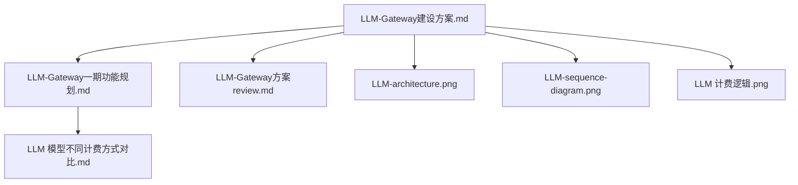
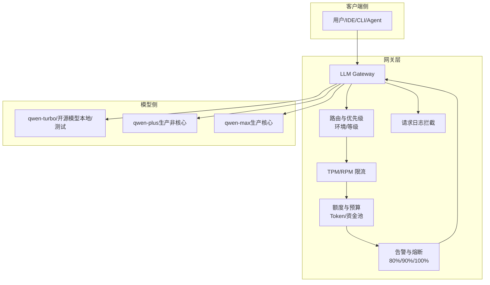
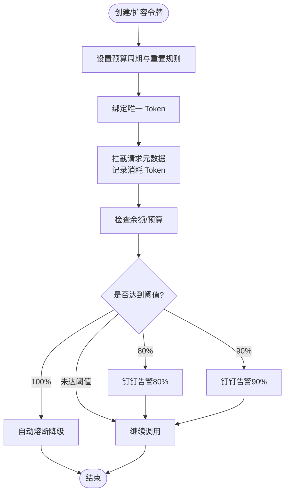
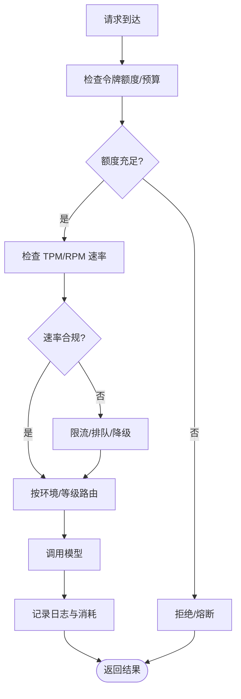
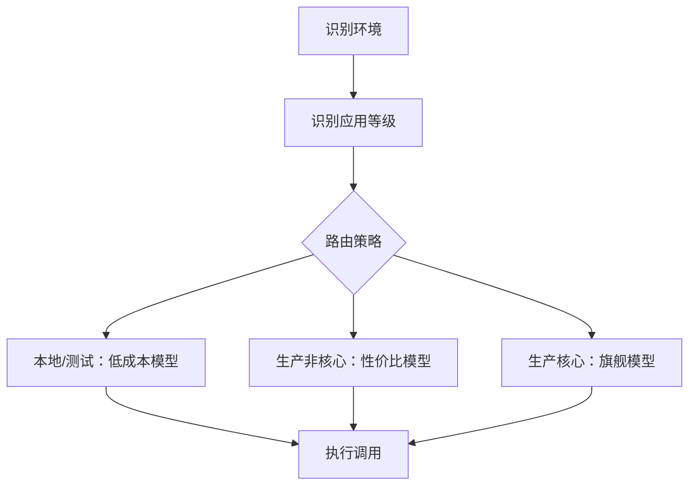
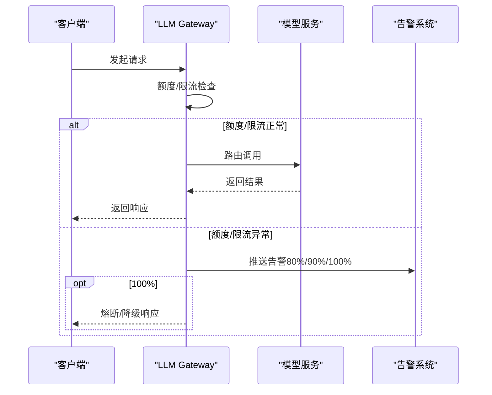
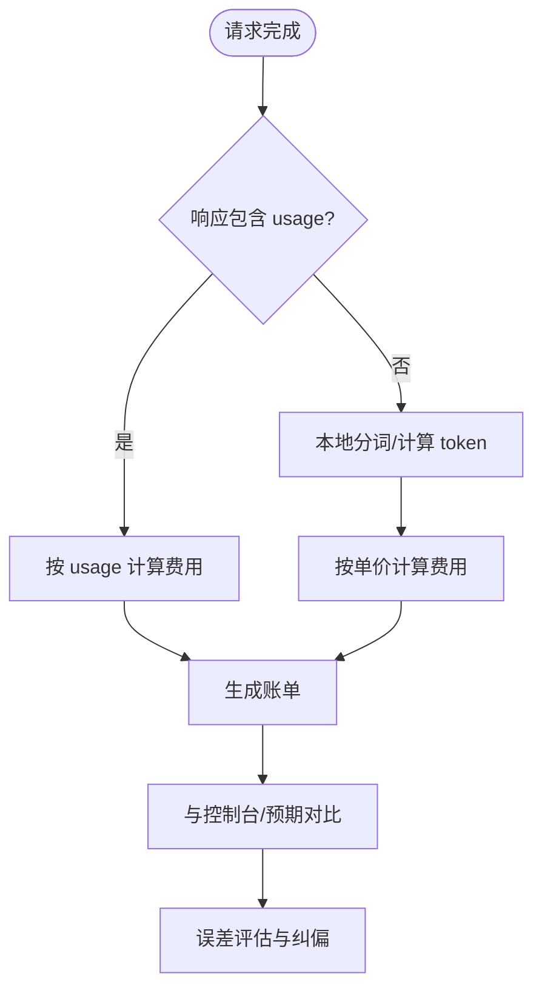
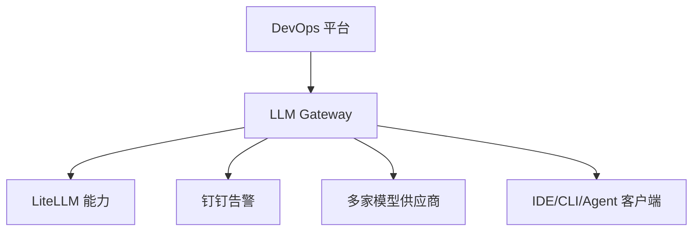

# 成本控制与计费

<cite>
**本文引用的文件**
- [LLM-Gateway建设方案.md](file://plan/LLM-Gateway建设方案.md)
- [LLM-Gateway一期功能规划.md](file://plan/LLM-Gateway一期功能规划.md)
- [LLM-Gateway方案review.md](file://notes/zhaobomin/LLM-Gateway方案review.md)
- [LLM 计费逻辑.png](file://plan/pic/LLM%20计费逻辑.png)
- [LLM-architecture.png](file://plan/pic/LLM-architecture.png)
- [LLM-sequence-diagram.png](file://plan/pic/LLM-sequence-diagram.png)
- [LLM 模型不同计费方式对比.md](file://plan/LLM Gateway 模型不同计费方式对比.md)
</cite>

## 目录
1. [简介](#简介)
2. [项目结构](#项目结构)
3. [核心组件](#核心组件)
4. [架构总览](#架构总览)
5. [详细组件分析](#详细组件分析)
6. [依赖分析](#依赖分析)
7. [性能考量](#性能考量)
8. [故障排查指南](#故障排查指南)
9. [结论](#结论)
10. [附录](#附录)

## 简介
本技术文档围绕 LLM Gateway 的成本控制与计费体系，系统阐述额度管理、预算控制、自动熔断、TPM/RPM 限流、环境与等级路由、优先级管控、计费逻辑与误差分析、优化建议、监控指标与异常处理策略。文档基于仓库现有设计文档与评审意见，结合 LiteLLM 能力与实际落地规划，形成可操作的实施方案与最佳实践。

## 项目结构
- 文档以“LLM Gateway 建设方案”为核心蓝图，配套“一期功能规划”“方案 review”“计费逻辑图”“架构图/时序图”等材料，形成从架构到落地的完整视图。
- 重点文件分布如下：
  - 建设方案：定义背景痛点、系统架构、技术方案（API 标准化、DevOps 密钥分发、流量降级与成本控制、日志与安全）、核心优势、开源对比、项目规划。
  - 一期规划：明确个人令牌申请与管理、令牌监控告警、网关配置、测试验证等目标与排期。
  - 方案 review：指出上线节奏、前后文矛盾、逃生方案、计费误差、安全缺口、前端选型、账号迁移等风险与建议。
  - 图表：计费逻辑图、架构图、时序图，直观展示计费与调用流程、路由与降级策略。

**图表来源**
- [LLM-Gateway建设方案.md](file://plan/LLM-Gateway建设方案.md)
- [LLM-Gateway一期功能规划.md](file://plan/LLM-Gateway一期功能规划.md)
- [LLM-Gateway方案review.md](file://notes/zhaobomin/LLM-Gateway方案review.md)
- [LLM-architecture.png](file://plan/pic/LLM-architecture.png)
- [LLM-sequence-diagram.png](file://plan/pic/LLM-sequence-diagram.png)
- [LLM 计费逻辑.png](file://plan/pic/LLM%20计费逻辑.png)
- [LLM 模型不同计费方式对比.md](file://plan/LLM Gateway 模型不同计费方式对比.md)

**章节来源**
- [LLM-Gateway建设方案.md](file://plan/LLM-Gateway建设方案.md)
- [LLM-Gateway一期功能规划.md](file://plan/LLM-Gateway一期功能规划.md)
- [LLM-Gateway方案review.md](file://notes/zhaobomin/LLM-Gateway方案review.md)

## 核心组件
- 统一代理与 API 标准化：网关作为统一代理层，向下接入多家模型（Qwen 全系、OpenAI、Claude、Gemini 等），向上统一暴露 OpenAI 格式 API，实现业务零改造切换。
- DevOps 平台密钥分发：研发通过 DevOps 发起“AI 资源申请”，审批后自动创建渠道与唯一 Token，并在 CI/CD 流水线按环境注入 Token，杜绝硬编码与密钥泄露风险。
- 流量降级与成本控制：按环境与等级路由（本地/测试用低成本模型，生产非核心用性价比模型，核心用旗舰模型），并配置 TPM/RPM 限流；为每个 Token 设定独立资金/Token 额度池，80%/90%/100% 三级告警与自动熔断。
- 日志与安全：拦截请求元数据（时间、来源 IP、Token 归属域组、消耗 Token 数、响应延迟）；高敏业务可选配脱敏插件；Key 白名单与访问方式（内网/虎盾 VPN）保障安全。
- 监控与告警：令牌级告警（默认 80%/90%/100%）、网关不可用与模型健康告警推送到钉钉群；支持一键屏蔽告警与用量详情、配额记录查询。
- 估算与对比：提供不同场景下（AI 客户端、CLI、IDE 插件、直连）的耗时与 token 消耗对比，辅助预算与成本评估。

**章节来源**
- [LLM-Gateway建设方案.md](file://plan/LLM-Gateway建设方案.md)
- [LLM-Gateway一期功能规划.md](file://plan/LLM-Gateway一期功能规划.md)
- [LLM 模型不同计费方式对比.md](file://plan/LLM Gateway 模型不同计费方式对比.md)

## 架构总览
下图基于仓库“架构图/时序图”与“建设方案”，展示 LLM Gateway 的端到端调用与成本控制路径：客户端/IDE/CLI 通过统一网关发起请求，网关按环境与等级路由到对应模型，执行限流与额度校验，记录日志并返回结果；异常与熔断通过告警通道通知。

**图表来源**
- [LLM-architecture.png](file://plan/pic/LLM-architecture.png)
- [LLM-Gateway建设方案.md](file://plan/LLM-Gateway建设方案.md)

## 详细组件分析

### 额度管理与预算控制
- 额度池：为每个 Token 设定独立资金或 Token 额度池，支持按自然月等周期自动重置（LiteLLM 原生支持）。
- 预算分配：按域组/项目维度分配额度池，支持在令牌创建时配置预算周期与重置规则。
- 额度消耗追踪：拦截请求元数据，记录每次调用的 Token 消耗，支撑实时余额与剩余查询。
- 预算告警：默认三级阈值（80%/90%/100%），支持自定义阈值；100% 自动熔断降级，80%/90% 推送钉钉告警。
- 配额记录：支持查看分配周期、分配类型（系统分配/扩容）、额度与剩余，便于审计与复盘。

**图表来源**
- [LLM-Gateway建设方案.md](file://plan/LLM-Gateway建设方案.md)
- [LLM-Gateway一期功能规划.md](file://plan/LLM-Gateway一期功能规划.md)

**章节来源**
- [LLM-Gateway建设方案.md](file://plan/LLM-Gateway建设方案.md)
- [LLM-Gateway一期功能规划.md](file://plan/LLM-Gateway一期功能规划.md)

### TPM/RPM 限流策略
- 维度：基于 Key/User/Team 的双维度限流（RPM 次数 + TPM 吞吐量），支持令牌级精细化控制。
- 策略：生产非核心应用设置严格 TPM/RPM 上限；本地/测试环境默认较低限额，保障调试成本可控。
- 降级：当接近阈值或触发熔断时，自动降级到低成本模型或回退到备用渠道，确保服务连续性。

**图表来源**
- [LLM-Gateway建设方案.md](file://plan/LLM-Gateway建设方案.md)

**章节来源**
- [LLM-Gateway建设方案.md](file://plan/LLM-Gateway建设方案.md)

### 环境等级路由与优先级管控
- 环境路由：本地/测试强制路由至低成本模型（qwen-turbo/开源模型），生产非核心使用性价比模型（qwen-plus），核心应用使用旗舰模型（qwen-max）。
- 优先级：按应用等级（核心/非核心/边缘）与环境（本地/测试/预发/生产）动态选择模型与权重，确保成本与性能平衡。
- 多渠道重试：核心应用配置多渠道轮询与重试，提升可用性与稳定性。

**图表来源**
- [LLM-Gateway建设方案.md](file://plan/LLM-Gateway建设方案.md)

**章节来源**
- [LLM-Gateway建设方案.md](file://plan/LLM-Gateway建设方案.md)

### 自动熔断与逃生机制
- 熔断触发：100% 额度使用后自动熔断，阻断进一步调用；80%/90% 触发告警，提醒控制用量。
- 逃生方案：建议至少两种逃生路径：
  - 业务侧：支持 fallback 直连百炼/OpenAI 原生 API（绕过网关）。
  - 网关侧：支持 bypass 模式，一键关闭所有路由规则，快速恢复。
- 全局告警：网关不可用与模型健康失败推送至钉钉群，便于集中处置。

**图表来源**
- [LLM-Gateway建设方案.md](file://plan/LLM-Gateway建设方案.md)
- [LLM-Gateway方案review.md](file://notes/zhaobomin/LLM-Gateway方案review.md)

**章节来源**
- [LLM-Gateway建设方案.md](file://plan/LLM-Gateway建设方案.md)
- [LLM-Gateway方案review.md](file://notes/zhaobomin/LLM-Gateway方案review.md)

### 计费逻辑与误差分析
- 计费方式：基于模型单价与实际使用 token 数计算；部分场景支持套餐计费或预付费模式。
- 误差来源：分词规则差异（如 cl100k_base 与阿里云差异）、不支持阶梯计费、响应 usage 缺失时需本地计算 token。
- 误差评估：建议开展“网关 vs 控制台”的对比实验，统计偏差比例，形成可接受范围与纠偏策略。
- 对比参考：不同接入方式（AI 客户端、CLI、IDE 插件、直连）在耗时与 token 消耗上的差异，可用于成本与效率权衡。

**图表来源**
- [LLM 计费逻辑.png](file://plan/pic/LLM%20计费逻辑.png)
- [LLM 模型不同计费方式对比.md](file://plan/LLM Gateway 模型不同计费方式对比.md)

**章节来源**
- [LLM 计费逻辑.png](file://plan/pic/LLM%20计费逻辑.png)
- [LLM 模型不同计费方式对比.md](file://plan/LLM Gateway 模型不同计费方式对比.md)

### 告警配置与熔断机制实现要点
- 令牌级告警：默认 80%/90%/100% 三级阈值，支持自定义；100% 自动熔断，80%/90% 推送钉钉。
- 令牌管理：支持启用/禁用、扩容、用量详情、配额记录、一键屏蔽告警。
- 网关级告警：网关不可用与模型健康失败推送至钉钉群，便于集中处置。
- 告警模板：包含额度、已用、剩余、用量查询链接等关键信息，便于用户快速响应。

**章节来源**
- [LLM-Gateway一期功能规划.md](file://plan/LLM-Gateway一期功能规划.md)
- [LLM-Gateway建设方案.md](file://plan/LLM-Gateway建设方案.md)

### 成本优化建议
- 路由策略：优先在本地/测试使用低成本模型，减少高阶模型调用；生产非核心使用性价比模型，核心应用保留旗舰模型。
- 限流与预算：为不同令牌设置合理的 TPM/RPM 与额度上限，避免突发流量导致超支。
- 额度重置：按自然月等周期重置额度，避免长期累积导致预算失效。
- 模型选择：结合“模型不同计费方式对比”，在满足质量前提下选择更优性价比模型。
- 安全与审计：启用脱敏插件、白名单与访问控制，减少数据泄露与滥用带来的隐性成本。

**章节来源**
- [LLM-Gateway建设方案.md](file://plan/LLM-Gateway建设方案.md)
- [LLM 模型不同计费方式对比.md](file://plan/LLM Gateway 模型不同计费方式对比.md)

### 监控指标与异常处理
- 监控指标：请求量、错误率、P95/P99 延迟、TPM/RPM 实时速率、额度剩余、告警触发次数、模型健康状态。
- 异常处理：熔断后返回降级响应；限流时排队或回退；健康检查失败推送告警并自动切换备用渠道。
- 审计与追溯：拦截请求元数据，记录来源、Token 归属域组、消耗 token 数与响应延迟，支持事后审计与成本归因。

**章节来源**
- [LLM-Gateway建设方案.md](file://plan/LLM-Gateway建设方案.md)
- [LLM-Gateway一期功能规划.md](file://plan/LLM-Gateway一期功能规划.md)

## 依赖分析
- 组件耦合：网关层（路由/限流/预算/告警/日志）与模型层（多厂商/多版本）松耦合，通过统一 API 标准对接。
- 外部依赖：依赖 LiteLLM 的令牌级限流、预算重置、告警与降级能力；与 DevOps 平台集成实现令牌生命周期管理；与钉钉集成实现告警推送。
- 风险点：前后文矛盾（建设方案中提及“New API 管理接口”，但选型结论为 LiteLLM）；逃生方案需尽快明确；计费误差需量化评估；前端选型与迁移风险需评估。

**图表来源**
- [LLM-Gateway建设方案.md](file://plan/LLM-Gateway建设方案.md)
- [LLM-Gateway方案review.md](file://notes/zhaobomin/LLM-Gateway方案review.md)

**章节来源**
- [LLM-Gateway建设方案.md](file://plan/LLM-Gateway建设方案.md)
- [LLM-Gateway方案review.md](file://notes/zhaobomin/LLM-Gateway方案review.md)

## 性能考量
- 路由与限流：在网关层前置限流与路由，避免无效调用进入模型侧，降低整体延迟与成本。
- 模型选择：根据场景选择合适模型，兼顾质量与成本；核心场景使用旗舰模型，非核心与测试场景使用性价比模型。
- 重试与降级：核心应用配置多渠道重试与降级，提升可用性与稳定性，减少失败重试带来的额外开销。
- 日志与审计：拦截关键元数据，避免冗余日志影响性能；对高敏数据启用脱敏，降低合规风险与潜在损失。

## 故障排查指南
- 熔断与告警：检查 80%/90%/100% 阈值配置与钉钉告警是否正常；确认 100% 熔断是否触发。
- 限流与额度：核对令牌的 TPM/RPM 限额与当前使用速率；检查额度池剩余与预算周期。
- 路由与模型：确认环境/等级路由规则是否正确；检查模型健康状态与备用渠道是否可用。
- 日志与审计：查看请求拦截日志，定位异常来源与耗时热点；结合用量详情与配额记录进行成本归因。
- 逃生方案：若网关不可用，启用 bypass 模式或引导业务侧 fallback 直连原生 API，尽快恢复服务。

**章节来源**
- [LLM-Gateway建设方案.md](file://plan/LLM-Gateway建设方案.md)
- [LLM-Gateway方案review.md](file://notes/zhaobomin/LLM-Gateway方案review.md)

## 结论
LLM Gateway 通过统一代理、API 标准化、DevOps 密钥分发、环境与等级路由、TPM/RPM 限流、令牌级预算与告警、自动熔断与逃生机制，形成闭环的成本控制与计费体系。结合 LiteLLM 的原生能力与仓库规划，可在 4/30 最小可用范围内验证路由与告警，在 5/15 完成 DevOps 融合与审批流，最终在 5/30 推广至全量业务。建议尽快统一前后文描述、明确逃生方案、量化计费误差、完善前端与迁移策略，确保成本可控、安全可靠、可运维。

## 附录
- 术语
  - TPM：每分钟 Token 数
  - RPM：每分钟请求数
  - 额度池：按令牌/用户/团队维度设定的预算或 Token 使用上限
  - 熔断：达到阈值后自动阻断或降级调用
- 参考图表
  - [LLM-architecture.png](file://plan/pic/LLM-architecture.png)
  - [LLM-sequence-diagram.png](file://plan/pic/LLM-sequence-diagram.png)
  - [LLM 计费逻辑.png](file://plan/pic/LLM%20计费逻辑.png)