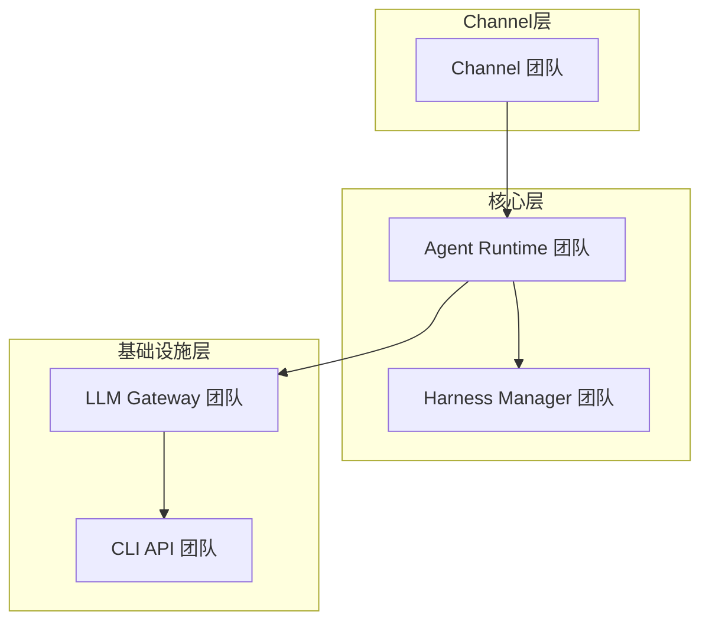
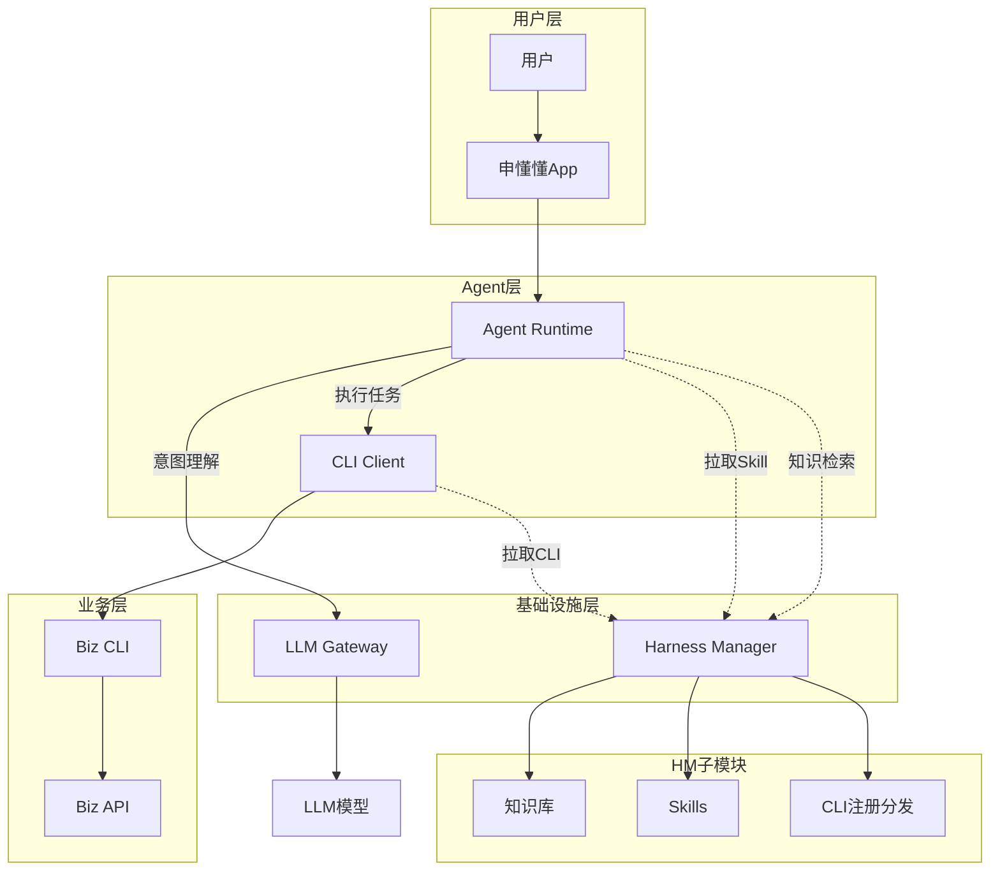
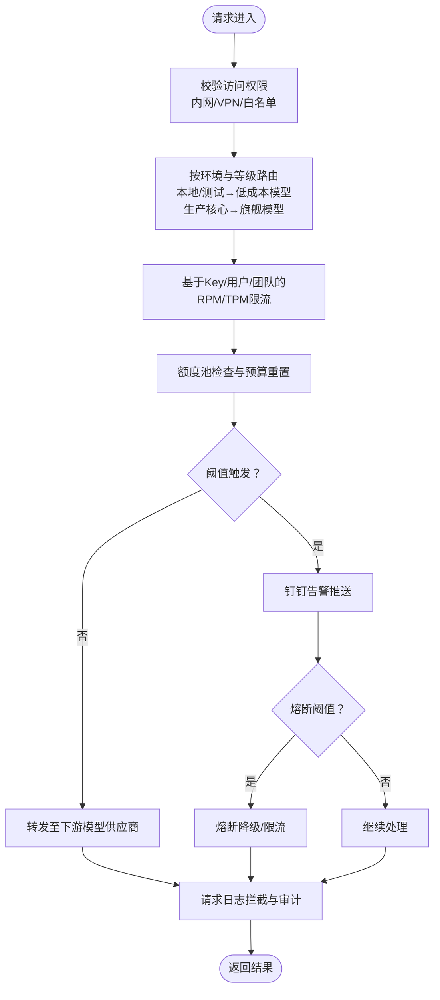
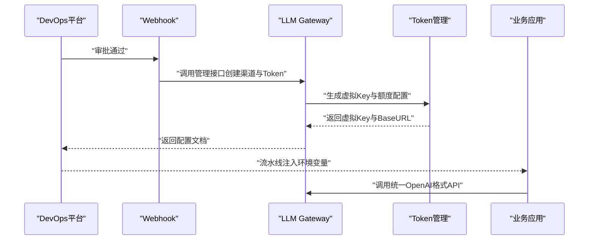
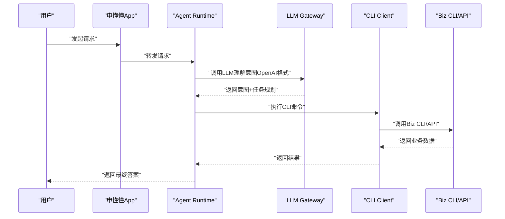
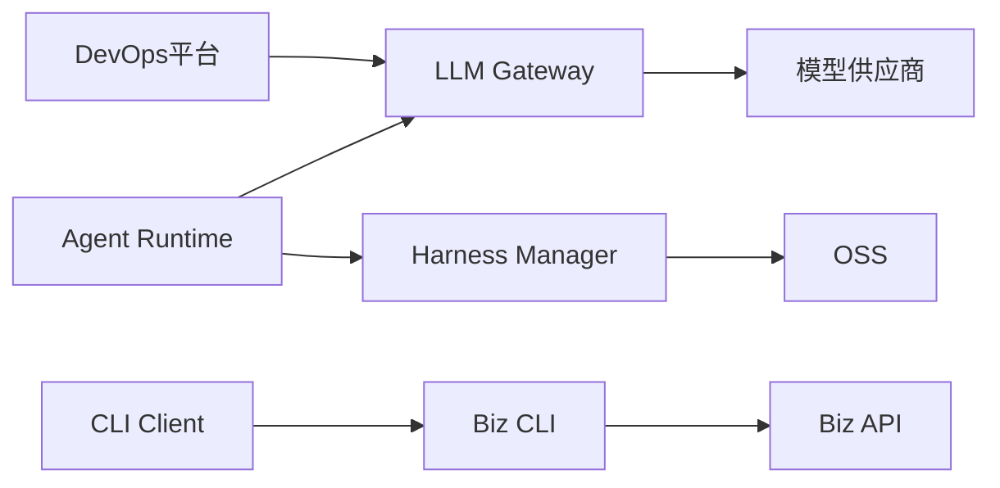

# 系统架构设计

<cite>
**本文引用的文件**
- [LLM-Gateway建设方案.md](file://plan/LLM-Gateway建设方案.md)
- [LLM-Gateway一期功能规划.md](file://plan/LLM-Gateway一期功能规划.md)
- [LLM-Gateway方案review.md](file://notes/zhaobomin/LLM-Gateway方案review.md)
- [Sai整体架构设计.md](file://project/standup/Sai整体架构设计.md)
- [Agent-Runtime方案.md](file://plan/Agent-Runtime方案.md)
- [LLM Gateway 热门开源项目对比.md](file://plan/LLM Gateway 热门开源项目对比.md)
- [项目管理方案v1.0.md](file://project/项目管理方案v1.0.md)
- [LLM 计费逻辑.png](file://plan/pic/LLM%20计费逻辑.png)
- [LLM-architecture.png](file://plan/pic/LLM-architecture.png)
- [LLM-sequence-diagram.png](file://plan/pic/LLM-sequence-diagram.png)
</cite>

## 目录
1. [引言](#引言)
2. [项目结构](#项目结构)
3. [核心组件](#核心组件)
4. [架构总览](#架构总览)
5. [详细组件分析](#详细组件分析)
6. [依赖分析](#依赖分析)
7. [性能考量](#性能考量)
8. [故障与排障指南](#故障与排障指南)
9. [结论](#结论)
10. [附录](#附录)

## 引言
本文件围绕基于 LiteLLM 的统一网关（LLM Gateway）系统架构，系统性阐述其设计原则、组件交互、数据与控制流、API标准化策略、统一代理层实现机制、多模型无缝切换方案，以及与 DevOps 平台的集成与流量路由策略。文档同时提供架构决策的技术依据与实现细节，帮助系统设计者与开发者建立一致的认知与落地路径。

## 项目结构
本项目采用“三层架构、五个团队代码库、一个公共文档库”的组织方式，LLM Gateway 位于基础设施层，承担统一代理、路由与成本控制职责，向上支撑 Agent Runtime 与业务 CLI 的意图理解与执行链路。

图表来源
- [项目管理方案v1.0.md:34-49](file://project/项目管理方案v1.0.md#L34-L49)

章节来源
- [项目管理方案v1.0.md:21-49](file://project/项目管理方案v1.0.md#L21-L49)

## 核心组件
- LLM Gateway（统一代理层）
  - 作为统一代理层，向下接入多家模型供应商（如 Qwen、OpenAI、Claude、Gemini 等），向上对外暴露统一的 OpenAI 格式 API，实现业务侧“零成本切换”。
  - 支持基于 Key/用户/团队的精细化限流与预算控制，结合额度预警与熔断机制，保障成本可控。
  - 提供白名单访问控制、内网与 VPN 访问策略，配合 DevOps 平台实现资源申请与密钥分发自动化。
- DevOps 平台（密钥分发与审批）
  - 通过审批流触发 Webhook，自动调用网关管理接口创建渠道与唯一 Token；在 CI/CD 流水线中按环境动态注入网关 Token，避免硬编码真实 Key。
- Agent Runtime（意图理解与任务编排）
  - 通过 LLM Gateway 完成意图理解与任务规划，随后驱动 CLI Client 执行业务 CLI，实现“理解—执行”的完整链路。
- Harness Manager（控制面资源分发）
  - 提供 Skills、CLI 注册与分发、知识库检索等控制面能力，支撑 Agent Runtime 的资源拉取与执行。
- CLI API（业务能力封装）
  - 以 API 原型形式提供业务能力，Agent Runtime 通过 CLI Client 调用，实现业务数据的获取与反馈。

章节来源
- [LLM-Gateway建设方案.md:15-26](file://plan/LLM-Gateway建设方案.md#L15-L26)
- [Sai整体架构设计.md:142-151](file://project/standup/Sai整体架构设计.md#L142-L151)

## 架构总览
下图展示了 LLM Gateway 在整体系统中的位置与交互关系，以及意图理解与业务执行两条核心链路。

图表来源
- [Sai整体架构设计.md:17-65](file://project/standup/Sai整体架构设计.md#L17-L65)

章节来源
- [Sai整体架构设计.md:108-138](file://project/standup/Sai整体架构设计.md#L108-L138)

## 详细组件分析

### 组件A：LLM Gateway（统一代理层）
- 职责边界
  - 统一代理：向下接入多家模型供应商，向上提供统一 OpenAI 格式 API，屏蔽底层差异。
  - 成本与预算：基于 Key/用户/团队的 RPM/TPM 限流与预算重置，支持 80%/90%/100% 三级告警与熔断。
  - 安全与审计：请求日志拦截、隐私数据脱敏（可选）、Key 白名单访问控制、内网/VPN 访问策略。
  - 路由与降级：按环境与应用等级进行路由（本地/测试用低成本模型，生产核心用旗舰模型），支持多渠道轮询与故障降级。
- 关键实现机制
  - API 标准化：统一 OpenAI 格式，业务侧仅需更换 Base URL 与 Token 即可无缝切换模型。
  - 流量路由：按环境维度（本地/测试/预发/生产）与应用等级（核心/非核心/边缘）进行策略化路由。
  - 额度与告警：为每个 Token 设置独立额度池，支持预算重置规则与钉钉告警推送。
  - 安全与合规：Key 白名单、内网/VPN 访问、可选脱敏插件、审计日志留存。
- 与 DevOps 的集成
  - 审批流触发 Webhook，自动创建渠道与唯一 Token；流水线动态注入环境变量，避免真实 Key 硬编码。
- 与 Agent Runtime 的交互
  - Agent Runtime 通过 LLM Gateway 的 OpenAI 格式接口进行意图理解与任务规划，返回结果后继续执行业务链路。

图表来源
- [LLM-Gateway建设方案.md:43-65](file://plan/LLM-Gateway建设方案.md#L43-L65)

章节来源
- [LLM-Gateway建设方案.md:27-65](file://plan/LLM-Gateway建设方案.md#L27-L65)
- [LLM-Gateway一期功能规划.md:3-11](file://plan/LLM-Gateway一期功能规划.md#L3-L11)

### 组件B：DevOps 平台（密钥分发与审批）
- 职责边界
  - 资源申请自动化：研发在 DevOps 发起“AI 资源申请”，填写应用等级、并发、所需环境，审批通过后触发 Webhook。
  - 管理接口调用：自动创建渠道与唯一 Token，返回虚拟 Key、Base URL 与配置文档。
  - 流水线注入：在 CI/CD 流水线中按环境注入网关 Token，避免真实 Key 硬编码。
- 风险与建议
  - 4/30 上线时间紧张，建议缩小 Scope，优先保证“网关跑通 + 手动发 Key + 基础告警”，审批流与前端管理页面延后至 5/15。
  - 前后文矛盾：全文应统一使用 LiteLLM 的管理接口，避免与 New API 混淆。

图表来源
- [LLM-Gateway建设方案.md:36-41](file://plan/LLM-Gateway建设方案.md#L36-L41)

章节来源
- [LLM-Gateway建设方案.md:36-41](file://plan/LLM-Gateway建设方案.md#L36-L41)
- [LLM-Gateway方案review.md:21-25](file://notes/zhaobomin/LLM-Gateway方案review.md#L21-L25)

### 组件C：Agent Runtime（意图理解与任务编排）
- 职责边界
  - 通过 LLM Gateway 完成意图理解与任务规划，随后驱动 CLI Client 执行业务 CLI，实现“理解—执行”的完整链路。
  - 用户隔离：基于 Serverless 的 Agent 实例，按 session_id 动态分配，确保实例内单一会话。
  - 文件系统挂载：通过 OSS 挂载 workspace 与 systemspace，支持按用户/领域/公共组织，提升冷启动性能。
- 与 LLM Gateway 的接口
  - 统一 OpenAI 格式接口，认证方式为 Bearer Token（Gateway 分配的虚拟 Key）。

图表来源
- [Sai整体架构设计.md:115-138](file://project/standup/Sai整体架构设计.md#L115-L138)

章节来源
- [Sai整体架构设计.md:197-221](file://project/standup/Sai整体架构设计.md#L197-L221)
- [Agent-Runtime方案.md:4-12](file://plan/Agent-Runtime方案.md#L4-L12)

### 组件D：Harness Manager（控制面资源分发）
- 职责边界
  - 知识库：企业知识存储与检索，辅助 Agent 决策。
  - Skills：Skill 注册与管理，Agent 从 HM 拉取 Skill 定义。
  - CLI 注册分发：业务方上报 CLI 元数据，存储到 OSS，Agent 从 OSS 拉取 CLI 定义。
- 与 Agent Runtime 的交互
  - Agent Runtime 通过 HTTP/OSS 拉取 Skill 与 CLI 定义，不参与调用链路，仅做资源分发。

章节来源
- [Sai整体架构设计.md:173-194](file://project/standup/Sai整体架构设计.md#L173-L194)

### 组件E：CLI API（业务能力封装）
- 职责边界
  - 以 API 原型形式封装业务能力，Agent Runtime 通过 CLI Client 调用，实现业务数据的获取与反馈。
- 与 Agent Runtime 的交互
  - CLI Client 通过 HTTP 调用 Biz CLI，Biz CLI 再调用 Biz API 获取业务数据。

章节来源
- [Sai整体架构设计.md:206-213](file://project/standup/Sai整体架构设计.md#L206-L213)

## 依赖分析
- 组件耦合与协作
  - Agent Runtime 依赖 LLM Gateway 的统一 OpenAI 格式接口，实现意图理解与任务规划。
  - Agent Runtime 通过 CLI Client 调用 Biz CLI，Biz CLI 再调用 Biz API，实现业务执行。
  - Harness Manager 为 Agent Runtime 提供 Skills 与 CLI 的元数据与产物，不参与调用链路。
  - LLM Gateway 与 DevOps 平台通过 Webhook 与管理接口联动，实现资源申请与密钥分发自动化。
- 外部依赖与集成点
  - 模型供应商：Qwen、OpenAI、Claude、Gemini 等。
  - 钉钉：告警推送与群通知。
  - OSS：Skills 与 CLI 的元数据与产物存储与分发。
- 潜在循环依赖
  - 当前架构中，控制面（HM）与数据面（Agent Runtime/LLM Gateway）分离，不存在循环依赖风险。

图表来源
- [Sai整体架构设计.md:142-151](file://project/standup/Sai整体架构设计.md#L142-L151)
- [Sai整体架构设计.md:173-194](file://project/standup/Sai整体架构设计.md#L173-L194)

章节来源
- [Sai整体架构设计.md:142-151](file://project/standup/Sai整体架构设计.md#L142-L151)

## 性能考量
- 冷启动与热启动
  - Agent Runtime 基于 Serverless，冷启动时间小于 1 秒，热启动小于 200 毫秒，满足通用 Agent 调用场景。
- 路由与降级
  - 本地/测试环境使用低成本模型，生产核心使用旗舰模型，结合多渠道轮询与故障降级，平衡性能与稳定性。
- 挂载与权限
  - 通过 OSS 挂载 workspace 与 systemspace，区分用户/领域/公共组织，减少 IO 开销，提升拉起速度。
- 成本与预算
  - 基于 Key/用户/团队的 RPM/TPM 限流与预算重置，避免突发流量导致成本失控。

章节来源
- [Agent-Runtime方案.md:4-12](file://plan/Agent-Runtime方案.md#L4-L12)
- [LLM-Gateway建设方案.md:43-54](file://plan/LLM-Gateway建设方案.md#L43-L54)

## 故障与排障指南
- 故障场景与降级策略
  - LLM Gateway 熔断：意图理解链路完全中断，Agent 返回固定提示；业务执行链路不受影响。
  - HM 不可用：Agent 使用本地缓存的 Skill/CLI 定义，降级为无知识检索模式。
  - Biz API 超时/失败：CLI Client 单次重试（≤3s），失败后向用户说明具体接口不可用。
  - OSS 不可用：Agent 使用本地缓存版本运行，日志告警通知 HM 团队。
  - Agent Runtime 实例崩溃：Serverless 平台自动重建实例，用户会话需重新发起。
- 逃生方案建议
  - 业务侧支持 fallback 直连百炼/OpenAI 原生 API（绕过网关）。
  - 网关支持 bypass 模式，一键关闭所有路由规则，业务侧可临时回退到直连。

章节来源
- [Sai整体架构设计.md:236-245](file://project/standup/Sai整体架构设计.md#L236-L245)
- [LLM-Gateway方案review.md:32-38](file://notes/zhaobomin/LLM-Gateway方案review.md#L32-L38)

## 结论
LLM Gateway 以 LiteLLM 为核心，构建统一代理层，实现 API 标准化、多模型无缝切换与成本可控的统一管理。通过与 DevOps 平台的深度集成，实现资源申请、密钥分发与流水线注入的自动化；结合 Agent Runtime 的意图理解与任务编排，以及 Harness Manager 的控制面资源分发，形成“理解—执行”的完整链路。在性能与可靠性方面，通过 Serverless 冷热启动优化、路由与降级策略、以及完善的告警与熔断机制，确保系统在高并发与突发流量下的稳定运行。

## 附录
- 架构图与时序图
  - 架构图与时序图见附件文件，展示 LLM Gateway 在整体系统中的位置与交互关系。
- 计费逻辑
  - 计费逻辑流程图见附件文件，反映基于 usage 的计费与误差来源。

章节来源
- [LLM-architecture.png](file://plan/pic/LLM-architecture.png)
- [LLM-sequence-diagram.png](file://plan/pic/LLM-sequence-diagram.png)
- [LLM 计费逻辑.png](file://plan/pic/LLM%20计费逻辑.png)