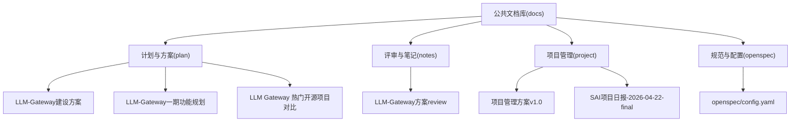
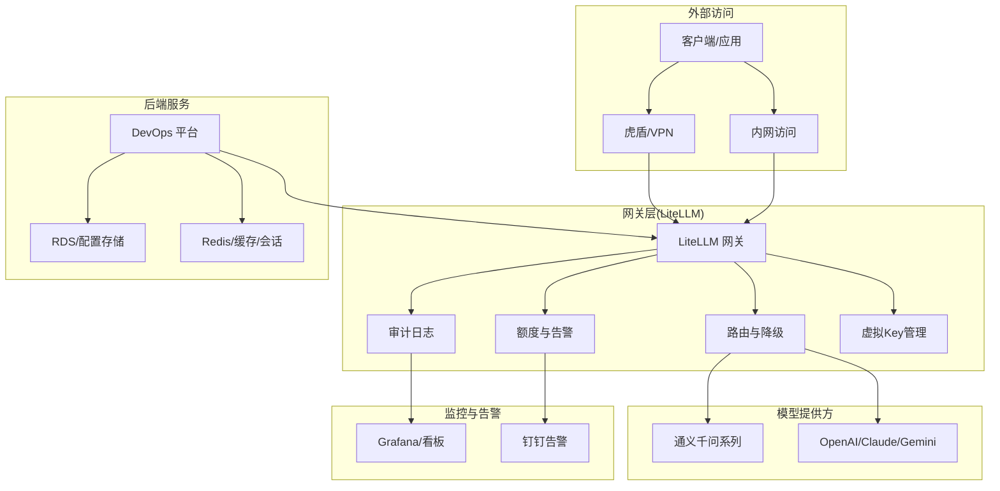
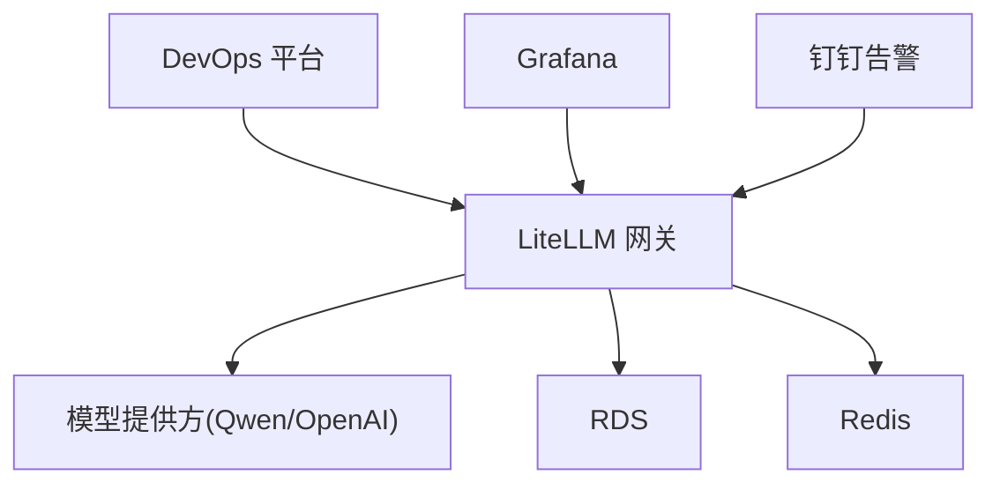

# 部署与运维

<cite>
**本文引用的文件**
- [LLM-Gateway建设方案.md](file://plan/LLM-Gateway建设方案.md)
- [LLM-Gateway一期功能规划.md](file://plan/LLM-Gateway一期功能规划.md)
- [LLM-Gateway方案review.md](file://notes/zhaobomin/LLM-Gateway方案review.md)
- [SAI项目日报-2026-04-22-final.md](file://project/SAI-daily-report-2026-04-22-final.md)
- [项目管理方案v1.0.md](file://project/项目管理方案v1.0.md)
- [config.yaml](file://openspec/config.yaml)
- [LLM Gateway 热门开源项目对比.md](file://plan/LLM Gateway 热门开源项目对比.md)
</cite>

## 目录
1. [简介](#简介)
2. [项目结构](#项目结构)
3. [核心组件](#核心组件)
4. [架构总览](#架构总览)
5. [详细组件分析](#详细组件分析)
6. [依赖分析](#依赖分析)
7. [性能考量](#性能考量)
8. [故障排查指南](#故障排查指南)
9. [结论](#结论)
10. [附录](#附录)

## 简介
本文件面向 LLM Gateway 的部署与运维，围绕 LiteLLM 网关的部署架构、环境要求、配置要点、高可用与容器化策略、集群管理、监控与日志、性能优化、运维操作与应急响应、容量规划与扩容、版本升级与回滚、变更管理等方面，结合仓库现有文档进行系统化梳理与落地建议。目标是帮助运维与平台工程团队建立可执行、可追溯、可扩展的部署与运维体系。

## 项目结构
- 文档仓库采用“公共文档库 + 团队目录”的组织方式，LLM Gateway 相关文档主要分布在 plan 与 notes 两大板块，同时项目管理方案明确了仓库划分、提交规范与文档同步要求。
- 与部署运维直接相关的关键文档包括：建设方案、一期功能规划、方案评审、项目日报、项目管理方案、开源对比等。

图表来源
- [LLM-Gateway建设方案.md](file://plan/LLM-Gateway建设方案.md)
- [LLM-Gateway一期功能规划.md](file://plan/LLM-Gateway一期功能规划.md)
- [LLM-Gateway方案review.md](file://notes/zhaobomin/LLM-Gateway方案review.md)
- [SAI项目日报-2026-04-22-final.md](file://project/SAI-daily-report-2026-04-22-final.md)
- [项目管理方案v1.0.md](file://project/项目管理方案v1.0.md)
- [config.yaml](file://openspec/config.yaml)

章节来源
- [LLM-Gateway建设方案.md](file://plan/LLM-Gateway建设方案.md)
- [LLM-Gateway一期功能规划.md](file://plan/LLM-Gateway一期功能规划.md)
- [LLM-Gateway方案review.md](file://notes/zhaobomin/LLM-Gateway方案review.md)
- [SAI项目日报-2026-04-22-final.md](file://project/SAI-daily-report-2026-04-22-final.md)
- [项目管理方案v1.0.md](file://project/项目管理方案v1.0.md)
- [config.yaml](file://openspec/config.yaml)

## 核心组件
- LiteLLM 网关：作为统一代理层，向下接入多家模型供应商，向上提供统一 OpenAI 格式 API，支持虚拟 Key 管理、路由与降级、额度与告警、审计日志等能力。
- DevOps 平台：负责审批流、资源申请、密钥分发与注入，实现“审批即用、超额即断”的自动化闭环。
- 监控与告警：基于网关内置能力与钉钉告警通道，实现令牌级阈值告警、网关健康告警、模型可用性告警。
- 容器化与集群：支持 Docker、ECS、Kubernetes 集群部署，满足高可用与弹性伸缩需求。
- 安全与合规：密钥托管、白名单访问、内网/VPN 访问限制、可选数据脱敏、审计日志留存与权限控制。

章节来源
- [LLM-Gateway建设方案.md](file://plan/LLM-Gateway建设方案.md)
- [LLM-Gateway一期功能规划.md](file://plan/LLM-Gateway一期功能规划.md)
- [LLM-Gateway方案review.md](file://notes/zhaobomin/LLM-Gateway方案review.md)

## 架构总览
下图展示了 LLM Gateway 的部署与运维总体架构：前端/客户端通过统一入口访问网关，网关根据环境与应用等级进行路由，结合额度与告警策略实现成本控制与高可用；DevOps 平台贯穿资源申请、审批、密钥下发与注入；监控与日志贯穿全链路，保障可观测性与可追溯性。

图表来源
- [LLM-Gateway建设方案.md](file://plan/LLM-Gateway建设方案.md)
- [LLM-Gateway一期功能规划.md](file://plan/LLM-Gateway一期功能规划.md)

## 详细组件分析

### LiteLLM 网关部署与配置
- 部署形态：支持 Docker、ECS、Kubernetes 集群部署，满足高可用与弹性伸缩。
- 配置要点：
  - 统一 API 格式：向上暴露 OpenAI 格式 API，业务侧仅需更换 Base URL 与 Token 即可切换底层模型。
  - 路由策略：按环境与应用等级进行路由，测试/本地使用低成本模型，生产核心使用旗舰模型，并配置多渠道轮询与重试。
  - 额度与告警：为每个 Token 设置独立额度池，支持 80%/90%/100% 三级阈值告警与熔断；支持额度重置规则（如按自然月重置）。
  - 审计与安全：拦截并记录请求元数据，支持可选数据脱敏；Key 访问白名单；访问方式限定为内网与 VPN。
- 配置文件与动态参数：建议通过 ConfigMap 或环境变量注入关键参数，结合 WebUI 动态配置能力进行运行时调整。

章节来源
- [LLM-Gateway建设方案.md](file://plan/LLM-Gateway建设方案.md)
- [LLM-Gateway一期功能规划.md](file://plan/LLM-Gateway一期功能规划.md)
- [LLM-Gateway方案review.md](file://notes/zhaobomin/LLM-Gateway方案review.md)

### DevOps 平台与密钥分发
- 自动化流程：研发在 DevOps 发起“AI 资源申请”，填写应用等级、并发、所需环境等，审批通过后触发 Webhook 调用网关管理接口，自动创建渠道与唯一 Token。
- 密钥注入：在 CI/CD 流水线打包部署时，根据当前环境（测试/预发/生产）将对应网关 Token 动态注入为环境变量，避免硬编码 Key。
- 审批与权限：审批节点覆盖申请人、部门 TL、运维与 PMO，确保资源申请的合规性与可追溯性。

章节来源
- [LLM-Gateway建设方案.md](file://plan/LLM-Gateway建设方案.md)
- [LLM-Gateway一期功能规划.md](file://plan/LLM-Gateway一期功能规划.md)

### 监控与日志
- 监控指标：建议围绕网关可用性、模型健康度、请求延迟、错误率、TPM/RPM、额度使用率等关键指标建立看板。
- 告警策略：令牌级阈值告警（80%/90%/100%）、网关不可用告警、模型健康检查失败告警，统一推送至钉钉群。
- 日志采集：网关层拦截请求元数据（时间、来源 IP、Token 归属域组、消耗 Token 数、响应延迟），结合审计日志实现可追溯性。

章节来源
- [LLM-Gateway建设方案.md](file://plan/LLM-Gateway建设方案.md)
- [LLM-Gateway一期功能规划.md](file://plan/LLM-Gateway一期功能规划.md)

### 高可用与容器化部署
- 高可用：通过多副本部署、健康检查、自动扩缩容与多渠道轮询重试，实现服务与模型层面的降级与容灾。
- 容器化：支持 Docker 与 Kubernetes 集群部署，建议使用 StatefulSet/Deployment、Service、Ingress/NLB 等编排组件，结合持久化存储与配置热更新。
- 集群管理：建议采用滚动升级策略，结合就绪探针与存活探针，确保升级过程无损；对关键配置采用灰度发布与回滚机制。

章节来源
- [LLM-Gateway建设方案.md](file://plan/LLM-Gateway建设方案.md)
- [LLM-Gateway方案review.md](file://notes/zhaobomin/LLM-Gateway方案review.md)

### 安全与合规
- 密钥管理：真实 Key 由网关统一托管，业务侧使用虚拟 Key，支持轮转与白名单控制。
- 访问控制：应用内网白名单访问，用户通过虎盾（VPN）访问；结合 IP 限制与会话管理。
- 数据保护：高敏业务可选配脱敏插件；建议补充 Prompt 长度/内容限制与审计日志留存策略。

章节来源
- [LLM-Gateway建设方案.md](file://plan/LLM-Gateway建设方案.md)
- [LLM-Gateway方案review.md](file://notes/zhaobomin/LLM-Gateway方案review.md)

### 性能优化
- 路由与限流：按环境与等级进行路由，避免测试/边缘业务滥用昂贵模型；结合 RPM/TPM 限流与额度熔断，控制峰值与突发。
- 缓存与连接：利用 Redis 缓存热点配置与会话信息，减少数据库压力；优化上游连接池与超时策略。
- 观测性：通过 Grafana/指标与日志聚合，识别瓶颈与异常，持续优化模型选择与资源配置。

章节来源
- [LLM-Gateway建设方案.md](file://plan/LLM-Gateway建设方案.md)
- [LLM-Gateway方案review.md](file://notes/zhaobomin/LLM-Gateway方案review.md)

### 运维操作指南
- 日常巡检：检查网关进程与健康状态、模型可用性、额度使用趋势、告警状态与日志异常。
- 配置变更：通过 ConfigMap/环境变量与 WebUI 动态配置，变更前进行灰度验证与回滚预案准备。
- 扩缩容：根据流量预测与峰值评估，结合 HPA/手动扩缩容策略，确保 SLA。
- 备份与恢复：定期备份配置与关键数据，制定灾难恢复流程与演练计划。

章节来源
- [LLM-Gateway建设方案.md](file://plan/LLM-Gateway建设方案.md)
- [LLM-Gateway一期功能规划.md](file://plan/LLM-Gateway一期功能规划.md)

### 故障诊断与应急响应
- 逃生方案：建议至少具备两类逃生路径：业务侧直连原生 API（绕过网关）与网关 bypass 模式（一键关闭路由规则）。
- 告警联动：将网关不可用与模型健康失败告警接入钉钉群，明确处置时限与升级路径。
- 快速恢复：建立回滚机制（版本回退、配置回滚），并准备应急预案（临时额度提升、备用模型切换）。

章节来源
- [LLM-Gateway建设方案.md](file://plan/LLM-Gateway建设方案.md)
- [LLM-Gateway方案review.md](file://notes/zhaobomin/LLM-Gateway方案review.md)

### 容量规划与扩容策略
- 规模评估：结合应用等级、并发峰值、模型单价与分词差异，估算月度/季度成本与资源占用。
- 扩容策略：按环境与等级分层扩容，测试/本地优先使用低成本模型；核心生产按 SLA 与成本平衡选择旗舰模型。
- 额度与预算：为每个 Token 设置额度池与重置规则，结合阈值告警与熔断，避免超支。

章节来源
- [LLM-Gateway建设方案.md](file://plan/LLM-Gateway建设方案.md)
- [LLM-Gateway方案review.md](file://notes/zhaobomin/LLM-Gateway方案review.md)

### 版本升级、回滚与变更管理
- 变更管理：遵循最小可行范围（MVP）原则，4/30 先上线“网关 + 手动发 Key + 基础告警”，审批流与前端管理页面延后。
- 升级策略：采用滚动升级与灰度发布，结合探针与回滚预案；重大变更前进行压测与演练。
- 回滚机制：保留最近 N 个版本镜像与配置快照，出现异常时快速回滚至稳定版本。

章节来源
- [LLM-Gateway方案review.md](file://notes/zhaobomin/LLM-Gateway方案review.md)
- [LLM-Gateway建设方案.md](file://plan/LLM-Gateway建设方案.md)

## 依赖分析
- 组件耦合：网关与模型提供方、DevOps 平台、监控与日志系统形成松耦合依赖；通过统一 API 与虚拟 Key 实现业务侧解耦。
- 外部依赖：RDS/Redis 用于配置与会话存储；Grafana/钉钉用于监控与告警；Kubernetes/Docker 用于容器化部署。
- 风险点：审批流与前端 UI 未完全适配 BaseURL 路由、逃生方案未明确、计费误差未量化评估、安全规则存在缺口（如 Prompt 限制与审计留存周期）。

图表来源
- [LLM-Gateway建设方案.md](file://plan/LLM-Gateway建设方案.md)
- [LLM-Gateway方案review.md](file://notes/zhaobomin/LLM-Gateway方案review.md)

章节来源
- [LLM-Gateway建设方案.md](file://plan/LLM-Gateway建设方案.md)
- [LLM-Gateway方案review.md](file://notes/zhaobomin/LLM-Gateway方案review.md)

## 性能考量
- 路由与限流：按环境与等级进行路由，避免测试/边缘业务滥用昂贵模型；结合 RPM/TPM 限流与额度熔断，控制峰值与突发。
- 缓存与连接：利用 Redis 缓存热点配置与会话信息，减少数据库压力；优化上游连接池与超时策略。
- 观测性：通过 Grafana/指标与日志聚合，识别瓶颈与异常，持续优化模型选择与资源配置。

章节来源
- [LLM-Gateway建设方案.md](file://plan/LLM-Gateway建设方案.md)
- [LLM-Gateway方案review.md](file://notes/zhaobomin/LLM-Gateway方案review.md)

## 故障排查指南
- 常见问题定位：检查网关健康状态、模型可用性、额度使用率、告警日志与审计日志；核对路由规则与 Key 白名单。
- 逃生路径：业务侧直连原生 API（绕过网关）与网关 bypass 模式（一键关闭路由规则）。
- 告警联动：将网关不可用与模型健康失败告警接入钉钉群，明确处置时限与升级路径。

章节来源
- [LLM-Gateway建设方案.md](file://plan/LLM-Gateway建设方案.md)
- [LLM-Gateway方案review.md](file://notes/zhaobomin/LLM-Gateway方案review.md)

## 结论
通过 LiteLLM 网关统一接入多家模型供应商，结合 DevOps 平台实现资源申请与密钥分发自动化，辅以精细化额度与告警、完善的监控与日志体系，以及高可用与容器化部署策略，可有效解决多模型统一管理、成本预算控制、安全与合规、优先级调度与运维流程自动化等关键痛点。建议在 4/30 先聚焦最小可用范围，后续逐步完善审批流与前端管理页面，并持续优化逃生方案、计费误差评估与安全规则。

## 附录

### 项目管理与文档规范
- 仓库划分：按三层架构与五团队划分六个代码仓库，公共文档库集中管理。
- 提交规范：核心规则三条（类型、同步文档、每日提交），Git 即进度。
- 文档同步：任何影响 API、模块交互或新增功能的代码变更，必须当天在 docs 仓库对应团队目录同步更新。

章节来源
- [项目管理方案v1.0.md](file://project/项目管理方案v1.0.md)

### 开源网关对比参考
- LiteLLM 在国内模型支持、协议兼容、虚拟 Key 管理、预算/配额控制、负载均衡与熔断降级、可观测性集成、Web 管理 UI、PII 脱敏、SSO/SAML、内置 Eval 框架、社区活跃度等方面具有优势，适合企业级使用。

章节来源
- [LLM Gateway 热门开源项目对比.md](file://plan/LLM Gateway 热门开源项目对比.md)