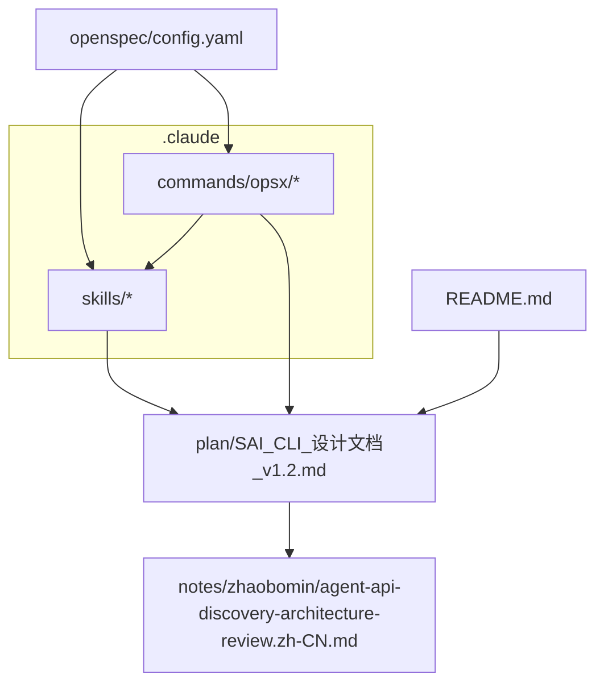
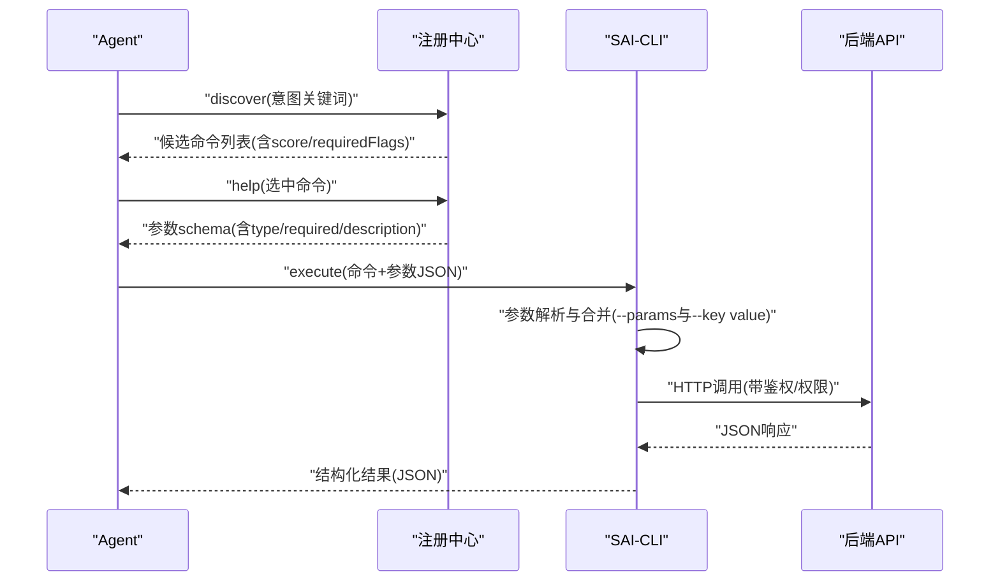
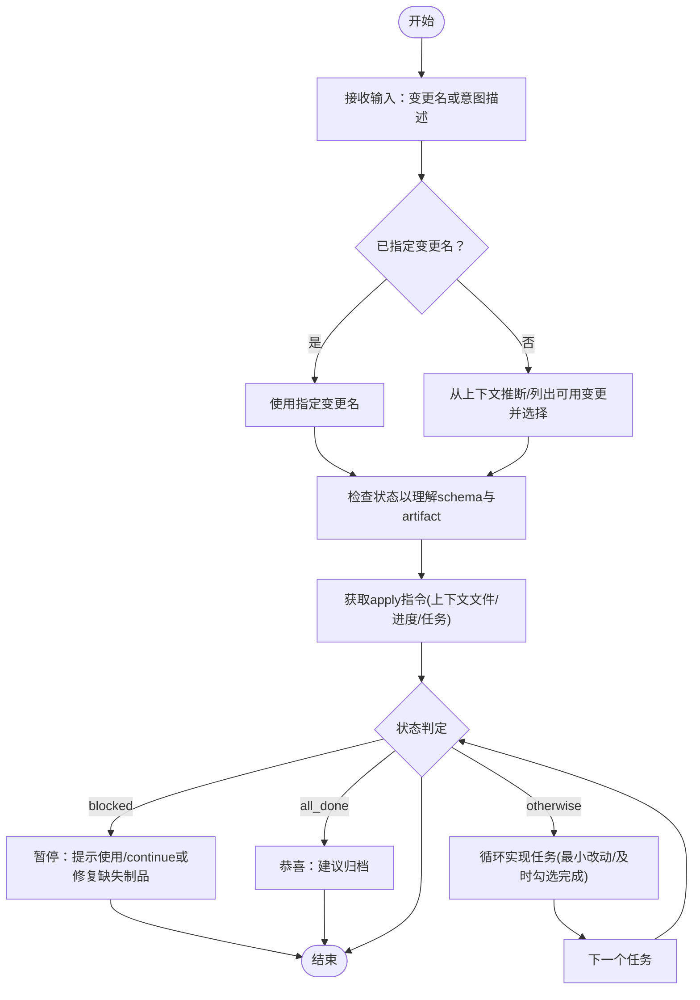
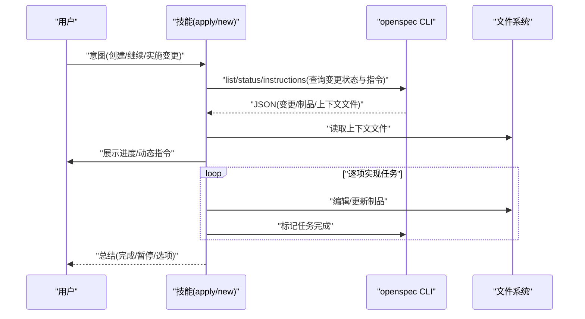
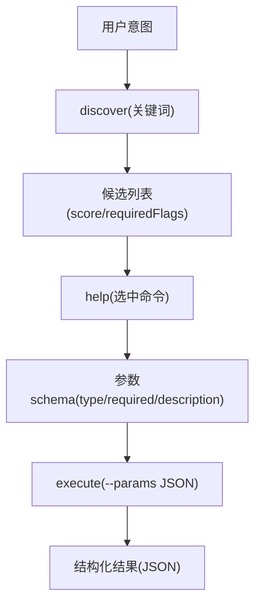
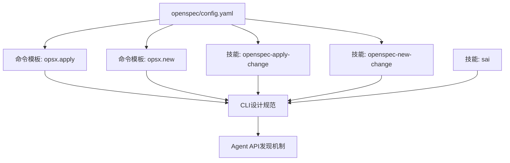

# Claude命令系统

<cite>
**本文引用的文件**
- [.claude/commands/opsx/apply.md](file://.claude/commands/opsx/apply.md)
- [.claude/commands/opsx/new.md](file://.claude/commands/opsx/new.md)
- [.claude/skills/openspec-apply-change/SKILL.md](file://.claude/skills/openspec-apply-change/SKILL.md)
- [.claude/skills/openspec-new-change/SKILL.md](file://.claude/skills/openspec-new-change/SKILL.md)
- [.claude/skills/sai/SKILL.md](file://.claude/skills/sai/SKILL.md)
- [openspec/config.yaml](file://openspec/config.yaml)
- [plan/SAI_CLI_设计文档_v1.2.md](file://plan/SAI_CLI_设计文档_v1.2.md)
- [notes/zhaobomin/agent-api-discovery-architecture-review.zh-CN.md](file://notes/zhaobomin/agent-api-discovery-architecture-review.zh-CN.md)
- [README.md](file://README.md)
</cite>

## 目录
1. [简介](#简介)
2. [项目结构](#项目结构)
3. [核心组件](#核心组件)
4. [架构总览](#架构总览)
5. [详细组件分析](#详细组件分析)
6. [依赖关系分析](#依赖关系分析)
7. [性能考量](#性能考量)
8. [故障排查指南](#故障排查指南)
9. [结论](#结论)
10. [附录](#附录)

## 简介
本文件为Claude命令系统的技术文档，聚焦于Claude AI助手命令的定义、注册与执行机制，覆盖命令生命周期、参数传递、权限控制与错误处理，以及命令模板的设计原理、复用策略与扩展方法。文档同时给出命令开发指南、调试技巧与性能优化建议，并结合OpenSpec规范说明命令与规范的协同使用方式。读者对象既包括一线开发者，也包括需要理解系统运作机制的产品与运营人员。

## 项目结构
仓库采用“文档驱动 + 技能/命令模板 + 规范配置”的组织方式：
- .claude/commands：命令模板集合，面向具体命令（如opsx系列），描述步骤、输入、输出与守则
- .claude/skills：技能模板集合，面向Agent与用户协作流程（如openspec系列、sai）
- openspec/config.yaml：OpenSpec规范的项目上下文与规则配置
- plan/SAI_CLI_设计文档_v1.2.md：SAI CLI整体架构与设计原则
- notes/zhaobomin/agent-api-discovery-architecture-review.zh-CN.md：Agent API发现机制与CLI架构Review
- README.md：项目模块与分工概览

图表来源
- [README.md:11-41](file://README.md#L11-L41)
- [plan/SAI_CLI_设计文档_v1.2.md:29-75](file://plan/SAI_CLI_设计文档_v1.2.md#L29-L75)
- [openspec/config.yaml:1-21](file://openspec/config.yaml#L1-L21)

章节来源
- [README.md:9-41](file://README.md#L9-L41)
- [plan/SAI_CLI_设计文档_v1.2.md:29-75](file://plan/SAI_CLI_设计文档_v1.2.md#L29-L75)

## 核心组件
- 命令模板（.claude/commands/opsx/*）：定义命令的步骤、输入、输出与守则，强调“动作在变更上的执行”和“流式工作流”
- 技能模板（.claude/skills/*）：定义Agent与用户协作的三步法（发现→理解→执行），并提供常见场景与参数示例
- OpenSpec规范配置（openspec/config.yaml）：声明规范驱动的schema、项目上下文与规则
- CLI设计与规范（plan/SAI_CLI_设计文档_v1.2.md）：统一命令规范、9维Tag体系、结构化输出与错误处理、鉴权与Dry-Run
- Agent API发现机制（notes/zhaobomin/agent-api-discovery-architecture-review.zh-CN.md）：动态命令发现、参数schema、缓存与执行代理

章节来源
- [.claude/commands/opsx/apply.md:1-153](file://.claude/commands/opsx/apply.md#L1-L153)
- [.claude/commands/opsx/new.md:1-70](file://.claude/commands/opsx/new.md#L1-L70)
- [.claude/skills/openspec-apply-change/SKILL.md:1-157](file://.claude/skills/openspec-apply-change/SKILL.md#L1-L157)
- [.claude/skills/openspec-new-change/SKILL.md:1-75](file://.claude/skills/openspec-new-change/SKILL.md#L1-L75)
- [.claude/skills/sai/SKILL.md:1-155](file://.claude/skills/sai/SKILL.md#L1-L155)
- [openspec/config.yaml:1-21](file://openspec/config.yaml#L1-L21)
- [plan/SAI_CLI_设计文档_v1.2.md:109-336](file://plan/SAI_CLI_设计文档_v1.2.md#L109-L336)
- [notes/zhaobomin/agent-api-discovery-architecture-review.zh-CN.md:14-21](file://notes/zhaobomin/agent-api-discovery-architecture-review.zh-CN.md#L14-L21)

## 架构总览
命令系统围绕“注册中心 + 动态命令 + 结构化输出”的三段式链路展开：
- 发现（discover）：Agent通过关键词/语义在注册中心召回候选命令
- 理解（help/schema）：Agent获取参数schema与必要flag，完成参数归一化与校验
- 执行（execute）：Agent拼装参数并调用CLI，CLI通过注册元数据驱动执行，返回结构化结果

图表来源
- [notes/zhaobomin/agent-api-discovery-architecture-review.zh-CN.md:14-21](file://notes/zhaobomin/agent-api-discovery-architecture-review.zh-CN.md#L14-L21)
- [plan/SAI_CLI_设计文档_v1.2.md:109-336](file://plan/SAI_CLI_设计文档_v1.2.md#L109-L336)

## 详细组件分析

### 命令模板：opsx.apply 与 opsx.new
- opsx.apply：面向OpenSpec变更的任务实施，强调“从变更中提取任务并逐项实现”，包含状态检查、上下文文件读取、进度展示与暂停/继续机制
- opsx.new：面向新变更的引导式创建，强调“先明确意图与工作流schema，再生成变更目录与首个制品指令”

图表来源
- [.claude/commands/opsx/apply.md:12-85](file://.claude/commands/opsx/apply.md#L12-L85)

章节来源
- [.claude/commands/opsx/apply.md:1-153](file://.claude/commands/opsx/apply.md#L1-L153)
- [.claude/commands/opsx/new.md:1-70](file://.claude/commands/opsx/new.md#L1-L70)

### 技能模板：openspec-apply-change 与 openspec-new-change
- openspec-apply-change：与opsx.apply一致的工作流，强调“在变更上执行动作”的模型，支持随时介入与制品更新
- openspec-new-change：与opsx.new一致的引导式创建流程，强调“先理解工作流schema，再生成首个制品模板”

图表来源
- [.claude/skills/openspec-apply-change/SKILL.md:16-89](file://.claude/skills/openspec-apply-change/SKILL.md#L16-L89)
- [.claude/skills/openspec-new-change/SKILL.md:16-67](file://.claude/skills/openspec-new-change/SKILL.md#L16-L67)

章节来源
- [.claude/skills/openspec-apply-change/SKILL.md:1-157](file://.claude/skills/openspec-apply-change/SKILL.md#L1-L157)
- [.claude/skills/openspec-new-change/SKILL.md:1-75](file://.claude/skills/openspec-new-change/SKILL.md#L1-L75)

### 技能模板：sai（SAI CLI数据查询）
- sai技能：定义“发现→理解→执行”的三步法，提供大量命令参考与参数示例，强调通过discover与help减少误判与参数错误
- 与OpenSpec的差异：sai侧重“查询类命令”的发现与执行，强调参数schema与必填项的确认

图表来源
- [.claude/skills/sai/SKILL.md:23-64](file://.claude/skills/sai/SKILL.md#L23-L64)

章节来源
- [.claude/skills/sai/SKILL.md:1-155](file://.claude/skills/sai/SKILL.md#L1-L155)

### OpenSpec规范与命令模板的结合
- openspec/config.yaml：声明schema为“spec-driven”，用于指导变更工作流与制品序列
- 命令模板与技能模板：在opsx.apply/openspec-apply-change中体现“从变更中提取任务并实施”的流程，与spec-driven schema保持一致

章节来源
- [openspec/config.yaml:1-21](file://openspec/config.yaml#L1-L21)
- [.claude/commands/opsx/apply.md:23-46](file://.claude/commands/opsx/apply.md#L23-L46)
- [.claude/skills/openspec-apply-change/SKILL.md:27-50](file://.claude/skills/openspec-apply-change/SKILL.md#L27-L50)

### 命令生命周期与执行机制
- 生命周期：定义（模板/技能）→ 发现（注册中心）→ 理解（help/schema）→ 执行（CLI调用）→ 结果（结构化JSON）
- 参数传递：支持--params JSON与--key value混合，CLI内部进行参数解析与合并
- 权限控制：鉴权方案采用PoP Token（分阶段实施），支持Scope权限控制与Dry-Run
- 错误处理：统一结构化错误输出，包含type/code/message/hint字段

章节来源
- [notes/zhaobomin/agent-api-discovery-architecture-review.zh-CN.md:14-21](file://notes/zhaobomin/agent-api-discovery-architecture-review.zh-CN.md#L14-L21)
- [plan/SAI_CLI_设计文档_v1.2.md:109-336](file://plan/SAI_CLI_设计文档_v1.2.md#L109-L336)

## 依赖关系分析
- 命令模板与技能模板共同依赖CLI设计规范（统一命令格式、9维Tag、结构化输出与错误处理）
- 技能模板与OpenSpec规范协同，通过openspec/config.yaml约束工作流schema
- Agent API发现机制依赖注册中心的动态命令与schema缓存

图表来源
- [plan/SAI_CLI_设计文档_v1.2.md:109-336](file://plan/SAI_CLI_设计文档_v1.2.md#L109-L336)
- [openspec/config.yaml:1-21](file://openspec/config.yaml#L1-L21)
- [notes/zhaobomin/agent-api-discovery-architecture-review.zh-CN.md:14-21](file://notes/zhaobomin/agent-api-discovery-architecture-review.zh-CN.md#L14-L21)

章节来源
- [plan/SAI_CLI_设计文档_v1.2.md:109-336](file://plan/SAI_CLI_设计文档_v1.2.md#L109-L336)
- [openspec/config.yaml:1-21](file://openspec/config.yaml#L1-L21)
- [notes/zhaobomin/agent-api-discovery-architecture-review.zh-CN.md:14-21](file://notes/zhaobomin/agent-api-discovery-architecture-review.zh-CN.md#L14-L21)

## 性能考量
- 动态命令发现与缓存：注册中心本地缓存与TTL降低高频调用延迟
- 参数解析与合并：CLI内部统一解析--params JSON与--key value，兼顾机器调用与人工调试
- 输出稳定性：统一JSON envelope，便于Agent稳定解析成功与失败结果
- 执行前校验：建议在Agent侧增加参数schema校验与缺失参数提示，减少无效调用

章节来源
- [notes/zhaobomin/agent-api-discovery-architecture-review.zh-CN.md:14-21](file://notes/zhaobomin/agent-api-discovery-architecture-review.zh-CN.md#L14-L21)

## 故障排查指南
- 非2xx状态码处理：确保CLI对非2xx响应返回结构化错误，避免误报成功
- 动态命令兜底分发：在main.go或root command层接入TryDynamicDispatch，避免合法动态命令依赖启动时预挂载
- 结构化错误输出：严格遵循type/code/message/hint字段，便于Agent与用户定位问题
- 参数schema校验：在Agent侧先help再execute，确保参数类型与必填项正确
- Dry-Run模式：对写操作命令启用--dry-run，预览将要执行的操作，降低误操作风险

章节来源
- [notes/zhaobomin/agent-api-discovery-architecture-review.zh-CN.md:505-533](file://notes/zhaobomin/agent-api-discovery-architecture-review.zh-CN.md#L505-L533)
- [plan/SAI_CLI_设计文档_v1.2.md:295-336](file://plan/SAI_CLI_设计文档_v1.2.md#L295-L336)

## 结论
本命令系统通过“模板/技能 + 注册中心 + 结构化输出”的组合，实现了Agent与CLI之间的稳定协作。命令模板与技能模板明确了步骤、输入输出与守则；CLI设计规范统一了命令格式、参数schema与错误处理；OpenSpec规范为变更驱动的工作流提供了约束与一致性。未来可在发现质量、执行前安全性与代码可维护性方面持续演进，进一步提升Agent在复杂历史API场景下的召回与执行能力。

## 附录
- 命令开发指南
  - 使用模板/技能作为起点，明确步骤、输入、输出与守则
  - 遵循统一命令格式与9维Tag体系，确保Agent可正确理解与路由
  - 提供结构化错误输出与Dry-Run能力
- 调试技巧
  - 使用discover与help进行参数schema确认
  - 通过--params JSON与--key value混合参数进行调试
  - 在Agent侧增加参数校验与缺失提示
- 集成模式
  - Agent通过注册中心召回候选命令，结合上下文选择最佳命令
  - CLI执行后返回结构化JSON，Agent进行结果解读与呈现
- OpenSpec结合使用
  - 在变更驱动场景中，使用openspec/config.yaml约束schema
  - 通过status/instructions等CLI命令获取上下文与任务序列

章节来源
- [plan/SAI_CLI_设计文档_v1.2.md:109-336](file://plan/SAI_CLI_设计文档_v1.2.md#L109-L336)
- [.claude/commands/opsx/apply.md:12-85](file://.claude/commands/opsx/apply.md#L12-L85)
- [.claude/skills/openspec-apply-change/SKILL.md:16-89](file://.claude/skills/openspec-apply-change/SKILL.md#L16-L89)
- [.claude/skills/sai/SKILL.md:23-64](file://.claude/skills/sai/SKILL.md#L23-L64)