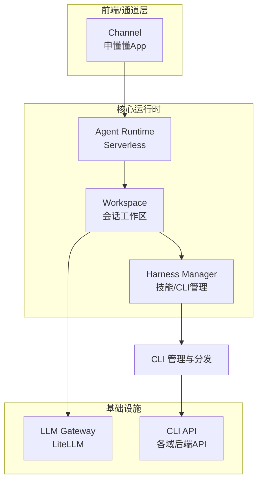
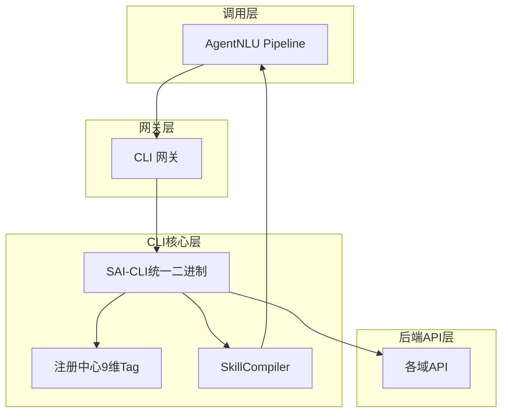
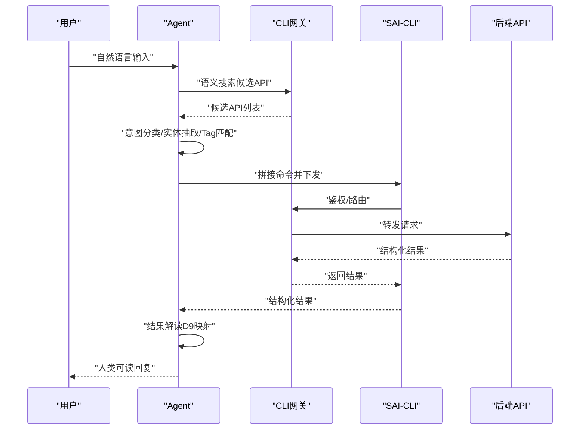
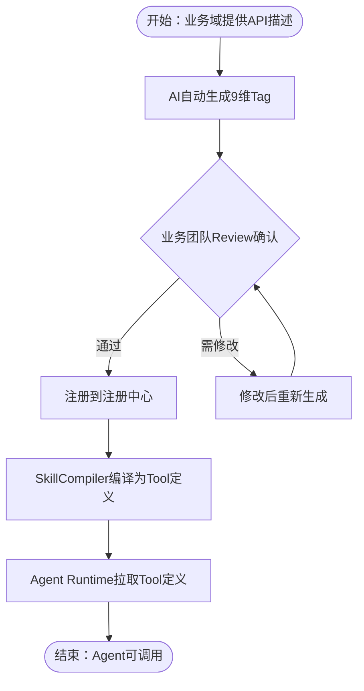
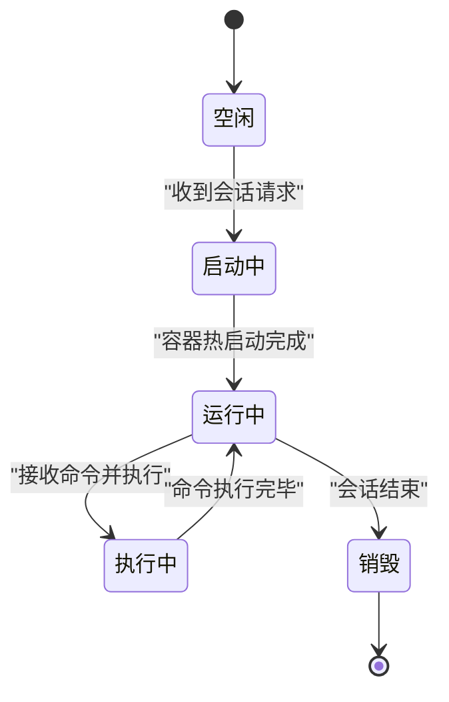
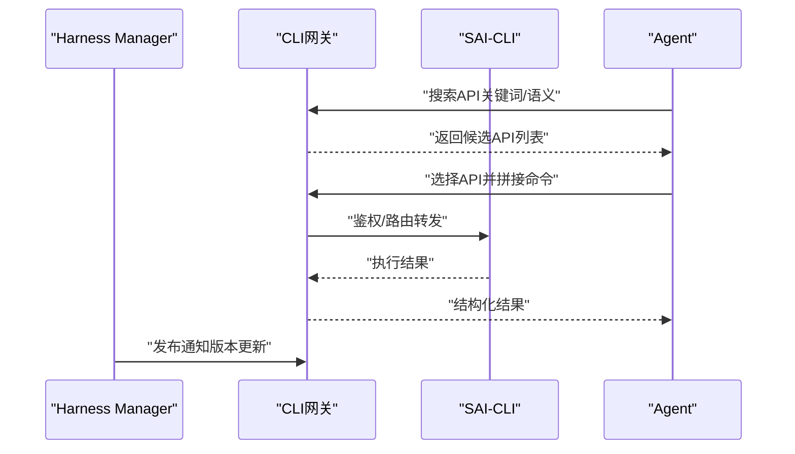
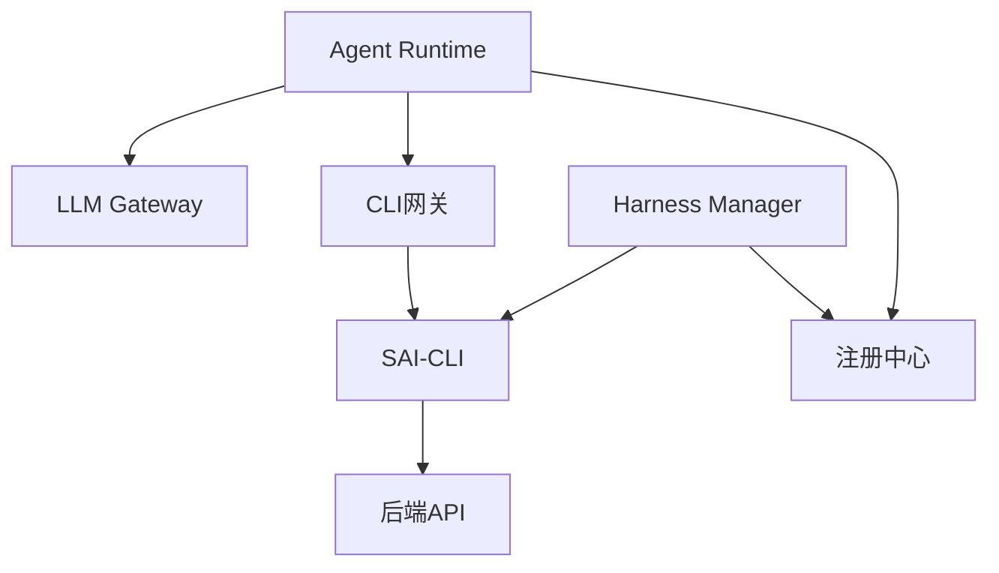

# Claude技能管理

<cite>
**本文引用的文件**
- [Agent-Runtime方案.md](file://plan/Agent-Runtime方案.md)
- [Agent-Runtime方案review.md](file://notes/zhaobomin/Agent-Runtime方案review.md)
- [SAI_CLI_设计文档_v1.0.md](file://plan/SAI_CLI_设计文档_v1.0.md)
- [SAI_CLI_设计文档_v1.2.md](file://plan/SAI_CLI_设计文档_v1.2.md)
- [SAI-daily-report-2026-04-22-final.md](file://project/SAI-daily-report-2026-04-22-final.md)
- [2026-04-20-zhaobomin.md](file://project/standup/2026-04-20-zhaobomin.md)
- [config.yaml](file://openspec/config.yaml)
</cite>

## 目录
1. [引言](#引言)
2. [项目结构](#项目结构)
3. [核心组件](#核心组件)
4. [架构总览](#架构总览)
5. [详细组件分析](#详细组件分析)
6. [依赖分析](#依赖分析)
7. [性能考虑](#性能考虑)
8. [故障排查指南](#故障排查指南)
9. [结论](#结论)
10. [附录](#附录)

## 引言
本文件面向Claude技能管理系统，系统性阐述“技能”的定义、分类、注册与调用机制，以及与Agent Runtime的集成方式与使用场景。文档以仓库内现有设计文档为基础，提炼技能接口规范、参数约定、返回值格式、错误处理、生命周期管理、版本控制与依赖关系，并提供开发指南、测试方法与部署流程，辅以模板、最佳实践与性能优化策略。

## 项目结构
仓库围绕“SAI（申通 AI 智能体平台）”展开，涉及Agent Runtime、Harness Manager、CLI API、LLM Gateway、Channel（前端）等多个模块。技能（Skill）在本系统中通过“统一CLI（SAI-CLI）+ 注册中心 + 编译器（SkillCompiler）”的方式实现，Agent通过语义理解与注册中心检索，自动拼接命令并调用后端API，形成闭环。

图表来源
- [2026-04-20-zhaobomin.md:5-40](file://project/standup/2026-04-20-zhaobomin.md#L5-L40)

章节来源
- [2026-04-20-zhaobomin.md:1-84](file://project/standup/2026-04-20-zhaobomin.md#L1-L84)
- [SAI_CLI_设计文档_v1.2.md:29-75](file://plan/SAI_CLI_设计文档_v1.2.md#L29-L75)

## 核心组件
- Agent Runtime（Serverless）
  - 以会话为单位的无状态容器，冷启动<1秒、热启动百毫秒级，按session_id隔离实例，确保一实例一session。
  - 与Harness Manager通过注册中心交互，拉取编译后的Tool定义，执行CLI命令。
- Harness Manager（技能/CLI管理）
  - 职责：API注册、元数据管理（9维Tag）、SkillCompiler编译、CLI路由与鉴权、发布通知。
  - 通过统一打包的SAI-CLI二进制文件分发至Agent运行环境（OSS挂载）。
- CLI API（各业务域后端API）
  - 各域仅提供API接口与描述文档，不参与CLI开发，零侵入。
- LLM Gateway（LiteLLM）
  - 提供模型路由与WebUI动态配置，支撑Agent的LLM调用链路。
- Channel（前端）
  - 申懂懂App作为Agent入口，负责用户交互与结果呈现。

章节来源
- [Agent-Runtime方案.md:4-13](file://plan/Agent-Runtime方案.md#L4-L13)
- [SAI_CLI_设计文档_v1.2.md:545-591](file://plan/SAI_CLI_设计文档_v1.2.md#L545-L591)
- [SAI_CLI_设计文档_v1.2.md:603-632](file://plan/SAI_CLI_设计文档_v1.2.md#L603-L632)

## 架构总览
系统采用“调用层（Agent）→ 网关层（CLI网关）→ CLI核心层（SAI-CLI）→ 后端API层”的四层解耦架构。Agent通过注册中心检索API，结合上下文选择最匹配的API，拼接命令后经网关路由与鉴权，最终调用后端API并返回结构化结果。

图表来源
- [SAI_CLI_设计文档_v1.2.md:29-75](file://plan/SAI_CLI_设计文档_v1.2.md#L29-L75)
- [SAI_CLI_设计文档_v1.2.md:545-591](file://plan/SAI_CLI_设计文档_v1.2.md#L545-L591)

章节来源
- [SAI_CLI_设计文档_v1.2.md:29-75](file://plan/SAI_CLI_设计文档_v1.2.md#L29-L75)
- [SAI_CLI_设计文档_v1.2.md:545-591](file://plan/SAI_CLI_设计文档_v1.2.md#L545-L591)

## 详细组件分析

### 组件A：技能（Skill）与Tool定义
- 技能本质
  - 由业务域API经Harness Manager注册、编译为Agent可读的Tool定义，包含LLM可见层（name/description/parameters）与框架控制层（__agent_meta__）。
- 注册与编译
  - 业务域提供API描述文档，Harness Manager通过SkillCompiler将原始注册信息编译为增强型Tool定义，供Agent Runtime拉取。
- 调用流程（6步NLU Pipeline）
  - 用户输入 → 意图分类（D8）→ 实体抽取 → Tag匹配+评分（D7）→ 参数组装（D3/D4）→ API调用 → 结果解读（D9）。

图表来源
- [SAI_CLI_设计文档_v1.2.md:250-288](file://plan/SAI_CLI_设计文档_v1.2.md#L250-L288)
- [SAI_CLI_设计文档_v1.2.md:603-632](file://plan/SAI_CLI_设计文档_v1.2.md#L603-L632)

章节来源
- [SAI_CLI_设计文档_v1.2.md:225-288](file://plan/SAI_CLI_设计文档_v1.2.md#L225-L288)
- [SAI_CLI_设计文档_v1.2.md:603-632](file://plan/SAI_CLI_设计文档_v1.2.md#L603-L632)

### 组件B：注册中心与9维Tag体系
- 9维Tag维度
  - 路由与分类组：D1（指标大类）、D2（API名称）、D4（指标清单）
  - NLU理解组：D5（指标类型）、D7（触发关键词，含exact/synonym/negative）
  - 执行与展示组：D3（二级类目）、D6（适用层级）、D9（出参映射）
- 注册流程
  - 路径A（推荐）：提交API基础信息 → AI自动生成9维Tag → 业务Review → 注册
  - 路径B（定制）：自行准备9维Tag → 直接注册
- 编译与下发
  - SkillCompiler将注册元数据编译为Agent Tool定义，Agent Runtime拉取后用于NLU与调用。

图表来源
- [SAI_CLI_设计文档_v1.2.md:365-391](file://plan/SAI_CLI_设计文档_v1.2.md#L365-L391)
- [SAI_CLI_设计文档_v1.2.md:225-249](file://plan/SAI_CLI_设计文档_v1.2.md#L225-L249)

章节来源
- [SAI_CLI_设计文档_v1.2.md:151-249](file://plan/SAI_CLI_设计文档_v1.2.md#L151-L249)
- [SAI_CLI_设计文档_v1.2.md:365-391](file://plan/SAI_CLI_设计文档_v1.2.md#L365-L391)

### 组件C：Agent Runtime与会话生命周期
- 用户隔离
  - 基于Serverless按session_id分配实例，一实例一session，确保隔离与无状态。
- 热启动性能
  - 冷启动<1秒、热启动百毫秒级，满足通用Agent调用体验。
- 集成要点
  - Agent通过注册中心检索API，结合上下文选择最佳API，拼接命令后调用SAI-CLI。
  - 支持与ACP协议的向前兼容（等待Python SDK与HTTP适配）。

图表来源
- [Agent-Runtime方案.md:4-13](file://plan/Agent-Runtime方案.md#L4-L13)

章节来源
- [Agent-Runtime方案.md:4-13](file://plan/Agent-Runtime方案.md#L4-L13)
- [Agent-Runtime方案review.md:9-18](file://notes/zhaobomin/Agent-Runtime方案review.md#L9-L18)

### 组件D：CLI网关与鉴权
- 能力
  - API注册接口、元数据搜索接口、元数据生成、发布通知、路由转发、权限校验。
- 鉴权
  - 一期：Bearer Token（SSO Token）+ Scope校验
  - 二期：PoP Token + ECDSA签名（环境绑定），增强安全性
- 部署
  - 通过OSS挂载统一SAI-CLI二进制文件至Agent运行环境。

图表来源
- [SAI_CLI_设计文档_v1.2.md:605-618](file://plan/SAI_CLI_设计文档_v1.2.md#L605-L618)
- [SAI_CLI_设计文档_v1.2.md:561-591](file://plan/SAI_CLI_设计文档_v1.2.md#L561-L591)

章节来源
- [SAI_CLI_设计文档_v1.2.md:605-618](file://plan/SAI_CLI_设计文档_v1.2.md#L605-L618)
- [SAI_CLI_设计文档_v1.2.md:561-591](file://plan/SAI_CLI_设计文档_v1.2.md#L561-L591)

## 依赖分析
- 模块耦合
  - Agent Runtime与Harness Manager通过注册中心与Tool定义解耦；CLI网关负责路由与鉴权；CLI API仅暴露后端API，零侵入。
- 外部依赖
  - Claude Agent SDK（当前为强依赖，建议考虑SDK抽象层以降低风险）
  - LiteLLM网关（模型路由与WebUI配置）
- 依赖关系可视化

图表来源
- [SAI_CLI_设计文档_v1.2.md:29-75](file://plan/SAI_CLI_设计文档_v1.2.md#L29-L75)
- [2026-04-20-zhaobomin.md:5-40](file://project/standup/2026-04-20-zhaobomin.md#L5-L40)

章节来源
- [SAI_CLI_设计文档_v1.2.md:29-75](file://plan/SAI_CLI_设计文档_v1.2.md#L29-L75)
- [2026-04-20-zhaobomin.md:5-40](file://project/standup/2026-04-20-zhaobomin.md#L5-L40)

## 性能考虑
- 启动性能
  - Agent容器热启动<1秒，满足实时交互需求；建议在Agent层缓存常用Tool定义，减少拉取开销。
- 网关与CLI
  - CLI统一二进制部署，减少多次拉取与依赖安装；网关层启用连接复用与并发限制，避免抖动。
- 数据传输
  - 统一JSON协议，避免非结构化输出；错误与结果均采用结构化格式，便于前端渲染与日志分析。
- 安全与鉴权
  - 一期使用Token校验，二期引入PoP签名与环境绑定，降低Token复用风险。

## 故障排查指南
- 常见错误类型与结构化输出
  - 认证错误（AUTH_ERROR）、参数错误（PARAM_ERROR）、API错误（API_ERROR）
  - 统一包含type、code、message、hint字段，便于Agent与用户定位问题
- 排查步骤
  - 检查Agent是否正确选择API（D8意图、D7关键词匹配）
  - 校验参数组装（D3/D4）是否符合API入参说明
  - 确认网关鉴权（Token/Scope/PoP）是否通过
  - 查看CLI执行日志与返回结构化错误，结合hint修复

章节来源
- [SAI_CLI_设计文档_v1.0.md:143-184](file://plan/SAI_CLI_设计文档_v1.0.md#L143-L184)
- [SAI_CLI_设计文档_v1.2.md:295-336](file://plan/SAI_CLI_设计文档_v1.2.md#L295-L336)

## 结论
本系统通过“注册中心+9维Tag+SkillCompiler+统一CLI”的组合，实现了技能的标准化定义、自动编译与Agent可读的Tool定义下发，配合Agent Runtime的Serverless隔离与高性能启动，形成了可扩展、可演进的Claude技能管理体系。建议在后续版本中完善SDK抽象、细化发布流程与版本回滚策略，并持续优化NLU匹配与结果解读的准确性。

## 附录

### 技能接口规范与参数约定
- 命令格式
  - {product} {module} {action} [params]
  - 示例：kunlun timeliness query --type 出港滞留 --date 2026-04-24
- 参数约定
  - 所有参数通过命令行传入，禁止交互式输入
  - 结构化入参/出参统一JSON格式
- 返回值格式
  - 成功：结构化JSON，包含业务字段与人类可读摘要
  - 失败：结构化JSON，包含type/code/message/hint
- 错误处理
  - 统一错误输出格式，便于Agent与前端处理

章节来源
- [SAI_CLI_设计文档_v1.0.md:83-114](file://plan/SAI_CLI_设计文档_v1.0.md#L83-L114)
- [SAI_CLI_设计文档_v1.0.md:143-184](file://plan/SAI_CLI_设计文档_v1.0.md#L143-L184)

### 技能生命周期管理与版本控制
- 生命周期
  - 注册（add/update/remove，remove为软删除30天可恢复）
  - 编译（SkillCompiler生成Agent Tool定义）
  - 发布（Harness Manager上传SAI-CLI二进制并通知网关）
  - 调用（Agent通过注册中心检索并执行）
- 版本控制
  - 通过OSS路径区分系统内置、公共与用户技能，支持灰度与回滚
  - 发布通知接口触发命令清单同步更新

章节来源
- [SAI_CLI_设计文档_v1.2.md:384-391](file://plan/SAI_CLI_设计文档_v1.2.md#L384-L391)
- [SAI_CLI_设计文档_v1.2.md:561-591](file://plan/SAI_CLI_设计文档_v1.2.md#L561-L591)

### 技能开发指南
- 开发语言
  - Harness Manager侧统一使用Golang，CLI为单一二进制文件
- 接入方式
  - 业务域仅提供API接口与描述文档，通过Java SDK注解（@CliSystem/@CliCommand/@NLU/@OutMap）快速接入
- 测试与Dry-Run
  - 写操作命令支持--dry-run预演；核心逻辑通过接口抽象，支持Mock与VFS测试

章节来源
- [SAI_CLI_设计文档_v1.2.md:339-362](file://plan/SAI_CLI_设计文档_v1.2.md#L339-L362)
- [SAI_CLI_设计文档_v1.2.md:474-514](file://plan/SAI_CLI_设计文档_v1.2.md#L474-L514)

### 部署流程
- OSS挂载
  - CLI网关：sai/cli/sai-cli
  - 系统内置技能：sai/skill/system/
  - 公共技能：sai/skill/public/
  - 用户技能：sai/skill/wtcodexx/
- 发布流程
  - 业务域提供API → Harness Manager更新CLI代码 → 打包统一SAI-CLI二进制 → 上传OSS → 调用发布通知接口 → 网关生效

章节来源
- [SAI_CLI_设计文档_v1.2.md:561-591](file://plan/SAI_CLI_设计文档_v1.2.md#L561-L591)

### 最佳实践
- 语义理解
  - 为D7关键词设计exact/synonym/negative三层，提高匹配准确率
- 结果解读
  - 通过D9出参映射，将JSON字段翻译为人类可读含义
- 安全
  - 优先使用Token获取（命令行参数/环境变量/本地配置文件），逐步过渡到PoP签名
- 可测试性
  - 通过接口抽象与Mock，保证在无真实API环境下可单元测试

章节来源
- [SAI_CLI_设计文档_v1.2.md:151-170](file://plan/SAI_CLI_设计文档_v1.2.md#L151-L170)
- [SAI_CLI_设计文档_v1.2.md:441-471](file://plan/SAI_CLI_设计文档_v1.2.md#L441-L471)
- [SAI_CLI_设计文档_v1.2.md:502-514](file://plan/SAI_CLI_设计文档_v1.2.md#L502-L514)

### 性能优化策略
- Agent层
  - 缓存Tool定义与候选API列表，减少重复拉取
  - 并发控制与超时设置，避免阻塞
- CLI层
  - 单一二进制部署，减少依赖加载
  - 合理拆分命令集，按域分发
- 网关层
  - 连接池与限流策略，保障稳定性
  - 结构化日志与监控埋点，便于定位瓶颈

### 技能模板
- 命令模板
  - {product} {module} {action} [params]
- Tag模板（9维）
  - D1/D2/D3/D4/D5/D6/D7/D8/D9
- Tool定义模板
  - LLM可见层：name/description/parameters
  - 框架控制层：__agent_meta__（domain/intent_scenarios/negative_keywords/result_fields）

章节来源
- [SAI_CLI_设计文档_v1.2.md:115-146](file://plan/SAI_CLI_设计文档_v1.2.md#L115-L146)
- [SAI_CLI_设计文档_v1.2.md:241-249](file://plan/SAI_CLI_设计文档_v1.2.md#L241-L249)

### 使用场景
- AI销售助理
  - 当前通过CLI方式调用业务API，未来随云完成CLI wrapper后切换为随云client
- 通用Agent与业务Skill、CLI完全隔离
  - 通过注册中心与SkillCompiler实现Skill的标准化与可插拔

章节来源
- [Agent-Runtime方案.md:33-38](file://plan/Agent-Runtime方案.md#L33-L38)
- [Agent-Runtime方案.md:58-60](file://plan/Agent-Runtime方案.md#L58-L60)