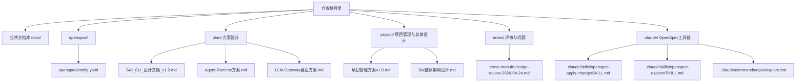
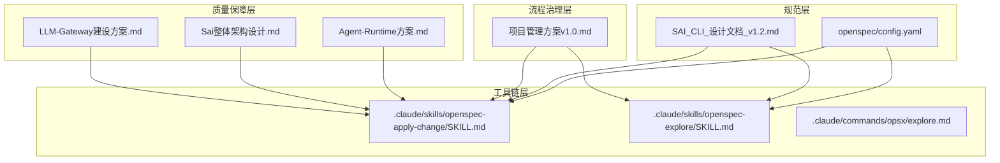
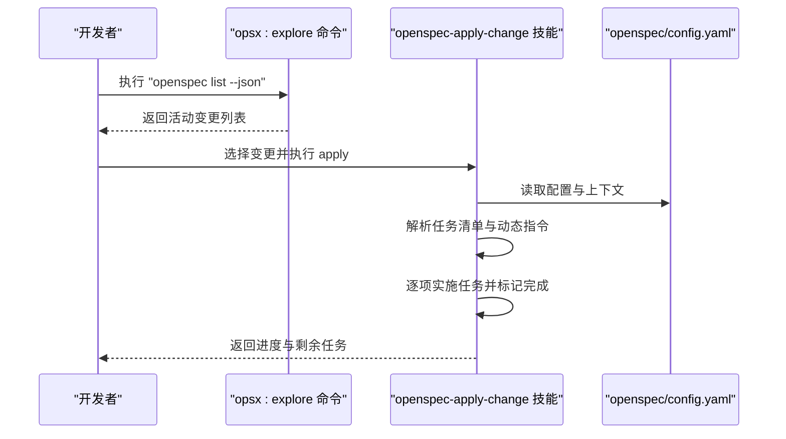
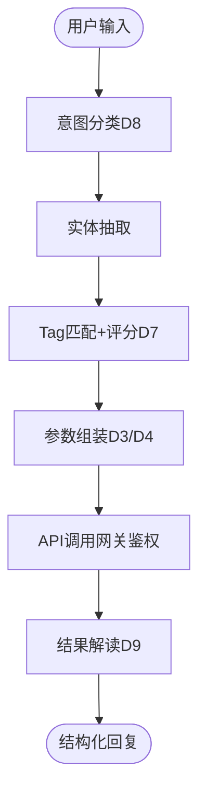
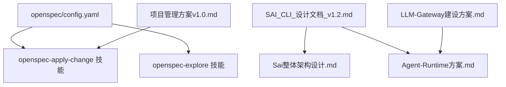

# OpenSpec规范驱动

<cite>
**本文引用的文件**
- [README.md](file://README.md)
- [openspec/config.yaml](file://openspec/config.yaml)
- [SAI_CLI_设计文档_v1.2.md](file://plan/SAI_CLI_设计文档_v1.2.md)
- [项目管理方案v1.0.md](file://project/项目管理方案v1.0.md)
- [Agent-Runtime方案.md](file://plan/Agent-Runtime方案.md)
- [LLM-Gateway建设方案.md](file://plan/LLM-Gateway建设方案.md)
- [Sai整体架构设计.md](file://project/standup/Sai整体架构设计.md)
- [.claude/skills/openspec-apply-change/SKILL.md](file://.claude/skills/openspec-apply-change/SKILL.md)
- [.claude/skills/openspec-explore/SKILL.md](file://.claude/skills/openspec-explore/SKILL.md)
- [.claude/commands/opsx/explore.md](file://.claude/commands/opsx/explore.md)
- [cross-module-design-review-2026-04-24.md](file://notes/zhaobomin/cross-module-design-review-2026-04-24.md)
</cite>

## 目录
1. [简介](#简介)
2. [项目结构](#项目结构)
3. [核心组件](#核心组件)
4. [架构总览](#架构总览)
5. [详细组件分析](#详细组件分析)
6. [依赖分析](#依赖分析)
7. [性能考量](#性能考量)
8. [故障排查指南](#故障排查指南)
9. [结论](#结论)
10. [附录](#附录)

## 简介
本文件面向“OpenSpec规范驱动框架”的使用者与贡献者，系统化阐述规范驱动开发理念、实现机制与工程实践。围绕OpenSpec配置规则、项目治理与质量控制、自动化工具链与命令系统、技能管理机制、规范定义与生成器、自定义扩展以及开发工作流，提供从概念到落地的完整指导。同时，结合仓库中的CLI架构设计、项目管理方案、Agent运行时方案与LLM网关方案，给出可操作的配置示例、命令模板与最佳实践，帮助团队建立稳定、可演进、可治理的规范驱动开发体系。

## 项目结构
仓库采用“公共文档库 + 多团队子模块”的组织方式，围绕SAI整体架构展开，重点文档分布如下：
- README.md：项目总览与模块分工概览
- openspec/config.yaml：OpenSpec配置入口，定义规范驱动模式与可选的项目上下文与制品规则
- plan/：方案设计文档集合，包含CLI架构、Agent运行时、LLM网关等
- project/：项目管理方案、站会与总体架构设计
- notes/zhaobomin/：跨模块评审与问题清单
- .claude/：OpenSpec工具链与技能/命令模板（用于规范驱动工作流）

图表来源
- [README.md:11-41](file://README.md#L11-L41)
- [openspec/config.yaml:1-21](file://openspec/config.yaml#L1-L21)
- [SAI_CLI_设计文档_v1.2.md:29-64](file://plan/SAI_CLI_设计文档_v1.2.md#L29-L64)
- [项目管理方案v1.0.md:94-131](file://project/项目管理方案v1.0.md#L94-L131)

章节来源
- [README.md:11-41](file://README.md#L11-L41)
- [openspec/config.yaml:1-21](file://openspec/config.yaml#L1-L21)
- [项目管理方案v1.0.md:94-131](file://project/项目管理方案v1.0.md#L94-L131)

## 核心组件
- OpenSpec配置与工作流
  - openspec/config.yaml：定义schema为spec-driven，支持项目上下文与制品规则，作为规范驱动的起点
  - .claude/skills/openspec-apply-change/SKILL.md 与 .claude/skills/openspec-explore/SKILL.md：提供“探索—提案—任务—实施—归档”的闭环工作流，覆盖状态检查、指令获取、上下文文件读取、任务推进与暂停
  - .claude/commands/opsx/explore.md：提供快速检查当前变更状态、列出活动变更的命令模板
- CLI架构与规范
  - SAI_CLI_设计文档_v1.2.md：定义四层架构、统一命令规范、9维Tag体系、SkillCompiler编译、Agent调用NLU流水线、鉴权与PoP签名、Dry-Run与结构化错误输出等
- 项目治理与质量控制
  - 项目管理方案v1.0.md：Git提交规范、文档同步、日报制度、仓库划分与职责边界
- Agent运行时与技能分发
  - Agent-Runtime方案.md：Agent Run（serverless）与Skill隔离、OSS挂载与权限控制
  - Sai整体架构设计.md：HM子模块（知识库、Skills、CLI注册分发）与调用协议
- LLM网关与安全
  - LLM-Gateway建设方案.md：统一API、DevOps密钥分发、流量降级与成本控制、日志与安全、额度预警与熔断

章节来源
- [openspec/config.yaml:1-21](file://openspec/config.yaml#L1-L21)
- [.claude/skills/openspec-apply-change/SKILL.md:16-88](file://.claude/skills/openspec-apply-change/SKILL.md#L16-L88)
- [.claude/skills/openspec-explore/SKILL.md:35-134](file://.claude/skills/openspec-explore/SKILL.md#L35-L134)
- [.claude/commands/opsx/explore.md:81-104](file://.claude/commands/opsx/explore.md#L81-L104)
- [SAI_CLI_设计文档_v1.2.md:79-362](file://plan/SAI_CLI_设计文档_v1.2.md#L79-L362)
- [项目管理方案v1.0.md:59-86](file://project/项目管理方案v1.0.md#L59-L86)
- [Agent-Runtime方案.md:4-56](file://plan/Agent-Runtime方案.md#L4-L56)
- [Sai整体架构设计.md:173-223](file://project/standup/Sai整体架构设计.md#L173-L223)
- [LLM-Gateway建设方案.md:15-109](file://plan/LLM-Gateway建设方案.md#L15-L109)

## 架构总览
OpenSpec规范驱动框架以“规范—工具—流程—治理”为主线，贯穿以下关键环节：
- 规范驱动：以openspec/config.yaml为入口，定义schema与上下文，结合CLI设计文档中的命令规范、Tag体系与编译规则，形成可被AI与工具链自动化的规范基线
- 工具链：通过OpenSpec技能与命令模板，实现“探索—提案—任务—实施—归档”的自动化推进
- 流程治理：以项目管理方案为治理抓手，确保代码与文档同步、每日提交、仓库职责清晰
- 质量保障：以CLI设计文档的质量控制点（结构化错误输出、Dry-Run、鉴权与PoP签名、NLU流水线）为质量基线

图表来源
- [openspec/config.yaml:1-21](file://openspec/config.yaml#L1-L21)
- [SAI_CLI_设计文档_v1.2.md:79-362](file://plan/SAI_CLI_设计文档_v1.2.md#L79-L362)
- [.claude/skills/openspec-apply-change/SKILL.md:16-88](file://.claude/skills/openspec-apply-change/SKILL.md#L16-L88)
- [.claude/skills/openspec-explore/SKILL.md:35-134](file://.claude/skills/openspec-explore/SKILL.md#L35-L134)
- [.claude/commands/opsx/explore.md:81-104](file://.claude/commands/opsx/explore.md#L81-L104)
- [项目管理方案v1.0.md:59-86](file://project/项目管理方案v1.0.md#L59-L86)
- [Agent-Runtime方案.md:4-56](file://plan/Agent-Runtime方案.md#L4-L56)
- [Sai整体架构设计.md:173-223](file://project/standup/Sai整体架构设计.md#L173-L223)
- [LLM-Gateway建设方案.md:15-109](file://plan/LLM-Gateway建设方案.md#L15-L109)

## 详细组件分析

### OpenSpec配置与工作流
- 配置入口
  - schema: spec-driven，启用规范驱动工作流
  - 可选上下文：在创建制品时向AI提供项目技术栈、约定与领域知识
  - 可选规则：为特定制品类型（如proposal、tasks）添加定制规则
- 工具链能力
  - 探索与检查：通过命令快速列出活动变更、检查当前状态
  - 指令与上下文：根据schema解析上下文文件、任务进度与动态指令
  - 实施推进：逐项完成任务，支持暂停与继续，确保最小化、聚焦的变更
- 最佳实践
  - 在变更启动前先“探索”，明确当前状态与上下文
  - 严格遵循任务清单，避免遗漏关键制品
  - 变更完成后及时“归档”，沉淀经验

图表来源
- [.claude/commands/opsx/explore.md:81-104](file://.claude/commands/opsx/explore.md#L81-L104)
- [.claude/skills/openspec-apply-change/SKILL.md:16-88](file://.claude/skills/openspec-apply-change/SKILL.md#L16-L88)
- [openspec/config.yaml:1-21](file://openspec/config.yaml#L1-L21)

章节来源
- [openspec/config.yaml:1-21](file://openspec/config.yaml#L1-L21)
- [.claude/skills/openspec-apply-change/SKILL.md:16-88](file://.claude/skills/openspec-apply-change/SKILL.md#L16-L88)
- [.claude/skills/openspec-explore/SKILL.md:35-134](file://.claude/skills/openspec-explore/SKILL.md#L35-L134)
- [.claude/commands/opsx/explore.md:81-104](file://.claude/commands/opsx/explore.md#L81-L104)

### CLI架构与规范
- 四层架构
  - 调用层：统一Agent，负责搜索、选择与拼接命令
  - 网关层：路由转发、鉴权（PoP签名）、负载均衡、命令清单同步
  - CLI核心层：统一命令规范、入参/出参JSON、公共能力（认证/日志）；注册中心与SkillCompiler
  - 后端API层：各域提供API接口，零侵入
- 统一命令规范
  - 命令格式：{product} {module} {action} [params]
  - 参数：JSON格式，禁止交互式输入
- 9维Tag体系
  - 路由与分类组：D1（指标大类）、D2（API名称）、D4（指标清单）
  - NLU理解组：D5（指标类型）、D7（触发关键词）、D8（场景意图）
  - 执行与展示组：D3（二级类目）、D6（适用层级）、D9（出参映射）
- SkillCompiler编译
  - 将注册元数据编译为Agent Tool定义，区分LLM可见层与框架控制层
- Agent调用NLU流水线
  - 6步：意图分类、实体抽取、Tag匹配+评分、参数组装、API调用、结果解读
- 安全与鉴权
  - 一期：Bearer Token；二期：PoP Token + ECDSA签名
  - AK/SK签名（HMAC-SHA256）用于Harness Manager API
- 结构化错误输出与Dry-Run
  - 固定字段：type、code、message、hint
  - 写操作支持--dry-run，返回将要执行的操作描述

图表来源
- [SAI_CLI_设计文档_v1.2.md:250-288](file://plan/SAI_CLI_设计文档_v1.2.md#L250-L288)

章节来源
- [SAI_CLI_设计文档_v1.2.md:29-64](file://plan/SAI_CLI_设计文档_v1.2.md#L29-L64)
- [SAI_CLI_设计文档_v1.2.md:79-362](file://plan/SAI_CLI_设计文档_v1.2.md#L79-L362)
- [SAI_CLI_设计文档_v1.2.md:394-471](file://plan/SAI_CLI_设计文档_v1.2.md#L394-L471)
- [SAI_CLI_设计文档_v1.2.md:474-512](file://plan/SAI_CLI_设计文档_v1.2.md#L474-L512)

### 项目治理与质量控制
- Git提交规范
  - Commit message：类型（feat/fix/docs/refactor/test）+ 简要说明
  - 代码提交必须同步文档：新增/变更API、模块交互变化、新增功能使用说明
  - 每天至少一次提交
- 文档目录结构
  - 按团队维度组织，各团队自行管理设计/接口文档；日报集中于公共区域
- 质量控制要点
  - 文档与代码同步：确保变更当天完成
  - 评审与问题跟踪：通过notes目录沉淀跨模块评审与缺失项

章节来源
- [项目管理方案v1.0.md:59-86](file://project/项目管理方案v1.0.md#L59-L86)
- [项目管理方案v1.0.md:90-131](file://project/项目管理方案v1.0.md#L90-L131)
- [cross-module-design-review-2026-04-24.md:223-269](file://notes/zhaobomin/cross-module-design-review-2026-04-24.md#L223-L269)

### Agent运行时与技能分发
- Agent运行时
  - 基于Serverless的Agent实例启动与销毁，按session隔离
  - 与Skills分发与CLI分发解耦
- Skills分发
  - Agent从Harness Manager拉取Skill定义，支持系统/公共/用户技能目录
- CLI分发
  - 业务方上报元数据，Harness Manager统一打包为单一CLI二进制，通过OSS挂载分发

章节来源
- [Agent-Runtime方案.md:4-56](file://plan/Agent-Runtime方案.md#L4-L56)
- [Sai整体架构设计.md:173-223](file://project/standup/Sai整体架构设计.md#L173-L223)

### LLM网关与安全
- 统一API与模型接入：向下支持多模型，向上统一OpenAI格式
- DevOps密钥分发：自动化申请、动态注入环境变量
- 流量降级与成本控制：按环境与等级路由、额度预警与熔断
- 日志与安全：请求日志拦截、隐私数据脱敏、Key白名单与访问控制

章节来源
- [LLM-Gateway建设方案.md:15-109](file://plan/LLM-Gateway建设方案.md#L15-L109)

## 依赖分析
- 组件耦合与协作
  - OpenSpec配置与工具链：config.yaml驱动技能与命令模板，形成规范基线
  - CLI设计文档：为Agent运行时与Harness Manager提供统一命令规范与编译规则
  - 项目管理方案：为规范驱动工作流提供治理与质量控制保障
  - LLM网关：为Agent提供统一的推理入口，支撑意图理解链路
- 外部依赖与集成点
  - AK/SK签名用于Harness Manager API鉴权
  - PoP Token方案用于CLI调用链路的安全增强
  - OSS挂载用于CLI与Skill的分发

图表来源
- [openspec/config.yaml:1-21](file://openspec/config.yaml#L1-L21)
- [SAI_CLI_设计文档_v1.2.md:79-362](file://plan/SAI_CLI_设计文档_v1.2.md#L79-L362)
- [Sai整体架构设计.md:173-223](file://project/standup/Sai整体架构设计.md#L173-L223)
- [Agent-Runtime方案.md:4-56](file://plan/Agent-Runtime方案.md#L4-L56)
- [项目管理方案v1.0.md:59-86](file://project/项目管理方案v1.0.md#L59-L86)
- [LLM-Gateway建设方案.md:15-109](file://plan/LLM-Gateway建设方案.md#L15-L109)

章节来源
- [openspec/config.yaml:1-21](file://openspec/config.yaml#L1-L21)
- [SAI_CLI_设计文档_v1.2.md:79-362](file://plan/SAI_CLI_设计文档_v1.2.md#L79-L362)
- [Sai整体架构设计.md:173-223](file://project/standup/Sai整体架构设计.md#L173-L223)
- [Agent-Runtime方案.md:4-56](file://plan/Agent-Runtime方案.md#L4-L56)
- [项目管理方案v1.0.md:59-86](file://project/项目管理方案v1.0.md#L59-L86)
- [LLM-Gateway建设方案.md:15-109](file://plan/LLM-Gateway建设方案.md#L15-L109)

## 性能考量
- 启动与路由
  - 单一CLI二进制减少运行时依赖与启动开销
  - 9维Tag与NLU流水线需平衡匹配精度与性能，建议对高频API建立缓存与索引
- 并发与容量
  - 预估QPS与Token消耗，结合环境与等级路由策略进行容量规划
- 网关与链路
  - 通过AK/SK签名与PoP签名降低鉴权开销与安全风险
  - 网关层承担路由与鉴权，避免业务域感知Agent存在，降低耦合

## 故障排查指南
- 常见问题定位
  - 命令执行失败：检查结构化错误输出（type/code/message/hint），核对参数与鉴权
  - 未命中API：检查D7 negative关键词与D8意图分类是否匹配
  - Dry-Run未生效：确认写操作命令是否支持--dry-run
- 工具链辅助
  - 使用opsx:explore命令快速列出活动变更，核对当前状态
  - 通过openspec-apply-change技能逐步推进任务，定位阻塞点
- 安全与鉴权
  - 优先级：命令行参数 > 环境变量 > 本地配置文件
  - 二期PoP签名需确保设备/环境绑定一致

章节来源
- [.claude/commands/opsx/explore.md:81-104](file://.claude/commands/opsx/explore.md#L81-L104)
- [.claude/skills/openspec-apply-change/SKILL.md:16-88](file://.claude/skills/openspec-apply-change/SKILL.md#L16-L88)
- [SAI_CLI_设计文档_v1.2.md:295-336](file://plan/SAI_CLI_设计文档_v1.2.md#L295-L336)
- [SAI_CLI_设计文档_v1.2.md:405-420](file://plan/SAI_CLI_设计文档_v1.2.md#L405-L420)

## 结论
OpenSpec规范驱动框架通过“规范—工具—流程—治理—质量”闭环，将CLI架构设计、Agent运行时、Harness Manager与LLM网关有机整合，形成可自动化、可治理、可演进的工程体系。建议团队以openspec/config.yaml为起点，结合CLI设计文档的规范与质量基线，利用OpenSpec工具链推进变更，依托项目管理方案落实治理与文档同步，最终实现“神之一手”级的最优决策与长期价值沉淀。

## 附录
- 配置示例路径
  - OpenSpec配置：[openspec/config.yaml](file://openspec/config.yaml)
- 命令模板路径
  - 探索活动变更：[opsx:explore 命令](file://.claude/commands/opsx/explore.md)
  - 应用变更流程：[openspec-apply-change 技能](file://.claude/skills/openspec-apply-change/SKILL.md)
  - 探索与检查：[openspec-explore 技能](file://.claude/skills/openspec-explore/SKILL.md)
- 开发工作流
  - 规范驱动工作流：从“探索—提案—任务—实施—归档”的完整闭环
  - 项目治理：Git提交规范、文档同步、日报制度与仓库职责
- 规范定义与生成器
  - 9维Tag体系与SkillCompiler编译规则：[SAI_CLI_设计文档_v1.2.md](file://plan/SAI_CLI_设计文档_v1.2.md)
- 技能管理机制
  - Skills分发与CLI分发：[Sai整体架构设计.md](file://project/standup/Sai整体架构设计.md)
- 自动化工具链
  - Agent运行时与LLM网关：[Agent-Runtime方案.md](file://plan/Agent-Runtime方案.md)、[LLM-Gateway建设方案.md](file://plan/LLM-Gateway建设方案.md)