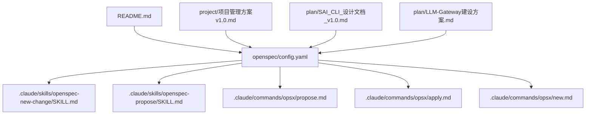
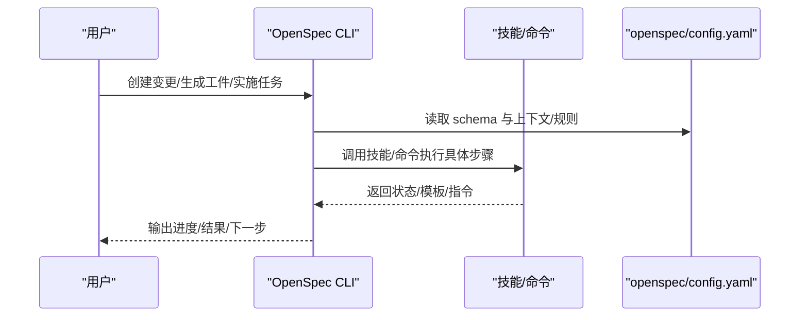
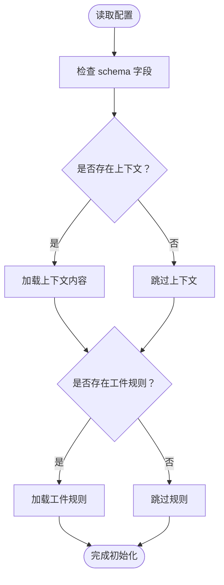
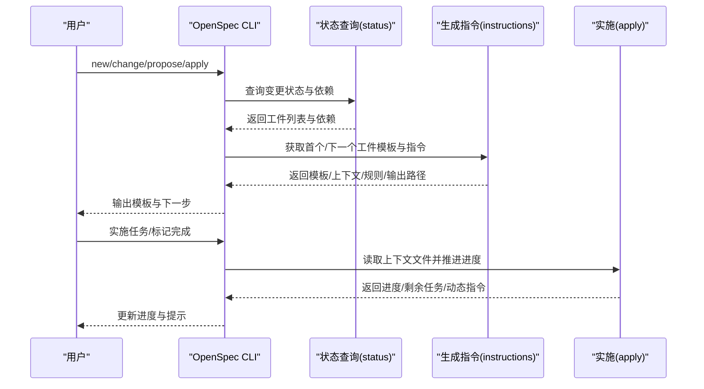
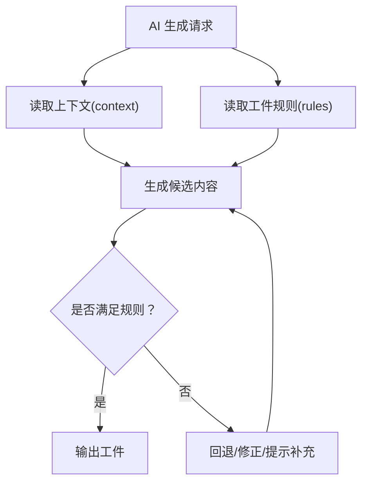
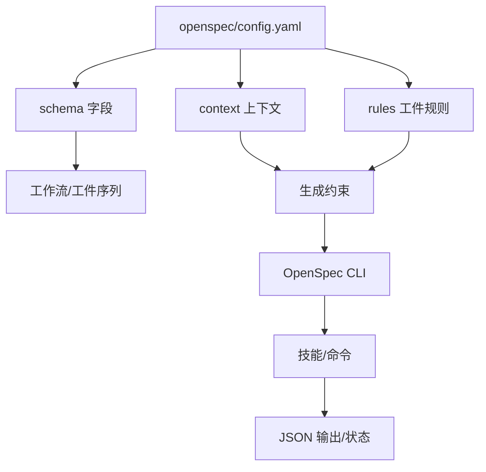

# OpenSpec配置规则

<cite>
**本文引用的文件**
- [openspec/config.yaml](file://openspec/config.yaml)
- [README.md](file://README.md)
- [.claude/skills/openspec-new-change/SKILL.md](file://.claude/skills/openspec-new-change/SKILL.md)
- [.claude/skills/openspec-propose/SKILL.md](file://.claude/skills/openspec-propose/SKILL.md)
- [.claude/commands/opsx/propose.md](file://.claude/commands/opsx/propose.md)
- [.claude/commands/opsx/apply.md](file://.claude/commands/opsx/apply.md)
- [.claude/commands/opsx/new.md](file://.claude/commands/opsx/new.md)
- [project/项目管理方案v1.0.md](file://project/项目管理方案v1.0.md)
- [plan/SAI_CLI_设计文档_v1.0.md](file://plan/SAI_CLI_设计文档_v1.0.md)
- [plan/LLM-Gateway建设方案.md](file://plan/LLM-Gateway建设方案.md)
</cite>

## 目录
1. [简介](#简介)
2. [项目结构](#项目结构)
3. [核心组件](#核心组件)
4. [架构总览](#架构总览)
5. [详细组件分析](#详细组件分析)
6. [依赖分析](#依赖分析)
7. [性能考虑](#性能考虑)
8. [故障排查指南](#故障排查指南)
9. [结论](#结论)
10. [附录](#附录)

## 简介
本文件系统化阐述 OpenSpec 配置规则与使用方法，聚焦于配置文件结构、schema 定义、项目上下文配置、工件规则设置等核心概念，解释配置项的作用机制、优先级与继承关系，并提供完整配置示例与最佳实践，帮助通过配置实现项目治理、质量控制与自动化流程。同时给出配置验证、调试技巧与常见问题解决方案。

## 项目结构
OpenSpec 在本仓库中的落地体现为：
- openspec/config.yaml：OpenSpec 工作流的顶层配置，定义 schema 与可选的项目上下文与工件规则。
- .claude/skills/ 与 .claude/commands/：围绕 OpenSpec 的技能与命令，驱动变更创建、状态查询、实施等流程。
- plan/ 与 project/：项目与方案文档，承载上下文与治理实践，为 OpenSpec 的项目上下文提供素材来源。
- README.md：总体模块与协作关系的概览，有助于理解 OpenSpec 在整体架构中的定位。

**图表来源**
- [openspec/config.yaml:1-21](file://openspec/config.yaml#L1-L21)
- [.claude/skills/openspec-new-change/SKILL.md:1-75](file://.claude/skills/openspec-new-change/SKILL.md#L1-L75)
- [.claude/skills/openspec-propose/SKILL.md:25-111](file://.claude/skills/openspec-propose/SKILL.md#L25-L111)
- [.claude/commands/opsx/propose.md:1-107](file://.claude/commands/opsx/propose.md#L1-L107)
- [.claude/commands/opsx/apply.md:1-84](file://.claude/commands/opsx/apply.md#L1-L84)
- [.claude/commands/opsx/new.md:12-55](file://.claude/commands/opsx/new.md#L12-L55)
- [README.md:1-72](file://README.md#L1-L72)
- [project/项目管理方案v1.0.md:1-175](file://project/项目管理方案v1.0.md#L1-L175)
- [plan/SAI_CLI_设计文档_v1.0.md:1-384](file://plan/SAI_CLI_设计文档_v1.0.md#L1-L384)
- [plan/LLM-Gateway建设方案.md:1-109](file://plan/LLM-Gateway建设方案.md#L1-L109)

**章节来源**
- [openspec/config.yaml:1-21](file://openspec/config.yaml#L1-L21)
- [README.md:1-72](file://README.md#L1-L72)

## 核心组件
- 配置文件与 schema
  - schema 字段决定工作流类型与工件序列。示例中采用 spec-driven，表示以提案、规格、设计、任务为主线的规范驱动工作流。
  - 该字段在 CLI 与技能/命令中被读取，用于推导变更目录结构、工件依赖与执行顺序。
- 项目上下文（可选）
  - 作用：在生成工件时提供 AI 约束与背景信息，确保产出符合团队技术栈、约定与领域知识。
  - 形式：可为多行文本块，建议包含技术栈、提交规范、风格指南、领域知识等。
  - 位置：位于配置文件中注释示例处，实际启用时应取消注释并填充内容。
- 工件规则（Per-artifact rules，可选）
  - 作用：为特定工件类型设置约束与质量门槛，如字数限制、必须包含的章节等。
  - 形式：以工件类型为键，值为规则列表。
  - 位置：位于配置文件中注释示例处，实际启用时应取消注释并填充内容。

上述组件共同构成 OpenSpec 的“治理基线”：既约束 AI 生成内容的质量与一致性，又通过上下文引导生成更贴合团队现状的产物。

**章节来源**
- [openspec/config.yaml:1-21](file://openspec/config.yaml#L1-L21)

## 架构总览
OpenSpec 在本仓库中的使用贯穿“变更创建—状态检查—工件生成—实施”的闭环，CLI 与技能/命令负责驱动流程，配置文件提供工作流与约束。

**图表来源**
- [.claude/skills/openspec-new-change/SKILL.md:16-75](file://.claude/skills/openspec-new-change/SKILL.md#L16-L75)
- [.claude/skills/openspec-propose/SKILL.md:25-111](file://.claude/skills/openspec-propose/SKILL.md#L25-L111)
- [.claude/commands/opsx/propose.md:21-107](file://.claude/commands/opsx/propose.md#L21-L107)
- [.claude/commands/opsx/apply.md:12-84](file://.claude/commands/opsx/apply.md#L12-L84)
- [.claude/commands/opsx/new.md:12-55](file://.claude/commands/opsx/new.md#L12-L55)
- [openspec/config.yaml:1-21](file://openspec/config.yaml#L1-L21)

## 详细组件分析

### 配置文件结构与语法规则
- schema
  - 位置：配置文件首行
  - 作用：声明工作流 schema 名称，决定工件序列与依赖关系
  - 示例：spec-driven
- 项目上下文（context）
  - 位置：配置文件注释示例中，启用后应放置在实际配置段落
  - 作用：为 AI 生成提供背景约束，如技术栈、风格、领域知识
  - 建议：以多行文本块形式组织，条理清晰
- 工件规则（rules）
  - 位置：配置文件注释示例中，启用后应放置在实际配置段落
  - 作用：对特定工件类型施加约束，如字数、章节、格式
  - 建议：规则应可量化、可验证，避免模糊表述

**图表来源**
- [openspec/config.yaml:1-21](file://openspec/config.yaml#L1-L21)

**章节来源**
- [openspec/config.yaml:1-21](file://openspec/config.yaml#L1-L21)

### 工作流与工件序列（以 spec-driven 为例）
- 工作流 schema：spec-driven
- 典型工件序列：proposal → specs → design → tasks（apply 阶段通常指向 tasks）
- 依赖关系：某些工件需在前序工件完成后方可生成或实施
- CLI/技能/命令通过 status/instructions/apply 等子命令与 JSON 输出驱动流程

**图表来源**
- [.claude/skills/openspec-new-change/SKILL.md:37-75](file://.claude/skills/openspec-new-change/SKILL.md#L37-L75)
- [.claude/skills/openspec-propose/SKILL.md:54-111](file://.claude/skills/openspec-propose/SKILL.md#L54-L111)
- [.claude/commands/opsx/propose.md:38-107](file://.claude/commands/opsx/propose.md#L38-L107)
- [.claude/commands/opsx/apply.md:23-84](file://.claude/commands/opsx/apply.md#L23-L84)

**章节来源**
- [.claude/skills/openspec-new-change/SKILL.md:16-75](file://.claude/skills/openspec-new-change/SKILL.md#L16-L75)
- [.claude/skills/openspec-propose/SKILL.md:25-111](file://.claude/skills/openspec-propose/SKILL.md#L25-L111)
- [.claude/commands/opsx/propose.md:21-107](file://.claude/commands/opsx/propose.md#L21-L107)
- [.claude/commands/opsx/apply.md:12-84](file://.claude/commands/opsx/apply.md#L12-L84)

### 项目上下文与工件规则的协同机制
- 上下文（context）为 AI 生成提供“背景约束”，规则（rules）为“质量约束”
- 两者共同作用于工件生成：AI 在模板与结构范围内，结合上下文与规则完成产出
- 优先级与继承
  - 上下文优先：AI 生成时优先遵循上下文提供的技术栈、风格与领域知识
  - 规则次之：在上下文允许的范围内，进一步约束格式、长度、结构等
  - 继承关系：子工件（如 tasks）可复用父工件（如 proposal/specs/design）的上下文与规则，但可叠加更细粒度的规则

**图表来源**
- [openspec/config.yaml:12-21](file://openspec/config.yaml#L12-L21)

**章节来源**
- [openspec/config.yaml:12-21](file://openspec/config.yaml#L12-L21)

### 与项目治理、质量控制、自动化流程的结合
- 项目治理
  - 通过上下文固化团队技术栈、风格与领域知识，减少跨团队分歧
  - 通过规则约束关键工件（如 proposal、tasks）的质量门槛，确保治理一致性
- 质量控制
  - 规则可量化（如字数上限、必须章节），便于自动化校验
  - 与 CI/CD 结合，可在提交前对工件进行规则校验
- 自动化流程
  - CLI 与技能/命令驱动变更从创建到实施的自动化
  - 通过 status/instructions/apply 的 JSON 输出，便于工具链集成与可视化

**章节来源**
- [project/项目管理方案v1.0.md:1-175](file://project/项目管理方案v1.0.md#L1-L175)
- [plan/SAI_CLI_设计文档_v1.0.md:1-384](file://plan/SAI_CLI_设计文档_v1.0.md#L1-L384)
- [plan/LLM-Gateway建设方案.md:1-109](file://plan/LLM-Gateway建设方案.md#L1-L109)

## 依赖分析
- 配置文件依赖
  - CLI/技能/命令依赖配置文件中的 schema、context、rules 字段
  - schema 决定工件序列与依赖关系
  - context 与 rules 作为约束输入，影响生成与校验
- 工具链依赖
  - 技能/命令通过 JSON 输出与 CLI 交互，形成稳定的契约
  - README 中的模块关系图体现了 OpenSpec 在整体架构中的位置

**图表来源**
- [openspec/config.yaml:1-21](file://openspec/config.yaml#L1-L21)
- [.claude/skills/openspec-new-change/SKILL.md:16-75](file://.claude/skills/openspec-new-change/SKILL.md#L16-L75)
- [.claude/commands/opsx/propose.md:21-107](file://.claude/commands/opsx/propose.md#L21-L107)
- [.claude/commands/opsx/apply.md:12-84](file://.claude/commands/opsx/apply.md#L12-L84)
- [README.md:11-41](file://README.md#L11-L41)

**章节来源**
- [openspec/config.yaml:1-21](file://openspec/config.yaml#L1-L21)
- [README.md:11-41](file://README.md#L11-L41)

## 性能考虑
- 配置读取与解析
  - 配置文件体量较小，读取与解析开销极低
  - 建议将上下文与规则保持简洁，避免冗长片段导致生成耗时增加
- 生成与校验
  - 规则越明确、越可量化，校验越高效
  - 建议将规则拆分为细粒度条目，便于增量校验与缓存
- 工具链集成
  - CLI 的 JSON 输出利于流水线集成，减少中间态转换
  - 建议在 CI 中对关键工件进行规则校验，尽早发现偏差

## 故障排查指南
- 常见问题
  - schema 未设置或拼写错误：导致 CLI 无法识别工作流与工件序列
  - 上下文缺失：AI 生成可能偏离团队技术栈或风格
  - 规则冲突：同一工件的多条规则相互矛盾，导致生成反复或失败
  - 工件依赖未满足：apply 阶段提示 blocked，需先完成前置工件
- 调试步骤
  - 使用 status 查看当前变更的工件状态与依赖
  - 使用 instructions 获取当前工件的模板、上下文、规则与输出路径
  - 使用 apply 逐步推进任务，关注动态指令与剩余任务
  - 检查配置文件的 schema、context、rules 是否正确启用与格式正确
- 相关参考
  - 变更创建与状态查询：new/change/status
  - 工件生成与指令：instructions
  - 任务实施：apply

**章节来源**
- [.claude/commands/opsx/propose.md:21-107](file://.claude/commands/opsx/propose.md#L21-L107)
- [.claude/commands/opsx/apply.md:12-84](file://.claude/commands/opsx/apply.md#L12-L84)
- [.claude/skills/openspec-new-change/SKILL.md:16-75](file://.claude/skills/openspec-new-change/SKILL.md#L16-L75)
- [.claude/skills/openspec-propose/SKILL.md:25-111](file://.claude/skills/openspec-propose/SKILL.md#L25-L111)

## 结论
OpenSpec 配置规则通过 schema、项目上下文与工件规则三要素，为 AI 驱动的工件生成提供了清晰的治理基线。结合 CLI 与技能/命令的自动化流程，可在项目治理、质量控制与自动化方面取得显著收益。建议在团队内统一配置规范，持续优化规则与上下文，以获得更稳定、可预期的产出。

## 附录

### 配置示例与最佳实践
- 示例结构
  - schema：指定工作流类型
  - context：启用后提供团队技术栈、风格与领域知识
  - rules：启用后为特定工件类型设置约束
- 最佳实践
  - 上下文应简洁、可读性强，聚焦关键约束
  - 规则应可量化、可验证，避免模糊表述
  - 将规则与工件生命周期绑定，逐步完善
  - 在 CI 中集成规则校验，保障质量门槛

**章节来源**
- [openspec/config.yaml:1-21](file://openspec/config.yaml#L1-L21)