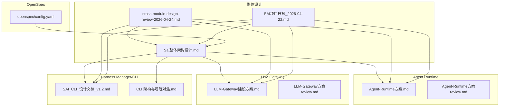
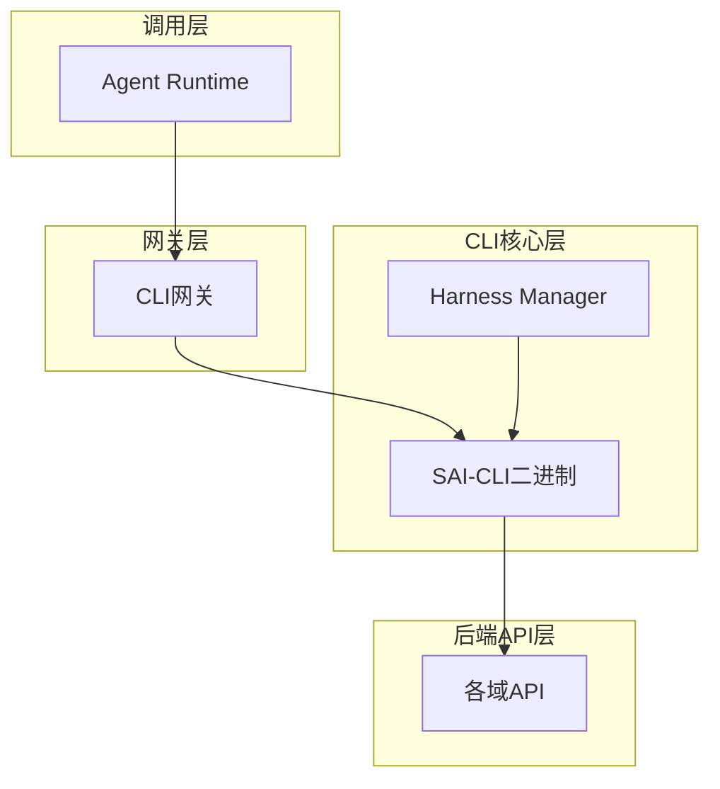
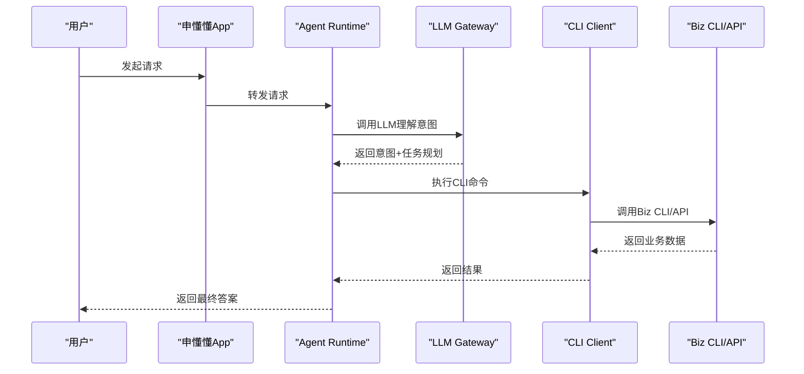
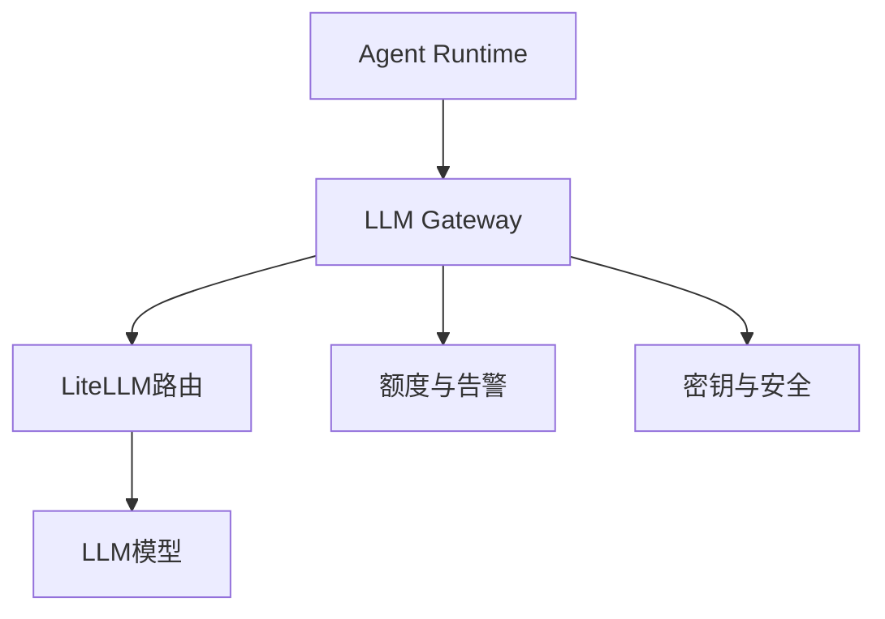
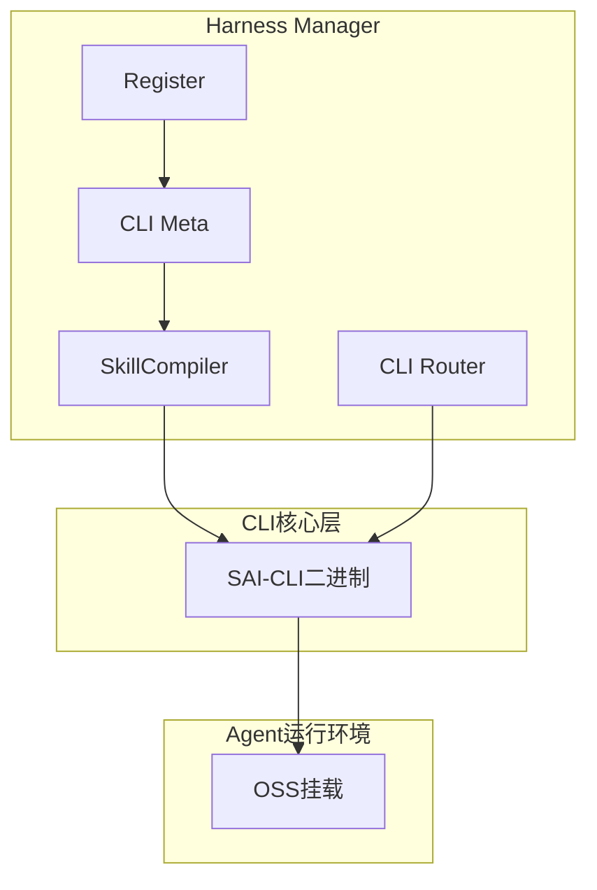
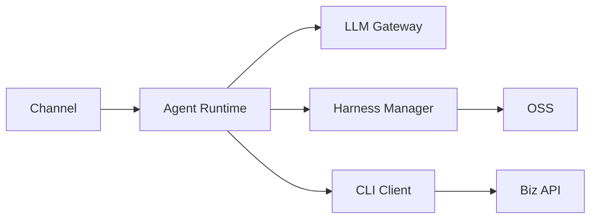

# 技术架构设计

<cite>
**本文引用的文件**
- [Sai整体架构设计.md](file://project/standup/Sai整体架构设计.md)
- [Agent-Runtime方案.md](file://plan/Agent-Runtime方案.md)
- [LLM-Gateway建设方案.md](file://plan/LLM-Gateway建设方案.md)
- [SAI_CLI_设计文档_v1.2.md](file://plan/SAI_CLI_设计文档_v1.2.md)
- [cross-module-design-review-2026-04-24.md](file://notes/zhaobomin/cross-module-design-review-2026-04-24.md)
- [Agent-Runtime方案review.md](file://notes/zhaobomin/Agent-Runtime方案review.md)
- [LLM-Gateway方案review.md](file://notes/zhaobomin/LLM-Gateway方案review.md)
- [SAI项目日报_2026-04-22.md](file://project/SAI-daily-report-2026-04-22-final.md)
- [CLI 架构与规范对焦.md](file://plan/CLI 架构与规范对焦.md)
- [config.yaml](file://openspec/config.yaml)
</cite>

## 目录
1. [引言](#引言)
2. [项目结构](#项目结构)
3. [核心组件](#核心组件)
4. [架构总览](#架构总览)
5. [详细组件分析](#详细组件分析)
6. [依赖关系分析](#依赖关系分析)
7. [性能考量](#性能考量)
8. [故障排查指南](#故障排查指南)
9. [结论](#结论)
10. [附录](#附录)

## 引言
本技术架构文档面向SAI智能体平台，系统性阐述四层分层架构的设计理念、组件关系与交互模式，重点解析意图理解链路与业务执行链路的数据流与控制流，明确模块间接口依赖与协议设计，并给出系统边界、技术约束与设计权衡。文档同时提供架构图与序列图，帮助架构师与高级开发者快速把握系统全貌与关键实现细节。

## 项目结构
SAI项目采用“整体架构设计文档 + 多专题方案”的组织方式，围绕Agent Runtime、LLM Gateway、Harness Manager/CLI、Channel四大领域展开，辅以跨模块设计评审与每日进展跟踪，确保设计一致性与可落地性。

**图表来源**
- [Sai整体架构设计.md:1-277](file://project/standup/Sai整体架构设计.md#L1-L277)
- [cross-module-design-review-2026-04-24.md:1-306](file://notes/zhaobomin/cross-module-design-review-2026-04-24.md#L1-L306)
- [Agent-Runtime方案.md:1-60](file://plan/Agent-Runtime方案.md#L1-L60)
- [LLM-Gateway建设方案.md:1-109](file://plan/LLM-Gateway建设方案.md#L1-L109)
- [SAI_CLI_设计文档_v1.2.md:1-635](file://plan/SAI_CLI_设计文档_v1.2.md#L1-L635)
- [CLI 架构与规范对焦.md:1-25](file://plan/CLI 架构与规范对焦.md#L1-L25)
- [openspec/config.yaml:1-21](file://openspec/config.yaml#L1-L21)

**章节来源**
- [Sai整体架构设计.md:1-277](file://project/standup/Sai整体架构设计.md#L1-L277)
- [cross-module-design-review-2026-04-24.md:1-306](file://notes/zhaobomin/cross-module-design-review-2026-04-24.md#L1-L306)
- [SAI项目日报_2026-04-22.md:1-77](file://project/SAI-daily-report-2026-04-22-final.md#L1-L77)

## 核心组件
- Agent Runtime：基于Serverless的通用Agent执行层，负责意图理解、技能加载、CLI调用与会话管理，强调用户隔离与热启动性能。
- LLM Gateway：统一LLM代理与路由层，提供OpenAI格式API、额度与告警、模型路由与降级、密钥分发与安全控制。
- Harness Manager/CLI：统一构建与分发CLI的控制面，提供API注册中心、9维Tag体系、SkillCompiler编译、CLI路由与鉴权。
- Channel（申懂懂App）：用户接入层，负责前端交互与Agent SDK集成，当前设计文档缺失，需尽快补齐。

**章节来源**
- [Sai整体架构设计.md:142-151](file://project/standup/Sai整体架构设计.md#L142-L151)
- [Agent-Runtime方案.md:4-13](file://plan/Agent-Runtime方案.md#L4-L13)
- [LLM-Gateway建设方案.md:15-26](file://plan/LLM-Gateway建设方案.md#L15-L26)
- [SAI_CLI_设计文档_v1.2.md:29-75](file://plan/SAI_CLI_设计文档_v1.2.md#L29-L75)

## 架构总览
SAI采用四层分层架构，实现AI Agent与业务域后端服务的标准化接入与解耦：

- 调用层（统一AI Agent）：根据用户提问在SAI-CLI中搜索相关API，结合上下文选择最匹配API，拼接执行命令并返回结构化结果。
- 网关层（CLI路由转发、鉴权、负载均衡）：负责命令路由、权限校验与同步机制。
- CLI核心层（Harness Manager统一构建与维护）：将各域API封装为单一SAI-CLI二进制，内置注册中心与SkillCompiler。
- 后端API层（各域只提供API接口）：零侵入，各域仅维护自身API。

**图表来源**
- [SAI_CLI_设计文档_v1.2.md:33-64](file://plan/SAI_CLI_设计文档_v1.2.md#L33-L64)
- [Sai整体架构设计.md:17-65](file://project/standup/Sai整体架构设计.md#L17-L65)

**章节来源**
- [SAI_CLI_设计文档_v1.2.md:29-75](file://plan/SAI_CLI_设计文档_v1.2.md#L29-L75)
- [Sai整体架构设计.md:17-65](file://project/standup/Sai整体架构设计.md#L17-L65)

## 详细组件分析

### Agent Runtime（意图理解与业务执行）
- 用户隔离与热启动：基于Serverless按会话分配实例，冷启动<1s、热启动<200ms，实例与会话一一对应，确保隔离与快速恢复。
- 意图理解链路：Agent调用LLM Gateway的OpenAI格式API，Gateway路由至LLM并返回意图+任务规划。
- 业务执行链路：Agent通过CLI Client执行CLI命令，CLI调用业务域API，返回结构化数据。
- 错误处理：Agent本地缓存最近一次Skill/CLI定义，HM不可用时降级为无知识检索模式；Agent实例崩溃由Serverless平台自动重建。

**图表来源**
- [Sai整体架构设计.md:115-138](file://project/standup/Sai整体架构设计.md#L115-L138)

**章节来源**
- [Agent-Runtime方案.md:4-13](file://plan/Agent-Runtime方案.md#L4-L13)
- [Sai整体架构设计.md:108-138](file://project/standup/Sai整体架构设计.md#L108-L138)
- [Agent-Runtime方案review.md:9-15](file://notes/zhaobomin/Agent-Runtime方案review.md#L9-L15)

### LLM Gateway（统一代理与路由）
- LiteLLM选型：统一OpenAI格式API，向下支持多模型（qwen系列、OpenAI、Claude等），向上提供标准SDK对接。
- 成本与预算：按域组/项目分配额度池，80%/90%/100%三级告警与自动熔断；支持额度重置与单令牌告警。
- 安全与审计：密钥统一托管、虚拟Key生成与轮转、隐私数据脱敏、访问白名单与日志拦截。
- 环境路由：本地/测试环境路由低成本模型，生产环境按应用等级路由至旗舰模型，支持故障降级与多渠道轮询。

**图表来源**
- [LLM-Gateway建设方案.md:15-65](file://plan/LLM-Gateway建设方案.md#L15-L65)
- [Sai整体架构设计.md:197-221](file://project/standup/Sai整体架构设计.md#L197-L221)

**章节来源**
- [LLM-Gateway建设方案.md:15-109](file://plan/LLM-Gateway建设方案.md#L15-L109)
- [LLM-Gateway方案review.md:9-16](file://notes/zhaobomin/LLM-Gateway方案review.md#L9-L16)

### Harness Manager/CLI（统一构建与分发）
- 四层架构职责：调用层不直接调用后端API；网关层负责路由与鉴权；CLI核心层由HM统一构建与维护；后端API层零侵入。
- 9维Tag体系：D1-D9标签覆盖路由分类、NLU理解与执行展示，支持AI自动生成与业务团队Review确认。
- SkillCompiler：将注册元数据编译为Agent可读Tool定义，包含LLM可见层与框架控制层。
- CLI发布与分发：统一打包为SAI-CLI二进制，通过OSS挂载至Agent运行环境，网关发布通知同步命令清单。

**图表来源**
- [SAI_CLI_设计文档_v1.2.md:545-591](file://plan/SAI_CLI_设计文档_v1.2.md#L545-L591)

**章节来源**
- [SAI_CLI_设计文档_v1.2.md:29-75](file://plan/SAI_CLI_设计文档_v1.2.md#L29-L75)
- [SAI_CLI_设计文档_v1.2.md:149-288](file://plan/SAI_CLI_设计文档_v1.2.md#L149-L288)
- [SAI_CLI_设计文档_v1.2.md:545-591](file://plan/SAI_CLI_设计文档_v1.2.md#L545-L591)

### Channel（申懂懂App）与Agent Runtime接口
- 当前状态：接口定义与前端交互协议尚未形成正式文档，属于高风险缺失项。
- 建议补齐：前端架构、消息协议（流式/非流式、SSE/WebSocket）、会话管理与Agent SDK集成方案。

**章节来源**
- [cross-module-design-review-2026-04-24.md:91-100](file://notes/zhaobomin/cross-module-design-review-2026-04-24.md#L91-L100)
- [Sai整体架构设计.md:154-164](file://project/standup/Sai整体架构设计.md#L154-L164)

## 依赖关系分析
- Agent Runtime依赖LLM Gateway进行意图理解，依赖Harness Manager进行技能与CLI元数据拉取，依赖CLI Client执行业务命令。
- LLM Gateway与业务域API无直接耦合，通过标准化OpenAI格式API与路由策略实现成本与安全控制。
- Harness Manager/CLI通过OSS分发统一的SAI-CLI二进制，CLI鉴权由业务域自行负责，网关层仅做路由与权限校验。
- Channel与Agent Runtime的接口契约尚未对齐，需尽快补齐前端交互协议与会话管理定义。

**图表来源**
- [Sai整体架构设计.md:17-65](file://project/standup/Sai整体架构设计.md#L17-L65)
- [cross-module-design-review-2026-04-24.md:187-197](file://notes/zhaobomin/cross-module-design-review-2026-04-24.md#L187-L197)

**章节来源**
- [Sai整体架构设计.md:154-164](file://project/standup/Sai整体架构设计.md#L154-L164)
- [cross-module-design-review-2026-04-24.md:187-197](file://notes/zhaobomin/cross-module-design-review-2026-04-24.md#L187-L197)

## 性能考量
- Agent Runtime：冷启动<1s、热启动<200ms，基于Serverless按会话隔离，实例崩溃由平台自动重建。
- LLM Gateway：LiteLLM具备精细化限流与告警能力，支持按令牌维度的RPM/TPM限制与额度重置，保障成本可控。
- CLI分发：OSS挂载统一SAI-CLI二进制，减少Agent启动时的文件系统开销；若个性化挂载受阻，需启用Agent层文件权限实现的B方案。
- Channel：需明确前端消息协议与会话管理策略，避免长连接与流式传输带来的性能瓶颈。

**章节来源**
- [Agent-Runtime方案.md:4-13](file://plan/Agent-Runtime方案.md#L4-L13)
- [LLM-Gateway建设方案.md:43-54](file://plan/LLM-Gateway建设方案.md#L43-L54)
- [cross-module-design-review-2026-04-24.md:128-135](file://notes/zhaobomin/cross-module-design-review-2026-04-24.md#L128-L135)

## 故障排查指南
- HM不可用：Agent使用本地缓存的Skill/CLI定义，降级为无知识检索模式。
- LLM Gateway熔断：Agent返回固定提示“当前AI服务暂时不可用，请稍后重试”，业务执行链路不受影响。
- Biz API超时/失败：CLI Client单次重试（≤3s等待），失败后Agent向用户说明具体接口不可用。
- OSS不可用：Agent使用本地缓存版本运行，日志告警通知HM团队。
- Agent Runtime实例崩溃：Serverless平台自动重建实例，用户会话需重新发起。

**章节来源**
- [Sai整体架构设计.md:236-245](file://project/standup/Sai整体架构设计.md#L236-L245)

## 结论
SAI智能体平台通过四层分层架构实现了Agent、网关、CLI与后端API的解耦与标准化接入。整体架构设计清晰，模块职责明确，但在Channel接口定义、Agent Runtime与Harness Manager接口契约、LLM Gateway逃生方案等方面仍存在缺失与风险，需在4/25前完成对齐与补齐，以确保4/30的最小可用目标顺利达成。

## 附录

### 系统边界与技术约束
- 系统边界：Agent Runtime负责意图理解与业务执行编排；LLM Gateway负责统一代理与成本控制；Harness Manager/CLI负责CLI构建与分发；Channel负责用户接入与前端交互。
- 技术约束：统一OpenAI格式API、9维Tag体系、PoP Token鉴权（分两期实施）、OSS挂载与个性化挂载评估、全局错误码与状态码规范缺失。

**章节来源**
- [Sai整体架构设计.md:154-164](file://project/standup/Sai整体架构设计.md#L154-L164)
- [cross-module-design-review-2026-04-24.md:210-221](file://notes/zhaobomin/cross-module-design-review-2026-04-24.md#L210-L221)

### 设计权衡
- Agent SDK强依赖：为避免对Claude SDK的强耦合，需考虑SDK抽象层设计，保留切换能力。
- HM Skill/CLI方案未出：需在4/25前产出接口定义文档，避免Agent对接返工。
- LLM Gateway 4/30 scope偏大：建议砍至最小可用（网关跑通+手动发key+基础告警），审批流与前端管理页面延后。
- OSS挂载个性化需求：若4/30前无结论，启用Agent层文件权限实现的B方案。

**章节来源**
- [cross-module-design-review-2026-04-24.md:248-258](file://notes/zhaobomin/cross-module-design-review-2026-04-24.md#L248-L258)
- [Agent-Runtime方案review.md:44-49](file://notes/zhaobomin/Agent-Runtime方案review.md#L44-L49)
- [LLM-Gateway方案review.md:21-26](file://notes/zhaobomin/LLM-Gateway方案review.md#L21-L26)