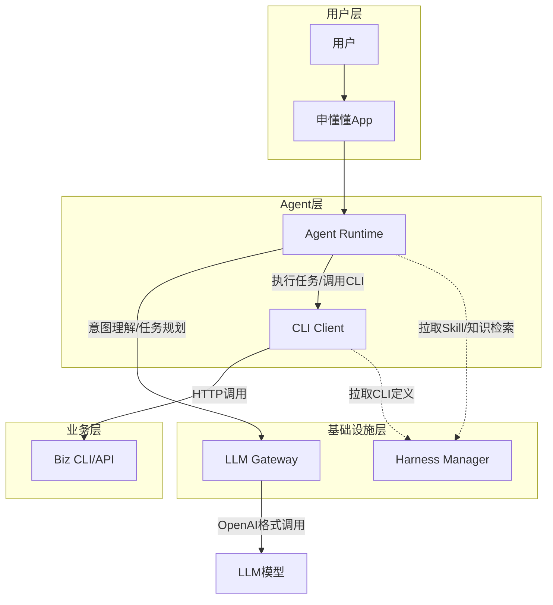
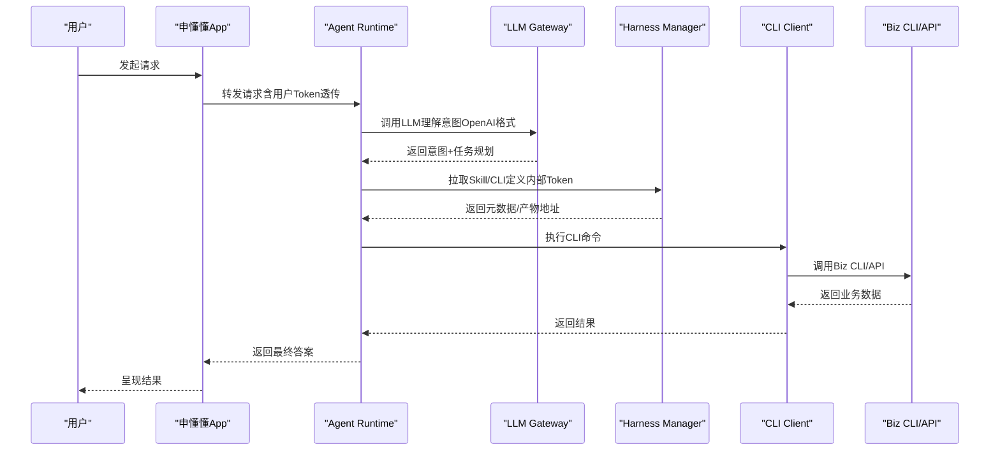
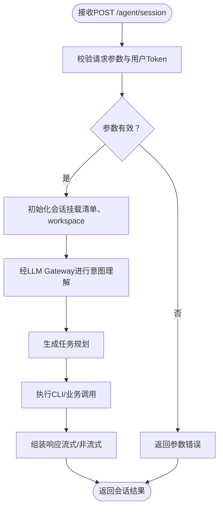
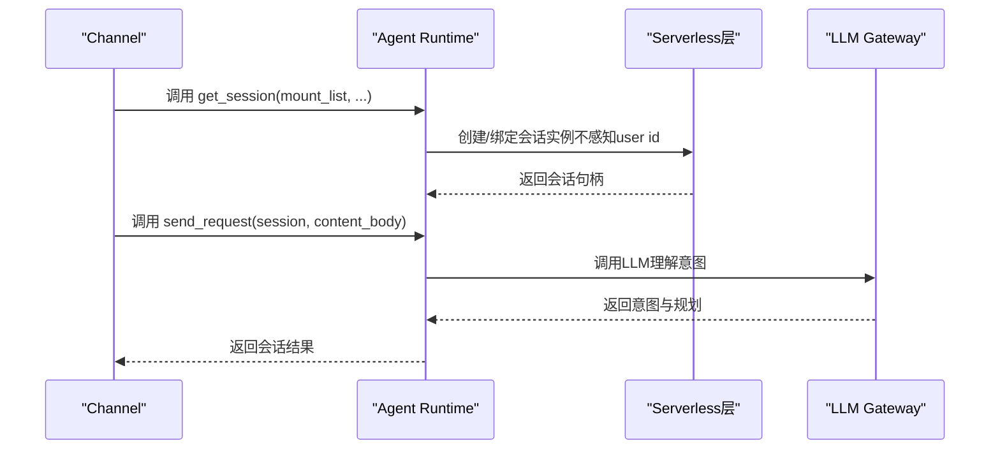
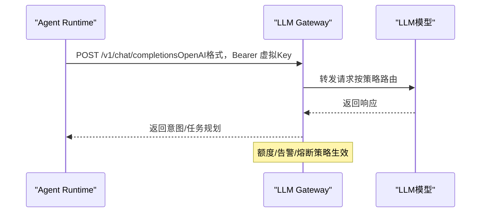
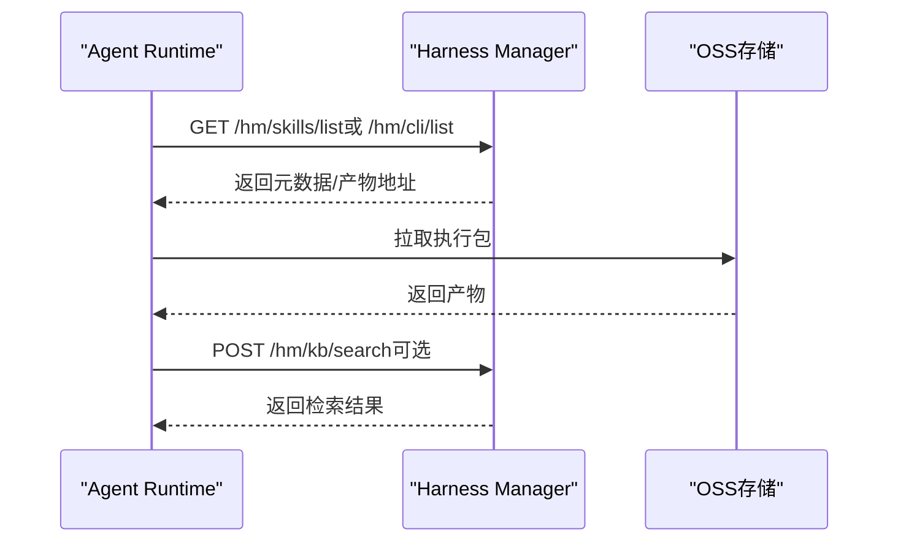
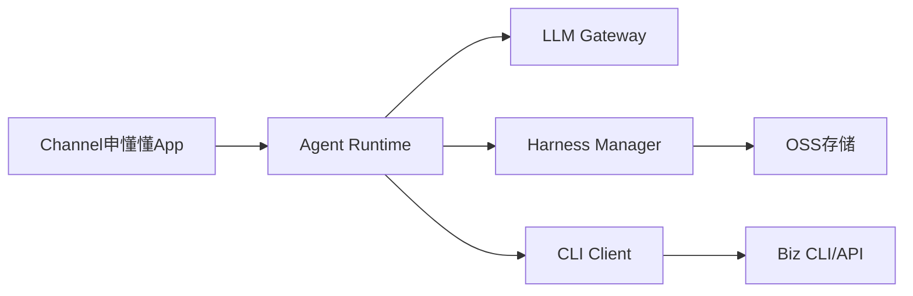

# Agent运行时接口

<cite>
**本文引用的文件**
- [Agent运行时方案（评审）.md](file://notes/zhaobomin/Agent-Runtime方案review.md)
- [LLM网关建设方案.md](file://plan/LLM-Gateway建设方案.md)
- [LLM网关一期功能规划.md](file://plan/LLM-Gateway一期功能规划.md)
- [Sai整体架构设计.md](file://project/standup/Sai整体架构设计.md)
- [2026-04-20 日报（奕杭）.md](file://daily/2026-04-20/yihang.md)
- [2026-04-21 日报（奕杭）.md](file://daily/2026-04-21/yihang.md)
- [跨模块设计评审（2026-04-24）.md](file://notes/zhaobomin/cross-module-design-review-2026-04-24.md)
- [LLM网关方案（评审）.md](file://notes/zhaobomin/LLM-Gateway方案review.md)
</cite>

## 目录
1. [简介](#简介)
2. [项目结构](#项目结构)
3. [核心组件](#核心组件)
4. [架构总览](#架构总览)
5. [详细组件分析](#详细组件分析)
6. [依赖关系分析](#依赖关系分析)
7. [性能考量](#性能考量)
8. [故障排查指南](#故障排查指南)
9. [结论](#结论)
10. [附录](#附录)

## 简介
本文件面向Agent运行时模块，聚焦以下目标：
- Agent会话接口设计：重点说明POST /agent/session的请求/响应语义、会话生命周期与状态维护。
- Agent Runtime与Channel交互协议：明确用户Token透传机制、会话建立与消息流转。
- Agent运行时与LLM Gateway的集成接口：统一OpenAI格式调用、虚拟Key认证、成本控制与熔断策略。
- 错误处理与降级策略：在HM、LLM Gateway、OSS、Agent Runtime实例等故障场景下的恢复与提示。
- 会话管理最佳实践与性能优化建议：冷热启动、实例隔离、会话持久化与缓存策略。

## 项目结构
围绕Agent运行时接口，相关文档与设计要点分布如下：
- 架构与模块职责：Sai整体架构设计明确了Agent Runtime、LLM Gateway、Harness Manager、Channel等模块的边界与调用关系。
- 会话接口与交互：跨模块评审与日报明确了POST /agent/session与内部get_session/send_request的约定。
- LLM网关集成：LLM网关建设方案与一期规划明确了OpenAI格式代理、虚拟Key、额度与告警。
- 错误处理与降级：架构设计中的降级矩阵给出了关键故障场景的处置策略。

图表来源
- [Sai整体架构设计.md:19-65](file://project/standup/Sai整体架构设计.md#L19-L65)

章节来源
- [Sai整体架构设计.md:1-277](file://project/standup/Sai整体架构设计.md#L1-L277)

## 核心组件
- Agent Runtime：负责会话管理、意图理解（经LLM Gateway）、业务执行（经CLI Client）、与HM交互拉取Skill/CLI与知识。
- LLM Gateway：统一代理LLM调用，提供OpenAI格式接口，基于虚拟Key进行认证与额度/告警控制。
- Harness Manager（HM）：控制面服务，提供Skill/CLI注册与分发、知识库检索，Agent通过HTTP/OSS拉取资源。
- Channel（申懂懂App）：前端接入层，负责消息协议、会话管理、与Agent Runtime的交互。
- Biz CLI/API：业务能力封装与后端API调用，由Agent Runtime通过CLI Client触发。

章节来源
- [Sai整体架构设计.md:142-151](file://project/standup/Sai整体架构设计.md#L142-L151)
- [LLM网关建设方案.md:15-26](file://plan/LLM-Gateway建设方案.md#L15-L26)
- [Agent运行时方案（评审）.md:1-55](file://notes/zhaobomin/Agent-Runtime方案review.md#L1-L55)

## 架构总览
Agent运行时与Channel、LLM Gateway、HM的交互关系如下：

图表来源
- [Sai整体架构设计.md:115-138](file://project/standup/Sai整体架构设计.md#L115-L138)

章节来源
- [Sai整体架构设计.md:108-138](file://project/standup/Sai整体架构设计.md#L108-L138)

## 详细组件分析

### 1) Agent会话接口：POST /agent/session
- 接口定位：由Channel（申懂懂App）调用，向Agent Runtime发起会话建立请求。
- 请求与响应语义（基于现有文档的可证实信息）：
  - 请求：包含用户上下文、会话标识、消息内容等（具体字段以接口契约为准）。
  - 响应：包含Agent的回复片段（流式/非流式取决于协议）、会话状态、错误码等。
- 会话生命周期与状态维护：
  - 会话建立：Agent Runtime基于用户级别workspace与挂载清单（mount_list）初始化会话。
  - 会话保持：在会话有效期内复用Agent实例，支持热启动与状态缓存。
  - 会话结束：会话结束后销毁实例，释放资源。
- 用户Token透传机制：
  - Channel在请求中携带用户Token，Agent Runtime在内部调用LLM Gateway与业务系统时透传该Token，确保鉴权与审计一致。

图表来源
- [Sai整体架构设计.md:158-159](file://project/standup/Sai整体架构设计.md#L158-L159)
- [2026-04-20 日报（奕杭）.md:5-12](file://daily/2026-04-20/yihang.md#L5-L12)

章节来源
- [Sai整体架构设计.md:154-164](file://project/standup/Sai整体架构设计.md#L154-L164)
- [2026-04-20 日报（奕杭）.md:5-12](file://daily/2026-04-20/yihang.md#L5-L12)

### 2) Agent Runtime内部接口：get_session / send_request
- get_session：基于用户级别workspace与挂载清单（mount_list）创建/获取会话实例，确保serverless层不感知user id，降低耦合。
- send_request：在已有会话上下文中发送消息，驱动意图理解与业务执行。
- 会话状态维护：通过挂载清单与workspace实现会话持久化与隔离，避免跨用户污染。

图表来源
- [2026-04-20 日报（奕杭）.md:5-12](file://daily/2026-04-20/yihang.md#L5-L12)

章节来源
- [2026-04-20 日报（奕杭）.md:5-12](file://daily/2026-04-20/yihang.md#L5-L12)

### 3) Agent Runtime与Channel交互协议
- 消息协议：支持流式/非流式输出，具体协议细节由前端SDK与Agent Runtime对齐。
- 会话管理：支持多会话、会话历史、生成式UI等（以前端方案为准）。
- 与Agent Runtime接口：POST /agent/session → 内部get_session/send_request。

章节来源
- [跨模块设计评审（2026-04-24）.md:171-183](file://notes/zhaobomin/cross-module-design-review-2026-04-24.md#L171-L183)
- [Sai整体架构设计.md:158-159](file://project/standup/Sai整体架构设计.md#L158-L159)

### 4) Agent运行时与LLM Gateway集成接口
- 统一OpenAI格式：Agent Runtime通过HTTP调用LLM Gateway的OpenAI兼容接口。
- 认证方式：使用Gateway分配的虚拟Key（Bearer Token）进行鉴权。
- 成本控制与熔断：Gateway提供额度预警与熔断机制，Agent在熔断时返回统一提示。
- 环境路由：根据环境与应用等级自动路由至低成本/旗舰模型，保障成本可控。

图表来源
- [Sai整体架构设计.md:158-159](file://project/standup/Sai整体架构设计.md#L158-L159)
- [LLM网关建设方案.md:29-34](file://plan/LLM-Gateway建设方案.md#L29-L34)
- [LLM网关建设方案.md:43-54](file://plan/LLM-Gateway建设方案.md#L43-L54)

章节来源
- [Sai整体架构设计.md:197-221](file://project/standup/Sai整体架构设计.md#L197-L221)
- [LLM网关建设方案.md:15-54](file://plan/LLM-Gateway建设方案.md#L15-L54)
- [LLM网关一期功能规划.md:1-23](file://plan/LLM-Gateway一期功能规划.md#L1-L23)

### 5) 与Harness Manager（HM）的交互
- Skill/CLI拉取：Agent Runtime通过HTTP从HM获取元数据，再从OSS拉取执行包。
- 知识检索：Agent Runtime通过HTTP向HM发起知识检索请求。
- 认证：HM侧内部Token，Agent Runtime在调用时携带相应凭证。

图表来源
- [Sai整体架构设计.md:160-163](file://project/standup/Sai整体架构设计.md#L160-L163)
- [Sai整体架构设计.md:173-194](file://project/standup/Sai整体架构设计.md#L173-L194)

章节来源
- [Sai整体架构设计.md:154-164](file://project/standup/Sai整体架构设计.md#L154-L164)

## 依赖关系分析
- Agent Runtime依赖Channel提供会话请求与Token透传；依赖LLM Gateway进行意图理解；依赖HM进行Skill/CLI与知识检索；依赖OSS进行资源分发。
- Channel与Agent Runtime的交互协议尚未形成正式接口定义，需尽快补齐。
- HM的Skill/CLI方案尚未产出，可能影响Agent对接进度。

图表来源
- [Sai整体架构设计.md:154-164](file://project/standup/Sai整体架构设计.md#L154-L164)

章节来源
- [Sai整体架构设计.md:154-170](file://project/standup/Sai整体架构设计.md#L154-L170)
- [跨模块设计评审（2026-04-24）.md:171-222](file://notes/zhaobomin/cross-module-design-review-2026-04-24.md#L171-L222)

## 性能考量
- 启动性能：冷启动<1秒、热启动<200ms（以架构设计验收标准为准），通过Serverless实例与挂载清单优化会话初始化。
- 会话隔离：按session分配实例，确保一实例一session，避免资源争用。
- 缓存策略：在HM/OSS不可用时，Agent使用本地缓存版本运行，减少对上游依赖的强耦合。
- 路由与降级：Gateway按环境与等级路由至低成本模型，超阈值熔断，保障成本与稳定性。

章节来源
- [Sai整体架构设计.md:224-232](file://project/standup/Sai整体架构设计.md#L224-L232)
- [LLM网关建设方案.md:43-54](file://plan/LLM-Gateway建设方案.md#L43-L54)

## 故障排查指南
- HM不可用：Agent使用本地缓存的Skill/CLI定义，降级为无知识检索模式。
- LLM Gateway熔断：Agent返回统一提示“当前AI服务暂时不可用，请稍后重试”，业务执行链路不受影响。
- Biz API超时/失败：CLI Client进行单次重试（≤3s等待），失败后向用户说明具体接口不可用。
- OSS不可用：Agent使用本地缓存版本运行，日志告警通知HM团队。
- Agent Runtime实例崩溃：Serverless平台自动重建实例，用户会话需重新发起。

章节来源
- [Sai整体架构设计.md:236-245](file://project/standup/Sai整体架构设计.md#L236-L245)
- [LLM网关方案（评审）.md:32-38](file://notes/zhaobomin/LLM-Gateway方案review.md#L32-L38)

## 结论
- Agent运行时接口以会话为中心，结合Channel的Token透传与Serverless实例隔离，实现用户级隔离与高性能启动。
- 与LLM Gateway的OpenAI格式统一接口、虚拟Key认证与额度熔断机制，满足成本与安全要求。
- 与HM的HTTP/OSS交互支撑Skill/CLI与知识检索，具备良好的容错与降级能力。
- 建议尽快补齐Channel与Agent Runtime的接口定义、HM的Skill/CLI方案，以及统一的错误码规范，以确保端到端可落地与可运维。

## 附录
- 关键接口与协议摘要
  - LLM调用：Agent Runtime → LLM Gateway（OpenAI格式，Bearer虚拟Key）
  - 会话接口：Channel → Agent Runtime（POST /agent/session），内部 → get_session/send_request
  - HM交互：Agent Runtime → HM（HTTP/OSS），用于Skill/CLI与知识检索
- 逃生与降级
  - 业务侧fallback直连百炼原生API
  - Gateway bypass模式一键关闭路由规则
- 最佳实践
  - 会话持久化与挂载清单管理
  - 本地缓存与重试策略
  - 环境路由与额度预警联动

章节来源
- [Sai整体架构设计.md:154-164](file://project/standup/Sai整体架构设计.md#L154-L164)
- [LLM网关建设方案.md:43-54](file://plan/LLM-Gateway建设方案.md#L43-L54)
- [LLM网关方案（评审）.md:32-38](file://notes/zhaobomin/LLM-Gateway方案review.md#L32-L38)