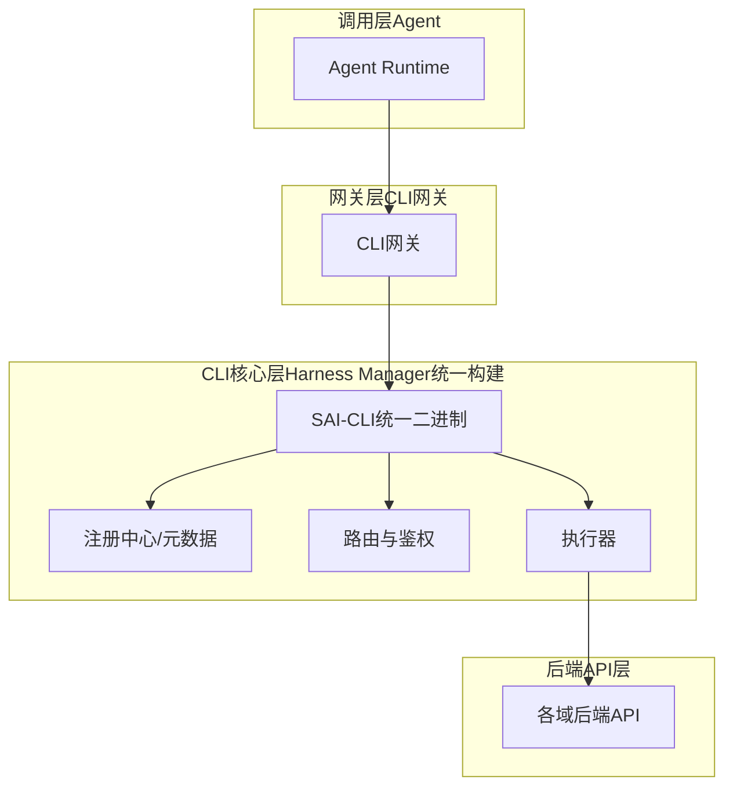
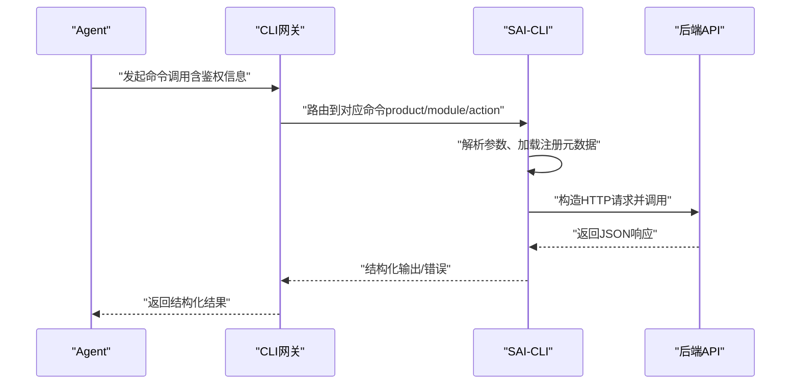
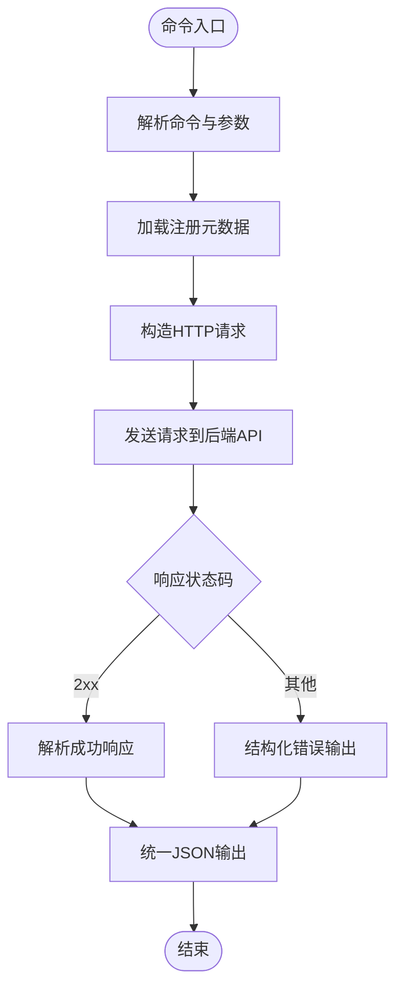
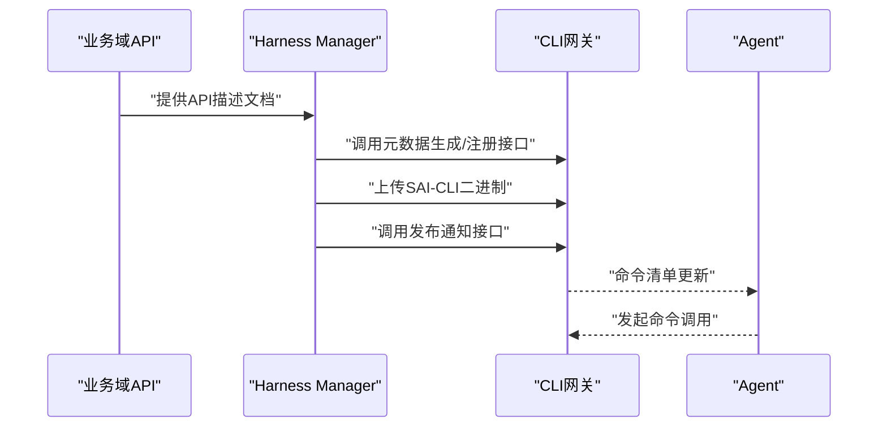
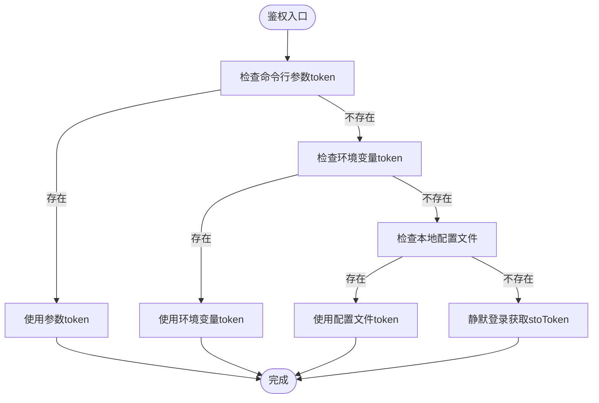
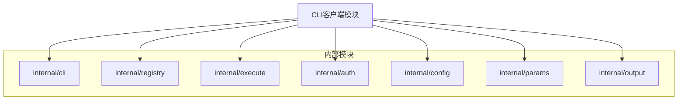

# CLI客户端接口

<cite>
**本文引用的文件**
- [SAI CLI 架构设计文档 v1.0](file://plan/SAI_CLI_设计文档_v1.0.md)
- [SAI CLI 架构设计文档 v1.2](file://plan/SAI_CLI_设计文档_v1.2.md)
- [Agent-Runtime方案review](file://notes/zhaobomin/Agent-Runtime方案review.md)
- [LLM-Gateway方案review](file://notes/zhaobomin/LLM-Gateway方案review.md)
- [2026-04-22 项目日报](file://daily/2026-04-22/suiyun.md)
- [2026-04-20 早会记录](file://project/standup/2026-04-20-zhaobomin.md)
- [Agent API发现架构review](file://notes/zhaobomin/agent-api-discovery-architecture-review.zh-CN.md)
- [CLI 架构与规范对焦](file://plan/CLI 架构与规范对焦.md)
</cite>

## 目录
1. [简介](#简介)
2. [项目结构](#项目结构)
3. [核心组件](#核心组件)
4. [架构总览](#架构总览)
5. [详细组件分析](#详细组件分析)
6. [依赖分析](#依赖分析)
7. [性能考虑](#性能考虑)
8. [故障排查指南](#故障排查指南)
9. [结论](#结论)
10. [附录](#附录)

## 简介
本文件面向CLI客户端模块，提供与Biz CLI（Harness Manager统一构建的SAI-CLI二进制）之间的HTTP调用协议与接口规范，涵盖命令执行流程、参数传递机制、通过Harness Manager拉取CLI定义的注册分发链路、错误处理与重试机制、超时策略、鉴权与安全考虑，以及监控与日志记录规范。文档严格基于仓库内现有设计文档与评审材料整理而成，确保技术口径一致。

## 项目结构
围绕CLI客户端的接口与交互，相关设计分布在以下文档中：
- SAI CLI架构与规范（v1.0/v1.2）：定义命令规范、鉴权、注册与分发、Agent调用流程、9维Tag体系等
- Agent Runtime与LLM Gateway评审：提供模块边界、接口依赖与分发策略背景
- 项目早会与日报：明确单CLI封装、OSS挂载分发、鉴权兼容等关键落地点
- Agent API发现架构review：指出CLI内部模块边界、动态命令分发、执行与输出等实现要点

图表来源
- [SAI CLI 架构设计文档 v1.2:29-64](file://plan/SAI_CLI_设计文档_v1.2.md#L29-L64)
- [Agent API发现架构review:24-38](file://notes/zhaobomin/agent-api-discovery-architecture-review.zh-CN.md#L24-L38)

章节来源
- [SAI CLI 架构设计文档 v1.2:29-64](file://plan/SAI_CLI_设计文档_v1.2.md#L29-L64)
- [Agent-Runtime方案review:1-55](file://notes/zhaobomin/Agent-Runtime方案review.md#L1-L55)
- [LLM-Gateway方案review:1-70](file://notes/zhaobomin/LLM-Gateway方案review.md#L1-L70)
- [2026-04-22 项目日报:1-46](file://daily/2026-04-22/suiyun.md#L1-L46)
- [2026-04-20 早会记录:1-84](file://project/standup/2026-04-20-zhaobomin.md#L1-L84)

## 核心组件
- 命令规范与参数
  - 统一命令格式：{product} {module} {action} [params]
  - 入参/出参统一JSON格式，错误输出亦为结构化JSON
- 注册与分发
  - Harness Manager负责将各域API封装为统一SAI-CLI二进制并通过OSS挂载分发
  - CLI网关提供元数据生成、注册接口、发布通知、路由与鉴权
- 执行与输出
  - CLI内部模块：CLI命令注册、注册中心客户端、执行器、鉴权、配置、参数解析、输出
  - 执行器按注册元数据构造并调用后端API，统一JSON输出与结构化错误

章节来源
- [SAI CLI 架构设计文档 v1.0:83-114](file://plan/SAI_CLI_设计文档_v1.0.md#L83-L114)
- [SAI CLI 架构设计文档 v1.2:115-146](file://plan/SAI_CLI_设计文档_v1.2.md#L115-L146)
- [Agent API发现架构review:24-38](file://notes/zhaobomin/agent-api-discovery-architecture-review.zh-CN.md#L24-L38)

## 架构总览
SAI-CLI采用四层分层架构，Agent通过CLI网关调用统一的SAI-CLI二进制，后者根据注册元数据路由到相应后端API。鉴权采用SSO Token，网关负责路由与权限校验，CLI核心层负责命令解析与执行。

图表来源
- [SAI CLI 架构设计文档 v1.2:29-64](file://plan/SAI_CLI_设计文档_v1.2.md#L29-L64)
- [Agent API发现架构review:24-38](file://notes/zhaobomin/agent-api-discovery-architecture-review.zh-CN.md#L24-L38)

章节来源
- [SAI CLI 架构设计文档 v1.2:29-64](file://plan/SAI_CLI_设计文档_v1.2.md#L29-L64)
- [Agent API发现架构review:24-38](file://notes/zhaobomin/agent-api-discovery-architecture-review.zh-CN.md#L24-L38)

## 详细组件分析

### 命令执行流程与参数传递
- 命令格式与参数
  - 命令格式：{product} {module} {action} [params]
  - 入参统一JSON格式，错误输出亦为结构化JSON
- 参数解析与合并
  - CLI内部参数解析模块负责参数合并与归一化
- 执行器
  - 按注册元数据构造HTTP请求，发送至后端API
  - 统一JSON输出与结构化错误返回

图表来源
- [Agent API发现架构review:166-186](file://notes/zhaobomin/agent-api-discovery-architecture-review.zh-CN.md#L166-L186)

章节来源
- [SAI CLI 架构设计文档 v1.0:83-114](file://plan/SAI_CLI_设计文档_v1.0.md#L83-L114)
- [Agent API发现架构review:166-186](file://notes/zhaobomin/agent-api-discovery-architecture-review.zh-CN.md#L166-L186)

### 通过Harness Manager拉取CLI定义与注册分发链路
- 单CLI封装与OSS挂载
  - 各域仅提供API接口，Harness Manager统一构建SAI-CLI二进制并通过OSS挂载分发
- 注册与元数据
  - CLI网关提供元数据生成与注册接口，支持AI自动生成9维Tag与描述
  - 注册接口支持add/update/remove操作
- 发布通知
  - Harness Manager上传二进制后调用网关发布通知接口，同步更新命令清单

图表来源
- [2026-04-22 项目日报:17-46](file://daily/2026-04-22/suiyun.md#L17-L46)
- [SAI CLI 架构设计文档 v1.2:545-591](file://plan/SAI_CLI_设计文档_v1.2.md#L545-L591)

章节来源
- [2026-04-22 项目日报:17-46](file://daily/2026-04-22/suiyun.md#L17-L46)
- [SAI CLI 架构设计文档 v1.2:545-591](file://plan/SAI_CLI_设计文档_v1.2.md#L545-L591)

### 错误处理策略、重试机制与超时处理
- 结构化错误输出
  - 错误输出包含type、code、message、hint四个固定字段
- 执行器与状态码处理
  - 执行器负责HTTP请求发送与响应解析，建议拆分状态码处理逻辑
- 重试与超时
  - CLI内部模块边界中未明确重试与超时参数，建议在执行器层引入可配置的重试次数与超时设置，并在网关层配合限流与熔断

章节来源
- [SAI CLI 架构设计文档 v1.0:143-184](file://plan/SAI_CLI_设计文档_v1.0.md#L143-L184)
- [Agent API发现架构review:166-186](file://notes/zhaobomin/agent-api-discovery-architecture-review.zh-CN.md#L166-L186)

### 鉴权机制与安全考虑
- 一期鉴权（Bearer Token）
  - Token获取优先级：命令行参数 > 环境变量 > 本地配置文件
  - 配置文件格式包含token、identity_type、scopes、expires_at
- 二期鉴权（PoP签名+ECDSA）
  - 引入sai-agent作为安全代理，实现Token与设备/环境绑定
  - CLI命令可附加用户查询原始语句与扩展意图字段
- 网关鉴权
  - CLI网关负责权限校验与路由转发，二期支持PoP签名验证

图表来源
- [SAI CLI 架构设计文档 v1.2:394-471](file://plan/SAI_CLI_设计文档_v1.2.md#L394-L471)

章节来源
- [SAI CLI 架构设计文档 v1.2:394-471](file://plan/SAI_CLI_设计文档_v1.2.md#L394-L471)
- [SAI CLI 架构设计文档 v1.0:220-251](file://plan/SAI_CLI_设计文档_v1.0.md#L220-L251)

### 监控指标与日志记录规范
- 监控建议
  - 命令成功率、响应时延、错误类型分布、重试次数、路由命中率
- 日志规范
  - 默认关闭调试日志，仅在SAI_DEBUG=true时输出
  - 对敏感字段进行脱敏处理
  - 输出包含request id、path、method、status、duration等关键信息

章节来源
- [Agent API发现架构review:123-134](file://notes/zhaobomin/agent-api-discovery-architecture-review.zh-CN.md#L123-L134)

## 依赖分析
CLI客户端模块内部职责清晰，模块边界如下：
- internal/cli：Cobra命令注册、鉴权门禁、动态命令分发
- internal/registry：注册中心客户端、schema读取、本地缓存、discover/list解析
- internal/execute：按注册元数据构造并调用目标API
- internal/auth：本地登录态读写与token过期判断
- internal/config：环境profile、URL、TTL、超时等配置解析
- internal/params：参数解析与合并
- internal/output：统一JSON输出

图表来源
- [Agent API发现架构review:24-38](file://notes/zhaobomin/agent-api-discovery-architecture-review.zh-CN.md#L24-L38)

章节来源
- [Agent API发现架构review:24-38](file://notes/zhaobomin/agent-api-discovery-architecture-review.zh-CN.md#L24-L38)

## 性能考虑
- 单CLI二进制部署：减少Agent侧分发与版本管理复杂度
- 注册中心缓存：本地缓存与ETag/304处理，降低网络开销
- 动态命令分发：建议在main.go或root command层接入TryDynamicDispatch，避免依赖启动期预挂载
- 执行器重构：建议拆分HTTP transport、缓存、解析与状态码处理，提升可维护性与可测试性

章节来源
- [2026-04-22 项目日报:17-46](file://daily/2026-04-22/suiyun.md#L17-L46)
- [Agent API发现架构review:40-66](file://notes/zhaobomin/agent-api-discovery-architecture-review.zh-CN.md#L40-L66)
- [Agent API发现架构review:135-165](file://notes/zhaobomin/agent-api-discovery-architecture-review.zh-CN.md#L135-L165)

## 故障排查指南
- 动态命令不可用
  - 现象：合法动态命令在某些情况下被识别为未知命令
  - 原因：动态命令兜底分发未接入真实入口
  - 处理：在main.go或root command层接入TryDynamicDispatch
- 非2xx状态码仍返回ok=true
  - 现象：下游API返回非2xx时CLI仍标记成功
  - 处理：修复状态码处理逻辑，确保非2xx时返回结构化错误
- 调试日志污染与敏感信息泄露
  - 现象：默认输出调试日志，可能泄露业务参数
  - 处理：仅在SAI_DEBUG=true时输出，对敏感字段脱敏
- 注册中心责任过重
  - 现象：registry.Client承担过多职责，耦合度高
  - 处理：拆分为transport、cache_store、commands_client、parser、refresh等模块

章节来源
- [Agent API发现架构review:40-66](file://notes/zhaobomin/agent-api-discovery-architecture-review.zh-CN.md#L40-L66)
- [Agent API发现架构review:123-134](file://notes/zhaobomin/agent-api-discovery-architecture-review.zh-CN.md#L123-L134)
- [Agent API发现架构review:135-165](file://notes/zhaobomin/agent-api-discovery-architecture-review.zh-CN.md#L135-L165)

## 结论
本文基于仓库内现有设计文档与评审材料，系统梳理了CLI客户端与Harness Manager之间的HTTP调用协议、命令执行流程、参数传递机制、注册分发链路、鉴权与安全策略、错误处理与日志规范。建议在后续实现中重点落实动态命令兜底分发、状态码处理修复、调试日志脱敏与注册中心模块拆分，以提升CLI的可靠性与可维护性。

## 附录
- 术语
  - SAI-CLI：Harness Manager统一构建的CLI二进制
  - 注册中心：存储与管理9维Tag、描述与入参说明的元数据中心
  - PoP：证明持有（Proof-of-Possession）签名，用于Token与环境绑定
- 相关接口与规范
  - 元数据生成接口：POST /api/v1/sai/cli/metadata/generate
  - 命令注册接口：POST /api/v1/sai/cli/registry（支持add/update/remove）
  - 静默登录接口：POST /api/v1/sai/auth/silent-login

章节来源
- [SAI CLI 架构设计文档 v1.2:376-391](file://plan/SAI_CLI_设计文档_v1.2.md#L376-L391)
- [SAI CLI 架构设计文档 v1.2:413-420](file://plan/SAI_CLI_设计文档_v1.2.md#L413-L420)