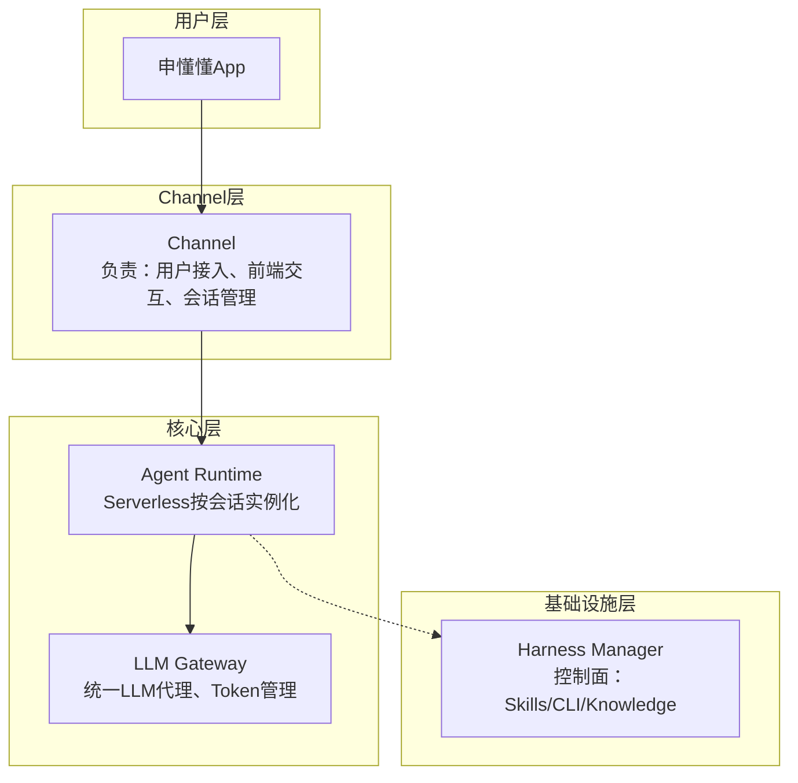
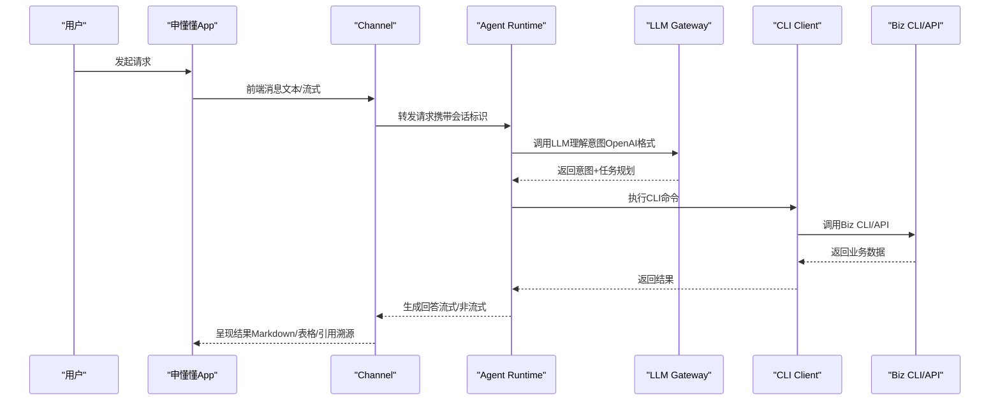
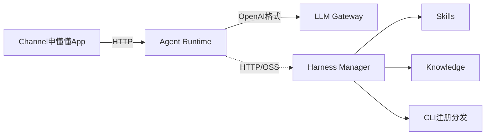

# Channel接口

<cite>
**本文引用的文件**
- [Sai整体架构设计.md](file://project/standup/Sai整体架构设计.md)
- [Agent-Runtime方案.md](file://plan/Agent-Runtime方案.md)
- [Agent-Runtime方案review.md](file://notes/zhaobomin/Agent-Runtime方案review.md)
- [cross-module-design-review-2026-04-24.md](file://notes/zhaobomin/cross-module-design-review-2026-04-24.md)
- [2026-04-20-zhaobomin.md](file://project/standup/2026-04-20-zhaobomin.md)
- [hongyu.md（2026-04-20）](file://daily/2026-04-20/hongyu.md)
- [hongyu.md（2026-04-21）](file://daily/2026-04-21/hongyu.md)
- [hongyu.md（2026-04-22）](file://daily/2026-04-22/hongyu.md)
- [hongyu.md（2026-04-23）](file://daily/2026-04-23/hongyu.md)
- [yihang.md（2026-04-22）](file://daily/2026-04-22/yihang.md)
- [yihang.md（2026-04-23）](file://daily/2026-04-23/yihang.md)
- [yihang.md（2026-04-24）](file://daily/2026-04-24/yihang.md)
- [LLM-Gateway一期功能规划.md](file://plan/LLM-Gateway一期功能规划.md)
</cite>

## 目录
1. [简介](#简介)
2. [项目结构](#项目结构)
3. [核心组件](#核心组件)
4. [架构总览](#架构总览)
5. [详细组件分析](#详细组件分析)
6. [依赖分析](#依赖分析)
7. [性能考量](#性能考量)
8. [故障排查指南](#故障排查指南)
9. [结论](#结论)
10. [附录](#附录)

## 简介
本文件面向Channel模块（申懂懂App）与Agent Runtime之间的前端交互协议，系统化阐述以下内容：
- 前端接入与Agent SDK集成方案
- 用户请求转发机制与会话生命周期
- 消息格式与流式/非流式交互约定
- 与Agent Runtime的通信协议与数据交换格式
- 前端集成最佳实践与用户体验优化建议
- Channel层的扩展性与兼容性考虑

当前仓库中，Channel层尚缺乏正式设计文档与接口定义，本文在现有资料基础上进行归纳与补充，形成可执行的接口蓝图与实施建议，以支撑申懂懂App在4月底前完成“通用Agent前端SDK嵌入 + 通过agent-gateway按会话分配Serverless Agent”的里程碑目标。

## 项目结构
Channel层位于用户层与Agent Runtime之间，承担用户接入、会话管理、消息编解码与前端SDK集成职责。整体架构关系如下：

图表来源
- [Sai整体架构设计.md:19-65](file://project/standup/Sai整体架构设计.md#L19-L65)
- [2026-04-20-zhaobomin.md:5-40](file://project/standup/2026-04-20-zhaobomin.md#L5-L40)

章节来源
- [Sai整体架构设计.md:15-65](file://project/standup/Sai整体架构设计.md#L15-L65)
- [2026-04-20-zhaobomin.md:1-65](file://project/standup/2026-04-20-zhaobomin.md#L1-L65)

## 核心组件
- Channel（申懂懂App）
  - 职责：用户接入、前端交互、会话管理、消息编解码、Agent SDK集成
  - 交付目标：完成通用Agent前端SDK嵌入，支持按会话在Serverless上分配Agent实例
- Agent Runtime
  - 职责：意图理解、任务规划、业务执行（CLI调用）、Serverless按会话实例化
  - 交付目标：冷启动<1s，热启动<200ms，支持≥3个Skill挂载
- LLM Gateway
  - 职责：统一LLM代理、Token管理、成本控制
  - 交付目标：支持qwen系列模型路由，个人令牌告警与熔断
- Harness Manager（HM）
  - 职责：Skills/CLI/Knowledge的注册、分发与检索
  - 交付目标：完成注册→分发→调用闭环，支持≥1个业务CLI接入

章节来源
- [Sai整体架构设计.md:142-151](file://project/standup/Sai整体架构设计.md#L142-L151)
- [Agent-Runtime方案.md:1-60](file://plan/Agent-Runtime方案.md#L1-L60)
- [LLM-Gateway一期功能规划.md:1-23](file://plan/LLM-Gateway一期功能规划.md#L1-L23)

## 架构总览
Channel与Agent Runtime的交互链路分为“意图理解链路”和“业务执行链路”。其中，意图理解链路由Channel将用户请求转发至Agent Runtime，Agent Runtime经LLM Gateway调用LLM模型；业务执行链路由Agent Runtime通过CLI Client调用Biz CLI/API。

图表来源
- [Sai整体架构设计.md:115-138](file://project/standup/Sai整体架构设计.md#L115-L138)

章节来源
- [Sai整体架构设计.md:108-138](file://project/standup/Sai整体架构设计.md#L108-L138)

## 详细组件分析

### 1) 前端SDK集成与Agent SDK对接
- 集成方式
  - PC/移动端引入通用Agent页面SDK，实现与Agent Runtime的交互
  - 早期PC端Demo已跑通（AI销售助理），后续按宏宇逻辑对焦迭代
- 集成目标
  - 在申懂懂App内嵌通用Agent前端SDK
  - 通过agent-gateway按用户会话在Serverless上分配Agent实例
  - 完成“你好”等基础对话能力验证

章节来源
- [Agent-Runtime方案.md:40-43](file://plan/Agent-Runtime方案.md#L40-L43)
- [yihang.md（2026-04-24）:74-74](file://daily/2026-04-24/yihang.md#L74-L74)

### 2) 用户接入流程与会话管理
- 会话生命周期
  - 会话创建：用户发起请求，Channel生成会话标识并转发至Agent Runtime
  - 会话恢复：支持历史会话时间轴分组、重命名、删除；启动时自动恢复上次会话
  - 会话销毁：Serverless实例按会话销毁，确保用户隔离
- 会话状态管理
  - 新建会话：侧边栏常驻新建入口，点击进入空白页并自动唤起键盘
  - 历史会话：列表展示（分组），支持重命名、删除
  - 会话初始状态：支持Initial State重置，便于多轮对话场景

章节来源
- [hongyu.md（2026-04-21）:23-27](file://daily/2026-04-21/hongyu.md#L23-L27)
- [hongyu.md（2026-04-22）:18-22](file://daily/2026-04-22/hongyu.md#L18-L22)
- [hongyu.md（2026-04-23）:9-29](file://daily/2026-04-23/hongyu.md#L9-L29)

### 3) 消息格式与交互协议
- 意图理解链路
  - 协议：HTTP + OpenAI格式
  - 认证：Bearer Token（Gateway分配的虚拟key）
- 业务执行链路
  - Agent → CLI Client：本地调用
  - CLI Client → Biz CLI：HTTP
  - Biz CLI → Biz API：HTTP/RPC
- Channel → Agent Runtime
  - 接口路径（草案）：`POST /agent/session` → `get_session` / `send_request`
  - 认证方式：用户Token透传
  - 说明：该接口定义目前尚未形成正式文档，需与弘宇对齐

章节来源
- [Sai整体架构设计.md:154-164](file://project/standup/Sai整体架构设计.md#L154-L164)
- [cross-module-design-review-2026-04-24.md:260-266](file://notes/zhaobomin/cross-module-design-review-2026-04-24.md#L260-L266)

### 4) 与Agent Runtime的通信协议与数据交换格式
- 通信协议
  - Channel与Agent Runtime之间建议采用HTTP协议，支持流式/非流式两种模式
  - 流式场景：SSE或WebSocket，用于实时呈现思考过程与结果
  - 非流式场景：一次性返回完整回答
- 数据交换格式
  - 请求：包含用户消息、会话标识、上下文、认证信息
  - 响应：包含回答正文、来源标注、结构化内容（Markdown/表格/引用）、异常状态
- 会话状态
  - 支持多会话并行与历史回溯
  - 任务过程展示：异步任务可折叠/展开，支持用户暂停/继续

章节来源
- [Sai整体架构设计.md:197-221](file://project/standup/Sai整体架构设计.md#L197-L221)
- [hongyu.md（2026-04-22）:18-22](file://daily/2026-04-22/hongyu.md#L18-L22)

### 5) 前端集成最佳实践与用户体验优化
- 输入与交互
  - 输入框底部固定、多行自适应、状态机管理（空态/输入中/发送中/禁用）
  - 语音转录范式：点击录音、流式转录、权限三态
  - 快捷指令：常驻快捷标签（可编辑再发送、角色化）
- 输出与呈现
  - 生成阶段：思考状态标签、逐字流式输出、自动滚动、悬浮“回到底部”
  - 结果阶段：Markdown结构化渲染（标题/列表/表格/引用）、表格超宽横滑、引用溯源
  - 使用阶段：点赞/吐槽/复制/更多（扩展位）、长按同款菜单、停止后支持“重新生成”
- 会话体验
  - Session Resumption：历史时间轴分组 + 重命名/删除
  - 追问逻辑：四级推荐策略（信息补全→同源深挖→关联补充→不推荐）

章节来源
- [hongyu.md（2026-04-21）:23-46](file://daily/2026-04-21/hongyu.md#L23-L46)
- [hongyu.md（2026-04-22）:18-22](file://daily/2026-04-22/hongyu.md#L18-L22)
- [hongyu.md（2026-04-23）:9-29](file://daily/2026-04-23/hongyu.md#L9-L29)

### 6) Channel层的扩展性与兼容性
- 扩展性
  - 通过Agent SDK抽象层降低对Claude Agent SDK的强耦合，便于未来切换其他Agent SDK
  - Channel与Agent Runtime通过HTTP接口解耦，支持多产品登录态适配（客户管家、申懂懂）
- 兼容性
  - 前端SDK需兼容PC/移动端，支持多行输入、流式输出、Markdown渲染
  - 与LLM Gateway保持OpenAI格式兼容，便于后续扩展模型与路由策略

章节来源
- [cross-module-design-review-2026-04-24.md:252-257](file://notes/zhaobomin/cross-module-design-review-2026-04-24.md#L252-L257)
- [yihang.md（2026-04-24）:55-55](file://daily/2026-04-24/yihang.md#L55-L55)

## 依赖分析
Channel与Agent Runtime的接口依赖矩阵（草案）如下：

图表来源
- [Sai整体架构设计.md:154-164](file://project/standup/Sai整体架构设计.md#L154-L164)

章节来源
- [Sai整体架构设计.md:154-164](file://project/standup/Sai整体架构设计.md#L154-L164)

## 性能考量
- 启动性能
  - Agent Runtime冷启动<1s，热启动<200ms，满足前端即时响应需求
- 并发与吞吐
  - LLM Gateway支持≥5个个人用户并发使用，配合限额与告警机制保障稳定性
- 传输效率
  - 流式输出（SSE/WebSocket）降低首字延迟，提升等待体验
  - 非流式适用于一次性结果场景，减少连接开销

章节来源
- [Agent-Runtime方案.md:4-12](file://plan/Agent-Runtime方案.md#L4-L12)
- [LLM-Gateway一期功能规划.md:1-23](file://plan/LLM-Gateway一期功能规划.md#L1-L23)

## 故障排查指南
- HM不可用
  - 现象：Agent无法拉取Skill/CLI；知识检索中断
  - 降级：Agent使用本地缓存最近一次Skill/CLI定义，降级为无知识检索模式
- LLM Gateway熔断
  - 现象：意图理解链路完全中断
  - 降级：Agent返回固定提示，业务执行链路不受影响
- Biz API超时/失败
  - 现象：单个CLI命令执行失败
  - 处理：CLI Client单次重试（≤3s等待），失败后Agent向用户说明具体接口不可用
- OSS不可用
  - 现象：Agent无法拉取新Skill/CLI执行包
  - 处理：Agent使用本地缓存版本运行，日志告警通知HM团队
- Agent Runtime实例崩溃
  - 现象：单个用户会话中断
  - 处理：Serverless平台自动重建实例，用户会话需重新发起

章节来源
- [Sai整体架构设计.md:236-245](file://project/standup/Sai整体架构设计.md#L236-L245)

## 结论
- Channel层当前缺乏正式设计文档与接口定义，需尽快补齐“前端交互架构 + 消息协议 + 与Agent Runtime接口”三要素
- 前端SDK集成已在PC端Demo中验证，后续需按宏宇逻辑对焦迭代，确保在申懂懂App内嵌通用Agent前端SDK
- 与Agent Runtime的接口（`POST /agent/session` → `get_session` / `send_request`）需尽快形成正式契约，明确请求/响应schema与认证方式
- 通过流式输出、结构化渲染与会话恢复等体验设计，可显著提升用户满意度与易用性

## 附录
- 术语
  - Agent Runtime：通用Agent执行与调度层，基于Serverless按会话实例化
  - LLM Gateway：统一LLM代理与Token管理服务
  - Harness Manager（HM）：控制面服务，负责Skills/CLI/Knowledge的注册、分发与检索
  - SSE：服务器发送事件，用于流式数据推送
  - WebSocket：双向通信协议，适用于实时交互场景