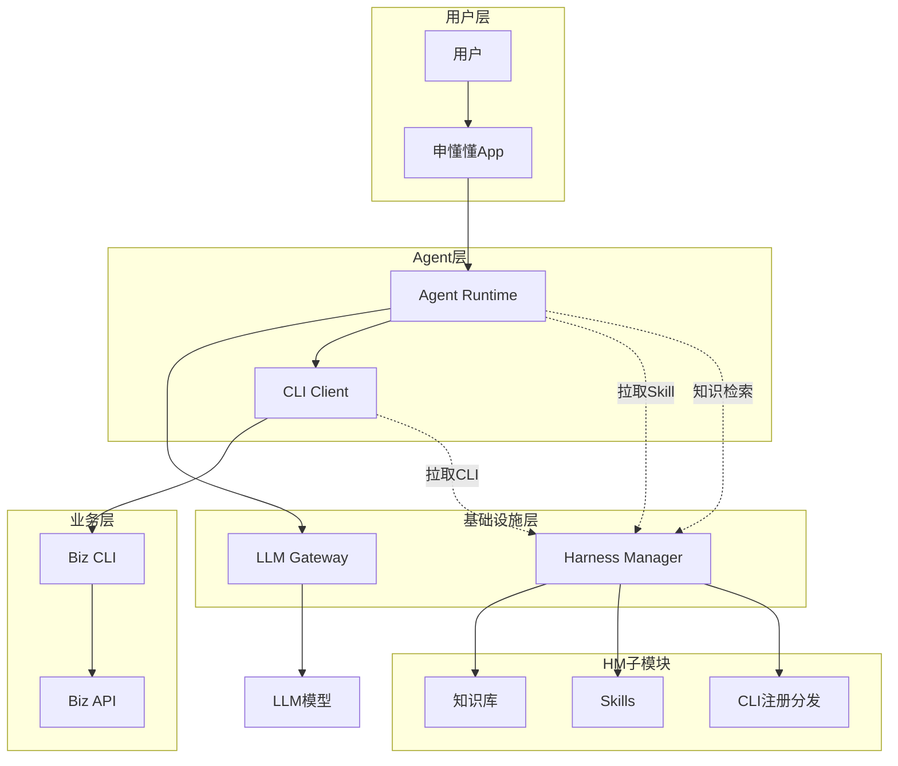
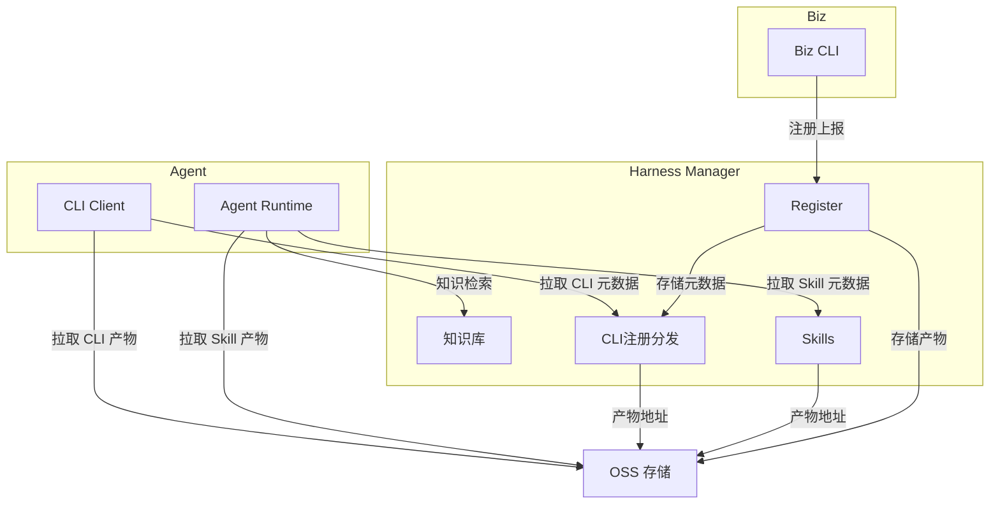
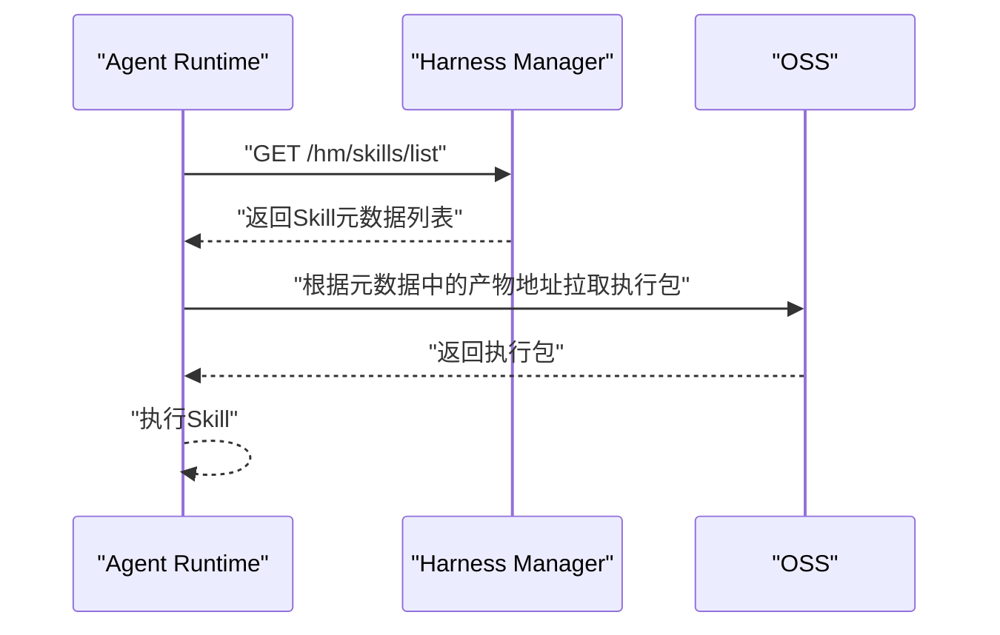
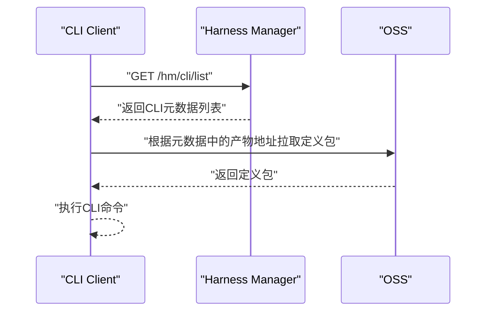
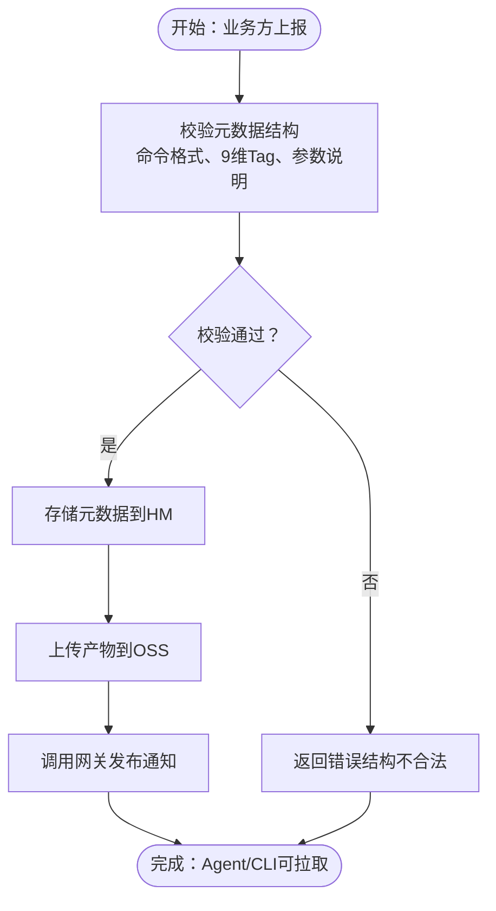
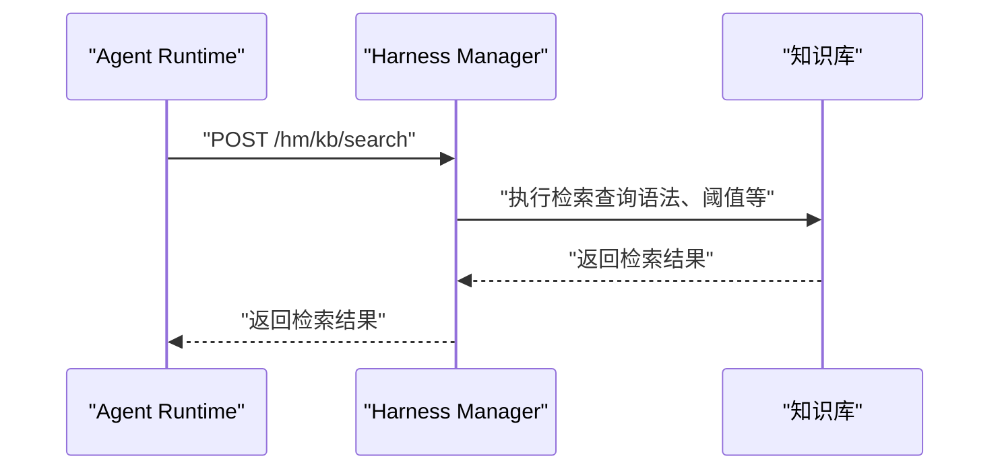
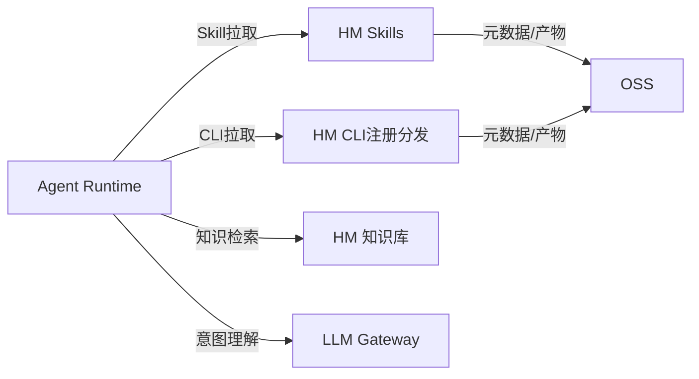

# Harness管理器接口

<cite>
**本文引用的文件**
- [Sai整体架构设计.md](file://project/standup/Sai整体架构设计.md)
- [cross-module-design-review-2026-04-24.md](file://notes/zhaobomin/cross-module-design-review-2026-04-24.md)
- [SAI_CLI_设计文档_v1.2.md](file://plan/SAI_CLI_设计文档_v1.2.md)
- [Agent-Runtime方案.md](file://plan/Agent-Runtime方案.md)
- [LLM-Gateway建设方案.md](file://plan/LLM-Gateway建设方案.md)
</cite>

## 目录
1. [简介](#简介)
2. [项目结构](#项目结构)
3. [核心组件](#核心组件)
4. [架构总览](#架构总览)
5. [详细组件分析](#详细组件分析)
6. [依赖分析](#依赖分析)
7. [性能考量](#性能考量)
8. [故障排查指南](#故障排查指南)
9. [结论](#结论)
10. [附录](#附录)

## 简介
本文件聚焦Harness管理器（HM）模块的接口设计与实现，围绕以下核心接口展开：
- 技能拉取接口：GET /hm/skills/list
- CLI拉取接口：GET /hm/cli/list
- CLI注册接口：POST /hm/cli/register
- 知识检索接口：POST /hm/kb/search

文档将系统阐述元数据拉取与OSS产物获取的完整流程、CLI注册的数据结构与认证机制、知识检索与Agent Runtime的集成方式，并提供接口调用示例、参数规范与错误处理策略，最后分析HM子模块间的协作关系与数据流转。

## 项目结构
本仓库中与Harness管理器接口相关的关键文档如下：
- 顶层架构与模块职责：Sai整体架构设计.md
- 接口契约与缺失项：cross-module-design-review-2026-04-24.md
- CLI与HM对接规范、鉴权与OSS分发：SAI_CLI_设计文档_v1.2.md
- Agent Runtime与OSS挂载、冷启动与隔离：Agent-Runtime方案.md
- LLM Gateway与Agent Runtime的意图理解链路：LLM-Gateway建设方案.md

**图表来源**
- [Sai整体架构设计.md:19-65](file://project/standup/Sai整体架构设计.md#L19-L65)

**章节来源**
- [Sai整体架构设计.md:17-65](file://project/standup/Sai整体架构设计.md#L17-L65)

## 核心组件
- 知识库（KB）：企业知识存储与检索，Agent可进行知识检索辅助决策。
- Skills：Skill注册与管理，Agent从HM拉取Skill定义。
- CLI注册分发：业务方上报CLI元数据，存储到OSS，Agent从OSS拉取CLI定义。

**章节来源**
- [Sai整体架构设计.md:173-194](file://project/standup/Sai整体架构设计.md#L173-L194)

## 架构总览
HM作为控制面服务，承担三条核心数据流：
- 注册流：业务方 → HM注册 → 元数据存储 → 产物存储（OSS）
- 拉取流：Agent/HM → 元数据拉取（HTTP） → 产物地址（OSS） → 产物拉取（OSS）
- 检索流：Agent → HM知识检索 → KB

**图表来源**
- [Sai整体架构设计.md:67-106](file://project/standup/Sai整体架构设计.md#L67-L106)

**章节来源**
- [Sai整体架构设计.md:67-106](file://project/standup/Sai整体架构设计.md#L67-L106)

## 详细组件分析

### 技能拉取接口 GET /hm/skills/list
- 调用方：Agent Runtime
- 提供方：HM（Skills子模块）
- 调用协议：HTTP/OSS
- 目标：拉取Skill元数据，随后从OSS拉取执行包
- 认证方式：HM内部Token
- 数据流：
  1) Agent Runtime调用GET /hm/skills/list获取Skill元数据列表
  2) HM返回元数据（含产物地址等）
  3) Agent Runtime从OSS下载执行包并执行

**图表来源**
- [Sai整体架构设计.md:159-160](file://project/standup/Sai整体架构设计.md#L159-L160)
- [Sai整体架构设计.md:96-102](file://project/standup/Sai整体架构设计.md#L96-L102)

**章节来源**
- [Sai整体架构设计.md:159-160](file://project/standup/Sai整体架构设计.md#L159-L160)
- [Sai整体架构设计.md:96-102](file://project/standup/Sai整体架构设计.md#L96-L102)

### CLI拉取接口 GET /hm/cli/list
- 调用方：CLI Client
- 提供方：HM（CLI注册分发子模块）
- 调用协议：HTTP/OSS
- 目标：拉取CLI元数据，随后从OSS拉取定义包
- 认证方式：HM内部Token
- 数据流：
  1) CLI Client调用GET /hm/cli/list获取CLI元数据列表
  2) HM返回元数据（含产物地址等）
  3) CLI Client从OSS下载定义包并执行

**图表来源**
- [Sai整体架构设计.md:160-161](file://project/standup/Sai整体架构设计.md#L160-L161)
- [Sai整体架构设计.md:96-102](file://project/standup/Sai整体架构设计.md#L96-L102)

**章节来源**
- [Sai整体架构设计.md:160-161](file://project/standup/Sai整体架构设计.md#L160-L161)
- [Sai整体架构设计.md:96-102](file://project/standup/Sai整体架构设计.md#L96-L102)

### CLI注册接口 POST /hm/cli/register
- 调用方：Biz CLI（业务方）
- 提供方：HM（Register子模块）
- 调用协议：HTTP
- 认证方式：业务方Token
- 目标：上报CLI元数据，HM存储元数据与产物，供Agent/CLI Client拉取
- 数据结构要点（来自文档）：
  - 命令格式：{product} {module} {action} [params]
  - 9维Tag体系：D1-D9，用于路由、NLU理解、执行与展示
  - 描述与参数说明：用于Agent理解与参数组装
  - 示例：包含command、tags、description、params、example等字段
- 发布流程：
  1) 业务方上报元数据
  2) HM接收并存储元数据
  3) HM将产物上传至OSS
  4) 通过网关发布通知，同步命令清单

**图表来源**
- [SAI_CLI_设计文档_v1.2.md:171-223](file://plan/SAI_CLI_设计文档_v1.2.md#L171-L223)
- [SAI_CLI_设计文档_v1.2.md:574-588](file://plan/SAI_CLI_设计文档_v1.2.md#L574-L588)

**章节来源**
- [SAI_CLI_设计文档_v1.2.md:171-223](file://plan/SAI_CLI_设计文档_v1.2.md#L171-L223)
- [SAI_CLI_设计文档_v1.2.md:574-588](file://plan/SAI_CLI_设计文档_v1.2.md#L574-L588)

### 知识检索接口 POST /hm/kb/search
- 调用方：Agent Runtime
- 提供方：HM（知识库子模块）
- 调用协议：HTTP
- 认证方式：HM内部Token
- 目标：基于用户输入进行知识检索，辅助Agent决策
- 设计要点（来自文档）：
  - 查询语法、返回格式、相似度阈值等细节在Review中列为“缺失”
  - Agent Runtime与HM的接口契约需进一步对齐

**图表来源**
- [Sai整体架构设计.md:162-163](file://project/standup/Sai整体架构设计.md#L162-L163)

**章节来源**
- [Sai整体架构设计.md:162-163](file://project/standup/Sai整体架构设计.md#L162-L163)
- [cross-module-design-review-2026-04-24.md:187-196](file://notes/zhaobomin/cross-module-design-review-2026-04-24.md#L187-L196)

## 依赖分析
- Agent Runtime与HM的接口契约：
  - Skill拉取：GET /hm/skills/list
  - CLI拉取：GET /hm/cli/list
  - 知识检索：POST /hm/kb/search
- HM子模块间协作：
  - Register接收业务方上报，存储元数据与产物
  - Skills/CLI注册分发提供元数据查询
  - OSS存储产物，Agent/CLI Client通过产物地址拉取
- Agent Runtime与LLM Gateway：
  - 意图理解链路：Agent → LLM Gateway → LLM

**图表来源**
- [Sai整体架构设计.md:159-163](file://project/standup/Sai整体架构设计.md#L159-L163)
- [Sai整体架构设计.md:96-102](file://project/standup/Sai整体架构设计.md#L96-L102)

**章节来源**
- [Sai整体架构设计.md:159-163](file://project/standup/Sai整体架构设计.md#L159-L163)
- [Sai整体架构设计.md:96-102](file://project/standup/Sai整体架构设计.md#L96-L102)

## 性能考量
- Agent冷启动与热启动：Agent Runtime方案指出冷启动<1s，热启动<200ms，需确保HM接口与OSS拉取不会成为瓶颈。
- OSS挂载与个性化需求：Agent Runtime方案指出OSS挂载在Agent层配置，若无法满足个性化挂载，需在Agent层自行实现文件权限，或等待阿里云评估结果。
- 1500个API Tag元数据量级对Agent启动速度的影响：跨模块设计Review中列为“缺失”，需在后续补充性能与容量规划。

**章节来源**
- [Agent-Runtime方案.md:4-8](file://plan/Agent-Runtime方案.md#L4-L8)
- [Agent-Runtime方案.md:15-31](file://plan/Agent-Runtime方案.md#L15-L31)
- [cross-module-design-review-2026-04-24.md:243-251](file://notes/zhaobomin/cross-module-design-review-2026-04-24.md#L243-L251)

## 故障排查指南
- HM不可用：
  - 影响：Agent无法拉取Skill/CLI；知识检索中断
  - 降级策略：Agent使用本地缓存最近一次Skill/CLI定义，降级为无知识检索模式
- OSS不可用：
  - 影响：Agent无法拉取新Skill/CLI执行包
  - 降级策略：Agent使用本地缓存版本运行，日志告警通知HM团队
- LLM Gateway熔断：
  - 影响：意图理解链路完全中断
  - 降级策略：Agent返回固定提示，业务执行链路不受影响
- Biz API超时/失败：
  - 影响：单个CLI命令执行失败
  - 降级策略：CLI Client单次重试（≤3s等待），失败后Agent向用户说明具体接口不可用

**章节来源**
- [Sai整体架构设计.md:236-245](file://project/standup/Sai整体架构设计.md#L236-L245)

## 结论
- HM接口契约已在整体架构与Review中明确，但部分细节（如Skill/CLI拉取的分页与缓存策略、知识检索的查询语法与阈值）仍需进一步对齐与补充。
- HM通过Register子模块完成业务方元数据与产物的集中管理，Skills/CLI注册分发子模块提供元数据查询，OSS承载产物分发，Agent Runtime与CLI Client据此拉取并执行。
- 鉴权方面，HM对Agent/CLI的接口采用内部Token；对业务方的注册接口采用业务方Token；同时文档明确了AK/SK签名鉴权用于HM内部API调用。

## 附录

### 接口调用示例与参数规范
- 技能拉取 GET /hm/skills/list
  - 认证：HM内部Token
  - 返回：Skill元数据列表（含产物地址等）
  - 后续：Agent从OSS拉取执行包
- CLI拉取 GET /hm/cli/list
  - 认证：HM内部Token
  - 返回：CLI元数据列表（含产物地址等）
  - 后续：CLI Client从OSS拉取定义包
- CLI注册 POST /hm/cli/register
  - 认证：业务方Token
  - 请求体：command、tags（9维）、description、params、example等
  - 流程：上报 → 存储元数据 → 上传产物到OSS → 网关发布通知
- 知识检索 POST /hm/kb/search
  - 认证：HM内部Token
  - 设计：查询语法、返回格式、相似度阈值等细节在Review中列为“缺失”，需对齐

**章节来源**
- [Sai整体架构设计.md:159-163](file://project/standup/Sai整体架构设计.md#L159-L163)
- [cross-module-design-review-2026-04-24.md:187-196](file://notes/zhaobomin/cross-module-design-review-2026-04-24.md#L187-L196)
- [SAI_CLI_设计文档_v1.2.md:171-223](file://plan/SAI_CLI_设计文档_v1.2.md#L171-L223)