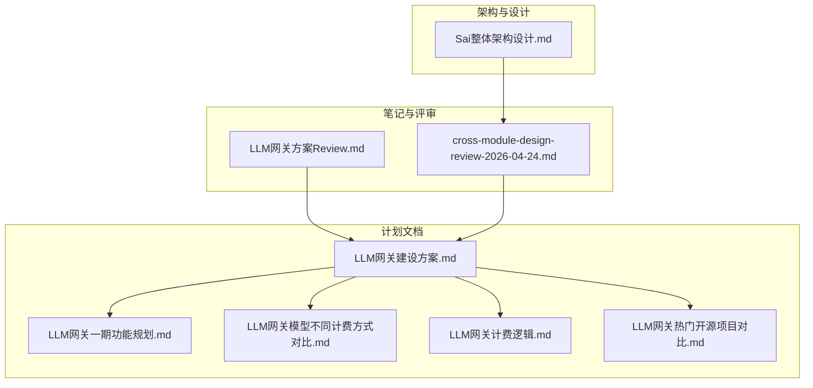
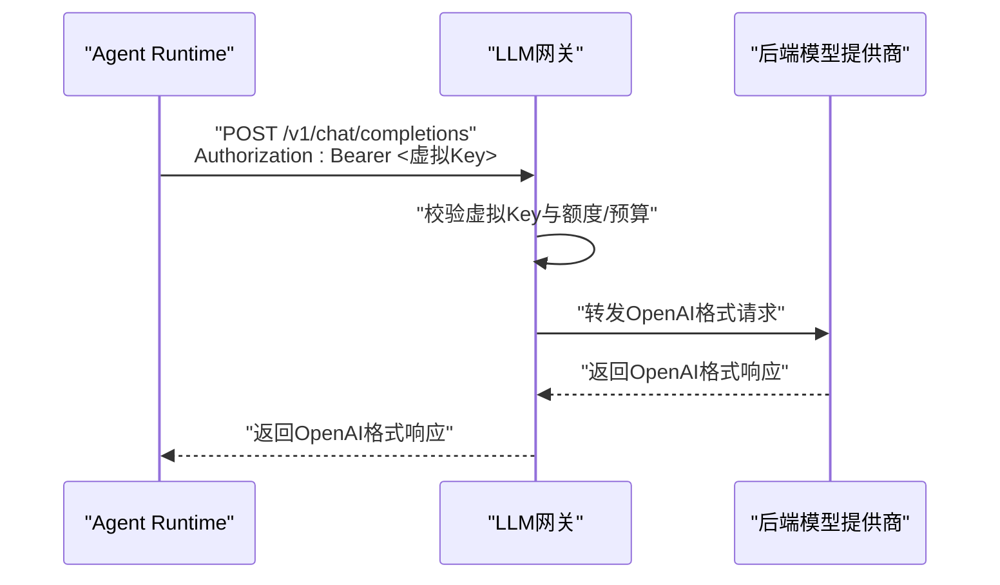
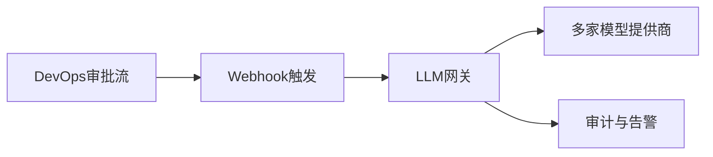

# LLM网关接口

<cite>
**本文引用的文件**
- [LLM网关建设方案.md](file://plan/LLM-Gateway建设方案.md)
- [LLM网关一期功能规划.md](file://plan/LLM-Gateway一期功能规划.md)
- [LLM网关方案Review.md](file://notes/zhaobomin/LLM-Gateway方案review.md)
- [LLM网关热门开源项目对比.md](file://plan/LLM Gateway 热门开源项目对比.md)
- [LLM网关计费逻辑.md](file://plan/LLM Gateway 计费逻辑.md)
- [LLM网关模型不同计费方式对比.md](file://plan/LLM Gateway 模型不同计费方式对比.md)
- [cross-module-design-review-2026-04-24.md](file://notes/zhaobomin/cross-module-design-review-2026-04-24.md)
- [Sai整体架构设计.md](file://project/standup/Sai整体架构设计.md)
</cite>

## 目录
1. [简介](#简介)
2. [项目结构](#项目结构)
3. [核心组件](#核心组件)
4. [架构总览](#架构总览)
5. [详细组件分析](#详细组件分析)
6. [依赖关系分析](#依赖关系分析)
7. [性能考量](#性能考量)
8. [故障排查指南](#故障排查指南)
9. [结论](#结论)
10. [附录](#附录)

## 简介
本文件面向LLM网关模块的接口与实现，聚焦以下目标：
- 统一对外暴露OpenAI格式的聊天接口：POST /v1/chat/completions
- 基于Bearer Token的认证与虚拟Key管理
- Agent Runtime到LLM Gateway的HTTP通信与OpenAI API格式统一
- 额度控制、预警与熔断机制
- 成本计算与计费逻辑
- 接口使用示例与错误处理策略

## 项目结构
围绕LLM网关的文档主要分布在“计划”和“笔记”两类文档中，涵盖建设方案、功能规划、对比分析、计费逻辑以及跨模块设计评审等。下图为概念化的项目结构视图（非代码映射）：

## 核心组件
- 统一代理层：向下接入多家模型（含OpenAI、Claude、Gemini、Qwen系列），向上统一暴露OpenAI格式API
- 虚拟Key与额度管理：通过DevOps审批流创建虚拟Key，绑定额度池、预算周期与告警阈值
- 流量路由与降级：按环境与应用等级进行模型路由，支持熔断与降级
- 审计与安全：请求日志拦截、隐私数据脱敏、访问白名单与访问控制

章节来源
- [LLM网关建设方案.md:15-65](file://plan/LLM-Gateway建设方案.md#L15-L65)
- [LLM网关一期功能规划.md:3-12](file://plan/LLM-Gateway一期功能规划.md#L3-L12)

## 架构总览
下图展示Agent Runtime经由LLM网关访问后端模型的典型时序，体现OpenAI格式的统一与虚拟Key认证：

图表来源
- [LLM网关建设方案.md:23-25](file://plan/LLM-Gateway建设方案.md#L23-L25)
- [Sai整体架构设计.md:157](file://project/standup/Sai整体架构设计.md#L157)
- [cross-module-design-review-2026-04-24.md:259](file://notes/zhaobomin/cross-module-design-review-2026-04-24.md#L259)

章节来源
- [LLM网关建设方案.md:23-25](file://plan/LLM-Gateway建设方案.md#L23-L25)
- [Sai整体架构设计.md:157](file://project/standup/Sai整体架构设计.md#L157)
- [cross-module-design-review-2026-04-24.md:259](file://notes/zhaobomin/cross-module-design-review-2026-04-24.md#L259)

## 详细组件分析

### 接口定义：POST /v1/chat/completions
- 协议与格式
  - 对外统一采用OpenAI格式API，便于业务线零成本切换
  - 支持流式与非流式响应（依据上游模型能力）
- 认证机制
  - 使用Bearer Token，Token来源于LLM网关分配的虚拟Key
  - 虚拟Key与额度池、预算周期、告警阈值关联
- 请求参数要点
  - 消息数组（messages）：包含system、user、assistant等角色消息
  - 模型选择：可按环境/等级路由至不同模型
  - 控制参数：温度、最大生成长度、停用词等（遵循OpenAI语义）
- 响应格式
  - 返回OpenAI兼容的结构，包含choices、usage、created、model等字段
  - 流式场景下，按SSE逐帧推送片段

章节来源
- [LLM网关建设方案.md:29-34](file://plan/LLM-Gateway建设方案.md#L29-L34)
- [LLM网关一期功能规划.md:13-23](file://plan/LLM-Gateway一期功能规划.md#L13-L23)
- [cross-module-design-review-2026-04-24.md:259](file://notes/zhaobomin/cross-module-design-review-2026-04-24.md#L259)

### 认证与虚拟Key管理
- Key生命周期
  - 通过DevOps审批流自动创建渠道与唯一虚拟Key
  - 支持按周期重置额度（如自然月）
- 访问控制
  - Key白名单与访问白名单结合，仅允许内网与授权访问
  - 虚拟Key对业务透明，真实Key由网关托管
- 额度与预算
  - 每个Key绑定独立资金或Token额度池
  - 预设阈值（如80%/90%/100%）触发告警与熔断

章节来源
- [LLM网关建设方案.md:36-41](file://plan/LLM-Gateway建设方案.md#L36-L41)
- [LLM网关建设方案.md:53-53](file://plan/LLM-Gateway建设方案.md#L53-L53)
- [LLM网关一期功能规划.md:7-10](file://plan/LLM-Gateway一期功能规划.md#L7-L10)

### 流量路由与降级
- 环境与等级策略
  - 本地/测试：低成本模型或开源本地模型
  - 非核心生产：性价比模型并设置TPM/RPM上限
  - 核心生产：旗舰模型，多渠道轮询与重试
- 熔断与降级
  - 达到阈值自动熔断与降级，保障系统稳定性
  - 支持逃生方案（直连原生API或网关bypass模式）

章节来源
- [LLM网关建设方案.md:43-53](file://plan/LLM-Gateway建设方案.md#L43-L53)
- [LLM网关方案Review.md:32-38](file://notes/zhaobomin/LLM-Gateway方案review.md#L32-L38)

### 审计与安全
- 请求日志拦截：记录时间、来源IP、Key归属域组、消耗Token数、响应延迟
- 隐私数据脱敏：高敏业务可选配脱敏插件
- 访问方式：应用内网白名单、用户虎盾VPN访问

章节来源
- [LLM网关建设方案.md:56-65](file://plan/LLM-Gateway建设方案.md#L56-L65)

### 计费逻辑与成本控制
- 计费方式
  - 基于usage的token计费，单价由网关配置
  - 存在分词规则差异导致的误差，不支持阶梯计费
- 成本追踪
  - 多维度成本追踪，支持按域组/项目/Key统计
  - 与钉钉告警联动，支持突发用量告警
- 不同计费方式对比
  - 百炼token计费：透明、稳定
  - 套餐计费：预付费、需持续购买
  - 直接请求：耗时与token消耗相对更低

章节来源
- [LLM网关建设方案.md:89-89](file://plan/LLM-Gateway建设方案.md#L89-L89)
- [LLM网关计费逻辑.md:1-3](file://plan/LLM Gateway 计费逻辑.md#L1-L3)
- [LLM网关模型不同计费方式对比.md:1-9](file://plan/LLM Gateway 模型不同计费方式对比.md#L1-L9)

### Agent Runtime到LLM网关的调用协议
- 接口契约
  - Agent Runtime通过HTTP向LLM网关发起OpenAI格式请求
  - 使用Bearer Token携带虚拟Key
- 协议对齐
  - 网关对齐OpenAI格式，确保SDK零改造接入
- 会话与流式
  - 支持会话管理与流式/非流式响应（依据上游能力）

章节来源
- [Sai整体架构设计.md:157](file://project/standup/Sai整体架构设计.md#L157)
- [cross-module-design-review-2026-04-24.md:259](file://notes/zhaobomin/cross-module-design-review-2026-04-24.md#L259)

## 依赖关系分析
- 组件耦合
  - 网关与上游模型提供商解耦，通过OpenAI格式统一对接
  - DevOps平台与网关通过Webhook联动，实现Key自动化发放
- 外部依赖
  - LiteLLM作为核心网关实现（方案中明确选型）
  - 开源对比显示LiteLLM具备精细化限流、预算/配额控制、可观测性等优势

图表来源
- [LLM网关建设方案.md:36-41](file://plan/LLM-Gateway建设方案.md#L36-L41)
- [LLM网关热门开源项目对比.md:1-22](file://plan/LLM Gateway 热门开源项目对比.md#L1-L22)

章节来源
- [LLM网关建设方案.md:36-41](file://plan/LLM-Gateway建设方案.md#L36-L41)
- [LLM网关热门开源项目对比.md:1-22](file://plan/LLM Gateway 热门开源项目对比.md#L1-L22)

## 性能考量
- 路由策略优化：按环境与等级选择合适模型，平衡成本与性能
- 限流与熔断：基于Key/User/Team维度的RPM/TPM限流，避免突发流量冲击
- 观测性：结合多维度成本追踪与告警，及时发现异常与瓶颈
- 计费误差：了解分词规则差异带来的误差，必要时进行实测对比与校准

## 故障排查指南
- 常见错误与处理
  - 认证失败（401/403）：检查Bearer Token是否正确、是否在白名单内
  - 参数错误（400）：核对OpenAI格式请求参数与必填项
  - 服务不可用（503）：网关熔断或模型不可用，检查告警与降级策略
  - 限流（429）：降低请求频率或提升额度/预算
  - 业务错误（带code+message）：根据返回的业务错误码定位问题
- 逃生方案
  - 业务侧fallback：直连原生API（如百炼/OpenAI）
  - 网关bypass：一键关闭路由规则，快速恢复

章节来源
- [cross-module-design-review-2026-04-24.md:210-222](file://notes/zhaobomin/cross-module-design-review-2026-04-24.md#L210-L222)
- [LLM网关方案Review.md:32-38](file://notes/zhaobomin/LLM-Gateway方案review.md#L32-L38)

## 结论
LLM网关通过LiteLLM实现统一代理与OpenAI格式对齐，结合虚拟Key与额度预算控制，形成从接入、安全、成本到运维的完整闭环。建议在4/30先达成“网关+手动发Key+基础告警”的最小可用版本，后续逐步推进DevOps审批流与前端管理页面。

## 附录
- 使用示例（概念性说明）
  - 在Agent Runtime中配置自定义BaseURL与Bearer Token（虚拟Key），发送OpenAI格式请求
  - 根据环境与应用等级选择模型，观察usage与成本变化
- 关键参考
  - OpenAI格式与参数对齐
  - 虚拟Key生命周期与额度重置
  - 熔断与降级策略
  - 计费误差与实测校准