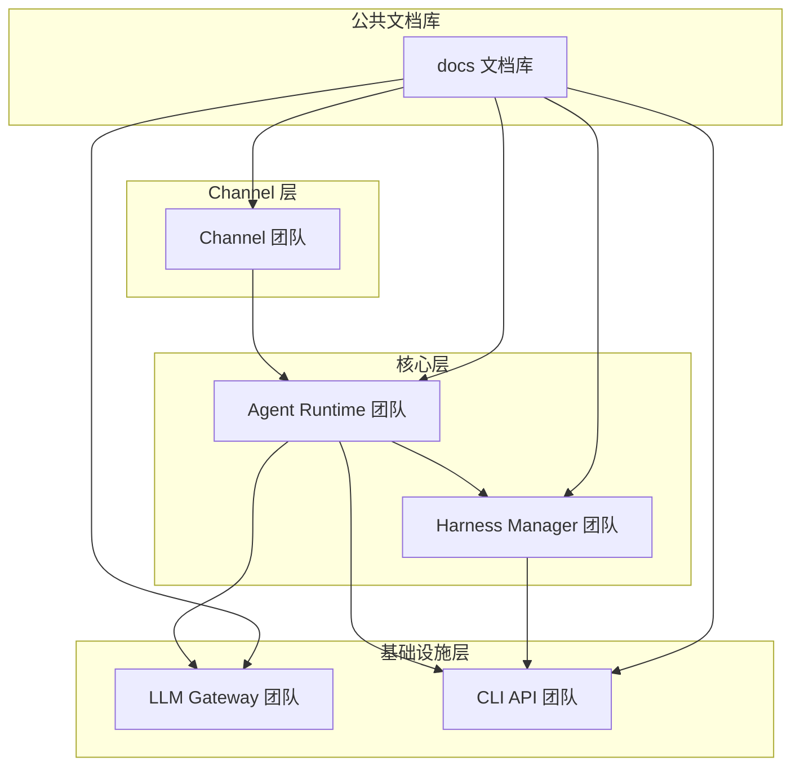
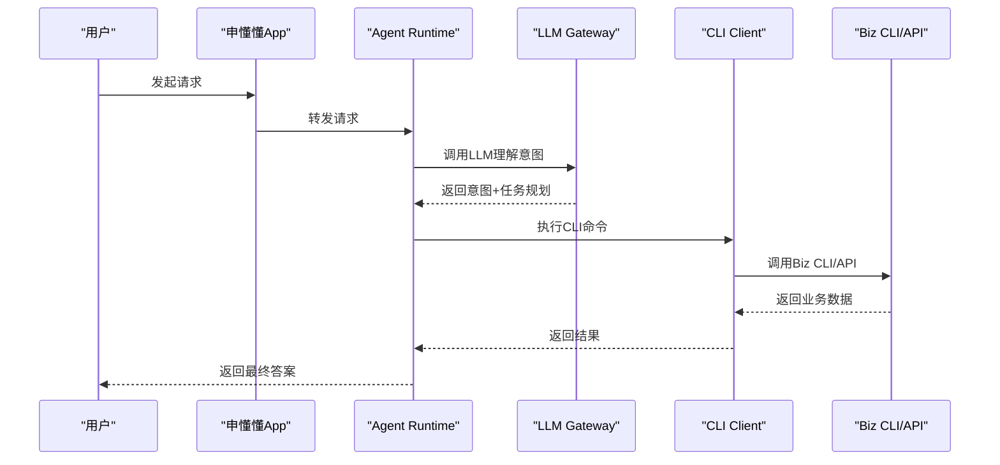
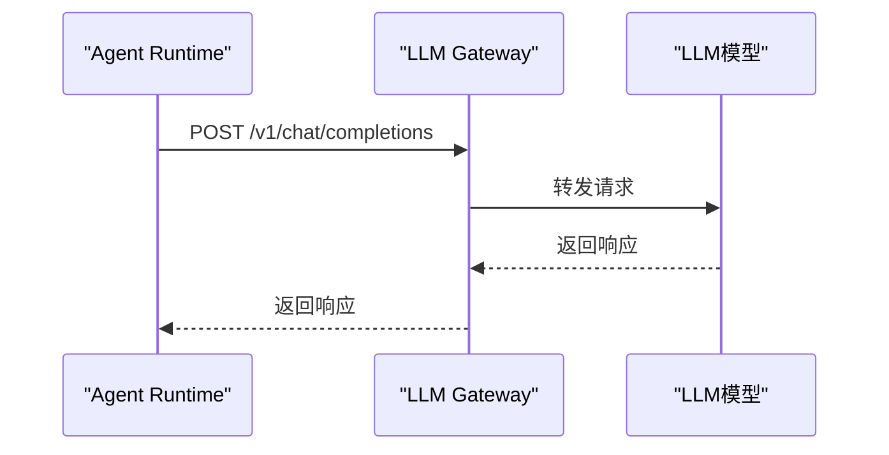
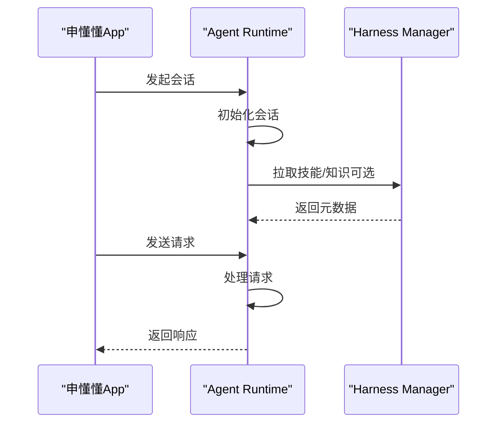
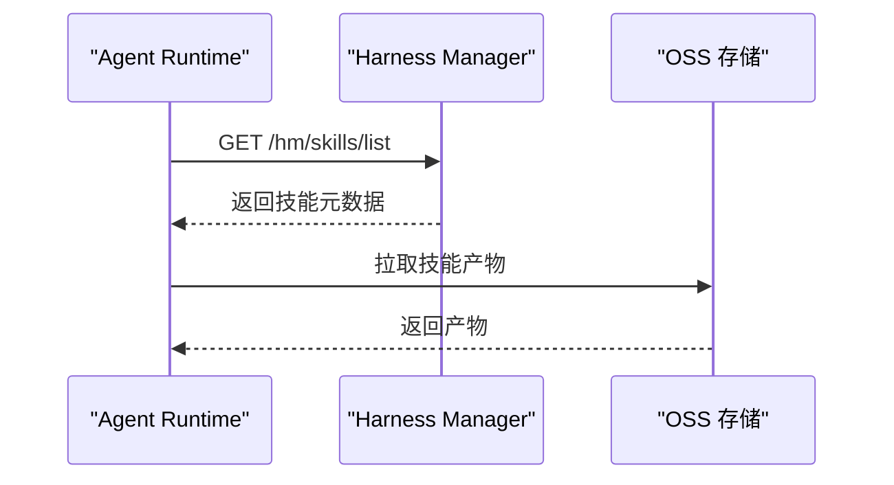
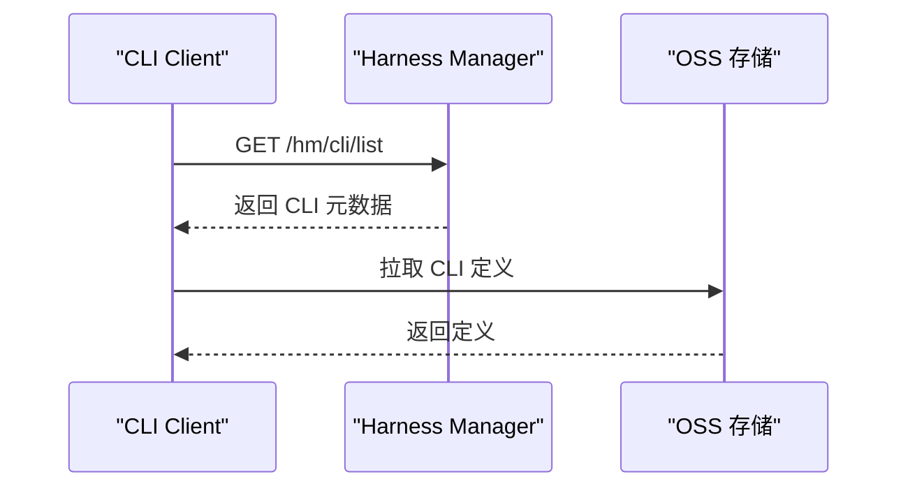
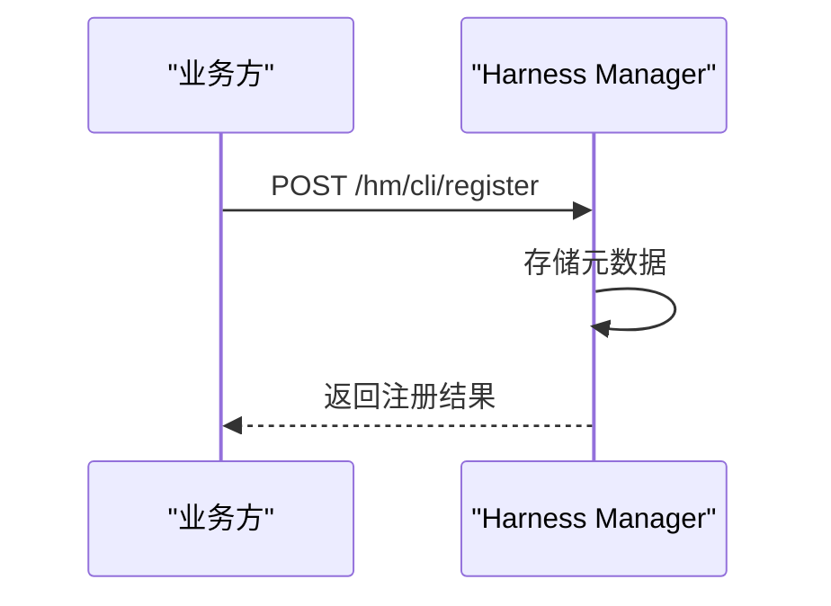
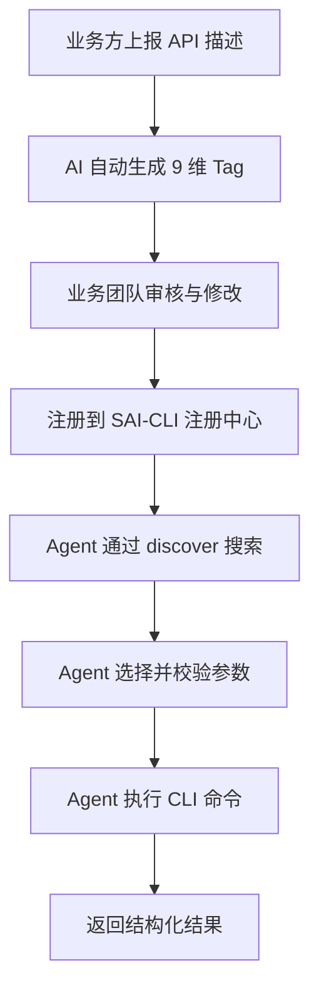
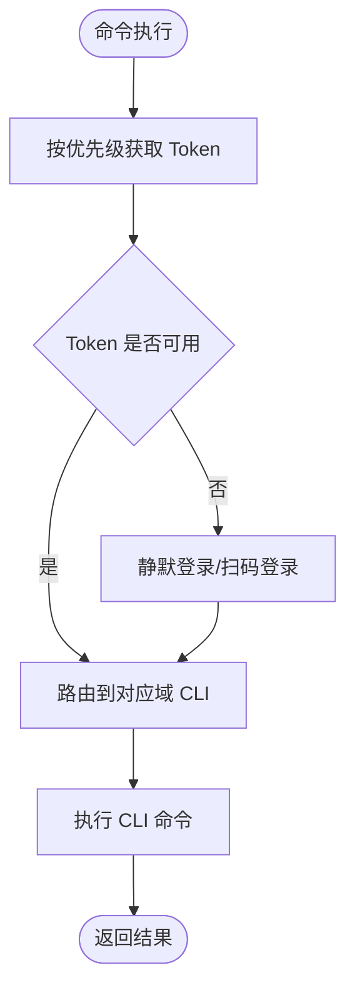

# 接口依赖关系

<cite>
**本文引用的文件**
- [SAI CLI 架构设计文档 v1.0](file://plan/SAI_CLI_设计文档_v1.0.md)
- [SAI CLI 架构设计文档 v1.2](file://plan/SAI_CLI_设计文档_v1.2.md)
- [Agent API 发现机制 Review](file://notes/zhaobomin/agent-api-discovery-architecture-review.zh-CN.md)
- [Sai 整体架构设计](file://project/standup/Sai整体架构设计.md)
- [项目管理方案 v1.0](file://project/项目管理方案v1.0.md)
- [LLM Gateway 方案 Review](file://notes/zhaobomin/LLM-Gateway方案review.md)
- [跨模块设计评审 2026-04-24](file://notes/zhaobomin/cross-module-design-review-2026-04-24.md)
- [2026-04-22 日报（隋云）](file://daily/2026-04-22/suiyun.md)
- [2026-04-23 日报（凌雪）](file://daily/2026-04-23/lingxue.md)
- [2026-04-24 日报（凌雪）](file://daily/2026-04-24/lingxue.md)
</cite>

## 目录
1. [简介](#简介)
2. [项目结构](#项目结构)
3. [核心组件](#核心组件)
4. [架构总览](#架构总览)
5. [详细组件分析](#详细组件分析)
6. [依赖分析](#依赖分析)
7. [性能考虑](#性能考虑)
8. [故障排查指南](#故障排查指南)
9. [结论](#结论)
10. [附录](#附录)

## 简介
本文件聚焦 SAI 智能体平台的接口依赖关系，系统性梳理 Agent Runtime、LLM Gateway、Harness Manager、CLI Client、业务 CLI/Biz API 之间的接口调用关系与依赖矩阵。重点覆盖以下关键接口：
- LLM 调用接口
- Agent 会话接口
- Skill 拉取接口
- CLI 拉取接口
- CLI 注册接口

并解释认证方式、参数规范、返回值格式、版本兼容性与演进策略，提供接口依赖图与调用时序图，给出接口对齐状态与风险评估。

## 项目结构
SAI 项目采用分层架构，围绕 Agent Runtime、LLM Gateway、Harness Manager、CLI Client 与业务 API 构建端到端链路。文档库采用团队维度组织，便于接口与模块的协同治理。

**图表来源**
- [项目管理方案 v1.0:34-49](file://project/项目管理方案v1.0.md#L34-L49)

**章节来源**
- [项目管理方案 v1.0:90-131](file://project/项目管理方案v1.0.md#L90-L131)

## 核心组件
- Agent Runtime：负责意图理解、会话管理、CLI 调用与结果整合。
- LLM Gateway：统一 LLM 调用入口，提供 OpenAI 格式接口与成本控制。
- Harness Manager：控制面服务，负责知识库、Skills 与 CLI 注册分发。
- CLI Client：本地 CLI 调用客户端，桥接 Agent 与业务 CLI。
- Biz CLI：封装业务 API 的 CLI 命令集合。
- Biz API：各业务域后端 API，提供只读或读写能力。

**章节来源**
- [Sai 整体架构设计:15-65](file://project/standup/Sai整体架构设计.md#L15-L65)
- [项目管理方案 v1.0:23-49](file://project/项目管理方案v1.0.md#L23-L49)

## 架构总览
SAI 的两条核心链路：
- 意图理解链路：用户 → App → Agent → LLM Gateway → LLM
- 业务执行链路：Agent → CLI Client → Biz CLI → Biz API

**图表来源**
- [Sai 整体架构设计:115-138](file://project/standup/Sai整体架构设计.md#L115-L138)

**章节来源**
- [Sai 整体架构设计:108-138](file://project/standup/Sai整体架构设计.md#L108-L138)

## 详细组件分析

### LLM 调用接口
- 接口路径：POST /v1/chat/completions（OpenAI 格式）
- 认证方式：Bearer Token（Gateway 分配的虚拟 key）
- 参数规范：遵循 OpenAI Chat Completion 请求体字段
- 返回值格式：遵循 OpenAI Chat Completion 响应体字段
- 版本兼容性：统一 OpenAI 格式，便于替换与扩展
- 演进策略：保持接口稳定，新增模型路由与成本控制能力

**图表来源**
- [Sai 整体架构设计:199-204](file://project/standup/Sai整体架构设计.md#L199-L204)

**章节来源**
- [Sai 整体架构设计:158-158](file://project/standup/Sai整体架构设计.md#L158-L158)
- [LLM Gateway 方案 Review:9-16](file://notes/zhaobomin/LLM-Gateway方案review.md#L9-L16)

### Agent 会话接口
- 接口路径：POST /agent/session → get_session / send_request
- 认证方式：用户 Token 透传
- 参数规范：会话初始化与消息发送的请求体字段
- 返回值格式：会话状态与消息响应体
- 版本兼容性：与 Channel 侧协议对齐
- 演进策略：完善会话生命周期管理与状态一致性

**图表来源**
- [Sai 整体架构设计:159-159](file://project/standup/Sai整体架构设计.md#L159-L159)

**章节来源**
- [Sai 整体架构设计:159-159](file://project/standup/Sai整体架构设计.md#L159-L159)

### Skill 拉取接口
- 接口路径：GET /hm/skills/list + OSS 拉取执行包
- 认证方式：Harness Manager 内部 Token
- 参数规范：技能列表查询参数（分页、过滤等）
- 返回值格式：技能元数据与产物地址
- 版本兼容性：与 Agent Runtime 的技能加载机制对齐
- 演进策略：支持增量更新与版本管理

**图表来源**
- [Sai 整体架构设计:160-160](file://project/standup/Sai整体架构设计.md#L160-L160)

**章节来源**
- [Sai 整体架构设计:160-160](file://project/standup/Sai整体架构设计.md#L160-L160)
- [跨模块设计评审 2026-04-24:254-266](file://notes/zhaobomin/cross-module-design-review-2026-04-24.md#L254-L266)

### CLI 拉取接口
- 接口路径：GET /hm/cli/list + OSS 拉取定义包
- 认证方式：Harness Manager 内部 Token
- 参数规范：CLI 列表查询参数（分页、过滤、标签等）
- 返回值格式：CLI 元数据与产物地址
- 版本兼容性：支持缓存与版本控制
- 演进策略：支持按域/模块/能力过滤与增量更新

**图表来源**
- [Sai 整体架构设计:161-161](file://project/standup/Sai整体架构设计.md#L161-L161)

**章节来源**
- [Sai 整体架构设计:161-161](file://project/standup/Sai整体架构设计.md#L161-L161)
- [跨模块设计评审 2026-04-24:254-266](file://notes/zhaobomin/cross-module-design-review-2026-04-24.md#L254-L266)

### CLI 注册接口
- 接口路径：POST /hm/cli/register
- 认证方式：业务方 Token
- 参数规范：业务 API 描述、9 维 Tag、命令元数据
- 返回值格式：注册结果与状态
- 版本兼容性：与 Harness Manager 的注册流程对齐
- 演进策略：支持 AI 自动生成 Tag 与多路径注册

**图表来源**
- [Sai 整体架构设计:162-162](file://project/standup/Sai整体架构设计.md#L162-L162)

**章节来源**
- [Sai 整体架构设计:162-162](file://project/standup/Sai整体架构设计.md#L162-L162)
- [SAI CLI 架构设计文档 v1.2:384-391](file://plan/SAI_CLI_设计文档_v1.2.md#L384-L391)

### CLI 元数据接口与 Agent 发现机制
- 元数据生成接口：POST /api/v1/sai/cli/metadata/generate
- 注册接口：POST /api/v1/sai/cli/registry
- Agent 发现链路：discover → help/schema → validate/dry-run → execute
- 9 维 Tag 体系：路由与分类组、NLU 理解组、执行与展示组
- 演进策略：增强 discover 返回结构、参数 schema、适用边界与风险等级

**图表来源**
- [SAI CLI 架构设计文档 v1.2:376-391](file://plan/SAI_CLI_设计文档_v1.2.md#L376-L391)
- [Agent API 发现机制 Review:219-237](file://notes/zhaobomin/agent-api-discovery-architecture-review.zh-CN.md#L219-L237)

**章节来源**
- [SAI CLI 架构设计文档 v1.2:151-170](file://plan/SAI_CLI_设计文档_v1.2.md#L151-L170)
- [Agent API 发现机制 Review:188-237](file://notes/zhaobomin/agent-api-discovery-architecture-review.zh-CN.md#L188-L237)

### CLI 命令规范与鉴权
- 命令格式：{product} {module} {action} [params]
- 鉴权方案：PoP Token + ECDSA 签名（分阶段实施）
- Token 获取优先级：命令行参数 > 环境变量 > 本地配置文件
- 配置文件格式：包含 token、identity_type、scopes、expires_at
- 演进策略：从基础 Bearer Token 过渡到 PoP 签名

**图表来源**
- [SAI CLI 架构设计文档 v1.2:413-449](file://plan/SAI_CLI_设计文档_v1.2.md#L413-L449)

**章节来源**
- [SAI CLI 架构设计文档 v1.2:220-250](file://plan/SAI_CLI_设计文档_v1.2.md#L220-L250)
- [SAI CLI 架构设计文档 v1.2:413-470](file://plan/SAI_CLI_设计文档_v1.2.md#L413-L470)

## 依赖分析
模块间接口依赖矩阵（基于整体架构文档与评审结论）：

| 接口 | 调用方 | 提供方 | 接口路径（草案） | 认证方式 | 对齐状态 |
|------|--------|--------|------------------|----------|----------|
| LLM 调用 | Agent Runtime | LLM Gateway | POST /v1/chat/completions（OpenAI 格式） | Bearer Token（Gateway 分配的虚拟 key） | ✅ 已对齐 |
| Agent 会话 | Channel | Agent Runtime | POST /agent/session → get_session / send_request | 用户 Token 透传 | ⚠ 未写入文档 |
| Skill 拉取 | Agent Runtime | HM | GET /hm/skills/list + OSS 拉取执行包 | HM 内部 Token | ⚠ 隋云方案未出 |
| CLI 拉取 | CLI Client | HM | GET /hm/cli/list + OSS 拉取定义包 | HM 内部 Token | ⚠ v1.2 有路径规范，无版本/缓存 |
| CLI 注册 | Biz CLI | HM | POST /hm/cli/register | 业务方 Token | ✅ SDK 注解设计完成 |
| 知识检索 | Agent Runtime | HM | POST /hm/kb/search | HM 内部 Token | ⚠ 未定义 |
| 前端交互 | 申懂懂 App | Channel | 待定义 | 待定义 | ⚠ 宏宇方案未对齐 |

**章节来源**
- [Sai 整体架构设计:154-170](file://project/standup/Sai整体架构设计.md#L154-L170)
- [跨模块设计评审 2026-04-24:254-266](file://notes/zhaobomin/cross-module-design-review-2026-04-24.md#L254-L266)

## 性能考虑
- Agent Runtime：冷启动 <1s，热启动 <200ms；支持 ≥3 个 Skill 挂载并执行
- LLM Gateway：支持 qwen 系列模型路由；支持 ≥5 个个人用户并发使用；额度 80%/90%/100% 三级告警可触发
- Harness Manager：完成 CLI 注册上报 + OSS 分发闭环；支持 ≥1 个业务 CLI 接入并拉取成功；Skill 拉取接口可用
- Channel：申懂懂 App 可发起请求并收到 Agent 回复；完成 Agent SDK 前端集成 demo
- Biz CLI：≥1 个业务 CLI demo 上报 HM 并可被 Agent 调用

**章节来源**
- [Sai 整体架构设计:224-233](file://project/standup/Sai整体架构设计.md#L224-L233)

## 故障排查指南
- HM 不可用：Agent 使用本地缓存最近一次 Skill/CLI 定义，降级为无知识检索模式
- LLM Gateway 熔断：Agent 返回固定提示："当前 AI 服务暂时不可用，请稍后重试"；业务执行链路不受影响
- Biz API 超时/失败：CLI Client 单次重试（≤3s 等待），失败后 Agent 向用户说明具体接口不可用
- OSS 不可用：Agent 使用本地缓存版本运行，日志告警通知 HM 团队
- Agent Runtime 实例崩溃：Serverless 平台自动重建实例，用户会话需重新发起

**章节来源**
- [Sai 整体架构设计:236-245](file://project/standup/Sai整体架构设计.md#L236-L245)

## 结论
SAI 智能体平台通过清晰的分层架构与接口契约，实现了从意图理解到业务执行的完整链路。LLM Gateway、Harness Manager、CLI Client 与业务 API 的接口设计遵循统一协议与认证方式，具备良好的扩展性与演进空间。当前接口对齐状态总体良好，部分模块（如 Agent 会话、Skill 拉取、知识检索、前端交互）尚需完善文档与实现。建议优先补齐关键接口定义与文档，确保端到端链路稳定运行。

## 附录
- 业务 API 接入进展：各域完成 API 接入，总计 8 个 API，可在本地 CLI 正常执行，目前仍在调试中
- Tag 生成效果：存在业务区分度不足与数据精细度不够的问题，需优化以提升 API 命中率
- 未来计划：推进各域 API 标准共识，统一入参、出参及异常处理规范

**章节来源**
- [2026-04-23 日报（凌雪）:1-56](file://daily/2026-04-23/lingxue.md#L1-L56)
- [2026-04-24 日报（凌雪）:1-42](file://daily/2026-04-24/lingxue.md#L1-L42)
- [2026-04-22 日报（隋云）:47-64](file://daily/2026-04-22/suiyun.md#L47-L64)